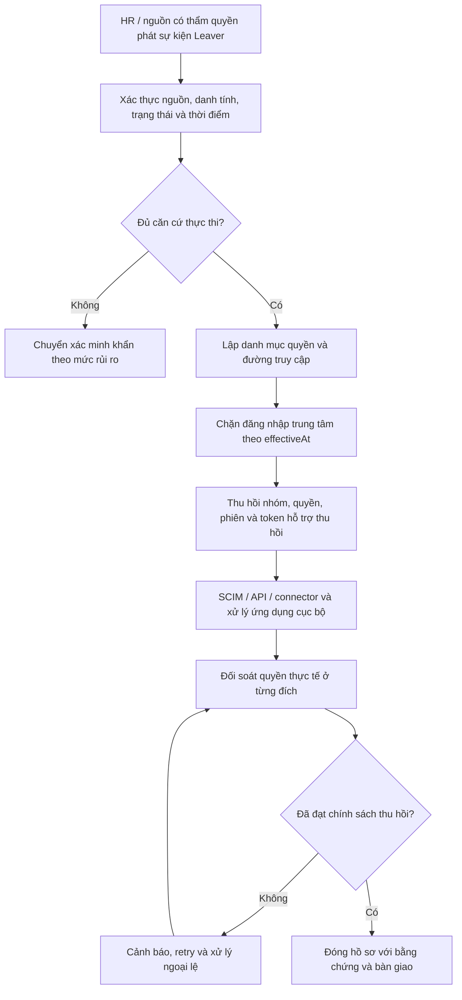

# Leaver là gì trong quản lý vòng đời danh tính IAM?

Trong quản lý danh tính và truy cập (*Identity and Access Management* — **IAM**), **Leaver** là giai đoạn một người hoặc danh tính không còn đủ điều kiện tiếp tục sử dụng các quyền truy cập đã được cấp do quan hệ làm việc, hợp đồng, nhiệm vụ hoặc tư cách tham gia tổ chức kết thúc. Leaver là chữ **L** trong mô hình **Joiner–Mover–Leaver (JML)**: Joiner chuẩn bị và cấp quyền cho người gia nhập; Mover điều chỉnh quyền khi vai trò thay đổi; Leaver chấm dứt quyền khi căn cứ cấp quyền không còn hợp lệ.

Trong module `SECURITY_IDENTITY_ACCESS_MANAGEMENT_IDENTITY_LIFECYCLE`, Leaver được nghiên cứu như một **quy trình phối hợp giữa dữ liệu nhân sự, xác minh danh tính, IdP, SSO, SCIM, RBAC/ABAC, chủ ứng dụng, danh tính dịch vụ và kiểm toán**. Mục tiêu là hạn chế *quyền truy cập tồn dư* (*residual access*): tài khoản, phiên đăng nhập, token, nhóm, đặc quyền hoặc khóa kỹ thuật vẫn có thể sử dụng sau thời điểm phải thu hồi.

Leaver **không chỉ là xóa tài khoản**. Có trường hợp cần khóa ngay việc đăng nhập nhưng tiếp tục lưu giữ dữ liệu công việc, bằng chứng giao dịch và nhật ký theo chính sách. Ngược lại, xóa một bản ghi người dùng khỏi danh bạ trung tâm cũng không bảo đảm các ứng dụng hoặc token cũ đã mất khả năng truy cập.

Sau bài học, bạn có thể xác định một sự kiện Leaver hợp lệ, phân biệt các loại chấm dứt, mô tả quy trình thu hồi từ nguồn HR đến ứng dụng đích, giải thích vì sao cần đối soát nhiều đường truy cập và đề xuất các tiêu chí để chứng minh offboarding hoàn tất.

## 1. Khi nào một danh tính được xem là Leaver?

Leaver thường xuất phát từ một **sự kiện nghiệp vụ có thẩm quyền** làm thay đổi điều kiện sử dụng tài nguyên. Nguồn có thể là HRIS (*Human Resources Information System*) đối với nhân viên, hệ thống quản lý nhà thầu đối với cộng tác viên, hoặc quy trình quản lý đối tác có người chịu trách nhiệm. Điểm chung là phải biết **danh tính nào bị ảnh hưởng, căn cứ chấm dứt là gì và quyết định có hiệu lực từ khi nào**.

| Trường hợp | Tín hiệu có thể kích hoạt Leaver | Phạm vi xem xét |
| --- | --- | --- |
| Nhân viên nghỉ việc theo lịch | Ngày kết thúc hợp đồng đã được phê duyệt | Tài khoản, nhóm, ứng dụng, VPN, thiết bị, đặc quyền và tài nguyên công việc |
| Chấm dứt hợp đồng khẩn cấp | Chỉ thị hợp lệ yêu cầu chặn truy cập ngay | Ưu tiên ngăn truy cập nhanh, sau đó hoàn thành các bước dọn dẹp và kiểm toán |
| Nhà thầu hết thời hạn | Ngày hết hạn hợp đồng hoặc xác nhận từ người bảo trợ | Các quyền và tài khoản phát sinh từ hợp đồng; rà soát thông tin xác thực liên quan |
| Đối tác kết thúc hợp tác | Hủy tư cách đối tác hoặc quyền tham gia dự án | Truy cập cổng đối tác, API, dữ liệu chia sẻ và quyền được ủy quyền |
| Danh tính tạm thời hết hạn | Phiếu cấp quyền hoặc tư cách tham gia đã hết hạn theo chính sách | Quyền tạm thời; có thể cần đánh giá thêm trước khi vô hiệu hóa toàn bộ danh tính |

**Phân biệt Mover với Leaver:** người chuyển bộ phận nhưng vẫn làm việc thường thuộc Mover. Họ cần gỡ quyền cũ và cấp quyền mới, nhưng danh tính tổ chức có thể vẫn hoạt động. Người rời tổ chức thường thuộc Leaver, cần chấm dứt các quyền dựa trên quan hệ đó. Với người có **nhiều quan hệ hợp lệ cùng lúc** (ví dụ vừa là nhân viên vừa là thành viên một tổ chức đối tác), chấm dứt một quan hệ phải được đánh giá theo chính sách; không mặc định xóa mọi quyền độc lập còn có căn cứ.

**Tạm nghỉ không tự động đồng nghĩa Leaver.** Nghỉ thai sản, nghỉ phép dài hạn, tạm đình chỉ hoặc thay đổi trạng thái hợp đồng có thể có chính sách riêng. Nếu một hệ thống chỉ thấy `status != ACTIVE` rồi tự xóa tài khoản, nó có thể làm gián đoạn sai đối tượng. Cần định nghĩa ngữ nghĩa trạng thái HR và điều kiện chuyển trạng thái rõ ràng.

## 2. Mục tiêu bảo mật và nghiệp vụ của Leaver

Quy trình Leaver tốt phải đạt cả hai nhóm kết quả:

**Bảo mật và kiểm soát:**

- Chặn đăng nhập hoặc thao tác mới của danh tính không còn hợp lệ theo mốc hiệu lực.
- Thu hồi những quyền đã cấp qua nhóm, vai trò, quyền trực tiếp, đặc quyền và cơ chế ủy quyền.
- Xử lý phiên, refresh token, API key, chứng chỉ và những đường truy cập không phụ thuộc vào đăng nhập SSO khi có liên quan.
- Phát hiện quyền hoặc tài khoản còn tồn dư tại ứng dụng đích bằng kiểm tra độc lập.
- Có bằng chứng đủ để chứng minh ai phát sinh quyết định, ai thực thi và tài nguyên nào còn ngoại lệ.

**Liên tục nghiệp vụ và quản trị:**

- Bàn giao tài sản, thiết bị, công việc, quy trình phê duyệt và quyền sở hữu tài nguyên.
- Giữ dữ liệu hoặc nhật ký cần thiết theo chính sách lưu trữ, pháp lý và trách nhiệm tổ chức.
- Đảm bảo dịch vụ tự động không bị ngừng do xóa nhầm tài khoản máy còn cần thiết.
- Xử lý ngoại lệ có chủ sở hữu, thời hạn và cơ chế nâng mức xử lý.

Ví dụ, một nhân viên là người sở hữu thư mục dự án và đang vận hành dịch vụ chạy theo lịch. Khi họ nghỉ việc, tổ chức có thể cần chuyển quyền sở hữu dữ liệu và quy trình vận hành sang người được duyệt. **Giữ dữ liệu công việc không phải lý do để giữ nguyên quyền đăng nhập của người đã rời đi.**

## 3. Các khái niệm cần phân biệt khi offboarding

| Khái niệm | Ý nghĩa | Vì sao chưa đủ khi đứng một mình? |
| --- | --- | --- |
| **Vô hiệu hóa danh tính tại IdP** | Ngăn hoặc hạn chế xác thực mới qua nhà cung cấp định danh | Ứng dụng có thể còn phiên riêng, tài khoản cục bộ hoặc token đã phát hành |
| **Gỡ nhóm/role RBAC** | Loại bỏ các quyền được thừa hưởng theo vai trò | Quyền trực tiếp, ngoại lệ, cache phân quyền hoặc API key có thể vẫn còn |
| **Điều kiện ABAC** | Từ chối khi thuộc tính như `employmentStatus` không còn hợp lệ | Chỉ có hiệu lực nếu điểm thực thi chính sách thực sự đánh giá thuộc tính hiện hành |
| **SCIM deprovisioning** | Gửi lệnh vô hiệu hóa, cập nhật hoặc xóa người dùng/nhóm ở hệ thống đích hỗ trợ | Mức hỗ trợ và thời điểm áp dụng khác nhau; không mặc nhiên kết thúc session |
| **Thu hồi phiên/token** | Làm mất khả năng tiếp tục sử dụng phiên hoặc thông tin xác thực đã cấp | Không phải mọi token hoặc ứng dụng đều hỗ trợ thu hồi tức thời |
| **Xóa tài khoản** | Gỡ một đối tượng tài khoản ở hệ thống nhất định | Có thể mất liên kết kiểm toán/dữ liệu; vẫn bỏ sót các tài khoản/khóa độc lập |
| **Thu hồi thiết bị** | Nhận lại, khóa hoặc xử lý dữ liệu trên tài sản | Một người vẫn có thể truy cập từ thiết bị khác nếu quyền tài khoản chưa bị chặn |
| **Đối soát (reconciliation)** | So sánh trạng thái quyền thực tế với tập quyền kỳ vọng | Phát hiện sai lệch nhưng cần thêm quy trình khắc phục để đóng rủi ro |

Leaver là **một tập hợp các thay đổi có kiểm soát**, thường thực thi qua nhiều hệ thống không có giao dịch chung. Vì vậy, “gửi lệnh thành công” và “không còn khả năng truy cập” là hai trạng thái phải đo riêng.

## 4. Các mốc thời gian quyết định quyền truy cập

Một hồ sơ Leaver nên phân biệt các mốc:

| Mốc | Diễn giải |
| --- | --- |
| `occurredAt` | Khi quyết định/sự kiện được ghi nhận tại nguồn có thẩm quyền |
| `receivedAt` | Khi IAM tiếp nhận sự kiện hoặc yêu cầu hợp lệ |
| `effectiveAt` | Khi căn cứ cấp quyền kết thúc về mặt nghiệp vụ |
| `requestedAt` | Khi IAM yêu cầu từng hệ thống đích thực hiện thay đổi |
| `enforcedAt` | Khi đích thực sự áp dụng việc chặn hoặc thu hồi |
| `verifiedAt` | Khi kiểm tra xác nhận trạng thái thực tế đã đạt yêu cầu |

**Nghỉ việc theo lịch:** nếu `effectiveAt` là 17:00 thứ Sáu, tổ chức có thể chuẩn bị trước danh mục quyền và các tác vụ thu hồi. Tuy nhiên, việc chặn đăng nhập phải theo thời điểm và chính sách được phê duyệt, tránh khóa quá sớm khiến người dùng không hoàn thành bàn giao.

**Chấm dứt khẩn cấp:** một chỉ thị hợp lệ có thể yêu cầu thực thi ngay, không chờ lịch xử lý theo lô. Nếu sự kiện đến lúc 15:10 nhưng có hiệu lực từ 15:00, IAM cần xử lý ngay, ghi nhận khoảng truy cập vượt thời điểm mong đợi và tìm hiểu lý do đến muộn.

Timestamp phải có thông tin múi giờ; khi chỉ nhận ngày kết thúc (không có giờ), tổ chức cần quy định rõ mốc hiệu lực tương ứng theo địa điểm và loại hợp đồng. Không nên mặc định 00:00 UTC khi quy trình nhân sự sử dụng giờ địa phương.

## 5. Quy trình Leaver từ quyết định nhân sự đến trạng thái đã kiểm chứng



Sơ đồ là luồng khái niệm. Trong tình huống khẩn cấp, bước **chặn truy cập nhanh** thường được kích hoạt ngay sau khi xác minh đủ danh tính và chỉ thị, trong khi lập danh mục chi tiết hoặc bàn giao tiếp tục song song. Không nên chờ mọi thuộc tính HR ít liên quan được điền đủ mới bắt đầu kiểm soát nguy cơ cao.

### Bước 1 — Xác minh đúng người và sự kiện

Đối chiếu `sourceSystem`, định danh nhân sự ổn định (`sourcePersonId`), `identityId` nội bộ, tình trạng hợp đồng, phiên bản thay đổi, người/nguồn có thẩm quyền và `effectiveAt`. Việc ghép chỉ bằng họ tên hoặc email có thể gây **khóa nhầm tài khoản** nếu trùng tên hoặc địa chỉ email được tái sử dụng.

Nếu sự kiện thiếu định danh duy nhất, cần chuyển xử lý gấp theo chính sách, không tự đoán đối tượng. Với chỉ thị khẩn cấp, có thể kích hoạt các biện pháp bảo vệ tạm thời được phê duyệt sau khi xác minh mức cần thiết; mọi quyết định phải có dấu vết.

### Bước 2 — Xác định phạm vi quyền cần thu hồi

Phạm vi thường gồm: tài khoản IdP/directory, nhóm, role và entitlement, ứng dụng SaaS, VPN, email và cộng tác, máy chủ, công cụ phát triển, kho mã nguồn, hạ tầng đám mây, phiên đặc quyền, tài khoản cục bộ và quyền được gán thủ công. Ngoài ra cần xem tài khoản dịch vụ, khóa API, lịch trình tự động hoặc tích hợp do người nghỉ việc sở hữu.

Tập quyền kỳ vọng cần đến từ **chính sách và trạng thái nghiệp vụ**, không chỉ từ danh sách group IdP. Các quyền ngoài quy trình trung tâm phải được phát hiện qua đối soát ứng dụng đích và quy trình rà soát của chủ ứng dụng.

### Bước 3 — Chặn đăng nhập và thu hồi quyền

Tùy hạ tầng, IAM có thể thực thi các công việc sau:

1. Vô hiệu hóa hoặc hạn chế tài khoản tại IdP/directory, chặn đăng nhập SSO mới.
2. Thu hồi session, refresh token, quyền sử dụng khóa hoặc phương thức xác thực mà nền tảng cho phép.
3. Xóa người dùng khỏi nhóm và các vai trò liên quan, kể cả đặc quyền quản trị và quyền JIT đang có hiệu lực.
4. Gửi lệnh SCIM/API đến các ứng dụng tương thích để vô hiệu hóa tài khoản hoặc cập nhật entitlement.
5. Xử lý tài khoản cục bộ, API key hoặc cơ chế đăng nhập không đi qua IdP; phối hợp chủ hệ thống khi cần.
6. Ghi trạng thái xử lý riêng cho từng mục; hệ thống thất bại phải có retry, cảnh báo và người xử lý.

**Không phải mọi thao tác đều có thể đảo ngược hoặc đồng bộ ngay.** Khi một connector thất bại, hệ thống không nên tuyên bố hoàn tất toàn bộ Leaver. Với quyền quan trọng, cần đánh giá biện pháp bù trừ hoặc chặn khẩn cấp tại chính ứng dụng đích.

### Bước 4 — Xác minh quyền truy cập thực tế

Mỗi đích nên có một trạng thái kỳ vọng và **bằng chứng quan sát**. Ví dụ, API cho biết `active=false`, group đã được gỡ, thử đăng nhập mới bị chặn hoặc hệ thống xác nhận phiên được thu hồi. Việc kiểm tra phải phù hợp khả năng từng hệ thống và không cần tạo lại đăng nhập thật bằng thông tin xác thực của người nghỉ việc.

**Lưu ý về token:** access token tự chứa, chẳng hạn JWT, có thể vẫn được một ứng dụng chấp nhận đến khi hết hạn nếu không có cơ chế thu hồi trực tuyến, denylist, rút ngắn thời hạn hoặc thay đổi điểm thực thi. Việc vô hiệu hóa IdP thường ngăn cấp token mới, nhưng không mặc nhiên vô hiệu hóa tất cả token cũ. Đây là lý do phải quan sát **đường truy cập thực tế**, không chỉ trạng thái tài khoản trong IdP.

### Bước 5 — Bàn giao, lưu trữ và đóng hồ sơ

Thu hồi máy tính, thẻ, khóa bảo mật và tài sản công việc có thể thực hiện song song với chặn truy cập. Dữ liệu thuộc tổ chức, hộp thư, hồ sơ giao dịch hoặc nhật ký có thể được lưu theo chính sách và chuyển cho người được phép tiếp nhận; **không cần giữ tài khoản người nghỉ việc ở trạng thái đăng nhập được để bảo toàn dữ liệu**.

Chỉ nên đóng hồ sơ khi các kiểm soát thuộc phạm vi đã được kiểm chứng hoặc các sai lệch còn lại được ghi nhận, phân công và quản trị theo quy trình. “Đã gửi đủ yêu cầu” không phải bằng chứng “đã thu hồi đủ”.

## 6. Các hệ thống và vai trò tham gia

| Bên / hệ thống | Đầu việc chính | Đầu ra cần xác nhận |
| --- | --- | --- |
| **HR / quản lý nhà thầu** | Công bố sự kiện và mốc hiệu lực hợp lệ | Định danh, trạng thái, thời điểm và nguồn quyết định |
| **IAM / Identity Governance** | Xác minh, tính quyền kỳ vọng, điều phối, theo dõi SLA và đối soát | Hồ sơ Leaver và trạng thái từng công việc |
| **IdP / SSO** | Chặn xác thực mới; thu hồi phiên/chứng thực khi hỗ trợ | Người dùng không còn được đăng nhập qua đường trung tâm |
| **SCIM / provisioning connector** | Cập nhật tài khoản, nhóm/entitlement đến đích | Phản hồi và trạng thái đích được kiểm chứng |
| **Chủ ứng dụng** | Xử lý quyền cục bộ, API, phiên, dữ liệu cần bàn giao và ngoại lệ | Bằng chứng thu hồi hoặc lý do chưa xử lý được |
| **ITAM / MDM / endpoint** | Thu hồi thiết bị, bảo vệ dữ liệu và tài sản | Tình trạng thiết bị, bàn giao và biện pháp khắc phục |
| **Security Operations / PAM** | Xử lý truy cập đặc quyền, sự cố và chấm dứt khẩn cấp | Ghi nhận biện pháp chặn và mức rủi ro còn lại |
| **Quản lý trực tiếp / chủ quy trình** | Bàn giao công việc và quyền sở hữu tài sản số | Người tiếp nhận hợp lệ và phê duyệt liên quan |

Trong tổ chức nhỏ, một nhóm có thể thực hiện nhiều vai trò; điều quan trọng là trách nhiệm và bằng chứng rõ ràng, không có “khoảng trống” giữa HR, IAM và đội ứng dụng.

## 7. Tình huống Leaver theo lịch và Leaver khẩn cấp

| Tiêu chí | Leaver theo lịch | Leaver khẩn cấp |
| --- | --- | --- |
| **Nguồn** | Kết thúc hợp đồng hoặc quyết định đã lên kế hoạch | Chỉ thị bảo mật/nhân sự hợp lệ yêu cầu hành động ngay |
| **Thời gian chuẩn bị** | Có thể lập lịch thu hồi, kiểm kê quyền, đặt lịch bàn giao | Thường phải chặn nhanh, tiếp tục kiểm kê và làm sạch sau |
| **Ưu tiên đầu tiên** | Đảm bảo quyền kết thúc đúng mốc được phê duyệt | Giảm ngay khả năng truy cập nguy hiểm theo SLA |
| **Thực thi** | Tác vụ bền vững chạy theo `effectiveAt`, có xử lý đổi lịch | Luồng ưu tiên, không phụ thuộc hoàn toàn vào xử lý lô định kỳ |
| **Bằng chứng** | Mốc kế hoạch, trạng thái thực tế, đối soát và bàn giao | Thời điểm tiếp nhận, chặn truy cập, những đích còn mở và xử lý khẩn |

**Ví dụ A — nghỉ việc đã báo trước:** hợp đồng của nhân viên kết thúc lúc 17:00 ngày 30/11. Ngày 28/11, IAM chuẩn bị danh mục quyền, phân công chủ ứng dụng và kế hoạch bàn giao. Đến 17:00, tài khoản trung tâm được vô hiệu hóa theo chính sách; các quyền tại hệ thống đích được thu hồi và xác minh. Nếu quyết định nghỉ việc được thay đổi trước mốc hiệu lực, lịch xử lý phải được cập nhật có kiểm soát để tránh khóa sai.

**Ví dụ B — chấm dứt khẩn cấp:** lúc 14:12, đội được ủy quyền gửi yêu cầu chặn một tài khoản đặc quyền ngay. IAM xác minh định danh và thẩm quyền, khóa đường đăng nhập liên quan, thu hồi các phiên có thể thu hồi, phối hợp chủ hệ thống chặn quyền sản xuất và theo dõi mọi đích còn rủi ro. Việc thu hồi thiết bị hoặc chuyển giao dữ liệu có thể tiếp tục sau hành động chặn ưu tiên.

Đây là ví dụ về trình tự, không phải SLA chuẩn bắt buộc cho mọi tổ chức. Thời hạn thực thi phải được quy định theo tính nhạy cảm và khả năng kỹ thuật của từng hệ thống.

## 8. Các vấn đề dễ gây quyền truy cập tồn dư

### 8.1. IdP đã khóa nhưng ứng dụng vẫn cho truy cập

Một người đã bị khóa trong IdP có thể còn cookie phiên của một ứng dụng SaaS hoặc token hợp lệ. Nếu ứng dụng chỉ kiểm tra quyền lúc đăng nhập đầu, phiên đã mở có thể tiếp tục truy cập cho đến khi hết hạn hoặc được vô hiệu hóa riêng.

Hướng xử lý gồm thiết kế quản lý session, hỗ trợ revoke khi có, kiểm tra quyền tại thời điểm truy cập, thời hạn token phù hợp với rủi ro và đối soát trạng thái ứng dụng sau lệnh deprovisioning.

### 8.2. Có quyền cấp trực tiếp ngoài RBAC

Nhóm IdP bị gỡ nhưng người dùng vẫn có `project.admin` do chủ dự án cấp thủ công tại ứng dụng. Việc chỉ so sánh nhóm trung tâm sẽ bỏ sót quyền đó. Cần danh mục tài khoản, entitlement và cơ chế đối soát **quyền thực tế với quyền kỳ vọng**, kể cả tài khoản cục bộ, nhóm lồng nhau hoặc ngoại lệ còn hiệu lực.

### 8.3. Mất sự kiện hoặc nhận sai thứ tự

Một sự kiện Mover cũ đến sau sự kiện Leaver mới có thể vô tình tạo lại nhóm và quyền, nếu pipeline không kiểm tra phiên bản. Luồng JML cần xử lý **idempotency**, sự kiện trùng, thông điệp đến muộn và quy tắc trạng thái hiện hành. Sự kiện đã hoàn tất của người nghỉ việc không được bị một bản ghi cũ tự ý đảo ngược.

### 8.4. Danh tính máy, API key và tài khoản dịch vụ

Một nhân viên rời tổ chức nhưng vẫn là chủ sở hữu duy nhất của tài khoản dịch vụ, secret CI/CD, khóa triển khai hoặc tích hợp đối tác. Quyền của các danh tính này có thể không hiện trong hồ sơ người dùng IdP. Cần kiểm kê quyền sở hữu và thực hiện chuyển giao, xoay vòng hoặc thu hồi thông tin xác thực theo mức rủi ro.

**Không nên xóa tùy tiện một service account còn phục vụ dịch vụ sống**, vì có thể gây gián đoạn sản xuất. Đồng thời cũng không thể bỏ qua nó vô thời hạn: phải có chủ sở hữu mới, kế hoạch xoay vòng và xác minh tài khoản không giữ quyền không cần thiết.

### 8.5. Tài khoản đối tác, nhà thầu và người có nhiều tư cách

Hệ thống HR chỉ chứa nhân viên chính thức có thể không biết tài khoản nhà thầu hoặc quyền truy cập được cấp qua một tổ chức đối tác. Leaver của một hợp đồng phải kích hoạt xử lý những quyền liên quan. Trường hợp có nhiều tư cách còn hợp lệ cần chính sách phân biệt để tránh xóa nhầm quyền độc lập nhưng cũng không để lại quyền từ quan hệ đã kết thúc.

## 9. Theo dõi trạng thái và chống lỗi khi thực thi Leaver

Một thiết kế theo dõi nên tránh dùng duy nhất cờ `completed=true`. Cần quan sát **đúng danh tính**, **đúng từng đích** và **đúng loại quyền**. Ví dụ trạng thái vận hành:

```yaml
eventId: hr-leaver-1042
sourcePersonId: EMP-004218
identityId: iam-user-67a1
eventType: LEAVER
effectiveAt: "2026-11-30T10:00:00Z"
processingStatus: IN_PROGRESS
targets:
  - system: idp
    desiredState: DISABLED
    actualState: DISABLED
    verified: true
  - system: crm
    desiredState: DEPROVISIONED
    actualState: PENDING_RECONCILIATION
    verified: false
```

Dữ liệu này chỉ minh họa mô hình trạng thái, không phải schema chuẩn của sản phẩm IAM cụ thể. `processingStatus: IN_PROGRESS` là phù hợp vì CRM chưa được xác minh dù IdP đã chặn.

Với mỗi tác vụ, hệ thống cần biết mã yêu cầu, thời điểm gửi, kết quả connector, lần retry, trạng thái thực tế, lỗi và người xử lý. Các thay đổi nên **idempotent**: gửi lại lệnh vô hiệu hóa không mở tài khoản trở lại hoặc tạo tài khoản mới. Nếu đích tạm thời ngoại tuyến, cần lưu công việc để thử lại, cảnh báo và đặt thời hạn; không lặng lẽ bỏ qua.

## 10. Đo chất lượng quy trình Leaver

| Chỉ số | Cách diễn giải | Lý do cần đo |
| --- | --- | --- |
| Độ trễ nhận sự kiện | `receivedAt - occurredAt` | Phát hiện lỗi hoặc chậm từ nguồn HR |
| Độ trễ chặn truy cập | `enforcedAt - effectiveAt` theo từng đích | Xác định khoảng quyền tồn dư sau mốc phải thu hồi |
| Độ trễ xác minh | `verifiedAt - effectiveAt` | Đo thời điểm thực sự có bằng chứng đầu cuối |
| Tỷ lệ thu hồi trong SLA | Số trường hợp được xác minh đúng hạn / tổng trường hợp áp dụng | Theo dõi khả năng vận hành theo mức rủi ro |
| Quyền tồn dư | Số quyền/tài khoản còn hiệu lực trái chính sách | Ưu tiên xử lý các đích có rủi ro cao |
| Ngoại lệ quá hạn | Số mục chưa hoàn tất sau thời hạn quy định | Kiểm soát các trường hợp bị bỏ quên |
| Tài khoản không có chủ sở hữu | Danh tính máy/ứng dụng không còn người chịu trách nhiệm | Phát hiện rủi ro liên quan thay đổi nhân sự |

Không nên chỉ dựa vào **trung bình**: một tài khoản đặc quyền còn truy cập suốt một ngày có thể nghiêm trọng hơn hàng trăm tài khoản thông thường bị chặn trong vài giây. Cần theo dõi các trường hợp vượt SLA, độ trễ p95/p99, độ nhạy của tài nguyên và những bước thu hồi chưa được xác minh.

### Kiểm toán cần ghi gì?

Lưu nguồn và phiên bản sự kiện, người hoặc quy trình có thẩm quyền, identity ID, thời điểm hiệu lực, các chính sách được áp dụng, quyền trước/sau, thao tác ở từng hệ thống, bằng chứng xác minh và chủ sở hữu ngoại lệ. Log phải được bảo vệ theo quyền truy cập và chính sách lưu trữ; **không sao chép mật khẩu, access token, refresh token hoặc bí mật API vào nhật ký**.

## 11. Tình huống tổng hợp và câu hỏi tự kiểm tra

Giả sử một nhân viên hỗ trợ khách hàng được chấm dứt hợp đồng lúc **17:00 thứ Sáu**. Người này có tài khoản IdP, CRM qua SSO, VPN, quyền quản trị dự án do cấp trực tiếp và quyền sở hữu một công việc tự động chạy bằng API key.

| Mốc | Hành động / kết quả | Nhận định |
| --- | --- | --- |
| 16:30 | HR xác nhận quyết định và mốc 17:00 | Có nguồn và thời điểm hiệu lực để chuẩn bị Leaver |
| 17:00 | IdP từ chối đăng nhập mới | Một lớp truy cập đã được chặn; chưa chứng minh mọi quyền đã mất |
| 17:01 | SCIM gửi yêu cầu vô hiệu hóa tài khoản CRM | Có tác vụ kỹ thuật, cần xác minh trạng thái thực tế và phiên |
| 17:04 | VPN và quyền trực tiếp ở dự án được xác nhận đã thu hồi | Hai đường truy cập được xử lý |
| 17:10 | CRM vẫn cho sử dụng phiên đăng nhập cũ | **Leaver chưa hoàn tất:** phải xử lý session/cache và rủi ro còn lại |
| 17:15 | Công việc tự động vẫn dùng API key cũ | Cần xác định chủ sở hữu mới và thực hiện luân chuyển/thu hồi khóa phù hợp |

**Câu hỏi 1:** Nếu IdP đã vô hiệu hóa tài khoản lúc 17:00, có thể báo “Leaver hoàn tất” ngay không?

**Trả lời:** Không. Cần kiểm tra các ứng dụng, phiên/token, tài khoản cục bộ, quyền trực tiếp và các đường truy cập khác theo phạm vi đã xác định.

**Câu hỏi 2:** Quyền cấp trực tiếp trong một ứng dụng không được quản lý qua SCIM có tự mất khi nhóm IdP bị gỡ không?

**Trả lời:** Không thể mặc định như vậy. Chủ ứng dụng hoặc cơ chế tích hợp riêng phải xử lý và xác minh quyền đó.

**Câu hỏi 3:** Nhân viên nghỉ việc nhưng cần lưu hộp thư phục vụ bàn giao. Có cần giữ tài khoản đăng nhập được không?

**Trả lời:** Không. Việc giữ dữ liệu và cấp quyền tiếp nhận cho người được duyệt là quy trình khác với quyền đăng nhập của người đã rời tổ chức.

**Câu hỏi 4:** Một sự kiện Mover cũ đến sau Leaver mới có được phép kích hoạt lại quyền không?

**Trả lời:** Không. Hệ thống phải dựa vào phiên bản/trạng thái có thẩm quyền, chống áp dụng sự kiện cũ hoặc trùng, và bảo vệ quyết định thu hồi hiện hành.

**Câu hỏi 5:** Vì sao cần rà soát service account khi một người nghỉ việc?

**Trả lời:** Người đó có thể là chủ sở hữu hoặc đang giữ bí mật của tích hợp tự động. Cần chuyển giao trách nhiệm, kiểm tra quyền và xoay vòng credential hoặc thu hồi danh tính kỹ thuật theo nhu cầu thực tế.

## Kết luận

**Leaver là giai đoạn kết thúc quyền truy cập dựa trên quan hệ, vai trò hoặc tư cách không còn hợp lệ**, không đơn thuần là xóa một username. Quy trình phải bắt đầu từ sự kiện đáng tin cậy, xác định đúng danh tính và thời điểm, phối hợp IdP/SSO, SCIM, RBAC/ABAC và chủ ứng dụng để chặn truy cập, thu hồi quyền/phiên/credential phù hợp, rồi đối soát kết quả. Với tài sản, dữ liệu và tài khoản dịch vụ, việc bàn giao và lưu giữ có thể diễn ra song song theo chính sách. Khi từng đường truy cập đều được kiểm chứng hoặc có ngoại lệ được kiểm soát, tổ chức mới có căn cứ để kết luận Leaver hoàn tất và giảm quyền truy cập tồn dư trong toàn bộ vòng đời Joiner–Mover–Leaver.
