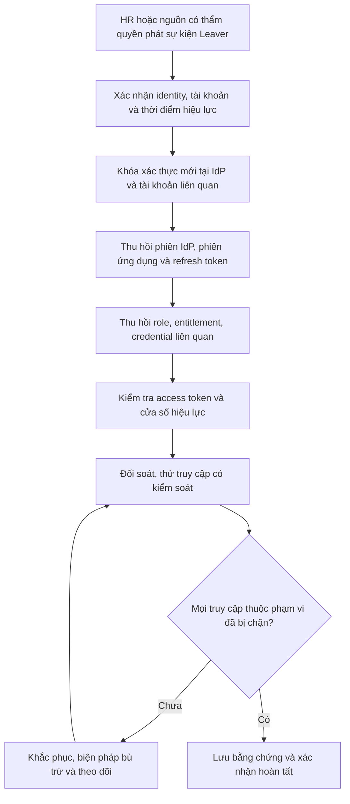

# Thu hồi session trong Leaver lifecycle

**Thu hồi session** (*session revocation*) là quá trình chấm dứt hoặc làm mất hiệu lực trạng thái đăng nhập đang cho phép một chủ thể tiếp tục truy cập hệ thống. Trong quản lý vòng đời danh tính (**Identity and Access Management – IAM**), đây là một phần quan trọng của giai đoạn **Leaver** trong mô hình **Joiner–Mover–Leaver (JML)**. Khi nhân viên nghỉ việc, nhà thầu hết hợp đồng hoặc quyền truy cập của đối tác bị chấm dứt, việc vô hiệu hóa tài khoản chưa chắc làm những phiên đã thiết lập ngừng hoạt động ngay.

Ví dụ, một nhân viên đã đăng nhập vào cổng khách hàng từ sáng, hệ thống nhân sự ghi nhận nghỉ việc vào buổi chiều và IdP khóa tài khoản. Nếu ứng dụng vẫn chấp nhận cookie phiên cũ mà không kiểm tra trạng thái truy cập, nhân viên ấy có thể tiếp tục xem dữ liệu. Vì vậy, Leaver phải xử lý **phiên tại IdP, phiên tại ứng dụng, token còn hiệu lực và khả năng thực thi quyền tại tài nguyên đích**, sau đó kiểm chứng việc truy cập đã bị chặn.

## 1. Session là gì, và tại sao khóa tài khoản chưa đủ?

Một **session** biểu diễn trạng thái đăng nhập hoặc tương tác đã được xác thực giữa chủ thể và hệ thống. Session có thể được theo dõi bằng cookie mang session ID, bằng dữ liệu phiên phía máy chủ hoặc qua token được ứng dụng chấp nhận trong thời gian nhất định. Các thành phần liên quan không có cùng cơ chế thu hồi.

| Thành phần | Công dụng | Điều cần xem khi Leaver |
| --- | --- | --- |
| **Tài khoản IdP** | Danh tính đăng nhập do Identity Provider quản lý | Khóa tài khoản để ngăn lần xác thực mới |
| **Phiên SSO ở IdP** | Cho phép đăng nhập liên kết tới các ứng dụng | Chấm dứt phiên IdP; xác định phạm vi tác động |
| **Phiên ứng dụng** | Duy trì trạng thái người dùng trong CRM, ERP, portal | Vô hiệu hóa session ở ứng dụng đích, kể cả session tạo trước khi IdP bị khóa |
| **Access token** | Cung cấp bằng chứng truy cập API trong một khoảng thời gian | Kiểm tra kiểu token, hạn dùng, cơ chế introspection hoặc thu hồi |
| **Refresh token** | Xin access token mới mà không cần đăng nhập lại đầy đủ | Thu hồi hoặc vô hiệu hóa để ngăn phát hành token tiếp |
| **Credential dài hạn** | Mật khẩu, khóa API, client secret, khóa riêng | Thu hồi/xoay vòng riêng nếu còn đường xác thực |
| **Entitlement** | Role, nhóm, ACL, quyền trực tiếp | Thu hồi theo chính sách, không phụ thuộc duy nhất vào việc logout |

**Logout ở trình duyệt không đồng nghĩa toàn bộ phiên phía máy chủ đã bị thu hồi.** Xóa cookie ở một thiết bị chỉ ảnh hưởng phiên đang có trên thiết bị ấy; các trình duyệt khác, thiết bị khác và phiên của ứng dụng liên kết có thể còn hoạt động.

Đặc biệt, **SSO không có nghĩa một lần logout tại IdP sẽ chắc chắn logout mọi ứng dụng**. Việc hỗ trợ single logout, cơ chế front-channel/back-channel và hành vi của ứng dụng đích phụ thuộc giao thức và cách tích hợp thực tế.

## 2. Các kiểu phiên và khả năng thu hồi

### 2.1 Phiên có trạng thái phía máy chủ

Ứng dụng lưu session trong kho phiên, còn trình duyệt giữ session ID. Hệ thống có thể vô hiệu hóa session bằng cách xóa hoặc đánh dấu hết hiệu lực bản ghi phía máy chủ, sau đó từ chối yêu cầu sử dụng session ID cũ.

Ví dụ giả mã:

```text
onLeaver(personId):
    accounts = findLinkedAccounts(personId)
    for account in accounts:
        disableAccount(account)
        invalidateServerSideSessions(account)
    recordRevocationResults(personId)
```

Đây là mô hình logic. Khi triển khai thật, cần xác định session ID thuộc tài khoản nào, các session store phân tán có đồng bộ không và có ứng dụng nào vận hành kho phiên riêng.

### 2.2 Access token dạng tự chứa

Một API có thể kiểm tra chữ ký, `iss`, `aud` và `exp` của JWT mà không gọi IdP trong mỗi yêu cầu. Khi đó, **khóa tài khoản hoặc thu hồi refresh token không nhất thiết làm access token đã phát hành mất hiệu lực ngay**. Token có thể vẫn được chấp nhận đến khi hết hạn, trừ khi hệ thống có thêm cơ chế kiểm tra trạng thái, danh sách thu hồi hoặc phiên bản quyền.

Những biện pháp thường được cân nhắc gồm access token ngắn hạn, kiểm tra trạng thái tại API, revocation list phân tán và chính sách từ chối theo `subjectId` hoặc `sessionId`. Mỗi cách có chi phí về độ trễ, tính sẵn sàng và vận hành.

### 2.3 Token có thể kiểm tra trạng thái tập trung

Với token được API kiểm tra bằng introspection hoặc tra cứu trạng thái ở máy chủ ủy quyền, việc thu hồi có thể được phản ánh sớm hơn. Tuy nhiên, **cache kết quả introspection** hoặc độ trễ đồng bộ vẫn có thể tạo một cửa sổ truy cập còn hiệu lực. Cần đo thời gian thu hồi thực tế thay vì giả định tức thì.

### 2.4 Phiên của ứng dụng qua SSO

Khi đăng nhập qua IdP, ứng dụng thường tạo phiên nội bộ riêng. Thu hồi phiên SSO tại IdP có thể chặn đăng nhập mới nhưng **chưa chắc xóa phiên nội bộ** ở ứng dụng. Hệ thống Leaver cần danh sách ứng dụng liên quan, tính năng logout/revoke mà từng ứng dụng hỗ trợ và phương án kiểm tra khi ứng dụng không cung cấp API thu hồi.

## 3. Quy trình thu hồi session cho Leaver



### Bước 1 — Xác minh nguồn sự kiện và danh tính

Leaver cần có **thời điểm chấm dứt có hiệu lực**, định danh ổn định và phạm vi quan hệ bị kết thúc. Không chỉ dựa vào email hoặc họ tên, vì một người có thể có nhiều tài khoản, tài khoản đặc quyền, thiết bị hoặc tư cách đối tác khác nhau.

Sự kiện nghỉ việc thông thường có thể được lên lịch theo ngày hợp đồng; trường hợp chấm dứt khẩn cấp cần cơ chế xử lý ưu tiên theo chính sách bảo mật và nhân sự. Không nên trì hoãn khóa truy cập chỉ vì một connector ứng dụng đích đang lỗi.

### Bước 2 — Ngăn phiên và đăng nhập mới

Vô hiệu hóa tài khoản hoặc quyền đăng nhập ở IdP và ứng dụng cục bộ có liên quan. Kích hoạt các API hoặc chức năng thu hồi session mà nhà cung cấp hỗ trợ, bao gồm phiên trên nhiều thiết bị và refresh token khi phù hợp.

Cần tránh giả định rằng **đổi mật khẩu sẽ tự động thu hồi toàn bộ session**. Tác dụng của đổi mật khẩu khác nhau theo nền tảng; chỉ áp dụng như một biện pháp được xác minh của hệ thống.

### Bước 3 — Thu hồi quyền và đường truy cập song song

Phiên bị vô hiệu hóa là một lớp kiểm soát; **RBAC/ABAC**, nhóm, quyền cục bộ, API key và tài khoản thứ cấp vẫn phải được kiểm tra độc lập. Với ứng dụng hỗ trợ **SCIM**, tổ chức có thể đồng bộ trạng thái user hoặc nhóm, nhưng SCIM không tự bảo đảm thu hồi mọi session/token của ứng dụng.

Phải phân biệt tài khoản cá nhân với **service/workload identity**. Không vô hiệu hóa bừa một workload dùng chung đang phục vụ nghiệp vụ chỉ vì người tạo nó nghỉ việc; thay vào đó chuyển chủ sở hữu, loại bỏ quyền truy cập cá nhân của người nghỉ, xoay credential chịu ảnh hưởng và rà soát quyền dịch vụ.

### Bước 4 — Kiểm chứng trạng thái và cửa sổ tồn dư

Đọc lại trạng thái tài khoản, phiên và quyền tại từng hệ thống đích. Kiểm tra cả kết quả từ API thu hồi và hành vi thực tế: yêu cầu hợp lệ trước đây của người nghỉ việc phải bị từ chối khi hết hiệu lực theo chính sách.

Nếu hệ thống dùng access token không thể thu hồi tức thì, cần ghi lại **hạn hết hiệu lực tối đa có thể xảy ra**, biện pháp giảm rủi ro và thời điểm kiểm tra lại. Tùy kiến trúc, có thể chặn trực tiếp ở API gateway hoặc policy enforcement point để giảm thời gian quyền còn hiệu lực.

### Bước 5 — Ghi audit và xử lý lỗi

Audit tối thiểu cần có mã identity, sự kiện nguồn, thời điểm hiệu lực, tài khoản/ứng dụng đích, thao tác revoke, kết quả readback, thời điểm truy cập thực sự bị chặn và ngoại lệ còn tồn. Không ghi session cookie, bearer token, mã bí mật hoặc private key vào log.

Nếu API thu hồi thất bại, cần retry có kiểm soát, cảnh báo cho owner và áp dụng biện pháp bù trừ phù hợp mức độ rủi ro. **Trạng thái “gửi yêu cầu thành công” không được coi là bằng chứng session đã bị vô hiệu hóa.**

## 4. Ví dụ: nhân viên nghỉ việc nhưng phiên CRM còn tồn tại

Giả sử Minh kết thúc hợp đồng lúc 17:00. Minh đã đăng nhập vào CRM lúc 13:00 qua SSO, và ứng dụng tạo cookie phiên nội bộ có hạn đến 21:00.

| Thời điểm | Sự kiện | Ý nghĩa |
| --- | --- | --- |
| 13:00 | Minh đăng nhập IdP và CRM | IdP và CRM có thể tạo hai phiên độc lập |
| 17:00 | HR phát sự kiện Leaver | IAM bắt đầu khóa tài khoản và thu hồi quyền |
| 17:01 | IdP vô hiệu hóa account và phiên SSO | Chặn đăng nhập lại qua IdP; chưa đủ để kết luận CRM đã chặn |
| 17:02 | IAM gọi chức năng vô hiệu hóa phiên CRM | Cần xác minh ứng dụng đã áp dụng |
| Sau thu hồi | Kiểm tra truy cập CRM với phiên cũ trong môi trường kiểm soát | Nếu bị từ chối: có bằng chứng; nếu vẫn được: cần xử lý |

Các mốc thời gian chỉ là ví dụ minh họa, **không phải SLA mặc định**. Nếu CRM không hỗ trợ thu hồi phiên theo người dùng, tổ chức cần phương án thay thế như kiểm tra trạng thái ở mỗi request, vô hiệu hóa tài khoản cục bộ kèm xác nhận hành vi, giảm TTL session hoặc chặn truy cập phía gateway nếu khả thi.

Điểm quyết định không phải CRM hiển thị “logout” mà là **phiên cũ còn thực hiện được hành động trên tài nguyên hay không**.

## 5. Quan hệ với IdP, SSO, SCIM, RBAC và ABAC

| Thành phần | Vai trò trong Leaver | Giới hạn cần nhớ |
| --- | --- | --- |
| HRIS/nguồn có thẩm quyền | Cung cấp sự kiện và thời điểm chấm dứt | Sự kiện nguồn không tự thu hồi phiên |
| IdP | Khóa danh tính đăng nhập, quản lý phiên và token thuộc phạm vi IdP | Không kiểm soát mặc định mọi phiên ứng dụng |
| SSO | Thiết lập đăng nhập liên kết; một số giao thức có hỗ trợ logout liên kết | Không đảm bảo single logout được mọi ứng dụng thực thi |
| SCIM/connector | Đồng bộ user/group và trạng thái tài khoản | Không phải cơ chế thu hồi token phiên phổ quát |
| RBAC/ABAC | Chặn hành động không còn hợp lệ theo trạng thái và quyền | Phải thực thi ở nơi xử lý tài nguyên, cần thuộc tính hiện hành |
| IGA/audit | Điều phối, theo dõi ngoại lệ và chứng minh thu hồi | Không thể thay thế xác nhận thực tế từ hệ thống đích |

Một chính sách bảo vệ tài nguyên có thể kiểm tra trạng thái quan hệ ngay tại thời điểm yêu cầu:

```text
ALLOW access IF
    subject.lifecycle_status == "active"
    AND subject.account_status == "enabled"
    AND requested_action IN effective_permissions(subject, resource)
    AND session.is_valid == true
ELSE DENY
```

Đây là giả mã, không phải cú pháp sản phẩm. Trạng thái `active` phải đến từ dữ liệu đáng tin cậy, đủ mới; cache trạng thái dài hạn có thể làm quyết định tiếp tục cho phép truy cập sau khi Leaver có hiệu lực.

## 6. Thiết kế để giảm thời gian truy cập tồn dư

Một số biện pháp có thể phối hợp tùy mức rủi ro:

1. **TTL hợp lý:** rút ngắn vòng đời phiên và access token cho dữ liệu nhạy cảm; cân đối trải nghiệm và tải xác thực.
2. **Thu hồi chủ động:** hỗ trợ revoke session theo người dùng, theo thiết bị hoặc theo ứng dụng khi nền tảng cho phép.
3. **Kiểm tra trạng thái tại điểm thực thi:** API xác minh account/entitlement còn hiệu lực thay vì chỉ tin claims đã phát hành từ lâu.
4. **Thu hồi refresh token:** ngăn tạo thêm access token sau khi sự kiện Leaver xảy ra.
5. **Đồng bộ sự kiện có theo dõi:** cảnh báo sự kiện chậm, connector lỗi, ứng dụng đích chưa xác nhận.
6. **Đối soát tài khoản mồ côi:** phát hiện account và session không còn gắn được với danh tính hoặc quan hệ hợp lệ.
7. **Kiểm tra nhiều thiết bị:** đảm bảo các session khác nhau của cùng account được xử lý đầy đủ.

Những biện pháp này có giới hạn triển khai. Ví dụ, token ngắn hạn **giảm** cửa sổ truy cập tồn dư nhưng không chứng minh token đã mất hiệu lực tức thì; một danh sách thu hồi phân tán có thể bị trễ do cache hay sự cố mạng.

## 7. Tiêu chí nghiệm thu và chỉ số theo dõi

| Mã | Tiêu chí | Bằng chứng cần có |
| --- | --- | --- |
| L1 | Xác định đúng chủ thể và tài khoản liên quan | Định danh gốc, danh sách account và ứng dụng |
| L2 | Chặn xác thực mới theo thời điểm Leaver | Trạng thái IdP và ứng dụng được đọc lại |
| L3 | Phiên IdP đã bị thu hồi | Kết quả session revocation và kiểm tra lại |
| L4 | Phiên ứng dụng đã xử lý | Readback hoặc kiểm thử truy cập bị từ chối |
| L5 | Refresh token/credential có liên quan đã xử lý | Trạng thái thu hồi hoặc thay thế, hạn hiệu lực |
| L6 | Role/entitlement đã thu hồi | Đối soát nhóm, ACL, quyền cục bộ và tài khoản đặc quyền |
| L7 | Token không thể thu hồi được đánh giá | Hạn sử dụng còn lại và biện pháp giảm thiểu |
| L8 | Ngoại lệ và audit được đóng đúng quy trình | Owner, thời hạn khắc phục, bằng chứng xác nhận |

Các chỉ số vận hành hữu ích gồm **thời gian từ thời điểm Leaver có hiệu lực đến lúc truy cập thực sự bị từ chối**, tỷ lệ ứng dụng hỗ trợ revoke session, số phiên còn hiệu lực sau SLA, số tài khoản cục bộ bị bỏ sót và số ngoại lệ quá hạn. Nên tách kết quả theo IdP, ứng dụng, loại phiên và mức độ rủi ro.

## 8. Tình huống tự kiểm tra

**Tình huống A:** Nhân viên đã bị vô hiệu hóa trên IdP nhưng cookie CRM cũ vẫn dùng được. Leaver đã hoàn tất chưa? **Chưa.** Phải xử lý session CRM và kiểm chứng truy cập bị từ chối.

**Tình huống B:** Ứng dụng đã thu hồi refresh token, nhưng access token JWT còn 15 phút mới hết hạn. Có thể nói truy cập dừng ngay không? **Không.** Cần đánh giá cơ chế xác minh token tại API và biện pháp thu hồi/chặn bổ sung nếu có.

**Tình huống C:** Người dùng bấm logout trên một trình duyệt, còn phiên trên điện thoại vẫn hoạt động. Có đủ không? **Không.** Quy trình Leaver cần xử lý toàn bộ phiên liên quan và xác nhận phạm vi thu hồi.

**Tình huống D:** SCIM thông báo `active=false` nhưng ứng dụng vẫn cho phép cookie phiên cũ. Có thể tin báo cáo provisioning để đóng yêu cầu không? **Không.** Phải có bằng chứng tại ứng dụng hoặc điểm thực thi chính sách.

**Tình huống E:** Một dịch vụ quan trọng dùng credential do nhân viên nghỉ việc quản lý. Có nên tắt dịch vụ ngay bằng cách xóa toàn bộ tài khoản dùng chung không? **Cần phân tích phụ thuộc nghiệp vụ.** Phải cắt quyền cá nhân, xác lập owner mới, xoay credential chịu ảnh hưởng và bảo đảm workload identity được quản lý độc lập.

## Ghi nhớ

**Thu hồi session** là thành phần thiết yếu của **Leaver lifecycle** nhằm chặn người đã chấm dứt quan hệ tiếp tục sử dụng trạng thái đăng nhập cũ. Phải phân biệt **khóa account, kết thúc phiên IdP/SSO, vô hiệu hóa phiên ứng dụng, thu hồi refresh token, xử lý access token và thu hồi RBAC/ABAC entitlement**. Kết quả thành công phải được chứng minh tại hệ thống đích, có audit và xử lý ngoại lệ; đó là cách IAM giảm quyền truy cập tồn dư trong toàn bộ vòng đời **Joiner–Mover–Leaver**.
