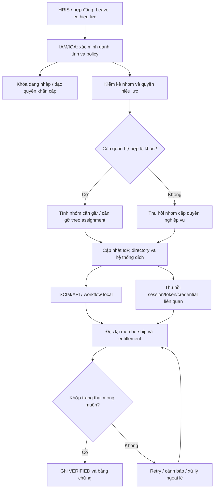

# Thu hồi nhóm trong Leaver lifecycle

## 1. Thu hồi nhóm là gì?

**Thu hồi nhóm (group membership revocation)** là quá trình loại một danh tính hoặc tài khoản khỏi các nhóm đã cấp cho nó quyền truy cập, đồng thời xác minh rằng những quyền do nhóm đó cung cấp **không còn hiệu lực**. Trong quản lý vòng đời danh tính **Identity and Access Management (IAM)** theo mô hình **Joiner–Mover–Leaver (JML)**, thao tác này đặc biệt quan trọng khi một nhân viên nghỉ việc, nhà thầu hết hạn hợp đồng hoặc một quan hệ truy cập bị chấm dứt.

Nhóm thường được dùng để quản lý quyền tập trung. Thay vì cấp quyền trực tiếp cho từng người, tổ chức gán quyền vào nhóm rồi thêm người vào nhóm phù hợp:

- `employees` có thể cho phép sử dụng cổng nội bộ.
- `project-p1-readers` có thể cho phép đọc tài liệu dự án P1.
- `finance-report-exporters` có thể cho phép xuất một loại báo cáo.
- `production-admins` có thể ánh xạ tới quyền quản trị nhạy cảm.

Ví dụ, khi một nhân viên có tài khoản `user-1042` nghỉ việc, workflow Leaver phải xác định các nhóm mà tài khoản ấy đang thuộc về, thu hồi những quan hệ thành viên tương ứng và xác minh tại những hệ thống có liên quan. Nếu chỉ khóa đăng nhập ở IdP nhưng để lại nhóm, việc tái kích hoạt nhầm tài khoản hoặc một đường truy cập khác vẫn có thể làm quyền cũ phát sinh trở lại.

**Thu hồi thành viên khỏi nhóm không giống xóa chính nhóm.** Khi một nhân viên nghỉ việc, thông thường cần loại **nhân viên đó** khỏi nhóm; xóa nhóm dùng chung có thể khiến nhiều người khác mất quyền hoặc gây gián đoạn vận hành.

### 1.1. Ba đối tượng cần phân biệt

| Đối tượng | Ví dụ | Thao tác phù hợp khi Leaver |
|---|---|---|
| **Danh tính** (*identity*) | Người có ID nhân sự `W-1042` | Xác nhận trạng thái quan hệ và chính sách kết thúc |
| **Tài khoản** (*account*) | Tài khoản `user-1042` tại IdP hoặc SaaS | Disable/deprovision theo chính sách từng hệ thống |
| **Quan hệ thành viên nhóm** (*membership*) | `user-1042 ∈ finance-readers` | Thu hồi membership, kiểm tra quyền hiệu lực |

Một danh tính có thể có nhiều tài khoản ở các hệ thống khác nhau; mỗi tài khoản lại có nhiều nguồn quyền. Vì vậy, việc xóa một membership chỉ bảo đảm xử lý **một quan hệ** tại **một nơi**, chưa chứng minh đã thu hồi toàn bộ quyền.

## 2. Thu hồi nhóm nằm ở đâu trong Joiner–Mover–Leaver?

Ở **Joiner**, nhóm được gán khi danh tính đã được xác minh, nguồn nhân sự/hợp đồng được chấp thuận và quyền cần thiết đáp ứng RBAC/ABAC. Ở **Mover**, nhóm được thêm hoặc gỡ khi người dùng đổi vai trò hoặc dự án. Đến **Leaver**, phần lớn quan hệ công việc không còn hợp lệ, nên các nhóm gắn với quan hệ đó cần được loại bỏ hoặc vô hiệu hóa theo chính sách.

| Giai đoạn | Câu hỏi đối với membership | Ví dụ |
|---|---|---|
| **Joiner** | Người mới cần nhóm nào để thực hiện công việc? | Thêm `user-1042` vào `project-p1-readers` |
| **Mover** | Nhóm nào còn cần, nhóm nào hết nhu cầu khi đổi vai trò? | Gỡ `sales-report`, thêm `finance-report` |
| **Leaver** | Nhóm nào vẫn đang cấp quyền cho quan hệ đã kết thúc? | Gỡ các membership không còn căn cứ hợp lệ |
| **Review/Reconciliation** | Có membership nào tồn dư so với dữ liệu nguồn và chính sách? | Phát hiện nhóm trực tiếp hoặc lồng nhau vẫn còn cấp quyền |

**Thời điểm Leaver** phải bắt nguồn từ nguồn có thẩm quyền như HRIS, hệ thống hợp đồng hoặc người bảo trợ đối tác. Trong trường hợp rủi ro cao, chính sách có thể yêu cầu chặn đăng nhập khẩn cấp ngay khi nhận sự kiện hợp lệ, trong khi các thao tác gỡ nhóm và đối soát được tiếp tục có theo dõi.

## 3. Các loại nhóm và những nguồn quyền liên quan

Không phải mọi nhóm trong hệ thống đều vận hành giống nhau. Khi lập kế hoạch thu hồi cần biết nhóm nằm ở đâu, ai quản lý membership và quyền thực tế được tính thế nào.

| Loại nhóm | Cơ chế thường gặp | Rủi ro khi thu hồi |
|---|---|---|
| **Nhóm tĩnh ở IdP/directory** | Quản trị viên hoặc IAM thêm/xóa tài khoản khỏi danh sách thành viên | Xóa sai nhóm hoặc bỏ sót nhóm mà người dùng được gán trực tiếp |
| **Nhóm động** (*dynamic group*) | Thành viên được tính tự động theo thuộc tính như phòng ban, loại hợp đồng, trạng thái | Chỉ gỡ trực tiếp có thể không bền; rule có thể thêm lại |
| **Nhóm lồng nhau** (*nested group*) | Thành viên nhóm con hưởng quyền từ nhóm cha tùy nền tảng | Xóa một đường membership nhưng vẫn còn đường kế thừa khác |
| **Nhóm tại ứng dụng SaaS** | Nhóm do ứng dụng lưu và quản trị riêng | Có thể không đồng bộ khi IdP thay đổi |
| **Nhóm được provision qua SCIM** | IAM/IdP đồng bộ user/group membership đến ứng dụng hỗ trợ SCIM | Đồng bộ trễ, lỗi connector hoặc ứng dụng diễn giải mapping khác |
| **Nhóm liên kết qua SSO claims** | Ứng dụng ánh xạ claim nhóm từ SAML/OIDC thành role | Phiên/token cũ có thể giữ claim trước khi thu hồi |
| **Nhóm đặc quyền/PAM** | Cấp quyền quản trị hoặc mở phiên đặc quyền | Cần thu hồi session, credential và quyền ngoài nhóm nếu có |
| **Nhóm dự án hoặc tenant** | Gắn với tài nguyên và phạm vi cộng tác | Có thể tồn tại ở nhiều tổ chức hoặc miền quản trị |

### 3.1. Membership trực tiếp và membership hiệu lực

Giả sử:

```text
user-1042
  ├── direct member: finance-analysts
  │     └── nested in: corporate-report-readers
  └── direct member: export-exception
```

Trong hệ thống hỗ trợ nhóm lồng nhau, `user-1042` có thể hưởng quyền từ `corporate-report-readers` thông qua nhóm `finance-analysts`. Khi thu hồi `finance-analysts`, người dùng mất đường kế thừa đó **nếu không còn đường membership khác**. Nếu một nhóm khác cũng lồng trong `corporate-report-readers` và vẫn chứa người dùng, quyền đó có thể còn.

Tính quyền cần dựa trên **toàn bộ đường cấp quyền mà hệ thống hỗ trợ**, đồng thời kiểm tra role hoặc grant trực tiếp. Cách xử lý nested groups khác nhau tùy IdP và ứng dụng: có nơi hỗ trợ, có nơi làm phẳng membership, có nơi không hỗ trợ lồng nhóm.

### 3.2. Nhóm động và thuộc tính nguồn

Nhóm động có thể dùng quy tắc như:

```text
include(user) when
    user.employment_status == "ACTIVE"
    and user.department_id == "FIN"
```

Nếu quy tắc đang tính từ dữ liệu cũ, thao tác gỡ membership thủ công có thể bị đồng bộ tự động **thêm lại**. Leaver phải cập nhật nguồn thuộc tính có thẩm quyền, xử lý rule nhóm, chặn đường truy cập khi cần và xác minh nhóm không còn chứa tài khoản sau khi bộ máy tính lại.

**Không nên sửa rule chung của nhóm chỉ vì một người nghỉ việc**, trừ khi phát hiện lỗi chính sách và đã đánh giá tác động với những thành viên khác.

## 4. Mục tiêu và phạm vi thu hồi nhóm

Tại thời điểm offboarding, IAM cần xác định cả **membership mong muốn** và **membership đang có**.

- **Membership mong muốn:** tập nhóm mà một tài khoản vẫn được phép thuộc về theo các quan hệ, chính sách và ngoại lệ còn hiệu lực.
- **Membership thực tế:** tập nhóm trực tiếp hoặc hiệu lực mà hệ thống nguồn và ứng dụng đích đang áp dụng.
- **Chênh lệch cần gỡ:** những membership thực tế không còn được phép.
- **Quyền sau thu hồi:** những entitlement mà ứng dụng vẫn có thể cho phép thông qua các đường khác.

Khi **toàn bộ quan hệ làm việc đã chấm dứt**, tập nhóm cấp quyền nghiệp vụ thường phải rỗng hoặc bị vô hiệu hóa theo chính sách. Nhưng một người có **nhiều quan hệ còn hiệu lực** là trường hợp cần xem xét riêng. Ví dụ, một assignment kết thúc không nhất thiết khiến mọi tài khoản và mọi nhóm của cá nhân phải bị gỡ nếu hợp đồng khác vẫn hợp lệ.

Điều cần đạt không chỉ là kết quả “membership đã bị xóa”, mà còn là **không còn quyền truy cập trái với trạng thái Leaver**.

### 4.1. Không xóa quyền của người khác

Những hành động phải phân biệt rõ:

| Thao tác | Tác động | Khi nào nên dùng |
|---|---|---|
| **Remove member from group** | Gỡ một hoặc một số membership của chủ thể | Offboarding một người hoặc tài khoản |
| **Disable user account** | Ngăn tài khoản đăng nhập theo khả năng của hệ thống | Leaver cần khóa truy cập |
| **Deprovision account** | Vô hiệu hóa/xóa tài khoản và tài nguyên liên quan theo chính sách | Hoàn tất xử lý tại ứng dụng đích |
| **Delete group** | Xóa cấu trúc nhóm, có thể ảnh hưởng nhiều người | Chỉ khi chính nhóm không còn cần thiết và được phê duyệt |
| **Remove role from group** | Thay đổi quyền của **mọi** thành viên nhóm | Thay đổi chính sách nhóm, không phải thu hồi cho một người |

## 5. Chuẩn bị trước khi gỡ nhóm

Trước khi gọi API xóa membership, hệ thống phải có đủ dữ kiện về danh tính, hệ thống đích và căn cứ thu hồi.

### 5.1. Xác minh sự kiện Leaver

Nguồn có thẩm quyền cần cung cấp hoặc cho phép xác minh:

- Mã nhân sự/định danh ổn định và quan hệ làm việc tương ứng.
- Loại sự kiện: nghỉ việc, hết hợp đồng, chấm dứt hợp tác hoặc đóng assignment.
- Ngày/giờ hiệu lực; độ ưu tiên khi cần khóa khẩn cấp.
- Trạng thái hiện hành, bao gồm sự kiện hủy hoặc thay đổi ngày nghỉ.
- Nguồn sự kiện, phiên bản và mã giao dịch phục vụ kiểm toán.

**Không dùng email hiển thị làm khóa duy nhất** để xóa thành viên. Email có thể trùng, đổi hoặc tái sử dụng. IAM phải ánh xạ từ identity ID/worker ID sang **tài khoản đích cụ thể**, rồi xác nhận tenant và user ID của ứng dụng đó.

### 5.2. Kiểm kê nhóm và đường cấp quyền

Nên thu thập:

1. **Nhóm gán trực tiếp** trong IdP hoặc directory.
2. **Nhóm động** mà tài khoản hiện thỏa điều kiện.
3. **Nhóm lồng nhau** và những quyền kế thừa cần kiểm tra.
4. **Nhóm được đồng bộ** qua SCIM hoặc connector riêng.
5. **Nhóm/role nội bộ ứng dụng** không do IdP trực tiếp quản lý.
6. **Nhóm đặc quyền, nhóm dự án và nhóm tenant ngoài**.
7. **Role hoặc grant trực tiếp** có thể duy trì quyền ngay cả sau khi đã gỡ nhóm.
8. **Phiên, token hoặc credential** có thể còn mang quyền cũ.

Đối với mỗi membership cần biết **nguồn cấp**, **mục đích**, **người sở hữu**, **thời hạn** và **đường thực thi** để thu hồi đúng mục tiêu.

### 5.3. Sắp xếp thứ tự theo mức rủi ro

Một kế hoạch offboarding có thể ưu tiên:

- Khóa đăng nhập và phiên đặc quyền khi cần phản ứng ngay.
- Thu hồi membership cấp quyền quản trị hoặc truy cập dữ liệu nhạy cảm.
- Thu hồi nhóm nghiệp vụ, dự án và các kết nối liên tổ chức.
- Kiểm tra ứng dụng ít dùng, hệ thống cũ, token, tài khoản local.
- Đối soát và lưu bằng chứng từng ứng dụng.

Thứ tự có thể khác nhau theo tổ chức. **Không đánh đổi việc thu hồi quyền nguy hiểm để chờ toàn bộ danh mục nhóm được đồng bộ hoàn chỉnh.**

## 6. Quy trình thu hồi nhóm từ đầu đến cuối

Quy trình có thể gồm những bước sau:

1. **Tiếp nhận Leaver:** nhận sự kiện từ HRIS, VMS hoặc sponsor; kiểm tra tính xác thực, thời điểm hiệu lực và danh tính.
2. **Khóa truy cập khi cần:** chặn đăng nhập IdP và áp dụng biện pháp khẩn cấp cho quyền đặc quyền theo chính sách.
3. **Lập danh sách membership:** lấy danh sách nhóm và mapping tới ứng dụng; phân biệt trực tiếp, động, lồng nhau và local.
4. **Tính phạm vi thu hồi:** xác định các nhóm không còn căn cứ; kiểm tra hợp đồng hoặc assignment khác còn hợp lệ.
5. **Thực thi tại nguồn quản trị:** gỡ membership tĩnh, cập nhật trạng thái/thuộc tính chi phối nhóm động, thu hồi các grant trực tiếp tương ứng.
6. **Đồng bộ tới đích:** gửi SCIM/API hoặc workflow phù hợp để cập nhật user/group ở ứng dụng.
7. **Xử lý phiên và token:** vô hiệu hóa các đường truy cập tiếp tục có hiệu lực nhờ phiên, token hay credential đã phát hành.
8. **Đối soát:** kiểm tra lại membership và entitlement tại nguồn lẫn từng đích, tính quyền hiệu lực thay vì chỉ kiểm tra response API.
9. **Theo dõi lỗi:** retry an toàn, tạo yêu cầu xử lý thủ công, cảnh báo khi quá SLA.
10. **Lưu bằng chứng:** ghi sự kiện nguồn, thao tác, trạng thái và thời điểm xác minh.



Trong trường hợp người dùng đã được khóa nhưng gỡ nhóm chưa hoàn tất do hệ thống đích lỗi, workflow phải biểu thị **hoàn tất một phần**. Không dùng việc khóa IdP để che đi phần thu hồi chưa xác minh.

## 7. Thu hồi membership tại IdP và directory

Trong hệ thống dùng RBAC, người dùng thường thuộc các security group, role group hoặc nhóm ứng dụng. Leaver cần phân biệt **nguồn điều khiển membership**.

### 7.1. Nhóm tĩnh

Với nhóm có membership được quản lý trực tiếp, IAM có thể gọi API hoặc SDK để loại user ID khỏi group ID. Khi làm, nên:

- Sử dụng **ID nhóm ổn định**, thay vì chỉ tên hiển thị có thể bị đổi.
- Xác minh tenant và account ID chính xác.
- Chỉ xóa membership của chủ thể được giao; giữ nguyên các thành viên khác.
- Không thực hiện thay đổi cấu trúc role/group không liên quan.
- Ghi kết quả thực thi và đọc lại membership.
- Xử lý idempotent: membership vốn không tồn tại có thể được xem là **trạng thái đích đã đạt**, sau khi xác minh đúng tài khoản/nhóm.

### 7.2. Nhóm động

Với nhóm có membership được tính theo chính sách, phải kiểm tra **nguồn thuộc tính** và **logic membership**. Khi employment status đổi sang Leaver, một rule chỉ nhận `status=ACTIVE` có thể tự loại người dùng. Nhưng nếu rule không xét trạng thái hoặc dữ liệu HR đến chậm, quyền có thể còn tồn dư.

Có thể cần **khóa tài khoản ngay**, sửa trạng thái theo nguồn có thẩm quyền, kích hoạt đồng bộ và xác minh lại sau khi nhóm được tính lại. Không nên ghi đè tay trạng thái HR hoặc chỉnh rule chung nếu không được giao quyền.

### 7.3. Nhóm lồng nhau

Việc loại khỏi nhóm con có thể làm mất một đường quyền kế thừa nhưng không chắc đã mất **mọi đường quyền**. Các bước kiểm tra gồm:

- Liệt kê nhóm trực tiếp và nhóm hiệu lực theo cách nền tảng hỗ trợ.
- Kiểm tra user có thêm membership qua nhóm con khác không.
- Xác định nhóm nào thực sự cấp quyền vào ứng dụng.
- Kiểm tra quyền bằng danh sách entitlement hoặc một truy vấn phù hợp tại hệ thống đích.

Một số ứng dụng không hỗ trợ nested groups hoặc chỉ nhận danh sách nhóm được làm phẳng khi provisioning; phải xem **trạng thái thực tế của ứng dụng** thay vì suy đoán từ cây nhóm ở IdP.

## 8. Thu hồi qua SCIM và ứng dụng SaaS

**SCIM (System for Cross-domain Identity Management)** thường dùng để quản lý user và group trên các ứng dụng đích. SCIM có thể hỗ trợ chỉnh membership, nhưng mỗi ứng dụng có giới hạn riêng: có nơi không đồng bộ group, có nơi chuyển group thành role, có nơi giữ thêm quyền gán thủ công.

### 8.1. Minh họa SCIM PATCH xóa một member

Một yêu cầu **minh họa** theo cấu trúc SCIM 2.0 để xóa user khỏi group:

```http
PATCH /scim/v2/Groups/finance-readers-001 HTTP/1.1
Host: scim.example.org
Authorization: Bearer <access-token>
Content-Type: application/scim+json

{
  "schemas": [
    "urn:ietf:params:scim:api:messages:2.0:PatchOp"
  ],
  "Operations": [
    {
      "op": "remove",
      "path": "members[value eq \"user-1042\"]"
    }
  ]
}
```

Ở đây, `finance-readers-001` và `user-1042` là **ID giả định**. Biểu thức lọc chọn một thành viên theo trường `members.value`. Tính khả dụng thực tế phụ thuộc connector và mức hỗ trợ của SCIM provider: có ứng dụng triển khai một tập tính năng giới hạn hoặc có yêu cầu bổ sung. Credential trong ví dụ chỉ là placeholder và **không được đưa token thật vào tài liệu hoặc log**.

Các bước xác minh quan trọng:

1. Kiểm tra request gửi tới đúng tenant, đúng Group ID và đúng User ID.
2. Xử lý phản hồi API theo hợp đồng của provider.
3. Đọc lại group hoặc danh sách membership ở ứng dụng sau khi hệ thống đã áp dụng.
4. Kiểm tra role/entitlement thực tế, kể cả quyền local hoặc role gán trực tiếp.
5. Nếu provider xử lý bất đồng bộ, giữ trạng thái chờ xác minh thay vì báo hoàn tất ngay.

### 8.2. Disable user và remove membership khác nhau

Khi offboarding, SCIM có thể được dùng để đặt trạng thái tài khoản user không còn hoạt động (chẳng hạn một provider hỗ trợ thuộc tính `active=false`). Tuy nhiên:

- **Disable user** nhằm chặn truy cập của tài khoản tại ứng dụng theo ngữ nghĩa provider.
- **Remove membership** nhằm xóa những quan hệ nhóm không còn hợp lệ.
- **Revoke sessions/tokens** xử lý các phiên và credential có thể tồn tại độc lập.
- **Delete account** là bước quản lý dữ liệu và tài khoản có thể cần lưu giữ trước khi xóa.

Một hệ thống có thể cần tất cả các bước này. Không được giả định chỉ một SCIM PATCH là đủ để chấm dứt mọi quyền.

### 8.3. Không có SCIM thì làm gì?

Với ứng dụng không hỗ trợ SCIM hoặc đồng bộ nhóm:

- Dùng API quản trị chính thức khác khi có.
- Áp dụng quy trình quản trị thủ công có người sở hữu và xác nhận kết quả.
- Ghi rõ ứng dụng thuộc phạm vi **chưa tự động hóa**.
- Tạo tác vụ với thời hạn và mức ưu tiên theo rủi ro.
- Xác minh trạng thái từ ứng dụng thay vì chỉ đánh dấu “đã gửi yêu cầu cho quản trị viên”.

## 9. SSO, SAML/OIDC và quyền tồn dư sau khi gỡ nhóm

**SSO** và **federated identity** thường dùng IdP để xác thực người dùng và truyền thông tin nhóm hoặc vai trò cho ứng dụng. Tuy nhiên, việc gỡ membership có thể **chưa tác động ngay** đến phiên đang hoạt động.

### 9.1. Claim nhóm trong token hoặc assertion

- **OIDC:** ứng dụng có thể nhận ID token với thông tin định danh và claim nhóm tùy cấu hình; API có thể dựa vào access token theo hợp đồng của authorization server.
- **SAML:** SP có thể nhận group/role attribute trong assertion tại thời điểm đăng nhập.
- **Phiên ứng dụng:** sau đăng nhập, ứng dụng có thể giữ vai trò đã tính trong session cookie hoặc bộ nhớ đệm riêng.

Sau khi group membership bị gỡ ở IdP, **token hoặc phiên đã phát hành không tự thay đổi nội dung**. Vì vậy một ứng dụng sử dụng thông tin cũ có thể tiếp tục cho phép truy cập đến khi phiên hết hạn hoặc được thu hồi theo khả năng hỗ trợ.

### 9.2. Kiểm soát cần kết hợp

- Disable tài khoản ở IdP để ngăn phiên xác thực mới theo chính sách.
- Thu hồi phiên SSO và phiên ứng dụng khi nền tảng có cơ chế hỗ trợ.
- Thu hồi refresh token, hoặc credential mà người dùng vẫn có thể dùng.
- Với quyền rủi ro cao, cân nhắc token thời hạn ngắn, token introspection hoặc kiểm tra quyền tại thời điểm truy cập theo kiến trúc.
- Đảm bảo ứng dụng cập nhật role/quyền local sau khi membership thay đổi.
- Ghi nhận hệ thống nào **không hỗ trợ thu hồi ngay token/phiên**, vì đây là rủi ro tồn dư cần xử lý bằng biện pháp khác.

**Gỡ nhóm không đồng nghĩa thu hồi token**. Hai tác vụ phải được xác minh riêng nếu cần bảo đảm ngăn truy cập thực tế.

## 10. Pseudocode cho quy trình thu hồi nhóm an toàn

Một bộ điều phối có thể dùng **desired-state reconciliation**: thay vì tin rằng gửi lệnh xóa là đủ, nó tính danh sách nhóm cần còn lại và lặp việc đối chiếu đến khi trạng thái thực tế khớp với chính sách.

```text
event = verify_authoritative_leaver_event(event_id)

identity = resolve_identity(
    event.worker_id,
    event.employment_id,
    event.source_system
)

if event.is_stale_or_superseded:
    stop_and_reconcile_current_authoritative_state()

remaining_assignments = list_active_assignments(identity)
desired_groups = evaluate_allowed_groups(
    identity,
    remaining_assignments,
    active_approved_exceptions
)

for account in enumerate_known_accounts(identity):
    actual_groups = read_direct_and_effective_groups(account)
    groups_to_remove = actual_groups - desired_groups_for(account)

    for group in groups_to_remove:
        if group.membership_is_directly_managed:
            remove_membership_idempotently(account, group)
        else:
            reconcile_authoritative_attributes_and_group_rule(account, group)

    reconcile_target_applications(account)
    revoke_related_sessions_or_credentials(account, according_to_policy)
    verify_effective_access(account)

record_results_per_target()
escalate_any_unverified_or_failed_revocations()
```

Đây là **mã giả để giải thích tư duy thiết kế**, không phải thuật toán sử dụng nguyên xi. Đặc biệt, việc lấy `actual_groups - desired_groups` phải biết **nguồn cấp** và **đơn vị sở hữu**: không được gọi API gỡ trực tiếp cho một nhóm động hoặc nhóm được quản lý bởi hệ thống khác nếu thao tác đó không được hỗ trợ. Phải kiểm tra cả entitlement không do nhóm cấp.

### 10.1. Tính idempotent

Một sự kiện Leaver có thể được gửi lặp do retry. Với thao tác gỡ nhóm:

- Gỡ thành viên đang có → mục tiêu là thành viên không còn trong nhóm.
- Gỡ lại khi thành viên đã vắng mặt → sau kiểm tra đúng đối tượng, **được xem là đạt trạng thái mong muốn**.
- Không nên xóa cả group, thay đổi membership của người khác hoặc cấp lại quyền chỉ vì retry.
- Sử dụng event ID/operation ID và phiên bản nguồn để phân biệt sự kiện mới với sự kiện cũ.

### 10.2. Trạng thái per-target

Không nên dùng một cờ `DONE` cho toàn bộ hệ thống khi vẫn còn lỗi ở một SaaS. Có thể theo dõi trạng thái riêng cho từng tài khoản hoặc nhóm:

| Trạng thái minh họa | Diễn giải |
|---|---|
| `PLANNED` | Đã xác định membership cần thu hồi |
| `SENT` | Đã gửi yêu cầu đến API/connector |
| `APPLIED` | Hệ thống đích báo thao tác được áp dụng |
| `VERIFIED` | Đã đối chiếu lại và xác minh quyền/membership theo phạm vi |
| `RETRY_PENDING` | Cần thử lại do lỗi tạm thời |
| `MANUAL_ACTION_REQUIRED` | Không thể tự động xử lý, cần owner can thiệp |
| `BLOCKED` | Thiếu dữ liệu/quyền thực thi hoặc có xung đột phải giải quyết |

Không tự chuyển `SENT` thành `VERIFIED` nếu chưa có bằng chứng từ hệ thống đích.

## 11. Xác minh thu hồi và chống quyền truy cập tồn dư

Sau khi gỡ group membership, cần xác minh theo ba mức.

### 11.1. Mức 1 — Membership

- Tài khoản **không còn là thành viên trực tiếp** của nhóm cần gỡ.
- Các nhóm động đã tính lại theo trạng thái mới.
- Không còn đường membership gián tiếp vẫn cấp quyền bị cấm.
- Nếu ứng dụng đồng bộ group, danh sách membership ở ứng dụng đích phù hợp với trạng thái mới.

### 11.2. Mức 2 — Entitlement

- Role hoặc policy được nhóm cấp không còn áp dụng.
- Không có **grant trực tiếp** giữ lại quyền tương đương.
- Những quyền đặc quyền, quyền ủy quyền hoặc ngoại lệ có hạn đã được xử lý.
- Quyền mà các ứng dụng tính dựa trên ABAC không còn thỏa điều kiện khi trạng thái danh tính là Leaver.

### 11.3. Mức 3 — Truy cập thực tế

- Các đường đăng nhập mới bị chặn theo chính sách.
- Phiên/refresh token/access token hoặc credential độc lập đã được thu hồi hoặc kiểm soát theo cơ chế hệ thống hỗ trợ.
- Các kết nối VPN, SSH, ứng dụng local, tài khoản đặc quyền và tích hợp API đã được xem xét.
- Kết quả được xác minh từ trạng thái hoặc cơ chế kiểm tra được cho phép, không tùy tiện dùng tài khoản đã offboard để thử truy cập.

| Mức xác minh | Điều xác nhận được | Điều **chưa** tự chứng minh |
|---|---|---|
| Xóa membership từ IdP thành công | Một quan hệ nhóm ở IdP đã đổi | Ứng dụng đích đã đồng bộ, token đã mất hiệu lực |
| SCIM trả thành công | Provider đã nhận/áp dụng thao tác theo hợp đồng | Mọi role local và grant trực tiếp đã bị thu hồi |
| Đọc lại membership ở ứng dụng | Group membership tại đích đã đúng | Không còn mọi quyền ngoài nhóm |
| Đối chiếu entitlement và phiên | Phạm vi quyền thực tế được kiểm soát rộng hơn | Các hệ thống chưa tích hợp hoặc chưa quan sát được cũng đã an toàn |

**Không thể đánh dấu Leaver hoàn tất nếu còn một đường truy cập quan trọng chưa xác minh**, trừ khi quy trình ghi rõ phạm vi ngoài khả năng tự động hóa, người chịu trách nhiệm và biện pháp kiểm soát bù trừ đã được chấp thuận.

## 12. Ví dụ thực tế: thu hồi nhóm của nhân viên nghỉ việc

Giả sử nhân viên **Minh** có mã `W-1042`, tài khoản IdP `user-1042` và làm việc ở bộ phận Tài chính. Trước khi nghỉ, Minh thuộc các nhóm:

| Nhóm / quyền | Nguồn cấp | Tác động |
|---|---|---|
| `employees` | Nhóm mặc định của nhân viên | Truy cập cổng nội bộ |
| `finance-readers` | RBAC theo phòng ban | Xem báo cáo tài chính |
| `report-exporters` | Quyền ngoại lệ đã duyệt | Xuất báo cáo |
| `project-p7-members` | Nhóm dự án | Xem tài liệu P7 |
| `production-support` | Membership đặc quyền tạm thời | Truy cập công cụ hỗ trợ sản xuất |

HRIS xác nhận ngày nghỉ việc có hiệu lực. IAM giải quyết đúng tài khoản, nhận diện các membership và bắt đầu offboarding.

**Giai đoạn 1 — Khóa truy cập:** theo chính sách, IAM disable tài khoản tại IdP, xử lý phiên đặc quyền hiện có và ngăn tạo phiên đăng nhập mới.

**Giai đoạn 2 — Gỡ nhóm:** IAM loại Minh khỏi những nhóm tĩnh không còn được phép; trạng thái Leaver khiến membership nhóm động `employees` được tính lại, nếu quy tắc động đã được cấu hình. Các nhóm được đồng bộ qua SCIM tiếp tục được cập nhật tại ứng dụng đích.

**Giai đoạn 3 — Kiểm tra quyền ngoài nhóm:** quản trị viên phát hiện ứng dụng báo cáo còn quyền `exporter` gán **trực tiếp** cho tài khoản Minh. Vì đây không phải membership, IAM phải thu hồi grant đó riêng.

**Giai đoạn 4 — Xác minh phiên/token:** một ứng dụng từng phát hành access token có vòng đời riêng. IAM áp dụng cơ chế thu hồi, vô hiệu hóa hoặc hạn chế truy cập được hệ thống hỗ trợ; ghi rõ trường hợp chưa thể chấm dứt token ngay.

**Giai đoạn 5 — Đối soát:** các hệ thống đích lần lượt xác nhận membership và quyền sau thay đổi. Một SaaS bị lỗi API vẫn giữ `project-p7-members`; workflow ghi `RETRY_PENDING`, mở cảnh báo và chỉ chuyển `VERIFIED` khi đối soát thành công.

Tình huống này cho thấy **xóa thành viên khỏi nhóm IdP là một phần quan trọng**, nhưng không thay thế xử lý quyền trực tiếp, token và hệ thống đích.

### 12.1. Nếu Minh còn một hợp đồng khác?

Giả sử Minh nghỉ khỏi dự án P7 nhưng vẫn còn hợp đồng tại dự án P9. Đó có thể là **kết thúc assignment** thay vì Leaver toàn bộ danh tính. IAM phải xác định đúng nguồn sự thật và chỉ thu hồi quyền của P7 nếu các quyền nền khác vẫn có căn cứ. Không tự xóa mọi nhóm vì một sự kiện kết thúc dự án riêng lẻ.

## 13. Các ngoại lệ và tình huống khó

### 13.1. Người dùng còn là owner của group

Một tài khoản có thể là **người quản lý hoặc owner** của nhóm. Khi Leaver, ngoài xóa membership cần chuyển owner sang người được phê duyệt nếu nhóm vẫn phục vụ nghiệp vụ. Không được xóa group dùng chung chỉ vì owner nghỉ việc.

### 13.2. Nhóm cấp quyền cho tài khoản dịch vụ

Nếu một nhóm có service account, bot hoặc workload identity đang hoạt động, không tự gỡ các tài khoản đó vì nhân viên quản lý nhóm rời đi. Cần **chuyển ownership**, rà soát entitlement, kiểm soát credential và bảo đảm hệ thống không bị gián đoạn không cần thiết.

Ngược lại, nếu chính workload ngừng hoạt động, vòng đời tài khoản dịch vụ có thể yêu cầu gỡ khỏi nhóm và thu hồi credential theo nguồn có thẩm quyền riêng như service catalog hoặc CMDB.

### 13.3. Tài khoản khách/đối tác liên kết

Một đối tác có thể dùng **federated identity** từ IdP bên ngoài. Tổ chức nhận truy cập phải thu hồi membership và quyền ở **hệ thống của mình**, dù IdP đối tác vẫn xác thực tài khoản. Cần kiểm tra guest account, nhóm tenant, quyền truy cập tài nguyên chia sẻ và các phiên ứng dụng.

### 13.4. Nhóm dùng chung cho nhiều vai trò

Một nhóm có thể cấp quyền cho cả nhân sự Kinh doanh và Tài chính. Nếu một người thôi một assignment nhưng còn assignment khác hợp lệ, xóa group ngay có thể làm mất quyền vẫn cần. Nên tính **tập căn cứ đang còn hiệu lực** trước khi gỡ.

### 13.5. Lỗi đồng bộ hoặc nhóm bị thêm trở lại

Sau khi xóa, connector hoặc rule động có thể thêm tài khoản trở lại. Khi đó phải kiểm tra dữ liệu nguồn, chính sách nhóm, hệ thống quản lý membership và job đồng bộ liên quan; chỉ retry thao tác xóa có thể gây vòng lặp mà không sửa được nguyên nhân.

### 13.6. Sự kiện HR bị hủy hoặc được sửa

Nếu thông báo nghỉ việc bị hủy, IAM phải đọc lại trạng thái có thẩm quyền và thực hiện workflow tái kích hoạt được phê duyệt. **Không tự thêm lại tất cả nhóm cũ** từ lịch sử, vì quyền và phê duyệt có thể đã thay đổi; cần tính lại quyền mong muốn theo vai trò đang có và chính sách hiện hành.

## 14. Kiểm toán và bằng chứng thu hồi

Với mỗi membership cần xử lý, nhật ký nên giải thích được: **ai bị gỡ, khỏi nhóm nào, vì sao, khi nào, hệ thống nào đã thực thi và ai xác nhận kết quả**.

| Dữ liệu | Ý nghĩa |
|---|---|
| `identity_id`, `worker_id` | Liên kết với danh tính có thẩm quyền |
| `leaver_event_id`, `source_system` | Truy vết sự kiện nguồn và loại chấm dứt |
| `effective_at` | Thời điểm quan hệ mất hiệu lực |
| `target_account_id`, `target_tenant` | Xác định đúng tài khoản ở đích |
| `group_id`, `membership_source` | Nhóm và nguồn quản lý membership |
| `revocation_reason`, `policy_version` | Căn cứ và chính sách thu hồi |
| `operation_id`, `attempted_at` | Theo dõi thao tác và retry |
| `execution_result`, `observed_state` | Phân biệt đã gửi lệnh với trạng thái thực tế |
| `verified_at`, `verifier` | Thời điểm và hệ thống/người xác minh |
| `exception_id`, `owner`, `due_at` | Theo dõi thu hồi chưa hoàn tất |

Ví dụ bản ghi audit **không chứa credential thật**:

```json
{
  "event_id": "leaver-2026-0031",
  "identity_id": "identity-1042",
  "target_system": "finance-saas",
  "target_account_id": "user-1042",
  "group_id": "finance-readers-001",
  "operation": "REMOVE_GROUP_MEMBERSHIP",
  "state": "VERIFIED",
  "source": "HRIS-PRIMARY",
  "policy_version": "OFFBOARDING-V3",
  "executed_at": "2026-11-23T08:22:00Z",
  "verified_at": "2026-11-23T08:23:10Z",
  "observed_member": false
}
```

Log chỉ cần metadata và tham chiếu đủ kiểm toán; tránh lưu mật khẩu, access token, refresh token hoặc dữ liệu HR nhạy cảm không cần thiết.

### 14.1. Chỉ số theo dõi

- **Group revocation latency:** thời gian từ lúc Leaver có hiệu lực đến lúc membership được xác minh đã thu hồi.
- **Unverified membership count:** số membership đã gửi yêu cầu nhưng chưa đối soát.
- **Residual entitlement count:** số quyền vẫn hiệu lực sau khi các nhóm liên quan đã gỡ.
- **Provisioning failure rate:** tỷ lệ yêu cầu gỡ nhóm lỗi hoặc phải xử lý thủ công.
- **Dynamic group re-add rate:** nhóm động hoặc đồng bộ đã vô tình thêm lại người dùng.
- **Critical-group SLA compliance:** mức tuân thủ thời hạn thu hồi với nhóm có đặc quyền.
- **Application coverage:** tỷ lệ ứng dụng có thể quan sát và thu hồi membership bằng cơ chế đáng tin.

SLA cụ thể phụ thuộc vào chính sách và rủi ro; không có một khoảng thời gian thu hồi mặc định phù hợp mọi tổ chức.

## 15. Những sai lầm phổ biến

| Sai lầm | Hậu quả | Biện pháp |
|---|---|---|
| Xóa luôn group khi một nhân viên nghỉ | Gián đoạn quyền của mọi thành viên khác | Chỉ gỡ membership theo user ID |
| Chỉ disable IdP và bỏ qua group | Membership cũ tồn tại, có thể phát sinh quyền khi tái kích hoạt | Thu hồi và đối soát nhóm/entitlement |
| Chỉ gỡ nhóm tĩnh | Nhóm động hoặc nested vẫn cấp quyền | Kiểm tra rule, thuộc tính và quyền hiệu lực |
| Chỉ gỡ nhóm tại IdP | SaaS có role local hoặc nhóm riêng vẫn giữ quyền | Đọc lại ứng dụng và thu hồi local grant |
| Tin response API là đã hoàn tất | Đồng bộ bất đồng bộ hoặc lỗi ứng dụng bị bỏ sót | Phân biệt APPLIED và VERIFIED |
| Không xử lý phiên/token cũ | Người đã gỡ nhóm vẫn có thể dùng phiên trước đó | Thu hồi phiên và credential theo khả năng hệ thống |
| Gỡ mọi nhóm khi một assignment kết thúc | Mất quyền còn hợp lệ của assignment khác | Đánh giá tổng thể quan hệ đang hiệu lực |
| Dùng email để tìm user | Nhầm tài khoản khi email đổi/trùng | Dùng identity ID và target account ID ổn định |
| Không chống event replay hoặc stale event | Xóa nhầm quyền sau khi HR hủy/sửa sự kiện | Kiểm tra version, effective time và trạng thái hiện hành |
| Không quản lý group owner | Nhóm còn hoạt động nhưng thiếu người chịu trách nhiệm | Bàn giao ownership được duyệt |
| Không xử lý lỗi và đối soát định kỳ | Quyền tồn dư kéo dài không được phát hiện | Retry, cảnh báo và reconciliation |

## 16. Các tình huống kiểm thử cần có

| Tình huống | Kết quả mong đợi |
|---|---|
| Người dùng thuộc nhóm tĩnh và Leaver hợp lệ | Gỡ đúng một user khỏi đúng group; giữ các thành viên khác |
| User không còn trong nhóm khi retry | Trạng thái mong muốn đạt, không báo lỗi nghiệp vụ hoặc tạo thay đổi thừa |
| Người dùng thuộc nhóm động theo `status=ACTIVE` | Cập nhật nguồn và kiểm tra membership được tính lại |
| Nhóm có cấp quyền qua nhóm lồng nhau | Không còn đường kế thừa quyền bị cấm |
| User có hai đường membership đến cùng quyền | Gỡ nhóm liên quan nhưng vẫn phát hiện đường quyền còn lại |
| App có role gán trực tiếp song song nhóm | Thu hồi role trực tiếp nếu không còn căn cứ |
| API SCIM trả thành công nhưng app vẫn báo membership | Không đánh dấu VERIFIED, mở đối soát/lỗi |
| App không hỗ trợ SCIM | Chuyển workflow thủ công có owner và xác nhận |
| Token chứa claim nhóm cũ | Áp dụng kiểm soát phiên/token phù hợp và ghi rủi ro chưa xử lý |
| Một hợp đồng kết thúc, hợp đồng khác còn hiệu lực | Chỉ thu hồi quyền không còn căn cứ hợp lệ |
| HR hủy sự kiện Leaver | Đánh giá lại trạng thái; không tự khôi phục mọi nhóm cũ |
| Contractor từ IdP đối tác hết hợp đồng | Thu hồi guest/local groups của tài nguyên doanh nghiệp |
| Group có owner sắp nghỉ | Chuyển owner, không xóa group dùng chung |
| Service account cũng thuộc nhóm | Không tác động nhầm workload còn hợp lệ |
| Connector thêm lại membership sau khi gỡ | Phát hiện policy/source sai và sửa quy trình |
| Một ứng dụng không thể truy cập để xác minh | Trạng thái còn ngoại lệ; không tuyên bố hoàn tất toàn phần |

## 17. Nguyên tắc cần ghi nhớ

**Thu hồi nhóm là một phần quan trọng của Leaver lifecycle, nhưng mục tiêu cuối cùng là thu hồi quyền truy cập thực tế**. Khi thiết kế và vận hành, hãy duy trì các nguyên tắc sau:

1. **Đúng danh tính và đúng nguồn:** chỉ xử lý sự kiện Leaver có thẩm quyền, dùng identity ID/target account ID ổn định.
2. **Gỡ membership, bảo toàn nhóm dùng chung:** không xóa cấu trúc nhóm hoặc quyền của người khác.
3. **Hiểu đầy đủ cách nhóm hoạt động:** nhóm tĩnh, động, lồng nhau, nhóm SaaS và nhóm qua SCIM có đặc tính khác nhau.
4. **Tính quyền theo căn cứ hiện tại:** hợp đồng/assignment khác còn hiệu lực cần được xét trước khi thu hồi.
5. **Phối hợp IdP, SSO, SCIM, RBAC/ABAC và ứng dụng đích:** thay đổi nhóm ở một nơi chưa chứng minh các nơi khác đã cập nhật.
6. **Xử lý phiên, token và grant ngoài nhóm:** không để quyền được duy trì qua tài khoản local, role trực tiếp hoặc credential độc lập.
7. **Thi hành an toàn và idempotent:** xử lý sự kiện lặp, lỗi API và nhóm bị thêm trở lại từ rule động.
8. **Đọc lại trạng thái và lưu bằng chứng:** chỉ đánh dấu `VERIFIED` khi đã xác minh membership/quyền theo phạm vi kiểm soát.
9. **Quản lý ngoại lệ và owner:** chuyển giao quản trị nhóm, tài khoản dịch vụ và công việc còn tồn tại khi người sở hữu nghỉ việc.
10. **Theo dõi quyền truy cập tồn dư:** đối soát định kỳ để phát hiện sai lệch ngay cả khi workflow Leaver đã được chạy.

Khi được thực hiện có kiểm chứng, việc thu hồi nhóm giúp giảm nguy cơ người đã rời tổ chức vẫn còn quyền thông qua nhóm cũ, đồng thời tạo bằng chứng đáng tin cho **offboarding và kiểm toán IAM**.
