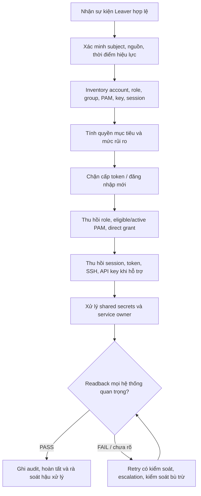

# Thu hồi quyền đặc biệt trong Leaver Lifecycle

Một kỹ sư nền tảng từng có quyền quản trị môi trường production, khả năng đọc bí mật trong kho lưu trữ và quyền kích hoạt vai trò đặc quyền qua hệ thống Privileged Access Management (PAM). Khi người này nghỉ việc, tổ chức đã khóa tài khoản ở Identity Provider (IdP). Tuy nhiên, một phiên quản trị trên dịch vụ đám mây vẫn còn hiệu lực, một khóa SSH vẫn nằm trong danh sách cho phép và tài khoản quản trị cục bộ vẫn tồn tại ở một ứng dụng cũ.

Tình huống trên cho thấy **khóa đăng nhập chưa đồng nghĩa với thu hồi hết quyền đặc biệt**. Trong **Identity and Access Management (IAM)**, xử lý **Leaver** cần tìm, ngăn sử dụng và xác minh việc loại bỏ các đặc quyền ở mọi hệ thống liên quan. Quy trình càng quan trọng khi một quyền có thể thay đổi chính sách, cấp thêm quyền cho người khác, đọc bí mật hoặc điều khiển hạ tầng.

Bài học trình bày cách nhận diện và **thu hồi quyền đặc biệt (privileged access revocation)** khi danh tính rời tổ chức hoặc không còn nhu cầu đặc quyền, kết nối với mô hình **Joiner–Mover–Leaver (JML)**, **IdP, SSO, SCIM, RBAC/ABAC, PAM/PIM/JIT**, tài khoản dịch vụ, kiểm toán và giảm **quyền truy cập tồn dư (residual access)**.

## 1. Quyền đặc biệt là gì?

**Quyền đặc biệt (privileged access)** là quyền có khả năng tạo thay đổi đáng kể đối với hệ thống, danh tính, cấu hình, dữ liệu hoặc cơ chế bảo mật. Khái niệm này phụ thuộc vào **hành động, tài nguyên và phạm vi**, chứ không chỉ phụ thuộc vào tên role có chữ “Administrator”.

Ví dụ quyền đặc biệt có thể bao gồm:

- Tạo, sửa hoặc vô hiệu hóa danh tính và tài khoản.
- Gán vai trò quản trị, thay đổi nhóm nhạy cảm hoặc sửa chính sách IAM.
- Cấu hình môi trường production, mạng, máy chủ, cluster và hệ thống CI/CD.
- Đọc, phát hành hoặc xoay vòng credential trong secrets manager.
- Sửa trust policy, tạo service principal hoặc phát hành khóa cho workload.
- Truy cập dữ liệu rất nhạy cảm, thực hiện xuất dữ liệu hàng loạt hoặc sửa cơ sở dữ liệu production.
- Thay đổi chính sách ghi log, lưu giữ bằng chứng hoặc cơ chế phát hiện bảo mật.

Một quyền có thể là đặc quyền **chỉ trong một phạm vi cụ thể**. Quản trị một dự án thử nghiệm và quản trị toàn bộ tenant production có mức ảnh hưởng khác nhau; chính sách thu hồi cần phân loại theo mức rủi ro thực tế.

### 1.1. Phân biệt các thành phần cần thu hồi

| Đối tượng | Ý nghĩa | Ví dụ cần xử lý |
|---|---|---|
| **Identity** | Danh tính tổ chức của chủ thể. | Nhân viên đã Leaver; trạng thái không còn đủ điều kiện truy cập. |
| **Account** | Tài khoản tại IdP, cloud, ứng dụng hoặc hệ thống cục bộ. | Tài khoản `admin.worker` và tài khoản đăng nhập thường. |
| **Role / entitlement** | Quyền gắn trực tiếp hoặc gián tiếp với account/principal. | Quyền `tenant-admin`, `secrets.read`. |
| **Group membership** | Quan hệ nhóm có thể tạo ra nhiều quyền. | Thành viên nhóm `production-operators`. |
| **Session** | Phiên đang sử dụng tài nguyên, có thể còn hiệu lực sau lần xác thực. | Phiên console quản trị, SSH, VPN. |
| **Credential** | Bằng chứng đăng nhập hoặc nhận token. | Mật khẩu, khóa SSH, certificate, client secret, API key. |
| **Token / grant** | Vật mang quyền hoặc khả năng lấy quyền. | Access token, refresh token, token STS. |
| **Delegation / eligible role** | Khả năng nâng quyền hoặc tác động thay người khác. | Quyền kích hoạt PAM/JIT, quyền ủy quyền phê duyệt. |

**Thu hồi quyền đặc biệt** không chỉ là xóa tên role khỏi danh sách. Một vai trò đã bị gỡ ở IdP có thể vẫn có hiệu lực qua direct grant, nhóm lồng nhau, tài khoản cục bộ hoặc phiên chưa được làm mới.

### 1.2. Thu hồi quyền, khóa account và xóa dữ liệu là các hành động khác nhau

- **Revoke entitlement:** làm cho một quyền hoặc một đường cấp quyền không còn hợp lệ.
- **Disable account:** ngăn account tiếp tục được sử dụng theo cơ chế của hệ thống đích.
- **Invalidate session/token:** làm phiên hoặc token không còn được chấp nhận, trong phạm vi sản phẩm hỗ trợ.
- **Rotate credential:** thay bí mật có khả năng đã được biết hoặc sao chép; phiên bản cũ cần bị loại bỏ theo quy trình.
- **Deprovision account:** loại bỏ tài khoản hoặc liên kết truy cập khỏi hệ thống khi phù hợp.
- **Retain/archive records:** giữ hồ sơ và audit đúng chính sách, nhưng không tiếp tục cho truy cập.

Không nên xóa ngay toàn bộ bản ghi danh tính khi Leaver nếu cần bảo toàn dữ liệu, lịch sử giao dịch, quy trình bàn giao hoặc bằng chứng kiểm toán. **Lưu hồ sơ** và **duy trì quyền đăng nhập** là hai quyết định riêng.

## 2. Vì sao phải ưu tiên đặc quyền trong Leaver?

Một quyền thông thường có thể cho phép xem một tập dữ liệu giới hạn. Một quyền quản trị có thể cho phép **cấp thêm quyền, mở rộng phạm vi truy cập hoặc vô hiệu hóa biện pháp bảo vệ**. Vì vậy, thời gian tồn tại của quyền đặc biệt sau khi người dùng hết thẩm quyền có thể làm tăng rủi ro đáng kể.

Các rủi ro cần phân biệt:

1. **Standing privilege:** đặc quyền được giữ thường trực dù chỉ thỉnh thoảng cần dùng.
2. **Privilege creep:** nhân viên đổi vai trò nhưng quyền cũ vẫn tồn tại.
3. **Indirect privilege escalation:** quyền sửa group, role, policy, trust hoặc secret có thể dẫn tới quyền cao hơn.
4. **Orphan privileged account:** account quản trị không còn gắn được với owner hợp lệ.
5. **Active privileged session:** phiên đã đăng nhập tiếp tục được sử dụng sau khi account bị khóa ở nơi khác.
6. **Residual credentials:** khóa hoặc token được phát hành trước đó vẫn được hệ thống đích chấp nhận.
7. **Shared secrets exposure:** người rời đi từng biết bí mật mà ứng dụng vẫn dùng.
8. **Break-glass misuse:** tài khoản khẩn cấp bị dùng làm đường truy cập thường xuyên và không được kiểm toán.

**Mục tiêu Leaver** là đưa mọi đường truy cập của chủ thể về trạng thái **không còn cho phép thao tác ngoài chính sách**, đồng thời giữ hệ thống và dịch vụ hợp lệ hoạt động thông qua quá trình bàn giao có kiểm soát.

## 3. Leaver, Mover và hết hạn đặc quyền có gì khác nhau?

Quyền đặc biệt có thể bị thu hồi do nhiều sự kiện:

| Sự kiện | Chủ thể còn hoạt động? | Hành động mong muốn |
|---|---|---|
| **Leaver nhân sự** | Không còn đủ tư cách truy cập theo nguồn có thẩm quyền. | Chặn đăng nhập; thu hồi mọi quyền cá nhân, đặc biệt quyền quản trị; xử lý credential và phiên. |
| **Mover khỏi vai trò quản trị** | Có thể vẫn là nhân viên. | Gỡ đặc quyền cũ; giữ hoặc cấp quyền mới hợp lệ theo vai trò hiện hành. |
| **Quyền JIT hết hạn** | Có. | Gỡ quyền kích hoạt trong phiên, đóng phiên/quyền liên quan theo cơ chế được thiết kế. |
| **Dự án kết thúc** | Có thể có. | Thu hồi quyền đặc biệt trên tài nguyên dự án; xử lý owner và service account liên quan. |
| **Tài khoản bị nghi lộ** | Chưa biết hoặc vẫn hoạt động. | Chặn ngay các đường rủi ro theo quy trình ứng phó; xác minh và khôi phục an toàn khi được phê duyệt. |
| **Nhà thầu hết hợp đồng** | Quan hệ hợp tác kết thúc. | Thu hồi quyền theo thời điểm hợp đồng, account và bí mật có liên quan. |

Một người đang làm việc nhưng không còn giữ nhiệm vụ Administrator **không nhất thiết phải bị khóa toàn bộ tài khoản**. Ngược lại, một người đã nghỉ việc thường cần ngừng **cả truy cập thường lẫn đặc quyền**. Quy trình phải phân biệt trạng thái danh tính và trạng thái từng entitlement.

## 4. Kiểm kê đặc quyền trước khi có sự kiện Leaver

Muốn thu hồi đủ, tổ chức cần biết những quyền nào đang tồn tại và ở đâu. **Inventory** nên được duy trì liên tục thay vì chờ đến ngày người dùng nghỉ việc mới bắt đầu tìm kiếm.

### 4.1. Nguồn tìm kiếm quyền đặc biệt

| Nguồn | Có thể phát hiện gì? | Ví dụ sai lệch thường gặp |
|---|---|---|
| **IdP / Directory** | Role, nhóm, account, trạng thái đăng nhập, ứng dụng liên kết. | Nhóm lồng nhau cấp quyền admin nhưng không nằm trong danh sách role trực tiếp. |
| **PAM / PIM** | Vai trò đủ điều kiện kích hoạt, yêu cầu nâng quyền, tài khoản đặc quyền và phiên. | Người rời đi không có role active nhưng vẫn có eligible role. |
| **Cloud IAM** | Policy, role assignment, principal, resource binding, access key. | Direct grant trên project/subscription không đi qua IdP. |
| **SaaS và ứng dụng nội bộ** | Tài khoản cục bộ, role ứng dụng, API token, ủy quyền. | User bị khóa SSO nhưng tài khoản quản trị nội bộ còn dùng mật khẩu riêng. |
| **Secrets manager / PKI** | Khóa, chứng chỉ, secret và quyền truy xuất. | Người rời đi từng đọc một secret chung chưa được thay. |
| **Hệ thống SSH / VPN / bastion** | Public key được cho phép, phiên từ xa, tài khoản máy chủ. | Khóa SSH cá nhân vẫn được cấu hình trên server. |
| **CI/CD và service catalog** | Bot, pipeline, service principal và người sở hữu. | Tài khoản dịch vụ còn owner là nhân viên đã nghỉ. |
| **Ứng dụng nghiệp vụ** | Quyền phê duyệt, truy xuất dữ liệu, ủy quyền theo đơn vị. | Có quyền ký duyệt giao dịch không được mô hình hóa như role admin. |

### 4.2. Dữ liệu tối thiểu cho một bản ghi đặc quyền

Một hệ thống governance có thể ghi:

```yaml
privilegeAssignmentId: grant-1042
subjectId: person-071
targetSystem: production-cloud
accountId: admin-account-071
entitlement: deployment-admin
resourceScope: project-payments-prod
grantPath: PAM_ELIGIBILITY
approvedBy: person-019
reason: "Vận hành hệ thống thanh toán"
grantedAt: "2026-10-01T09:00:00+07:00"
reviewAfter: "2026-12-01"
lifecycleState: ACTIVE
```

Đây là **cấu trúc dữ liệu minh họa**, không phải schema chuẩn chung. Những trường quyết định chất lượng là: **subject → account/principal → quyền → tài nguyên → đường cấp → owner/approver → thời hạn**.

Một account có thể có nhiều đường cấp cùng một quyền. Hệ thống phải thấy **effective access**, không chỉ một membership mà nó tình cờ biết tới.

## 5. Quy tắc thu hồi: quyền mục tiêu và quyền thực tế

Để giảm quyền tồn dư, hệ thống IAM/IGA cần phân biệt hai trạng thái:

- **Desired state:** quyền mà danh tính còn được phép sử dụng theo HRIS, vai trò hiện tại, chính sách, phê duyệt và ngoại lệ.
- **Actual state:** quyền mà hệ thống đích đang thực sự cho phép qua role, group, policy, credential, account và phiên.

Có thể biểu diễn:

```text
D = tập quyền mục tiêu hợp lệ
A = tập quyền hiệu lực thực tế

Cần cấp       = D - A
Cần thu hồi   = A - D
Đã đúng       = D ∩ A
```

Đối với **Leaver hoàn toàn**, tập quyền tương tác cá nhân thường phải trở về rỗng theo chính sách, còn hồ sơ kiểm toán có thể được giữ. Đây là phép **so sánh khái niệm**, vì quyền hiệu lực phụ thuộc nhiều điều kiện và đường cấp; việc gỡ một role chưa chắc làm mất quyền nếu có role khác giữ cùng quyền.

### 5.1. RBAC: tìm mọi đường gán vai trò

Trong **Role-Based Access Control (RBAC)**, quyền có thể đến từ:

- Role gán trực tiếp cho principal.
- Nhóm IdP hoặc directory và các **nhóm lồng nhau**.
- Nhóm ứng dụng được đồng bộ qua connector.
- Role trên tài nguyên cụ thể, tenant, project, namespace hoặc database.
- Quyền đủ điều kiện kích hoạt từ hệ thống quản lý đặc quyền.

Ví dụ:

```text
person-071
├── group: platform-operators
│   └── role: deploy-production
├── group: emergency-responders
│   └── role: production-diagnostics
└── direct grant: database-admin
```

Gỡ `platform-operators` **không loại bỏ** `database-admin`. Nếu `emergency-responders` vẫn còn hợp lệ với người đó sau một lần Mover, chính sách cần phê duyệt và kiểm tra rõ; với Leaver, mọi đường cá nhân phải được xử lý.

### 5.2. ABAC: trạng thái và thuộc tính có thể tiếp tục cho phép truy cập

Trong **Attribute-Based Access Control (ABAC)**, quyền phụ thuộc vào thuộc tính của subject, resource, action và context.

Ví dụ policy khái niệm:

```text
Cho phép cấu hình production nếu:
  subject.employmentStatus == ACTIVE
  subject.privilegedDuty == PLATFORM_OPERATOR
  resource.environment == production
  session.assurance >= requiredLevel
  request có phê duyệt hợp lệ và chưa hết hạn
```

Khi người dùng Leaver, `employmentStatus` phải được cập nhật từ nguồn có thẩm quyền và chính sách của resource server phải kiểm tra dữ liệu đủ mới. Nhưng nếu hệ thống dựa vào **token đã phát hành chứa claims cũ**, token có thể vẫn được chấp nhận cho tới khi hết hạn hoặc bị chặn bằng cơ chế tương ứng.

**Cập nhật thuộc tính** và **ngăn một phiên đang dùng quyền cũ** là hai bước cần kiểm tra riêng.

## 6. Thứ tự hành động trong Leaver đặc quyền

Quy trình cần xác định **mốc hiệu lực**, **mức rủi ro** và **phụ thuộc hệ thống**. Trường hợp Leaver đã được lên lịch khác với yêu cầu chặn truy cập khẩn cấp.

### 6.1. Chuẩn bị trước thời điểm Leaver

Trước ngày nghỉ dự kiến, có thể thực hiện những công việc không làm phát sinh quyền ngoài thời hạn:

1. Xác minh danh tính, tài khoản liên kết và nguồn sự kiện.
2. Kiểm kê role, group, tài khoản quản trị, credential, phiên và quyền PAM/PIM.
3. Xác định ứng dụng/nguồn quyền chưa tích hợp và người xử lý thủ công.
4. Lập kế hoạch chuyển giao tài nguyên và ownership của service account.
5. Xác định bí mật chung cần rotation và thời điểm thay phù hợp.
6. Lập lịch vô hiệu hóa, thu hồi và xác minh theo thời điểm hiệu lực.
7. Kiểm tra có quyền đặc biệt đang chạy lâu hơn thời hạn nghỉ hay không.

**Chuẩn bị thu hồi** không có nghĩa sớm xóa tài khoản hoặc phá vỡ công việc khi quyền vẫn hợp lệ. Phải tách thời điểm lập kế hoạch và thời điểm quyền bị chặn.

### 6.2. Thời điểm hiệu lực: ưu tiên chặn đường truy cập rủi ro cao

Khi Leaver có hiệu lực, quy trình thường ưu tiên:

- Chặn khả năng đăng nhập và nhận **credential/token mới** ở các điểm tin cậy phù hợp.
- Vô hiệu hóa những tài khoản quản trị riêng, quyền PAM/PIM và khả năng nâng quyền JIT.
- Thu hồi role trực tiếp, nhóm đặc quyền và quyền trên ứng dụng/cloud.
- Chấm dứt các phiên quản trị đang hoạt động khi hệ thống cho phép.
- Thu hồi API key, khóa SSH, certificate, refresh token và credential cá nhân có liên quan.
- Xử lý secret chung có nguy cơ đã được người đó biết hoặc sao chép.
- Đặt tác vụ xác minh ở hệ thống đích và theo dõi ngoại lệ chưa xử lý.

Không nên mặc định một thứ tự kỹ thuật duy nhất luôn phù hợp: ở hệ thống nhạy cảm, **revoke quyền tại resource** hoặc chặn tại gateway có thể cần diễn ra song song với vô hiệu hóa IdP. Mục tiêu là ngăn đường truy cập còn rủi ro **sớm nhất theo chính sách** và không bỏ sót bước hậu xử lý.

### 6.3. Sau thời điểm hiệu lực: kiểm chứng và bàn giao

Một Leaver chỉ nên được coi là đã hoàn tất theo tiêu chí đã định khi:

- Các đường truy cập trong phạm vi bắt buộc đã bị chặn và có **bằng chứng đọc lại**.
- Những hệ thống không thể xác minh đều được ghi nhận là ngoại lệ, có owner và thời hạn khắc phục.
- Tài nguyên, lịch chạy, kho mã, backup và service identity được bàn giao đúng người có trách nhiệm.
- Nhật ký quyết định và các tác vụ thu hồi được lưu theo chính sách.
- Giấy phép và tài khoản thừa được dọn sau khi xét phụ thuộc nghiệp vụ và yêu cầu lưu trữ.

Không biến trạng thái “đã gửi lệnh” thành “đã thu hồi thành công” khi còn một quyền production chưa được xác minh.

## 7. PAM, PIM và quyền nâng cấp Just-in-Time

### 7.1. PAM/PIM quản lý những gì?

**Privileged Access Management (PAM)** là các cơ chế quản lý credential, phiên và quyền đặc quyền. **Privileged Identity Management (PIM)** thường mô tả quản lý vai trò đủ điều kiện kích hoạt, phê duyệt và thời hạn nâng quyền trong các nền tảng tương ứng.

Một người có thể có các trạng thái khác nhau:

- **Eligible:** đủ điều kiện kích hoạt vai trò khi có yêu cầu hợp lệ.
- **Active:** vai trò đang được kích hoạt với quyền thực tế.
- **Standing:** role có hiệu lực thường trực.
- **Expired/Revoked:** quyền hoặc khả năng nâng quyền không còn hợp lệ.

Leaver phải kiểm tra **cả eligible role lẫn active role**, vì người đã mất active role nhưng vẫn eligible có thể tự kích hoạt lại nếu quy trình còn cho phép.

### 7.2. Thu hồi quyền JIT có các lớp nào?

Giả sử một kỹ sư đang có quyền `database-admin` qua PAM cho một phiên nâng quyền 30 phút. Khi nghỉ việc khẩn cấp giữa phiên:

1. Vô hiệu hóa khả năng tạo **yêu cầu nâng quyền mới**.
2. Hủy quyền eligible hoặc điều kiện kích hoạt ở hệ thống quản trị.
3. Thu hồi quyền active đang được gán cho target.
4. Chấm dứt hoặc vô hiệu hóa session do PAM/bastion quản lý nếu hỗ trợ.
5. Chặn credential/token được cấp cho phiên theo khả năng của target.
6. Đọc lại trạng thái ở PAM **và** resource server/database.

Chỉ xóa quyền eligible sẽ **không chắc tự động kết thúc** phiên đã được kích hoạt. Chỉ đóng một phiên cũng **không chắc xóa** role thường trực hoặc direct grant nằm ngoài PAM.

### 7.3. Bàn giao và thu hồi đặc quyền quản trị hạ tầng

Khi người rời đi có trách nhiệm vận hành dịch vụ đang hoạt động:

- Chuyển ownership của tài nguyên sang đội được ủy quyền.
- Bảo đảm người được bàn giao đã có quyền hợp lệ trước hoặc theo thời điểm chuyển tiếp được phê duyệt.
- Thu hồi **quyền cá nhân** của người rời đi.
- Không tái sử dụng danh tính cá nhân của Leaver làm tài khoản automation.
- Kiểm tra các tài khoản root, shared admin, break-glass và secret được quản lý riêng.

Quyền của **dịch vụ hợp lệ** có thể tiếp tục tồn tại sau khi nhân viên nghỉ, nhưng phải có owner và cơ chế chứng thực mới phù hợp; không nên để dịch vụ phụ thuộc vào tài khoản cá nhân đã bị vô hiệu hóa.

## 8. Phiên, token và credential: phần dễ bỏ sót nhất

### 8.1. IdP/SSO không tự kết thúc mọi phiên ứng dụng

**Identity Provider (IdP)** và **Single Sign-On (SSO)** giúp xác thực tập trung, thường qua SAML hoặc OpenID Connect. Khi IdP khóa một người dùng, các **lần đăng nhập mới** thường bị chặn theo cơ chế tích hợp; nhưng ứng dụng có thể đang giữ session cookie hoặc token riêng.

Ví dụ:

- Session SaaS được tạo trước khi IdP vô hiệu hóa account.
- Access token còn hạn và được API kiểm tra cục bộ bằng chữ ký.
- Refresh token có thể hoặc không thể bị thu hồi qua cơ chế issuer.
- Phiên SSH hoặc VPN có thể tồn tại cho tới khi bị ngắt riêng.
- Ứng dụng legacy vẫn cho phép đăng nhập bằng mật khẩu cục bộ.

Cần xác định **mỗi ứng dụng hỗ trợ revoke/logout/terminate như thế nào**, trong bao lâu thay đổi có hiệu lực và có thể đọc lại điều gì.

### 8.2. Access token và refresh token khác nhau

**Access token** cho phép truy cập resource theo thời hạn và phạm vi của token. **Refresh token** cho phép yêu cầu access token mới theo điều kiện của issuer.

Nếu hệ thống thu hồi refresh token nhưng resource server vẫn chấp nhận một access token chưa hết hạn, quyền có thể còn tồn tại trong khoảng thời gian nhất định. Với token tự chứa (ví dụ JWT được xác minh cục bộ), khả năng chặn ngay có thể cần cơ chế bổ sung như phiên bản session, denylist, introspection hoặc chặn tại resource/gateway, tùy sản phẩm.

Do đó quy trình phải ghi rõ:

- Token nào có thể thu hồi trực tiếp?
- Resource server kiểm tra trạng thái token hiện hành hay chỉ chữ ký và thời hạn?
- Có thể vô hiệu hóa account/permission ở tài nguyên đích độc lập với token không?
- Thời gian sống tối đa của token hoặc session hiện hữu là bao lâu?
- Có phương án chặn khẩn cấp và cách kiểm chứng hay không?

**Không đưa access token, refresh token hoặc private key thật vào nhật ký thu hồi**; lưu mã tham chiếu/fingerprint phù hợp khi cần điều tra.

### 8.3. SSH, VPN, khóa API và chứng chỉ

| Cơ chế | Bước thu hồi có thể cần | Vấn đề còn tồn tại |
|---|---|---|
| **SSH authorized key** | Gỡ public key khỏi host/bastion hoặc nguồn cấp, kiểm tra quyền truy cập còn hiệu lực. | Phiên SSH đang mở có thể chưa bị ngắt chỉ vì key bị gỡ. |
| **SSH certificate** | Chặn phát hành mới, thu hồi/deny theo cơ chế triển khai hoặc đợi hết hạn. | Các máy đích phải nhận trạng thái từ chối hoặc kiểm tra policy. |
| **VPN** | Vô hiệu hóa account/chứng thực, kết thúc phiên và đọc lại kết nối. | Phiên đang hoạt động có thể cần lệnh terminate riêng. |
| **API key** | Revoke/xóa key ở dịch vụ đích, thay key của workload hợp lệ nếu cần. | Bản sao key vẫn nguy hiểm nếu key cũ chưa thực sự bị từ chối. |
| **Client secret** | Thu hồi hoặc rotate tại issuer/ứng dụng, cập nhật workload hợp lệ. | Secret có thể đang nằm ở nhiều bản sao cấu hình. |
| **X.509 certificate** | Chặn cấp mới, xử lý thu hồi theo PKI và trust policy. | Hệ thống đích có thể không tra cứu trạng thái thu hồi ngay hoặc có cache. |
| **Local admin password** | Vô hiệu hóa account hoặc thay credential theo chính sách. | Shared password có thể bị biết bởi nhiều người, cần quản lý vòng đời riêng. |

**Rotation** có mục đích thay thế secret; **revocation** làm credential cũ không còn được chấp nhận. Trong tình huống nhạy cảm, chỉ phát hành secret mới mà vẫn chấp nhận secret cũ **chưa hoàn tất thu hồi**.

## 9. IdP, SCIM và các hệ thống đích có vai trò khác nhau

### 9.1. IdP và directory

IdP có thể quản lý tài khoản, nhóm, ứng dụng liên kết và chính sách đăng nhập. Với một Leaver, cần kiểm tra:

- Trạng thái account người dùng và tài khoản quản trị riêng.
- Membership nhóm đặc quyền, nested group, vai trò có khả năng nâng quyền.
- Quyền tạo token, khóa hoặc phương thức chứng thực mới.
- Những ứng dụng có đường đăng nhập không phụ thuộc IdP.

Tắt account ở IdP là một **tín hiệu và bước kiểm soát quan trọng**, nhưng không đủ làm bằng chứng mọi quyền đặc biệt đã biến mất khỏi các hệ thống khác.

### 9.2. SCIM hỗ trợ provisioning, không phải mọi dạng revoke

**System for Cross-domain Identity Management (SCIM)** hỗ trợ quản lý đối tượng như User và Group giữa các hệ thống tích hợp. Tùy khả năng triển khai, IAM có thể dùng SCIM để:

- Cập nhật trạng thái người dùng, chẳng hạn `active=false` trong mô hình SCIM hỗ trợ.
- Gỡ membership trong những group quản lý qua SCIM.
- Đồng bộ thay đổi thuộc tính phục vụ quyền truy cập.

Tuy nhiên, SCIM **không mặc nhiên thu hồi**:

- Phiên hoặc token đã cấp trước đó.
- API key hoặc SSH key riêng nằm ngoài đối tượng SCIM.
- Role nội bộ ứng dụng không được ánh xạ qua connector.
- Tài khoản cục bộ hay đường đăng nhập trực tiếp không do SCIM quản lý.
- Khả năng khôi phục đặc quyền từ trust policy, service principal hoặc cấu hình cloud.

Cần đối soát với **trạng thái quyền thực tế tại ứng dụng đích**, không chỉ phản hồi thành công của lệnh SCIM.

### 9.3. Các hệ thống đích không hỗ trợ provisioning tự động

Một ứng dụng chỉ có giao diện quản trị thủ công vẫn thuộc phạm vi Leaver nếu người rời đi có quyền đặc biệt trong đó. Tác vụ thủ công cần:

1. Định danh account và quyền cụ thể phải xử lý.
2. Người được phép thực thi lệnh thu hồi.
3. Thời hạn theo mức rủi ro.
4. Bằng chứng kiểm tra sau thao tác (ví dụ trạng thái account/role hiện hành).
5. Kết quả và người xác nhận độc lập khi chính sách yêu cầu.
6. Cơ chế nâng mức xử lý nếu quá hạn hoặc không thể chặn ngay.

**Đã tạo ticket** khác với **đã chặn quyền**. Nếu hệ thống nhạy cảm không thể thu hồi theo thời gian mục tiêu, cần mở ngoại lệ rủi ro và biện pháp ngăn truy cập ở lớp khác được phê duyệt.

## 10. Tài khoản dịch vụ, bí mật dùng chung và vấn đề ownership

Một nhân viên có thể là người tạo hoặc quản lý một **service account**, bot, workload identity hoặc pipeline CI/CD. Các đối tượng này có vòng đời riêng và có thể phục vụ hoạt động sản xuất sau khi nhân viên nghỉ.

### 10.1. Không nhầm quyền cá nhân với quyền workload

Ví dụ:

- Quân có quyền đọc secret `payments-sync-key` trong vault.
- Dịch vụ `payments-sync` dùng secret đó để tích hợp hệ thống thanh toán.
- Khi Quân Leaver, quyền **cá nhân của Quân** phải bị thu hồi.
- Dịch vụ vẫn cần hoạt động; việc giữ secret hoặc thay credential của dịch vụ phải do owner mới quyết định và thực hiện có kiểm soát.

Không nên **tự xóa toàn bộ service account** chỉ vì người đã tạo account nghỉ việc. Cũng không được bỏ qua việc thu hồi quyền truy cập bí mật cá nhân hoặc vấn đề một bí mật có thể đã bị sao chép.

### 10.2. Quy trình với service account liên quan Leaver

1. Kiểm kê service principal, API key, certificate, secret và workload mà người rời đi có thể quản lý.
2. Xác minh dịch vụ còn hoạt động và có mục đích hợp lệ không.
3. Chỉ định **owner team** và người chịu trách nhiệm mới qua nguồn quản trị dịch vụ.
4. Thu hồi quyền cá nhân của Leaver trên secrets manager, cloud IAM và CI/CD.
5. Đánh giá bí mật đã từng có thể bị đọc, tải xuống hoặc sao chép; thực hiện rotation khi phù hợp mức rủi ro.
6. Đảm bảo credential thay thế được triển khai an toàn trước khi vô hiệu hóa bí mật cũ, nếu chính sách và tình huống cho phép.
7. Xác minh dịch vụ còn hoạt động đúng, đồng thời credential cũ không còn được chấp nhận.
8. Đánh dấu các account không còn workload/owner hợp lệ để thu hồi theo quy trình riêng.

**Owner không nên chỉ là email một nhân viên.** Service account có thể có owner theo nhóm, ứng dụng và danh mục dịch vụ để việc chuyển người không làm đứt trách nhiệm.

### 10.3. Bí mật dùng chung phải được đánh giá riêng

Nếu một mật khẩu hoặc private key từng được nhiều người biết, vô hiệu hóa account cá nhân **không xóa khả năng dùng lại bí mật đó**. Cần xác định:

- Ai có thể đã truy cập bí mật?
- Bí mật được sử dụng ở bao nhiêu hệ thống?
- Có thể thu hồi hoặc thay mà không gây gián đoạn không?
- Có thể chuyển sang credential theo từng workload hoặc ngắn hạn không?
- Có nhật ký truy cập hoặc dấu hiệu bất thường cần điều tra không?

Biện pháp lâu dài thường là giảm chia sẻ secret tĩnh, dùng quyền theo workload và credential ngắn hạn khi hệ thống hỗ trợ.

## 11. Tài khoản break-glass và quyền khẩn cấp

**Break-glass account** là một cơ chế khẩn cấp được thiết kế để khôi phục hoạt động khi các luồng truy cập thông thường gặp sự cố. Nó có thể có đặc quyền rất cao nên cần quản lý độc lập, bảo vệ nghiêm ngặt và thử nghiệm định kỳ.

Khi một người từng được phép dùng break-glass nghỉ việc:

- Thu hồi **quyền hoặc khả năng sử dụng** của người đó theo quy trình.
- Kiểm tra có credential khẩn cấp nào người đó từng biết hoặc có thể sao chép không; rotation khi cần.
- Chỉ định lại custodian/chủ sở hữu được phê duyệt.
- Xác minh hệ thống vẫn còn phương án phục hồi hợp lệ, không bị khóa hoàn toàn vì xử lý Leaver.
- Giám sát sự kiện truy cập khẩn cấp và điều tra mọi lần dùng sau thời điểm quyền cá nhân đã kết thúc.

Không nên xóa tài khoản break-glass chung của cả tổ chức một cách mù quáng chỉ vì một thành viên đội vận hành nghỉ. Mục tiêu là **ngừng khả năng truy cập trái phép của người đó** mà vẫn giữ năng lực khôi phục được quản trị đúng.

## 12. Phê duyệt và phân tách trách nhiệm khi thu hồi đặc quyền

**Separation of Duties (SoD)** giúp tránh trường hợp một người vừa có thể tạo/giữ quyền trái phép vừa tự xác nhận mình đã thu hồi quyền đó.

Một quy trình Leaver có thể phân nhiệm:

| Vai trò | Trách nhiệm | Kiểm soát |
|---|---|---|
| **Nguồn nhân sự/nhà thầu** | Xác nhận sự kiện và thời điểm kết thúc quan hệ. | Có thẩm quyền, bảo vệ tính toàn vẹn dữ liệu. |
| **IAM workflow** | Tính quyền mục tiêu, điều phối cấp/thu hồi, theo dõi ngoại lệ. | Không được tự ý bỏ qua chính sách. |
| **Administrator của hệ thống đích** | Thực hiện gỡ role, account, session, key theo phạm vi được giao. | Nhật ký thao tác, least privilege. |
| **Resource owner / security** | Xác nhận rủi ro và các ngoại lệ nhạy cảm. | Quyền phê duyệt độc lập với chủ thể Leaver. |
| **Reviewer / auditor** | Kiểm tra bằng chứng, tình trạng sau thu hồi. | Đọc trạng thái thực tế và lịch sử; không làm mất log. |

Thu hồi quyền đã hết hiệu lực theo quy trình Leaver được phê duyệt có thể cần **tự động hóa ngay** để tránh chờ phê duyệt mới. Các tình huống **giữ ngoại lệ truy cập sau mốc Leaver** phải bị giới hạn nghiêm ngặt và chỉ thực hiện nếu có căn cứ hợp lệ cùng cấp thẩm quyền thích hợp.

### 12.1. Không để người Leaver tự xác nhận hoàn tất

Không nên dựa vào lời xác nhận của chính người rời đi rằng “đã xóa tất cả khóa API”. Họ có thể hỗ trợ bàn giao, nhưng **bằng chứng thu hồi** cần đến từ hệ thống đích, nhật ký và người kiểm tra được phân quyền. Các secret không thể chứng minh đã thu hồi cần được thay hoặc kiểm soát bằng phương án khác phù hợp.

## 13. Workflow thu hồi đặc quyền có thể kiểm chứng

Một luồng xử lý có thể mô tả:



Đây là sơ đồ **logic công việc**, không phải cam kết về thứ tự bắt buộc cho mọi hệ thống. Một số hành động cần chạy song song để chặn truy cập kịp thời; việc kiểm tra lại kết quả luôn là bước không thể bỏ qua.

### 13.1. Mẫu sự kiện Leaver

```json
{
  "eventId": "leaver-2026-0142",
  "subjectId": "person-071",
  "eventType": "LEAVER",
  "source": "authoritative-workforce-system",
  "effectiveAt": "2026-12-01T17:00:00+07:00",
  "sourceVersion": 42,
  "priority": "STANDARD",
  "privilegedAccessReviewRequired": true
}
```

Dữ liệu mang tính minh họa. **Effective time** thể hiện mốc nghiệp vụ phải ngừng quyền, khác với lúc IAM nhận hoặc thực thi event. Quy trình cần kiểm tra nguồn và quyền phát hành sự kiện, tránh tạo Leaver giả để khóa tài khoản của người khác.

### 13.2. Lập kế hoạch thu hồi cho từng hệ thống

Một target plan có thể gồm:

```yaml
subjectId: person-071
effectiveAt: "2026-12-01T17:00:00+07:00"
targets:
  - system: idp
    action: DISABLE_ACCOUNT
    verify: ACCOUNT_DISABLED
  - system: pam
    action: REMOVE_ELIGIBLE_AND_ACTIVE_PRIVILEGES
    verify: NO_PRIVILEGED_ASSIGNMENT
  - system: cloud-production
    action: REMOVE_DIRECT_AND_GROUP_GRANTS
    verify: NO_EFFECTIVE_PRIVILEGED_ACCESS
  - system: vpn
    action: TERMINATE_SESSION
    verify: NO_ACTIVE_SESSION
  - system: legacy-admin
    action: MANUAL_DISABLE
    verify: ADMIN_ACCOUNT_DISABLED
```

Đây là **đặc tả nghiệp vụ ví dụ**, không phải YAML dùng trực tiếp cho công cụ quản trị nào. Khi triển khai, mỗi action phải có adapter hỗ trợ, owner, thời hạn, giới hạn retry và nguồn readback.

### 13.3. Idempotency, thứ tự sự kiện và khả năng xử lý lại

Các sự kiện có thể bị gửi trùng hoặc đến trễ. Xử lý Leaver cần bảo đảm:

- **Idempotency:** chạy lại cùng yêu cầu không tạo quyền mới hoặc phục hồi account.
- **State/version check:** sự kiện Mover cũ đến sau Leaver không được kích hoạt lại quyền.
- **Retry có kiểm soát:** chỉ retry tác vụ phù hợp, không lặp vô hạn; phân biệt lỗi kết nối và lỗi chính sách.
- **Partial failure visibility:** một hệ thống thành công không che khuất hệ thống thất bại.
- **Không tự rollback mở quyền:** nếu thu hồi ở cloud đã thành công nhưng hệ thống SaaS thất bại, không khôi phục role cloud chỉ để “đồng bộ trạng thái”.
- **Readback:** xác minh kết quả thực ở target thay vì suy diễn từ HTTP status.

Ví dụ pseudocode:

```text
handleLeaver(event):
  verifyAuthoritativeSource(event)
  current = readCurrentIdentityState(event.subjectId)

  if eventIsStale(event, current):
      recordStaleEvent(event)
      return

  plan = enumeratePrivilegedAccess(event.subjectId)
  blockNewPrivilegedAccess(plan, event.effectiveAt)

  for each target in plan:
      revokeWithIdempotency(target)
      actual = readTargetState(target)
      recordResult(target, actual)

      if actual still permits prohibited access:
          createEscalation(target)

  markCompleteOnlyIfRequiredEvidencePasses()
```

Pseudocode chỉ minh họa điều kiện an toàn; trong hệ thống thật phải xử lý lịch tác vụ, atomicity tại từng target, đồng thời, chính sách ưu tiên và thời điểm hiệu lực.

## 14. Trạng thái tác vụ và xử lý thất bại

Không nên dùng duy nhất hai trạng thái `SUCCESS/FAILED` cho một workflow nhiều hệ thống. Có thể dùng mô hình:

| Trạng thái | Ý nghĩa |
|---|---|
| `SCHEDULED` | Chờ tới thời điểm hiệu lực. |
| `IN_PROGRESS` | Đang thực thi các tác vụ thu hồi. |
| `APPLIED` | Lệnh đã được target chấp nhận/thực thi theo phản hồi, chưa đủ bằng chứng. |
| `VERIFIED` | Readback xác nhận quyền không còn hiệu lực theo tiêu chí. |
| `FAILED_RETRYABLE` | Lỗi tạm thời có thể xử lý lại an toàn. |
| `MANUAL_ACTION_REQUIRED` | Phải xử lý bằng người có quyền phù hợp. |
| `RISK_EXCEPTION_OPEN` | Chưa thể chặn theo mục tiêu; có owner và phương án giảm thiểu. |
| `CLOSED` | Đạt điều kiện đóng theo chính sách và bằng chứng yêu cầu. |

Trạng thái là **ví dụ thiết kế**. Tổ chức có thể có quy định khác, nhưng phải phân biệt **đã phát lệnh** với **quyền thực sự bị chặn**.

### 14.1. Đối soát quyền hiệu lực

Ví dụ có một role `secrets.read` được gán qua hai đường:

```text
person-071
├── group: platform-admins → secrets.read
└── direct grant: vault-secret-operations → secrets.read
```

Nếu chỉ gỡ `platform-admins`, quyền vẫn tồn tại qua direct grant. Readback cần kiểm tra **effective access** bằng dữ liệu quyền của target và các đường cấp có thể kiểm tra; chỉ kiểm tra một group đã rỗng là chưa đủ.

### 14.2. Khi không thể chặn ngay token hay phiên

Có thể xảy ra trường hợp API đích không hỗ trợ thu hồi tức thì token tự chứa đã phát hành. Khi đó cần:

1. Xác định chính xác phạm vi tài nguyên và thời gian token còn có thể dùng.
2. Áp dụng cơ chế chặn khác được hỗ trợ tại resource/gateway/policy nếu có.
3. Cảnh báo và giới hạn truy cập theo mức rủi ro trong thời gian còn tồn đọng.
4. Ghi nhận owner, hạn xử lý và kết quả kiểm chứng tại từng mốc.
5. Cải thiện thiết kế về sau bằng token ngắn hạn, kiểm tra trạng thái phiên hoặc cơ chế revoke phù hợp.

Không báo “mọi quyền đã thu hồi” chỉ vì đã khóa IdP nếu chưa có bằng chứng rằng token/phiên của hệ thống đích không còn hiệu lực.

## 15. Ví dụ đầy đủ: Leaver của Cloud Administrator

Giả sử nhân viên Hà nghỉ việc tại thời điểm 17:00 ngày 01/12/2026. Hà từng quản trị cloud production, có tài khoản đăng nhập riêng cho công việc thường, account admin riêng, quyền eligible trong PIM và đã quản lý một pipeline CI/CD.

### 15.1. Kiểm kê trước Leaver

| Đường truy cập | Trạng thái ban đầu | Rủi ro cần xử lý |
|---|---|---|
| Account nhân viên tại IdP | Active | Có thể đăng nhập mới. |
| Account quản trị riêng | Active | Có thể thao tác production. |
| PIM eligible role | Eligible | Có thể kích hoạt đặc quyền dù hiện chưa active. |
| Direct cloud admin grant | Active | Có thể bypass quy trình nâng quyền. |
| Phiên console cloud | Đang mở | Có thể tiếp tục thao tác sau khi role thay đổi. |
| Khóa SSH cá nhân trên bastion | Còn được cho phép | Có thể mở phiên truy cập từ xa. |
| Token API cá nhân | Chưa xác định | Có thể dùng với automation hoặc API. |
| Service principal CI/CD | Đang hoạt động | Cần owner mới; tránh xóa phá pipeline hợp lệ. |
| Secret pipeline trong vault | Hà từng có quyền đọc | Cần đánh giá rotation và thu hồi quyền đọc. |

### 15.2. Kế hoạch thực thi

**Trước 17:00:** xác minh dữ liệu HRIS, thống kê quyền và hệ thống đích, chuẩn bị bàn giao owner của pipeline, lên lịch thu hồi theo đúng thời điểm. Nếu có yêu cầu xử lý khẩn cấp trước giờ đó, dùng quy trình có thẩm quyền riêng.

**Từ 17:00:** chặn đăng nhập account thường và admin ở IdP; thu hồi role active/eligible trong PIM; gỡ direct cloud grant; đóng các phiên có thể terminate; gỡ SSH key; vô hiệu hóa token/credential cá nhân theo khả năng của từng hệ thống. Các hành động cần được điều phối theo mức ưu tiên để giảm thời gian còn quyền production.

**Sau thu hồi:** readback trạng thái PIM, cloud IAM, bastion, token/session và ứng dụng cục bộ. Chuyển service principal và workflow CI/CD sang owner được chỉ định; xem xét thay secret vì Hà đã từng có quyền truy xuất. Lưu bằng chứng và xử lý những target chưa xác minh.

### 15.3. Ma trận kết quả mẫu

| Target | Yêu cầu kết quả | Kết luận khi đọc lại |
|---|---|---|
| IdP | Cả account thường và admin không còn được đăng nhập. | `VERIFIED` nếu đã khóa đúng identity và đường đăng nhập. |
| PIM | Không còn active hoặc eligible privilege cho Hà. | `VERIFIED` khi không còn assignment hợp lệ. |
| Cloud IAM | Không còn direct/group grant cho principal của Hà. | `VERIFIED` khi không còn effective privilege. |
| Bastion | Key bị gỡ; session không còn; đường truy cập đã bị chặn. | `VERIFIED` sau kiểm tra cơ chế tương ứng. |
| API token | Không còn token cá nhân được chấp nhận; xác định ngoại lệ nếu chưa thể chặn ngay. | Có thể cần `RISK_EXCEPTION_OPEN`. |
| CI/CD service identity | Có owner hợp lệ và credential đã được đánh giá. | Báo cáo bàn giao riêng; không coi là quyền cá nhân của Hà. |

Nếu chỉ khóa account IdP mà bỏ qua PIM eligible role, direct grant hoặc SSH key, **Leaver chưa đạt tiêu chí thu hồi đặc quyền**.

### 15.4. Nếu Hà chuyển vị trí thay vì nghỉ việc

Khi Hà chuyển sang nhóm phân tích nhưng vẫn ở lại doanh nghiệp, chỉ các quyền đặc quyền không còn phù hợp cần bị thu hồi theo **Mover**. Account thường có thể vẫn hoạt động và được cấp quyền mới theo nhiệm vụ. Điều kiện quyết định là **trạng thái quyền mục tiêu hợp lệ**, không phải từ khóa “admin” trong chức danh cũ.

## 16. Kiểm toán và bằng chứng thu hồi

Một bản ghi audit cho thu hồi quyền đặc biệt nên cho biết:

1. **Subject:** định danh ổn định của người hoặc workload, kể cả account liên kết.
2. **Nguồn sự kiện:** HRIS, hợp đồng hoặc quyết định có thẩm quyền; ID và thời điểm hiệu lực.
3. **Quyết định:** quyền phải thu hồi, policy/role/SoD liên quan, người phê duyệt ngoại lệ nếu có.
4. **Target:** hệ thống, account/principal, quyền, tài nguyên và đường cấp.
5. **Thực thi:** người hoặc connector đã chạy, thời điểm và kết quả.
6. **Xác minh:** trạng thái readback từ target, thời điểm kiểm tra và bằng chứng hợp lệ.
7. **Ngoại lệ:** người chịu trách nhiệm, mức rủi ro, hạn và biện pháp giảm thiểu.
8. **Hoàn tất:** ai xác nhận đóng và các bước còn phải theo dõi hậu Leaver.

Ví dụ JSON minh họa:

```json
{
  "eventId": "iam-revoke-6102",
  "subjectId": "person-071",
  "sourceLeaverEvent": "leaver-2026-0142",
  "effectiveAt": "2026-12-01T17:00:00+07:00",
  "target": "production-cloud",
  "entitlement": "deployment-admin",
  "action": "REVOKE",
  "requestStatus": "APPLIED",
  "verification": {
    "status": "VERIFIED",
    "checkedAt": "2026-12-01T17:02:00+07:00",
    "effectivePrivilegePresent": false
  }
}
```

Dữ liệu chỉ mô tả ý tưởng, không phải schema sản phẩm. Một hệ thống có thể lưu bằng chứng dưới dạng ID truy vấn, bản ghi thay đổi hoặc kết quả API phù hợp. Nhật ký phải **chống bị sửa trái phép** và hạn chế truy cập vì có thể chứa thông tin nhạy cảm về hệ thống, quan hệ nhân sự.

### 16.1. Chỉ số theo dõi hiệu quả

| Chỉ số | Ý nghĩa |
|---|---|
| **Privileged deprovisioning latency** | Từ thời điểm Leaver có hiệu lực tới khi quyền đặc biệt không còn được target cho phép. |
| **Verified revocation coverage** | Tỷ lệ đường quyền đặc biệt đã có readback đạt yêu cầu. |
| **Residual privileged grant count** | Số grant đặc biệt vẫn còn sau thời hạn phải thu hồi. |
| **PAM eligible residue** | Số trường hợp đã rời vai trò nhưng còn đủ điều kiện nâng quyền. |
| **Privileged active-session residue** | Số phiên đặc quyền chưa được kết thúc hoặc chưa xác minh. |
| **Orphan privileged account count** | Số account quản trị không có identity/owner hợp lệ. |
| **Shared-secret review coverage** | Tỷ lệ secret nhạy cảm liên quan Leaver đã được đánh giá và xử lý. |
| **Manual-revocation overdue** | Số tác vụ gỡ quyền thủ công quá hạn. |
| **Exception resolution time** | Thời gian đóng các ngoại lệ còn đường truy cập rủi ro. |

Nên tách **thời điểm nghiệp vụ có hiệu lực**, **thời điểm hệ thống nhận sự kiện**, **thời điểm gửi lệnh** và **thời điểm target thực sự từ chối quyền**. Chỉ một chỉ số “ticket đóng nhanh” không cho biết quyền có bị chặn kịp thời không.

## 17. Lỗi thiết kế thường gặp

| Sai lầm | Hậu quả | Cách cải thiện |
|---|---|---|
| Khóa account IdP và kết luận xong Leaver. | SaaS cục bộ, token, phiên, SSH key vẫn có thể dùng. | Kiểm kê mọi target và xác minh từng đường. |
| Chỉ gỡ active role trong PIM. | Eligible role vẫn có thể được kích hoạt lại. | Thu hồi cả khả năng kích hoạt và phiên active. |
| Chỉ xóa membership nhóm chính. | Direct grant hoặc nested group duy trì quyền. | Phân tích effective access và nguồn cấp. |
| Chỉ rotate secret nhưng giữ bản cũ hoạt động. | Bí mật đã lộ vẫn có thể bị dùng. | Bảo đảm credential cũ bị revoke/vô hiệu hóa. |
| Xóa luôn service account do Leaver từng tạo. | Workload hợp lệ bị gián đoạn. | Bàn giao owner và đánh giá credential riêng. |
| Không đánh giá break-glass. | Người rời đi vẫn biết đường quản trị khẩn cấp. | Thu hồi khả năng sử dụng, rotation và audit. |
| Tin hoàn toàn phản hồi HTTP thành công. | Lệnh chưa có hiệu lực hoặc target cập nhật bất đồng bộ. | Readback và đối soát quyền thực. |
| Không phân biệt revoke với xóa audit. | Mất bằng chứng phục vụ điều tra, tuân thủ. | Tách quyền truy cập với lưu giữ hồ sơ. |
| Để người Leaver tự xác nhận đã gỡ hết quyền. | Thiếu kiểm chứng độc lập. | Lấy kết quả trực tiếp từ target/người được ủy quyền. |
| Rollback khôi phục quyền cũ khi một target lỗi. | Mở lại đường truy cập đã bị cấm. | Xử lý lỗi từng hệ thống, tránh rollback trái chính sách. |
| Không có owner cho ngoại lệ chưa thu hồi. | Quyền tồn dư không ai xử lý. | Escalation, SLA theo rủi ro và đối soát định kỳ. |
| Bỏ qua tài khoản quản trị riêng của nhân viên. | Account đặc quyền còn hoạt động dù account thường đã khóa. | Liên kết identity với mọi account và revoke theo danh tính. |

## 18. Bài tập tình huống

### Tình huống A — Token quản trị còn hạn

Nhân viên nghỉ việc đã bị khóa IdP. API production vẫn chấp nhận access token phát hành trước đó trong 30 phút vì chỉ kiểm chữ ký và hạn token.

**Câu hỏi:** Vì sao trạng thái account ở IdP không đủ? Có những phương án nào để giới hạn rủi ro?

**Gợi ý:** kiểm tra khả năng token revocation tại issuer/resource, cơ chế kiểm tra trạng thái quyền tại API/gateway, chặn principal hoặc policy khi được hỗ trợ, theo dõi TTL và giám sát cho tới khi không còn đường truy cập.

### Tình huống B — PIM eligible role

Một Administrator đã rời đội vận hành nhưng không còn active role trong PIM. Hệ thống vẫn ghi họ có thể kích hoạt role `production-admin` bất cứ lúc nào.

**Câu hỏi:** Quy trình đã hoàn tất thu hồi đặc quyền chưa?

**Gợi ý:** chưa; cần xóa hoặc vô hiệu hóa **eligible assignment** và xác minh mọi quyền trực tiếp/phiên liên quan.

### Tình huống C — Bí mật chung và pipeline

Kỹ sư từng biết client secret của pipeline triển khai production. Kỹ sư nghỉ việc, nhóm mới muốn xóa service principal ngay.

**Câu hỏi:** Làm thế nào vừa giảm rủi ro secret cũ vừa duy trì pipeline hợp lệ?

**Gợi ý:** xác định owner mới, kiểm tra workload, cấp credential thay thế qua kênh an toàn, cập nhật pipeline và kiểm thử, revoke secret cũ, gỡ quyền cá nhân và lưu kết quả.

### Tình huống D — Quyền được cấp từ nhiều nguồn

Một nhân viên đã bị gỡ khỏi nhóm `platform-admins` nhưng vẫn còn direct grant `database-admin` trong một cơ sở dữ liệu legacy.

**Câu hỏi:** Vì sao lệnh gỡ nhóm vẫn được báo thành công nhưng Leaver chưa đạt?

**Gợi ý:** IAM chưa đối soát effective access trên toàn bộ nguồn cấp. Cần thu hồi direct grant và xác minh target thực sự từ chối thao tác quản trị.

### Tình huống E — Tài khoản khẩn cấp

Một người từng được phép truy xuất break-glass credential nghỉ việc. Do lo ngại, nhân viên IT đề xuất xóa hẳn tài khoản phục hồi duy nhất của hệ thống.

**Câu hỏi:** Nguy cơ vận hành là gì? Cần giải quyết thế nào?

**Gợi ý:** thu hồi quyền và khả năng biết credential của người rời đi, thay credential theo quy trình, xác định custodian mới, kiểm tra giám sát và duy trì đường phục hồi hợp lệ.

## 19. Checklist thực thi và xác minh thu hồi đặc quyền

Trước khi đóng một Leaver có quyền đặc biệt, kiểm tra:

1. Có **sự kiện Leaver từ nguồn có thẩm quyền** và thời điểm hiệu lực rõ ràng chưa?
2. Đã ánh xạ đúng **identity tổ chức → mọi account/principal** chưa?
3. Đã liệt kê role trực tiếp, group, nested group, role kế thừa và đặc quyền gián tiếp chưa?
4. Đã xử lý **tài khoản quản trị riêng** ngoài account thông thường chưa?
5. Đã xóa cả **PAM/PIM eligible và active assignments** chưa?
6. Đã chặn khả năng **đăng nhập, cấp credential hoặc nhận token mới** chưa?
7. Đã kiểm tra phiên console, VPN, SSH, bastion, SaaS và token đang hoạt động chưa?
8. Đã thu hồi API key, SSH key, certificate, client secret hoặc credential cá nhân liên quan chưa?
9. Đã đánh giá rotation cho **shared secrets** mà người rời đi có thể đã biết chưa?
10. Đã rà soát các tài khoản cục bộ và ứng dụng không hỗ trợ SCIM chưa?
11. Đã tính **effective access** ở cloud IAM, database, SaaS và những target nhạy cảm chưa?
12. Đã kiểm soát khả năng **tự cấp lại quyền** qua policy, nhóm hoặc trust relationship chưa?
13. Đã bàn giao owner của **service account, bot, pipeline, workload** mà không giữ quyền cá nhân của Leaver chưa?
14. Đã xử lý người được phép dùng **break-glass** và bảo toàn năng lực phục hồi chưa?
15. Đã đọc lại kết quả từng target, phân biệt **APPLIED với VERIFIED** chưa?
16. Những target chưa thu hồi được có **owner, SLA, cảnh báo và phương án giảm rủi ro** chưa?
17. Có chống sự kiện cũ đến sau và retry làm **kích hoạt lại quyền** không?
18. Audit có đủ actor, nguồn, quyết định, hành động, readback và ngoại lệ không?
19. Có bảo vệ nhật ký khỏi tiết lộ secret hoặc sửa/xóa trái phép không?
20. Chỉ đánh dấu hoàn tất khi đã đạt **tiêu chí đóng Leaver theo chính sách** chưa?

## Kết luận

**Thu hồi quyền đặc biệt trong Leaver lifecycle** là quá trình bảo đảm người hoặc danh tính không còn đủ tư cách **không thể tiếp tục sử dụng đặc quyền** qua bất kỳ đường truy cập nào thuộc phạm vi phải quản lý. Khóa tài khoản IdP là một bước, nhưng cần kiểm tra thêm **quyền trực tiếp và quyền kế thừa, vai trò PAM/PIM, phiên, token, khóa SSH, API key, ứng dụng cục bộ và bí mật dùng chung**.

Một quy trình IAM đáng tin cậy dùng **nguồn sự kiện có thẩm quyền**, **quyền mục tiêu theo RBAC/ABAC**, cơ chế provisioning như **SCIM/connector**, kiểm soát **PAM/JIT** và **readback hiệu lực** tại các hệ thống đích. Đồng thời, quy trình bàn giao đúng ownership của **service account/workload**, bảo vệ khả năng phục hồi khẩn cấp và lưu bằng chứng kiểm toán. Khi các đường quyền tồn dư được phát hiện, thu hồi hoặc quản lý ngoại lệ cho tới khi có bằng chứng hoàn tất, tổ chức mới giảm được rủi ro đặc quyền tồn dư sau Joiner–Mover–Leaver.
