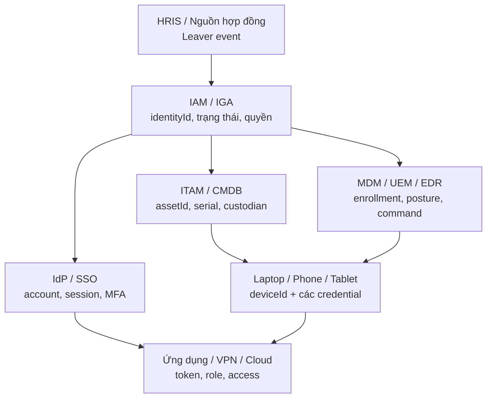
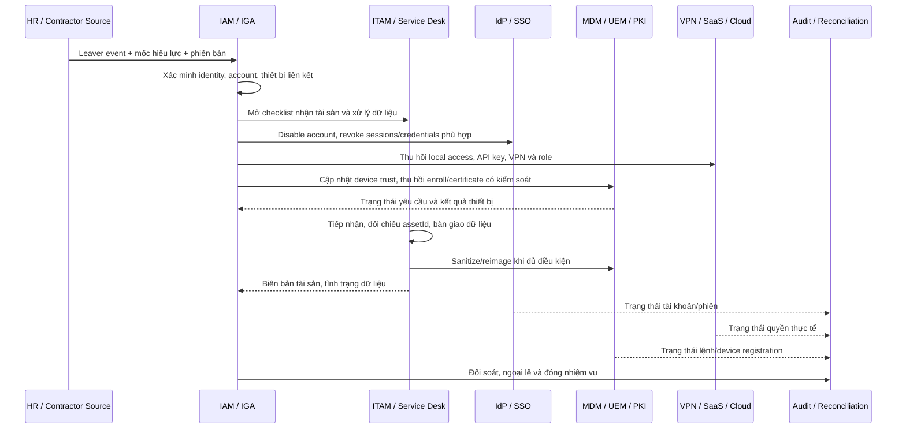
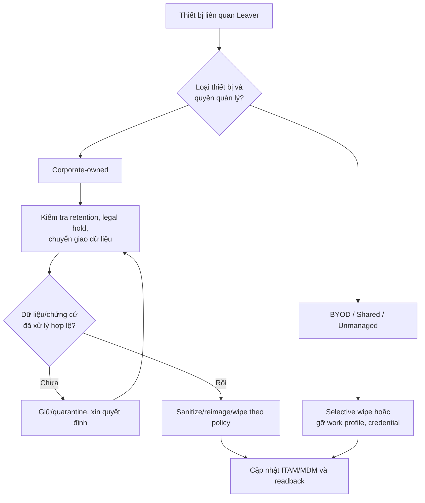

# Thu hồi thiết bị trong Leaver lifecycle của IAM

## Mục tiêu học tập

Sau bài này, người học có thể:

1. Giải thích vì sao **thu hồi thiết bị** là một phần không thể thiếu của **Leaver lifecycle** trong mô hình Joiner–Mover–Leaver (JML), ngoài việc khóa tài khoản và gỡ quyền.
2. Phân biệt **thu hồi tài sản vật lý**, **thu hồi quyền truy cập của thiết bị**, **thu hồi credential/session** và **xử lý dữ liệu**; xác định tiêu chí hoàn tất riêng cho từng việc.
3. Nhận biết vai trò của HRIS, IAM/IGA, IdP, SSO, MDM/UEM, EDR, PKI, hệ thống quản lý tài sản và các ứng dụng đích trong quy trình.
4. Thiết kế luồng thu hồi theo mốc hiệu lực, loại thiết bị, mức độ rủi ro và quyền sở hữu tài sản; xử lý đúng thiết bị công ty, BYOD, thiết bị dùng chung, thiết bị thất lạc hoặc ngoại tuyến.
5. Xử lý có kiểm soát chứng chỉ, khóa, passkey, MFA authenticator, token, phiên SSO, VPN, quyền mạng và dữ liệu doanh nghiệp còn lưu trên thiết bị.
6. Tổ chức bàn giao, lưu giữ chứng cứ, xóa dữ liệu hoặc tái cấp phát phù hợp với chính sách và yêu cầu pháp lý liên quan.
7. Đối soát kết quả thực tế, lưu audit, xử lý ngoại lệ và đo **residual access** (quyền truy cập tồn dư) sau khi người dùng rời tổ chức.

## 1. Thu hồi thiết bị trong Leaver lifecycle là gì?

**Leaver** là giai đoạn mà một người không còn được phép duy trì quan hệ truy cập như trước: chấm dứt việc làm, kết thúc hợp đồng, rời tổ chức, hoặc mất tư cách tham gia một phạm vi nghiệp vụ. Nguồn nhân sự có thẩm quyền cung cấp sự kiện và mốc hiệu lực; IAM điều phối thu hồi quyền qua các hệ thống liên quan.

**Thu hồi thiết bị** trong giai đoạn này gồm hai nhóm công việc liên quan nhưng không đồng nhất:

- **Thu hồi và xử lý tài sản vật lý:** nhận lại laptop, máy tính để bàn, điện thoại, thẻ bảo mật vật lý, ổ cứng, USB, máy tính bảng, thiết bị mạng hoặc tài sản khác tổ chức cấp; kiểm tra tình trạng và cập nhật quyền quản lý tài sản.
- **Thu hồi khả năng truy cập từ thiết bị:** chặn khả năng thiết bị còn được dùng để đăng nhập, truy cập VPN/Wi-Fi doanh nghiệp, khai thác chứng chỉ, token, session, khóa mật mã hoặc dữ liệu đã đồng bộ.

Ví dụ, nhân viên An nghỉ việc và trả laptop cho IT. Việc bàn giao máy **chưa chứng minh** An đã bị đăng xuất khỏi các ứng dụng SaaS trên điện thoại riêng, token API trên máy cá nhân đã bị thu hồi hoặc tài khoản của An ở IdP đã bị khóa.

Ngược lại, IAM đã khóa account của An nhưng laptop công ty vẫn chưa được trả, trong máy còn bản sao dữ liệu nhạy cảm và có credential offline. Quy trình thu hồi truy cập có thể đã tiến triển, nhưng **quy trình quản lý tài sản và dữ liệu còn mở**.

### 1.1. Bốn khái niệm cần tách

| Công việc | Mục tiêu | Bằng chứng hoàn tất |
|---|---|---|
| **Thu hồi tài sản** | Tổ chức lấy lại quyền kiểm soát thiết bị vật lý | Biên bản bàn giao, mã tài sản/serial, người nhận, thời gian, tình trạng |
| **Thu hồi trust của thiết bị** | Thiết bị không còn đáp ứng điều kiện truy cập doanh nghiệp | Trạng thái MDM/UEM, certificate/registration, conditional access, VPN/Wi-Fi được kiểm chứng |
| **Thu hồi phiên và thông tin xác thực** | Người rời tổ chức không thể dùng token, khóa hay phiên cũ để truy cập ngoài ý muốn | Trạng thái IdP, ứng dụng, token/session/revocation theo khả năng nền tảng |
| **Bảo vệ và xử lý dữ liệu** | Dữ liệu doanh nghiệp được bàn giao, giữ theo chính sách hoặc xóa khỏi thiết bị | Kết quả backup/transfer có kiểm chứng, record xóa, xử lý ngoại lệ và retention |

**Không kết luận “thu hồi thiết bị thành công” chỉ vì một trong bốn mục đã hoàn thành.** Mỗi mục cần owner và trạng thái riêng; mức độ kiểm soát phụ thuộc loại thiết bị và khả năng quản trị thực tế.

### 1.2. Tại sao đây là vấn đề IAM?

IAM kiểm soát **ai được làm gì**, trong khi thiết bị là một môi trường có thể nắm giữ credential, dữ liệu, phiên và cơ chế chứng minh độ tin cậy. Một principal đã bị khóa ở IdP vẫn có thể để lại những đường truy cập khác:

- Tài khoản local hoặc phiên ứng dụng không đi qua SSO.
- Access token, refresh token, API key hoặc SSH key còn hợp lệ.
- Chứng chỉ thiết bị còn được VPN/Wi-Fi hoặc gateway tin cậy.
- Passkey, khóa phần cứng, MFA authenticator hoặc mã khôi phục do người dùng kiểm soát.
- Bản sao dữ liệu đã đồng bộ cho phép đọc ngoại tuyến.
- Thiết bị thuộc nhóm quản trị đặc quyền có khả năng đăng nhập bằng đường dự phòng.

Thu hồi thiết bị vì thế gắn trực tiếp với **Identity**, **Account**, **Device identity**, **Credential**, **Authorization** và **Audit** trong IAM.

## 2. Liên kết giữa identity, account và device

Một người có thể sử dụng nhiều thiết bị, và một thiết bị có thể được sử dụng bởi nhiều account. Do đó không nên suy luận “mỗi nhân viên = một máy”.



Các loại khóa cần nhận biết:

| Khóa | Tồn tại ở đâu | Lưu ý |
|---|---|---|
| `identityId` | IAM/Identity registry | Đại diện một người/thực thể được quản trị, không phải máy |
| `personId` | HRIS | Dùng liên kết nguồn nhân sự; có thể khác identityId |
| `accountId` | IdP hoặc ứng dụng | Account được xác thực và phân quyền |
| `assetId` | IT Asset Management (ITAM) / CMDB | ID quản lý tài sản và quyền sở hữu của tổ chức |
| `serialNumber` | Nhà sản xuất/thiết bị | Phục vụ nhận diện vật lý; không tự chứng minh thiết bị đang tin cậy |
| `mdmDeviceId` | MDM/UEM | Định danh thiết bị đã enroll trên nền tảng quản lý |
| `deviceRegistrationId` | IdP/thiết bị được đăng ký | Phục vụ trust và conditional access tùy nền tảng |
| `certificateId` / `keyId` | PKI, VPN, vault hoặc thiết bị | Dùng truy dấu credential cần thu hồi hoặc xoay vòng |

Bảng ánh xạ giữa identity, account, custodian, asset và thông tin enrollment cần được duy trì. Ví dụ trong dữ liệu mẫu sau, một thiết bị gắn với tài sản và người nhận:

```json
{
  "identityId": "IDN-0159",
  "hrPersonId": "HR-2841",
  "assetId": "ASSET-LT-1042",
  "serialNumber": "SN-EXAMPLE-719",
  "mdmDeviceId": "MDM-00AB",
  "deviceType": "LAPTOP",
  "ownership": "CORPORATE",
  "custodianIdentityId": "IDN-0159",
  "assignedAt": "2025-06-01T08:00:00+07:00",
  "deviceTrustState": "MANAGED",
  "assetReturnState": "ISSUED"
}
```

Đây là **schema minh họa** cho quản trị nội bộ, không phải một chuẩn MDM/SCIM bắt buộc.

### 2.1. Thiết bị và account không phải quan hệ một–một

Một nhân viên có thể sở hữu laptop công ty, điện thoại BYOD và security key. Một laptop dùng chung tại cửa hàng có thể do nhiều nhân viên đăng nhập ở các ca khác nhau. Máy ảo hoặc thiết bị chạy job có thể thuộc về một **workload identity** hơn là một người.

Vì vậy, trước khi khóa/wipe/reassign, hệ thống cần xác định:

1. Thiết bị thuộc quyền sở hữu của ai?
2. Ai đang là custodian, ai là user hiện hành?
3. Thiết bị có dùng chung với người khác không?
4. Có những account và credential doanh nghiệp nào hiện hữu?
5. Các quyền/kênh truy cập nào phụ thuộc device trust?
6. Có bản ghi tài sản và bằng chứng liên kết đủ tin cậy không?

Chặn account của Leaver là thao tác theo **identity**. Xóa sạch máy là thao tác theo **thiết bị**, có thể ảnh hưởng những người khác và dữ liệu cần bảo tồn.

## 3. Các loại thiết bị và phạm vi thu hồi

| Loại | Đặc điểm | Hướng xử lý khi Leaver |
|---|---|---|
| **Laptop/desktop công ty cấp** | Tổ chức sở hữu và thường quản lý bằng MDM/UEM | Nhận lại tài sản, khóa truy cập, bảo toàn dữ liệu cần thiết, sanitize/reimage theo chính sách |
| **Điện thoại công ty cấp** | Có SIM/eSIM, ứng dụng và dữ liệu doanh nghiệp | Thu hồi máy/SIM, ngắt token, quản lý dữ liệu và reset khi được phép |
| **BYOD (thiết bị cá nhân)** | Người dùng sở hữu máy; doanh nghiệp chỉ quản lý phạm vi đã thỏa thuận | Gỡ managed profile/container, enterprise apps, credential và quyền truy cập; tránh xóa dữ liệu cá nhân |
| **Thiết bị dùng chung/kiosk** | Nhiều người sử dụng | Thu hồi session/credential của Leaver; không phá hoạt động người dùng khác |
| **Thiết bị ngoại tuyến/thất lạc** | Không nhận được lệnh quản trị từ xa | Cắt quyền phía server, đánh dấu ngoại lệ, theo dõi/điều tra; không coi lệnh wipe đã thực thi |
| **Thẻ bảo mật/MFA key** | Thiết bị xác thực vật lý, có thể lưu khóa riêng | Thu hồi đăng ký authenticator và thu lại tài sản nếu thuộc tổ chức |
| **USB/ổ lưu trữ di động** | Có thể giữ dữ liệu không qua mạng | Thu hồi, kiểm tra/tiêu hủy dữ liệu theo chính sách tài sản |
| **Thiết bị đặc quyền hoặc production** | Có SSH key, certificate, quyền quản trị nhạy cảm | Thu hồi ưu tiên cao, xem xét forensics và kiểm soát quyền/token riêng |

**BYOD cần cách tiếp cận khác thiết bị doanh nghiệp.** Khi offboarding, chỉ thực hiện biện pháp quản lý dữ liệu công việc trong phạm vi chính sách, sự đồng ý và khả năng kỹ thuật; “xóa toàn bộ điện thoại cá nhân” không phải bước mặc định của Leaver.

### 3.1. MDM, UEM và EDR có vai trò khác nhau

- **MDM (Mobile Device Management):** quản lý enrollment, cấu hình, profile, ứng dụng và một số lệnh lock/wipe của thiết bị được hỗ trợ.
- **UEM (Unified Endpoint Management):** quản lý nhiều loại endpoint, hệ điều hành, cấu hình và khả năng tuân thủ.
- **EDR (Endpoint Detection and Response):** giám sát/dò tìm mối đe dọa và hỗ trợ phản ứng trên endpoint, tùy sản phẩm.
- **ITAM/CMDB:** quản lý vòng đời tài sản, người được giao, tình trạng, bàn giao và tái cấp phát.
- **IdP/Conditional Access:** đánh giá account, device posture, registration và điều kiện truy cập; có thể từ chối đăng nhập từ thiết bị không còn tin cậy.

Những hệ thống này thường kết hợp, nhưng **MDM gửi lệnh wipe** không tương đương **ITAM ghi nhận đã thu máy**, và **EDR isolation** không tương đương đã thu hồi token ở ứng dụng.

## 4. Điểm kích hoạt và thời điểm thực hiện

Nguồn có thẩm quyền cho Leaver thường là **HRIS** hoặc hệ thống quản lý hợp đồng/đối tác. Sự kiện cung cấp thông tin như `personId`, trạng thái kết thúc, `effectiveAt` và loại kết thúc. Không nên tự xác định mốc khóa từ ngày cuối cùng ghi trong email hoặc thời điểm ticket được mở.

Ví dụ event nội bộ:

```json
{
  "eventId": "HR-LEAVER-2081",
  "sourceSystem": "HRIS",
  "personId": "HR-2841",
  "type": "LEAVER",
  "effectiveAt": "2026-12-15T17:00:00+07:00",
  "sourceVersion": 41,
  "reasonCategory": "CONTRACT_ENDED"
}
```

Đây là định dạng **minh họa**, không phải schema HR chuẩn. Thông tin lý do nghỉ việc chỉ nên được chia sẻ với hệ thống và người có nhu cầu hợp pháp; IAM thường chỉ cần điều kiện kết thúc, độ ưu tiên và thời điểm có hiệu lực.

### 4.1. Offboarding thông thường và offboarding khẩn cấp

| Tình huống | Thứ tự ưu tiên | Điểm cần chú ý |
|---|---|---|
| **Nghỉ việc theo kế hoạch** | Chuẩn bị checklist, lịch bàn giao tài sản/dữ liệu; cắt quyền đúng thời điểm | Không kích hoạt quyền vượt thời điểm; không xóa trước khi xử lý dữ liệu hợp lệ |
| **Chấm dứt truy cập khẩn cấp** | Cắt quyền phía server và credential/token ưu tiên cao | Có thể phong tỏa/giữ thiết bị để điều tra; phối hợp HR, Security, Legal |
| **Nhà thầu hết hạn** | Thu hồi quyền tại ngày hết hạn, thiết bị được mượn và tài khoản đối tác | Không giả định HRIS nhân viên là nguồn cho nhà thầu |
| **Thiết bị thất lạc trong lúc nghỉ** | Đánh dấu mất, khóa trust/credential, điều tra dữ liệu | Wipe nếu được phép và có thể thực thi; xác minh server-side revocation |
| **Nghỉ tạm hoặc chuyển vị trí** | Điều chỉnh theo chính sách Mover/Suspend | Không mặc định sanitize/xóa máy nếu vẫn là tài sản đang sử dụng hợp lệ |

Mốc **thu hồi truy cập** và mốc **bàn giao vật lý** có thể khác nhau. Ví dụ nhân viên làm việc từ xa phải gửi laptop qua vận chuyển sau ngày kết thúc; IAM vẫn cần chặn truy cập đúng thời điểm, không đợi máy về kho.

### 4.2. Leaver event có thể bị sửa/hủy

Sự kiện có thể đến sớm, được cập nhật ngày hiệu lực hoặc bị hủy vì gia hạn hợp đồng. Workflow cần version/idempotency và kiểm tra trạng thái hiện tại trước thao tác nhạy cảm. Một event Leaver cũ không được tự thực thi wipe nếu hợp đồng đã được gia hạn và owner có thẩm quyền đã xác nhận thay đổi.

Ngược lại, khi thời điểm cắt quyền đã đến, việc người dùng **chưa trả máy** không phải lý do để chờ thu hồi đăng nhập.

## 5. Một workflow thu hồi thiết bị có thể kiểm toán



Đây là **luồng tham khảo**. Một số thao tác có thể chạy song song; thứ tự sanitize/wipe phụ thuộc retention, legal hold, thiết bị có thuộc tổ chức hay không và dữ liệu đã được chuyển giao hợp lệ chưa.

### 5.1. Những bước cụ thể

1. **Nhận và xác minh event:** kiểm tra nguồn HR/contractor, ID, trạng thái, thời điểm, version và trường hợp khẩn cấp.
2. **Xác định identity/account:** lấy account IdP, SaaS, VPN, cloud và tài khoản đặc quyền đã liên kết; tránh chỉ dựa vào email.
3. **Lập danh mục thiết bị:** dùng ITAM/CMDB, MDM/UEM, IdP device registration và dữ liệu giao nhận để tìm thiết bị có thể liên quan.
4. **Đánh giá loại sở hữu:** doanh nghiệp, BYOD, dùng chung, nhà thầu mượn hoặc đang thất lạc.
5. **Thu hồi truy cập phía server:** chặn account, reset/thu hồi credential cần thiết, chặn device trust, VPN, Wi-Fi và các đường truy cập độc lập.
6. **Xử lý session/token:** áp dụng cơ chế revoke/sign-out theo từng IdP/app, đánh giá lifetime token, refresh token và cookie session.
7. **Thu hồi tài sản vật lý:** theo dõi yêu cầu trả, bàn giao cho đúng người, đối chiếu asset ID/serial và ghi tình trạng thực tế.
8. **Xử lý dữ liệu:** sao lưu hoặc chuyển giao dữ liệu doanh nghiệp có thẩm quyền; bảo toàn chứng cứ/retention khi cần.
9. **Quản lý endpoint:** selective wipe, retire, unenroll, reset/reimage/sanitize hoặc giữ máy ở khu bảo quản theo quyết định.
10. **Đối soát và đóng:** đọc lại account/role/device status, đối chiếu tài sản, ghi ngoại lệ và trách nhiệm cho phần chưa hoàn tất.

Một kết quả “IT nhận máy” không nên tự động đóng những nhiệm vụ revoke token, thiết bị BYOD và quyền ứng dụng.

## 6. Ngắt truy cập của thiết bị tại IdP và hệ thống đích

### 6.1. Thu hồi account và quyền trước khi xử lý máy

Trong Leaver, điều quan trọng là cắt những đường mà người đó có thể dùng để tiếp tục truy cập từ bất kỳ thiết bị nào. IAM cần phối hợp:

- **IdP:** disable account, thu hồi các phiên và refresh token theo khả năng nền tảng; kiểm tra cơ chế đăng nhập dự phòng.
- **SSO/SAML/OIDC:** đánh giá session ở IdP và ứng dụng; một số ứng dụng duy trì phiên độc lập sau đăng nhập SSO.
- **SCIM/connector:** cập nhật `active=false` hoặc thu hồi group/role tại app hỗ trợ; cần readback.
- **VPN/Zero Trust Network Access:** thu hồi entitlement/kết nối, chứng chỉ hoặc thiết bị hợp lệ; kiểm tra kết nối đang mở.
- **Wi-Fi/802.1X:** thu hồi chứng chỉ tài khoản hoặc thiết bị khi phù hợp; kiểm tra chính sách NAC và credential cache.
- **Cloud và developer tools:** vô hiệu hóa personal access token, API key, SSH key, service principal bị người dùng nắm giữ trái chính sách.
- **PAM/privileged access:** khóa đường quản trị, thu hồi phiên/credential đặc quyền và kiểm tra tài khoản khẩn cấp liên quan.

**Không dựa hoàn toàn vào thao tác khóa IdP account.** Một ứng dụng có login local, token API riêng hoặc phiên đã được thiết lập có thể tiếp tục cho truy cập nếu chưa có biện pháp tương ứng.

### 6.2. Thay đổi device trust

Nhiều tổ chức dùng thiết bị “managed/compliant” để tăng mức tin cậy khi truy cập. Khi Leaver, có thể cần:

- Xóa hoặc vô hiệu hóa liên kết thiết bị với account đã nghỉ.
- Gỡ enrollment/registration nếu chính sách và trạng thái tài sản cho phép.
- Thu hồi hoặc ngăn phát hành **device certificate** dùng cho VPN/Wi-Fi/mTLS.
- Đưa thiết bị vào nhóm không được phép truy cập hệ thống nội bộ.
- Vô hiệu hóa conditional access exception dành cho người dùng hoặc thiết bị cũ.
- Loại khỏi chính sách cấp quyền đặc biệt đã được trao tạm thời.

**Không xóa quản lý thiết bị quá sớm** khi vẫn cần MDM gửi lệnh khóa/wipe, thu thập thông tin cuối hoặc lưu chứng cứ. Cần sắp thứ tự thao tác tùy nền tảng: ví dụ chặn truy cập phía server trước, hoàn tất lệnh được phép khi máy online, rồi mới retire/unenroll.

### 6.3. Token/session không phải lúc nào cũng bị thu hồi tức thì

Một access token có thể tự xác minh offline bằng chữ ký và tiếp tục hợp lệ tới khi hết hạn, tùy kiến trúc. Thu hồi refresh token hoặc session ở IdP không luôn thu hồi được token đã cấp trong ứng dụng khác.

Biện pháp cần xem xét theo hệ thống:

| Đối tượng | Cách xử lý | Giới hạn cần biết |
|---|---|---|
| IdP session | Sign-out/revoke sessions theo khả năng | Không chắc cắt app-local session |
| Refresh token | Revoke hoặc làm mất hiệu lực theo nền tảng | Access token cũ có thể còn hiệu lực |
| Access token/JWT | API introspection/denylist, TTL ngắn hoặc cơ chế revocation được hỗ trợ | JWT tự xác minh có thể sống tới `exp` |
| API key/personal access token | Disable/revoke tại issuer hoặc ứng dụng đích | Có thể được lưu trên nhiều thiết bị |
| SSH key/certificate | Gỡ public key, thu hồi certificate, cập nhật trust | Phải kiểm tra các máy chủ và cache liên quan |
| VPN/Wi-Fi session | Ngắt phiên/quyền hoặc revoke certificate | Thiết bị đang offline có thể vẫn giữ chứng cứ/khóa |
| Passkey/MFA authenticator | Gỡ đăng ký factor/credential theo IdP | Có thể cần recovery và kiểm soát account trước khi thay đổi |

Mục tiêu là **không còn đường truy cập được phép ngoài chính sách**, kể cả khi thiết bị chưa về tổ chức.

## 7. MDM/UEM: lock, retire, wipe và unenroll

Các hệ thống quản lý endpoint có thể hỗ trợ nhiều thao tác khác nhau; tên gọi và hành vi thay đổi theo nhà cung cấp, OS và loại enrollment.

| Thao tác | Ý định | Khi nào phù hợp | Điều kiện kiểm tra |
|---|---|---|---|
| **Lock** | Khóa màn hình hoặc hạn chế sử dụng | Thiết bị công ty cần bảo vệ nhanh | Lệnh đã thực sự thực thi? Có thể bypass offline không? |
| **Selective wipe / Remove work data** | Xóa container/profile/apps và dữ liệu công việc | BYOD hoặc thiết bị có dữ liệu trộn | Chỉ đúng dữ liệu thuộc phạm vi quản lý |
| **Retire / Unenroll** | Chấm dứt quản lý thiết bị | Thiết bị trả về, chuyển chủ hoặc BYOD rời chính sách | Không làm mất khả năng gửi lệnh cần thiết trước đó |
| **Full wipe / Factory reset** | Xóa dữ liệu/khôi phục thiết bị | Tài sản doanh nghiệp, đã hoàn tất retention/handover | Có thẩm quyền, đúng asset ID, không còn legal hold |
| **Reimage / Reprovision** | Cài đặt lại hệ thống để cấp phát tiếp | Laptop công ty sau khi kiểm tra/xử lý dữ liệu | Đã loại credential/khóa người cũ và cấu hình sạch |
| **EDR isolate** | Hạn chế giao tiếp mạng để điều tra sự cố | Có dấu hiệu xâm nhập hoặc cần containment | Phối hợp IR, bảo toàn chứng cứ, không tự thay thế revocation |

**Gửi lệnh ≠ thiết bị đã thực hiện.** MDM có thể báo `PENDING` khi máy ngoại tuyến. Lệnh wipe chỉ nên đánh dấu `VERIFIED` khi có bằng chứng đủ tin cậy từ nền tảng/thiết bị và các điều kiện xác minh bổ sung theo chính sách.

### 7.1. BYOD: ưu tiên thu hồi quyền và dữ liệu công việc

Ví dụ nhân viên sử dụng điện thoại cá nhân có một managed work profile. Sau Leaver:

1. IAM khóa account và thu hồi phiên/credential doanh nghiệp.
2. IdP và ứng dụng chặn truy cập theo điều kiện tài khoản, quyền và device posture.
3. MDM/UEM thực hiện **selective wipe** hoặc gỡ work profile theo khả năng và chính sách đã thỏa thuận.
4. Xác minh dữ liệu và ứng dụng quản lý đã bị xóa trong phạm vi cho phép; nếu thiết bị ngoại tuyến thì giữ ngoại lệ.
5. Chấm dứt enrollment/quan hệ quản lý theo quy trình, không xóa ảnh, tin nhắn hay ứng dụng riêng của chủ thiết bị.

Nếu thiết bị cá nhân chưa từng enrollment, tổ chức có thể không có khả năng xóa dữ liệu cục bộ. Khi đó cần ưu tiên revoke token và server-side access, hạn chế đồng bộ/export từ trước và xử lý rủi ro dữ liệu đã tải xuống qua chính sách.

### 7.2. Corporate-owned: bảo toàn dữ liệu trước khi xóa

Với laptop công ty, một quy trình có thể gồm:

- Xác nhận thiết bị và tính toàn vẹn vật lý.
- Phân loại dữ liệu doanh nghiệp cần bàn giao.
- Chuyển ownership tài liệu/tài khoản kinh doanh có phê duyệt.
- Giữ chứng cứ khi có sự cố, tranh chấp hoặc yêu cầu pháp lý.
- Xác nhận điều kiện xóa dữ liệu và tiêu chuẩn sanitization của tổ chức.
- Thực hiện wipe/reimage hoặc phương thức xử lý dữ liệu phù hợp.
- Kiểm tra không còn profile, credential, token hoặc thông tin người dùng cũ trước tái cấp phát.
- Cập nhật ITAM, MDM, IdP registration và biên bản xử lý.

Đừng chỉ tạo tài khoản Windows/macOS mới rồi xem laptop đã sạch. Dữ liệu còn lưu ở ổ đĩa, trình duyệt, ứng dụng local hoặc vùng cache có thể vẫn tiếp cận được.

## 8. Thiết bị ngoại tuyến, thất lạc và không nhận được lệnh

Một thách thức quan trọng của Leaver là thiết bị **không kết nối mạng** hoặc người dùng không trả máy. Không thể lấy kết quả “wipe thành công” từ việc chỉ bấm gửi lệnh trong console.

Một chiến lược thường gồm:

1. Đánh dấu thiết bị `OFFLINE`, `LOST`, `UNRETURNED` hoặc trạng thái tài sản phù hợp.
2. Cắt ngay **server-side access** của identity và credential có thể dùng từ máy.
3. Thu hồi chứng chỉ, profile trust, VPN, token và khóa liên quan theo mức rủi ro.
4. Gửi lệnh quản trị nếu được phép; lưu trạng thái `QUEUED` và hạn xử lý, không giả định đã đến thiết bị.
5. Dùng mã hóa ổ đĩa, kho khóa phần cứng và chính sách bảo vệ dữ liệu đã triển khai trước đó làm lớp giảm thiểu rủi ro.
6. Phối hợp Security/ITAM/HR/Legal để tìm lại thiết bị, đánh giá khả năng lộ dữ liệu và lập biên bản ngoại lệ.
7. Khi thiết bị quay lại online hoặc được nhận lại, xác minh trạng thái lệnh, dữ liệu và xử lý tiếp.

### 8.1. Mã hóa thiết bị và việc thu hồi truy cập

Mã hóa toàn bộ ổ đĩa giảm rủi ro khi máy bị mất hoặc tắt, nhưng không bảo đảm an toàn nếu người không được phép vẫn biết PIN/mật khẩu hoặc thiết bị đang mở khóa. Tương tự, thu hồi network access không tự xóa bản sao dữ liệu đã lưu offline.

**Tách rủi ro truy cập từ xa và rủi ro lộ dữ liệu cục bộ** để quản lý và báo cáo chính xác.

### 8.2. Khi nghi ngờ sự cố bảo mật

Nếu có dấu hiệu rò rỉ dữ liệu, mã độc hoặc thao túng hệ thống, cần phối hợp Incident Response (IR) trước khi wipe. Xóa máy ngay có thể phá hủy log và chứng cứ cần cho điều tra. Tùy mức rủi ro, Security có thể yêu cầu cách ly thiết bị, bảo toàn ảnh đĩa/log và chuỗi lưu giữ chứng cứ (**chain of custody**) trước khi sanitize.

Đồng thời, cần chặn đường truy cập bên ngoài theo chính sách; không trì hoãn revoke account/token chỉ vì chưa thu được máy để giám định.

## 9. Quy trình nhận lại tài sản vật lý

Quy trình ITAM/Service Desk cần rõ người chịu trách nhiệm, thời điểm, kênh bàn giao và bằng chứng nhận lại.

### 9.1. Checklist khi nhận thiết bị

| Nội dung kiểm tra | Dữ liệu cần ghi | Tại sao cần |
|---|---|---|
| **Định danh tài sản** | Asset tag, serial, model, MDM ID nếu có | Tránh nhận nhầm máy hoặc xử lý nhầm tài sản |
| **Người đang giữ** | Custodian, nguồn xác nhận, bộ phận | Liên hệ đúng người, quy trách nhiệm |
| **Phụ kiện** | Sạc, dock, SIM/eSIM, security key, ổ ngoài | Thu hồi đủ thiết bị do tổ chức cấp |
| **Tình trạng vật lý** | Hỏng, thiếu, niêm phong, phụ kiện | Bảo trì, bồi hoàn hoặc điều tra theo chính sách |
| **Dữ liệu cần giữ** | Owner dữ liệu, yêu cầu backup/handover | Tránh xóa nhầm dữ liệu doanh nghiệp |
| **Trạng thái truy cập** | Account, token, VPN, certificate, device trust | Tách khỏi việc trả máy |
| **Người nhận và thời gian** | Nhân viên IT/đơn vị vận chuyển, ký nhận | Audit và chain of custody khi cần |
| **Trạng thái tái cấp phát** | Quarantine, sanitize, reimage, ready | Không cấp cho người mới trước khi xử lý sạch |

Biên bản bàn giao nên gắn đúng `assetId` với yêu cầu Leaver, không chỉ liệt kê tên thiết bị chung chung.

### 9.2. Nhân viên làm việc từ xa

Tổ chức có thể gửi nhãn vận chuyển và yêu cầu trả thiết bị qua bưu cục. Quy trình cần phân biệt:

- **Requested:** đã gửi yêu cầu trả thiết bị.
- **In transit:** có xác nhận vận chuyển.
- **Received:** IT đã nhận và đối chiếu vật lý.
- **Inspected:** đã kiểm tra asset, tình trạng và dữ liệu.
- **Sanitized/Retired:** đã xử lý dữ liệu và đưa tài sản về trạng thái cuối.

Một mã vận đơn được tạo không có nghĩa tổ chức đã nhận tài sản. Trong lúc chờ, các biện pháp cắt truy cập phía server vẫn phải hoàn thành theo SLA an ninh.

### 9.3. Thiết bị dùng chung

Nếu Leaver từng sử dụng một máy dùng chung tại xưởng hoặc cửa hàng, không nên wipe cả máy nếu còn phục vụ người dùng khác. Nên:

- Gỡ account/profile/session của người nghỉ trên máy.
- Thu hồi credential, key và quyền đã gán cho cá nhân.
- Kiểm tra dữ liệu cá nhân/doanh nghiệp liên quan được bảo quản đúng chính sách.
- Giữ nguyên chức năng hợp pháp của các người dùng còn được phép.
- Rà soát credential dùng chung để tránh người rời tổ chức tiếp tục biết mật khẩu/khóa dùng chung.

Tài khoản dùng chung vốn gây khó truy vết; khi có Leaver, có thể phải xoay vòng credential và cải thiện cơ chế quy trách nhiệm.

## 10. Bàn giao dữ liệu, retention và quyền riêng tư

Thu hồi thiết bị phải bảo đảm thông tin cần thiết cho hoạt động kinh doanh được chuyển đúng owner mà không tự ý truy cập dữ liệu riêng tư. Cần xác định phạm vi dữ liệu:

- Dữ liệu nghiệp vụ nằm trong máy hoặc đồng bộ lên cloud.
- Tài liệu đang được người nghỉ sở hữu hoặc chia sẻ.
- Dữ liệu thuộc diện retention, legal hold, điều tra.
- Secret, credential, API key cần thu hồi chứ **không chuyển giao nguyên secret** cho người mới.
- Dữ liệu cá nhân trong BYOD hoặc thiết bị doanh nghiệp được sử dụng theo chính sách chấp thuận.

### 10.1. Thứ tự xử lý an toàn



Với BYOD và thiết bị dùng chung, lựa chọn thao tác phải xét quyền sở hữu và người dùng khác. Với corporate-owned có legal hold, quyết định bảo quản có thể thay thế việc xóa ngay; việc trì hoãn xóa phải có kiểm soát và owner.

### 10.2. Không chuyển giao mật khẩu hoặc private key

Nếu ứng dụng cần tiếp tục hoạt động sau Leaver, tổ chức nên chuyển quyền sở hữu tài nguyên và phát credential mới cho principal đủ điều kiện; không nên chuyển file mật khẩu, private key, cookie đăng nhập hay token cũ từ máy của người nghỉ sang máy người kế nhiệm.

Với **service account/workload identity** do người nghỉ từng quản lý, cần xác định owner đội nhóm, đổi quyền quản trị/credential có rủi ro và bảo đảm dịch vụ không bị gián đoạn ngoài kế hoạch. Người phát triển workload rời tổ chức không làm workload tự trở thành Leaver; vòng đời dịch vụ cần quản trị riêng.

## 11. Quyền và trách nhiệm giữa các đội

| Vai trò | Trách nhiệm chính | Bằng chứng bàn giao |
|---|---|---|
| **HR / quản lý hợp đồng** | Xác nhận sự kiện, hiệu lực, loại Leaver và người liên hệ có thẩm quyền | Event nguồn và version |
| **IAM / IGA** | Liên kết identity, tính quyền cần thu hồi, điều phối task và chứng thực kết quả | Workflow ID, account status, quyền thực tế |
| **IdP / SSO owner** | Disable account, xử lý session/MFA/credential và conditional access | Log trạng thái account, phiên, đăng ký thiết bị |
| **ITAM / Service Desk** | Danh mục tài sản, nhận máy, giao nhận, xử lý tái cấp phát | Asset record, ký nhận, tình trạng |
| **Endpoint / MDM / UEM team** | Lock, selective wipe, retire, reimage và device posture | Kết quả lệnh và readback thiết bị |
| **Network / PKI / Cloud owner** | Thu hồi VPN/Wi-Fi, certificate, key và role liên quan | Trạng thái certificate/trust, network access |
| **App owner** | Chặn app-local session, user, role và token ngoài IdP | Trạng thái từ ứng dụng đích |
| **Security / Incident Response** | Đánh giá rủi ro thiết bị mất/compromised, bảo toàn chứng cứ | Incident case, quyết định containment |
| **Legal / Privacy / Records** | Hướng dẫn retention, legal hold, quyền riêng tư | Quyết định giữ/xóa dữ liệu theo phạm vi |

Một task đóng ở ITAM không tự động đóng task Security hoặc IAM. Mỗi bước cần **owner**, **hạn hoàn thành**, **trạng thái** và **bằng chứng** có thể kiểm tra.

## 12. Mô hình trạng thái thu hồi có thể áp dụng

Đối với một Leaver có nhiều thiết bị, nên theo dõi theo **từng asset** và **từng kênh truy cập**. Ví dụ trạng thái:

| Trạng thái | Ý nghĩa |
|---|---|
| `DISCOVERED` | Đã xác định thiết bị có liên quan |
| `RETURN_REQUESTED` | Đã yêu cầu trả tài sản |
| `ACCESS_REVOKE_PENDING` | Đang xử lý trust/credential/session |
| `ACCESS_REVOKED_VERIFIED` | Đã kiểm tra những kênh truy cập trong phạm vi kiểm soát |
| `DEVICE_OFFLINE` | Không nhận được lệnh/telemetry từ thiết bị |
| `IN_TRANSIT` | Thiết bị đang trong quá trình vận chuyển |
| `PHYSICALLY_RECEIVED` | Đã nhận lại và đối chiếu asset |
| `DATA_REVIEW_PENDING` | Chưa có quyết định giữ/chuyển/xóa dữ liệu |
| `SANITIZED_VERIFIED` | Hoàn tất sanitization có bằng chứng |
| `REASSIGNMENT_READY` | Thiết bị đã sẵn sàng cấp phát lại |
| `EXCEPTION_OPEN` | Còn phần chưa giải quyết, có owner và lịch xử lý |

Đây là **những trạng thái minh họa**, không phải schema bắt buộc của ITAM/MDM.

Một thiết bị có thể đồng thời `ACCESS_REVOKED_VERIFIED` và `RETURN_REQUESTED` vì chưa được trả về; một thiết bị đã nhận có thể vẫn `DATA_REVIEW_PENDING`. Không dùng một boolean `offboardingDone=true` để che khuất các trạng thái khác nhau.

### 12.1. Điều kiện đóng việc

Ví dụ các điều kiện tối thiểu:

1. Đã xác định và phân loại toàn bộ thiết bị trong phạm vi có thể kiểm chứng.
2. Account và quyền truy cập phía server đã được thu hồi theo chính sách.
3. Device credential, trust, session/token và app-local access được kiểm tra ở các hệ thống liên quan.
4. Mọi tài sản cần trả đều có biên bản nhận hoặc ngoại lệ được phê duyệt.
5. Dữ liệu doanh nghiệp, retention/hold và BYOD privacy được xử lý đúng.
6. Những lệnh MDM chưa hoàn tất không bị ghi nhầm thành đã thực thi.
7. Mọi ngoại lệ còn tồn tại có owner, thời hạn và biện pháp giảm rủi ro rõ.
8. Audit và đối soát cuối cùng phản ánh trạng thái thực tế.

Nếu quy trình cho phép đóng Leaver với tài sản chưa nhận do vận chuyển kéo dài, cần báo **đóng phần truy cập** và **ngoại lệ tài sản đang mở** riêng, không tuyên bố toàn bộ hạng mục đã xong.

## 13. Những lỗi thiết kế phổ biến

### 13.1. Đồng nhất khóa account với thu hồi máy

Khóa account ở IdP là bước quan trọng, nhưng không xử lý được bản sao dữ liệu offline, thiết bị chưa trả, account local, token API và chứng chỉ không phụ thuộc IdP. Phải quản lý tất cả các đường truy cập trong phạm vi.

### 13.2. Xóa device registration quá sớm

Gỡ thiết bị khỏi MDM/IdP trước khi hoàn tất các lệnh cần thiết có thể làm mất kênh quản trị và khả năng xác minh wipe. Cần lên lịch thao tác theo khả năng sản phẩm; thường ưu tiên chặn truy cập phía server và thu hồi token, rồi xử lý thiết bị, cuối cùng dọn enrollment/trust ở đúng thời điểm.

### 13.3. Wipe toàn bộ BYOD

Một chính sách xóa sạch thiết bị cá nhân có thể làm mất dữ liệu cá nhân của chủ máy và vi phạm phạm vi quản lý đã thỏa thuận. Cần xác minh ownership và sử dụng **selective wipe/managed profile removal** khi thích hợp.

### 13.4. Ghi nhận lệnh wipe đang chờ như đã thành công

Một thiết bị offline có thể không bao giờ nhận được lệnh. Nên phân biệt `REQUESTED`, `QUEUED`, `DELIVERED`, `EXECUTED` và `VERIFIED` tùy khả năng telemetry. Nếu không thể xác minh, phải giữ ngoại lệ và xử lý rủi ro phía server.

### 13.5. Chưa bàn giao dữ liệu đã xóa sạch máy

Xóa dữ liệu trước khi có quyết định owner/retention/hold có thể làm mất dữ liệu kinh doanh cần thiết hoặc chứng cứ điều tra. Trình tự phải có cổng phê duyệt và ghi lại người chịu trách nhiệm.

### 13.6. Bỏ qua thiết bị không nằm trong danh mục

Thiết bị BYOD, security key hoặc máy được cấp từ nhóm dự án có thể không xuất hiện trong ITAM chính. Nên đối chiếu nguồn ITAM, MDM, IdP device records và ứng dụng nhạy cảm, nhưng vẫn xác định giới hạn phát hiện.

### 13.7. Dùng cùng một chính sách cho nhân viên và workload

Máy chủ/runner hoặc service principal có thể do người nghỉ từng quản lý nhưng không phải thiết bị cá nhân để tự động xóa. Cần chuyển ownership, xoay credential có rủi ro và kiểm tra tác động vận hành trước khi thay đổi workload.

### 13.8. Chỉ xét nhóm/role trong IdP

Ứng dụng có thể giữ app-local role, personal access token hoặc permission trực tiếp. Thu hồi membership ở IdP không đủ để xác nhận các ứng dụng đã cắt quyền, nhất là khi SSO token/session còn hiệu lực.

## 14. Kiểm toán và đối soát kết quả

Một bản ghi audit minh họa có thể tách kết quả vật lý và kỹ thuật:

```json
{
  "offboardingCaseId": "LV-2026-2081",
  "identityId": "IDN-0159",
  "sourceEventId": "HR-LEAVER-2081",
  "assetId": "ASSET-LT-1042",
  "deviceType": "LAPTOP",
  "ownership": "CORPORATE",
  "networkAccess": {
    "idpAccount": "DISABLED_VERIFIED",
    "vpnCertificate": "REVOKED_VERIFIED",
    "appSessions": "REVIEW_IN_PROGRESS"
  },
  "deviceManagement": {
    "mdmDeviceId": "MDM-00AB",
    "wipeCommand": "NOT_REQUESTED",
    "deviceOnline": false
  },
  "assetReturn": {
    "status": "IN_TRANSIT",
    "receivedAt": null
  },
  "dataHandling": {
    "state": "PENDING_OWNER_REVIEW"
  },
  "overallStatus": "EXCEPTION_OPEN"
}
```

Đây là ví dụ nội bộ, không phải schema chuẩn của SCIM, IdP hoặc MDM. Bản ghi audit nên lưu thời điểm, actor/workflow, policy version, trạng thái thực tế, nguồn phản hồi và correlation ID; không lưu token/secret hoặc dữ liệu HR ngoài nhu cầu.

### 14.1. Những đối soát nên thực hiện

| Chênh lệch | Ý nghĩa | Hướng xử lý |
|---|---|---|
| HR Leaver, IdP còn active | Truy cập chưa được chặn đúng | Ưu tiên disable và điều tra lỗi workflow |
| IdP disabled, SaaS account vẫn active | App-local access có thể còn | Revoke tại ứng dụng, kiểm tra session/token |
| ITAM báo đã trả, MDM vẫn báo assigned cho người cũ | Trạng thái quản lý thiết bị lệch | Cập nhật asset mapping, xử lý enrollment |
| MDM đã gửi wipe, thiết bị offline | Không có bằng chứng đã xóa | Giữ ngoại lệ, xử lý server-side access |
| Asset serial không khớp biên bản | Có thể trả nhầm thiết bị | Dừng tái cấp phát, xác minh vật lý |
| Device cert vẫn valid sau Leaver | VPN/Wi-Fi hoặc mTLS có thể chấp nhận | Revoke/deny theo trust policy, đọc lại |
| Account bị khóa nhưng có access token còn dùng được | Token/app session còn hiệu lực | Kiểm tra cơ chế invalidate và API policy |
| Laptop đã sanitize nhưng dữ liệu chưa được handover | Nguy cơ mất dữ liệu kinh doanh | Điều tra, thực hiện quy trình khôi phục/ngoại lệ |
| BYOD đã unenroll nhưng work data chưa được xác minh gỡ | Dữ liệu có thể tồn dư | Kiểm tra khả năng selective wipe và risk mitigation |
| Máy dùng chung bị full wipe do một Leaver | Ảnh hưởng người dùng khác | Khôi phục dịch vụ, sửa phân loại ownership |

### 14.2. Chỉ số vận hành

- **Access revocation latency:** từ mốc Leaver hiệu lực tới lúc từng đường truy cập được xác minh chặn.
- **Asset return completion rate:** tỷ lệ tài sản cần thu hồi đã được nhận và kiểm tra.
- **Unreturned asset age:** thời gian tài sản chưa được trả sau hạn.
- **Device trust revocation coverage:** tỷ lệ thiết bị có trạng thái trust/credential được xử lý có bằng chứng.
- **Wipe/retire command verification rate:** số lệnh được xác nhận thực thi trên tổng lệnh yêu cầu.
- **Offline device exception count:** số thiết bị ngoại tuyến còn ngoại lệ mở.
- **Residual access count:** số token, role, session, account hoặc chứng chỉ còn được phép sử dụng ngoài chính sách.
- **Data handling compliance:** tỷ lệ thiết bị được xử lý dữ liệu/hold/retention đúng quyết định.
- **Reconciliation exception age:** thời gian sai lệch giữa HR, IAM, ITAM, MDM và app chưa được giải quyết.

Mỗi chỉ số cần xác định **phạm vi thiết bị, mẫu số, thời gian, trạng thái đã xác minh**. Không báo tỷ lệ 100% chỉ vì các lệnh wipe đã được gửi đi.

## 15. Tình huống thực hành: nhân viên nghỉ việc và không trả laptop ngay

**Bối cảnh:** Lan nghỉ việc vào 17:00 thứ Sáu. Lan dùng laptop công ty và điện thoại cá nhân có work profile. Vì làm việc từ xa, laptop được gửi qua đơn vị vận chuyển và dự kiến đến IT vào tuần sau. Khi IAM khóa account IdP, đội vận hành phát hiện:

- Laptop chưa nhận được lệnh MDM lock vì đang offline.
- Lan còn một personal access token của hệ thống quản lý mã nguồn.
- Điện thoại BYOD có dữ liệu trong managed work profile.
- Một service account cho batch job trước đây được Lan tạo và đang do team Vận hành sử dụng.
- Có tài liệu dự án cần chuyển giao cho người quản lý mới.

### 15.1. Câu hỏi

1. Có nên đợi nhận laptop rồi mới khóa account và token?
2. MDM đã gửi lệnh lock nhưng máy offline thì có thể ghi “đã khóa thiết bị thành công” không?
3. Có nên full wipe điện thoại cá nhân của Lan?
4. Service account do Lan tạo có phải tự động xóa khi Lan nghỉ?
5. Khi nào có thể sanitize laptop và đánh dấu sẵn sàng tái cấp phát?
6. Cần những bằng chứng nào để báo cáo phần thu hồi truy cập đã hoàn tất?

### 15.2. Hướng giải

**Bước 1 – Cắt quyền phía server đúng mốc.** IAM xác nhận Leaver, disable IdP và thu hồi phiên theo khả năng. App owner revoke personal access token, app-local credential và kiểm tra ứng dụng khác. Việc laptop đang vận chuyển không được trì hoãn bước này.

**Bước 2 – Xử lý laptop offline.** Gửi lệnh được phép, nhưng chỉ đánh dấu `QUEUED` hoặc trạng thái thực tế tương ứng. Ghi ngoại lệ thiết bị offline; xem xét rủi ro của credential đã có trên máy và cắt quyền từ PKI/VPN/IdP/app.

**Bước 3 – Xử lý BYOD.** Thu hồi account/token phía server, rồi selective wipe hoặc gỡ managed work profile theo enrollment và chính sách. Không xóa toàn bộ dữ liệu cá nhân.

**Bước 4 – Chuyển giao workload.** Không xóa batch job một cách máy móc. Kiểm tra service account owner, mục đích, quyền và credential; chuyển ownership sang team còn chịu trách nhiệm, xoay credential cần thiết và loại quyền cá nhân của Lan.

**Bước 5 – Bảo toàn dữ liệu.** Người quản lý và owner dữ liệu xác nhận tài liệu cần chuyển; Legal/Records xác định hold/retention nếu có. Sau khi laptop được nhận, đối chiếu serial/asset ID và dữ liệu đã xử lý hợp lệ, IT mới sanitize/reimage rồi xác minh sẵn sàng cấp phát lại.

**Bước 6 – Đối soát.** Thu hồi truy cập chỉ được coi hoàn tất trong phạm vi đã xác minh khi các app, token, VPN, device trust và phiên liên quan đã được xử lý. Tài sản chưa về kho và lệnh MDM chưa thực thi vẫn là **ngoại lệ riêng có owner**, không được che bằng trạng thái “toàn bộ offboarding thành công”.

### 15.3. Bài tập tự kiểm tra

Xác định đúng/sai:

1. “Nhân viên đã trả laptop nghĩa là mọi đường truy cập từ thiết bị khác đã hết.”
2. “Thiết bị đang offline vẫn có thể bị chặn quyền ở nhiều hệ thống phía server.”
3. “Gửi lệnh remote wipe là bằng chứng thiết bị đã được xóa thành công.”
4. “BYOD nên ưu tiên selective wipe theo chính sách và phạm vi quản lý.”
5. “Chỉ khóa IdP account không bảo đảm mọi app-local session hay API key đã bị thu hồi.”
6. “Sanitize thiết bị có legal hold nên được thực hiện ngay để tránh mất an toàn.”
7. “Thiết bị dùng chung cần xử lý credential/profile của Leaver mà vẫn bảo vệ người dùng khác.”
8. “Có thể cấp laptop cho người mới sau khi chỉ thay tài khoản đăng nhập, chưa kiểm tra dữ liệu cũ.”
9. “Service account do người nghỉ tạo cần rà soát ownership và credential, không tự xóa mọi workload.”
10. “Khi chưa nhận máy, phần thu hồi tài sản có thể vẫn mở dù đã cắt truy cập phía server.”

**Đáp án:** 1 Sai; 2 Đúng; 3 Sai; 4 Đúng; 5 Đúng; 6 Sai; 7 Đúng; 8 Sai; 9 Đúng; 10 Đúng.

## 16. Ghi nhớ

1. **Thu hồi thiết bị có ít nhất hai mặt:** lấy lại quyền kiểm soát tài sản và loại bỏ các đường truy cập/dữ liệu doanh nghiệp còn tồn tại trên thiết bị.
2. **Identity, account, device, credential và session là các đối tượng khác nhau.** Phải xác định đúng liên kết trước khi chặn hoặc xóa.
3. **Leaver event có nguồn và mốc hiệu lực rõ**; không chờ trả máy mới thu hồi account, role, token và truy cập mạng.
4. **IdP/SSO/SCIM, MDM/UEM, PKI/VPN và ứng dụng đích đảm nhiệm các phần khác nhau**; phải readback từng phần liên quan.
5. **BYOD, tài sản công ty và thiết bị dùng chung cần phương án riêng**, tôn trọng quyền sở hữu, retention và dữ liệu của người khác.
6. **Thiết bị ngoại tuyến tạo ngoại lệ cần quản lý**, không phải bằng chứng wipe/lock đã hoàn tất.
7. **Bảo toàn dữ liệu và chứng cứ trước sanitize**, đặc biệt khi có chuyển giao nghiệp vụ, sự cố hoặc legal hold.
8. **Workload/service account cần chuyển giao owner và rà soát quyền**, tránh phá vỡ dịch vụ hoặc giữ credential ngoài quản trị.
9. **Audit và reconciliation quyết định chất lượng Leaver**: ghi rõ quyền nào đã thu hồi thật, thiết bị nào đã nhận, dữ liệu nào đã xử lý và ngoại lệ nào còn mở.

Một quy trình thu hồi thiết bị hiệu quả giúp hoàn tất Leaver theo mô hình JML, liên kết quản lý tài sản với IAM và chính sách truy cập, đồng thời giảm nguy cơ account mồ côi, dữ liệu thất lạc và quyền truy cập tồn dư sau khi người dùng rời tổ chức.
