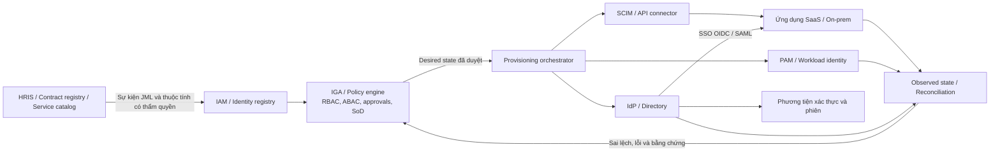

# Provisioning là gì trong quản lý tài khoản IAM?

## 1. Khái niệm và mục tiêu

**Provisioning** trong **Identity and Access Management (IAM)** là quá trình **tạo, cấu hình và cấp phát tài khoản hoặc khả năng truy cập cần thiết cho một danh tính tại các hệ thống đích**, dựa trên trạng thái danh tính, chính sách và quyết định được phép thực thi. Provisioning không chỉ là thao tác thêm một dòng vào cơ sở dữ liệu người dùng; trong thực tế nó có thể bao gồm khởi tạo tài khoản IdP, đồng bộ thuộc tính, gán nhóm, gán vai trò, kích hoạt ứng dụng, chuẩn bị thông tin xác thực và xác nhận rằng ứng dụng đã áp dụng thay đổi.

Ví dụ, khi nhân viên Mai gia nhập tổ chức, HRIS xác nhận quan hệ lao động, IAM liên kết Mai với `identityId` ổn định, IGA quyết định các quyền cơ bản được phép cấp. Một bộ provisioning có thể tạo tài khoản tại IdP, đặt nhóm `employees`, tạo hồ sơ ở hệ thống chấm công và cấp tài khoản cho ứng dụng phù hợp. Mai sau đó đăng nhập qua **SSO**. **SSO giúp đăng nhập; provisioning thiết lập trạng thái tài khoản và quyền cần thiết ở hệ thống đích.** Hai cơ chế có thể phối hợp nhưng không đồng nghĩa.

Trong module **SECURITY_IDENTITY_ACCESS_MANAGEMENT_IDENTITY_LIFECYCLE**, provisioning là phần thực thi quan trọng của vòng đời **Joiner–Mover–Leaver (JML)**: tạo và cấp quyền khi gia nhập, điều chỉnh khi chuyển vai trò, vô hiệu hóa/thu hồi khi rời tổ chức. Nó liên kết các nguồn danh tính, IdP, SSO, **SCIM**, chính sách **RBAC/ABAC**, account dịch vụ, kiểm toán và kiểm soát quyền truy cập tồn dư.

Bài học nhằm giúp người đọc:

- Phân biệt provisioning với đăng ký danh tính, xác thực, ủy quyền và thu hồi truy cập.
- Hiểu dữ liệu đầu vào, hệ thống quyết định, connector và trạng thái đầu ra trong một luồng provisioning.
- Biết các cách cấp phát tự động, thủ công, theo lịch, JIT và theo API/SCIM; chọn theo khả năng ứng dụng.
- Giải thích cách provisioning hỗ trợ JML, quyền tối thiểu, phê duyệt và phân tách nhiệm vụ.
- Nhận biết lỗi đồng bộ, trùng account, thất bại một phần và cách đối soát trạng thái thực tế.

## 2. Provisioning thực hiện những việc gì?

Từ **provision** có nghĩa chung là chuẩn bị và cấp phát tài nguyên. Trong IAM, đối tượng được cấp phát có thể là tài khoản, nhóm, vai trò, thuộc tính hoặc quyền truy cập ứng dụng.

| Thao tác | Ví dụ | Kết quả cần xác nhận |
| --- | --- | --- |
| **Tạo account** | Tạo hồ sơ người dùng trên SaaS từ danh tính nội bộ | Tài khoản đích tồn tại và liên kết đúng chủ thể |
| **Đồng bộ thuộc tính** | Cập nhật tên hiển thị, bộ phận, email liên hệ | Thuộc tính được sửa đúng nguồn và đúng giá trị |
| **Gán nhóm/vai trò** | Thêm nhân viên vào nhóm quyền báo cáo | Membership và quyền liên quan đúng phạm vi đã duyệt |
| **Kích hoạt/khóa account** | Cho phép sử dụng khi bắt đầu công việc; vô hiệu hóa khi nghỉ | Trạng thái thực tế phù hợp thời gian hiệu lực và chính sách |
| **Thay đổi quyền** | Chuyển từ quyền CRM sang quyền tài chính | Quyền mới có hiệu lực, quyền cũ không còn nếu hết căn cứ |
| **Cấp quyền đặc biệt có thời hạn** | Cho kỹ sư thao tác production trong ca sự cố | Phạm vi, thời hạn, phê duyệt và giám sát được thực thi |
| **Thu hồi/hủy cấp phát** | Vô hiệu hóa guest sau khi hợp đồng hết hạn | Quyền, account và các con đường truy cập cần thu hồi được xử lý |
| **Đối soát** | So sánh quyền CRM với quyết định trong IGA | Sai lệch được phát hiện, ghi nhận và khắc phục |

Một hệ thống đích có thể có tài khoản được tạo **trước** khi người dùng được phép đăng nhập. Ví dụ tài khoản `PRE_HIRE` được chuẩn bị trước ngày bắt đầu làm việc nhưng giữ trạng thái chưa hoạt động. Ngược lại, không phải mọi ứng dụng đều cần tạo account trước: một số hệ thống tạo hồ sơ khi nhận phiên đăng nhập hợp lệ theo cơ chế *just-in-time provisioning*.

### Khác biệt giữa identity và account

**Identity** là bản ghi mô tả một chủ thể được tổ chức quản lý; **account** là biểu diễn kỹ thuật của chủ thể tại một hệ thống cụ thể. Một nhân viên có thể có `identityId=id-1042`, tài khoản IdP `idp-user-610`, tài khoản ERP `erp-772` và tài khoản Git `git-941`. Bộ provisioning cần duy trì ánh xạ **một chủ thể, nhiều account đích** mà không tạo trùng hoặc ghép nhầm người. Tên đăng nhập và email có thể đổi, nên không nên dùng chúng làm khóa duy nhất xuyên hệ thống.

## 3. Phân biệt provisioning với các khái niệm gần nhau

| Khái niệm | Câu hỏi chính | Vai trò trong hệ thống |
| --- | --- | --- |
| **Identity proofing** | Người được khai báo là ai; bằng chứng danh tính có đáng tin cậy không? | Kiểm tra bằng chứng, gắn đúng chủ thể với hồ sơ |
| **Identity enrollment** | Danh tính có đủ điều kiện được đăng ký/liên kết trong IAM không? | Tiếp nhận, xác thực nguồn, kiểm tra dữ liệu và tạo/liên kết hồ sơ |
| **Provisioning** | Những account, thuộc tính và quyền đã được duyệt phải được thiết lập ở hệ thống nào? | Thực thi thay đổi đến hệ thống đích |
| **Authentication** | Chủ thể có chứng minh được quyền kiểm soát phương tiện đăng nhập? | IdP kiểm tra passkey, MFA hoặc credential phù hợp |
| **SSO/federation** | Kết quả xác thực được chia sẻ an toàn đến ứng dụng nào? | OIDC/SAML đưa kết quả xác thực qua ranh giới tin cậy |
| **Authorization** | Chủ thể có được thực hiện hành động cụ thể trên tài nguyên cụ thể? | RBAC/ABAC hoặc chính sách tại ứng dụng/API quyết định |
| **Deprovisioning** | Trạng thái nào phải bị vô hiệu hóa hoặc thu hồi? | Phần ngược của cấp phát: xóa nhóm, khóa account, thu hồi quyền/credential theo chính sách |
| **Reconciliation** | Trạng thái thực tế ở đích có khớp trạng thái được duyệt không? | Đối soát và xử lý drift hoặc lỗi cấp phát |

**Provisioning không thay thế authorization runtime.** Ví dụ việc đã thêm người dùng vào nhóm `finance-readers` chỉ thiết lập một đầu vào cho quyết định truy cập. Khi người đó gọi API đọc báo cáo, ứng dụng vẫn phải kiểm tra quyền trên đối tượng và phạm vi dữ liệu. Ngược lại, xác thực OIDC thành công không cho phép bộ provisioning suy rằng người dùng có thể tự chọn vai trò quản trị.

## 4. Mô hình kiến trúc điển hình



Sơ đồ minh họa các thành phần **logic**, không buộc mọi doanh nghiệp triển khai thành các sản phẩm riêng. Có hệ thống đặt chức năng provisioning trong IdP, có hệ thống dùng IGA gọi trực tiếp SCIM/API, có hệ thống dùng middleware hoặc hàng đợi để điều phối. Điều quan trọng là phân biệt:

1. **Nguồn có thẩm quyền:** xác nhận trạng thái người lao động, hợp đồng, dịch vụ và thuộc tính liên quan.
2. **Bộ quyết định chính sách:** xác định trạng thái mong muốn, vai trò, phê duyệt và điều kiện áp dụng.
3. **Bộ provisioning:** chuyển quyết định thành thao tác đối với account đích, theo dõi từng yêu cầu.
4. **Hệ thống đích:** lưu trạng thái account, nhóm và quyền thực tế.
5. **Đối soát/kiểm toán:** quan sát kết quả và phát hiện những gì chưa đạt chính sách.

**Source of truth** về việc một người còn là nhân viên thường là HRIS, nhưng trạng thái quyền **thực tế** trong ứng dụng cần được đọc từ chính ứng dụng hoặc nguồn quan sát đáng tin cậy. Không được tự động coi quyền đang tồn tại là quyền được phê duyệt.

## 5. Đầu vào và đầu ra của một yêu cầu provisioning

Một yêu cầu cấp phát tốt cần cho biết **chủ thể nào**, **hệ thống nào**, **thay đổi gì**, **dựa vào quyết định nào** và **có hiệu lực khi nào**.

Ví dụ dữ liệu nội bộ minh họa, **không phải định dạng chuẩn của SCIM**:

```json
{
  "requestId": "prov-2084",
  "identityId": "id-1042",
  "sourceEventId": "hr-joiner-801",
  "requestType": "CREATE_OR_UPDATE",
  "targetSystem": "timesheet",
  "desired": {
    "enabled": true,
    "department": "FIN",
    "entitlementRefs": ["timesheet-basic-user"]
  },
  "effectiveAt": "2026-12-01T00:00:00+07:00",
  "policyVersion": "workforce-access-v4",
  "approvalRef": "policy-grant-224",
  "correlationKey": "id-1042:timesheet:prov-2084"
}
```

Bộ provisioning phải kiểm tra rằng `identityId` liên kết đúng chủ thể, nguồn sự kiện được công nhận, vai trò đã được phê duyệt và connector có thẩm quyền sửa các trường mong muốn. Trường `enabled=true` có thể được **lên lịch** theo `effectiveAt` thay vì kích hoạt ngay khi nhận request.

| Thành phần đầu vào | Mục đích |
| --- | --- |
| `identityId`, `targetSystem` | Xác định chính xác chủ thể và nơi thực thi |
| `sourceEventId`, `policyVersion` | Truy nguồn sự kiện JML và quy tắc ra quyết định |
| `desired` | Trạng thái account/quyền cần đạt, có scope rõ ràng |
| `effectiveAt` và thời hạn quyền | Ngăn cấp quyền sớm hoặc giữ quyền quá hạn |
| `approvalRef` | Tham chiếu quyết định phê duyệt hoặc chính sách tự động |
| `correlationKey` | Truy vết và tránh thực thi trùng khi retry |

Kết quả nên chứa **account ID tại hệ thống đích**, trạng thái thực thi, thời điểm thử, mã tương quan, lỗi có thể xử lý và trạng thái đã được xác minh sau readback. Không coi việc gửi lệnh là bằng chứng account đã có hoặc quyền đã có hiệu lực.

## 6. Những hình thức provisioning thường gặp

| Hình thức | Cách hoạt động | Phù hợp khi | Giới hạn cần quản lý |
| --- | --- | --- | --- |
| **Tự động theo sự kiện** | JML event làm bộ điều phối tạo/cập nhật/thu hồi account | Nhiều ứng dụng, cần cập nhật kịp thời | Sự kiện đến muộn, lặp, lỗi từng connector |
| **Theo lịch/batch** | Tính chênh lệch và đồng bộ theo chu kỳ | Nguồn cũ, ứng dụng không hỗ trợ webhook/API liên tục | Độ trễ và cửa sổ sai lệch quyền |
| **SCIM provisioning** | Client gọi REST API chuẩn SCIM tới service provider | SaaS/directory có hỗ trợ SCIM | Sản phẩm khác nhau về hỗ trợ thuộc tính, group, disable |
| **API riêng hoặc connector** | Tích hợp API đặc thù của ứng dụng | Đích không hỗ trợ SCIM | Phải quản lý mapping, version, rate limit và lỗi riêng |
| **JIT provisioning** | Tạo/link account khi đăng nhập hợp lệ lần đầu | Ứng dụng hỗ trợ JIT, tránh tạo account chưa dùng | Không được tự bỏ qua phê duyệt, dễ tạo trùng nếu correlation yếu |
| **Provisioning thủ công** | IGA tạo ticket; quản trị viên thay quyền ở đích | Hệ thống legacy hoặc thay đổi cần kiểm soát đặc biệt | Cần bằng chứng thực thi, SLA và đối soát độc lập |
| **Just-in-time privileged access** | Cấp đặc quyền ngắn hạn theo nhu cầu và điều kiện | Quản trị production, tác vụ rủi ro cao | Phải thu hồi đúng hạn và quản lý phiên/credential |

Một tổ chức có thể dùng **mô hình lai**: tạo tài khoản IdP tự động, cấp license SaaS qua SCIM, cấp quyền dữ liệu qua approval, còn hệ thống cũ qua ticket. Vì vậy phải định nghĩa **độ hoàn tất của workflow** theo từng đích, không suy từ một connector thành công.

### Push provisioning và pull/JIT

Ở mô hình **push**, bộ provisioning chủ động gửi dữ liệu tới hệ thống đích. Trong JIT hoặc mô hình một ứng dụng tự đọc từ nguồn tin cậy, account được tạo/liên kết khi người dùng bắt đầu sử dụng. JIT không thay thế quản trị vòng đời: cần cơ chế khóa khi leaver, cập nhật khi mover và rà soát tài khoản vẫn còn trong ứng dụng sau khi phiên đăng nhập kết thúc.

## 7. Provisioning trong Joiner–Mover–Leaver

### 7.1 Joiner: tạo và kích hoạt đúng thời điểm

Khi nguồn có thẩm quyền xác nhận một nhân viên sắp gia nhập, hệ thống IAM xác minh hoặc liên kết danh tính chuẩn. IGA quyết định các ứng dụng và quyền mặc định theo vai trò, chính sách và phê duyệt. Bộ provisioning tạo tài khoản trên IdP, gửi tài khoản tới ứng dụng cần thiết, gán quyền tối thiểu rồi kích hoạt theo ngày được phép.

Các tình huống cần kiểm soát gồm: nhân viên ở trạng thái `PRE_HIRE`, tài khoản đích đã tồn tại từ kỳ thực tập trước, tên/email bị trùng, hoặc phê duyệt quyền nhạy cảm chưa hoàn tất. **Không nên tạo tài khoản thứ hai chỉ vì tên đăng nhập đã tồn tại**; phải giải quyết liên kết account và chủ thể.

### 7.2 Mover: thay đổi quyền và thuộc tính, xử lý quyền cũ

Khi nhân viên từ Sales chuyển sang Finance, bộ chính sách tính lại **desired entitlements**. Bộ provisioning cần thêm quyền Finance, loại bỏ quyền Sales không còn hợp lệ, giữ quyền chung và xử lý ngoại lệ bàn giao có hạn.

Ví dụ:

```text
actualBefore = {crm-read, customer-export, office-login}
desiredAfter = {finance-report-read, invoice-review, office-login}

toGrant  = desiredAfter - actualBefore
         = {finance-report-read, invoice-review}

toRevoke = actualBefore - desiredAfter
         = {crm-read, customer-export}

toKeep   = actualBefore intersection desiredAfter
         = {office-login}
```

Trong triển khai thật, so sánh phải xem **tài nguyên, hành động, phạm vi, nguồn quyền và thời điểm hiệu lực**, không chỉ tên group. Nếu quyền cũ và mới tạo xung đột **Segregation of Duties (SoD)**, có thể phải **thu hồi quyền cũ trước khi kích hoạt quyền mới**. Không có quy tắc “luôn cấp trước, thu hồi sau” dùng cho mọi loại quyền.

### 7.3 Leaver: deprovisioning không dừng ở việc khóa IdP

Khi HRIS, sponsor hoặc nguồn hợp đồng xác nhận kết thúc quan hệ, bộ provisioning chuyển các account tới trạng thái phù hợp, thu hồi nhóm/quyền, xử lý guest, token hoặc credential theo chính sách. Thao tác `active=false` tại một hệ thống SCIM **không bảo đảm** phiên, personal access token, tài khoản local hoặc quyền chia sẻ ở mọi ứng dụng đều bị hủy. Cần đường thu hồi bao phủ các con đường truy cập thực tế và đối soát sau đó.

**Không nhầm việc thu hồi quyền với xóa dữ liệu ngay.** Hồ sơ giao dịch, email, nội dung nghiệp vụ và audit log có thể có chính sách lưu giữ hoặc bàn giao riêng. Leaver thường yêu cầu vô hiệu hóa truy cập kịp thời trước khi thực hiện những hành động dữ liệu có điều kiện pháp lý.

### 7.4 Rehire và chuyển đổi loại quan hệ

Nhân viên trở lại hoặc nhà thầu trở thành nhân viên có thể sử dụng cùng một tài khoản cũ hoặc một bản ghi mới tùy chính sách. Trước provisioning, cần xác minh liên kết danh tính, phân biệt kỳ làm việc/hợp đồng và rà soát quyền từ quan hệ cũ. **Không khôi phục toàn bộ quyền cũ chỉ vì cùng email, cùng mã nhân viên hoặc cùng `identityId`**.

## 8. SCIM: giao thức thường dùng để cấp phát account

**System for Cross-domain Identity Management (SCIM)** là tập đặc tả cho phép các hệ thống trao đổi và quản lý thông tin danh tính, chủ yếu qua giao diện REST và lược đồ chuẩn. Những tài nguyên phổ biến gồm **User** và **Group**; SCIM định nghĩa thao tác đọc, tạo, sửa, cập nhật một phần và xóa, tùy mức hỗ trợ của service provider.

Trong một kết nối SCIM:

- **Provisioning client** là hệ thống gửi yêu cầu đến đích.
- **SCIM service provider** là hệ thống triển khai endpoint và duy trì tài nguyên.
- **Schema User/Group** mô tả thuộc tính với các đặc tính riêng về kiểu, tính bắt buộc và khả năng sửa.
- **Mapping** xác định thuộc tính hoặc định danh của IAM nào tương ứng với thuộc tính trong đích.

Một ví dụ **SCIM User** giản lược dùng cho tài liệu học, không phải phản hồi từ hệ thống thật:

```json
{
  "schemas": ["urn:ietf:params:scim:schemas:core:2.0:User"],
  "externalId": "id-1042",
  "userName": "mai.nguyen@example.org",
  "name": {
    "formatted": "Mai Nguyen",
    "givenName": "Mai",
    "familyName": "Nguyen"
  },
  "emails": [
    {"value": "mai.nguyen@example.org", "type": "work", "primary": true}
  ],
  "active": true
}
```

Một số lưu ý quan trọng:

1. **`id`** do SCIM service provider cấp cho tài nguyên tại đích; không mặc định là ID chuẩn của toàn tổ chức.
2. **`externalId`** là thuộc tính để provisioning client định danh hoặc đối chiếu tài nguyên trong ngữ cảnh tích hợp; nó không là khóa toàn cục được mọi đích thống nhất.
3. **`userName`** có những ràng buộc riêng của SCIM và triển khai; không nên xem là ID con người không bao giờ thay đổi.
4. **`active`** thường dùng biểu đạt tình trạng hoạt động của account, nhưng ý nghĩa cụ thể đối với khả năng đăng nhập, session và token cần kiểm tra ở nhà cung cấp.
5. Nhóm và membership cần mapping đúng từ identity và quyền đã được duyệt. Một số đích không hỗ trợ đủ SCIM Group hoặc PATCH theo cùng cách.
6. **SCIM không thay thế OIDC/SAML**, không phải một giao thức đăng nhập hay cơ chế kiểm tra MFA.

### Ví dụ cập nhật trạng thái User

Khi cần vô hiệu hóa một account đã được xác minh đúng ánh xạ, provisioning client có thể dùng SCIM PATCH theo khả năng service provider:

```http
PATCH /scim/v2/Users/sp-user-771 HTTP/1.1
Content-Type: application/scim+json

{
  "schemas": ["urn:ietf:params:scim:api:messages:2.0:PatchOp"],
  "Operations": [
    {"op": "replace", "path": "active", "value": false}
  ]
}
```

Đoạn HTTP là ví dụ cấu trúc request, **chưa gồm phần xác thực kết nối** và không có nghĩa một URL giả định sẽ chạy được ở mọi ứng dụng. Trong triển khai, phải dùng TLS, xác thực client, giới hạn quyền API và cấu hình endpoint theo nhà cung cấp; tuyệt đối không nhúng access token thật vào giáo trình hoặc log.

Sau khi API thành công, bộ provisioning cần **đọc lại tài nguyên hoặc nhận bằng chứng trạng thái tương đương**, đồng thời kiểm tra những cơ chế truy cập không bị thao tác `active=false` bao phủ.

## 9. RBAC, ABAC, phê duyệt và giới hạn quyền

Provisioning là **cơ chế thực thi quyết định truy cập**. Nếu đầu vào chính sách sai, tự động hóa chỉ khiến quyền sai được cấp nhanh hơn.

### RBAC: vai trò nghiệp vụ ánh xạ sang quyền

**Role-Based Access Control (RBAC)** thường dùng vai trò như `sales-agent` hoặc `finance-analyst` để xác định những nhóm hoặc quyền cần có. IAM/IGA quản lý bảng ánh xạ đã được chấp thuận, còn bộ provisioning thực thi gán/thu hồi account và group tại đích. Nếu một vai trò mới có quyền nhạy cảm, có thể cần owner ứng dụng hoặc owner dữ liệu duyệt riêng.

### ABAC: thuộc tính và ngữ cảnh kiểm soát phạm vi

**Attribute-Based Access Control (ABAC)** dùng thuộc tính chủ thể (phòng ban, loại hợp đồng), tài nguyên (phân loại dữ liệu, sở hữu dự án), hành động và ngữ cảnh (mức MFA, thời gian, môi trường). Một số ABAC được đánh giá **ở thời điểm truy cập**, nên provisioning chỉ đồng bộ đầu vào hoặc điều kiện cần thiết; ứng dụng vẫn phải ra quyết định cuối cùng khi xử lý request.

Ví dụ, người dùng có vai trò `partner-orders-reader` chỉ được xem đơn hàng thuộc `partnerId` của mình. Không được cấp quyền dữ liệu toàn bộ đối tác chỉ dựa vào việc tạo account guest thành công.

### Phân tách nhiệm vụ (*SoD*) và quyền cao

Nếu một nhân viên đã có quyền `invoice-create`, việc tự động thêm `invoice-approve` có thể vi phạm SoD. Bộ chính sách cần phát hiện xung đột **trước provisioning**, kể cả quyền qua nhóm, quyền được gán trực tiếp và ngoại lệ. Với đặc quyền production hoặc thao tác quản trị, có thể cần **Privileged Access Management (PAM)**, quyền có thời hạn, MFA mạnh và giám sát phiên.

**Không cho người yêu cầu tự khai `role=admin` rồi dùng provisioning cấp ngay**. Phải tách người yêu cầu, người duyệt theo thẩm quyền và hệ thống thực thi; mọi quyền ngoài chính sách mặc định cần có lý do, phạm vi, thời hạn và bằng chứng.

## 10. Trạng thái mong muốn, trạng thái thực tế và đối soát

Một hệ thống provisioning đáng tin không chỉ có hàm `createUser()`. Nó phải quản lý hai lớp trạng thái:

- **Desired state**: kết quả đúng theo danh tính, nguồn sự thật, chính sách, phê duyệt và thời gian hiệu lực.
- **Observed/actual state**: account, membership, quyền và trạng thái thật đang tồn tại ở hệ thống đích.

Ví dụ IGA quyết định một nhân viên cần `finance-report-read`, nhưng API của ứng dụng trả lỗi timeout sau khi thực hiện cập nhật. IAM không thể suy ra quyền đã được cấp hay chưa chỉ từ timeout. Cần truy vấn lại account hoặc thực hiện yêu cầu lặp an toàn để biết trạng thái thực tế.

| Tình huống | Desired state | Observed state | Hành động |
| --- | --- | --- | --- |
| Cấp tài khoản joiner | Account tồn tại, được kích hoạt đúng hạn | Chưa có account | Gửi lệnh tạo; kiểm tra sau |
| Cấp nhóm mới | Có nhóm `finance-readers` | Chưa có membership | Gán membership theo cơ chế đích |
| Thu hồi quyền mover | Không còn `sales-export` | Vẫn có quyền trực tiếp trong SaaS | Thu hồi quyền đích và đánh giá nguyên nhân |
| Leaver | Không còn đường truy cập được phép | IdP bị khóa nhưng session ứng dụng vẫn tồn tại | Xử lý phiên/token và cảnh báo phần chưa thể thu hồi |
| Đối tác hết hạn | Guest bị vô hiệu hóa | Account vẫn `active` | Chạy deprovisioning, đối soát và xử lý lỗi |
| Service account dừng workload | Credential và quyền không còn hợp lệ | API key vẫn hoạt động | Thu hồi key, quyền và kiểm tra workload |

**Reconciliation** có thể chạy định kỳ hoặc khi có sự kiện. Đối với leaver và quyền đặc biệt, thời gian phát hiện/khắc phục thường cần nghiêm ngặt hơn. Dữ liệu quan sát từ ứng dụng chỉ xác nhận **thực tế đang có gì**, không tự cấp lại quyền hợp pháp cho một grant ngoài luồng.

### Những trạng thái điều phối nên tách biệt

Một workflow có thể lần lượt ở `REQUESTED`, `VALIDATED`, `APPROVED`, `SCHEDULED`, `SENT`, `APPLIED`, `VERIFIED` hoặc `FAILED/PARTIAL`. Đây là các **tên minh họa**. Thông thường:

- `APPROVED` chỉ nói quyết định nghiệp vụ đã được chấp thuận.
- `SENT` cho biết connector đã gửi yêu cầu.
- `APPLIED` có thể là phản hồi thành công của đích, nhưng chưa bao phủ toàn bộ quyền ngoài đích đó.
- `VERIFIED` cần có bằng chứng kiểm tra trạng thái quan trọng ở hệ thống đích.
- `PARTIAL` cảnh báo chỉ một phần trong nhiều hệ thống đã hoàn tất.

Không nên hiển thị cả quy trình là `COMPLETED` khi còn những bước bắt buộc chưa được xác nhận.

## 11. Thiết kế provisioning chịu lỗi và chạy lặp an toàn

Provisioning thường đi qua API, connector, hàng đợi và nhiều hệ thống không thể tham gia một giao dịch nguyên tử. Cần đặt trọng tâm vào **idempotency, versioning, xử lý đồng thời, retry và khả năng khôi phục**.

### Idempotency: cùng yêu cầu không tạo hai account

Nếu API gửi `create` thành công nhưng kết nối bị mất trước khi nhận phản hồi, bộ điều phối có thể gửi lại. Nếu không kiểm tra, một người có thể có hai tài khoản hoặc hai bộ quyền. Một thiết kế hợp lý nên:

1. Liên kết theo `identityId` và khóa nguồn đáng tin cậy.
2. Tra cứu ánh xạ account đích trước khi tạo, rồi dùng ràng buộc duy nhất hoặc cơ chế đồng bộ phù hợp.
3. Lưu `requestId`, trạng thái thao tác và kết quả đã thực hiện.
4. Khi nhận retry, xác định lại trạng thái đích trước khi tạo hoặc sửa.
5. Xử lý xung đột account/identity mơ hồ bằng kiểm tra có thẩm quyền thay vì tự tạo account với hậu tố ngẫu nhiên.

### Event ordering và thời điểm hiệu lực

Một sự kiện joiner cũ không được tái kích hoạt quyền sau khi hệ thống đã xử lý leaver mới hơn. Cần kiểm tra **source version** (nếu nguồn cung cấp thứ tự đáng tin cậy), tình trạng hiện tại và mốc `effectiveAt`. Với mover tương lai, bộ điều phối có thể chuẩn bị sẵn account nhưng phải bảo đảm quyền chỉ có hiệu lực theo lịch phê duyệt.

### Xử lý thành công một phần

Giả sử cùng một Joiner cần tài khoản IdP, ERP và Git. Hai đích đầu thành công nhưng Git bị giới hạn tốc độ API. Phải giữ trạng thái `PARTIAL`, retry với backoff phù hợp, theo dõi lỗi và tránh tạo lại tài khoản ở hai đích đã thành công. Khi một bước thu hồi quyền cao thất bại, có thể cần cảnh báo hoặc kiểm soát tạm thời theo mức rủi ro.

**Không rollback quyền một cách máy móc.** Nếu đã thu hồi quyền cũ để loại xung đột SoD rồi grant mới thất bại, việc khôi phục ngay quyền cũ có thể trái chính sách. Quy trình khắc phục phải dựa vào trạng thái quyền mong muốn và mức độ rủi ro hiện tại.

### Giả mã một bộ điều phối đơn giản

```text
provision(identityId, target, desired, requestId):
    assert decisionIsApprovedAndEffective(identityId, desired)
    assert requesterAndConnectorAreAuthorized(target)
    lockOrSerializeOperations(identityId, target)

    if ledger.hasCompletedRequest(requestId):
        return ledger.previousVerifiedResult(requestId)

    identity = registry.loadCanonicalIdentity(identityId)
    mappedAccount = correlation.findVerifiedTargetAccount(identity, target)

    if mappedAccount.isAmbiguous():
        return NEEDS_MANUAL_REVIEW

    plan = diff(target.readObservedState(mappedAccount), desired)
    ledger.recordPlannedChanges(requestId, plan)

    for operation in plan.safeOrderedOperations():
        result = target.applyIdempotently(operation)
        ledger.recordAttempt(requestId, operation, result)

    observed = target.readObservedState(mappedAccount)
    if observed.satisfies(desired):
        ledger.markVerified(requestId)
        return VERIFIED

    ledger.markPartialAndScheduleReconciliation(requestId)
    return PARTIAL
```

Giả mã không biểu diễn hết yêu cầu sản xuất. Cần có hàng đợi bền vững, giới hạn retry, kiểm tra policy khi trạng thái thay đổi giữa các bước, xử lý credential của connector, lỗi provider, lock timeout và audit. Với workflow phân tán, **transaction + outbox** hoặc cơ chế tương đương có thể giảm nguy cơ đã ghi quyết định nhưng mất sự kiện cấp phát.

## 12. Provisioning cho người dùng bên ngoài và danh tính dịch vụ

### Guest và đối tác B2B

Người dùng bên ngoài có thể đăng nhập bằng IdP của tổ chức họ qua OIDC/SAML, nhưng tổ chức sở hữu tài nguyên vẫn phải quyết định **tài khoản guest có được tạo không, có cần sponsor không, được phép truy cập phạm vi nào và hết hạn khi nào**. Một email từ miền đối tác không tự xác nhận hợp đồng còn hiệu lực. Nếu sử dụng **JIT provisioning**, điều kiện được tạo tài khoản vẫn phải kiểm tra issuer/subject tin cậy, lời mời hoặc quan hệ đã phê duyệt và giới hạn quyền.

Khi hợp đồng hết hạn, deprovisioning ở tổ chức tiếp nhận phải được thực hiện **ngay cả khi tài khoản gốc bên đối tác vẫn hoạt động**. Nếu chỉ phụ thuộc vào việc đối tác tự khóa người dùng, guest có thể giữ quyền tồn dư.

### Service account và workload identity

Danh tính phi con người thường không có HRIS hay quy trình đổi mật khẩu cá nhân. Provisioning của chúng dựa trên **service registry, workload platform, owner chịu trách nhiệm, môi trường, mục đích và chính sách đặc quyền**. Đầu ra có thể gồm workload identity, quan hệ trust, scope API, quyền cloud, chứng chỉ hoặc secret được quản lý.

Ví dụ `svc-invoice-export` cần đọc hàng đợi `invoice-events` và ghi vào bucket báo cáo. Bộ provisioning chỉ cấp đúng quyền đã được service owner và resource owner duyệt. Nếu hệ thống hỗ trợ, nên dùng **managed identity, workload federation hoặc credential ngắn hạn** thay vì khóa tĩnh dài hạn; nếu dùng bí mật, cần quản lý lưu trữ, luân chuyển và thu hồi.

Khi người từng tạo account nghỉ việc, phải xác định **owner mới**, kiểm tra quyền và credential, không mặc định dừng toàn bộ dịch vụ đang hoạt động. Khi chính workload ngừng chạy, cần **deprovision** danh tính dịch vụ, thu hồi quyền và xử lý khóa/tài nguyên liên quan.

## 13. Lỗi điển hình và cách khắc phục

| Triệu chứng | Nguyên nhân có thể | Cách xử lý phù hợp |
| --- | --- | --- |
| Một người có hai account ở cùng SaaS | Correlation dựa email, retry tạo mới, account cũ không được phát hiện | Dùng khóa ổn định, xác minh ánh xạ, chống tạo trùng, xử lý gộp có kiểm soát |
| Có tài khoản IdP nhưng không vào được ứng dụng | Chưa provision account/role đích; mapping SSO chưa đầy đủ | Kiểm tra login/federation và account/entitlement riêng |
| Mover có cả quyền cũ và mới | Chỉ cộng nhóm, chưa xử lý quyền trực tiếp hoặc quyền ngoại lệ | Tính desired state, revoke quyền dư, kiểm tra SoD |
| Leaver vẫn có API key hoạt động | Chỉ disable account/SSO, bỏ qua credential ngoài luồng | Liệt kê và thu hồi key, token, session, role theo khả năng hệ thống |
| SCIM trả lỗi xung đột `409` | Username/định danh bị trùng hoặc vi phạm quy tắc provider | Tra cứu lại account, xác minh đúng chủ thể; không đổi tên tùy tiện để vượt lỗi |
| SCIM/API trả `429` | Rate limit | Tôn trọng `Retry-After` khi có, backoff, giới hạn concurrency |
| API timeout nhưng account thực tế đã được tạo | Phản hồi bị mất sau khi đích đã cập nhật | Readback và idempotent retry, không `POST` mới vô điều kiện |
| Nhóm IdP đã đổi nhưng token cũ còn quyền | Token/phiên cache hoặc chính sách ứng dụng chưa đánh giá lại | Quản lý session/token và thời hạn hiệu lực theo rủi ro |
| Connector có đặc quyền quá rộng | Scope API token hoặc role quản trị cấp quá mức | Hạn chế quyền connector, bảo vệ secret, audit thao tác |
| Service account không có owner | Người tạo rời tổ chức hoặc registry không được cập nhật | Chỉ định owner và backup, rà soát/thu hồi account không còn mục đích |

**Một lỗi ở connector không tự chứng minh là lỗi ở nguồn sự thật.** Cần phân loại lỗi theo vị trí: dữ liệu nguồn, quyết định chính sách, mapping/correlation, xác thực kết nối, ứng dụng đích hoặc đối soát. Phân loại đúng giúp khắc phục nhanh và tránh thực hiện lại các bước đã thành công.

## 14. Kiểm toán, theo dõi và đo chất lượng provisioning

Mỗi quyết định cấp/thu hồi quyền nên có dấu vết xuyên các hệ thống. Một audit trail đủ dùng cho điều tra thường có:

- **Nguồn:** loại sự kiện JML, hệ thống có thẩm quyền, khóa chủ thể, phiên bản và thời gian hiệu lực.
- **Quyết định:** policy/role catalog version, quyền mong muốn, người phê duyệt hoặc điều kiện tự động, hạn của ngoại lệ.
- **Thực thi:** requestId, connector, target account ID, thao tác, thời điểm, trạng thái từng lần thử và lỗi đã xử lý.
- **Đối soát:** quyền/account thực tế đã đọc lại, sai lệch, người xử lý và thời gian đóng.
- **Bảo vệ dữ liệu:** chính sách retention, phân quyền truy cập log và giới hạn các thuộc tính cá nhân được ghi.

**Không lưu access token, mật khẩu, khóa riêng hoặc toàn bộ payload nhạy cảm trong log.** Nếu cần định danh liên kết giữa các hệ thống, dùng mã tương quan và tham chiếu nội bộ thay vì sao chép nhiều giấy tờ định danh.

Các chỉ số có thể theo dõi gồm:

| Chỉ số | Cách hiểu |
| --- | --- |
| **Provisioning latency** | Thời gian từ mốc có hiệu lực hoặc quyết định đã duyệt đến khi trạng thái đích được xác minh |
| **Success/partial/failure rate** | Tỷ lệ yêu cầu hoàn tất, chưa đầy đủ hoặc thất bại theo từng connector |
| **Reconciliation drift** | Số/sự nghiêm trọng của sai lệch giữa quyền mong muốn và thực tế |
| **Orphan accounts** | Tài khoản ứng dụng không liên kết với danh tính/owner hợp lệ |
| **Leaver deprovisioning time** | Khoảng thời gian từ sự kiện được xác nhận đến khi các đường truy cập cần thu hồi đã được kiểm chứng |
| **Entitlement excess** | Quyền thực tế không có căn cứ trong quyết định hiện hành |
| **Retry backlog** | Số yêu cầu retry hoặc cần can thiệp, tuổi của chúng và nguyên nhân |

Không nên đo thành công chỉ bằng số HTTP 2xx. Chỉ số quan trọng với IAM là **trạng thái truy cập phù hợp sau sự kiện**, trong mức thời gian đã cam kết theo rủi ro, cùng bằng chứng có thể kiểm toán.

## 15. Tình huống xuyên suốt: Joiner, Mover, Leaver

Giả sử doanh nghiệp có ba đích: IdP cho đăng nhập, CRM cho bán hàng và ERP cho tài chính. Nhân viên `EMP-1042` được HRIS xác nhận, liên kết với `identityId=id-1042`.

**Joiner — vào bộ phận Sales.** Hệ thống IAM nhận ngày bắt đầu, liên kết danh tính đã proofing, xác định quyền mặc định. IGA duyệt `crm-read` và nhóm nhân viên cơ bản. Provisioning tạo account IdP, gửi SCIM/API tới CRM, gán membership; tài khoản sẵn sàng theo ngày hiệu lực. Đối soát xác nhận không tạo trùng account và chỉ có quyền CRM được duyệt.

**Mover — chuyển sang Finance.** HRIS xác nhận bộ phận mới và ngày hiệu lực. IGA xác định cần `erp-report-read` và không còn cần `crm-export`. Provisioning chuẩn bị tài khoản ERP, xét phê duyệt quyền, lên lịch kích hoạt và thu hồi CRM. Connector ERP thành công nhưng CRM còn quyền `crm-export` được cấp trực tiếp trước đây. Workflow được ghi `PARTIAL`, mở xử lý quyền dư và chỉ hoàn tất sau khi quyền cũ bị thu hồi/giải quyết theo chính sách.

**Leaver — nghỉ việc.** HRIS phát sự kiện kết thúc quan hệ lao động. Hệ thống chặn đăng nhập IdP, gửi lệnh vô hiệu hóa CRM/ERP, thu hồi nhóm và xử lý phiên/token/credential liên quan. Kết quả được kiểm chứng ở từng đích; nếu một ứng dụng đang offline, workflow không tuyên bố mọi truy cập đã được thu hồi mà giữ cảnh báo và biện pháp kiểm soát tạm thời thích hợp.

**Kết quả:** cùng một `identityId` được quản trị từ đầu đến cuối. Provisioning thực thi các thay đổi đã được quyết định, còn reconciliation bảo đảm những thay đổi ấy phản ánh đúng ở hệ thống thực tế. Tài khoản sau leaver có thể cần được giữ dữ liệu phục vụ bàn giao hoặc lưu trữ theo chính sách, trong khi quyền truy cập đã được vô hiệu hóa.

## 16. Checklist trước khi triển khai account provisioning

1. **Nguồn:** ai quyết định danh tính và trạng thái JML? Các thuộc tính ảnh hưởng đến quyền có đến từ nguồn được phép hay không?
2. **Liên kết:** `identityId`, khóa nguồn và account ID đích có được ánh xạ ổn định, tránh trùng và nhầm người khi đổi email/tên không?
3. **Chính sách:** quyền mới lấy từ RBAC/ABAC và quyết định phê duyệt nào? Có kiểm tra SoD và đặc quyền nhạy cảm không?
4. **Thời gian:** có `effectiveAt`, hạn ngoại lệ, quy trình rehire và xử lý sự kiện đến sai thứ tự không?
5. **Kết nối:** đích hỗ trợ SCIM, API riêng, JIT hay thủ công? Có kiểm tra tính năng cụ thể của phiên bản nhà cung cấp không?
6. **Bảo mật connector:** credential, token scope, key rotation, quyền quản trị, TLS và log được quản lý ra sao?
7. **Tự động hóa:** API retry, timeout, rate limit, duplicate request, lỗi một phần và concurrency được xử lý thế nào?
8. **Joiner:** account được tạo, kích hoạt và cấp quyền tối thiểu đúng thời điểm, với bằng chứng xác minh không?
9. **Mover:** có tính lại quyền mong muốn, bỏ quyền cũ, giữ quyền hợp lệ và kiểm tra xung đột trước khi grant không?
10. **Leaver:** có thu hồi mọi con đường truy cập cần thiết, kể cả phiên, token, key, guest và account ứng dụng ngoài SSO không?
11. **Danh tính phi con người:** service account có owner, mục đích, hạn rà soát và quy trình thu hồi credential khi workload ngừng không?
12. **Đối soát:** kết quả được đọc lại ở đích, sai lệch được lưu và có người chịu trách nhiệm khắc phục đến khi đóng không?
13. **Kiểm toán:** có thể nối nguồn sự kiện, chính sách, phê duyệt, lệnh, kết quả và trạng thái cuối cùng qua mã tương quan không?

**Provisioning là cầu nối giữa quyết định danh tính/quyền và trạng thái account tại hệ thống đích.** Nó chỉ đáng tin khi dựa vào nguồn sự thật, chính sách và phê duyệt có thẩm quyền, thực thi qua connector an toàn, xử lý lỗi/lặp có kiểm soát và đối soát kết quả thực tế. Khi được tích hợp với IdP, SSO, SCIM, RBAC/ABAC và các quy trình JML cho cả người dùng lẫn tài khoản dịch vụ, provisioning giúp cấp đúng quyền khi cần và thu hồi kịp thời khi không còn căn cứ sử dụng.
