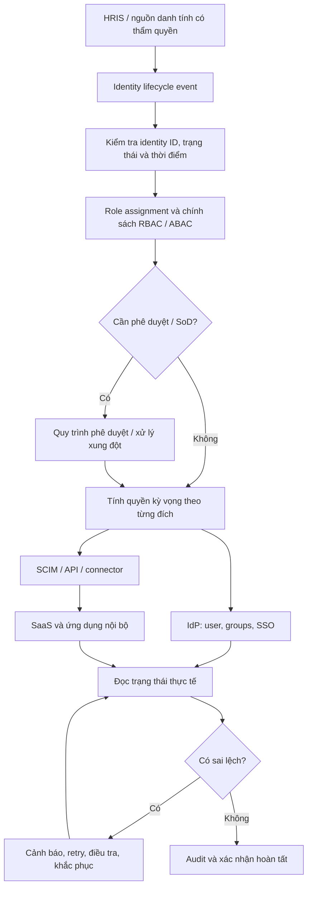

# Provisioning theo role trong quản lý vòng đời danh tính IAM

**Provisioning theo role** (*role-based provisioning*) là cách tự động hoặc bán tự động tạo tài khoản, cấp nhóm và gán quyền truy cập dựa trên **vai trò được xác định và phê duyệt** của một danh tính. Thay vì cấp từng quyền lẻ cho từng người, hệ thống IAM ánh xạ vai trò nghiệp vụ sang các quyền cần thiết trong từng ứng dụng. Khi nhân sự gia nhập, chuyển công việc hoặc rời tổ chức, IAM tính lại những quyền phải có và thực thi thay đổi ở hệ thống đích.

Trong chương **Account provisioning** của module `SECURITY_IDENTITY_ACCESS_MANAGEMENT_IDENTITY_LIFECYCLE`, đây là cơ chế kết nối dữ liệu nhân sự đã xác minh, Identity Provider (**IdP**), đăng nhập một lần (**SSO**), đồng bộ qua **SCIM/API**, mô hình **RBAC/ABAC**, các tài khoản dịch vụ và kiểm toán. Mục tiêu là tạo điều kiện cho người dùng hợp lệ làm việc đúng lúc, đồng thời giảm cấp thừa, tích lũy đặc quyền khi thay đổi vai trò và **quyền truy cập tồn dư** sau khi nghỉ việc.

Sau bài học, bạn có thể phân biệt role với permission và entitlement; xây dựng ánh xạ từ vai trò nghiệp vụ đến quyền ứng dụng; mô tả quy trình Joiner–Mover–Leaver; kiểm soát phê duyệt, xung đột phân tách nhiệm vụ (*Separation of Duties*, SoD); và thiết kế đối soát để biết cấp phát thực tế có đúng chính sách hay chưa.

## 1. Role-based provisioning giải quyết vấn đề gì?

Giả sử công ty có 1.000 nhân viên và 30 ứng dụng. Nếu quản trị viên chọn riêng từng quyền cho mỗi nhân viên, nguy cơ bỏ sót hoặc gán nhầm tăng nhanh. Một nhân viên chuyển từ bộ phận bán hàng sang kế toán cũng có thể giữ các quyền bán hàng cũ vì người cấp quyền mới không biết chúng tồn tại.

Với provisioning theo role, tổ chức định nghĩa một **vai trò công việc** như `sales-agent` và tập quyền được phê duyệt cho vai trò đó. Khi nguồn nhân sự xác nhận nhân viên thuộc bộ phận bán hàng, IAM có thể cấp các quyền cơ sở phù hợp; khi vai trò thay đổi, IAM phải tính lại cả quyền cần **thêm** và cần **gỡ**.

Lợi ích chính:

- **Nhất quán:** những người làm cùng một loại công việc được xem xét theo cùng một tập chính sách, giảm quyết định tùy hứng.
- **Nhanh hơn:** quyền cơ sở có thể cấp tự động sau khi điều kiện danh tính và thời điểm hiệu lực đã thỏa mãn.
- **Quyền tối thiểu:** mỗi role được thiết kế chỉ gồm quyền cần cho nhiệm vụ, thay vì cấp quyền rộng để phòng trường hợp phát sinh việc.
- **Dễ rà soát:** chủ vai trò và chủ ứng dụng có thể đánh giá cả một gói quyền và những người đang giữ nó.
- **Thu hồi có hệ thống:** khi role không còn hợp lệ, quyền liên quan được gỡ nếu không còn căn cứ hợp lệ khác.

Tuy nhiên, **cấp quyền qua role không tự động bảo đảm quyền tối thiểu**. Nếu `sales-agent` chứa `crm.admin`, mọi người trong role đó vẫn được cấp thừa. Chất lượng của mô hình phụ thuộc vào thiết kế role, nguồn dữ liệu, phê duyệt, thực thi và đối soát.

## 2. Các khái niệm phải phân biệt

| Khái niệm | Ý nghĩa | Ví dụ |
| --- | --- | --- |
| **Danh tính (identity / subject)** | Người hoặc workload được quản lý bởi IAM | `identityId=employee-0182` |
| **Business role** | Vai trò nghiệp vụ thể hiện công việc hoặc trách nhiệm | `sales-agent`, `branch-manager` |
| **Application role** | Vai trò có ý nghĩa trong một ứng dụng cụ thể | `crm.viewer`, `ticket.editor` |
| **Permission** | Quyền thực hiện một hành động trên tài nguyên | `order.read`, `order.approve` |
| **Entitlement** | Quyền lợi truy cập có thể cấp/thu hồi trong hệ thống đích | Thành viên nhóm CRM, license, role ứng dụng, quyền API |
| **Role assignment** | Quan hệ gán một vai trò cho một danh tính theo căn cứ và thời hạn | Nhân viên A được gán `sales-agent` từ ngày bắt đầu |
| **Policy** | Quy tắc quyết định ai đủ điều kiện giữ role và có cần phê duyệt hay không | `department=sales`, `status=ACTIVE`, không xung đột SoD |
| **Provisioning connector** | Cơ chế đưa thay đổi xuống đích | SCIM, REST API, directory sync hoặc tác vụ quản trị có kiểm soát |

Đặc biệt, **business role không nhất thiết trùng application role**. Vai trò `sales-agent` có thể bao gồm nhóm `crm-sales-read` ở CRM, `orders.editor` trong hệ thống đơn hàng và quyền vào cổng báo cáo bán hàng. Ngược lại, một application role có thể được dùng bởi nhiều business role nếu chính sách cho phép.

Một nhân viên cũng có thể có nhiều vai trò hợp lệ đồng thời. Tập quyền cuối phải tính đến quan hệ giữa các vai trò, ràng buộc SoD, thời hạn, quyền bổ sung được duyệt và những giới hạn ABAC. Không được hiểu việc hợp nhất quyền là cộng tất cả một cách vô điều kiện.

## 3. Từ role nghiệp vụ đến tài khoản và entitlement

Quá trình cấp phát thường có hai quyết định riêng:

1. **Người dùng có cần tài khoản ở ứng dụng đích hay không?** Nếu cần, IAM tạo hoặc liên kết đúng tài khoản theo định danh ổn định.
2. **Tài khoản đó phải giữ những quyền cụ thể nào?** IAM áp role, group, entitlement, license và phạm vi dữ liệu theo chính sách.

Ví dụ một danh mục role được phê duyệt:

| Business role | Ứng dụng đích | Entitlement/role được cấp | Điều kiện bổ sung |
| --- | --- | --- | --- |
| `employee-basic` | Email, cổng nội bộ | Quyền sử dụng cơ sở | Quan hệ nhân sự còn hiệu lực |
| `sales-agent` | CRM | `crm.customer.read`, `crm.lead.update` | Chỉ bản ghi thuộc phạm vi kinh doanh được giao |
| `sales-agent` | OrderHub | `order.create`, `order.read` | Không được phê duyệt hoàn tiền giá trị cao |
| `sales-manager` | CRM | Quyền quản lý nhóm bán hàng | Cần vai trò quản lý có thẩm quyền |
| `finance-approver` | FinanceApp | `payment.approve` | Phê duyệt đặc biệt và SoD với `payment.create` |
| `production-operator` | Hệ thống sản xuất | Quyền thao tác giới hạn | Cấp có thời hạn qua PAM/JIT nếu phù hợp |

Đây là danh mục **minh họa**, không phải tên quyền có sẵn của một sản phẩm IAM. Từng ứng dụng có thể sử dụng nhóm, role, entitlement hoặc quyền API khác nhau. Đội IAM phải giữ ánh xạ rõ ràng, có chủ sở hữu và kiểm soát phiên bản.

### Role nghiệp vụ, role kỹ thuật và quyền dữ liệu

Một role như `sales-agent` có thể cấp quyền *mở* CRM, nhưng điều đó không tự bảo đảm người dùng chỉ xem được khách hàng thuộc khu vực của mình. **RBAC** thường xác định khả năng truy cập theo vai trò; **ABAC** xét thêm thuộc tính danh tính, tài nguyên, hành động và ngữ cảnh.

Ví dụ chính sách ở mức ý tưởng:

```text
ALLOW khi:
    subject.employmentStatus == "ACTIVE"
    AND subject.hasBusinessRole("sales-agent")
    AND subject.hasApplicationRole("crm.customer.read")
    AND action == "read"
    AND resource.type == "customer"
    AND resource.region IN subject.allowedRegions

DENY trong những trường hợp còn lại.
```

Đây là giả mã, không phải ngôn ngữ chính sách của IdP hay ứng dụng cụ thể. Quan trọng là điểm thực thi quyền phải kiểm tra dữ liệu đáng tin cậy. Việc nhóm IdP đã có thành viên **không thay thế** việc ứng dụng kiểm soát đúng bản ghi, chức năng hoặc API mà người dùng yêu cầu.

## 4. Kiến trúc luồng provisioning theo role



Nguồn nhân sự thường đưa ra **thuộc tính nghiệp vụ** như trạng thái, bộ phận, chức danh, địa điểm, người quản lý và ngày hiệu lực. Công cụ IAM đánh giá điều kiện của role, xác định tập quyền được phép, rồi chuyển thay đổi xuống IdP và ứng dụng qua những cơ chế được hỗ trợ.

**IdP và SSO giải quyết xác thực và quản lý phiên tập trung**, còn **SCIM hoặc connector hỗ trợ tạo/cập nhật/vô hiệu hóa tài khoản, nhóm hoặc entitlement** tùy ứng dụng. Một số SaaS không hỗ trợ cấp role đầy đủ bằng SCIM, hoặc chỉ đồng bộ user mà vẫn phải phân quyền bằng API riêng. Vì vậy cần kiểm tra khả năng của từng đích; không coi có SCIM là mọi entitlement đã được tự động hóa.

Phản hồi connector thành công chỉ cho biết một bước kỹ thuật được chấp nhận. Cần **đọc lại trạng thái đích** và, khi phù hợp, kiểm tra khả năng truy cập thực tế để xác nhận tài khoản và role đã được thực thi.

## 5. Thiết kế role catalog để cấp quyền có kiểm soát

Trước khi tự động hóa, phải có danh mục role được định nghĩa và quản trị. Một role không chỉ gồm tên và danh sách group. Tối thiểu nên mô tả:

| Thuộc tính | Nội dung nên có |
| --- | --- |
| `roleId` | Khóa ổn định, không dựa vào tên hiển thị có thể đổi |
| Tên, mô tả và mục đích | Vai trò phục vụ nghiệp vụ nào; phạm vi dữ liệu hoặc hành động nào |
| Chủ sở hữu | Người/đơn vị chịu trách nhiệm duyệt và rà soát role |
| Điều kiện đủ tư cách | Trạng thái nhân sự, bộ phận, vị trí, hợp đồng hoặc dự án |
| Entitlement mapping | Ứng dụng, nhóm, role đích, permission và phiên bản ánh xạ |
| Mức rủi ro | Quyền đọc thông thường, quyền sửa nhạy cảm hoặc đặc quyền cao |
| Phê duyệt/SoD | Ai phê duyệt, vai trò xung đột và cách xử lý ngoại lệ |
| Hiệu lực, hết hạn | Khi nào bắt đầu/kết thúc, cách xử lý quyền tạm thời |
| Lịch rà soát | Chu kỳ xác nhận role và danh sách thành viên |

Một ví dụ YAML mô tả chính sách do tổ chức tự định nghĩa:

```yaml
roleId: sales-agent
displayName: Nhân viên kinh doanh
owner: sales-operations
eligibility:
  employmentStatus: ACTIVE
  department: sales
assignments:
  - target: crm
    entitlements:
      - crm.customer.read
      - crm.lead.update
  - target: orderhub
    entitlements:
      - order.create
      - order.read
constraints:
  conflictingRoles:
    - finance-approver
approval:
  type: policy-based
reviewCadence: quarterly
```

Đây chỉ là cấu trúc **minh họa để học**, không phải schema chung của IAM và cũng không thể áp dụng trực tiếp vào sản phẩm. Trong triển khai thật, cần định nghĩa ý nghĩa từng trường và chính sách xử lý khi thuộc tính thiếu, thay đổi hoặc mâu thuẫn.

### Role explosion và độ chi tiết phù hợp

Nếu mỗi chi nhánh, dự án, loại dữ liệu và chức danh được tạo thành một role riêng, hệ thống có thể phát sinh hàng nghìn role khó hiểu (*role explosion*). Nếu một role chứa mọi quyền của phòng ban, quyền cấp có thể quá rộng. Cách cân bằng là giữ role cho **nhiệm vụ ổn định**, dùng thuộc tính ABAC để giới hạn phạm vi động, và dùng quyền bổ sung có thời hạn cho nhu cầu đặc biệt.

Ví dụ, một role `sales-agent` đi cùng thuộc tính `allowedRegions=[south]` có thể dễ quản trị hơn nhiều role trùng chức năng như `sales-agent-south`, `sales-agent-north` nếu hệ thống đích có khả năng kiểm tra vùng dữ liệu đúng cách. Chỉ chọn giải pháp này khi điểm thực thi thật sự hỗ trợ điều kiện ABAC; nếu ứng dụng chỉ có role tĩnh, cần ánh xạ và kiểm thử phù hợp với khả năng thực tế.

## 6. Joiner: cấp tài khoản và quyền từ vai trò đầu tiên

**Tình huống:** Một nhân viên mới gia nhập bộ phận bán hàng lúc 09:00 ngày 01/12. HRIS đã phê duyệt hồ sơ và cung cấp ID nhân sự ổn định. Theo chính sách, nhân viên cần tài khoản IdP, ứng dụng CRM và OrderHub.

Quy trình được thiết kế như sau:

1. **Xác minh danh tính nguồn:** đọc hồ sơ từ HRIS có thẩm quyền, kiểm tra trạng thái, đơn vị, vai trò, ngày bắt đầu và tránh nhầm với người cùng tên.
2. **Đối chiếu hoặc tạo identity:** IAM tạo/giữ một `identityId` bền vững và ánh xạ tài khoản IdP; không dùng email có thể thay đổi làm khóa duy nhất.
3. **Xác định role cơ sở:** tính `employee-basic` và `sales-agent` từ thuộc tính đã xác minh; không suy ra `sales-manager` chỉ từ tên chức danh tương tự.
4. **Kiểm tra chính sách:** xác định quyền nào cấp tự động, quyền nào cần phê duyệt, điều kiện MFA và giới hạn SoD.
5. **Provision tài khoản và entitlement:** chuẩn bị hoặc tạo user, nhóm và role tương ứng qua IdP, SCIM hoặc API đích, có lưu kết quả riêng từng hệ thống.
6. **Kích hoạt đúng lúc:** tài khoản có thể được chuẩn bị trước (*pre-provisioning*), nhưng quyền được phép sử dụng phải gắn với `effectiveAt` và chính sách.
7. **Xác minh kết quả:** kiểm tra tài khoản và tập quyền tại ứng dụng, ghi audit và chuyển xử lý lỗi nếu thiếu hoặc thừa quyền.

**Không đồng nhất trạng thái `account created` với `access granted`.** Một tài khoản đã tồn tại ở SaaS nhưng chưa có role thì chưa dùng được nghiệp vụ; ngược lại, một tài khoản được provision trước nhưng có quyền truy cập dữ liệu nhạy cảm trước ngày nhận việc có thể vi phạm yêu cầu bảo mật.

## 7. Mover: tính lại quyền và xử lý nhiều role đồng thời

Khi nhân viên chuyển bộ phận, được thăng chức hoặc đổi dự án, role assignment phải thay đổi theo **nguồn và thời điểm hiệu lực mới**. Đây là nơi dễ phát sinh *privilege creep*: cấp role mới nhưng quên gỡ role cũ.

Ví dụ người dùng `employee-0182` đang có `sales-agent` và `employee-basic`. Khi chuyển sang `operations-analyst`, quyền mong đợi có thể như sau:

| Thành phần | Trước Mover | Sau Mover | Hành động |
| --- | --- | --- | --- |
| `employee-basic` | Có | Có | Giữ nguyên |
| CRM `crm.lead.update` | Có qua `sales-agent` | Không | Thu hồi nếu không có căn cứ khác |
| OrderHub `order.create` | Có qua `sales-agent` | Không | Thu hồi nếu không có căn cứ khác |
| Báo cáo `analytics.read` | Không | Có qua `operations-analyst` | Cấp khi đủ điều kiện |
| Quyền đặc biệt đã duyệt | Có thể có | Tùy thời hạn và nhu cầu | Rà soát, kết thúc hoặc phê duyệt lại |

### Không thu hồi nhầm quyền được cấp bởi nhiều role

Một entitlement có thể được **nhiều role hợp lệ cùng yêu cầu**. Ví dụ cả `sales-agent` và `operations-analyst` đều yêu cầu `portal.read`. Khi gỡ `sales-agent`, IAM không được xóa `portal.read` nếu người dùng vẫn cần quyền đó thông qua role mới.

Vì vậy, cần tính quyền mong đợi từ **toàn bộ role assignment hiện còn hợp lệ**, sau khi áp chính sách, rồi so với quyền thực tế. Việc chỉ chạy một danh sách lệnh “gỡ tất cả quyền của role cũ” mà không xét nguồn quyền khác dễ gây mất quyền hợp lệ.

### SoD và thứ tự cấp/thu hồi

Nếu vai trò cũ và mới tạo xung đột SoD, không nên cấp quyền nhạy cảm mới trong khi quyền cũ còn hoạt động. Ví dụ một người chuyển từ tạo lệnh thanh toán sang phê duyệt thanh toán: nếu cùng lúc giữ hai quyền, họ có thể tự tạo và duyệt giao dịch.

Trong trường hợp này, quy trình cần xác định thứ tự thu hồi quyền cũ, xác minh hiệu lực tại ứng dụng, sau đó mới kích hoạt quyền mới. Với quyền ít rủi ro và không xung đột, có thể thiết kế khoảng bàn giao hoặc một lịch chuyển đổi giảm gián đoạn. **Quyền chuyển tiếp** chỉ hợp lệ khi có phê duyệt, phạm vi hẹp, người sở hữu và ngày hết hạn; không biến việc “giữ role cũ để tiện” thành mặc định.

## 8. Leaver: chấm dứt căn cứ cấp role và mọi đường truy cập liên quan

Khi quan hệ làm việc kết thúc, các role được cấp dựa trên quan hệ đó phải trở nên không còn hợp lệ theo chính sách. IAM cần chặn đăng nhập tập trung, thu hồi nhóm/role và quyền trực tiếp, thực thi deprovisioning tới ứng dụng đích, đồng thời xử lý phiên hoặc token chưa hết hạn khi khả năng hệ thống hỗ trợ.

Một luồng Leaver gồm:

1. Tiếp nhận sự kiện từ HR hoặc nguồn có thẩm quyền, đối chiếu đúng danh tính và `effectiveAt`.
2. Chặn khả năng truy cập theo lịch hoặc ngay khi có chỉ thị khẩn cấp hợp lệ.
3. Gỡ role assignment không còn căn cứ; tính lại quyền kỳ vọng với các tư cách hợp lệ khác (nếu có).
4. Gửi thay đổi tới IdP, SCIM/API và hệ thống không tích hợp, kể cả quyền quản trị, tài khoản cục bộ, VPN và ứng dụng SaaS.
5. Đối soát account, quyền, phiên/token và ngoại lệ; ghi nhận đích chưa chặn được và cảnh báo theo SLA.
6. Bàn giao tài sản, dữ liệu, công việc và trách nhiệm quản trị theo chính sách riêng.

**Vô hiệu hóa IdP không bảo đảm access token tự chứa hoặc session SaaS cũ lập tức mất hiệu lực.** Nếu ứng dụng không có cơ chế thu hồi trực tuyến, token có thể tiếp tục được chấp nhận đến khi hết hạn. Do đó, cần xem xét vòng đời phiên, điểm thực thi chính sách, biện pháp chặn bổ sung và bằng chứng tại đích. Một tác vụ SCIM báo thành công cũng chưa đủ để khẳng định quyền không còn tác dụng.

Không nên xóa dữ liệu công việc, nhật ký hoặc hồ sơ theo phản xạ chỉ để hoàn tất Leaver. **Lưu trữ dữ liệu** và **quyền đăng nhập của người đã rời tổ chức** là hai quyết định khác nhau.

## 9. Thuật toán tính quyền kỳ vọng và đối soát

Một hệ thống đáng tin cần phân biệt **trạng thái mong đợi** (desired state) với **trạng thái thực tế** (observed state). Trạng thái mong đợi là kết quả của dữ liệu danh tính mới nhất, role assignment hợp lệ, chính sách, phê duyệt và thời điểm hiệu lực. Trạng thái thực tế là những account, group, entitlement được hệ thống đích ghi nhận.

Giả mã tham khảo:

```text
dongBoTheoRole(identityId, event):
    xacThucNguonVaDinhDanh(event)
    kiemTraPhienBanVaThoiDiem(event)

    identity = taiTrangThaiDanhTinhMoiNhat(identityId)
    roles = tinhRoleHopLe(identity, chinhSach, pheDuyet, thoiDiem)
    kiemTraSoD(roles)

    desiredByTarget = tinhEntitlementTuTatCaRole(roles)
    desiredByTarget = apDungGioiHanChinhSach(desiredByTarget, identity)

    cho moi target trong danhMucHeThongLienQuan(identity):
        observed = docTaiKhoanVaEntitlementThucTe(target, identityId)
        toGrant = desiredByTarget[target] - observed
        toRevoke = observed - desiredByTarget[target]

        kiemTraQuyenNgoaiLeVaSoHuuTruocKhiThuHoi(toRevoke)
        apDungThuTuAnToan(toRevoke, toGrant, target)
        xacMinhLaiTaiDich(target, desiredByTarget[target])

    ghiAuditVaCanhBaoMoiSaiLech()
```

Đây là **mô hình khái niệm**, không phải thuật toán production hoàn chỉnh. Quyền cấp trực tiếp, entitlement do nguồn khác sở hữu và tài khoản đặc biệt cần chính sách riêng trước khi đưa vào tập thay đổi. Không nên mặc định mọi quyền đang có ngoài role catalog đều được phép giữ; cũng không được tự ý xóa quyền không thuộc quyền sở hữu của connector mà chưa xác định căn cứ.

### Vì sao cần tính quyền theo tập hợp?

Giả sử người dùng có hai role `R1` và `R2`. Role `R1` cấp `{A, B}`, `R2` cấp `{B, C}`. Khi cả hai còn hợp lệ, tập quyền kỳ vọng là `{A, B, C}`. Nếu `R1` bị gỡ, tập quyền mới là `{B, C}`: **chỉ A phải thu hồi**, còn B vẫn có căn cứ từ `R2`.

Trong thực tế, tập quyền còn phải xét **deny, giới hạn ABAC, SoD, phân tách tenant và thời hạn**. Công thức hợp chỉ có ý nghĩa sau khi các điều kiện và xung đột được giải quyết hợp lệ.

### Sự kiện đến muộn và idempotency

Nếu Mover cũ được nhận sau Leaver mới, hệ thống không được áp role mới dựa trên thông điệp lỗi thời rồi vô tình mở lại tài khoản. Cần kiểm tra ID sự kiện, phiên bản nguồn hoặc trạng thái mới nhất từ hệ thống có thẩm quyền. Việc chạy lại một tác vụ phải **idempotent**: không tạo tài khoản/nhóm trùng, không nhân đôi entitlement và không đảo ngược quyết định thu hồi đã có hiệu lực.

## 10. Phê duyệt, quyền ngoại lệ, role đặc quyền và tài khoản dịch vụ

**Không phải mọi role nên được cấp tự động.** Vai trò cơ sở ít rủi ro có thể dựa trên thuộc tính HR đã xác minh. Role nhạy cảm như duyệt thanh toán, quản trị hệ thống sản xuất hoặc xem dữ liệu đặc biệt thường cần phê duyệt bởi chủ tài nguyên, kiểm tra SoD, xác thực mạnh và giới hạn thời hạn.

Với quyền đặc quyền, có thể sử dụng **Privileged Access Management (PAM)** và **Just-in-Time (JIT)**: người dùng được cấp quyền đủ dùng khi có nhiệm vụ đã duyệt, sau đó quyền hết hạn và phiên đặc quyền được kết thúc theo khả năng nền tảng. Đăng ký role quản trị vĩnh viễn chỉ để tránh thao tác xin quyền dễ làm tăng rủi ro.

### Quyền trực tiếp và ngoại lệ

Một người có thể cần quyền ngoài role cơ sở trong một dự án ngắn hạn. Ngoại lệ nên có người đề nghị, người phê duyệt, lý do, quyền cụ thể, phạm vi tài nguyên, thời điểm bắt đầu/hết hạn và lịch sử đánh giá. Tính quyền kỳ vọng phải gồm các **ngoại lệ còn hợp lệ** và loại bỏ ngoại lệ hết hạn. Không nên gán quyền trực tiếp vô thời hạn rồi bỏ qua các lần Mover.

### Role của tài khoản dịch vụ

Tài khoản dịch vụ, service principal hoặc workload identity có thể được gán quyền truy cập API theo role kỹ thuật. Chúng không nhất thiết có bản ghi HR, nhưng cần **chủ sở hữu**, mục đích, phạm vi, môi trường và hạn dùng thông tin xác thực.

Ví dụ dịch vụ đồng bộ báo cáo chỉ cần role `report-writer` trên đúng API và môi trường, không cần `global-admin`. Khi người phụ trách dịch vụ chuyển bộ phận hoặc nghỉ việc, phải rà soát quyền sở hữu, xoay vòng secret/certificate và cập nhật chính sách. Không tự xóa mọi tài khoản máy thuộc người đó nếu đang vận hành dịch vụ quan trọng; cần bàn giao có kiểm soát và ngăn tiếp tục truy cập trái phép.

## 11. Các lỗi triển khai thường gặp

| Vấn đề | Hậu quả | Biện pháp phù hợp |
| --- | --- | --- |
| HRIS ghi sai hoặc trễ thuộc tính phòng ban | Role được tính sai, cấp thiếu hoặc để sót quyền cũ | Xác minh nguồn, phiên bản, `effectiveAt`, giám sát độ trễ |
| Business role chứa quyền quá rộng | Mọi thành viên role có đặc quyền không cần thiết | Rà soát danh mục, tách quyền nhạy cảm, kiểm tra chủ sở hữu |
| Chỉ thêm role mới khi Mover | *Privilege creep* | Tính lại quyền kỳ vọng và thu hồi phần không còn căn cứ |
| Gỡ toàn bộ quyền của role cũ | Thu hồi nhầm quyền vẫn được role khác yêu cầu | Tính quyền từ **tất cả role còn hợp lệ** |
| Role phê duyệt và tạo giao dịch được gán đồng thời | Vi phạm SoD | Kiểm tra xung đột trước cấp quyền, sắp thứ tự thực thi |
| Connector trả thành công nhưng app chưa áp quyền | Tài khoản sai trạng thái hoặc quyền tồn dư | Đọc lại trạng thái tại đích, kiểm tra session/cache khi cần |
| Chỉ đồng bộ group IdP | Bỏ sót quyền trực tiếp, tài khoản cục bộ và quyền do người khác cấp | Đối soát entitlement đầy đủ, quản lý nguồn sở hữu quyền |
| Sự kiện cũ đến sau sự kiện mới | Mở lại quyền sau Leaver | Kiểm tra version/trạng thái, idempotency và chính sách ưu tiên |
| Không có người sở hữu role | Quyền lỗi thời không được rà soát | Thiết lập owner, lịch chứng nhận quyền và quy trình thay đổi |
| Cấp role bằng tên người dùng | Nhầm danh tính khi đổi tên/email | Dùng ID ổn định liên kết HR → IAM → IdP → ứng dụng |

### Thất bại từng phần cần được ghi nhận

Nhiều ứng dụng không hỗ trợ cập nhật quyền trong một giao dịch nguyên tử. Nếu CRM thu hồi thành công còn hệ thống kho mã nguồn thất bại, không được báo Mover/Leaver đã hoàn tất toàn bộ. Hãy ghi trạng thái riêng cho từng đích, áp retry có kiểm soát, theo dõi chênh lệch và nâng mức xử lý khi quá SLA. Với quyền đặc quyền, cân nhắc biện pháp chặn tạm thời tại đích nếu chưa thể xử lý bằng connector thông thường.

## 12. Ví dụ xuyên suốt: nhân viên thay đổi vai trò

Giả sử nhân viên có `identityId=emp-0182` và đã được xác minh trong HRIS. IAM có các role `employee-basic`, `sales-agent` và `operations-analyst`.

| Mốc | Sự kiện | Desired role | Kết quả cần kiểm chứng |
| --- | --- | --- | --- |
| Ngày 01/12, 09:00 | Joiner bắt đầu làm việc tại bộ phận bán hàng | `employee-basic`, `sales-agent` | Có IdP account; CRM và OrderHub được cấp quyền đúng phạm vi |
| Ngày 08/12, 14:00 | Mover sang nhóm phân tích vận hành | `employee-basic`, `operations-analyst` | Role bán hàng bị gỡ nếu không có căn cứ khác; quyền phân tích được cấp theo chính sách |
| Ngày 31/12, 17:00 | Leaver kết thúc hợp đồng | Không còn role dựa trên hợp đồng này | Đăng nhập mới bị chặn; quyền/phiên tại các đích được thu hồi hoặc có ngoại lệ được kiểm soát |

Nếu thời điểm Mover, quyền `portal.read` thuộc cả hai vai trò, quyền này phải được **giữ**. Nếu người dùng có `crm.admin` cấp trực tiếp ngoài role bán hàng, IAM cần phát hiện và xử lý theo nguồn quyền/ngoại lệ thay vì mặc nhiên bỏ qua. Nếu Leaver đã khóa IdP nhưng người dùng còn phiên SaaS hoạt động, kết quả vẫn chưa đạt mục tiêu thu hồi truy cập.

### Kiểm thử chấp nhận cho ví dụ

1. Khi HR nhập sai hoặc thiếu bộ phận, IAM có chặn cấp role nhạy cảm chưa đủ căn cứ không?
2. Một sự kiện Joiner được gửi lại có tạo thêm tài khoản hoặc role trùng không?
3. Một entitlement được cấp bởi hai role có được giữ khi chỉ một role bị thu hồi không?
4. Khi `sales-agent` và `finance-approver` xung đột SoD, quy trình có từ chối hoặc yêu cầu xử lý trước khi cấp không?
5. Mover có gỡ quyền trực tiếp, nhóm lồng nhau hoặc ngoại lệ hết hạn không?
6. Nếu SCIM/API đích thất bại, IAM có giữ trạng thái chưa hoàn tất và cảnh báo đúng đích không?
7. Sự kiện Mover cũ có thể kích hoạt lại quyền sau khi Leaver đã có hiệu lực không?
8. IdP đã khóa nhưng phiên tại ứng dụng còn mở thì hồ sơ Leaver có được giữ ở trạng thái cần xử lý không?

## 13. Đo hiệu quả và kiểm toán provisioning theo role

Không nên chỉ đo số lệnh cấp quyền được gửi. Cần theo dõi **độ đúng của tập quyền và thời điểm thực thi**:

| Chỉ số | Ý nghĩa |
| --- | --- |
| Thời gian Joiner có quyền cơ sở | Mức sẵn sàng cho ngày bắt đầu làm việc |
| Tỷ lệ role assignment đúng chính sách | Chất lượng dữ liệu HR, mapping và quyết định phê duyệt |
| Số entitlement dư sau Mover | Mức độ tích lũy quyền và lỗi thu hồi |
| Độ trễ thu hồi Leaver theo đích | Khoảng quyền có thể tồn dư sau `effectiveAt` |
| Số vi phạm hoặc ngoại lệ SoD | Mức độ kiểm soát xung đột nghiệp vụ |
| Số quyền trực tiếp không có chủ sở hữu | Quyền nằm ngoài mô hình role cần điều tra |
| Tỷ lệ đối soát thành công và lỗi connector | Chất lượng thực thi SCIM/API/ứng dụng |
| Số role không được rà soát đúng hạn | Rủi ro từ catalog và mapping lỗi thời |

Trong audit trail, nên lưu mã sự kiện HR, ID danh tính ổn định, role trước/sau, phiên bản chính sách và mapping, căn cứ phê duyệt, `effectiveAt`, kết quả từng connector, trạng thái đích sau đối soát và người xử lý ngoại lệ. Bảo vệ log theo chính sách, tránh ghi mật khẩu, access token hoặc bí mật của tài khoản dịch vụ.

## 14. Câu hỏi tự kiểm tra

**Câu 1.** Vì sao chỉ dùng nhóm phòng ban từ HRIS để tự động cấp mọi quyền ứng dụng là chưa đủ?

**Trả lời:** Vì vai trò nghiệp vụ cần ánh xạ có kiểm soát sang quyền từng ứng dụng, đồng thời xét phê duyệt, SoD, độ nhạy cảm tài nguyên và điều kiện ABAC. Thuộc tính HR không tự chứng minh quyền đặc quyền là hợp lệ.

**Câu 2.** Một quyền `portal.read` được cấp qua hai role. Nếu người dùng rời một role, IAM có nên thu hồi quyền đó ngay không?

**Trả lời:** Không, nếu role còn lại vẫn hợp lệ và vẫn yêu cầu quyền ấy. IAM phải tính tập quyền kỳ vọng từ toàn bộ role hợp lệ, sau đó mới xác định chênh lệch cần thay đổi.

**Câu 3.** Một Mover đã có quyền mới nhưng vẫn giữ quyền cũ. Có thể coi provisioning hoàn tất vì không có lỗi API không?

**Trả lời:** Không. Quyền thực tế chưa khớp quyền kỳ vọng; cần gỡ quyền cũ, kiểm tra ngoại lệ, SoD và xác minh trạng thái tại đích.

**Câu 4.** SSO thành công có nghĩa người dùng có đầy đủ role trên các ứng dụng không?

**Trả lời:** Không. SSO chủ yếu xác thực. Provisioning tài khoản và entitlement có thể dùng SCIM/API/connector riêng; ứng dụng cũng phải kiểm tra quyền tại tài nguyên và hành động cụ thể.

**Câu 5.** Khi chấm dứt hợp đồng, chỉ vô hiệu hóa IdP là đã bảo đảm không còn quyền truy cập tồn dư chưa?

**Trả lời:** Chưa. Cần xét tài khoản cục bộ, phiên/token, quyền cấp trực tiếp, ứng dụng không dùng SSO và tài khoản kỹ thuật liên quan; trạng thái phải được đối soát.

## Kết luận

**Provisioning theo role** chuyển yêu cầu công việc thành tài khoản và quyền truy cập có thể quản trị trong suốt vòng đời IAM. Để hoạt động đúng, tổ chức cần danh tính ổn định, dữ liệu HR có thẩm quyền, danh mục role được rà soát, ánh xạ entitlement chính xác, phê duyệt/SoD phù hợp và cơ chế thực thi qua IdP, SCIM/API cùng kiểm chứng tại hệ thống đích. Khi Joiner, role giúp cấp quyền cần thiết đúng lúc; khi Mover, phải tính lại toàn bộ quyền và thu hồi phần không còn căn cứ; khi Leaver, cần chặn các đường truy cập và xác minh kết quả. Cách tiếp cận này hỗ trợ RBAC/ABAC, giảm cấp phát thủ công và hạn chế quyền truy cập tồn dư mà vẫn giữ khả năng kiểm toán.
