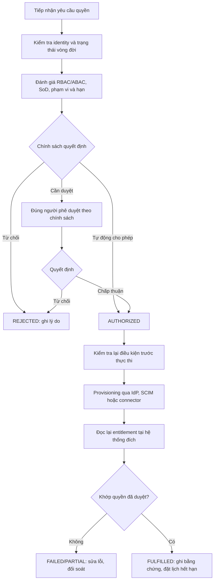

# Provisioning có phê duyệt trong quản lý danh tính IAM

**Provisioning có phê duyệt** (*approval-based provisioning*) là quy trình cấp hoặc thay đổi tài khoản, nhóm và quyền truy cập sau khi yêu cầu đã được kiểm tra và người có thẩm quyền chấp thuận. Trong hệ thống **Identity and Access Management (IAM)**, phê duyệt giúp bảo đảm một quyền được cấp có căn cứ nghiệp vụ, phù hợp với vai trò và mức độ rủi ro, đồng thời có thể truy vết người yêu cầu, người quyết định và kết quả thực thi.

Quy trình này xuất hiện trong vòng đời **Joiner–Mover–Leaver (JML)**. Nhân viên mới có thể được cấp một số quyền cơ bản tự động theo chính sách, nhưng quyền đặc quyền hoặc dữ liệu nhạy cảm thường cần phê duyệt. Khi nhân viên chuyển vị trí, quyền mới được đánh giá song song với việc thu hồi quyền cũ. Khi nhân viên rời tổ chức, việc thu hồi quyền đúng thời điểm phải tuân thủ chính sách chấm dứt, không nên bị trì hoãn vì đợi phê duyệt cấp quyền.

## 1. Provisioning và phê duyệt giải quyết những vấn đề khác nhau

**Phê duyệt (approval)** là quyết định có cho phép một thay đổi hay không. **Provisioning** là việc thực hiện thay đổi đó trên hệ thống đích. Hai bước phải liên kết bằng cùng một yêu cầu và cùng phạm vi quyền được phê duyệt.

| Khâu | Câu hỏi | Kết quả điển hình |
| --- | --- | --- |
| Tiếp nhận yêu cầu | Ai cần quyền nào, để làm gì, trong bao lâu? | Yêu cầu có định danh, đối tượng, tài nguyên và lý do |
| Đánh giá chính sách | Quyền có phù hợp vai trò, hợp đồng, ngày hiệu lực và SoD? | Cho phép tự động, cần phê duyệt hoặc từ chối |
| Phê duyệt | Ai có thẩm quyền chấp thuận đúng phạm vi? | Quyết định, người duyệt, thời điểm và điều kiện |
| Provisioning | Thay đổi tài khoản, role hoặc nhóm bằng cách nào? | Lệnh cập nhật tới IdP, SCIM, API hoặc tác vụ thủ công |
| Đối soát | Quyền thực tế có khớp với quyết định đã duyệt? | Bằng chứng từ hệ thống đích, trạng thái thành công/lỗi |
| Rà soát/thu hồi | Quyền còn cần thiết hoặc đã hết hạn chưa? | Gia hạn, thay đổi hoặc thu hồi có kiểm chứng |

Một yêu cầu được **APPROVED** nhưng chưa được thực thi vẫn chưa phải là quyền đã được cấp. Ngược lại, hệ thống đích báo đã thêm quyền không chứng minh rằng quyền ấy được cấp đúng thẩm quyền.

## 2. Khi nào cần phê duyệt?

Không phải mọi quyền đều cần gửi qua người quản lý. Một số quyền nền tảng (*birthright access*) có thể cấp tự động nếu người dùng đáp ứng chính sách rõ ràng, chẳng hạn tài khoản cổng nhân sự cho nhân viên đang hoạt động. Phê duyệt bổ sung thích hợp khi có yếu tố làm tăng rủi ro:

- Truy cập dữ liệu nhạy cảm, dữ liệu tài chính, thông tin cá nhân hoặc dữ liệu khách hàng quy mô lớn.
- Quyền quản trị sản xuất, thay đổi cấu hình bảo mật hoặc thao tác ảnh hưởng nhiều người dùng.
- Quyền vượt bộ vai trò cơ bản theo **RBAC** hoặc phạm vi thuộc tính cho phép theo **ABAC**.
- Quyền tạm thời để hỗ trợ khẩn cấp, dự án đặc biệt hoặc bàn giao công việc.
- Quyền có nguy cơ xung đột **Segregation of Duties (SoD)**, ví dụ vừa tạo vừa phê duyệt khoản thanh toán.
- Tài khoản nhà thầu, đối tác hoặc service account cần truy cập hệ thống có mức độ nhạy cảm cao.

Mục đích của phê duyệt là đưa **người có hiểu biết về tài nguyên và rủi ro** vào quyết định. Không nên biến quy trình thành thao tác bấm đồng ý hình thức, thiếu thông tin về quyền cụ thể hoặc không có khả năng từ chối.

## 3. Ai có thể phê duyệt?

| Vai trò tham gia | Trách nhiệm | Giới hạn |
| --- | --- | --- |
| **Người yêu cầu** | Nêu nhu cầu, tài nguyên, phạm vi và thời hạn | Không tự phê duyệt quyền của chính mình nếu chính sách cấm |
| **Line manager** | Xác nhận yêu cầu phục vụ nhiệm vụ của nhân viên | Không mặc nhiên có quyền quyết định mọi dữ liệu nhạy cảm |
| **Application owner** | Xác nhận quyền phù hợp khả năng và rủi ro ứng dụng | Chỉ duyệt phạm vi ứng dụng được ủy quyền |
| **Data owner** | Quyết định ai có thể dùng tập dữ liệu, mục đích và phạm vi | Không thay thế kiểm soát xác thực hoặc kỹ thuật |
| **Security/SoD reviewer** | Xử lý rủi ro đặc quyền, xung đột nhiệm vụ và ngoại lệ | Có thể yêu cầu biện pháp bù trừ hoặc từ chối |
| **Service owner** | Chịu trách nhiệm truy cập của workload hoặc tài khoản dịch vụ | Phải có chủ sở hữu thực và quy trình bàn giao |

Quy tắc phê duyệt nên được gắn với **vai trò chức năng hoặc chủ sở hữu tài nguyên đang hiệu lực**, tránh hardcode email cá nhân. Khi người quản lý nghỉ việc hoặc vắng mặt, cần cơ chế ủy quyền có thời hạn, ghi audit và tránh xung đột lợi ích.

Phê duyệt nhiều cấp có thể cần thiết cho quyền nhạy cảm. Ví dụ, quản lý trực tiếp xác nhận nhu cầu, data owner xác nhận phạm vi dữ liệu và security reviewer đánh giá quyền đặc biệt. Nhưng số bước cần tương xứng rủi ro để không làm tắc các quyền cơ bản.

## 4. Mô hình yêu cầu cấp quyền

Một yêu cầu đủ thông tin phải cho phép người duyệt hiểu **quyền nào sẽ được cấp thực tế**. Ví dụ dữ liệu minh họa:

```json
{
  "requestId": "AR-2026-1042",
  "subjectId": "EMP-2048",
  "requesterId": "EMP-2048",
  "applicationId": "customer-crm",
  "entitlement": "ticket-exporter",
  "scope": { "region": "north" },
  "businessJustification": "Xuất báo cáo chất lượng hỗ trợ tháng",
  "validFrom": "2026-12-01T00:00:00Z",
  "validUntil": "2026-12-08T00:00:00Z",
  "approvalPolicy": "sensitive-data-export",
  "status": "PENDING_APPROVAL"
}
```

Đây không phải schema chuẩn bắt buộc của SCIM hay IAM. Trường thời gian cần có múi giờ rõ ràng; hệ thống phải xác định ngày hiệu lực theo chính sách nghiệp vụ. Yêu cầu nên dùng mã định danh ổn định cho chủ thể, ứng dụng và entitlement, không chỉ dùng nhãn hiển thị có thể đổi tên.

Nội dung phê duyệt phải bao gồm **tác vụ**, **tài nguyên**, **phạm vi**, **thời hạn**, **lý do**, **chủ thể nhận quyền** và **rủi ro**. Khi một trong các nội dung quan trọng này thay đổi sau khi duyệt, cần đánh giá lại phê duyệt; không được dùng quyết định duyệt phạm vi hẹp để cấp quyền rộng hơn.

## 5. Workflow phê duyệt và provisioning



### Bước 1 — Kiểm tra yêu cầu và trạng thái người nhận

Xác minh người nhận là danh tính hợp lệ, quan hệ làm việc còn hiệu lực vào thời điểm cấp, tài nguyên nằm trong phạm vi có thể yêu cầu. Trong Joiner, quyền có thể được chuẩn bị trước nhưng chỉ kích hoạt đúng ngày bắt đầu. Trong Mover, yêu cầu phải xét vai trò hiện tại sau thay đổi; không cấp tiếp quyền của bộ phận cũ chỉ vì một ticket được tạo trước ngày luân chuyển.

### Bước 2 — Kiểm tra chính sách và xung đột SoD

IAM tính bộ quyền hiện tại và bộ quyền đề xuất. **RBAC** giúp nhận biết vai trò có bao gồm entitlement được yêu cầu hay không; **ABAC** giới hạn truy cập theo thuộc tính như `department`, `project`, `region` hoặc phân loại tài nguyên. Nếu có xung đột SoD, workflow phải từ chối hoặc chuyển sang quy trình ngoại lệ được quản trị, không tự bỏ qua kiểm tra.

### Bước 3 — Xác định và lấy quyết định từ approver

Quy tắc định tuyến có thể phụ thuộc entitlement, mức độ nhạy cảm, quản lý hiện tại và data owner. Quyết định cần ghi **định danh approver, thời gian, phiên bản chính sách, phạm vi quyền, điều kiện và kết quả**. Khi quá hạn, hệ thống phải có trạng thái và cơ chế thông báo/escalation theo chính sách; không coi im lặng là đồng ý.

### Bước 4 — Kiểm tra lại ngay trước khi thực thi

Phê duyệt có thể được cấp trước khi quyền được provisioning. Trong thời gian chờ, chủ thể có thể đổi vai trò, hết hợp đồng hoặc bị vô hiệu hóa. Vì vậy, trước khi thực thi phải xác nhận phê duyệt còn hiệu lực, entitlement và scope không bị sửa, điều kiện SoD vẫn đúng và không có sự kiện Leaver hoặc thay đổi chính sách làm yêu cầu trở nên không hợp lệ.

### Bước 5 — Provisioning có kiểm soát

Hệ thống có thể thêm nhóm tại **Identity Provider (IdP)**, sử dụng **SCIM** để đồng bộ user/group hoặc connector/API đặc thù để cấp entitlement trên ứng dụng. **SSO** phục vụ đăng nhập liên kết và không thay thế provisioning. SCIM không mặc nhiên hỗ trợ mọi loại quyền chi tiết của ứng dụng.

Các lệnh thực thi cần **idempotency** hoặc cơ chế phát hiện lặp để việc retry không tạo trùng tài khoản, quyền hay tác dụng phụ. Trường hợp API trả lỗi hoặc bị timeout phải xác minh trạng thái hệ thống đích trước khi gửi lại yêu cầu có thể đã được áp dụng.

### Bước 6 — Đối soát và đóng yêu cầu

Sau khi cấp, đọc lại tài khoản, role, nhóm và quyền tại ứng dụng; so sánh với phạm vi đã được chấp thuận. Nếu chỉ một phần công việc thành công, đánh dấu **PARTIAL/FAILED**, nêu hệ thống đích đang lỗi và người chịu trách nhiệm. Chỉ ghi **FULFILLED** khi điều kiện hoàn tất được đáp ứng.

Quyền tạm thời cần liên kết với lịch hết hạn và cơ chế thu hồi. Khi hết hạn, việc thu hồi cũng phải được đối soát tại ứng dụng đích, kể cả quyền cục bộ không được đồng bộ qua IdP.

## 6. Ví dụ: duyệt quyền xuất dữ liệu CRM

Giả sử nhân viên Lan đang làm việc tại nhóm hỗ trợ miền Bắc. Lan cần quyền xuất báo cáo trong bảy ngày:

1. Lan yêu cầu entitlement `ticket-exporter` cho `region=north`, ghi rõ mục đích và ngày hết hạn.
2. IAM kiểm tra Lan đang `active`, vai trò hiện tại cho phép yêu cầu quyền bổ sung và quyền không tạo xung đột SoD không được chấp nhận.
3. Quản lý xác nhận nhu cầu; data owner phê duyệt phạm vi dữ liệu nếu chính sách quy định.
4. Workflow lưu snapshot của chính quyền và phạm vi đã duyệt.
5. Connector cấp entitlement tại CRM với phạm vi miền Bắc; IAM đối soát và kiểm tra người dùng không thể xuất dữ liệu vùng khác.
6. Hết hạn bảy ngày, hệ thống thu hồi quyền và kiểm chứng kết quả; nếu Lan chuyển nhóm hoặc nghỉ việc sớm hơn thì xử lý theo sự kiện Mover/Leaver tương ứng.

Nếu người duyệt chỉ chấp thuận dữ liệu miền Bắc nhưng connector cấp quyền xuất toàn quốc, yêu cầu **không hoàn tất thành công**. Cần thu hồi quyền vượt phạm vi, xử lý lỗi mapping và lưu sự kiện kiểm toán.

## 7. Phê duyệt khi Joiner, Mover và Leaver

| Giai đoạn | Ví dụ | Cách phê duyệt liên quan |
| --- | --- | --- |
| **Joiner** | Nhân viên mới cần quyền hệ thống cơ bản và một quyền kế toán nhạy cảm | Quyền cơ bản có thể theo policy; quyền nhạy cảm cần approver |
| **Mover** | Người dùng đổi phòng ban, cần quyền mới và mất quyền cũ | Duyệt phần cấp mới/ngoại lệ; đối soát thu hồi quyền cũ |
| **Leaver** | Nhân viên chấm dứt quan hệ, cần khóa tài khoản và thu hồi quyền | Sự kiện nguồn có thẩm quyền kích hoạt thu hồi theo chính sách; không để vòng phê duyệt cấp quyền cản trở |
| **Workload thay đổi** | Dịch vụ đổi môi trường hoặc owner | Chủ sở hữu mới và app/data owner đánh giá quyền kỹ thuật |

**Ngoại lệ khẩn cấp:** quyền cần để ứng cứu sự cố có thể dùng một workflow đặc biệt (*break-glass* hoặc *emergency access*) với thời hạn ngắn, giám sát và kiểm tra sau sự kiện. Không biến ngoại lệ này thành cơ chế cấp quyền vĩnh viễn hoặc bỏ hoàn toàn dấu vết trách nhiệm.

## 8. Tách biệt phê duyệt, thực thi và kiểm toán

Ở các hệ thống có rủi ro cao, người phê duyệt không nên trực tiếp tự sửa dữ liệu quyền rồi tự xác nhận hoàn tất. Tách biệt trách nhiệm giúp phát hiện trường hợp quyết định hợp lệ nhưng provisioning vượt phạm vi.

Một log kiểm toán hữu ích cần có:

- Request ID và correlation ID xuyên suốt workflow.
- Subject, requester, approver, tài nguyên, entitlement, scope, thời hạn và lý do.
- Phiên bản chính sách, kết quả SoD, quyết định và thời điểm ra quyết định.
- Tài khoản đích, lệnh thực thi, phản hồi, kết quả đối soát và thời gian hoàn tất.
- Sự kiện gia hạn, thu hồi, lỗi và xử lý ngoại lệ sau đó.

Không ghi mật khẩu, client secret, API key hay access token thô vào nhật ký. Thông tin danh tính và dữ liệu nhạy cảm chỉ được lưu/truy cập theo mục đích, chính sách bảo mật và thời hạn áp dụng.

## 9. Rủi ro vận hành và kiểm soát

| Rủi ro | Hậu quả | Biện pháp |
| --- | --- | --- |
| Approver không đủ thẩm quyền | Quyền nhạy cảm được duyệt sai người | Định tuyến theo owner và chính sách hiện hành |
| Tự duyệt yêu cầu của mình | Xung đột lợi ích | SoD, hạn chế self-approval hoặc kiểm soát độc lập |
| Thay entitlement sau khi duyệt | Phê duyệt phạm vi hẹp nhưng cấp phạm vi rộng | Bất biến snapshot; kiểm tra lại trước thực thi |
| Yêu cầu cũ được áp dụng sau Mover/Leaver | Cấp quyền không còn phù hợp | Kiểm tra trạng thái tại thời điểm provisioning |
| Connector trả thành công nhưng role sai | Quyền thừa hoặc thiếu | Readback/đối soát từ ứng dụng đích |
| Retry gây cấp trùng | Quyền hoặc tài khoản không nhất quán | Idempotency key và reconciliation |
| Quyền tạm thời không bị thu hồi | Quyền tồn dư sau nhu cầu | Expiration, sự kiện thu hồi và kiểm chứng |
| Workflow không ai xử lý | Tồn đọng yêu cầu hoặc mở đường bypass | SLA, escalation, trạng thái và audit |

Các chỉ số nên theo dõi gồm thời gian chờ phê duyệt, số yêu cầu bị từ chối, tỷ lệ cấp đúng scope, tỷ lệ provisioning lỗi một phần, số ngoại lệ SoD, quyền tạm thời quá hạn và thời gian từ ngày thu hồi có hiệu lực đến lúc quyền thực sự mất hiệu lực.

## 10. Tình huống tự kiểm tra

**Tình huống A:** Người quản lý đã duyệt yêu cầu vào thứ Hai, nhưng đến thứ Tư nhân viên nghỉ việc. Có tiếp tục cấp quyền không? **Không.** Phải kiểm tra lại trạng thái Leaver trước provisioning và hủy/không thực thi yêu cầu không còn hợp lệ.

**Tình huống B:** Data owner duyệt quyền đọc một dự án, nhưng connector cấp quyền toàn bộ workspace. Trạng thái có thể là `FULFILLED` không? **Không.** Cần thu hồi phần vượt quyền, sửa mapping và đối soát.

**Tình huống C:** Nhân viên mới cần quyền cổng thông tin cơ bản, đã đáp ứng policy tự động. Có nhất thiết cần người quản lý duyệt từng quyền nhỏ không? **Không.** Quyền birthright có thể được cấp tự động theo chính sách có quản trị và kiểm toán.

**Tình huống D:** Hai approver chấp thuận quyền nhưng hệ thống đích trả lỗi. Có thể báo cấp quyền thành công không? **Không.** Phê duyệt chỉ là quyết định; cần kiểm tra provisioning và quyền thực tế.

**Tình huống E:** Một dịch vụ cần quyền đọc API trong ba tháng. Có nên dùng tài khoản cá nhân của kỹ sư để xin cấp quyền không? **Không.** Nên đăng ký service/workload identity riêng, xác định owner và scope, phê duyệt theo chính sách rồi quản lý hết hạn.

## Ghi nhớ

**Provisioning có phê duyệt** tạo liên kết kiểm chứng được từ **nhu cầu nghiệp vụ → chính sách → quyết định có thẩm quyền → thực thi trên hệ thống đích → đối soát → rà soát/thu hồi**. Trong IAM, **RBAC/ABAC** quyết định phạm vi quyền, **IdP/SSO** hỗ trợ xác thực, **SCIM/connector** giúp đồng bộ tài khoản/nhóm và **audit** cung cấp bằng chứng. Kết hợp với **Joiner–Mover–Leaver**, workflow phải ngăn cấp quyền cho danh tính không còn hợp lệ, phát hiện cấp sai phạm vi và thu hồi quyền tồn dư đúng thời điểm.
