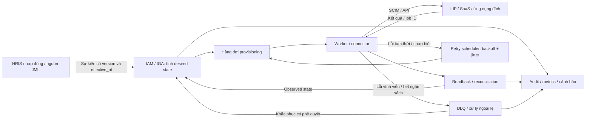
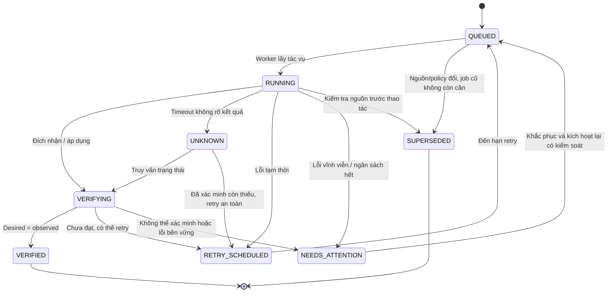

# Retry provisioning trong quản lý vòng đời danh tính IAM

## 1. Retry provisioning là gì?

**Retry provisioning** là cơ chế **thử thực hiện lại một thao tác cấp phát, cập nhật hoặc thu hồi tài khoản/quyền truy cập khi lần thực hiện trước chưa đạt trạng thái mong muốn**, thường do lỗi mạng, hệ thống đích tạm thời không khả dụng, giới hạn tốc độ API hoặc quá trình đồng bộ bất đồng bộ.

Trong **Identity and Access Management (IAM)**, provisioning không chỉ là tạo tài khoản. Nó bao gồm:

- **Joiner:** tạo hoặc liên kết tài khoản IdP/ứng dụng, gán nhóm và entitlement ban đầu.
- **Mover:** cập nhật thuộc tính, điều chỉnh role, thêm quyền mới và thu hồi quyền cũ khi người dùng đổi vai trò.
- **Leaver:** disable/deprovision tài khoản, gỡ membership, thu hồi quyền, phiên và credential theo chính sách.

Một yêu cầu có thể được chuyển qua **SCIM, API quản trị, connector, message queue hoặc workflow thủ công**. Mỗi điểm tích hợp có thể lỗi và cần cơ chế khôi phục khác nhau.

**Điểm quan trọng nhất:** retry an toàn không đồng nghĩa **gửi lại y nguyên một yêu cầu cho đến khi HTTP trả thành công**. Hệ thống phải kiểm tra **đích hiện đang ở trạng thái nào**, **yêu cầu còn hợp lệ không** và **việc gửi lại có thể tạo tác dụng phụ không**.

### 1.1. Vì sao không thể chỉ dựa vào một lần gọi?

Giả sử IAM gửi lệnh tạo tài khoản đến ứng dụng SaaS:

1. SaaS tạo tài khoản thành công.
2. Kết nối bị ngắt trước khi phản hồi đến IAM.
3. IAM ghi nhận `TIMEOUT`, trong khi tài khoản **đã tồn tại**.
4. Nếu retry bằng cách gửi lại `POST /Users` không kiểm tra, hệ thống có thể tạo tài khoản trùng hoặc nhận lỗi conflict.

Ngược lại, nếu IAM **không** retry, một lần mạng lỗi trước khi SaaS nhận request có thể khiến người dùng chưa có tài khoản. Giải pháp cần phân biệt trạng thái **thất bại đã xác định** và **kết quả chưa biết (unknown outcome)**.

### 1.2. Retry, reconciliation và reprocessing không giống nhau

| Khái niệm | Mục đích | Ví dụ |
|---|---|---|
| **Retry** | Thử lại tác vụ chưa đạt mục tiêu sau một lỗi có thể khôi phục | Gửi lại yêu cầu gỡ nhóm sau lỗi `503` |
| **Reconciliation** | So sánh trạng thái mong muốn với trạng thái thực tế, sửa sai lệch | Đọc nhóm ở SaaS và thấy user vẫn là member |
| **Reprocessing** | Xử lý lại sự kiện hoặc workflow với phiên bản dữ liệu/policy phù hợp | Phát lại sự kiện HR từng vào hàng đợi lỗi |
| **Compensating action** | Thực hiện thao tác bù để xử lý tác dụng phụ của bước đã chạy | Disable tài khoản đã tạo do sự kiện Joiner bị hủy |
| **Manual remediation** | Chuyển người có thẩm quyền xử lý khi tự động không an toàn | App không hỗ trợ xóa group membership qua API |

Các cơ chế này thường kết hợp với nhau. **Reconciliation theo trạng thái cuối** là nền tảng để retry không tạo quyền truy cập tồn dư.

## 2. Các tình huống cần retry trong IAM

| Thao tác | Sự cố | Nguy cơ nếu xử lý sai |
|---|---|---|
| Tạo tài khoản Joiner | `POST` timeout sau khi đích đã tạo user | Tài khoản trùng hoặc account orphan |
| Cập nhật thuộc tính | SaaS bị lỗi tạm thời khi đổi phòng ban | App vẫn tính quyền theo thuộc tính cũ |
| Thêm vào nhóm | API bị throttling | Nhân viên chưa có quyền làm việc ngày đầu |
| Gỡ khỏi nhóm | Connector không kết nối được | Người đã chuyển việc/nghỉ việc còn quyền cũ |
| Disable tài khoản Leaver | IdP hoặc SaaS không phản hồi | Đường đăng nhập có thể còn hiệu lực |
| Thu hồi session/token | Endpoint thu hồi không khả dụng | Token hoặc phiên cũ còn dùng được |
| Đổi người sở hữu service account | Workflow cập nhật owner thất bại | Workload thiếu chủ sở hữu hợp lệ |
| Đồng bộ ứng dụng không có API | Tác vụ thủ công chưa được xác nhận | Không thể coi quyền đã thu hồi |

Với **Joiner**, retry thường nhằm khôi phục khả năng sử dụng hệ thống. Với **Leaver**, retry có thể quyết định thời gian một quyền không còn hợp lệ tiếp tục tồn tại; cần **ưu tiên xử lý theo rủi ro**, có cảnh báo và biện pháp bù phù hợp.

## 3. Phân loại lỗi: lỗi nào thử lại được?

Trước khi thử lại phải hiểu **loại lỗi** và ý nghĩa phản hồi của connector/ứng dụng. Bảng sau là định hướng chung; hợp đồng API của từng đích luôn có ưu tiên khi diễn giải.

| Tín hiệu | Nguyên nhân khả dĩ | Hướng xử lý |
|---|---|---|
| Timeout, kết nối bị reset, mất phản hồi | Không biết yêu cầu đã được đích áp dụng chưa | **Đọc lại trạng thái** trước khi retry thao tác có tác dụng phụ |
| `429 Too Many Requests` | Vượt giới hạn tốc độ | Tôn trọng `Retry-After` nếu có và hợp lệ; backoff với giới hạn |
| `500/502/503/504` | Lỗi máy chủ hoặc gateway tạm thời | Retry có backoff và jitter; xác minh tác dụng phụ trước khi gửi lại |
| `401 Unauthorized` | Token hết hạn hoặc credential không hợp lệ | Làm mới credential theo cơ chế được phép; không lặp vô hạn cùng token |
| `403 Forbidden` | Thiếu quyền API/tenant hoặc chính sách từ chối | Không retry mù; sửa quyền/cấu hình hoặc chuyển xử lý |
| `400/422` | Payload không hợp lệ hoặc dữ liệu không đáp ứng ràng buộc | Sửa input/schema; thường là lỗi vĩnh viễn cho request hiện tại |
| `404 Not Found` | ID sai, đối tượng đã bị xóa, hoặc chưa đồng bộ xong | Xác minh mục tiêu: với thao tác xóa, vắng mặt có thể là trạng thái đúng; với cập nhật phải điều tra |
| `409 Conflict` | Trùng, xung đột trạng thái hoặc ràng buộc riêng của provider | Truy vấn đối tượng hiện có, đối soát và quyết định; không tự tạo tiếp |
| `412 Precondition Failed` | ETag/phiên bản không còn khớp | Đọc lại trạng thái, tính thao tác mới, dùng điều kiện cạnh tranh phù hợp |
| Lỗi DNS, TLS, xác thực chữ ký | Cấu hình, kết nối hoặc bảo mật có vấn đề | Phân loại sự cố; không vô hiệu hóa kiểm tra bảo mật để “cho retry chạy” |
| `2xx` nhưng tác vụ async chưa xong | API chấp nhận yêu cầu, chưa hoàn tất | Theo dõi job/trạng thái đích; **không gửi trùng chỉ vì chưa thấy ngay kết quả** |

**Mã HTTP không tự quyết định retry.** Ví dụ một `404` sau lệnh gỡ membership có thể nghĩa là quan hệ đã vắng mặt, nhưng cũng có thể là **sai Group ID hoặc tenant**. Phải xác thực đúng đối tượng và mục tiêu cuối.

### 3.1. Ba nhóm quyết định

1. **Retryable / transient:** lỗi tạm thời mà thực hiện lại có khả năng thành công.
2. **Permanent / actionable:** dữ liệu, quyền hoặc chính sách sai; cần sửa điều kiện đầu vào.
3. **Unknown outcome:** không thể xác định tác dụng phụ của lệnh trước; cần **readback hoặc reconciliation** trước khi retry.

Không phải lúc nào việc đọc lại trạng thái cũng khả thi ngay; nếu đích đang gián đoạn hoàn toàn, IAM cần giữ tác vụ chờ, giới hạn retry và đánh dấu **chưa xác minh**, thay vì đoán là thành công.

## 4. Kiến trúc retry provisioning đề xuất

Một kiến trúc có thể gồm **nguồn sự kiện JML**, **bộ điều phối trạng thái**, **hàng đợi tác vụ**, **connector**, **bộ đọc lại trạng thái**, **cơ chế retry** và **giám sát/audit**.



Kiến trúc này tránh để vòng retry trực tiếp giữ một request HTTP chờ quá lâu. Mỗi tác vụ nên có **ID, danh tính đích, hành động, phiên bản nguồn, trạng thái, thời gian thử lại và kết quả xác minh** để có thể khôi phục an toàn sau khi worker khởi động lại.

### 4.1. Tách sự kiện nghiệp vụ và lệnh thực thi

Sự kiện `WORKER_TERMINATED` mô tả **quan hệ nhân sự đã kết thúc**. Nó không nên bị chuyển thẳng thành một lệnh xóa nhóm cố định rồi retry vĩnh viễn. Thay vào đó:

1. Xác minh sự kiện còn là dữ kiện có thẩm quyền.
2. Tính **trạng thái danh tính mong muốn** hiện hành.
3. Sinh các tác vụ cho đích đang sai lệch.
4. Trước mỗi retry, kiểm tra tác vụ **vẫn còn cần thiết**.

Đây là khác biệt giữa cách làm **event-to-command** đơn giản và **desired-state reconciliation** an toàn hơn trong môi trường JML nhiều thay đổi.

## 5. At-least-once, idempotency và kết quả chưa biết

Hệ thống gửi sự kiện, queue và connector thường có thể **giao lại** thông điệp nếu không nhận được xác nhận. Vì vậy, nên giả định **một tác vụ có thể được thực thi nhiều lần**.

Không nên tuyên bố “exactly once trên toàn bộ hệ thống” chỉ vì có queue hoặc event ID: các tác dụng phụ qua mạng, DB và nhiều SaaS không nhất thiết nằm trong một giao dịch nguyên tử.

### 5.1. Idempotency là gì?

Một thao tác **idempotent** nếu áp dụng một lần hoặc nhiều lần cho cùng mục tiêu vẫn đưa hệ thống đến **cùng trạng thái mong muốn**. Ví dụ:

- Đặt `active=false` cho một tài khoản vốn đã inactive.
- Bảo đảm user **không còn** là member của group, dù lệnh remove đã được áp dụng trước đó.
- Cập nhật thuộc tính `department=FIN` nếu nó đã là `FIN`.

Tuy nhiên, **API không tự động idempotent chỉ vì mô tả ý định giống nhau**. `POST /Users` có thể tạo nhiều tài khoản nếu không có cơ chế ngăn trùng; một thao tác gửi lời mời hoặc tạo credential có thể phát sinh nhiều email/bí mật khi retry.

### 5.2. Ba lớp kiểm soát

| Lớp | Cơ chế | Giới hạn |
|---|---|---|
| **Sự kiện** | Khóa `event_id`, `source_version` để nhận diện sự kiện đã xử lý | Chưa chứng minh thao tác tại SaaS đã hoàn tất |
| **Tác vụ** | `operation_id` và khóa idempotency ổn định khi đích hỗ trợ | Không phải mọi API/SCIM provider đều hỗ trợ idempotency key |
| **Trạng thái đích** | Tìm account, đọc group/role, so sánh desired/actual | Đọc có thể bị trễ do eventual consistency hoặc thiếu quyền quan sát |

Nên phối hợp cả ba lớp. Nếu đích cung cấp **Idempotency-Key** hoặc cơ chế request deduplication chính thức, dùng theo tài liệu của đích; **không giả định SCIM chuẩn bắt buộc hỗ trợ header này**.

### 5.3. Vì sao phải xử lý unknown outcome?

Một `POST` tạo user có thể thành công dù IAM nhận timeout. Retry an toàn nên:

1. Xác định **đúng tenant và chủ thể** của request ban đầu.
2. Tìm user theo **ID đích đã biết** hoặc khóa liên kết ngoài phù hợp nếu provider hỗ trợ.
3. Kiểm tra đối tượng tìm được có thực sự thuộc danh tính và yêu cầu đó không.
4. Nếu đã đạt trạng thái mong muốn, ghi `VERIFIED` và **không gửi tạo lần nữa**.
5. Nếu không tìm thấy, xét độ trễ đồng bộ, chính sách readback và retry với giới hạn.
6. Nếu có nhiều đối tượng tương tự hoặc xung đột, dừng và chuyển xử lý thay vì chọn đại theo email.

`externalId` trong SCIM có thể hữu ích để đối chiếu, nhưng **không được mặc định nó luôn duy nhất trên mọi provider hoặc tenant**. Phải xác định hợp đồng mapping với hệ thống đích.

## 6. Backoff, jitter và giới hạn retry

Retry liên tục có thể làm tình trạng quá tải nghiêm trọng hơn. Cơ chế phổ biến là **exponential backoff với jitter**: thời gian chờ tăng dần, có một thành phần ngẫu nhiên để các worker không cùng retry đồng loạt.

Một công thức **minh họa**:

```text
base_delay = 2 seconds
max_delay  = 60 seconds
attempt    = 0, 1, 2, ...
cap        = min(max_delay, base_delay * 2^attempt)
delay      = random_uniform(0, cap)   # full jitter
```

Ví dụ với `attempt=0`, `cap=2s` và chờ ngẫu nhiên tối đa 2 giây; với `attempt=3`, `cap=16s`. Các con số **không phải cấu hình chung** cho mọi IAM: cần cân đối giới hạn API, SLA, mức rủi ro và năng lực hệ thống.

### 6.1. Tôn trọng Retry-After

Nếu API trả `429` hoặc `503` kèm header `Retry-After`, client nên diễn giải theo quy định của API, kiểm tra giới hạn và phối hợp với lịch retry. Header này có thể mang **số giây** hoặc **mốc HTTP-date** theo HTTP; không mặc định là một timestamp Unix.

Ví dụ phản hồi giả lập:

```http
HTTP/1.1 429 Too Many Requests
Retry-After: 30
Content-Type: application/json

{
  "error": "rate_limit",
  "message": "Please retry later"
}
```

Với tình huống này, IAM không nên gửi lại ngay sau 100 ms. Cũng cần tránh một nhóm tác vụ Leaver quan trọng bị chặn vô hạn phía sau nhiều tác vụ Joiner bình thường; điều phối ưu tiên phải tôn trọng **rate limit thực tế** và thiết kế fairness phù hợp.

### 6.2. Khi nào dừng retry?

Một retry policy nên xác định đồng thời:

- **Số lần thử tối đa** hoặc ngân sách retry, tránh vòng lặp vô hạn.
- **Tổng thời gian cho phép** kể từ lúc tác vụ phát sinh hoặc có hiệu lực.
- **Deadline nghiệp vụ**, đặc biệt SLA thu hồi quyền sau Leaver.
- **Nhóm lỗi được phép retry** và những lỗi phải dừng để sửa nguyên nhân.
- **Circuit breaker** khi đích không khả dụng trong thời gian dài.
- **Cơ chế escalation** khi không đạt mục tiêu trước deadline.

Hết retry budget **không có nghĩa xóa tác vụ khỏi hệ thống**. Phải chuyển trạng thái rõ ràng, cảnh báo, giữ dấu vết và cho phép xử lý lại có kiểm soát khi vấn đề được khắc phục.

## 7. Thuật toán retry theo trạng thái mong muốn

Mô hình an toàn là **reconcile trước, hành động nếu còn chênh lệch, xác minh sau**. Mã giả:

```text
function process_provisioning_task(task):
    source = load_authoritative_identity_state(task.identity_id)
    if task.source_version < source.version:
        mark_superseded(task)
        enqueue_reconciliation(task.identity_id)
        return

    desired = compute_desired_state(source, current_policy())
    observed = read_target_state(task.target, task.target_account_ref)

    if observed.matches(desired.for_target(task.target)):
        mark_verified(task, observed)
        return

    action = plan_minimal_safe_change(observed, desired)

    if not action.is_authorized_or_still_needed:
        mark_stale_or_blocked(task)
        return

    try:
        result = execute(action, stable_operation_id=task.operation_id)
        if result.is_async:
            schedule_status_check(result.job_id)
        else:
            schedule_readback(task)
    catch error:
        kind = classify(error)
        if kind == UNKNOWN_OUTCOME:
            schedule_readback_before_retry(task)
        else if kind == TRANSIENT and task.retry_budget_remains:
            schedule_with_backoff_and_jitter(task)
        else:
            mark_failed_and_escalate(task, error)

function verify_task(task):
    observed = read_target_state(task.target, task.target_account_ref)
    current_desired = compute_desired_state(load_authoritative_identity_state(task.identity_id))
    if observed.matches(current_desired.for_target(task.target)):
        mark_verified(task, observed)
    else:
        schedule_reconciliation_or_escalation(task)
```

**Đây là mã giả**; implementation thực tế cần xử lý vấn đề đồng thời, giới hạn truy vấn, readback trễ, mapping quyền không đầy đủ và các trạng thái partial success. Không nên sử dụng mã giả này nguyên dạng cho API sản xuất.

### 7.1. Những điểm bắt buộc bảo vệ

1. **Đọc trạng thái nguồn hiện hành** trước khi retry grant hoặc revoke quan trọng.
2. **Không thực hiện tác vụ lỗi thời** nếu HRIS hoặc chính sách đã thay đổi.
3. **Ràng buộc tenant, account ID và target ID** trước khi thao tác.
4. **Chỉ tạo tác dụng phụ cần thiết**: nếu mục tiêu đã đạt, không gửi tiếp.
5. **Phân biệt thực thi và xác minh**: API thành công có thể chưa phản ánh quyền hiệu lực.
6. **Không cấp lại quyền sau Leaver** chỉ vì một thao tác Joiner/Mover cũ được phát lại.
7. **Giữ đầy đủ dấu vết** để khôi phục khi worker hoặc queue khởi động lại.

## 8. Retry trong SCIM provisioning

**SCIM (System for Cross-domain Identity Management)** là giao thức thường dùng để tạo, cập nhật, vô hiệu hóa user và quản lý group membership trên ứng dụng hỗ trợ SCIM. Retry phải bám sát **tính năng của từng SCIM provider**, không coi mọi endpoint đều hỗ trợ tất cả thao tác.

### 8.1. Tạo tài khoản: POST /Users

Ví dụ yêu cầu **minh họa** tạo tài khoản trong một tenant đã được xác định:

```http
POST /scim/v2/Users HTTP/1.1
Host: scim.example.org
Authorization: Bearer <redacted-token>
Content-Type: application/scim+json

{
  "schemas": ["urn:ietf:params:scim:schemas:core:2.0:User"],
  "userName": "employee-1042",
  "externalId": "iam-identity-1042",
  "active": true
}
```

Nếu request timeout, có thể xảy ra hai khả năng:

- **Chưa tạo:** cần thử lại sau khi kiểm tra thời điểm, nguồn và điều kiện hợp lệ.
- **Đã tạo:** không được gửi `POST` tạo thêm. Phải truy vấn hoặc tra cứu ánh xạ user ID rồi đối soát.

Nên duy trì **target account ID** do provider trả về, kèm tenant và nguồn danh tính. `userName` và email có thể đổi hoặc trùng, không nên là căn cứ hợp nhất tài khoản duy nhất.

### 8.2. Cập nhật user: PATCH hoặc PUT

Đối với thay đổi như `active=false` khi Leaver, lệnh dạng cập nhật trạng thái thường thuận lợi cho idempotency hơn tạo đối tượng mới, nhưng vẫn phải kiểm tra provider xử lý thuộc tính ấy thế nào.

```http
PATCH /scim/v2/Users/target-user-1042 HTTP/1.1
Host: scim.example.org
Authorization: Bearer <redacted-token>
Content-Type: application/scim+json

{
  "schemas": ["urn:ietf:params:scim:api:messages:2.0:PatchOp"],
  "Operations": [
    { "op": "replace", "path": "active", "value": false }
  ]
}
```

Nếu API hỗ trợ **ETag/If-Match**, có thể dùng điều kiện phiên bản để tránh ghi đè dữ liệu do tác vụ khác vừa cập nhật. Khi bị lỗi precondition, hãy đọc lại đối tượng và tính lại hành động.

**Không mặc định `active=false` chấm dứt ngay mọi session hoặc token ở ứng dụng.** Cần cơ chế thu hồi phiên/credential riêng và kiểm tra theo khả năng hỗ trợ.

### 8.3. Thay đổi group membership

Một thao tác `PATCH /Groups/{id}` có thể thêm hoặc xóa membership theo SCIM PATCH nếu provider hỗ trợ. Retry cần xác minh:

- User ID trong group đã có/chưa có theo trạng thái mong muốn.
- Nhóm nằm ở đúng tenant và còn tồn tại.
- Membership không bị một connector hoặc rule khác thêm lại.
- Role/entitlement nội bộ ứng dụng có cập nhật cùng membership không.

Đối với Leaver, **“user không còn trong group”** có thể là điều kiện hoàn thành, không cần phát lại lệnh remove khi membership đã vắng mặt và đã xác minh đúng đối tượng.

### 8.4. Không dùng kết quả HTTP đơn lẻ để kết luận hoàn tất

Có provider trả phản hồi `2xx` sau khi nhận job nhưng cập nhật quyền bất đồng bộ. Có provider đồng bộ nhóm nhưng **không** đồng bộ các role gán trực tiếp. Cần xác định **observed state** phù hợp, chẳng hạn đọc lại user/group và entitlement ở app.

Nếu API không cung cấp chức năng đọc lại đủ chi tiết, workflow phải ghi phạm vi chưa quan sát được và cơ chế xác minh thay thế.

## 9. Retry và thứ tự sự kiện Joiner–Mover–Leaver

Lỗi nguy hiểm là **một tác vụ cấp quyền cũ chạy thành công sau khi sự kiện thu hồi mới đã có hiệu lực**.

### 9.1. Ví dụ race giữa Joiner và Leaver

Giả sử:

1. `T1`: Joiner gửi tác vụ tạo tài khoản, ứng dụng đích báo lỗi tạm thời.
2. `T2`: HR xác nhận hủy tuyển/Leaver; IAM khóa danh tính và lên kế hoạch thu hồi.
3. `T3`: retry tác vụ Joiner cũ chạy lại và tạo tài khoản **ACTIVE**.

Nếu worker không kiểm tra trạng thái có thẩm quyền trước khi retry, quy trình **vô tình cấp lại quyền sau khi đã thu hồi**.

Cách kiểm soát:

- Tác vụ giữ `identity_id` và `source_version`.
- Trước khi cấp, tải **desired state hiện hành** của danh tính.
- Nếu Leaver/hủy tuyển đã thay thế Joiner, đánh dấu grant cũ là `SUPERSEDED`.
- Reconcile tài khoản đã được tạo ở đích: disable/deprovision nếu cần.
- Ưu tiên và xác minh thao tác **deny/revoke**, không chỉ hủy job cũ trong queue.

### 9.2. Mover đổi role trong lúc retry

Một người chuyển từ dự án A sang dự án B. Lệnh thêm vào `project-b-readers` lỗi; sau đó người ấy lại được chuyển sang dự án C. Khi retry, không được tiếp tục cấp B nếu quyền B đã hết căn cứ. Phải tính tập quyền theo assignment **còn hiệu lực tại thời điểm xử lý**.

### 9.3. Bảo đảm thứ tự theo chủ thể

Hệ thống có thể sử dụng **key theo identity/account** để giữ thứ tự thao tác liên quan, khóa theo chủ thể, phiên bản nguồn, optimistic concurrency hoặc bộ điều phối trạng thái. Tuy nhiên:

- Thứ tự trong queue không giải quyết hết việc **API đích xử lý bất đồng bộ**.
- Một lệnh có thể hoàn tất sau lệnh gửi sau.
- Hành động cuối cùng vẫn phải được **đối soát với desired state hiện hành**.

Không được chỉ dựa vào “Leaver đứng sau Joiner trong queue” để chứng minh không còn truy cập.

## 10. Retry khi provisioning chỉ thành công một phần

Một Joiner có thể có tài khoản IdP nhưng chưa có tài khoản SaaS. Một Leaver có thể đã disable IdP nhưng vẫn còn nhóm tại ứng dụng khác. Đây là **partial success**, không phải trạng thái thành công hoàn chỉnh.

| Hệ thống đích | Desired state | Observed state | Kết quả |
|---|---|---|---|
| IdP | `DISABLED` | `DISABLED` | `VERIFIED` |
| SaaS A | User inactive | User inactive | `VERIFIED` |
| SaaS B | Không còn nhóm Finance | Vẫn còn membership | `RETRY_PENDING` |
| Kho mã nguồn | Không còn SSH key cá nhân | Chưa xác minh được | `UNKNOWN` |
| Ứng dụng legacy | Disable local account | API không hỗ trợ | `MANUAL_ACTION_REQUIRED` |

Mỗi hệ thống cần **trạng thái, operation ID và bằng chứng riêng**. Không nên “rollback toàn bộ” bằng cách kích hoạt lại tài khoản IdP vì một SaaS chưa gỡ được nhóm: điều đó có thể tái mở đường truy cập đã khóa.

### 10.1. Compensating action khác rollback cơ sở dữ liệu

Trong giao dịch nhiều hệ thống, không thể bảo đảm atomic commit ở mọi SaaS. Có thể dùng tư duy **saga/compensating action**: mỗi bước thành công được ghi lại và nếu kế hoạch nghiệp vụ thay đổi, tạo bước điều chỉnh phù hợp.

Ví dụ Joiner bị hủy sau khi một ứng dụng đã tạo user:

- Không “undo” bằng cách xóa tùy tiện mọi dữ liệu và log.
- Tính trạng thái mong muốn hiện tại: không cho phép đăng nhập; có thể cần disable rồi xóa theo lịch lưu giữ.
- Thực hiện hành động bù phù hợp với chính sách dữ liệu và khả năng ứng dụng.
- Xác minh không còn quyền truy cập.

## 11. State machine và hàng đợi lỗi

Một tác vụ provisioning có thể được mô hình hóa bằng trạng thái để tránh bỏ sót lỗi hoặc đếm sai SLA.



Đây là mô hình **minh họa**. Triển khai nên lưu trạng thái bền vững, tránh mất công việc khi tiến trình chết giữa lúc gọi API và lúc ghi nhận kết quả.

### 11.1. Dead-letter queue (DLQ)

Khi lỗi lặp lại hoặc vượt retry budget:

1. Ghi tác vụ vào **DLQ** hoặc kho ngoại lệ có owner.
2. Lưu mã lỗi, lịch sử thử, đích, source version và phạm vi quyền còn tồn dư.
3. Tạo cảnh báo phù hợp mức nghiêm trọng và deadline.
4. Khi đã khắc phục, **reconcile trạng thái mới** trước khi phát lại.
5. Không đưa tác vụ cũ chạy lại hàng loạt một cách mù quáng.

DLQ không phải “thùng rác”; nó là một phần của quy trình bảo đảm những sự kiện JML khó xử lý không biến mất.

### 11.2. Circuit breaker và rate limiting

Nếu nhiều thao tác liên tục thất bại vì một SaaS đang outage, **circuit breaker** có thể tạm giảm hoặc dừng request để tránh gây quá tải. Trong thời gian đó:

- Tác vụ vẫn được lưu bền vững.
- Leaver rủi ro cao được cảnh báo và xem xét biện pháp bù.
- Hệ thống kiểm tra phục hồi theo cơ chế an toàn.
- Khi đích hoạt động lại, retry có giới hạn tốc độ, không xả toàn bộ backlog cùng lúc.

## 12. Retry ưu tiên trong Leaver lifecycle

Với Leaver, mục tiêu an toàn là **chặn và thu hồi truy cập không còn hợp lệ càng sớm càng tốt theo chính sách và mức rủi ro**, đồng thời không bỏ sót quyền ở từng ứng dụng.

### 12.1. Phân lớp tác vụ thu hồi

| Lớp | Ví dụ | Cách ưu tiên |
|---|---|---|
| **Chặn đăng nhập mới** | Disable tại IdP, ngắt quyền vào VPN | Ưu tiên cao với Leaver có hiệu lực hoặc khẩn cấp |
| **Phiên và credential** | Thu hồi session, refresh token, personal access token, SSH key | Ưu tiên theo khả năng tiếp tục truy cập và độ nhạy |
| **Quyền đặc quyền** | PAM, nhóm production-admin, role quản trị | Cảnh báo nhanh, đối soát kỹ |
| **Entitlement nghiệp vụ** | Nhóm dự án, SaaS, app local | Thu hồi theo scope và SLA |
| **Đối soát và dọn dẹp** | Tài khoản mồ côi, nhóm thừa, lịch xóa dữ liệu | Hoàn tất theo chính sách dữ liệu và kiểm toán |

**IdP disable không tự đảm bảo access token đã phát hành mất hiệu lực**, và xóa nhóm chưa chắc khiến session ứng dụng hết ngay. Retry của từng loại hành động cần theo API/hợp đồng của đích và biện pháp bảo mật riêng.

### 12.2. Khi hệ thống đích chưa thể thu hồi

Nếu một ứng dụng đang outage và có quyền rủi ro cao còn tồn tại:

- Xác nhận các đường truy cập có thể chặn từ **tầng khác** như IdP, gateway, VPN hoặc policy engine, nếu được phép và hiệu quả.
- Báo cho chủ sở hữu ứng dụng/an ninh về **rủi ro chưa được thu hồi**.
- Giữ retry với mức ưu tiên và giới hạn phù hợp.
- Không tạo tuyên bố “offboarding hoàn tất” cho đích chưa xác minh.
- Lưu chứng cứ thời điểm lỗi, quyết định kiểm soát bù và kết quả sau khắc phục.

Không tự ý vô hiệu hóa các tài nguyên dùng chung hoặc chặn toàn bộ mạng chỉ để xử lý một user; mọi biện pháp bù phải được đánh giá ảnh hưởng và ủy quyền phù hợp.

## 13. Retry cho tài khoản dịch vụ và workload identity

**Service account, bot, CI/CD runner, workload identity** cũng cần provisioning và retry, nhưng vòng đời không nhất thiết bắt nguồn từ HRIS.

Các nguồn có thẩm quyền có thể là **service catalog, CMDB, hệ thống triển khai hoặc nền tảng workload**. Retry phải tôn trọng:

- **Owner và mục đích:** ai có quyền yêu cầu tạo/thu hồi và service còn hoạt động không?
- **Scope của workload:** tenant, môi trường `dev/staging/prod`, namespace và project.
- **Credential:** tạo khóa hoặc secret là thao tác có tác dụng phụ; timeout có thể đã tạo credential và cần reconcile/rotate theo policy.
- **Tính sẵn sàng:** không rollback hoặc xóa một workload hợp lệ chỉ vì người sở hữu nhân sự chuyển nhóm.
- **Đặc quyền:** quyền máy thường khó quan sát qua nhóm người dùng; phải kiểm tra role service, token và chính sách nền tảng.

Ví dụ, một yêu cầu **rotate secret** bị timeout không nên mặc nhiên thực hiện lại và sinh nhiều secret mà không biết secret nào đang được workload sử dụng. Cần xác minh phiên bản secret tại nguồn tin cậy, tình trạng triển khai và kế hoạch hủy secret cũ.

## 14. Bảo mật và quyền riêng tư trong retry

Retry làm tăng số lần xử lý dữ liệu và số điểm lưu trạng thái, nên cần giới hạn quyền và bảo vệ dữ liệu từ đầu.

1. **Tài khoản connector có quyền tối thiểu:** chỉ được tạo/đổi/thu hồi những đối tượng thuộc phạm vi được giao.
2. **Không để token/secret trong queue hoặc log:** dùng secret manager, tham chiếu credential và chính sách xoay vòng.
3. **Xác thực webhook và nguồn sự kiện:** ngăn đối tượng trái phép gửi các sự kiện giả tạo để cấp hoặc thu hồi quyền.
4. **Kiểm tra tenant/account/group ID trước retry:** tránh thao tác nhầm sang tổ chức khác.
5. **Không bỏ TLS, chữ ký, kiểm tra token để khắc phục lỗi:** lỗi bảo mật cần được xử lý như sự cố, không phải lý do nới lỏng kiểm soát.
6. **Chống replay và stale event:** sự kiện cũ không được tự khôi phục quyền sau khi trạng thái mới đã có hiệu lực.
7. **Giới hạn dữ liệu HR:** log giữ ID, trạng thái, loại sự kiện và mã lỗi; không sao chép toàn bộ hồ sơ nhân sự.
8. **Phân quyền xử lý DLQ:** người vận hành chỉ được replay/sửa tác vụ trong phạm vi được phép, mọi hành động cần kiểm toán.
9. **Giới hạn lưu giữ:** thông tin sự kiện và payload nhạy cảm được xóa theo chính sách lưu giữ, không lưu vô hạn vì retry.
10. **Rà soát thay đổi connector:** cập nhật scope API, mapping và retry policy có thể ảnh hưởng hàng loạt tài khoản.

## 15. Quan sát vận hành và bằng chứng kiểm toán

Một quy trình retry đáng tin phải trả lời được: **vì sao thao tác cần thực hiện, đã thử những gì, trạng thái đích hiện ra sao và ai chịu trách nhiệm nếu chưa thành công?**

| Trường kiểm toán | Mục đích |
|---|---|
| `identity_id`, `worker_id` hoặc `workload_id` | Liên kết tác vụ với đúng danh tính |
| `source_event_id`, `source_version` | Xác định sự kiện gốc và phiên bản hiện hành |
| `operation_id`, `operation_type` | Phân biệt tác vụ tạo/cập nhật/thu hồi |
| `target_system`, `tenant_id`, `target_account_id` | Xác định hệ thống và đối tượng thực thi |
| `desired_state_hash` / `policy_version` | Giải thích trạng thái mong muốn tại thời điểm quyết định |
| `attempt_no`, `attempted_at` | Theo dõi số lần thử và khoảng thời gian |
| `error_class`, `http_status` | Phân loại lỗi và nguyên nhân retry |
| `next_retry_at`, `retry_policy_version` | Giải thích lịch retry |
| `observed_state`, `verified_at` | Bằng chứng trạng thái đích sau thao tác |
| `exception_owner`, `escalation_at` | Trách nhiệm khắc phục khi không đạt SLA |

Không nên lưu tràn lan toàn bộ payload SCIM chứa PII, token bearer hoặc bí mật xác thực. Khi cần debug, ưu tiên **correlation ID, trace ID và trường đã được redaction**.

### 15.1. Các chỉ số hữu ích

- **Provisioning success rate:** tỷ lệ tác vụ đạt trạng thái mong muốn sau đối soát.
- **First-attempt success rate:** tỷ lệ đạt mục tiêu mà không cần retry.
- **Retry attempts distribution:** phân phối số lần thử theo hệ thống và loại thao tác.
- **Time to verified:** thời gian từ lúc tác vụ cần có hiệu lực đến khi xác minh thành công.
- **Leaver revocation latency:** thời gian quyền vẫn tồn dư sau sự kiện có hiệu lực.
- **Unknown-outcome backlog:** số tác vụ timeout chưa xác minh.
- **DLQ size/age:** số lượng và tuổi các tác vụ cần xử lý thủ công.
- **Stale-grant prevention:** số tác vụ cấp quyền cũ bị chặn sau sự kiện Mover/Leaver.
- **Reconciliation drift rate:** tỷ lệ trạng thái đích khác với trạng thái mong muốn.
- **Rate-limit incidents:** số đợt `429` và hiệu quả backoff theo từng API.

Cần tách số liệu theo **đích**, **mức rủi ro**, **loại tác vụ** và **giai đoạn JML** để biết hệ thống nào gây chậm Leaver hay làm người mới không có quyền đúng ngày đầu.

## 16. Ví dụ xuyên suốt: timeout, retry và Leaver đến sau

Giả sử công ty cần cấp tài khoản SaaS cho nhân viên **An**, có identity ID `I-2048` và ngày bắt đầu đã được HRIS phê duyệt.

### 16.1. Giai đoạn A — Joiner chưa nhận phản hồi

IAM gửi `POST /Users` để tạo tài khoản tại ứng dụng tài liệu. Kết nối timeout. Worker **không biết** ứng dụng đã tạo user hay chưa nên ghi:

```json
{
  "operation_id": "op-create-I-2048-docs",
  "identity_id": "I-2048",
  "source_version": 18,
  "target": "documents-saas",
  "action": "ENSURE_USER_EXISTS",
  "state": "UNKNOWN_OUTCOME",
  "attempt_no": 1,
  "next_action": "READBACK_BEFORE_RETRY"
}
```

Worker tiếp tục tìm tài khoản đã được liên kết đúng identity và tenant. Nếu tìm thấy tài khoản do request trước tạo, workflow **không POST lần nữa**, chỉ bổ sung mapping còn thiếu và kiểm tra quyền cần thiết.

### 16.2. Giai đoạn B — Một quyền vẫn chưa được cấp

Một connector khác bị `429` khi gán nhóm `data-readers`. IAM lưu tác vụ retry, tuân theo `Retry-After` nếu hợp lệ, rồi đọc lại membership. Khi đã xác nhận membership tồn tại, trạng thái được đánh dấu `VERIFIED`.

### 16.3. Giai đoạn C — HRIS hủy tuyển trước khi retry tiếp

Giả sử HRIS sau đó phát sự kiện hủy tuyển phiên bản `19`. Trạng thái mong muốn mới là **không có truy cập nghiệp vụ**.

Một worker cũ định retry thao tác `ADD_GROUP` của phiên bản `18`. Trước khi thực hiện, worker tải trạng thái nguồn, thấy phiên bản `19` đã thay thế. Nó đánh dấu job cũ `SUPERSEDED`, không cấp nhóm nữa.

Nếu tài khoản đã được tạo trước đó, IAM phải **disable/deprovision theo chính sách và xác minh**, chứ không chỉ bỏ qua các job còn lại.

### 16.4. Bảng theo dõi kết quả

| Thời điểm | Sự kiện / tác vụ | Trạng thái xử lý đúng |
|---|---|---|
| `T1` | Joiner v18, tạo user timeout | `UNKNOWN_OUTCOME`; readback |
| `T2` | Tìm thấy user đã tạo | `VERIFIED` cho bước tạo; không POST trùng |
| `T3` | Gán nhóm gặp `429` | `RETRY_SCHEDULED` theo rate limit |
| `T4` | HR hủy tuyển v19 | Cập nhật desired state; ưu tiên thu hồi |
| `T5` | Worker muốn retry grant v18 | `SUPERSEDED`; không cấp thêm |
| `T6` | Disable user và thu hồi nhóm/phiên | Kiểm tra đích, ghi `VERIFIED` hoặc ngoại lệ |

Đây là minh họa cho quy tắc quan trọng: **retry một yêu cầu cũ chỉ an toàn khi yêu cầu đó vẫn đúng với trạng thái IAM hiện hành**.

## 17. Các tình huống kiểm thử bắt buộc

| Trường hợp | Kết quả mong đợi |
|---|---|
| `POST /Users` timeout nhưng đích đã tạo tài khoản | Readback tìm đúng user; không tạo trùng |
| `POST` timeout và không có user sau khoảng kiểm tra phù hợp | Retry có kiểm soát và idempotency/mapping |
| `429` có `Retry-After` | Đợi theo hướng dẫn hợp lệ; không spam API |
| `503` kéo dài | Backoff+jitter, circuit breaker, cảnh báo khi quá deadline |
| `401` do credential hết hạn | Refresh/rotate hợp lệ; không retry vô hạn cùng credential |
| `403` do thiếu quyền | Chuyển sửa cấu hình, không tiếp tục gửi vô ích |
| `409` vì user trùng | Xác minh đối tượng tồn tại có đúng identity/tenant; không ghép nhầm |
| `412` do ETag cũ | Đọc lại trạng thái, tính action mới |
| `2xx` trả job ID nhưng xử lý async | Poll/truy vấn trạng thái; chỉ VERIFIED sau đối soát |
| Retry remove group khi user đã không còn là member | Nhận trạng thái đích đã đạt; không ảnh hưởng người khác |
| Sự kiện Joiner cũ tới sau Leaver mới | Grant cũ bị chặn, trạng thái đích được reconcile |
| Mover đổi dự án B sang C trong khi retry B | Không cấp quyền B hết nhu cầu |
| Một SaaS lỗi khi Leaver, các đích khác thành công | Ghi partial success, retry/escalate riêng đích lỗi |
| Connector khởi động lại sau khi gửi request nhưng trước khi ghi kết quả | Không mất job, không thực hiện tác dụng phụ trùng |
| DLQ được phát lại sau khi lỗi đã sửa | Đọc desired state mới rồi mới hành động |
| User có hai hợp đồng còn hiệu lực | Không thu hồi quyền còn căn cứ hợp lệ chỉ vì một assignment kết thúc |
| Token chưa hết hạn sau khi IdP disable | Ghi rủi ro tồn dư và áp dụng kiểm soát khả thi |
| Đích không hỗ trợ readback | Ghi `UNKNOWN/UNVERIFIED`, quy trình xác minh thay thế |
| Service account rotate secret timeout | Đối soát phiên bản/consumer; không sinh secret trùng bừa bãi |
| Log/debug tác vụ lỗi | Không lộ bearer token, secret hoặc dữ liệu HR không cần thiết |

## 18. Những sai lầm thường gặp

| Sai lầm | Hệ quả | Cách tránh |
|---|---|---|
| Retry ngay và liên tục với mọi lỗi | Gây quá tải, tăng rate limit và độ trễ | Backoff+jitter, retry budget |
| Gửi lại `POST` sau timeout không kiểm tra | Tạo user/credential trùng | Readback, idempotency, mapping ổn định |
| Xem `2xx` là quyền đã có/mất hoàn toàn | Quy trình async hoặc quyền local còn lệch | Xác minh observed state |
| Retry cả lỗi `403` hoặc payload sai | Không cải thiện, làm trễ xử lý thật | Phân loại lỗi và sửa nguyên nhân |
| Tác vụ grant cũ không kiểm tra trạng thái HR | Cấp lại quyền sau Leaver | Version/fencing, desired-state reconciliation |
| Một trạng thái `COMPLETED` cho nhiều SaaS | Che giấu các bước chưa thành công | State per-target và chứng cứ riêng |
| Không có DLQ và cảnh báo | Lỗi âm thầm, tồn dư quyền kéo dài | Escalation, owner, SLA |
| Replay toàn bộ DLQ nguyên trạng | Cấp sai quyền theo dữ liệu cũ | Recompute policy/desired state trước replay |
| Chỉ kiểm tra group ở IdP | Sai lệch trong SaaS/role local bị bỏ sót | Reconciliation đến ứng dụng đích |
| Không kiểm soát phiên/token | Người nghỉ việc vẫn dùng session cũ | Revoke/introspection/timeout và kiểm soát theo rủi ro |
| Coi thao tác bù là rollback nguyên tử | Vô tình kích hoạt lại quyền đã thu hồi | Compensating action có chính sách và phê duyệt |
| Ghi payload và token nguyên vẹn vào log | Lộ thông tin nhân sự hoặc credential | Redaction, metadata tối thiểu, phân quyền |

## 19. Nguyên tắc triển khai cần ghi nhớ

**Retry provisioning là một cơ chế phục hồi quan trọng của IAM lifecycle, không chỉ là kỹ thuật thử lại request.** Một triển khai đáng tin cần bảo đảm:

1. **Xác định kết quả mong muốn trước mỗi thao tác**, dựa trên sự kiện và trạng thái có thẩm quyền.
2. **Phân loại lỗi đúng:** tạm thời, vĩnh viễn hay kết quả chưa biết; đặc biệt thận trọng với timeout sau lệnh tạo.
3. **Thiết kế idempotency theo nhiều lớp:** event ID, operation ID và đối soát trạng thái đích.
4. **Thử lại có giới hạn:** exponential backoff, jitter, `Retry-After`, retry budget và circuit breaker phù hợp.
5. **Không cấp lại quyền cũ:** Joiner/Mover retry phải kiểm tra version và trạng thái mới nhất, nhất là khi Leaver đã có hiệu lực.
6. **Đối soát theo từng đích:** không dùng một response HTTP hay một cờ thành công tổng quát để suy ra mọi quyền đã đúng.
7. **Ưu tiên thu hồi quyền rủi ro cao**, không để retry lỗi làm kéo dài quyền truy cập tồn dư mà không cảnh báo.
8. **Quản lý lỗi bền vững:** queue, DLQ, owner, manual remediation, deadline và replay có kiểm soát.
9. **Bảo vệ dữ liệu và thông tin xác thực:** kết nối API an toàn, quyền tối thiểu, log đã redaction và dấu vết kiểm toán đầy đủ.
10. **Đo lường kết quả thật:** thời gian đến `VERIFIED`, độ trễ Leaver, tỷ lệ sai lệch và số tác vụ chưa xác minh.

**Kết luận:** provisioning đáng tin cậy không phải provisioning “không bao giờ lỗi”, mà là hệ thống **có thể gặp lỗi, phục hồi an toàn, không tạo quyền sai và chứng minh được quyền thực tế cuối cùng phù hợp với vòng đời danh tính**.
