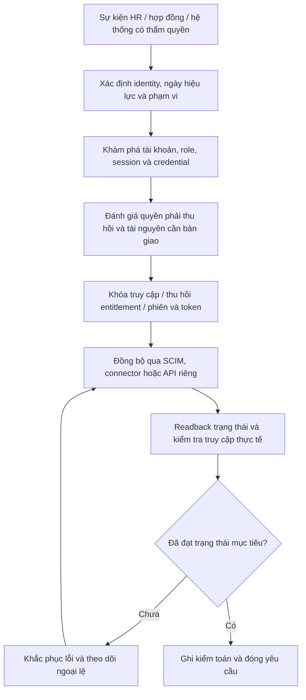

# Deprovisioning là gì trong quản lý vòng đời danh tính IAM?

**Account deprovisioning** là quá trình thu hồi, vô hiệu hóa hoặc loại bỏ quyền sử dụng tài khoản và các quyền truy cập liên quan khi chủ thể không còn đủ căn cứ truy cập. Trong **Identity and Access Management (IAM)**, deprovisioning không chỉ là xóa một tài khoản: đó là chuỗi hoạt động đưa **quyền truy cập thực tế** về trạng thái được chính sách cho phép, đồng thời bảo toàn dữ liệu, trách nhiệm sở hữu và bằng chứng kiểm toán cần thiết.

Deprovisioning thường được nhắc tới ở giai đoạn **Leaver** của mô hình **Joiner–Mover–Leaver (JML)**, ví dụ nhân viên nghỉ việc hoặc nhà thầu hết hạn hợp đồng. Tuy nhiên, deprovisioning cũng xuất hiện trong **Mover** khi người dùng chuyển bộ phận và phải mất quyền của vị trí cũ, hoặc khi một ứng dụng, dự án hay tài khoản dịch vụ ngừng hoạt động.

Điểm mấu chốt: **khóa đăng nhập tại Identity Provider (IdP) không đồng nghĩa đã thu hồi mọi quyền tại tất cả ứng dụng**. Một ứng dụng có thể lưu tài khoản cục bộ, role riêng, phiên đăng nhập còn hiệu lực hoặc API key độc lập; quy trình phải xác minh trạng thái trên từng hệ thống đích.

## 1. Phân biệt deprovisioning với các thao tác liên quan

| Thuật ngữ | Ý nghĩa | Ví dụ |
| --- | --- | --- |
| **Provisioning** | Tạo hoặc cập nhật tài khoản và quyền | Tạo user mới trên CRM, gán nhóm hỗ trợ |
| **Deprovisioning** | Thu hồi khả năng truy cập không còn được phép | Gỡ role kế toán, khóa tài khoản CRM |
| **Disable / suspend** | Vô hiệu hóa việc sử dụng tài khoản, có thể giữ hồ sơ | Đặt tài khoản thành không hoạt động |
| **Delete** | Xóa tài khoản hoặc đối tượng theo khả năng hệ thống | Xóa account sau thời hạn lưu giữ phù hợp |
| **Revoke entitlement** | Thu hồi một quyền cụ thể, không nhất thiết khóa cả account | Gỡ quyền `invoice-approver` |
| **Revoke session/token** | Chấm dứt khả năng dùng phiên/token đã phát hành | Thu hồi refresh token hoặc phiên ứng dụng |
| **Offboarding** | Quy trình kết thúc quan hệ rộng hơn IAM | Bàn giao tài sản, dữ liệu và trách nhiệm |

**Disable, delete và revoke không thay thế được nhau.** Một account có thể bị vô hiệu hóa để ngăn truy cập nhưng vẫn cần giữ hồ sơ vì yêu cầu kiểm toán; một người chuyển vị trí có thể chỉ cần thu hồi entitlement cũ mà vẫn giữ tài khoản và phương thức đăng nhập.

Deprovisioning đúng phải xuất phát từ câu hỏi: **chủ thể không còn được phép làm hành động gì, với tài nguyên nào, kể từ thời điểm nào?**

## 2. Vì sao deprovisioning là biện pháp bảo mật quan trọng?

Nếu một nhân viên đã chuyển bộ phận nhưng vẫn xem được dữ liệu tài chính từ vai trò trước, họ đang có **quyền truy cập tồn dư** (*residual access*). Nếu nhà thầu đã hết hạn hợp đồng nhưng API key vẫn còn hiệu lực, rủi ro không nằm ở trạng thái tài khoản nhân sự mà nằm ở khả năng hệ thống vẫn chấp nhận credential đó.

Deprovisioning giúp:

1. **Thực thi nguyên tắc đặc quyền tối thiểu:** quyền không còn cần thiết phải được gỡ bỏ.
2. **Giảm tích lũy đặc quyền sau Mover:** tránh giữ đồng thời quyền của nhiều vị trí từng đảm nhiệm.
3. **Ngăn truy cập sau Leaver:** chặn đăng nhập và các đường truy cập cũ vào hệ thống.
4. **Bảo vệ dữ liệu và tính liên tục:** chuyển giao quyền sở hữu dữ liệu, quy trình hoặc workload trước khi xóa đối tượng phụ thuộc.
5. **Tăng khả năng kiểm toán:** cung cấp bằng chứng quyền nào đã bị thu hồi, ở đâu, vào lúc nào.

Quy trình cũng phải tránh một lỗi ngược lại: xóa nhầm tài khoản dịch vụ chung khiến hệ thống nghiệp vụ ngừng hoạt động. Cần phân biệt **chủ thể con người**, **tài khoản kỹ thuật** và **tài nguyên do người đó sở hữu**.

## 3. Khi nào cần kích hoạt deprovisioning?

| Sự kiện | Phạm vi xử lý điển hình | Lưu ý |
| --- | --- | --- |
| **Leaver — nghỉ việc** | Tài khoản, phiên, token, entitlement, quyền đặc biệt | Căn cứ theo thời điểm chấm dứt có thẩm quyền |
| **Mover — chuyển vai trò** | Quyền không còn cần thiết; có thể giữ account | Không chỉ cộng thêm quyền của vai trò mới |
| Hết hạn hợp đồng đối tác | Membership, tài khoản B2B, API và quyền theo dự án | Xét cả người dùng lẫn workload của đối tác |
| Hết hạn quyền tạm thời | Entitlement hoặc role có thời hạn | Thu hồi đúng hạn, đối soát tại đích |
| Tài khoản nghi ngờ bị chiếm | Khóa, thu hồi credential/phiên khẩn cấp | Theo quy trình ứng phó sự cố; điều tra riêng |
| Ngừng ứng dụng hoặc workload | Tài khoản dịch vụ, khóa, role và tích hợp | Xử lý phụ thuộc và chuyển giao trước khi xóa |

Không phải mọi sự kiện đều dẫn tới xóa danh tính gốc. Một người chuyển từ kế toán sang phân tích dữ liệu thường vẫn giữ **human identity**; những quyền cần thu hồi là quyền kế toán không còn phù hợp với công việc mới.

## 4. Quy trình deprovisioning từ nguồn đến hệ thống đích



### Bước 1 — Tiếp nhận sự kiện và xác định phạm vi

Nguồn HRIS/HCM, hệ thống quản lý hợp đồng hoặc chủ sở hữu ứng dụng cần cung cấp **mã định danh ổn định**, loại quan hệ, thời điểm có hiệu lực và phạm vi thay đổi. Không chỉ dựa vào tên hoặc email, vì một người có thể dùng nhiều tài khoản, có tài khoản đặc quyền riêng hoặc email đã thay đổi.

Với trường hợp nghỉ việc khẩn cấp, chính sách có thể yêu cầu chặn truy cập ngay sau khi sự kiện được xác nhận. Không để việc chờ thủ tục phê duyệt cấp quyền thông thường trì hoãn thu hồi bảo mật.

### Bước 2 — Lập danh sách tài khoản và quyền

Từ một identity, IAM cần xác định:

- Tài khoản ở IdP, directory, SaaS, hệ thống nội bộ và ứng dụng cũ.
- Nhóm, vai trò **RBAC**, quyền trực tiếp, quyền kế thừa và các điều kiện **ABAC**.
- Tài khoản quản trị, quyền tạm thời hoặc quyền khẩn cấp.
- Phiên SSO, phiên ứng dụng, refresh token và credential còn dùng được.
- Khóa API, tài khoản dịch vụ hoặc workload có quan hệ sở hữu hay phụ thuộc cần kiểm tra.
- Dữ liệu, tài nguyên chia sẻ hoặc quy trình phê duyệt cần chuyển giao.

Danh sách chỉ dựa trên nhóm IdP có thể bỏ sót role cục bộ trong ứng dụng. Vì vậy, khả năng **đối soát quyền ở đích** quan trọng ngang khả năng gửi lệnh thu hồi.

### Bước 3 — Xác định trạng thái mục tiêu

Đối với Leaver, trạng thái mong muốn thường là **không thể xác thực hoặc truy cập** các tài nguyên thuộc quan hệ đã chấm dứt. Với Mover, trạng thái mong muốn là **vẫn có đủ quyền mới nhưng không còn quyền cũ**.

Có thể biểu diễn đơn giản:

```text
current_permissions = quyền thực tế tại các hệ thống
target_permissions  = quyền được phép sau sự kiện
to_revoke           = current_permissions - target_permissions
to_keep             = current_permissions ∩ target_permissions
```

Đây là mô hình logic. Thực tế còn có quyền tạm thời, nhóm lồng nhau, điều kiện theo tài nguyên và các ngoại lệ được phê duyệt. Quyền cần giữ để bàn giao phải được ghi rõ thời hạn và người chịu trách nhiệm, không được bỏ qua bước kiểm tra.

### Bước 4 — Thực thi ngăn truy cập và thu hồi

Hệ thống có thể vô hiệu hóa account tại IdP, dùng **SCIM** hoặc connector để cập nhật trạng thái user/group và dùng API riêng để gỡ entitlement. Các hệ thống chỉ hỗ trợ thao tác thủ công cần workflow có người chịu trách nhiệm, bằng chứng và thời hạn xử lý.

**SSO là phương thức xác thực liên kết, không phải công cụ deprovisioning đầy đủ.** Khóa IdP có thể ngăn đăng nhập mới nhưng không luôn kết thúc phiên ứng dụng đã tồn tại. Tương tự, SCIM có thể hỗ trợ cập nhật account mà không tự thu hồi mọi access token.

Đối với các tài khoản nhạy cảm, nên xem xét thu hồi phiên, refresh token, API key, credential và quyền quản trị song song với việc khóa account.

### Bước 5 — Đối soát và kiểm chứng

Sau mỗi thao tác, kiểm tra trạng thái **thực tế** của account, role, nhóm và session tại đích. Cần phân biệt:

- **Đã gửi yêu cầu:** connector nhận nhiệm vụ.
- **Đích đã phản hồi:** hệ thống báo nhận hoặc xử lý thao tác.
- **Đích đã đạt trạng thái mục tiêu:** readback và kiểm tra quyền xác nhận kết quả.

Một HTTP thành công không luôn chứng minh quyền đã bị gỡ hoàn toàn, nhất là khi ứng dụng áp dụng thay đổi bất đồng bộ hoặc có cache. Quy trình phải ghi lỗi, retry an toàn và chuyển ngoại lệ cho owner xử lý; không đánh dấu hoàn tất khi chưa có đủ bằng chứng theo chính sách.

### Bước 6 — Bàn giao, lưu giữ và đóng vòng đời

Không nên tự động xóa dữ liệu nghiệp vụ cùng account khi chưa xem xét nghĩa vụ lưu giữ, quy định pháp lý và phụ thuộc ứng dụng. Thư mục tài liệu, dashboard, lịch tác vụ, khóa tích hợp và workflow phê duyệt có thể cần chuyển sang owner mới.

Việc **xóa hẳn** account có thể diễn ra sau khi truy cập đã bị chặn và hết thời hạn lưu giữ phù hợp, nếu chính sách cho phép. Deprovisioning trước hết ưu tiên **chặn quyền không hợp lệ**, không đồng nghĩa xóa ngay mọi dữ liệu liên quan tới chủ thể.

## 5. Ví dụ Leaver: nhân viên nghỉ việc nhưng CRM còn phiên cũ

Giả sử Minh nghỉ việc có hiệu lực lúc 17:00. Minh có tài khoản IdP, CRM, tài khoản quản trị thử nghiệm và một API key dùng cho báo cáo cá nhân.

| Đối tượng | Biện pháp | Cần xác minh |
| --- | --- | --- |
| Tài khoản IdP | Vô hiệu hóa theo thời điểm Leaver | Không đăng nhập mới được |
| Tài khoản CRM | Disable qua connector hoặc API | Trạng thái tại CRM và quyền đọc dữ liệu thực tế |
| Phiên CRM trước 17:00 | Thu hồi hoặc chặn tại điểm thực thi | Cookie cũ không còn sử dụng được quyền |
| Tài khoản quản trị | Thu hồi quyền đặc quyền/khóa tài khoản | Không còn đường truy cập quản trị |
| API key cá nhân | Thu hồi và ngừng chấp nhận key | Gọi API bằng key cũ bị từ chối |
| Dashboard do Minh sở hữu | Chuyển giao theo quy trình | Người nhận tiếp tục vận hành mà không khôi phục quyền của Minh |

Nếu CRM dùng access token tự chứa (chẳng hạn JWT) và chỉ kiểm chữ ký, `exp`, `iss`, `aud`, token cũ có thể còn được chấp nhận đến khi hết hạn dù IdP đã khóa account. Tùy kiến trúc, tổ chức có thể dùng token ngắn hạn, introspection, kiểm tra trạng thái truy cập hoặc danh sách thu hồi để giảm **cửa sổ truy cập tồn dư**. Không khẳng định token mất hiệu lực ngay nếu chưa có cơ chế và bằng chứng phù hợp.

## 6. Deprovisioning ở Mover: thu hồi quyền, không xóa danh tính

Giả sử Hà chuyển từ bộ phận tài chính sang phân tích dữ liệu:

1. HR xác nhận sự kiện Mover và ngày hiệu lực.
2. IAM tính vai trò mục tiêu theo **RBAC/ABAC**, bao gồm phạm vi tài nguyên mới.
3. Quyền `invoice-preparer` và các quyền tài chính không còn phù hợp được thu hồi.
4. Quyền `analytics-reader` được cấp theo chính sách, các quyền chung cần thiết được giữ.
5. IAM đọc lại entitlement thực tế tại ứng dụng kế toán và nền tảng phân tích.
6. Phiên hoặc token chứa quyền cũ được đánh giá, xử lý theo cơ chế ứng dụng.

Nếu quyền cũ vẫn tồn tại, người dùng có thể tích lũy đặc quyền qua nhiều vị trí. Nhưng nếu chỉ thu hồi mà không cấp đủ quyền mới, quy trình Mover cũng chưa hoàn tất về nghiệp vụ. Vì vậy cần đo **cả quyền thừa và quyền thiếu**.

## 7. Tài khoản dịch vụ và quyền thuộc về workload

Một nhân viên nghỉ việc có thể là người tạo hoặc duy trì **service account** cho nhiều ứng dụng. Không nên xóa account dịch vụ dùng chung chỉ vì owner cá nhân đã rời tổ chức nếu hành động đó làm gián đoạn nghiệp vụ. Thay vào đó cần:

- Xác định workload thật sự sử dụng credential và chủ sở hữu nghiệp vụ/kỹ thuật mới.
- Thu hồi khả năng người nghỉ việc xem hoặc thay đổi secret, vault và cấu hình dịch vụ.
- Xoay vòng credential, chứng thư hoặc khóa khi có rủi ro chúng đã được cá nhân biết hoặc nắm giữ.
- Rà soát API scope, role và quyền tối thiểu của workload.
- Ngừng và deprovision danh tính kỹ thuật khi workload không còn được sử dụng, sau khi xử lý phụ thuộc.

Ưu tiên **workload identity federation** hoặc credential ngắn hạn khi nền tảng hỗ trợ; không dùng token cá nhân lâu dài để chạy tác vụ tự động.

## 8. Kiểm toán, ngoại lệ và chỉ số đo lường

Một hồ sơ deprovisioning cần cho biết **ai hoặc workload nào**, sự kiện nguồn nào, **quyền gì phải thu hồi**, hệ thống nào chịu ảnh hưởng, thời điểm nào cần mất hiệu lực, kết quả ra sao và ai xử lý lỗi.

| Chỉ số | Điều cần đo |
| --- | --- |
| **Time to revoke** | Thời gian từ sự kiện có hiệu lực đến khi quyền thực tế bị chặn |
| **Coverage** | Tỷ lệ tài khoản/ứng dụng được phát hiện và đưa vào phạm vi xử lý |
| **Reconciliation success** | Tỷ lệ hệ thống đích xác nhận trạng thái mong muốn |
| **Residual entitlements** | Số quyền không còn căn cứ nhưng vẫn hiệu lực |
| **Orphaned accounts** | Số account không gắn được với identity hoặc owner hợp lệ |
| **Overdue exceptions** | Quyền chưa thu hồi quá hạn hoặc chưa có biện pháp giảm rủi ro |

Nhật ký cần lưu mã identity, correlation ID, thời điểm, quyết định, kết quả cập nhật và bằng chứng đối soát; **không ghi mật khẩu, token thô, API key hoặc private key vào log**. Trường hợp ứng dụng đích không hỗ trợ thu hồi tự động, phải có owner, hướng xử lý thủ công, thời hạn và xác minh độc lập phù hợp rủi ro.

## 9. Các lỗi thường gặp

| Sai lầm | Hậu quả | Cách khắc phục |
| --- | --- | --- |
| Chỉ khóa IdP | Ứng dụng cục bộ hoặc session cũ còn truy cập | Đối soát từng hệ thống đích và xử lý phiên/token |
| Coi SCIM thành công là hoàn tất | Role/ACL hoặc token chưa được thu hồi | Readback và kiểm chứng quyền thực tế |
| Quên tài khoản đặc quyền | Giữ đường truy cập nhạy cảm sau Leaver | Liệt kê PAM, tài khoản thứ cấp, quyền tạm thời |
| Xóa account trước khi bàn giao | Mất chủ sở hữu dữ liệu, gián đoạn tác vụ | Phân tách chặn truy cập, chuyển giao, lưu giữ, xóa |
| Quên service identity | API key hoặc workload trở thành mồ côi | Quản lý owner và vòng đời workload riêng |
| Chỉ cấp thêm quyền khi Mover | Tích lũy đặc quyền | Tính quyền mục tiêu và thu hồi chênh lệch |
| Không xử lý lỗi đồng bộ | Quyền tồn dư không được phát hiện | Retry an toàn, cảnh báo, đối soát và quản lý ngoại lệ |

## 10. Câu hỏi tự kiểm tra

**Tình huống A:** HR ghi nhận nhân viên nghỉ việc và IdP khóa tài khoản, nhưng CRM vẫn chấp nhận phiên cũ. Deprovisioning đã hoàn tất chưa? **Chưa.** Cần xử lý phiên CRM và kiểm chứng quyền truy cập bị từ chối.

**Tình huống B:** Nhân viên chuyển bộ phận, quyền kế toán đã thu hồi và quyền phân tích được cấp nhưng vẫn có role kế toán cục bộ ở ứng dụng cũ. Có rủi ro không? **Có.** Đây là quyền tồn dư, phải đối soát và gỡ quyền tại đích.

**Tình huống C:** Một service account đang chạy tác vụ quan trọng do người nghỉ việc tạo. Có nên xóa ngay account ấy? **Không mặc nhiên.** Trước hết cần xác định owner mới, xử lý secret và phụ thuộc, rồi thu hồi đúng phần quyền không còn hợp lệ.

**Tình huống D:** Connector trả kết quả thành công nhưng không đọc lại entitlement được. Có thể tuyên bố đã thu hồi chắc chắn không? **Không.** Cần phương pháp kiểm chứng được phê duyệt hoặc ghi nhận ngoại lệ, giới hạn bằng chứng và rủi ro còn lại.

**Tình huống E:** Quyền tạm thời của nhà thầu đã hết hạn nhưng hợp đồng mới chưa được xác nhận. Có nên tự động gia hạn? **Không.** Cần dựa vào quan hệ và phê duyệt hợp lệ; nếu không đủ căn cứ, quyền phải hết hiệu lực theo chính sách.

## Ghi nhớ

**Deprovisioning** là quá trình kiểm soát việc **mất hiệu lực quyền truy cập**, không chỉ là thao tác xóa tài khoản. Trong vòng đời **Joiner–Mover–Leaver**, deprovisioning cần kết hợp sự kiện từ nguồn có thẩm quyền, **IdP/SSO**, **SCIM/connector**, kiểm soát **RBAC/ABAC**, quản lý session/token/credential, tài khoản dịch vụ và kiểm toán. Một yêu cầu chỉ hoàn tất đáng tin cậy khi **quyền thực tế tại hệ thống đích** đã đạt trạng thái mục tiêu hoặc ngoại lệ còn lại được quản trị rõ ràng, qua đó giảm quyền truy cập tồn dư.
