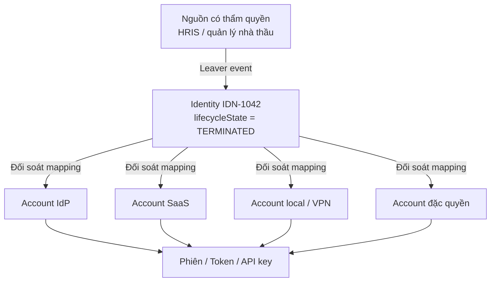
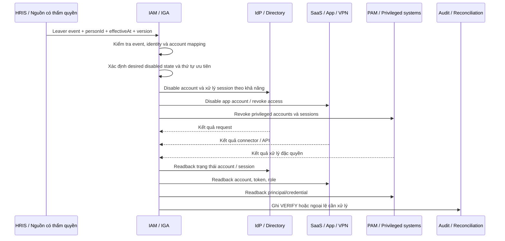

# Vô hiệu account trong quy trình Account deprovisioning của IAM

## Mục tiêu học tập

Sau bài này, người học có thể:

1. Giải thích **vô hiệu hóa tài khoản (account disablement)**, phân biệt với khóa tạm thời, thu hồi quyền, thu hồi phiên, xóa tài khoản và lưu trữ dữ liệu.
2. Xác định thời điểm, nguồn sự kiện và điều kiện vô hiệu account trong mô hình **Joiner–Mover–Leaver (JML)**.
3. Thiết kế luồng vô hiệu tài khoản xuyên **IAM/IGA, IdP, SSO, SCIM, directory và ứng dụng đích** với cơ chế đối soát.
4. Nhận diện các đường truy cập còn tồn tại sau khi account bị disable: session, refresh token, API key, account local, quyền nhóm hoặc credential đặc quyền.
5. Áp dụng nguyên tắc least privilege, RBAC/ABAC, phân tách nhiệm vụ và quản trị ngoại lệ vào hoạt động deprovisioning.
6. Thiết kế xử lý idempotent cho sự kiện đến muộn, connector lỗi, trạng thái bất đồng bộ và trường hợp tái tuyển dụng.
7. Xây dựng bằng chứng kiểm toán và tiêu chí xác nhận đã vô hiệu account thực sự, không chỉ đã gửi yêu cầu.

## 1. Vô hiệu account là gì?

Trong **Identity and Access Management (IAM)**, **vô hiệu account** là thao tác đưa một tài khoản tại một hệ thống về trạng thái không còn được phép sử dụng để xác thực hoặc truy cập theo chính sách áp dụng. Đối tượng được thao tác là **account cụ thể ở hệ thống đích**, ví dụ account IdP, SaaS, directory, máy chủ, cơ sở dữ liệu hoặc một ứng dụng nội bộ.

Đây là bước trọng tâm của **account deprovisioning** khi nhân viên, nhà thầu hoặc một danh tính không còn đủ điều kiện truy cập. Trong giai đoạn **Leaver**, thao tác thường được kích hoạt bởi sự kiện kết thúc quan hệ lao động hoặc hợp đồng từ nguồn có thẩm quyền.

Ví dụ: khi HR xác nhận nhân viên An nghỉ việc có hiệu lực lúc 17:00, IAM xác định các account của An, yêu cầu IdP và ứng dụng đích vô hiệu chúng, đồng thời kiểm tra các session/token có thể vẫn dùng được sau thời điểm đó.

**Account đã bị disable không đồng nghĩa mọi truy cập đã bị thu hồi.** Một ứng dụng có thể vẫn chấp nhận session đã được thiết lập trước khi khóa, một token có thể còn hiệu lực cho đến khi hết hạn hoặc một account local chưa được đồng bộ với IdP vẫn hoạt động.

### 1.1. Phân biệt các thao tác dễ nhầm

| Thao tác | Tác động chính | Có thể đảo ngược? | Lưu ý |
|---|---|---|---|
| **Disable account** | Chặn account được sử dụng theo cơ chế hệ thống | Thường có, tùy nền tảng | Cần kiểm tra session, token, đường đăng nhập khác |
| **Temporary lock / suspend** | Tạm hạn chế truy cập do rủi ro hoặc lý do vận hành | Thường có | Không phải lúc nào cũng là kết thúc vòng đời |
| **Revoke entitlement/group** | Bỏ role, quyền hoặc membership | Thường có | Account vẫn có thể đăng nhập nếu còn quyền cơ sở |
| **Revoke session/token** | Làm mất hiệu lực phiên/credential được hỗ trợ | Tùy loại token | Có token không thu hồi tức thì được |
| **Delete account** | Xóa bản ghi hoặc tài nguyên tài khoản | Có thể không | Có thể ảnh hưởng dữ liệu, audit, ownership và retention |
| **Transfer ownership** | Chuyển tài nguyên nghiệp vụ sang owner khác | Tùy tài nguyên | Không được chuyển giao mật khẩu/token cũ |
| **Archive/retain data** | Giữ dữ liệu theo chính sách | Không đồng nghĩa cho phép đăng nhập | Cần tách trạng thái lưu dữ liệu khỏi account hoạt động |

Vì vậy, vô hiệu account là **một bước cụ thể** trong deprovisioning; xóa account có thể là bước sau, khi việc giữ dữ liệu và các yêu cầu pháp lý, kiểm toán đã được giải quyết.

### 1.2. Vô hiệu tài khoản khác vô hiệu danh tính

Một **identity** có thể có nhiều **account**. Ví dụ cùng một người có account tại IdP, CRM, email, VPN, cloud và tài khoản quản trị riêng. Identity được quản trị ở cấp tổ chức; từng account có ID, credential và trạng thái riêng.



Một identity có trạng thái `TERMINATED` **không tự khiến mọi account ở đích bị khóa** nếu không có cơ chế đồng bộ hoặc kiểm tra quyền thực thi. Mục tiêu của deprovisioning là đưa **actual state** tại mọi hệ thống liên quan về trạng thái an toàn đã được chính sách xác định.

## 2. Khi nào phải vô hiệu account?

### 2.1. Leaver là trường hợp chính

Các tình huống phổ biến:

- Nhân viên chấm dứt quan hệ lao động.
- Nhà thầu hoặc đối tác hết hạn hợp đồng.
- Người được cấp quyền theo chương trình tạm thời kết thúc tham gia.
- Tài khoản phụ hoặc tài khoản đặc quyền không còn owner/nhiệm vụ hợp lệ.
- Danh tính không còn thuộc phạm vi tổ chức hoặc bị thu hồi tư cách truy cập.

Với Leaver, nguồn có thẩm quyền thường là HRIS, hệ thống quản lý hợp đồng hoặc sponsor đã được phân quyền. **Không suy ra Leaver chỉ vì Department trống, không có lượt đăng nhập gần đây hoặc người dùng không trả lời email.**

### 2.2. Suspend hoặc sự cố không giống Leaver

Một account cũng có thể được khóa do nghi ngờ bị xâm nhập, mất thiết bị, yêu cầu điều tra hoặc nhân viên nghỉ tạm. Trong các tình huống đó, thao tác kỹ thuật có thể giống nhau nhưng **lý do, phạm vi, điều kiện mở lại và retention** khác nhau.

| Tình huống | Hành động điển hình | Điều kiện bổ sung |
|---|---|---|
| Leaver có kế hoạch | Disable theo mốc hiệu lực HR; revoke đường truy cập liên quan | Bàn giao dữ liệu, owner và tài sản |
| Leaver khẩn cấp | Chặn truy cập ưu tiên, có thể xử lý ngay | Phối hợp HR/Security/Legal; theo dõi chứng cứ |
| Nghỉ tạm / suspended | Chặn hoặc giới hạn tạm theo policy | Quy trình và thẩm quyền kích hoạt lại |
| Account compromise | Khóa, revoke session, rotate credential, điều tra | Không coi đơn thuần là người đã nghỉ việc |
| Mover | Bỏ quyền không còn phù hợp, có thể disable một account chuyên biệt | Không mặc định khóa toàn bộ identity |
| Workload ngừng hoạt động | Disable principal/service account không còn dùng | Đánh giá phụ thuộc dịch vụ và owner |

### 2.3. Thời điểm hiệu lực

Một sự kiện HR có thể được ghi nhận trước nhiều ngày. Ví dụ:

```json
{
  "eventId": "HR-LV-2026-7421",
  "eventType": "LEAVER",
  "sourceSystem": "HRIS",
  "personId": "P-1042",
  "sourceVersion": 31,
  "recordedAt": "2026-11-20T10:00:00+07:00",
  "effectiveAt": "2026-11-30T17:00:00+07:00",
  "reasonCategory": "CONTRACT_ENDED"
}
```

Đây là event minh họa, không phải định dạng HR chuẩn. IAM cần phân biệt **ngày ghi nhận** và **ngày bắt đầu áp dụng**. Với Leaver theo lịch, có thể chuẩn bị danh sách account và kịch bản trước ngày hiệu lực, nhưng hành động khóa phải theo chính sách và mốc được duyệt. Với Leaver khẩn, chính sách có thể quy định chặn ngay.

Nguồn HR có thể thay đổi ngày nghỉ hoặc hủy event; workflow cần phát hiện phiên bản mới nhất. Không dùng event cũ để khóa nhầm người đã được xác nhận gia hạn.

## 3. Xác định đúng account cần vô hiệu

Vấn đề khó nhất nhiều khi không phải gọi API disable mà là **biết đầy đủ những tài khoản thuộc danh tính cần xử lý**.

### 3.1. Bảng liên kết identity–account

| Khóa | Chức năng | Nguyên tắc |
|---|---|---|
| `identityId` | Định danh nội bộ được quản trị | Ổn định, không tái sử dụng tùy tiện |
| `sourcePersonId` | Liên kết với HRIS hoặc nguồn hợp đồng | Có nguồn và bằng chứng correlation |
| `idpAccountId` | Account tại IdP | Lấy ID thực tế từ IdP, không suy từ email |
| `appAccountId` | Account ở SaaS/ứng dụng | Lưu mapping độc lập từng hệ thống |
| `privilegedAccountId` | Account quản trị riêng | Có liên kết owner và chính sách đặc quyền |
| `servicePrincipalId` | Account dịch vụ/workload | Không đồng nhất với tài khoản cá nhân |
| `owner/sponsor` | Người hoặc nhóm chịu trách nhiệm | Cần thiết cho tài khoản ngoại lệ và NHI |

Email, tên đăng nhập và họ tên có thể thay đổi hoặc trùng. Việc tìm theo email đơn thuần có thể bỏ sót account cũ, gán nhầm account của người khác hoặc làm lộ dữ liệu khi tự động vô hiệu nhầm tài khoản.

### 3.2. Danh mục account cần quét

Khi Leaver, IAM/IGA có thể lập danh mục từ:

1. Account IdP/directory (đăng nhập tương tác).
2. Account được quản lý qua SCIM hoặc connector ứng dụng SaaS.
3. Account local tại ứng dụng không dùng IdP.
4. VPN, Wi-Fi, VDI, máy chủ và dịch vụ mạng.
5. Cloud IAM account, account đặc quyền, quyền dự án và group.
6. Personal access token, API key, SSH key, app password và credential liên quan.
7. Account truy cập dữ liệu, database, hệ thống quản lý mã nguồn, CI/CD.
8. Account ngoại lệ không tích hợp tự động và account do người dùng được giao quản lý.

**Cần đối soát account inventory từ hệ thống đích**, vì một tài khoản được tạo thủ công có thể không nằm trong dữ liệu cấp phát ban đầu của IAM.

### 3.3. Account dùng chung và tài khoản dịch vụ

Một tài khoản dùng chung không nên bị disable chỉ vì một thành viên rời nhóm nếu nó còn phục vụ người khác, nhưng người đã rời tổ chức không được tiếp tục biết hoặc sử dụng credential. Cần đánh giá **rotate secret, quản lý session, quy trách nhiệm và chuyển quyền sở hữu**.

Với **service account/workload identity**, nhân viên tạo job không phải lúc nào cũng là chủ thể dùng account đó. Nếu service vẫn cần hoạt động, phải chuyển ownership cho đội chịu trách nhiệm và rà soát quyền; chỉ disable khi workload thực sự ngừng sử dụng hoặc có quyết định an ninh phù hợp.

## 4. Luồng vô hiệu account qua IAM, IdP và ứng dụng



Sơ đồ thể hiện trách nhiệm logic; thực tế các thao tác có thể chạy song song. Với Leaver rủi ro cao, phải ưu tiên cắt những đường truy cập có thể khai thác ngay thay vì chờ công việc bàn giao tài sản.

### 4.1. Các bước nghiệp vụ

1. **Tiếp nhận event đáng tin:** kiểm tra nguồn, ID nhân sự, lý do nghiệp vụ ở mức cần thiết, version và mốc hiệu lực.
2. **Xác nhận identity:** liên kết event đến đúng identity, phát hiện trùng hoặc mơ hồ.
3. **Inventory tài khoản:** lấy toàn bộ account/principal hiện có tại các hệ thống liên quan.
4. **Xác định chính sách:** account nào cần disable, khi nào, thứ tự ưu tiên, có ngoại lệ nào và owner nào phê duyệt.
5. **Thực thi disable:** gọi IdP/directory/app/PAM/SCIM theo API hoặc quy trình hỗ trợ.
6. **Thu hồi đường truy cập khác:** session/token/credential, app-local login, role/group và trust khi cần.
7. **Đọc lại trạng thái:** xác minh account thực sự bị khóa và quyền liên quan đã bị cắt theo khả năng đích.
8. **Ghi audit và sửa sai lệch:** ticket cho lỗi hoặc ngoại lệ; lưu lý do và bằng chứng.
9. **Bàn giao/lưu trữ dữ liệu:** quản lý ownership, retention và điều kiện xóa sau khi disable, theo quy trình riêng.

### 4.2. Trạng thái điều phối đề xuất

| Trạng thái minh họa | Ý nghĩa |
|---|---|
| `PENDING_EFFECTIVE_DATE` | Đã chuẩn bị nhưng chưa đến mốc khóa |
| `READY_TO_DISABLE` | Đã xác minh identity, account và policy |
| `DISABLE_REQUESTED` | Đã gửi yêu cầu, chưa xác nhận trạng thái ở đích |
| `DISABLED_APPLIED` | Hệ thống đích báo đã xử lý |
| `DISABLED_VERIFIED` | Readback xác nhận account không còn được sử dụng theo policy |
| `ACCESS_REVOKE_PENDING` | Account khóa nhưng token/session/entitlement còn xử lý |
| `DEPROVISIONED_VERIFIED` | Mọi bước trong phạm vi deprovisioning đã được xác minh |
| `RETRYABLE_ERROR` | Lỗi tạm thời và cần retry |
| `REVIEW_REQUIRED` | Mapping/ngoại lệ/tranh chấp trạng thái cần người có thẩm quyền |
| `FAILED` | Không thể hoàn tất; yêu cầu escalation và giảm thiểu rủi ro |

Các trạng thái này chỉ là **schema ví dụ của workflow nội bộ**, không phải chuẩn bắt buộc trong IdP hoặc SCIM.

Điểm cần nhớ: `DISABLED_APPLIED` không bằng `DEPROVISIONED_VERIFIED`. Cần tách **account status** khỏi **trạng thái toàn bộ quyền truy cập**.

## 5. Vô hiệu account trong IdP/Directory

IdP thường là điểm xác thực tập trung, nơi quản lý account, chính sách MFA và phát token để SSO. Khi disable account, kết quả mong đợi thường là **chặn những lần đăng nhập/xác thực mới** qua IdP theo cơ chế của sản phẩm.

Tuy nhiên, cần xác minh:

- Account thực tế đang `disabled` hay chỉ bị gỡ một nhóm ứng dụng?
- Các phiên SSO đang hoạt động có còn không?
- Refresh token có bị thu hồi, quyền refresh có bị chặn không?
- Các app có local login, session/cookie độc lập hoặc đường fallback không?
- Có account quản trị riêng với credential khác không?
- Policy điều kiện truy cập có đang dựa vào device trust hoặc group cache không?

### 5.1. Disable account không thay thế credential revocation

Một access token tự xác minh bằng chữ ký có thể tồn tại tới hạn `exp`, tùy kiến trúc. Nếu API đích không kiểm tra trạng thái account tại mỗi request, việc disable IdP có thể chưa tác động ngay đến token đã được phát hành.

Các loại credential cần phân biệt:

| Loại | Tác động khi IdP account bị disable | Hướng xử lý bổ sung |
|---|---|---|
| Password / interactive login | Thường không được xác thực mới qua IdP | Kiểm tra login dự phòng, local password |
| IdP session | Tùy cơ chế sign-out/revoke của sản phẩm | Revoke sessions/force sign-out khi hỗ trợ |
| Refresh token | Có thể bị chặn ở lần refresh hoặc cần revoke riêng | Dùng cơ chế revoke và đọc lại |
| Access token/JWT đã phát hành | Có thể còn hiệu lực đến `exp` | Giới hạn TTL, introspection/denylist khi khả thi |
| App-local session cookie | Không nhất thiết phụ thuộc IdP sau SSO | Revoke tại app, giảm TTL hoặc kiểm tra authorization |
| Personal access token / API key | Thường quản lý ở ứng dụng | Revoke trực tiếp tại issuer/đích |
| SSH key / client certificate | Có thể hoạt động độc lập với IdP | Gỡ authorized key, revoke cert/trust |
| Passkey/MFA factor | Là credential được liên kết với account hoặc thiết bị | Gỡ đăng ký theo policy và bảo vệ account |

Không có một lệnh chung nào bảo đảm vô hiệu mọi credential ở tất cả sản phẩm. Cần xác định mức đảm bảo và bước thực thi thực tế cho từng hệ thống.

### 5.2. Account được khóa và dữ liệu vẫn được giữ

Disable account thường được chọn trước khi delete vì tổ chức còn cần:

- Lưu log và dấu vết kiểm toán.
- Bảo toàn dữ liệu mailbox, tài liệu hoặc hồ sơ kinh doanh.
- Chuyển ownership tài nguyên và workflow sang người có thẩm quyền.
- Thực hiện retention hoặc legal hold.
- Giải quyết tài sản và các quyền còn liên quan.

Giữ account record ở trạng thái disabled **không đồng nghĩa giữ cho phép đăng nhập**. Phải phân biệt **quyền sở hữu dữ liệu, quyền đọc dữ liệu** và **khả năng đăng nhập của principal cũ**.

## 6. Vô hiệu account qua SCIM

**SCIM 2.0 (System for Cross-domain Identity Management)** là giao thức có thể được dùng để provision, update và quản lý resource `User`/`Group` giữa IAM/IdP và ứng dụng đích. Một thuộc tính quan trọng là `active` của User.

Ví dụ, nếu ứng dụng hỗ trợ cập nhật tài khoản bằng SCIM PATCH:

```http
PATCH /scim/v2/Users/{targetUserId}
Content-Type: application/scim+json
Authorization: Bearer <redacted>

{
  "schemas": [
    "urn:ietf:params:scim:api:messages:2.0:PatchOp"
  ],
  "Operations": [
    {
      "op": "replace",
      "path": "active",
      "value": false
    }
  ]
}
```

`targetUserId` là ID User resource do **SCIM server đích** cấp. Không tự dùng email hoặc `identityId` nội bộ làm ID đường dẫn khi chưa có mapping chính xác.

Theo ý nghĩa chung của SCIM, `active: false` biểu thị User không còn hoạt động theo quy tắc của nhà cung cấp; **cách đích chặn đăng nhập, giữ dữ liệu, session và entitlement cụ thể có thể khác nhau**. Vì vậy:

1. Kiểm tra SCIM server có hỗ trợ PATCH và thuộc tính `active` đúng như mong đợi.
2. Xác thực mapping giữa identity/account nội bộ và `targetUserId`.
3. Gửi lệnh cập nhật theo connector được ủy quyền.
4. Kiểm tra mã lỗi, đặc biệt lỗi quyền, xung đột hoặc mapping.
5. Gọi `GET /scim/v2/Users/{targetUserId}` hoặc API tương đương để xác minh `active=false`.
6. Kiểm tra riêng app session, local auth, API key và quyền ứng dụng nếu còn đường truy cập.
7. Ghi trạng thái thực tế; không tự xem HTTP 2xx là bằng chứng mọi quyền đã bị cắt.

### 6.1. Disable User không đồng nghĩa xóa group membership

Một app có thể vẫn giữ group hoặc role trong account disabled để bảo toàn lịch sử. Khi account được kích hoạt lại trong tương lai, các quyền cũ **có thể quay trở lại** nếu không được tính lại từ chính sách mới.

Do đó deprovisioning cần chính sách rõ về việc:

- Giữ thông tin group chỉ để audit, nhưng không cho quyền hoạt động.
- Gỡ membership/entitlement khi Leaver theo yêu cầu least privilege.
- Tránh tự re-enable account disabled rồi giữ nguyên role cũ trong trường hợp rehire.
- Xem xét quyền trực tiếp, nested group và app-local ACL.
- Đối soát mọi đường truy cập thực tế thay vì chỉ nhìn cờ `active`.

### 6.2. SCIM không phải SSO

SSO phục vụ xác thực đăng nhập; SCIM phục vụ quản trị account và một số thuộc tính/nhóm. Một ứng dụng có thể dùng SSO mà không hỗ trợ SCIM, hoặc hỗ trợ SCIM nhưng vẫn có local login. Khi triển khai, cần hiểu **thứ tự cập nhật IdP, ứng dụng, phiên và tài nguyên đích**.

## 7. RBAC, ABAC và vô hiệu account

Tại cấp ứng dụng, **authorization** phải xét account và lifecycle state, không chỉ group/role còn tồn tại.

Ví dụ policy minh họa:

```text
ALLOW(principal, action, resource) WHEN
    principal.accountState == ENABLED
    AND principal.identityState == ACTIVE
    AND principal.token.isValidForAudience
    AND principal.hasRequiredRole(action, resource)
    AND resource.scopeMatches(principal)
    AND request.context.meetsSecurityPolicy
```

Đây là pseudocode, không phải cú pháp chuẩn của một policy engine cụ thể. Một người còn role `FinanceReviewer` nhưng identity `TERMINATED` phải bị từ chối theo logic này.

**RBAC** dùng role/group xác định quyền theo vai trò. **ABAC** dùng thuộc tính principal, resource và bối cảnh như trạng thái vòng đời, bộ phận, thời gian, loại thao tác và mức xác thực.

Cần biết nguồn của các thuộc tính có đáng tin hay không: `identityState` do IAM/HR quản trị, không lấy từ header do client tự đặt. Dữ liệu có thể stale trong token hoặc cache; thao tác nhạy cảm có thể cần kiểm tra policy mới nhất.

### 7.1. Least privilege và SoD sau Leaver

Deprovisioning không chỉ chặn đăng nhập mà còn phải ngăn **quyền tồn dư** quay lại qua các account phụ, credential hoặc khôi phục nhầm. Những quyền quản trị đặc biệt nên được rà soát độc lập qua PAM, bao gồm quyền tạo token, reset tài khoản khác, gán role hoặc mở session.

Một tài khoản đặc quyền riêng vẫn có thể hoạt động sau khi account thường bị vô hiệu. IAM phải có mapping từ identity sang các account đặc quyền và xác nhận từng trạng thái.

## 8. Xử lý Leaver khẩn cấp và rủi ro cao

Khi có nguy cơ lạm dụng quyền hoặc sự cố bảo mật, thứ tự thực thi thường ưu tiên **cắt đường truy cập nhanh**:

1. Xác nhận quyết định khẩn cấp từ nguồn/đơn vị có thẩm quyền.
2. Khóa account tương tác và đặc quyền; chặn login/SSO.
3. Revoke session, refresh token, API key, VPN/SSH và credential nguy cơ cao theo khả năng.
4. Chặn quyền dùng account local và đường truy cập dự phòng.
5. Đánh giá thiết bị, credential lưu trên endpoint và các tài khoản dùng chung.
6. Bảo toàn log và chứng cứ cho Incident Response hoặc yêu cầu pháp lý.
7. Đọc lại trạng thái từng đích, ghi ngoại lệ khi chưa xử lý xong.

**Không nên chờ người nghỉ trả laptop hoặc hoàn tất bàn giao tài liệu mới disable account** nếu mốc thu hồi quyền đã có hiệu lực. Bàn giao tài sản, dữ liệu và quản lý tài khoản là các công việc phối hợp nhưng có tiêu chí riêng.

### 8.1. Khóa trước hay xóa trước?

Khi điều kiện bảo tồn dữ liệu hoặc kiểm toán chưa rõ, **disable thường là thao tác có thể đảo ngược và giữ nguyên bản ghi để điều tra**. Xóa vĩnh viễn là hành động riêng có điều kiện retention và approval; không nên tự động xóa ngay chỉ để “làm sạch” mọi account Leaver.

Điều này không thay thế nghĩa vụ xử lý dữ liệu hoặc xóa theo chính sách ở giai đoạn thích hợp.

## 9. Idempotency, thứ tự sự kiện và khôi phục an toàn

Trong hệ thống tích hợp, event có thể đến trùng, đến muộn hoặc sai thứ tự. Một connector có thể timeout sau khi đã xử lý request. Nếu xử lý hời hợt, hệ thống có thể disable nhầm tài khoản đã được khôi phục hợp lệ hoặc cấp lại quyền do replay event Joiner.

### 9.1. Mô hình xử lý trạng thái mong muốn

```text
onLifecycleEvent(event):
    validateTrustedSource(event)
    identity = correlateByStableSourceId(event.personId)

    if identity is ambiguous:
        openReviewCase()
        return

    if event.sourceVersion < identity.lastAcceptedLifecycleVersion:
        auditStaleEvent(event)
        return

    desiredState = evaluateLifecyclePolicy(event, identity)

    if desiredState == DISABLED:
        for account in discoverOwnedAccounts(identity):
            setDesiredAccountState(account, DISABLED, event.version)
            applyDisableWithRetry(account)
            verifyAccountStateAtTarget(account)

        reconcileSessionsTokensAndEntitlements(identity)
        auditOutstandingExceptions(identity)
    else:
        routeToAuthorizedLifecycleWorkflow(event)
```

Đây là pseudocode. Triển khai thật cần đồng bộ version, transaction, cơ chế chống race condition, phân quyền event producer và xử lý callback đến trễ.

### 9.2. Retry khi timeout

Giả sử SCIM PATCH timeout; ta chưa biết đích đã xử lý hay chưa. Trước khi gửi lại nên:

- Đọc trạng thái hiện tại bằng ID account đã xác minh.
- Nếu account đã disabled thì xác nhận kết quả, không tạo account mới.
- Nếu vẫn active và event còn hợp lệ thì retry có kiểm soát.
- Giới hạn số lượt, dùng backoff và chuyển ngoại lệ nếu thất bại lâu.
- Ghi mã lỗi, thời điểm và correlation ID để điều tra.
- Không để callback cũ chuyển trạng thái mới hơn thành active.

### 9.3. Mover và rehire khác với re-enable tự động

Nếu một người chuyển từ Sales sang Finance, IAM thường cần **thu hồi quyền Sales và cấp quyền Finance được duyệt**, không nhất thiết disable toàn bộ account. Nếu một account chuyên biệt không còn cần dùng, nó có thể được disable riêng.

Với **tái tuyển dụng (rehire)**, phải kiểm tra nguồn HR, identity correlation, yêu cầu proofing hiện tại, tài khoản cũ, policy và approval. Không tự khôi phục group, session, token hay quyền đặc biệt đã tồn tại trước Leaver chỉ vì email trùng. Cần xác lập lại **desired access** và bảo đảm phiên cũ không bị hồi sinh.

## 10. Đối soát: disabled tại đâu mới đủ?

Một luồng thành công về mặt API chưa chắc đã đạt trạng thái an toàn. Hệ thống nên đối soát cả **account status** và **actual access**.

| Phát hiện | Nguyên nhân có thể | Hướng xử lý |
|---|---|---|
| HR đã Leaver nhưng IdP account còn active | Event bị mất, connector lỗi hoặc sai mapping | Disable khẩn theo policy, kiểm tra phiên bản và xử lý lỗi |
| IdP disabled nhưng SaaS account active | SCIM chưa đồng bộ hoặc app có local login | Disable trực tiếp tại app, xác minh login và token |
| SCIM User `active=false` nhưng session app còn hoạt động | Session độc lập hoặc chưa revoke | Revoke session theo API/owner ứng dụng, kiểm tra khả năng runtime |
| Account bị disable nhưng privileged account còn active | Inventory thiếu account đặc quyền | Bổ sung mapping và xử lý PAM |
| Account disabled nhưng API key vẫn gọi được | Credential quản lý ở app riêng | Thu hồi key và kiểm tra log sau thời điểm nghỉ |
| Group/role vẫn lưu trong disabled account | Chính sách retention hoặc ứng dụng giữ metadata | Xác nhận không thể sử dụng và rà soát khi rehire |
| Account không tìm thấy ở đích | Đã xóa, sai ID hoặc connector mất dữ liệu | Đối soát lại ID/source, không tùy tiện tạo mới |
| Event Joiner cũ kích hoạt lại account | Thiếu version guard hoặc policy sai | Chặn replay, sửa workflow và thu hồi lại |
| Account shared vẫn cần phục vụ team | Dùng chung credential không kiểm soát | Xoay secret, gỡ người nghỉ, cải thiện quy trách nhiệm |
| IdP phản hồi thành công nhưng readback chưa đổi | Đồng bộ bất đồng bộ hoặc lỗi | Theo dõi đến VERIFIED hoặc escalation |

### 10.1. Tiêu chí hoàn tất theo từng cấp

**Cấp 1 — Request accepted:** hệ thống quản lý đã nhận yêu cầu disable.

**Cấp 2 — Account disabled verified:** dữ liệu trực tiếp từ hệ thống đích xác nhận account không còn active theo cơ chế sản phẩm.

**Cấp 3 — Access revoked verified:** các session, token, local account, role/entitlement và đường truy cập liên quan trong phạm vi xác định được thu hồi hoặc vô hiệu theo chính sách; các giới hạn chưa thể kiểm chứng được khai báo.

**Cấp 4 — Lifecycle closure:** dữ liệu, ownership, tài sản và retention đã được xử lý hoặc có ngoại lệ có người chịu trách nhiệm.

Không nên báo `DEPROVISIONED_VERIFIED` nếu chỉ đạt cấp 1 hoặc 2.

## 11. Bằng chứng kiểm toán và quản trị ngoại lệ

Một bản ghi audit có thể gồm:

```json
{
  "offboardingCaseId": "LV-2026-7421",
  "identityId": "IDN-1042",
  "sourcePersonId": "P-1042",
  "sourceEventId": "HR-LV-2026-7421",
  "sourceVersion": 31,
  "effectiveAt": "2026-11-30T17:00:00+07:00",
  "targetSystem": "CORPORATE_IDP",
  "targetAccountId": "USR-8382",
  "action": "DISABLE_ACCOUNT",
  "requestState": "APPLIED",
  "readbackState": "DISABLED_VERIFIED",
  "sessionRevokeState": "VERIFIED_WHERE_SUPPORTED",
  "policyVersion": "leaver-deprovision-v3",
  "correlationId": "IAM-JOB-8812"
}
```

Đây là **schema minh họa**, không phải schema audit chuẩn. Ngoài các trường trên, hệ thống thật cần thời gian từng thao tác, actor/service thực thi, kết quả đích, mã lỗi, approval và link chứng cứ có kiểm soát.

**Không ghi access token, mật khẩu, private key hoặc dữ liệu cá nhân quá mức cần thiết vào audit log.**

### 11.1. Ngoại lệ hợp lệ và không hợp lệ

Ngoại lệ hợp lệ có thể gồm:

- Một ứng dụng không hỗ trợ tự động disable, cần ticket thủ công có SLA và owner.
- Tài nguyên phải giữ theo legal hold nhưng account người nghỉ vẫn phải bị chặn truy cập.
- App cần chuyển ownership dữ liệu; không được re-enable account cũ chỉ để tiện chuyển nếu có cơ chế ủy quyền an toàn khác.
- Một hệ thống ngoại tuyến chưa thể kiểm tra trạng thái; cần biện pháp chặn qua lớp khác, theo dõi và readback sau.

Ngoại lệ **không hợp lệ** nếu chỉ ghi “đã gửi request” nhưng đánh dấu hoàn tất; hoặc giữ account còn hoạt động vô hạn vì không có người nhận ticket.

Mỗi ngoại lệ cần lý do, đánh giá rủi ro, owner, hạn khắc phục, quyền đã được giảm thiểu và bằng chứng đóng.

## 12. Chỉ số vận hành

| Chỉ số | Mục tiêu quan sát |
|---|---|
| **Account disable latency** | Thời gian từ mốc hiệu lực đến lúc account ở đích được xác minh disabled |
| **Deprovisioning completion rate** | Tỷ lệ identity Leaver có tất cả account thuộc phạm vi đã được xử lý |
| **Residual active account count** | Số account còn active sau khi identity hết điều kiện |
| **Unrevoked credential count** | Số token/key/certificate hoặc session còn hiệu lực ngoài policy |
| **Connector failure rate** | Tỷ lệ thao tác disable thất bại, timeout hoặc cần thao tác thủ công |
| **Orphan account rate** | Account không có identity/owner hợp lệ |
| **Reconciliation exception age** | Thời gian sai lệch không được xử lý |
| **Privileged account closure coverage** | Tỷ lệ account đặc quyền đã được xác minh thu hồi |
| **Rehire privilege recertification** | Tỷ lệ rehire được tính lại quyền thay vì khôi phục nguyên snapshot cũ |

Khi báo cáo KPI, phải nêu rõ số hệ thống được bao phủ, mẫu số, cửa sổ đồng bộ và sự khác biệt giữa **API success** với **actual verified state**.

Một dashboard chỉ đo account IdP có thể bỏ sót những hệ thống SaaS không hỗ trợ SCIM và các API key được phát hành độc lập.

## 13. Tình huống thực hành: vô hiệu account chưa chặn hết truy cập

**Bối cảnh:** Minh nghỉ việc lúc 18:00. HR phát Leaver event đúng hạn. IAM gọi disable account trên IdP và nhận phản hồi thành công. Tuy nhiên:

- CRM vẫn có account local active và chưa nhận thay đổi SCIM.
- Minh có một personal access token của hệ thống mã nguồn, được lưu trong laptop cá nhân.
- Một phiên SSO ở ứng dụng phân tích dữ liệu vẫn hoạt động sau khi IdP khóa account.
- Minh từng dùng account quản trị riêng cho môi trường kiểm thử.
- Một dịch vụ nền do Minh xây dựng vẫn dùng service principal chung của nhóm vận hành.

### 13.1. Câu hỏi phân tích

1. Có thể tuyên bố Leaver đã được deprovision hoàn toàn chỉ vì IdP disabled không?
2. Cần tìm những account và credential nào trước khi đóng case?
3. CRM đang local active nên xử lý thế nào?
4. Có nên disable service principal của nhóm vận hành ngay lập tức vì Minh từng sử dụng nó?
5. Bằng chứng nào chứng minh quá trình xử lý đã hoàn tất?

### 13.2. Gợi ý lời giải

**Bước 1 – Xác định trạng thái thực tế.** IdP đã disabled chỉ bảo đảm một phần đường truy cập. Các account local và credential độc lập còn có thể hoạt động.

**Bước 2 – Đối soát account.** Dùng identity/account mapping và inventory từ app, repo, cloud, PAM; không chỉ tìm theo email.

**Bước 3 – Thu hồi credential.** Revoke personal access token, kiểm tra phiên ứng dụng và khả năng sign-out, xử lý app-local login ở CRM. Disable account đặc quyền riêng và đọc lại trạng thái.

**Bước 4 – Xử lý service principal.** Kiểm tra owner thực tế và dịch vụ phụ thuộc. Nếu vẫn cần hoạt động, chuyển ownership, xoay credential khi cần và bỏ các quyền quản trị cá nhân của Minh; không tự phá dịch vụ bằng việc disable mù.

**Bước 5 – Kiểm chứng.** Ghi trạng thái target account disabled, token revoked, session xử lý theo khả năng hệ thống, quyền quản trị bị thu hồi và các ngoại lệ còn mở. Chỉ đánh dấu hoàn tất trong phạm vi đã xác minh.

### 13.3. Bài tập đúng/sai

1. “Disable một account ở IdP tự động xóa mọi token đã phát hành ở tất cả ứng dụng.”
2. “SCIM `active=false` cần được kiểm tra cùng hành vi thực tế của ứng dụng đích.”
3. “Một người có thể có nhiều account, kể cả account đặc quyền riêng.”
4. “Email là khóa bất biến nên có thể dùng để tự chọn mọi account cần disable.”
5. “Event Joiner cũ đến sau Leaver có thể tự kích hoạt lại account nếu được gửi từ HR.”
6. “Giữ dữ liệu theo legal hold không đồng nghĩa giữ account có quyền đăng nhập.”
7. “Một service account còn phục vụ workload phải được rà soát owner và credential trước khi quyết định disable.”
8. “HTTP 2xx từ connector là đủ để kết luận toàn bộ deprovisioning đã hoàn thành.”
9. “Mover có thể thu hồi một account chuyên biệt mà không khóa account chính.”
10. “Audit cần thể hiện source event, account đích, thao tác, kết quả và readback.”

**Đáp án:** 1 Sai; 2 Đúng; 3 Đúng; 4 Sai; 5 Sai; 6 Đúng; 7 Đúng; 8 Sai; 9 Đúng; 10 Đúng.

## 14. Những nguyên tắc cần ghi nhớ

1. **Vô hiệu account là thao tác trên account đích**, còn identity là chủ thể quản trị xuyên hệ thống.
2. **Disable, revoke entitlement, revoke session và delete là các hành động khác nhau** và có tiêu chí hoàn thành riêng.
3. **Leaver cần nguồn có thẩm quyền, mốc hiệu lực và version**; không suy ra chỉ từ email hay Department.
4. **Inventory/correlation đầy đủ là điều kiện tiên quyết** để không bỏ sót account SaaS, local hoặc đặc quyền.
5. **IdP, SSO và SCIM giải quyết các lớp khác nhau**; cập nhật `active=false` không tự chặn mọi session/token ở đích.
6. **Account disabled có thể giữ dữ liệu và lịch sử theo chính sách**, nhưng không được duy trì đường truy cập ngoài ý muốn.
7. **RBAC/ABAC, least privilege, SoD và PAM** phải được xét cả trong thu hồi và khi kích hoạt lại tài khoản.
8. **Service account/workload identity có owner và vòng đời riêng**; phải tránh cắt nhầm dịch vụ còn cần hoạt động.
9. **Retry idempotent, chống sự kiện đến muộn và readback ở đích** ngăn cấp lại quyền từ event cũ.
10. **Chỉ tuyên bố hoàn tất trên cơ sở bằng chứng kiểm chứng**, công khai những ngoại lệ còn mở để giảm residual access.

Vô hiệu account đúng cách là mắt xích then chốt của **Account deprovisioning** trong IAM theo mô hình **Joiner–Mover–Leaver**. Kết hợp nguồn HR đáng tin, IdP/SSO, SCIM, quyền RBAC/ABAC, kiểm toán và đối soát giúp tổ chức thu hồi truy cập đúng thời điểm, hạn chế tài khoản mồ côi và giảm quyền truy cập tồn dư.
