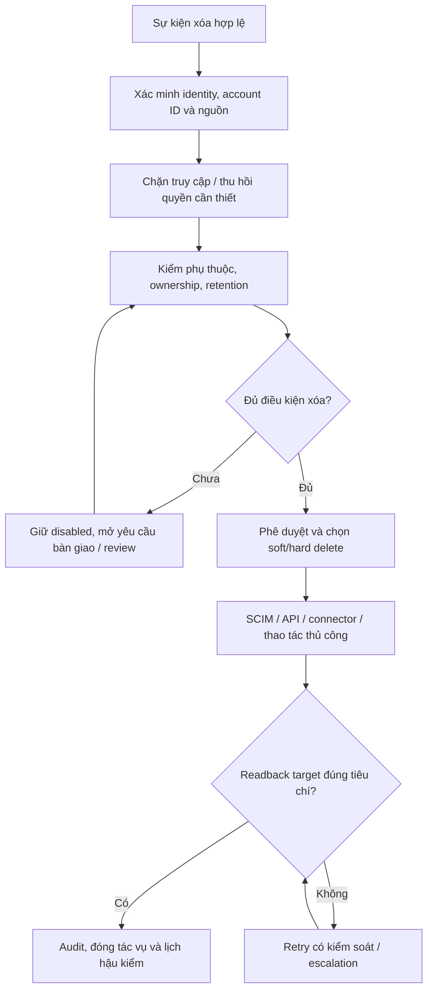
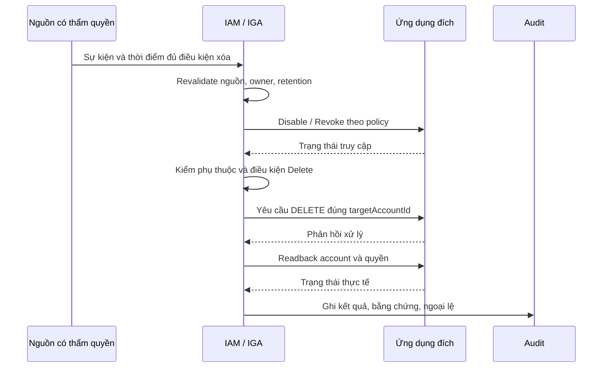

# Xóa account trong Account Deprovisioning (IAM)

Một nhân viên đã nghỉ việc, tài khoản trên Identity Provider (IdP) đã bị vô hiệu hóa, các nhóm quyền cũng đã được thu hồi. Vài tuần sau, nhóm vận hành muốn **xóa hẳn account** để không còn tài khoản cũ trên ứng dụng. Nhưng account đó có thể đang sở hữu tài liệu dự án, lịch chạy tự động, lịch sử phê duyệt hoặc bản ghi cần giữ để kiểm toán. Nếu xóa quá sớm, tổ chức có thể làm mất dữ liệu cần thiết; nếu giữ account hoạt động quá lâu, quyền truy cập tồn dư có thể tiếp tục tồn tại.

Trong **Account Deprovisioning**, **xóa account (account deletion)** là thao tác loại bỏ bản ghi tài khoản khỏi một hệ thống theo chính sách vòng đời, sau khi đã kiểm soát khả năng truy cập, xử lý các phụ thuộc và đáp ứng yêu cầu lưu giữ dữ liệu. Đây thường là một bước **sau khi ngăn truy cập và thu hồi quyền** trong giai đoạn **Leaver** của mô hình **Joiner–Mover–Leaver (JML)**. Tuy nhiên, có trường hợp account cần bị xóa để sửa lỗi cấp phát trùng hoặc kết thúc một tích hợp, không nhất thiết chỉ khi nhân viên nghỉ việc.

Bài học tập trung vào **khi nào nên xóa account, cần chuẩn bị gì, thực hiện bằng cách nào và xác minh ra sao**. Các ví dụ kết nối **IdP, SSO, SCIM, RBAC/ABAC, account đặc quyền, tài khoản dịch vụ, kiểm toán** và phương pháp giảm **quyền truy cập tồn dư (residual access)**.

## 1. Account deletion là gì?

**Account** là đối tượng do một hệ thống quản lý để nhận biết một chủ thể và liên kết chủ thể đó với trạng thái đăng nhập, quyền, tài nguyên hoặc lịch sử sử dụng. Một **identity tổ chức** có thể liên kết tới nhiều account: một account tại IdP, một account ở ứng dụng SaaS, một account nội bộ, một tài khoản quản trị riêng và các account có quyền theo môi trường.

**Xóa account** là thao tác khiến đối tượng account đích không còn tồn tại hoặc không còn được hiển thị như một đối tượng hoạt động theo hợp đồng của hệ thống. Tuy nhiên, từ “xóa” có thể mang ý nghĩa khác nhau tùy sản phẩm:

- **Hard delete:** loại bỏ đối tượng chính khỏi kho dữ liệu đang hoạt động theo hành vi sản phẩm; khả năng khôi phục và xử lý bản sao phụ thuộc chính sách hệ thống.
- **Soft delete:** đánh dấu đối tượng đã xóa hoặc đưa vào vùng giữ tạm, có thể khôi phục trong thời gian nhất định.
- **Scheduled deletion:** lên lịch xóa sau khoảng lưu giữ, hạn chờ khôi phục hoặc điều kiện bổ sung.
- **Logical deactivation:** chỉ vô hiệu hóa sử dụng account; đây là thao tác khác với xóa dù một số giao diện sản phẩm có thể gộp dưới nhãn “remove user”.

Không thể suy ra rằng **bấm Delete ở giao diện** đồng nghĩa mọi dữ liệu, phiên, token hoặc bản sao lưu đã biến mất ngay lập tức. Kết quả phải được hiểu theo **hợp đồng API và cơ chế lưu trữ thực tế** của hệ thống đó.

### 1.1. Phân biệt identity, account, quyền và dữ liệu

| Thành phần | Ý nghĩa | Khi xóa account cần lưu ý |
|---|---|---|
| **Identity tổ chức** | Bản ghi đại diện cho người, nhà thầu hoặc workload trong phạm vi IAM. | Có thể cần giữ identity, trạng thái và lịch sử để kiểm toán hoặc tái tuyển dụng. |
| **Account đích** | Đối tượng trên IdP, SaaS, hệ thống nội bộ hoặc cloud. | Là đối tượng được xóa theo từng hệ thống. |
| **Entitlement / role** | Quyền của account hoặc principal đối với tài nguyên. | Cần thu hồi hoặc xác minh không còn hiệu lực. |
| **Credential / token** | Bí mật hoặc chứng thực dùng để đăng nhập/gọi API. | Phải xử lý độc lập nếu vẫn được chấp nhận sau khi xóa account. |
| **Session** | Phiên truy cập đã mở. | Có thể tồn tại tới khi bị kết thúc hoặc hết hạn theo cơ chế hệ thống. |
| **Owned resource** | Tài liệu, khóa, repository, job, bản ghi hoặc cấu hình do account sở hữu. | Có thể cần bàn giao, giữ lại hoặc xóa theo chính sách riêng. |
| **Audit record** | Bằng chứng về truy cập và thay đổi. | Cần giữ đúng retention và quyền truy cập, tách khỏi quyền đăng nhập. |

Một account có thể bị xóa nhưng identity tổ chức vẫn ở trạng thái lưu trữ; điều này giúp biết ai từng truy cập hệ thống và đã được thu hồi những quyền gì. Ngược lại, xóa identity nguồn khi các account đích vẫn tồn tại có thể khiến tài khoản trở thành **orphan account** khó truy vết.

### 1.2. Xóa account khác gì khóa hoặc thu hồi quyền?

| Hành động | Mục tiêu chính | Có thể khôi phục? | Bảo đảm cần kiểm tra |
|---|---|---|---|
| **Disable / suspend account** | Chặn hoặc hạn chế việc sử dụng account theo cơ chế của hệ thống. | Thường có thể kích hoạt lại nếu chính sách cho phép. | Đăng nhập mới bị chặn; phiên/token cũ được xử lý riêng. |
| **Revoke entitlement** | Bỏ một quyền, nhóm, vai trò hoặc ủy quyền. | Có thể cấp lại theo quy trình. | Không còn effective access trái chính sách. |
| **Revoke credential/session** | Làm credential hoặc phiên không còn được chấp nhận. | Tùy loại; credential mới thường cần phát hành lại. | Target thực sự từ chối credential/phiên cũ. |
| **Delete account** | Loại đối tượng account khỏi hệ thống theo hợp đồng xóa. | Tùy hard/soft delete và thời hạn khôi phục. | Account không còn theo API/registry và không còn đường truy cập. |
| **Archive/retain records** | Giữ dữ liệu/hồ sơ có căn cứ mà không duy trì quyền. | Có quy trình truy xuất riêng. | Bằng chứng lưu giữ đúng chính sách, không kích hoạt lại account. |

**Tắt đăng nhập ngay** và **xóa đối tượng về sau** thường là hai mốc khác nhau. Trong Leaver khẩn cấp, không nên chờ đến thời gian được phép xóa dữ liệu mới chặn truy cập.

## 2. Khi nào nên xóa account?

Xóa account cần có **sự kiện nguồn đáng tin, chính sách hợp lệ và điều kiện hoàn tất**. Các tình huống phổ biến gồm:

1. **Leaver đã hoàn tất ngăn truy cập:** nhân viên hoặc nhà thầu rời tổ chức, account đích không còn cần phục vụ công việc, dữ liệu và tài nguyên đã được xử lý theo quy định.
2. **Account tạm thời hết hạn:** tài khoản cho thử nghiệm hoặc hợp tác ngắn hạn đã vượt thời hạn và không còn nhu cầu.
3. **Sửa account tạo nhầm hoặc bị trùng:** account không phải bản ghi chính được chọn; cần tránh nhầm với identity thật và chuyển dữ liệu nếu có.
4. **Ứng dụng hoặc tenant bị ngừng sử dụng:** các account chỉ thuộc phạm vi ứng dụng đó có thể được xóa theo quy trình đóng hệ thống.
5. **Service/workload ngừng hoạt động:** service account, principal hoặc bot không còn được workload nào sử dụng.
6. **Yêu cầu xóa dữ liệu hợp lệ:** chính sách bảo vệ dữ liệu hoặc quyền của chủ thể có thể yêu cầu xử lý account và dữ liệu liên quan trong phạm vi pháp luật áp dụng.

Mỗi tình huống có **quy trình phê duyệt, dữ liệu cần giữ và ràng buộc kỹ thuật** khác nhau. Không nên áp đặt quy tắc “nhân viên nghỉ là xóa tất cả ngay” cho mọi account, cũng không nên giữ mãi các account đã không còn chủ thể hợp lệ.

### 2.1. Đánh giá các điều kiện trước khi xóa

| Câu hỏi | Vì sao cần trả lời? |
|---|---|
| Danh tính đã hết tư cách sử dụng account này chưa? | Tránh xóa account của người đang hoạt động hoặc nhầm bản ghi. |
| Account có còn là đường truy cập hợp lệ cho workload/ứng dụng không? | Tránh làm gián đoạn tích hợp còn chạy. |
| Đã khóa, thu hồi quyền, phiên và credential liên quan chưa? | Giảm nguy cơ truy cập tồn dư trong thời gian chờ xóa. |
| Có tài nguyên hoặc dữ liệu do account sở hữu không? | Tránh mất tài liệu, lịch chạy, khóa quản trị và bản ghi nghiệp vụ. |
| Có yêu cầu lưu giữ hoặc tạm dừng xóa không? | Đáp ứng chính sách giữ hồ sơ, điều tra hoặc nghĩa vụ pháp lý. |
| Có thể khôi phục account hoặc dữ liệu nếu thao tác nhầm không? | Đánh giá tính không thể đảo ngược trước khi áp dụng. |
| Ai là người có thẩm quyền phê duyệt xóa? | Ngăn lạm dụng chức năng quản trị và kiểm soát SoD. |
| Làm sao chứng minh account đã bị xóa tại target? | Không nhầm phản hồi tiếp nhận lệnh với hoàn tất. |

**Tư cách nhân sự kết thúc** không tự quyết định **lịch xóa dữ liệu**. Tổ chức cần tách chính sách thu hồi truy cập khỏi lịch lưu giữ/xóa thông tin.

## 3. Xóa account trong vòng đời Joiner–Mover–Leaver

### 3.1. Joiner: chuẩn bị cho khả năng deprovision ngay từ khi tạo

Khi cấp account ban đầu, hệ thống nên ghi:

- **Identity nguồn** và khóa liên kết ổn định.
- **Target system**, định danh account tại target và phương thức provisioning.
- **Owner**, mục đích sử dụng, loại account, môi trường và ngày hiệu lực.
- **Các loại quyền** đã cấp, đường cấp và cơ chế thu hồi tương ứng.
- **Tài nguyên phụ thuộc** được tạo sau này và cách bàn giao.
- **Retention/deletion policy** áp dụng cho account và dữ liệu của target.

Nếu account được tạo mà không có chủ sở hữu, không có ánh xạ target ID hoặc không biết cách vô hiệu hóa, tới Leaver tổ chức sẽ khó thu hồi đầy đủ.

### 3.2. Mover: thường điều chỉnh quyền, chưa cần xóa account

Khi nhân viên chuyển phòng ban, IAM thường nên **tính lại quyền mục tiêu**, gỡ role/nhóm cũ và cấp role/nhóm mới. Xóa account có thể cần nếu người đó **không còn quyền sử dụng một ứng dụng riêng** của phòng ban cũ và chính sách yêu cầu dọn account sau thời gian chờ.

Ví dụ một nhân viên chuyển từ Support sang Finance:

- Giữ account IdP và danh tính tổ chức để tiếp tục làm việc.
- Gỡ quyền CRM không còn phù hợp.
- Cấp quyền báo cáo Finance theo phê duyệt.
- Nếu CRM chỉ phục vụ Support, **khóa và lên lịch xóa account CRM** khi dữ liệu/tài nguyên liên quan đã được xử lý.
- Đảm bảo session và credential của CRM bị thu hồi theo khả năng ứng dụng.

Vì vậy, Mover có thể kích hoạt deprovision **một số account đích**, nhưng không đồng nghĩa xóa mọi account của nhân viên.

### 3.3. Leaver: ngăn truy cập trước, dọn account theo chính sách

Một luồng Leaver có thể trải qua:

1. Nhận sự kiện kết thúc công tác có thẩm quyền.
2. Đến thời điểm hiệu lực, **vô hiệu hóa đăng nhập** và thu hồi quyền, phiên, token, credential ở những nơi cần thiết.
3. Xác minh đường truy cập đã bị chặn.
4. Bàn giao tài nguyên, lịch chạy, ownership và quyền quản trị.
5. Đánh giá retention, legal hold và các ngoại lệ theo chính sách.
6. Khi đủ điều kiện, gửi thao tác **xóa account** tới từng ứng dụng đích.
7. Đọc lại trạng thái, theo dõi lỗi và lưu bằng chứng.
8. Giữ lại các hồ sơ cần thiết một cách an toàn nhưng không duy trì quyền đăng nhập của người đã rời đi.

Sự kiện **Leaver** và sự kiện **DeleteEligible** nên được xem là các mốc khác nhau trong thiết kế nếu tổ chức có yêu cầu lưu giữ.

## 4. Xác định đúng account cần xóa

Rủi ro nghiêm trọng nhất của một lệnh Delete là **chọn sai đối tượng**. Một người có thể có nhiều account; một email có thể được dùng lại; và các ứng dụng có thể sử dụng ID khác nhau.

### 4.1. Mô hình ánh xạ

```text
Danh tính tổ chức: person-1045
    │
    ├── IdP account: idp-user-f75
    ├── SaaS CRM: crm-user-218
    ├── Cloud account: cloud-principal-a31
    └── Admin account: admin-user-1045

Ứng dụng đích dùng targetAccountId riêng,
IAM giữ liên kết person-1045 → targetAccountId.
```

Mọi thao tác xóa phải giải quyết đúng **target system + target account ID**. Không nên truy tìm rồi xóa account chỉ bằng tên hiển thị hoặc email trùng khớp, nhất là khi có account cũ, account mới, tài khoản quản trị riêng hoặc khách bên ngoài.

### 4.2. Ví dụ dữ liệu để lập lệnh xóa

```json
{
  "eventId": "offboard-2026-0421",
  "subjectId": "person-1045",
  "targetSystem": "crm-saas",
  "targetAccountId": "crm-user-218",
  "sourceStatus": "TERMINATED",
  "terminationEffectiveAt": "2026-12-15T17:00:00+07:00",
  "deleteEligibleAt": "2027-01-15T00:00:00+07:00",
  "deletePolicy": "crm-account-retention-v2",
  "requestedAction": "DELETE_ACCOUNT",
  "approvalReference": "approval-8102"
}
```

Đây là **schema minh họa**, không phải payload của API thực tế. Các ngày, chính sách và mã đều là dữ liệu giả. Trong triển khai, cần xác định nguồn có thẩm quyền cho `sourceStatus`, cách tính `deleteEligibleAt` và cách kiểm tra không có thay đổi mới khiến lệnh xóa trở nên sai.

### 4.3. Kiểm tra tái tuyển dụng và danh tính trùng

Giả sử một nhân viên nghỉ việc rồi quay lại trước khi account cũ được xóa. Job xóa chạy theo lịch cũ có thể xóa account đang được dùng cho lần làm việc mới nếu không kiểm tra lại trạng thái nguồn.

Trước khi áp dụng Delete cần:

- Đọc lại **trạng thái hiện hành** của identity và quan hệ công tác.
- Đối chiếu **phiên bản sự kiện/retention policy** với kế hoạch xóa đã lưu.
- Xác minh account đích vẫn ánh xạ đến đúng chủ thể và không được gán lại cho người khác.
- Dừng hoặc điều chỉnh kế hoạch nếu có **rehire, tái kích hoạt hoặc thay đổi owner** được phê duyệt.
- Tuyệt đối không tự khôi phục entitlement cũ cho người tái tuyển dụng chỉ vì account chưa bị xóa.

## 5. Kiểm kê các phụ thuộc trước khi xóa

Một account có thể là **chủ sở hữu tài nguyên** hoặc được tham chiếu trong nhiều luồng nghiệp vụ. Trước khi xóa, cần kiểm tra các phụ thuộc không thể giải quyết bằng cách chỉ gỡ nhóm quyền.

| Loại phụ thuộc | Ví dụ | Hành động cần cân nhắc |
|---|---|---|
| **Tệp và tài liệu** | Thư mục chung, tài liệu do người dùng sở hữu. | Chuyển owner hoặc lưu trữ đúng policy trước khi xóa account. |
| **Repository và dự án** | Repository cá nhân nhưng được dùng bởi dự án. | Chuyển owner, khóa nhánh, phân quyền lại người duy trì. |
| **Lịch chạy và automation** | Job được cấu hình chạy với user token. | Thay cơ chế chứng thực bằng workload identity phù hợp. |
| **Ứng dụng và tài nguyên cloud** | Project, dashboard, subscription hoặc resource phụ thuộc principal. | Kiểm tra quyền quản lý sau khi xóa; bàn giao ownership. |
| **Phê duyệt và workflow** | Yêu cầu đang chờ quản lý hoặc account cũ duyệt. | Định tuyến lại theo approver có thẩm quyền. |
| **Email/lịch làm việc** | Hộp thư hoặc lịch chứa thông tin cần bàn giao. | Xử lý theo yêu cầu lưu giữ và quyền riêng tư. |
| **Tài khoản kỹ thuật liên quan** | Service account do nhân viên từng quản lý. | Chuyển owner; thu hồi quyền cá nhân; đánh giá secret. |
| **Nhật ký và hồ sơ giao dịch** | Dấu vết ai đã tạo, phê duyệt hay sửa dữ liệu. | Giữ audit theo chính sách bằng ID ổn định. |
| **Khóa và chứng chỉ** | SSH key, API key hoặc certificate phát hành dưới account. | Revoke hoặc rotate khi cần; kiểm tra đường truy cập thực tế. |

Không nên vì tài nguyên chưa được bàn giao mà **giữ quyền đăng nhập của Leaver**. Có thể khóa account trước, duy trì dữ liệu ở trạng thái được bảo vệ trong thời gian bàn giao và chỉ xóa đối tượng sau khi thỏa điều kiện.

### 5.1. Tài nguyên cần giữ khác với quyền cá nhân cần giữ

Một tài liệu do người rời đi tạo có thể còn là tài sản nghiệp vụ cần thiết. Dữ liệu có thể được chuyển quyền quản lý sang người khác theo chính sách, nhưng điều đó **không yêu cầu giữ account cũ hoạt động**.

Tương tự, một account ứng dụng có thể là owner của một tích hợp. Trước khi xóa account, hãy xác định cách chuyển ownership hoặc tái cấu hình tích hợp, không âm thầm làm hỏng tiến trình sản xuất.

## 6. Chính sách lưu giữ, xóa dữ liệu và tính không thể đảo ngược

### 6.1. Retention và legal hold

Không phải mọi dữ liệu gắn với account đều được xóa tại cùng thời điểm. Một số bản ghi có thể phải giữ để đáp ứng chính sách kế toán, kiểm toán, an toàn, điều tra hoặc yêu cầu pháp lý. Có tình huống **legal hold** tạm dừng việc xóa những dữ liệu thuộc phạm vi bảo toàn.

Doanh nghiệp cần phân biệt:

- **Thời điểm ngăn truy cập:** khi chủ thể không còn tư cách sử dụng.
- **Thời điểm account đủ điều kiện xóa:** sau kiểm tra phụ thuộc và chính sách.
- **Thời điểm dữ liệu được xóa/ẩn danh:** theo loại dữ liệu, hệ thống và căn cứ lưu giữ.
- **Thời điểm bản sao lưu hết hạn:** phụ thuộc chu kỳ backup và chính sách khôi phục.
- **Thời hạn giữ audit:** có thể khác thời hạn tồn tại của account hoạt động.

Một lệnh Delete account không tự xóa mọi dấu vết trong backup, hệ thống sao chép hoặc nhật ký. Khi xử lý yêu cầu xóa dữ liệu cá nhân, phải xác định **phạm vi dữ liệu**, các ngoại lệ lưu giữ hợp lệ và cơ chế thực thi trên từng hệ thống theo pháp luật áp dụng.

### 6.2. Soft delete, hard delete và khôi phục

| Cơ chế | Hành vi điển hình | Điều phải làm rõ |
|---|---|---|
| **Disable** | Account vẫn tồn tại nhưng bị chặn sử dụng. | Phiên/token cũ và tài khoản cục bộ có bị chặn không? |
| **Soft delete** | Account chuyển sang trạng thái hoặc vùng đã xóa. | Có thể khôi phục trong bao lâu và quyền có quay lại không? |
| **Hard delete** | Đối tượng bị loại khỏi kho tài khoản đang hoạt động. | Dữ liệu, backup, audit và liên kết ngoài còn ở đâu? |
| **Tombstone** | Giữ dấu vết kỹ thuật tối thiểu rằng account đã bị xóa. | Mục đích, dữ liệu giữ lại và thời hạn. |
| **Anonymization** | Bỏ hoặc biến đổi thông tin nhận dạng theo phương pháp được phê duyệt. | Đã thực sự đạt mục tiêu bảo vệ dữ liệu hay chỉ đổi tên hiển thị? |

Trong một số ứng dụng, xóa account có thể kéo theo xóa tài nguyên hoặc chuyển chúng sang trạng thái “owner unknown”. Phải hiểu hành vi của từng sản phẩm trước khi gọi API.

### 6.3. Phương án khôi phục khi xóa nhầm

Nếu account còn trong thời gian soft-delete, việc khôi phục có thể khả thi; nhưng **khôi phục account không đồng nghĩa được tự động khôi phục mọi quyền cũ**. Quy trình cần xác minh danh tính, lý do, phê duyệt và quyền mục tiêu hiện hành.

Với hard delete không thể đảo ngược, phương án khôi phục có thể chỉ là **tạo account mới và phục hồi dữ liệu hợp lệ từ nguồn/backup**, không thể bảo đảm khôi phục toàn bộ identity kỹ thuật cũ. Trước khi xóa phải biết rõ rủi ro này.

## 7. Workflow xóa account an toàn

Một quy trình có thể gồm các giai đoạn từ xác minh đến đóng kết quả.

### Bước 1 — Nhận trigger có thẩm quyền

Nhận sự kiện Leaver, account hết hạn, ứng dụng ngừng sử dụng hoặc quyết định xóa hợp lệ. Ghi mã sự kiện, chủ thể, nguồn, thời điểm và loại thao tác. Không cho phép một request không xác thực chỉ định tùy ý ID account cần xóa.

### Bước 2 — Xác minh account đích

Ánh xạ identity nguồn sang account trong ứng dụng. Đọc lại trạng thái hiện hành để chắc chắn account vẫn thuộc đúng chủ thể; kiểm tra trùng hoặc việc account đã được chuyển owner.

### Bước 3 — Bảo đảm truy cập đã bị chặn

Nếu sự kiện đã làm mất tư cách truy cập, vô hiệu hóa đăng nhập, thu hồi quyền đặc biệt, group, phiên và credential có thể thu hồi. Không chờ lịch xóa dữ liệu rồi mới thực hiện bước này.

### Bước 4 — Thu thập phụ thuộc và điều kiện retention

Liệt kê tài nguyên do account sở hữu, các yêu cầu đang chờ, dữ liệu phải giữ, legal hold và yêu cầu bàn giao. Đánh giá rủi ro xóa không thể đảo ngược.

### Bước 5 — Tạo quyết định và phê duyệt

Dựa trên policy và owner có thẩm quyền, xác định nên giữ ở trạng thái disabled, soft delete, hard delete hay xử lý thủ công. Với tài khoản nhạy cảm, yêu cầu sự tách biệt giữa người đề nghị, người thực hiện và người xác minh khi chính sách quy định.

### Bước 6 — Thực hiện theo hợp đồng hệ thống đích

Dùng SCIM, API riêng, connector hoặc tác vụ quản trị thủ công để xóa **đúng account ID**. Ghi nhận mã request và kết quả. Đối với ứng dụng không cho xóa ngay vì dữ liệu phụ thuộc, theo dõi kế hoạch và owner thay vì ép thao tác gây mất dữ liệu.

### Bước 7 — Readback và đối soát

Truy vấn lại account đích, kiểm tra trạng thái xóa theo hợp đồng của hệ thống, cùng khả năng đăng nhập và đường quyền còn tồn tại. Kết quả API 200/204 chỉ chứng minh một bước của quy trình, không thay thế mọi kiểm tra cần thiết.

### Bước 8 — Lưu audit và đóng tác vụ

Lưu bằng chứng, phiên bản policy, kết quả từng hệ thống, tài nguyên đã bàn giao và ngoại lệ. Đặt lịch kiểm tra lại khi xóa bất đồng bộ hoặc có thời hạn soft-delete.

### 7.1. Sơ đồ trạng thái



Sơ đồ là **mô hình nghiệp vụ minh họa**. Trong các ca Leaver khẩn cấp, bước chặn truy cập có thể cần thực hiện song song và ưu tiên ngay khi sự kiện có hiệu lực, trong khi bàn giao và xóa account diễn ra về sau.

## 8. Xóa account qua IdP, SCIM và các connector

### 8.1. IdP và SSO

IdP thường là một nguồn quan trọng cho việc xác thực, tài khoản liên kết và nhóm. **Single Sign-On (SSO)** cho phép ứng dụng tin cậy kết quả xác thực từ IdP qua giao thức như SAML hoặc OpenID Connect (OIDC).

Khi account IdP bị xóa:

- Ứng dụng SSO có thể không cho tạo phiên đăng nhập mới qua IdP đó.
- Các **phiên đã mở** ở ứng dụng có thể tiếp tục tồn tại tùy thời hạn/cơ chế.
- Các ứng dụng có **tài khoản local** có thể vẫn cho đăng nhập trực tiếp.
- Quyền hoặc account được cấp qua SCIM/API có thể vẫn tồn tại tới khi quy trình deprovision xử lý.
- Secret, API key hoặc token cấp từ hệ thống khác có thể vẫn cần thu hồi riêng.

Do đó **xóa tài khoản tại IdP không thay thế quy trình xử lý từng account đích**. Trước khi xóa chính account IdP, nên đảm bảo còn dữ liệu ánh xạ để xác định các target cần xử lý; tránh mất dấu tài khoản còn tồn tại.

### 8.2. SCIM DELETE là thao tác gì?

**System for Cross-domain Identity Management (SCIM)** cung cấp API quản lý các tài nguyên chuẩn như User và Group ở hệ thống hỗ trợ. Với một tài nguyên User xác định, SCIM 2.0 có thao tác **DELETE** trên đường dẫn tài nguyên.

Ví dụ HTTP mang tính minh họa:

```http
DELETE /scim/v2/Users/scim-user-218 HTTP/1.1
Host: example.invalid
Authorization: Bearer <access-token>
```

Khi xử lý thành công theo SCIM, server thường phản hồi **`204 No Content`**. Một lần GET hoặc thao tác truy vấn theo ID sau khi đã xóa có thể cho biết tài nguyên không còn được tìm thấy, chẳng hạn `404 Not Found`, theo hành vi SCIM. Dù vậy cần tuân thủ **hợp đồng và tài liệu triển khai thực tế** của SCIM provider; một số sản phẩm có cơ chế soft-delete, đồng bộ chậm hoặc trạng thái lưu trữ riêng.

**Quan trọng:** ID trong `/Users/{id}` phải là **ID tài nguyên SCIM tại ứng dụng đích**, không mặc định là employeeId hoặc email từ HRIS. Một lệnh DELETE nhầm ID có thể xóa account của người khác.

### 8.3. SCIM active=false không đồng nghĩa DELETE

Trong SCIM, thuộc tính `active` có thể biểu thị việc User đang được xem là hoạt động hay không, tùy tính năng hỗ trợ. Cập nhật User thành `active=false` là một kiểu **thay đổi trạng thái**; nó khác với gọi DELETE để xóa tài nguyên.

| Lệnh/biện pháp | Mục tiêu | Điều còn phải kiểm tra |
|---|---|---|
| Cập nhật `active=false` | Vô hiệu hóa User trong ứng dụng hỗ trợ. | Cách ứng dụng xử lý đăng nhập, phiên, quyền và dữ liệu. |
| Gỡ membership Group | Thu hồi các quyền được cấp qua nhóm. | Role trực tiếp/nhóm khác có giữ quyền không? |
| DELETE User | Xóa tài nguyên User theo SCIM/server. | Tài nguyên, soft-delete, account cục bộ, log và token có còn không? |
| Xóa một User trực tiếp trong UI target | Thực hiện thay đổi không qua nguồn provisioning. | Connector có tự tạo lại khi đồng bộ không? |
| Ngừng đồng bộ từ IdP | Dừng hoặc thay đổi provisioning tùy chính sách. | Account đích đã bị khóa/xóa hay vẫn giữ nguyên? |

**SCIM không phải giao thức quản lý mọi loại secret, session hoặc token.** Nếu account có khóa API hoặc quyền nội bộ nằm ngoài vùng quản lý SCIM, tổ chức cần API, connector hoặc tác vụ riêng để xử lý.

### 8.4. Thứ tự xóa giữa IdP và ứng dụng

Không nên áp dụng một thứ tự duy nhất cho mọi hệ thống. Một nguyên tắc hữu ích là:

1. Ngăn đường truy cập có rủi ro ở thời điểm hiệu lực.
2. Giữ được **bản đồ identity ↔ target account** trong registry/audit.
3. Thu hồi quyền và xử lý các phụ thuộc theo từng ứng dụng.
4. Xóa target account theo chính sách.
5. Chỉ xóa bản ghi nguồn quản lý hoặc account trung tâm khi vẫn bảo đảm đối soát và điều kiện retention.

Trong thực tế, connector có thể tự động xóa các target sau khi một nguồn thay đổi. Cần hiểu rõ hành vi này và bảo vệ dữ liệu liên quan trước khi chạy hàng loạt.

### 8.5. API riêng và ứng dụng không hỗ trợ xóa

Một số ứng dụng chỉ cho **disable** vì bản ghi giao dịch tham chiếu trực tiếp tới account; một số khác chỉ có API quản trị riêng hoặc giao diện thao tác thủ công.

Trong trường hợp không hỗ trợ xóa, tổ chức có thể dùng trạng thái disabled, ẩn khỏi giao diện hoạt động hoặc bảo toàn bản ghi theo cơ chế hợp lệ. Tác vụ cần ghi rõ **khả năng sản phẩm, trạng thái đã đạt và việc chưa thể xóa**, không gắn nhãn hoàn tất xóa nếu thực tế chưa có thao tác tương ứng.

## 9. RBAC, ABAC và quyền đặc biệt sau khi xóa

### 9.1. Quyền theo vai trò (RBAC)

**Role-Based Access Control (RBAC)** có thể cấp quyền thông qua role trực tiếp, nhóm hoặc nhóm lồng nhau. Khi account bị xóa, phải kiểm tra các grant liên quan có thực sự bị loại bỏ theo hành vi target hay không.

Ví dụ:

```text
person-1045
  ├── IdP group: operations
  │     └── Role: reports.read
  ├── Target direct role: billing-admin
  └── App-local account: legacy-admin-1045
```

Xóa User ở ứng dụng báo cáo **không tự chứng minh** role `billing-admin` của một ứng dụng khác hoặc account `legacy-admin-1045` đã bị thu hồi.

### 9.2. Thuộc tính và ngữ cảnh (ABAC)

**Attribute-Based Access Control (ABAC)** dùng trạng thái identity, đơn vị, vai trò, phạm vi tài nguyên và context để ra quyết định. Một account đã xóa có thể vẫn tồn tại dưới dạng subject claim trong token cũ, tùy cơ chế.

Ví dụ policy:

```text
allow request khi:
    subject.lifecycleState == ACTIVE
    AND account.isEnabled
    AND resource.ownerDepartment == subject.department
    AND request đáp ứng điều kiện xác thực
```

Đây là **pseudocode**, không phải cú pháp chính sách chuẩn. Nếu resource server chỉ dựa vào token tự chứa còn hạn mà không kiểm tra trạng thái hiện hành, thao tác xóa account ở nguồn có thể **chưa đủ để chặn token tức thì**. Cần xem xét TTL, revoke, introspection hoặc policy tại target theo khả năng triển khai.

### 9.3. Tài khoản quản trị cần được kiểm tra kỹ hơn

Với Administrator, trước khi xóa cần xem cả:

- Account quản trị riêng và group/role admin.
- **Privileged Access Management (PAM)** và khả năng nâng quyền **Just-in-Time (JIT)**.
- Role **eligible** trong hệ thống quản lý danh tính đặc quyền, kể cả khi hiện chưa active.
- Session console, SSH, VPN, bastion và khóa truy cập.
- Quyền sửa chính sách, gán role, trust hoặc secret để **tự nâng quyền gián tiếp**.
- Tài khoản break-glass được quản trị riêng và cơ chế bàn giao.

Không nên xóa account break-glass của cả tổ chức chỉ vì một custodian nghỉ việc. Phải thu hồi **quyền sử dụng cá nhân** của người đó, thay credential nếu cần và duy trì phương án phục hồi hợp lệ.

## 10. Xóa account thuộc về workload và service account

**Service account, bot, workload identity hoặc CI/CD principal** cũng có vòng đời, nhưng sự kiện nguồn có thể là **ngừng ứng dụng, hủy pipeline hoặc thay đổi tích hợp**, không phải HRIS Leaver.

### 10.1. Vì sao không được tự xóa khi owner nghỉ việc?

Một nhân viên từng tạo service account `svc-payment-sync`. Khi nhân viên nghỉ, quy trình nên:

1. Thu hồi quyền cá nhân của nhân viên đối với bí mật và tài khoản kỹ thuật.
2. Kiểm tra service account đang phục vụ workload nào.
3. Chuyển **owner team** và người chịu trách nhiệm tới đội phù hợp.
4. Đánh giá credential mà người rời đi từng có thể truy xuất; xoay vòng khi cần.
5. Kiểm tra quyền của service account có còn đúng mục đích workload không.
6. Chỉ xóa service account nếu workload đã ngừng hoặc không còn cần danh tính đó.

Việc xóa ngay account dịch vụ đang chạy có thể làm hỏng thanh toán, backup, đồng bộ dữ liệu hoặc triển khai production. Ngược lại, giữ mãi account của một workload đã bị hủy tạo **orphan machine identity**.

### 10.2. Luồng xóa service account khi workload đã ngừng

| Bước | Kiểm tra |
|---|---|
| Xác minh workload decommission | Có quyết định nguồn đáng tin và chủ sở hữu chịu trách nhiệm. |
| Kiểm tra phụ thuộc | Cron job, container, API, secrets, integration có còn dùng principal không? |
| Chặn cấp credential mới | Không cho workload cũ nhận token hoặc cert mới. |
| Thu hồi quyền | Gỡ role, policy, binding, trust và grant trực tiếp. |
| Thu hồi bí mật/credential | API key, client secret, khóa SSH, certificate; xác minh bản cũ bị chặn. |
| Xóa account/principal | Thực hiện qua IAM hoặc API theo target ID đúng. |
| Đối soát | Principal không còn, ứng dụng còn hoạt động không bị lỗi ngoài dự kiến. |
| Lưu bằng chứng | Owner, lý do, thời điểm, kết quả và ngoại lệ. |

Tài khoản máy nên có **inventory, owner, purpose, môi trường, hạn review và cách decommission** ngay từ khi được tạo.

## 11. Xử lý lỗi, sự kiện trùng và xóa nhầm

### 11.1. Idempotency

Các workflow có thể nhận cùng sự kiện nhiều lần. Nếu Delete đã thành công, lệnh chạy lại có thể trả về trạng thái **không tìm thấy tài nguyên**.

Đây **có thể** là kết quả phù hợp với trạng thái mục tiêu, nhưng phải dựa trên bối cảnh:

- Lệnh đầu có từng được gửi tới **đúng target account** không?
- Có bằng chứng lần xóa trước đã được thực thi không?
- Account hiện không tồn tại hay chỉ bị ẩn do lỗi quyền/API?
- Có account mới nào dùng lại cùng tên nhưng mang ID khác không?

**Không nên coi mọi 404 là xóa thành công**: 404 cũng có thể do sai ID hoặc target không hỗ trợ truy vấn như kỳ vọng. Cần kết hợp ID ổn định, nhật ký request và readback theo hợp đồng.

### 11.2. Sự kiện đến sai thứ tự

Ví dụ:

- 01/12: HRIS phát sự kiện Leaver.
- 05/12: người đó được tái tuyển dụng theo một quyết định mới, identity được kích hoạt theo chính sách.
- 10/12: job xóa cũ chạy theo lịch không kiểm tra lại trạng thái.
- Kết quả: account đang phục vụ công việc mới bị xóa nhầm.

Giải pháp là **revalidate trước DELETE**: đọc trạng thái hiện hành, phiên bản nguồn, target account mapping, thời điểm đủ điều kiện và các điều kiện chính sách. Đừng tin rằng một tác vụ đã lên lịch từ vài tuần trước vẫn đúng ở thời điểm thực thi.

### 11.3. Quy trình có thể xử lý lại an toàn

```text
deleteAccountWhenEligible(job):
    verifyTrustedJobAndActor(job)

    current = fetchAuthoritativeState(job.subjectId)
    target = resolveTargetAccount(job.targetSystem, job.targetAccountId)

    if current does not authorize deletion:
        recordPolicyBlock(job)
        return

    if target is ambiguous or reassigned:
        escalateForReview(job)
        return

    ensureAccessBlocked(target)

    if retentionHoldExists(target) or dependenciesNotTransferred(target):
        markPendingWithOwner(job)
        return

    result = executeTargetDeleteIdempotently(target)
    actual = readTargetAccountAndAccessState(target)

    if actual satisfies deletionPolicy:
        recordVerifiedDeletion(job, result, actual)
    else:
        scheduleControlledRetryOrEscalation(job)
```

Đây là **pseudocode minh họa**, không phải triển khai có thể dùng trực tiếp. Hệ thống thật còn cần transaction/concurrency control, version check hoặc khóa theo account để tránh việc một luồng đang tạo lại account trong lúc luồng khác xóa.

### 11.4. Không tự rollback bằng cách mở lại quyền đã hết hiệu lực

Nếu thao tác xóa target A thành công nhưng target B thất bại, không nên khôi phục account của người Leaver tại A chỉ để “giữ nhất quán” khi không còn cơ sở truy cập hợp lệ.

Thay vào đó, theo dõi **kết quả theo từng target**, retry hoặc xử lý thủ công tại B, và bảo toàn bằng chứng. Nếu xóa nhầm một account của người đang hoạt động, phải dùng quy trình khôi phục có phê duyệt với **quyền mục tiêu hiện tại**.

## 12. Readback: làm sao chứng minh đã xóa account?

Một tác vụ Delete chỉ được xem là hoàn thành theo **tiêu chí kiểm chứng của từng hệ thống**.

### 12.1. Bằng chứng kỹ thuật

Có thể cần:

- **Kết quả thao tác:** mã request, phản hồi API, thời điểm và target đã nhận lệnh.
- **Trạng thái tài nguyên:** truy vấn bằng ID xác nhận account không còn ở phạm vi hoạt động theo hợp đồng.
- **Trạng thái truy cập:** đường đăng nhập, session, token hoặc quyền hiệu lực không còn cho phép truy cập trái chính sách.
- **Quyền/khoá liên quan:** role, group, direct grant, API key hoặc SSH key còn sót đã được xử lý.
- **Tài nguyên phụ thuộc:** owner mới, lịch chạy và dữ liệu cần giữ đã được bàn giao.
- **Ngoại lệ lưu trữ:** những bản sao/hồ sơ được giữ có căn cứ và nằm ngoài đường đăng nhập thông thường.
- **Chỉ số hậu kiểm:** không xuất hiện account được tự tạo lại bởi connector sau xóa.

Đối với soft delete, trạng thái cần xác minh là **đã vào trạng thái xóa phù hợp chính sách**, đồng thời xác định khi nào việc xóa tiếp theo xảy ra.

### 12.2. Trạng thái công việc gợi ý

| Trạng thái | Ý nghĩa |
|---|---|
| `ACCESS_BLOCKED` | Đã chặn đường truy cập yêu cầu, đang chờ điều kiện xóa. |
| `RETENTION_HOLD` | Chưa được xóa vì yêu cầu giữ dữ liệu/bằng chứng. |
| `TRANSFER_PENDING` | Chưa bàn giao xong tài nguyên phụ thuộc. |
| `DELETE_SCHEDULED` | Đã lên lịch xóa theo thời điểm hợp lệ. |
| `DELETE_REQUESTED` | Đã gửi lệnh xóa, chưa đủ bằng chứng hoàn tất. |
| `SOFT_DELETED` | Account đang trong trạng thái soft delete đã kiểm chứng. |
| `DELETION_VERIFIED` | Readback đạt tiêu chí xóa theo policy của target. |
| `MANUAL_ACTION_REQUIRED` | Target cần người xử lý hoặc không hỗ trợ API phù hợp. |
| `FAILED_RETRYABLE` | Lỗi có thể thử lại có kiểm soát. |

Các trạng thái trên là **đề xuất mô hình**, không phải chuẩn dùng chung. Không nên gắn `DELETION_VERIFIED` khi chỉ có bằng chứng đã gửi lệnh.

### 12.3. Sơ đồ đối soát



Nếu ứng dụng xóa bất đồng bộ, phải có mốc kiểm tra lại và cơ chế xử lý khi tài nguyên còn xuất hiện sau thời hạn dự kiến.

## 13. Ví dụ xuyên suốt: xóa account SaaS sau Leaver

Giả sử nhân viên Linh nghỉ việc từ **17:00 ngày 15/12/2026**. Linh có account IdP và account của một ứng dụng quản lý dự án. Account SaaS sở hữu 12 tài liệu nhóm và là người phê duyệt của 3 yêu cầu đang chờ.

### 13.1. Trạng thái ban đầu

```yaml
identityId: person-linh
lifecycleState: TERMINATED
effectiveAt: "2026-12-15T17:00:00+07:00"
accounts:
  - system: central-idp
    targetAccountId: idp-user-1045
    accessState: DISABLED
  - system: project-saas
    targetAccountId: saas-user-218
    accessState: DISABLED
    ownsResources: true
    pendingApprovals: 3
    deletionState: NOT_ELIGIBLE
```

YAML là dữ liệu minh họa. Mốc xóa SaaS phải được xác định từ policy và tình trạng phụ thuộc, không suy ra từ ngày nghỉ việc một cách máy móc.

### 13.2. Phân tích trước xóa

| Hạng mục | Tình trạng | Hành động |
|---|---|---|
| Đăng nhập IdP | Đã disabled. | Kiểm tra thêm phiên và app-local login theo khả năng. |
| Role/nhóm SaaS | Đã thu hồi quyền. | Readback effective access. |
| Tài liệu dự án | Còn 12 tài liệu thuộc account. | Resource owner quyết định chuyển quyền sở hữu hoặc lưu giữ. |
| Yêu cầu phê duyệt | 3 yêu cầu đang chờ. | Chuyển tới approver có thẩm quyền, giữ audit người duyệt cũ. |
| Quy định lưu giữ | Có thời hạn chờ theo policy nội bộ. | Lên lịch xóa sau khi đáp ứng điều kiện. |
| Token API cá nhân | Còn một token đã phát hành. | Thu hồi tại SaaS nếu được hỗ trợ; xác minh không còn được chấp nhận. |
| Lịch sử hoạt động | Cần cho audit. | Lưu bằng chứng theo chính sách, không duy trì truy cập. |

### 13.3. Thực hiện và xác minh

Quy trình có thể chạy như sau:

1. IAM tiếp tục giữ cả account IdP và SaaS ở trạng thái không thể đăng nhập.
2. Chủ dự án chuyển 12 tài liệu sang owner được phê duyệt.
3. Workflow chuyển 3 yêu cầu chờ sang người có thẩm quyền sau khi kiểm tra chính sách và SoD.
4. Hệ thống xác minh token/phiên cá nhân đã bị chặn.
5. Khi hết thời hạn giữ tài khoản và không có hold khác, IAM kiểm tra lại identity nguồn và target ID.
6. Connector thực hiện thao tác xóa tương ứng với khả năng SaaS.
7. IAM đọc lại account và quyền, ghi trạng thái `DELETION_VERIFIED` hoặc ngoại lệ nếu chưa đạt.
8. Audit vẫn lưu được identity, nguồn sự kiện và kết quả theo policy.

**Kết quả mong muốn:** account SaaS không còn là đường truy cập cho Linh; dự án vẫn giữ được dữ liệu hợp lệ; log không mất khả năng truy vết; không còn role/token cá nhân ngoài chính sách.

### 13.4. Khi nhân viên quay lại trước thời điểm xóa

Nếu Linh tái tuyển dụng trước khi lệnh Delete SaaS được thực thi, IAM phải kiểm tra lại trạng thái và quyết định **hủy, hoãn hoặc điều chỉnh kế hoạch xóa** theo chính sách. Không được áp dụng job cũ chỉ vì nó đã vào hàng đợi. Quyền truy cập cho lần làm việc mới cần được tính lại, không mặc định khôi phục role cũ.

## 14. Xóa account của nhà thầu và tài khoản tạm thời

Với nhà thầu, thời điểm kết thúc hợp đồng có thể là một thuộc tính rất quan trọng. Quy trình nên:

- Xác minh hợp đồng và sponsor từ nguồn có thẩm quyền.
- Hết hạn thì thu hồi quyền và ngăn đăng nhập đúng thời điểm.
- Bàn giao tài nguyên hoặc deliverable cho người bảo trợ/tài nguyên chủ sở hữu.
- Giữ hồ sơ cần thiết về công việc và phê duyệt theo retention.
- Xóa các account target theo điều kiện riêng, không chỉ theo ngày hết hạn ghi trên profile.
- Đánh giá gia hạn hoặc hợp đồng tiếp theo để không xóa nhầm account đang được tái sử dụng hợp lệ.

Tài khoản khách, đối tác và người dùng bên ngoài có thể không có hồ sơ HRIS. Nguồn authority có thể là **hệ thống hợp đồng, lời mời được quản lý hoặc owner của ứng dụng**. Không nên đòi cùng tập thuộc tính của nhân viên rồi tự tạo dữ liệu giả để vượt validation.

## 15. Kiểm toán và chỉ số đánh giá chất lượng account deletion

### 15.1. Nhật ký tối thiểu

Một audit record xóa account có thể bao gồm:

```json
{
  "eventId": "account-delete-00519",
  "sourceEventId": "offboard-2026-0421",
  "subjectId": "person-1045",
  "targetSystem": "crm-saas",
  "targetAccountId": "crm-user-218",
  "policyVersion": "crm-retention-v2",
  "requestedAt": "2027-01-15T09:00:00+07:00",
  "requestedAction": "DELETE_ACCOUNT",
  "requestStatus": "APPLIED",
  "verification": {
    "status": "DELETION_VERIFIED",
    "checkedAt": "2027-01-15T09:05:00+07:00"
  }
}
```

Dữ liệu minh họa này cố tình không chứa access token, mật khẩu hoặc bí mật. Trong thực tế, có thể lưu tham chiếu phê duyệt, kết quả bàn giao, tình trạng legal hold và bằng chứng readback, nhưng cần tránh lưu thông tin cá nhân quá mức hoặc secrets vào log.

### 15.2. Chỉ số vận hành

| Chỉ số | Câu hỏi cần trả lời |
|---|---|
| **Access-block latency** | Từ khi Leaver có hiệu lực đến khi mọi đường truy cập cần thiết bị chặn mất bao lâu? |
| **Deletion eligibility latency** | Từ khi ngừng truy cập đến khi account đủ điều kiện xóa mất bao lâu? |
| **Deletion verification rate** | Bao nhiêu lệnh xóa có readback đạt tiêu chí target? |
| **Residual account count** | Bao nhiêu account đáng lẽ đã deprovision nhưng vẫn tồn tại ngoài policy? |
| **Orphan account count** | Có bao nhiêu account không còn liên kết với identity/owner hợp lệ? |
| **Retention hold backlog** | Bao nhiêu account chưa thể xóa và có owner/hạn theo dõi không? |
| **Ownership transfer completion** | Bao nhiêu tài nguyên phụ thuộc đã bàn giao đúng trước khi xóa? |
| **Post-delete recreation rate** | Có bao nhiêu account bị connector tạo lại sau khi xóa vì nguồn đồng bộ còn active? |
| **Privileged residual access** | Có account/token/role admin nào còn hiệu lực sau khi phải thu hồi? |
| **Manual deletion overdue** | Bao nhiêu hệ thống không hỗ trợ API đang có tác vụ xóa quá hạn? |

**Không dùng số lượng account đã xóa làm chỉ số duy nhất.** Một hệ thống xóa nhanh nhưng gây mất dữ liệu hoặc để lại token có quyền cao không phải là quy trình deprovision tốt.

## 16. Những sai lầm thường gặp

| Sai lầm | Hậu quả | Hướng khắc phục |
|---|---|---|
| Xóa account ngay khi nhận Leaver mà không kiểm tra dữ liệu phụ thuộc. | Mất tài liệu, ownership, lịch chạy hoặc workflow đang chờ. | Chặn truy cập trước, bàn giao và kiểm tra retention trước Delete. |
| Đồng nhất `active=false` với DELETE. | Báo xóa thành công khi account vẫn tồn tại. | Định nghĩa rõ disable, soft delete, hard delete và tiêu chí readback. |
| Tin xóa IdP sẽ xóa mọi SaaS account. | Tài khoản và quyền ở target vẫn còn. | Kiểm kê liên kết, provisioning và deprovision từng target. |
| Xóa theo email/tên hiển thị. | Có thể xóa nhầm người trùng tên hoặc email được cấp lại. | Dùng subjectId và targetAccountId ổn định. |
| Không xử lý token và phiên trước khi xóa. | Access token đã phát hành hoặc session có thể còn hiệu lực. | Revoke/session control và kiểm tra tại target. |
| Xóa identity nguồn trước khi tìm hết account đích. | Mất liên kết, tạo orphan accounts. | Giữ ánh xạ phục vụ đối soát và audit. |
| Không kiểm tra thay đổi từ khi lên lịch xóa. | Xóa account đã tái kích hoạt hoặc đổi owner. | Revalidate nguồn và mapping ngay trước DELETE. |
| Không kiểm tra legal hold và retention. | Xóa dữ liệu phải lưu; khó phục hồi, vi phạm chính sách. | Kiểm tra điều kiện xóa, phân quyền và phê duyệt. |
| Chỉ nhìn phản hồi API thành công. | Lệnh chưa được áp dụng hoặc xóa bất đồng bộ chưa hoàn tất. | Readback, retry và theo dõi kết quả. |
| Tự xóa service account khi người tạo nghỉ việc. | Gián đoạn workload sản xuất. | Chuyển owner, thu hồi quyền cá nhân, đánh giá dịch vụ. |
| Xóa account nhưng để connector tạo lại. | Account quay trở lại sau đợt đồng bộ tiếp theo. | Đồng bộ trạng thái mục tiêu và quản lý source-of-truth. |
| Xóa log/audit theo account mặc định. | Mất lịch sử điều tra và bằng chứng kiểm toán. | Tách retention/audit khỏi quyền đăng nhập và dữ liệu không cần giữ. |
| Xem mọi 404 sau DELETE là thành công. | Sai ID, lỗi quyền hay sai endpoint có thể bị che khuất. | Đối chiếu target ID, request history và trạng thái thực tế. |
| Xử lý lỗi bằng cách khôi phục toàn bộ quyền Leaver. | Tái mở đường truy cập trái chính sách. | Theo dõi lỗi từng target, không rollback cấp quyền không hợp lệ. |

## 17. Bài tập tình huống

### Tình huống A — Xóa account nhưng còn tài liệu

Một nhân viên nghỉ việc. IAM đã vô hiệu hóa account SaaS, nhưng nhân viên sở hữu một thư mục chứa tài liệu dự án đang dùng. Bộ phận IT đề xuất xóa account ngay.

**Câu hỏi:** Cần kiểm tra và thực hiện gì trước khi Delete?

**Gợi ý:** xác định tài nguyên thuộc owner nào, chính sách giữ lại, quyền chuyển owner và yêu cầu bàn giao. Tiếp tục chặn đăng nhập trong thời gian xử lý; chỉ xóa sau khi đủ điều kiện.

### Tình huống B — SCIM báo 204

Connector gửi DELETE tới `/Users/scim-user-218` và nhận 204. Tổ chức đánh dấu toàn bộ Leaver là hoàn tất, dù một ứng dụng cũ vẫn có tài khoản local cùng nhân viên.

**Câu hỏi:** 204 chứng minh điều gì và chưa chứng minh điều gì?

**Gợi ý:** phản hồi áp dụng cho thao tác SCIM ở target đã gọi; cần đọc lại tài nguyên theo hợp đồng target, đồng thời kiểm tra các account, quyền, token và phiên ở hệ thống khác.

### Tình huống C — Xóa nhầm sau tái tuyển dụng

Một người nghỉ việc rồi quay lại sau 10 ngày. Job xóa account theo lịch 30 ngày vẫn còn. Đến hạn, job không đọc lại trạng thái nguồn và xóa account đang hoạt động.

**Câu hỏi:** Hệ thống thiếu cơ chế kiểm soát nào?

**Gợi ý:** kiểm tra phiên bản nguồn, trạng thái identity hiện hành, hiệu lực kế hoạch và target account mapping ngay trước DELETE; hủy kế hoạch lỗi thời.

### Tình huống D — Service account không còn owner

Một ứng dụng backup dùng service principal do nhân viên nghỉ việc tạo ra. Account dịch vụ có quyền đọc dữ liệu sản xuất; không ai xác định được owner hiện tại.

**Câu hỏi:** Có nên xóa ngay hay tiếp tục giữ nguyên?

**Gợi ý:** xác minh workload còn hoạt động, xác định owner có thẩm quyền, rà soát scope và credential, thu hồi quyền cá nhân của Leaver, thiết lập vòng đời; chỉ xóa khi không còn nhu cầu hoặc theo quyết định decommission hợp lệ.

### Tình huống E — Xóa tài khoản quản trị nhưng token còn hạn

Một account cloud admin đã bị xóa khỏi cổng quản trị. Access token được phát hành trước đó vẫn có thể được resource server chấp nhận tới khi hết hạn.

**Câu hỏi:** Tại sao thao tác Delete chưa đủ để kết luận truy cập đã chấm dứt?

**Gợi ý:** cần kiểm tra cách resource server xử lý token đã cấp, khả năng revoke/chặn tại target, TTL và readback quyền hiệu lực. Xóa đối tượng quản trị và ngừng chấp nhận credential là các nhiệm vụ có thể cần thực hiện riêng.

## 18. Checklist trước khi đóng tác vụ xóa account

1. Đã xác minh **nguồn sự kiện**, người có thẩm quyền và thời điểm hiệu lực chưa?
2. Đã ánh xạ đúng **subjectId → target system → targetAccountId** chưa?
3. Account còn thuộc đúng chủ thể, không bị tái sử dụng hoặc đổi owner chưa?
4. Đã kiểm tra **trạng thái mới nhất** ngay trước thao tác Delete chưa?
5. Có chặn đăng nhập và thu hồi quyền, phiên, credential liên quan theo mức rủi ro chưa?
6. Đã xác minh quyền qua **RBAC/ABAC, direct grant, group lồng nhau** hoặc PAM/JIT chưa?
7. Có dữ liệu, file, lịch chạy, repository hoặc workflow nào cần bàn giao không?
8. Đã xử lý owner của tài nguyên, tài khoản dịch vụ và bot liên quan chưa?
9. Có retention, legal hold hoặc nghĩa vụ bảo toàn dữ liệu đang hiệu lực không?
10. Đã phân biệt **disable, soft delete, hard delete và archive** theo khả năng của target chưa?
11. Có kế hoạch khôi phục phù hợp nếu xóa nhầm và thao tác còn khả năng đảo ngược không?
12. Lệnh SCIM/API có sử dụng **đúng ID tại target** và quyền thao tác hợp lệ không?
13. Đã xem connector có thể **tạo lại account sau xóa** hay không?
14. Có log request, actor, quyết định, policy, thời điểm và kết quả thực thi không?
15. Đã **readback** trạng thái account và quyền ở hệ thống đích chưa?
16. Những target thất bại có retry có kiểm soát, owner và thời hạn giải quyết chưa?
17. Những bản ghi cần giữ có được lưu an toàn và tách khỏi quyền đăng nhập không?
18. Đã tránh đánh dấu hoàn tất khi chỉ có phản hồi API mà chưa đủ bằng chứng chưa?
19. Có kiểm tra khác biệt giữa số account đã xóa và quyền truy cập thực sự còn tồn dư không?
20. Việc đóng Leaver có đáp ứng **tiêu chí nghiệp vụ và kiểm toán** của tổ chức không?

## Kết luận

**Xóa account trong Account Deprovisioning** là thao tác hoàn tất vòng đời một tài khoản đích theo chính sách, sau khi đã xác định đúng đối tượng, **chặn truy cập, thu hồi quyền và credential liên quan, bàn giao tài nguyên và xét điều kiện lưu giữ dữ liệu**. Xóa account không đồng nghĩa xóa identity tổ chức, xóa mọi dữ liệu hay kết thúc ngay mọi phiên/token trong mọi sản phẩm.

Trong mô hình **Joiner–Mover–Leaver**, **IdP/SSO** hỗ trợ xác thực, **SCIM/API/connector** giúp cập nhật hoặc xóa tài nguyên tài khoản tại ứng dụng đích, **RBAC/ABAC** định nghĩa quyền hợp lệ, còn **IAM/IGA, PAM và kiểm toán** giúp quản lý quyết định và chứng minh kết quả. Một quy trình tốt kiểm tra lại trạng thái trước DELETE, xử lý từng target, **đối soát sau thực thi** và theo dõi ngoại lệ đến khi account không còn là đường truy cập ngoài chính sách, từ đó giảm quyền truy cập tồn dư mà vẫn bảo toàn dữ liệu và hoạt động hợp lệ.
