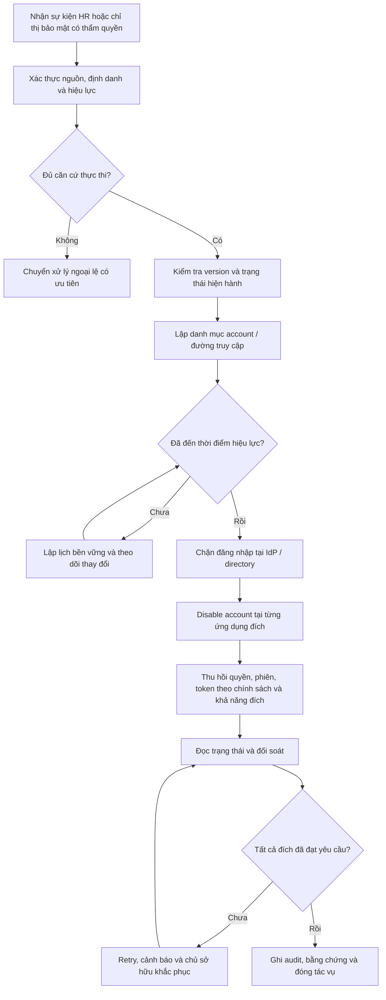

# Disable account: Vô hiệu hóa tài khoản trong Account deprovisioning

Trong quản lý định danh và truy cập (*Identity and Access Management* — **IAM**), **disable account** là thao tác chuyển một tài khoản sang trạng thái **không còn được phép sử dụng để đăng nhập hoặc xác thực theo chính sách của hệ thống quản lý tài khoản đó**. Đây là một bước quan trọng của **account deprovisioning** — quy trình chấm dứt hoặc thu hẹp quyền truy cập khi căn cứ nghiệp vụ không còn hợp lệ.

Vô hiệu hóa tài khoản thường xuất hiện ở giai đoạn **Leaver** của mô hình **Joiner–Mover–Leaver (JML)**, chẳng hạn khi nhân viên nghỉ việc hoặc hợp đồng nhà thầu kết thúc. Nó cũng có thể được sử dụng khi một tài khoản không còn cần thiết tại một ứng dụng sau **Mover**, hoặc khi cần chặn truy cập khẩn cấp do sự cố an ninh. Tuy nhiên, **disable một account chưa chắc đã vô hiệu hóa mọi phiên, token, quyền hoặc tài khoản khác liên quan**. Vì thế, cần hiểu chính xác phạm vi và hiệu quả của thao tác này.

Bài thuộc chương **Account deprovisioning** của module `SECURITY_IDENTITY_ACCESS_MANAGEMENT_IDENTITY_LIFECYCLE`. Nội dung kết nối sự kiện nhân sự, IdP, SSO, SCIM/API, RBAC/ABAC, tài khoản dịch vụ, kiểm toán và đối soát để giảm **quyền truy cập tồn dư** (*residual access*). Mục tiêu là trả lời ba câu hỏi: **vô hiệu hóa đúng tài khoản nào, vào thời điểm nào và dựa trên bằng chứng nào để biết việc chặn truy cập thực sự có hiệu lực?**

Sau bài học, bạn có thể phân biệt disable, suspend, revoke và delete; thiết kế luồng vô hiệu hóa an toàn cho từng hệ thống; xử lý sự kiện trùng hoặc đến muộn; kiểm tra phiên/token còn hoạt động; và xác định điều kiện để kết luận một tác vụ deprovisioning hoàn tất.

## 1. Disable account nghĩa là gì?

Một **danh tính IAM** đại diện cho chủ thể được quản lý, còn một **account** là tài khoản cụ thể tồn tại ở IdP, directory hoặc ứng dụng đích. Một danh tính con người có thể có nhiều account: tài khoản IdP chính, tài khoản tại SaaS, tài khoản cục bộ ở hệ thống cũ và tài khoản đặc quyền riêng. Mỗi account có trạng thái và cơ chế vô hiệu hóa riêng.

Giả sử nhân viên có `identityId=iam-1042`, đăng nhập vào hệ thống thông qua IdP và có một tài khoản CRM được cấp phát bằng SCIM. Khi nhân viên nghỉ việc:

- IdP có thể được yêu cầu **chặn đăng nhập mới** của user đó.
- CRM có thể cần **chuyển account sang trạng thái inactive** tại chính ứng dụng.
- Các nhóm, role và quyền nghiệp vụ không còn căn cứ phải được **gỡ bỏ hoặc làm mất hiệu lực**.
- Những phiên hoặc token đã phát hành có thể cần được **thu hồi bằng cơ chế riêng**, nếu hạ tầng hỗ trợ.
- Kết quả cần được **đối soát** để phát hiện ứng dụng hoặc đường truy cập còn hoạt động.

Không nên dùng một trạng thái duy nhất `disabled=true` để suy luận rằng mọi bước trên đã hoàn tất. `disabled` phải luôn được diễn giải kèm **hệ thống đích, loại account, thời điểm áp dụng và khả năng thực thi**.

### Các thao tác liên quan nhưng không đồng nhất

| Thao tác | Mục tiêu thường gặp | Điều cần lưu ý |
| --- | --- | --- |
| **Disable account** | Chặn khả năng sử dụng account theo chính sách của hệ thống đích | Không mặc nhiên chấm dứt session/token hiện có ở mọi ứng dụng |
| **Suspend / lock account** | Tạm ngưng hoặc khóa account theo chính sách, đôi khi có thể tự mở sau thời hạn | Cần xem trạng thái và khả năng khôi phục của nền tảng; không phải mọi sản phẩm phân biệt giống nhau |
| **Remove role / entitlement** | Gỡ một hoặc một nhóm quyền cụ thể | Account có thể vẫn hoạt động và giữ các quyền khác hợp lệ |
| **Revoke session / token** | Ngăn dùng tiếp phiên hoặc thông tin xác thực đã cấp trong phạm vi hỗ trợ | Khả năng thu hồi và thời gian hiệu lực tùy loại token và ứng dụng |
| **Reset credential / rotate secret** | Làm mất tác dụng mật khẩu, khóa, chứng chỉ hoặc secret cũ | Không tự thu hồi mọi session hoặc entitlement độc lập |
| **Delete account** | Xóa bản ghi account theo khả năng hệ thống | Có thể ảnh hưởng dữ liệu, liên kết kiểm toán và quy trình lưu trữ; không nên là bước mặc định đầu tiên |
| **Full deprovisioning** | Đưa toàn bộ đường truy cập của danh tính về trạng thái kỳ vọng | Thường đòi hỏi nhiều thao tác và bằng chứng ở nhiều hệ thống |

Trong nhiều hệ thống, vô hiệu hóa có tính **khôi phục được**: account được giữ lại để phục vụ kiểm toán, đối soát hoặc xử lý dữ liệu. Nhưng việc có thể bật lại không có nghĩa là được phép bật lại tùy ý. **Re-enable** phải là một quyết định IAM mới, có căn cứ và phê duyệt riêng.

## 2. Điều gì kích hoạt yêu cầu disable account?

Quyết định phải xuất phát từ **nguồn hoặc quy trình có thẩm quyền**, không từ việc một người gửi tùy ý một request tới API quản trị.

| Trường hợp | Tín hiệu kích hoạt | Hướng xử lý |
| --- | --- | --- |
| **Leaver theo lịch** | HRIS xác nhận ngày/giờ quan hệ lao động chấm dứt | Chuẩn bị trước, chặn account theo thời điểm hiệu lực, đối soát từng đích |
| **Leaver khẩn cấp** | Chỉ thị hợp lệ yêu cầu ngăn truy cập ngay | Ưu tiên khóa đường truy cập quan trọng; hoàn thiện kiểm kê và dọn dẹp sau |
| **Nhà thầu/đối tác hết hạn** | Hợp đồng hoặc bảo trợ không còn hiệu lực | Vô hiệu hóa các account và quyền có nguồn gốc từ tư cách đã kết thúc |
| **Mover không còn cần một ứng dụng** | Vai trò, dự án hoặc đơn vị đã thay đổi | Gỡ entitlement không còn hợp lệ; chỉ disable toàn bộ account ứng dụng khi không còn căn cứ truy cập |
| **Phát hiện rủi ro bảo mật** | Hành vi bất thường, nghi bị chiếm đoạt, chỉ thị ứng phó sự cố | Khóa/suspend theo chính sách, điều tra, xác minh trước khi khôi phục |
| **Tài khoản không còn chủ sở hữu** | Ứng dụng ngừng dùng, workload hết nhiệm vụ hoặc tài khoản mồ côi | Xác minh chủ sở hữu và phụ thuộc kỹ thuật; thu hồi sau khi xử lý an toàn |

**Tạm nghỉ không nhất thiết là Leaver.** Nghỉ dài hạn, thay đổi trạng thái hợp đồng hoặc nghỉ theo chính sách nhân sự có thể chỉ yêu cầu hạn chế một số quyền. Điều kiện disable phải được định nghĩa theo loại trạng thái và phạm vi tài khoản, tránh quy tắc thô như “bất kỳ trạng thái nào khác `ACTIVE` thì xóa toàn bộ”.

Với nhân sự có nhiều tư cách hợp lệ đồng thời, ví dụ vừa là nhân viên vừa có quyền truy cập một tổ chức khác theo hợp đồng độc lập, phải xét **căn cứ cấp từng quyền**. Chấm dứt một quan hệ không nhất thiết hợp thức hóa việc xóa các quyền độc lập còn hiệu lực; song cũng không được lợi dụng tư cách khác để giữ lại quyền đã hết căn cứ.

## 3. Đúng danh tính, đúng account, đúng thời điểm

Một lỗi disable nguy hiểm là **chặn nhầm người** do ghép account bằng tên hiển thị hoặc email. Một lỗi khác là **khóa quá sớm** hoặc **để account hoạt động quá lâu** do dùng nhầm thời điểm.

### 3.1. Khóa danh tính và ánh xạ account

| Định danh | Ý nghĩa | Vai trò trong disable |
| --- | --- | --- |
| `sourceSystem` + `sourcePersonId` | Bản ghi tại nguồn nhân sự có thẩm quyền | Xác nhận sự kiện thuộc đúng con người hoặc quan hệ cần chấm dứt |
| `identityId` | Khóa nội bộ ổn định của danh tính IAM | Liên kết lịch sử JML và các account của cùng chủ thể |
| `idpUserId` | Định danh đối tượng tài khoản tại IdP | Xác định chính xác account trung tâm cần chặn |
| `targetAccountId` | ID account ở từng ứng dụng đích | Gửi lệnh vô hiệu hóa đến đúng đối tượng ở SaaS hoặc hệ thống nội bộ |
| `userName` / email | Thuộc tính đăng nhập hoặc liên lạc | Dùng để hiển thị/đối chiếu hỗ trợ, không nên là khóa duy nhất dài hạn |

Khi một account đích không thể ánh xạ duy nhất về `identityId`, quy trình cần chuyển xử lý ngoại lệ có ưu tiên phù hợp; **không tự khóa tài khoản chỉ vì trùng họ tên**. Khi ứng dụng dùng username làm khóa nội bộ, cần kiểm tra lịch sử đổi tên và khả năng tái sử dụng tên trước khi thực thi.

### 3.2. Các mốc thời gian phải tách biệt

| Mốc | Ý nghĩa | Dùng để kiểm tra |
| --- | --- | --- |
| `occurredAt` | Khi nguồn ghi nhận sự kiện nghiệp vụ | Nguồn có công bố thay đổi kịp thời không? |
| `receivedAt` | Khi IAM nhận yêu cầu hoặc sự kiện | Có độ trễ ở tích hợp HR → IAM không? |
| `effectiveAt` | Khi căn cứ quyền kết thúc theo quyết định hợp lệ | Account phải bị chặn từ mốc nào? |
| `requestedAt` | Khi lệnh disable được gửi cho hệ thống đích | IAM có xử lý đúng lịch và ưu tiên không? |
| `enforcedAt` | Khi hệ thống đích thực sự áp dụng thay đổi | Chênh lệch hiệu lực của thao tác là bao nhiêu? |
| `verifiedAt` | Khi trạng thái được kiểm chứng bằng cơ chế phù hợp | Có bằng chứng đầu cuối thay vì chỉ nhận phản hồi API chưa? |

Ví dụ, HR phát Leaver lúc 16:00 với `effectiveAt=17:00`. IAM có thể lập lịch trước, nhưng không được chặn từ 16:00 nếu chính sách yêu cầu quyền còn hợp lệ tới 17:00. Nếu sự kiện chỉ tới IAM lúc 17:08, hệ thống cần xử lý ngay, ghi nhận độ trễ và rà soát những đường truy cập còn hoạt động trong khoảng thời gian đó.

Nếu nguồn chỉ gửi ngày không có giờ, phải có quy tắc xác định múi giờ và thời điểm trong ngày trước khi tự động hóa. Dữ liệu và lịch thực thi cần xử lý **thay đổi ngày nghỉ, hủy quyết định hoặc phát sinh sự kiện mới** một cách có kiểm soát.

## 4. Luồng disable account đầu cuối



Sơ đồ thể hiện thứ tự khái niệm. Trong **tình huống khẩn cấp**, bước chặn truy cập quan trọng có thể được thực hiện ngay sau khi xác minh đủ danh tính/chỉ thị, đồng thời với việc kiểm kê các đích còn lại. Không nên chờ toàn bộ danh mục ứng dụng hoàn hảo mới khóa một account đặc quyền đang bị lạm dụng.

### Bước 1 — Xác thực nguồn và đánh giá yêu cầu

Xác định nguồn HRIS, người quản lý nhà thầu hoặc kênh ứng phó sự cố có thẩm quyền. Kiểm tra định danh ổn định, phạm vi quan hệ cần kết thúc, thời điểm hiệu lực, trạng thái phê duyệt và phiên bản sự kiện. Những thuộc tính không liên quan đến quyết định chặn không nên trở thành lý do trì hoãn một yêu cầu khẩn đã được xác minh đầy đủ.

### Bước 2 — Tạo danh mục account và đường truy cập

IAM cần biết những hệ thống nào có account liên kết danh tính: IdP, Active Directory hoặc directory khác, VPN, email, SaaS, ứng dụng nội bộ, máy chủ, công cụ phát triển, hạ tầng đám mây, tài khoản cục bộ và tài khoản quản trị riêng. Cần xét cả **quyền trực tiếp ngoài nhóm IdP** và credential được cấp không qua SSO.

Nếu danh mục chưa đầy đủ, vẫn cần chặn các hệ thống trọng yếu theo mức rủi ro, đồng thời tiếp tục đối soát để tìm account còn sót. Việc không có record trong IAM **không chứng minh** ứng dụng đích không có account.

### Bước 3 — Thực thi theo khả năng của từng đích

Một số hệ thống dùng `enabled=false`, một số dùng `active=false`, khóa đăng nhập hoặc trạng thái `suspended`. Cần sử dụng **API hoặc chức năng quản trị chính thức** của từng nền tảng, không tự sửa database của ứng dụng nếu điều đó bỏ qua kiểm soát hoặc cache nội bộ.

Thao tác tại các đích phải có mã yêu cầu và khả năng retry; tránh tạo thao tác không cần thiết hoặc vô tình bật lại account. Khi có nhiều account liên kết, **mỗi account cần trạng thái riêng** thay vì một cờ tổng hợp thiếu chi tiết.

### Bước 4 — Kiểm chứng trạng thái và xử lý phần chưa đạt

Sau lệnh disable, cần đọc trạng thái account tại hệ thống đích và kiểm tra những đường truy cập còn hiệu lực theo khả năng kỹ thuật. Connector trả `200 OK` hoặc `204 No Content` chỉ cho biết API đã phản hồi thành công; không mặc nhiên chứng minh ứng dụng đã hủy mọi phiên hoặc toàn bộ quyền.

Nếu một hệ thống thất bại, phải lưu lỗi, retry có kiểm soát, cảnh báo theo SLA, xác định người chịu trách nhiệm và cân nhắc biện pháp giảm thiểu tạm thời phù hợp. Không đánh dấu toàn bộ quy trình `COMPLETED` khi còn đích quan trọng chưa được xác minh.

## 5. Disable tại IdP, SSO, SCIM và ứng dụng đích khác nhau ra sao?

### 5.1. IdP và directory: chặn xác thực mới

Vô hiệu hóa user ở **Identity Provider (IdP)** thường ngăn account tiếp tục đăng nhập theo luồng IdP/SSO mà chính sách quản lý. Ví dụ, một tài khoản được đánh dấu disabled tại IdP sẽ không được xác thực cho lần đăng nhập SSO mới theo hành vi của nền tảng.

Tuy vậy, **ứng dụng không nhất thiết hỏi lại IdP cho mọi request**. Một session SaaS đã tạo trước đó, một tài khoản local hoặc access token đã phát hành vẫn có thể tiếp tục được chấp nhận. Vì vậy, IdP là điểm ưu tiên để chặn đường đăng nhập trung tâm, **không phải bằng chứng duy nhất cho deprovisioning hoàn tất**.

### 5.2. SCIM: cập nhật trạng thái account ở ứng dụng đích

Với hệ thống hỗ trợ **SCIM 2.0** (*System for Cross-domain Identity Management*), thuộc tính `active` của đối tượng User thường được dùng để biểu diễn trạng thái đang hoạt động. Một client cấp phát có thể yêu cầu chuyển thuộc tính này sang `false` theo giao thức được ứng dụng hỗ trợ.

Ví dụ minh họa một yêu cầu SCIM PATCH:

```http
PATCH /scim/v2/Users/7f4a HTTP/1.1
Authorization: Bearer <ACCESS_TOKEN_REDACTED>
Content-Type: application/scim+json

{
  "schemas": ["urn:ietf:params:scim:api:messages:2.0:PatchOp"],
  "Operations": [
    { "op": "replace", "path": "active", "value": false }
  ]
}
```

Mã user và token trong ví dụ là giả định. Hệ thống thật phải sử dụng credential của connector có phạm vi phù hợp và bảo vệ chúng, không ghi token vào log. **Không phải ứng dụng nào cũng hỗ trợ SCIM PATCH, `active` hoặc đồng bộ session giống nhau**; cần kiểm tra hợp đồng tích hợp và hành vi thực tế.

Những điều cần xác nhận sau yêu cầu:

1. SCIM User ID đã được liên kết đúng với account đích và danh tính IAM.
2. Thuộc tính `active=false` được ứng dụng lưu và áp dụng theo chính sách.
3. Việc khóa account có ảnh hưởng đến đăng nhập mới, phiên đang hoạt động và quyền API ra sao.
4. Các role/entitlement cấp trực tiếp hoặc tài khoản độc lập khác có còn sử dụng được hay không.
5. Thời gian cần thiết để connector và ứng dụng đạt trạng thái có thể kiểm chứng.

### 5.3. Ứng dụng không dùng SSO hoặc SCIM

Một ứng dụng cũ có thể có cơ sở người dùng riêng. Disable account ở IdP **không thay đổi trạng thái tài khoản cục bộ** nếu không có tích hợp. Cần API quản trị riêng, quy trình thao tác có kiểm soát hoặc hỗ trợ từ chủ ứng dụng. Nếu thiếu khả năng tự động hóa, danh mục offboarding vẫn phải bao gồm tác vụ thủ công, người chịu trách nhiệm, deadline và bằng chứng.

### 5.4. Vai trò của RBAC và ABAC

**RBAC (Role-Based Access Control)** điều phối quyền theo role; **ABAC (Attribute-Based Access Control)** kiểm tra thêm điều kiện như `employmentStatus`, hợp đồng, đơn vị và tài nguyên. Với Mover, chỉ một số role mất căn cứ thì **gỡ role liên quan** thường thích hợp hơn disable toàn bộ danh tính. Với Leaver, trạng thái danh tính có thể khiến policy từ chối truy cập ngay cả khi một entitlement chưa kịp đồng bộ — **nhưng chỉ nếu ứng dụng/API thực sự thực thi kiểm tra đó**.

Một người không còn thuộc phòng kế toán có thể bị gỡ `finance.approver` nhưng vẫn giữ account để sử dụng ứng dụng với role mới. Gọi thao tác này là **disable toàn bộ account** sẽ không chính xác và có thể làm gián đoạn công việc hợp lệ.

## 6. Phiên và token: vì sao account disabled vẫn có thể còn truy cập?

Sau khi xác thực thành công, ứng dụng có thể cấp **cookie phiên**, access token hoặc refresh token. Thời hạn và cơ chế kiểm tra của chúng không nhất thiết phụ thuộc trực tiếp vào trạng thái account ở IdP theo thời gian thực.

| Loại đường truy cập | Rủi ro sau disable | Hướng kiểm soát |
| --- | --- | --- |
| Phiên web ở ứng dụng SaaS | Cookie/session còn hoạt động dù SSO không cho đăng nhập mới | Thu hồi session tại ứng dụng nếu có; cấu hình thời hạn, kiểm tra lại trạng thái khi phù hợp |
| Refresh token | Có thể tiếp tục yêu cầu token mới tùy hành vi authorization server | Thu hồi refresh token hoặc chặn cấp token theo khả năng nền tảng; kiểm chứng kết quả |
| Access token tự chứa | Một API có thể xác minh chữ ký và thời hạn mà không hỏi trạng thái account mới nhất | Token ngắn hạn, kiểm tra trạng thái/denylist/phiên theo rủi ro và khả năng hệ thống |
| API key hoặc secret riêng | Không phụ thuộc phiên đăng nhập của user | Thu hồi, xoay vòng hoặc vô hiệu hóa credential tại chính hệ thống quản lý |
| Tài khoản local | Không chịu điều khiển của IdP | Disable trực tiếp tại ứng dụng hoặc chuyển quyền quản trị theo chính sách |
| Quyền được cache | Role/group đã gỡ nhưng bộ nhớ đệm còn giữ quyết định cũ | Làm mới cache/phiên, giới hạn TTL và kiểm thử thời gian quyền thực sự mất hiệu lực |

**Ví dụ:** IdP vô hiệu hóa nhân viên lúc 17:00, nhưng API tài chính vẫn chấp nhận một JWT đã phát hành lúc 16:55 đến 17:10 vì API chỉ kiểm tra chữ ký, audience và thời hạn. Khi đó, thao tác khóa IdP đã thành công nhưng **mục tiêu ngăn quyền API sau 17:00 chưa chắc đã được bảo đảm**. Đội thiết kế cần hiểu cách xác thực, thu hồi và kiểm soát token tại chính tài nguyên.

Không phải mọi hệ thống đều hỗ trợ hủy access token tự chứa ngay lập tức. Khi không thể thu hồi tức thì, phải đánh giá rủi ro còn lại, giới hạn thời hạn/token scope, kiểm tra truy cập tại API và áp dụng biện pháp giảm thiểu phù hợp. Không quảng bá một lệnh logout là bảo vệ tức thời cho tất cả thiết bị và ứng dụng nếu nền tảng không có cam kết đó.

## 7. Thiết kế trạng thái và xử lý lỗi an toàn

Một quy trình deprovisioning trải qua nhiều hệ thống **không có giao dịch nguyên tử chung**. Thiết kế chỉ có `success=true` sẽ che giấu các lỗi từng phần. Nên theo dõi danh tính, phiên bản sự kiện, thời điểm hiệu lực, trạng thái mong đợi và trạng thái quan sát được theo từng tài khoản đích.

Ví dụ dữ liệu trạng thái minh họa:

```yaml
eventId: hr-leaver-2026-0418
sourceSystem: HRIS_MAIN
sourcePersonId: EMP-0418
identityId: iam-1042
eventType: LEAVER
sourceVersion: 92
effectiveAt: "2026-11-30T10:00:00Z"
workflowStatus: IN_PROGRESS
targets:
  - system: idp
    accountId: idp-1042
    desiredState: DISABLED
    observedState: DISABLED
    verified: true
  - system: crm
    accountId: crm-541
    desiredState: DISABLED
    observedState: PENDING_RECONCILIATION
    verified: false
  - system: legacy-vpn
    accountId: vpn-148
    desiredState: DISABLED
    observedState: RETRY_REQUIRED
    verified: false
```

Các giá trị trạng thái do bài học tự định nghĩa, không phải schema chính thức của một sản phẩm IAM. Dù IdP đã bị khóa, workflow vẫn là `IN_PROGRESS` vì CRM và VPN chưa xác minh xong.

### 7.1. Idempotency: gửi lại lệnh không được mở quyền

Nếu connector timeout sau khi gửi lệnh disable, worker có thể retry. Tác vụ cần **idempotent**: disable lại một account đã disabled phải tiếp tục đưa nó về trạng thái mong đợi, không tạo bản ghi trùng hoặc bật lại account. Mỗi sự kiện có thể có `eventId`, correlation ID, phiên bản nguồn và mã tác vụ theo đích để chống xử lý lại không kiểm soát.

### 7.2. Sự kiện đến muộn và sai thứ tự

Giả sử IAM đã thực hiện Leaver phiên bản 92, sau đó nhận một sự kiện Mover phiên bản 90. Nếu hệ thống áp sự kiện cũ theo thứ tự nhận, account có thể bị kích hoạt lại để gán role mới. Cần xác định **trạng thái hiện hành từ nguồn có thẩm quyền**, kiểm tra phiên bản và từ chối quyết định cũ làm đảo ngược trạng thái đã thu hồi.

Không nên chỉ so sánh `receivedAt` để suy ra phiên bản nghiệp vụ: mạng có thể chuyển thông điệp sai thứ tự. Nếu nguồn không cung cấp version ổn định, cần cơ chế xác minh snapshot hiện hành hoặc thứ tự sự kiện đáng tin cậy theo từng danh tính.

### 7.3. Tránh disable nhầm hàng loạt

Nếu HRIS gửi tệp danh sách thiếu một nửa nhân viên do lỗi phân trang, việc coi mọi người không xuất hiện là Leaver có thể khóa hàng loạt tài khoản hợp lệ. Cần phân biệt **sự kiện chấm dứt hợp lệ** với **dữ liệu không đầy đủ hoặc connector bị lỗi**.

Với tác vụ hàng loạt, áp kiểm tra định danh, giới hạn phạm vi, cảnh báo biến động bất thường, cơ chế duyệt theo rủi ro hoặc ngưỡng bảo vệ phù hợp. Biện pháp kiểm soát chống khóa nhầm phải được thiết kế để không trì hoãn chỉ thị chặn khẩn cấp đã xác thực của một cá nhân nguy cơ cao.

### 7.4. Lỗi hệ thống đích và biện pháp giảm thiểu

Nếu ứng dụng đích offline hoặc API quản trị thất bại, ghi nhận tác vụ `RETRY_REQUIRED`, giới hạn lần thử, backoff phù hợp, cảnh báo và người chịu trách nhiệm. Nếu một đích quan trọng chưa disable được, có thể cần chặn tại lớp xác thực, gateway, network, PAM hoặc cơ chế riêng của ứng dụng theo khả năng thực tế. **Không coi một cách chặn thay thế là chắc chắn hiệu quả nếu chưa được xác minh.**

## 8. Khi nào được enable lại tài khoản?

Tài khoản có thể được vô hiệu hóa do nghỉ việc, nghi bị chiếm đoạt, tạm ngưng hoặc lỗi dữ liệu. Việc **enable trở lại** không nên là thao tác “hoàn tác lệnh trước” một cách tự động trong mọi trường hợp.

Một quy trình tái kích hoạt nên kiểm tra:

1. **Căn cứ nghiệp vụ mới:** HR hoặc nguồn có thẩm quyền xác nhận danh tính hiện đủ điều kiện; hoặc đội an ninh đã cho phép khôi phục sau điều tra.
2. **Đối chiếu đúng chủ thể:** dùng identity ID, lịch sử account, nguồn và tình trạng tái tuyển dụng; không ghép chỉ bằng username hoặc email cũ.
3. **Tính lại quyền theo thời điểm hiện tại:** RBAC/ABAC, SoD, phê duyệt và nhu cầu thực tế phải được đánh giá lại; không tự trả mọi quyền trước Leaver.
4. **Kiểm tra xác thực và thiết bị:** phương thức MFA, mật khẩu/secret và trạng thái thiết bị cần đáp ứng yêu cầu hiện hành; với sự cố chiếm đoạt, credential cũ có thể cần thay thế.
5. **Đối soát sau khi enable:** kiểm tra user, phiên, nhóm, entitlement đúng phạm vi và ghi nhận quyết định.

Ví dụ, người nghỉ việc được tuyển dụng lại sau ba tháng có thể có cùng username nhưng vai trò công việc đã khác. **Khôi phục đăng nhập không được đồng nghĩa khôi phục quyền quản trị cũ**. Một quyết định chấm dứt khẩn cấp cũng không thể bị vô tình đảo ngược bởi tác vụ retry hoặc một sự kiện Joiner lỗi thời.

## 9. Disable account của tài khoản dịch vụ và danh tính ứng dụng

Tài khoản phi con người — service account, service principal, workload identity, API key hoặc credential của job tự động — thường không có sự kiện HR trực tiếp. Chúng vẫn phải có **chủ sở hữu, mục đích, môi trường, phạm vi quyền và điều kiện kết thúc vòng đời**.

| Trường hợp | Rủi ro nếu disable tùy tiện | Cách xử lý phù hợp |
| --- | --- | --- |
| Service account dùng cho tác vụ sao lưu | Ngừng sao lưu hoặc ảnh hưởng khả năng khôi phục | Kiểm kê phụ thuộc, chuẩn bị thay thế hoặc chuyển credential trước khi thu hồi có kiểm soát |
| API key do nhân viên nghỉ việc tạo | Khóa còn hiệu lực dù user đã bị disable | Xác định nơi sử dụng, chủ sở hữu mới, xoay vòng hoặc thu hồi theo mức rủi ro |
| Workload không còn hoạt động | Quyền API và credential tồn dư không có lý do | Thu hồi role, token/secret và vô hiệu hóa danh tính theo chính sách |
| Tài khoản máy không rõ chủ sở hữu | Không có người chịu trách nhiệm xử lý rủi ro | Điều tra, gắn owner hoặc thu hồi sau đánh giá nguy cơ và tác động vận hành |

**Disable tài khoản người sở hữu không tự động disable mọi danh tính máy của ứng dụng họ quản lý.** Nếu người quản trị hệ thống nghỉ việc, cần chuyển trách nhiệm vận hành, rà soát các quyền và xoay vòng bí mật mà người đó có thể đã biết. Không nên giữ lại secret đặc quyền vô thời hạn chỉ để bảo đảm dịch vụ hoạt động.

Khi hạ tầng hỗ trợ, có thể ưu tiên thông tin xác thực workload ngắn hạn hoặc cơ chế không cần lưu khóa tĩnh. Song việc thay thế credential phải có kiểm thử và kế hoạch tránh gián đoạn tài nguyên quan trọng.

## 10. Kiểm toán và đo hiệu quả disable account

Một quy trình chỉ báo `HTTP 200` không cung cấp đủ bằng chứng. Nên đo lường cả **thời gian xử lý**, **tỷ lệ trạng thái đạt yêu cầu** và **sai lệch còn lại**.

| Chỉ số | Ý nghĩa |
| --- | --- |
| `receivedAt - occurredAt` | Độ trễ nhận sự kiện từ nguồn HR hoặc hệ thống quản lý |
| `enforcedAt - effectiveAt` | Khoảng chênh từ thời điểm phải chặn đến khi account tại đích thực sự bị vô hiệu hóa |
| `verifiedAt - effectiveAt` | Thời gian đến khi có bằng chứng xác nhận trạng thái đích |
| Tỷ lệ account disable đúng SLA | Số account được xác minh đúng hạn trên tổng account phải xử lý trong phạm vi SLA |
| Tỷ lệ lỗi/timeout connector | Những đích có vấn đề kỹ thuật hoặc cần xử lý thủ công |
| Số account còn active trái chính sách | Quyền truy cập tồn dư phát hiện qua đối soát |
| Tỷ lệ session/token được xử lý theo yêu cầu | Đánh giá khoảng trống giữa disable account và thu hồi đường truy cập khác |
| Tài khoản dịch vụ không có owner | Danh tính kỹ thuật có rủi ro từ vòng đời không được quản lý |

Cần chia chỉ số theo độ nhạy cảm của đích, loại tài khoản và loại sự kiện. Một account có quyền quản trị sản xuất còn hoạt động sau Leaver cần được ưu tiên hơn một tài khoản chỉ đọc tài liệu công khai nội bộ, dù độ trễ trung bình của toàn hệ thống vẫn thấp. Không có SLA chung phù hợp cho mọi tổ chức và hệ thống.

### Dấu vết kiểm toán tối thiểu

Đối với mỗi lệnh disable, lưu nguồn sự kiện, định danh ổn định, target account ID, loại account, chính sách/phê duyệt, thời điểm hiệu lực, thời điểm yêu cầu, trạng thái trước/sau, phản hồi kỹ thuật, bằng chứng xác minh và người xử lý ngoại lệ. Giữ nhật ký theo chính sách quyền truy cập và lưu trữ; không ghi password, token thật, API key hoặc dữ liệu HR không cần thiết vào audit log.

## 11. Tình huống tổng hợp: một nhân viên và nhiều account

Giả sử nhân viên `EMP-0418` kết thúc công việc lúc **17:00**. Họ có user tại IdP, tài khoản CRM qua SCIM, VPN dùng directory nội bộ, quyền quản trị kho mã nguồn cấp trực tiếp và một API key của công cụ tích hợp.

| Thời điểm | Trạng thái quan sát | Đánh giá |
| --- | --- | --- |
| 16:30 | HRIS gửi Leaver có `effectiveAt=17:00`; IAM xác định đúng identity ID | Có thể lập lịch và chuẩn bị danh mục tác vụ |
| 17:00 | IdP đánh dấu disabled và chặn SSO mới | Đã xử lý một đường xác thực, chưa đủ để đóng Leaver |
| 17:01 | CRM nhận SCIM `active=false` | Cần đọc lại account và xem khả năng kết thúc phiên CRM |
| 17:03 | Directory/VPN xác nhận account disabled | Đường VPN liên quan đã được xử lý theo bằng chứng |
| 17:05 | Repo vẫn còn quyền quản trị cấp trực tiếp | **Sai lệch:** phải thu hồi role riêng và đối soát |
| 17:08 | Session CRM còn hoạt động từ trước | **Sai lệch:** cần đánh giá cơ chế revoke và thời hạn phiên |
| 17:10 | API key tích hợp vẫn hợp lệ | Cần xác định đây là khóa cá nhân hay workload; xử lý owner và credential |

**Kết luận tình huống:** thao tác `disable account` ở IdP đã thành công nhưng **deprovisioning toàn bộ chưa hoàn tất**. IAM chỉ có thể đóng những mục tiêu đã có bằng chứng; các sai lệch còn lại cần kế hoạch khắc phục, người chịu trách nhiệm và thời hạn.

### Checklist trước khi đánh dấu tác vụ hoàn tất

1. Sự kiện disable đến từ nguồn có thẩm quyền, liên kết đúng người và đúng quan hệ cần chấm dứt chưa?
2. Đã phân biệt `effectiveAt` với thời gian gửi lệnh và thời gian xác minh chưa?
3. Có bản đồ account tại IdP, SaaS, ứng dụng local, VPN và các tài khoản đặc quyền liên quan chưa?
4. Mỗi đích đã thực sự ở trạng thái disabled phù hợp, không chỉ trả kết quả API thành công chưa?
5. Các group, role và quyền cấp trực tiếp không còn căn cứ đã được xử lý chưa?
6. Session, refresh token, access token và API key có cơ chế thu hồi, giới hạn hoặc quản trị rủi ro còn lại chưa?
7. Có chống event trùng, Mover cũ đến sau Leaver mới và lỗi disable nhầm người không?
8. Nếu một đích thất bại, có retry, cảnh báo, người xử lý và bằng chứng bù trừ không?
9. Việc bàn giao dữ liệu/tài sản và xử lý danh tính dịch vụ có được theo dõi riêng không?
10. Hồ sơ audit có thể giải thích vì sao account bị disable, bởi ai và đã xác minh thế nào không?

## 12. Câu hỏi tự kiểm tra

**Câu 1.** Vì sao disable một user ở IdP không bảo đảm họ đã mất mọi quyền tại SaaS?

**Trả lời:** SaaS có thể giữ session, access token hoặc tài khoản cục bộ độc lập; ngoài ra các quyền trực tiếp có thể không được quản lý bởi IdP. Cần thu hồi/đối soát tại chính các đích.

**Câu 2.** Nhân viên chuyển bộ phận nhưng vẫn cần dùng ứng dụng với vai trò mới. Có nên disable toàn bộ account của ứng dụng không?

**Trả lời:** Thông thường nên **tính lại và điều chỉnh entitlement/role** theo căn cứ mới, thay vì disable toàn bộ account nếu người dùng vẫn có quyền truy cập hợp lệ. Phải kiểm tra xung đột SoD và quyền tồn dư.

**Câu 3.** SCIM PATCH đặt `active=false` trả về thành công. Có được ghi rằng toàn bộ Leaver đã hoàn tất chưa?

**Trả lời:** Không. Cần xác minh trạng thái tại đích, hành vi với phiên/token đang hoạt động, những account khác và mọi đường truy cập thuộc phạm vi Leaver.

**Câu 4.** Một sự kiện Mover phiên bản cũ đến sau Leaver đã xử lý. Có được enable account để gán quyền theo Mover không?

**Trả lời:** Không. Phải xác minh trạng thái mới nhất từ nguồn có thẩm quyền và chặn sự kiện cũ đảo ngược quyết định thu hồi.

**Câu 5.** Người quản trị nghỉ việc và đang là owner của service account phục vụ sao lưu. Disable user có đủ chưa, và có nên xóa service account ngay không?

**Trả lời:** Chưa đủ. Cần bàn giao owner, kiểm tra quyền và credential mà người nghỉ việc có thể biết, xoay vòng/thu hồi theo rủi ro. Việc vô hiệu hóa danh tính máy phải căn cứ vào nhu cầu và phụ thuộc vận hành thực tế.

## Kết luận

**Disable account là thao tác vô hiệu hóa khả năng sử dụng một tài khoản tại hệ thống quản lý nó**, không đồng nghĩa tự động xóa danh tính, thu hồi mọi role hay kết thúc mọi phiên. Trong Account deprovisioning, thao tác này cần được điều phối từ sự kiện nghiệp vụ đáng tin cậy, áp dụng **đúng account và đúng thời điểm**, kết hợp IdP/SSO, SCIM/API, RBAC/ABAC và cơ chế quản lý phiên/credential tương ứng. Bằng chứng tại từng hệ thống đích, xử lý lỗi, đối soát và kiểm toán là điều kiện để giảm quyền truy cập tồn dư và kết luận quy trình Leaver đã đạt yêu cầu. Cách thiết kế như vậy đồng thời bảo vệ sự liên tục nghiệp vụ khi Mover, xử lý danh tính dịch vụ và phục hồi account theo quyết định hợp lệ.
