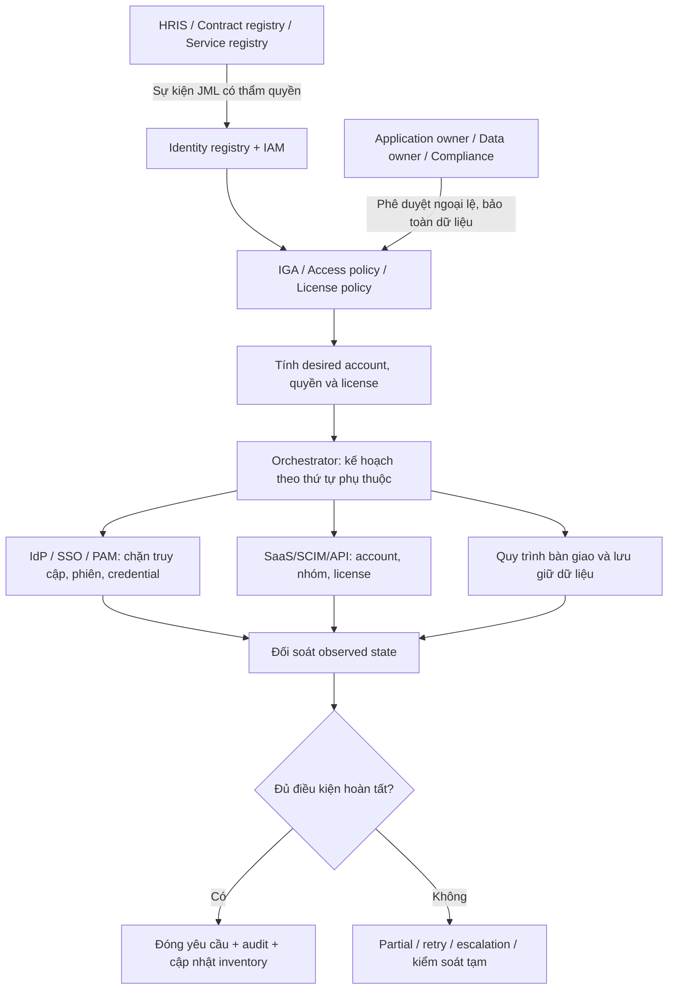

# Thu hồi license trong Account deprovisioning

## 1. Thu hồi license là gì và vì sao quan trọng?

Trong **Identity and Access Management (IAM)**, **thu hồi license** (*license reclamation/revocation*) là việc gỡ hoặc chấm dứt một quyền sử dụng sản phẩm, gói dịch vụ, tính năng trả phí hay suất cấp phép đã gán cho một danh tính, tài khoản hoặc workload, theo quyết định vòng đời và chính sách quản trị. Mục tiêu là **đưa trạng thái cấp phép về đúng nhu cầu thực tế**, tránh tiêu hao suất license khi không còn lý do sử dụng, đồng thời không làm mất dữ liệu nghiệp vụ hoặc tạo rủi ro truy cập trái phép.

Ví dụ: Một nhân viên nghỉ việc từng dùng bộ ứng dụng cộng tác, công cụ phân tích và phần mềm quản lý dự án. Sau khi chặn quyền truy cập, tổ chức cần xác định những license nào đang gán cho tài khoản, có dữ liệu cần bàn giao không, nguồn nào đã cấp license và thao tác nào sẽ thật sự giải phóng suất sử dụng. Chỉ vô hiệu hóa đăng nhập tại Identity Provider (IdP) **không bảo đảm** mọi license đã được thu hồi; ngược lại, gỡ license cũng **không bảo đảm** mọi cách truy cập đã bị chặn.

Trong module **SECURITY_IDENTITY_ACCESS_MANAGEMENT_IDENTITY_LIFECYCLE**, thu hồi license thuộc giai đoạn **Account deprovisioning** và liên kết chặt với **Joiner–Mover–Leaver (JML)**. Quy trình này lấy sự kiện từ HRIS, hệ thống nhà thầu hoặc quản lý dịch vụ; phối hợp với **IdP, SSO, SCIM, RBAC/ABAC, IGA**, quản trị tài khoản dịch vụ, kiểm toán và đối soát để giảm **quyền truy cập tồn dư** lẫn **lãng phí giấy phép**.

Sau bài học, người đọc có thể phân biệt license với tài khoản và quyền truy cập, thiết kế thứ tự thu hồi an toàn, xử lý license cấp qua nhóm hoặc trực tiếp, bảo toàn dữ liệu cần thiết, xác minh suất license thực sự được giải phóng và quản lý ngoại lệ trong quy trình JML.

## 2. Phân biệt account, quyền truy cập, license và chi phí

Bốn khái niệm thường đi cùng nhau nhưng không nên đánh đồng:

| Khái niệm | Ví dụ | Ai thường quản lý? | Điều cần xác nhận sau Leaver |
| --- | --- | --- | --- |
| **Identity** | `identityId=id-518` của một nhân viên | IAM/identity registry | Trạng thái vòng đời và sự kiện nghỉ việc chính xác |
| **Account** | User `u-783` ở một SaaS | Ứng dụng đích, IdP hoặc provisioning connector | Account bị khóa/vô hiệu hóa theo chính sách |
| **Entitlement** | Nhóm `report-editors`, quyền `project-admin` | IGA, application owner, API/SCIM | Không còn các quyền truy cập không được phép |
| **License** | Suất dùng gói `COLLAB_STANDARD`, add-on `ANALYTICS_PRO` | SaaS admin, license manager hoặc IAM/IGA | Gán license đã được gỡ khi hợp lệ và trạng thái đích xác nhận |
| **Subscription/billing** | Hợp đồng mua 500 suất theo năm | Procurement, Finance, SaaS vendor | Có thể tái sử dụng suất hoặc điều chỉnh hợp đồng theo điều kiện thương mại |

**Thu hồi license không đồng nghĩa hoàn tiền.** Một seat đã gỡ khỏi người dùng có thể được đưa về pool để tái cấp cho người khác, nhưng chi phí hợp đồng vẫn giữ nguyên cho đến kỳ gia hạn hoặc thay đổi gói. Với license dựa trên lưu lượng hoặc mức sử dụng, chi phí có thể tính theo cơ chế khác; không nên tự giả định “gỡ một người dùng = tiết kiệm một số tiền cố định”.

### Những trạng thái license khác nhau

Với một sản phẩm SaaS, có thể tồn tại:

- **License đã mua/đã cam kết:** năng lực và điều kiện hợp đồng.
- **License đã gán:** seat đang được gắn vào một tài khoản/người dùng.
- **License có hiệu lực:** các tính năng thực sự sử dụng được theo chính sách sản phẩm.
- **License có thể tái sử dụng:** suất đã được giải phóng và đủ điều kiện phân bổ lại.
- **License phát sinh phí:** tiêu chí tính phí thực tế theo hợp đồng, có thể độc lập với thời điểm IAM gỡ quyền.

Trong thiết kế dữ liệu, không nên chỉ có cờ `hasLicense`. Hãy biết **SKU hoặc plan, nguồn gán, account đích, thời điểm hiệu lực và trạng thái quan sát được**. Một tài khoản có thể giữ nhiều license cơ sở và add-on, hoặc nhận cùng một khả năng sử dụng thông qua nhiều nhóm.

## 3. Những mô hình cấp phép cần nhận diện

| Mô hình | Ví dụ minh họa | Khi thu hồi cần chú ý |
| --- | --- | --- |
| **Named-user/assigned seat** | Một suất SaaS gán cho một user | Gỡ assignment thực tế, kiểm tra suất về pool; tài khoản có thể vẫn tồn tại |
| **Group-based license** | Thành viên nhóm `design-users` được gán `DESIGN_PRO` | Gỡ quan hệ nhóm hoặc đổi chính sách nhóm; kiểm tra các nguồn gán khác |
| **Add-on hoặc tier** | Người dùng có gói cơ bản và gói phân tích nâng cao | Có thể chỉ cần thu hồi add-on khi đổi vai trò; kiểm tra phụ thuộc giữa các gói |
| **Concurrent/floating** | Chỉ giới hạn số phiên đang chạy | Kiểm tra phiên/checkout và cơ chế giải phóng ở máy chủ license; gỡ account có thể chưa đủ |
| **Device-based** | Giấy phép gán theo thiết bị | Cần trả/gỡ khỏi thiết bị hoặc cập nhật inventory, không chỉ user account |
| **Consumption/metered** | Tính theo request, tài nguyên hoặc mức sử dụng | Thu hồi token/quyền gọi dịch vụ và kiểm tra usage/billing; không phải luôn có seat để trả về |
| **Service/workload-based** | License cho bot, agent, tài khoản tích hợp hoặc tài nguyên chạy nền | Kiểm tra owner, chức năng, phụ thuộc kỹ thuật, hợp đồng và phương án thay thế |

Các loại này có thể được kết hợp trong cùng một sản phẩm. Đối với SaaS có nhiều cấu phần, **license người dùng**, **quyền vào tenant**, **quyền ở từng workspace**, **quyền quản trị** và **định mức tính phí** có thể được quản lý ở những nơi khác nhau.

## 4. Phải thu hồi license ở sự kiện nào của JML?

Thu hồi license không chỉ xảy ra khi người dùng nghỉ việc. Trong **Joiner–Mover–Leaver**, mỗi loại thay đổi có thể khiến tập license mong muốn biến đổi.

| Giai đoạn | Sự kiện ví dụ | Hành động với license |
| --- | --- | --- |
| **Joiner** | Nhân viên mới được cấp account và gói công cụ theo vị trí | Chỉ gán những license được chính sách/owner phê duyệt; đặt hạn nếu là nhu cầu tạm |
| **Mover** | Nhân viên đổi từ thiết kế sang kế toán | Gỡ license thiết kế không còn cần, thêm gói kế toán nếu hợp lệ, xử lý thời gian bàn giao |
| **Leaver** | Nhân viên thôi việc hoặc nhà thầu hết hợp đồng | Chặn truy cập theo mức ưu tiên; kiểm kê, bàn giao và gỡ license theo chính sách dữ liệu/retention |
| **Rehire** | Nhân viên cũ quay lại | Xác minh danh tính và kỳ lao động mới; cấp lại license dựa vào nhu cầu hiện tại, không tự khôi phục mọi gói cũ |
| **Access review** | Owner xác nhận người dùng không sử dụng một add-on | Xác minh nhu cầu, thông báo và gỡ license nếu không có căn cứ duy trì |
| **Ngừng dịch vụ** | Bot tích hợp hoặc workload bị ngừng | Thu hồi quyền, credential và các license tương ứng sau khi kiểm tra phụ thuộc |

**Nguồn kích hoạt phải đáng tin:** HRIS xác nhận tình trạng nhân viên; vendor/contract management xác nhận ngày kết thúc nhà thầu; sponsor và application owner xác nhận thời hạn dự án; service registry xác nhận workload đã dừng. Một tín hiệu “không đăng nhập 90 ngày” có thể là căn cứ **đề xuất rà soát**, nhưng không nhất thiết đủ để tự thu hồi license của tài khoản có nghĩa vụ nghiệp vụ hoặc giữ dữ liệu đặc thù.

## 5. Kiến trúc điều phối thu hồi license



Trong thực tế, các nhánh của sơ đồ **không nhất thiết chạy song song**. Có ứng dụng chỉ cho phép xuất hoặc chuyển dữ liệu khi license vẫn còn gán; ứng dụng khác cho phép giữ account không license để làm lưu trữ. Workflow phải biểu diễn **phụ thuộc và thời hạn** của từng hệ thống đích. Sơ đồ không áp đặt thao tác gỡ license trước hay sau khóa account cho mọi sản phẩm.

### Ba lớp trạng thái cần theo dõi

1. **Desired license state:** tổ chức đã quyết định license nào được phép tồn tại sau sự kiện.
2. **Provisioning/execution state:** yêu cầu gỡ license đã được tạo, duyệt, gửi đi, retry hay thất bại.
3. **Observed license state:** ứng dụng hoặc license inventory hiện cho thấy assignment nào thực sự còn tồn tại và seat nào có thể tái sử dụng.

Khi ba lớp này khác nhau, không được ghi `COMPLETED` chỉ vì một API trả thành công. Phải phân biệt rõ `APPROVED`, `SENT`, `APPLIED`, `VERIFIED` và `PARTIAL`.

## 6. Quy trình thu hồi license an toàn

Một quy trình đầy đủ nên được xây dựng thành các giai đoạn có điều kiện rõ ràng.

### Bước 1 — Xác nhận sự kiện và danh tính

Kiểm tra nguồn đã xác thực, `sourceSubjectId`, `identityId`, loại chủ thể và thời điểm hiệu lực. Đối với leaver, cần biết đây là nghỉ việc chính thức, hết hợp đồng, đình chỉ khẩn cấp hay đổi vai trò. Đừng tìm account chỉ bằng email vì email có thể đổi hoặc được tái sử dụng.

Sự kiện phải có mã tương quan và phiên bản để chống xử lý lặp hoặc đến muộn. Không cho phép một sự kiện joiner/mover cũ tự phục hồi quyền hoặc license đã bị thu hồi sau leaver mới hơn.

### Bước 2 — Xác định các license đang gán và nguồn gán

Tổng hợp dữ liệu từ IAM/IGA, SaaS admin API, nhóm IdP, SCIM, inventory license, workspace và các ngoại lệ quản trị cục bộ. Cần lưu cả **gán trực tiếp**, **gán qua nhóm**, **add-on** và những license không có API tự động.

Ví dụ, user được gán `ANALYTICS_PRO` qua nhóm `finance-users` đồng thời được admin gán trực tiếp. Chỉ gỡ người khỏi nhóm có thể không làm mất license. Nếu mục tiêu là thu hồi hoàn toàn, cần kiểm tra tất cả các nguồn cấp hợp lệ và xử lý theo chính sách.

### Bước 3 — Phân loại mức ưu tiên bảo mật và phụ thuộc dữ liệu

Đối với leaver, thường phải **chặn đăng nhập/quyền truy cập không còn hợp lệ kịp thời**, không chờ xử lý kế toán license. Tuy nhiên, **gỡ license quá sớm** ở một số sản phẩm có thể làm tính năng xuất dữ liệu, chuyển giao hộp thư/tài liệu hoặc giữ nội dung bị hạn chế. Phải hiểu cơ chế sản phẩm, thời hạn lưu và yêu cầu bảo toàn dữ liệu trước khi gỡ license.

Tách ít nhất hai việc:

- **Thu hồi khả năng truy cập:** vô hiệu hóa account hoặc cơ chế xác thực, thu hồi quyền/phiên/token theo khả năng hệ thống; ưu tiên an ninh và thời điểm leaver.
- **Thu hồi suất license:** sau khi xác minh điều kiện giữ dữ liệu, quyền sở hữu nội dung và yêu cầu nghiệp vụ, gỡ assignment theo API hoặc quy trình được duyệt.

Nếu cần trì hoãn bước thứ hai, phải tạo **ngoại lệ có owner, lý do, mốc hết hạn và quyền truy cập đã bị chặn**. Không dùng nhu cầu giữ dữ liệu làm lý do để giữ quyền đăng nhập không được phép.

### Bước 4 — Chuyển giao, giữ hoặc xử lý dữ liệu theo chính sách

Trước khi thu hồi license có ảnh hưởng dữ liệu, xác định nội dung cần bàn giao: tài liệu, mailbox, dashboard, workflow, lịch, báo cáo, tự động hóa hoặc bản ghi giao dịch. Người quản lý dữ liệu xác định bên nhận và thời hạn. Việc chuyển giao phải tuân thủ phân quyền, bảo vệ dữ liệu cá nhân, legal hold hoặc retention nếu áp dụng.

**Không mặc định xóa tài khoản để giải phóng license.** Ứng dụng có thể hỗ trợ trạng thái unlicensed/inactive, chuyển dữ liệu cho owner khác hoặc export hợp pháp. Cũng không được mặc định rằng thu hồi license sẽ giữ nguyên dữ liệu vĩnh viễn: tác động cụ thể phải được kiểm tra theo hợp đồng và tính năng của từng sản phẩm.

### Bước 5 — Thực thi thao tác gỡ license

Xác định đúng tài khoản đích và SKU. Nếu license được cấp qua nhóm, thay đổi membership hoặc chính sách cấp license ở nguồn chủ quản; nếu cấp trực tiếp, gỡ assignment trực tiếp. Một số hệ thống có thể có nhiều nguồn gán, add-on phụ thuộc hoặc khóa gói cơ sở: cần đảm bảo không gỡ nhầm license khác vẫn được phê duyệt.

Sử dụng API chính thức, connector đã được phân quyền tối thiểu hoặc quy trình thủ công có kiểm chứng. Ghi `requestId`, `identityId`, `targetAccountId`, `licenseSku`, `assignmentSource`, trạng thái và mã kết quả, **không ghi token hoặc secret**.

### Bước 6 — Readback và đối soát

Sau thao tác, kiểm tra trạng thái thực tế ở ứng dụng. Nếu gỡ license có hiệu lực bất đồng bộ, chờ và kiểm tra lại theo lịch/thỏa thuận của connector; không khẳng định đã giải phóng seat khi API chỉ nhận yêu cầu. Đối soát cả quyền truy cập còn tồn dư và dữ liệu cần bàn giao.

### Bước 7 — Đóng yêu cầu, cập nhật inventory và kiểm toán

Đánh dấu hoàn tất khi các điều kiện đã định nghĩa đạt: account bị chặn theo chính sách, license mục tiêu không còn gán, dữ liệu đã xử lý hợp lệ, không có lỗi connector chưa được kiểm soát và bằng chứng được lưu. License inventory được cập nhật sau xác nhận; việc tái cấp seat cho người khác phải dựa vào trạng thái đã kiểm chứng.

## 7. Bảng quyết định thứ tự deprovisioning

Không có một thứ tự cố định phù hợp với mọi SaaS. Bảng này giúp chọn kế hoạch theo rủi ro và phụ thuộc.

| Điều kiện | Quyết định ưu tiên | Điều không nên làm |
| --- | --- | --- |
| Người dùng nghỉ việc ngay lập tức | Chặn đường đăng nhập và đặc quyền theo chính sách; đánh dấu yêu cầu license cần xử lý | Chờ gỡ license xong mới chặn truy cập |
| Ứng dụng có dữ liệu cần chuyển và mất tính năng khi unlicense | Chặn truy cập của leaver; chuyển dữ liệu bằng tài khoản/role có thẩm quyền trước khi gỡ | Gỡ license không kiểm tra khiến dữ liệu hoặc workflow gián đoạn |
| License gán bằng nhóm tự động | Thay đổi membership/chính sách tại nguồn gán; đọc lại tại provider | Chỉ gỡ trực tiếp tại provider rồi để nhóm tự gán lại |
| Quyền qua nhiều nhóm hoặc đường cấp | Liệt kê và xử lý từng nguồn gán được phê duyệt | Kết luận hoàn tất chỉ vì đã rời một nhóm |
| Mover chỉ mất tính năng nâng cao | Gỡ add-on không còn cần, giữ license cơ sở còn hợp lệ | Khóa toàn bộ account khi nhân viên vẫn cần ứng dụng |
| Guest hết hợp đồng | Chặn truy cập theo thời hạn; đánh giá dữ liệu và gỡ license/guest | Cho quyền kéo dài vì seat đã mua trước |
| Tích hợp machine-to-machine còn hoạt động | Đánh giá owner, kỹ thuật và hợp đồng trước khi gỡ license | Thu hồi làm hỏng tích hợp production vì nhầm tài khoản máy với nhân viên nghỉ việc |
| Hệ thống đích đang lỗi | Đặt trạng thái partial, áp biện pháp tạm và escalation | Báo license đã thu hồi khi chưa có bằng chứng |

### Trường hợp thời gian bàn giao

Nhân viên chuyển vai trò có thể vẫn cần phần mềm cũ trong giai đoạn bàn giao. Nếu được duyệt, hãy gán **thời hạn sử dụng** và lập lịch thu hồi tự động hoặc yêu cầu có kiểm chứng. Đến hạn, hệ thống cần xử lý dù người quản lý không nhớ đóng ticket; ngoại lệ gia hạn phải có phê duyệt mới.

## 8. Gán license qua nhóm và gán trực tiếp

Hai cơ chế cấp thường gặp gây nhiều sai lệch trong deprovisioning.

**Group-based licensing:** thành viên của nhóm `project-designers` được nhận `DESIGN_PRO`. Khi nhân viên ra khỏi dự án, quy trình đúng là cập nhật membership hoặc thuộc tính dẫn đến việc gán nhóm. Nếu chỉ xóa assignment trực tiếp ở SaaS nhưng người dùng vẫn thuộc nhóm cấp license, hệ thống đồng bộ có thể **gán lại** sau một chu kỳ.

**Direct assignment:** application admin gán license `DESIGN_PRO` trực tiếp trên user. Việc rời nhóm không ảnh hưởng assignment này. Một user có thể nhận quyền từ hai nguồn, vì vậy hệ thống cần giải quyết **tính chồng lấn** theo khả năng của nhà cung cấp.

| Nguồn cấp | Cách phát hiện | Cách gỡ phù hợp |
| --- | --- | --- |
| Nhóm IdP | Mapping nhóm sang SKU hoặc license policy | Loại khỏi nhóm/đổi điều kiện membership và kiểm tra đồng bộ |
| Nhóm/role ngay trong SaaS | License policy hoặc membership của ứng dụng | Cập nhật ở SaaS qua API hoặc console |
| Gán trực tiếp | Assignment record ở SaaS admin/license portal | Gỡ assignment theo account và SKU được duyệt |
| Quyền theo workspace | Workspace membership quyết định plan hoặc seat | Xóa/đổi role membership theo chính sách workspace |
| Workflow đặc biệt | Ngoại lệ có hạn từ IGA/ticket | Chấm dứt ngoại lệ và xử lý nguồn cấp liên quan |
| Không rõ nguồn cấp | Inventory báo seat nhưng IAM không có record | Đối soát, tìm owner và nguồn điều khiển; không gỡ tùy tiện |

**Một hệ thống duy nhất nên là nơi chủ quản cho từng quan hệ cấp phát.** Nếu IAM và quản trị SaaS cùng tùy ý sửa assignment mà không đồng bộ quyết định, “drift” sẽ lặp lại sau mỗi chu kỳ.

## 9. SCIM, IdP, SSO và license: quan hệ không đồng nhất

**SCIM** là giao thức quản lý tài nguyên danh tính phổ biến qua REST, với các thao tác đối với User/Group và thuộc tính như `active`. SCIM **không định nghĩa chung cho mọi sản phẩm một thao tác chuẩn bắt buộc “reclaim license SKU X”**. Nhiều SaaS có API license riêng, hoặc license được suy ra từ nhóm/role; một số connector tích hợp quy tắc nội bộ.

Ví dụ một yêu cầu SCIM PATCH vô hiệu hóa user (minh họa):

```http
PATCH /scim/v2/Users/sp-user-518 HTTP/1.1
Content-Type: application/scim+json

{
  "schemas": ["urn:ietf:params:scim:api:messages:2.0:PatchOp"],
  "Operations": [
    {"op": "replace", "path": "active", "value": false}
  ]
}
```

Yêu cầu trên thay trạng thái account **nếu provider hỗ trợ và diễn giải theo quy ước**, nhưng không mặc nhiên chứng minh seat license đã được giải phóng hoặc mọi phiên/token đã mất hiệu lực. Phải đọc tài liệu sản phẩm và kiểm tra assignment riêng.

**IdP và SSO:** vô hiệu hóa tài khoản ở IdP có thể ngăn đăng nhập mới qua SSO, nhưng ứng dụng SaaS vẫn có thể giữ account, license, session hoặc API token. Với federation OIDC/SAML, tổ chức tiếp nhận còn phải xử lý guest và quyền cục bộ theo hợp đồng tin cậy.

**RBAC/ABAC:** chính sách vai trò và thuộc tính có thể quyết định license cần dùng cho từng chức danh/dự án, nhưng chỉ là **nguồn tạo desired state**. Một license đang gán không đồng nghĩa người đó vẫn được phép truy cập tài nguyên; runtime authorization tại ứng dụng vẫn cần kiểm soát.

**PAM:** quyền quản trị có thể được cấp tạm và cần thu hồi sớm hơn chu kỳ license. Không để một seat paid trở thành căn cứ duy trì vai trò quản trị production sau sự kiện mover/leaver.

## 10. Thiết kế dữ liệu cho yêu cầu thu hồi license

Một yêu cầu deprovisioning cần xác định **đúng đối tượng, đúng quyền cấp phép, đúng nguồn cấp và thời hạn**. Dưới đây là schema **nghiệp vụ minh họa**, không phải mẫu API chung của vendor:

```json
{
  "requestId": "lic-reclaim-8041",
  "sourceEventId": "hr-leaver-552",
  "identityId": "id-518",
  "sourceEventVersion": 42,
  "reason": "EMPLOYEE_LEAVER",
  "effectiveAt": "2026-12-01T00:00:00+07:00",
  "targetSystem": "collaboration-saas",
  "targetAccountId": "sp-user-518",
  "licenseSku": "COLLAB_STANDARD",
  "assignmentSources": [
    {"type": "GROUP", "id": "all-employees"},
    {"type": "DIRECT", "id": "assignment-9882"}
  ],
  "dataDisposition": {
    "status": "PENDING_TRANSFER",
    "ownerId": "id-176",
    "reviewBy": "2026-12-03T17:00:00+07:00"
  },
  "accessRevocation": "BLOCKED",
  "licenseReclamation": "WAITING_FOR_DATA_TRANSFER",
  "policyVersion": "deprov-policy-v6"
}
```

Ví dụ trên phân biệt **trạng thái thu hồi truy cập** và **trạng thái thu hồi license**. Nếu ứng dụng cần giữ license cho thao tác bàn giao dữ liệu, `accessRevocation=BLOCKED` vẫn phải có hiệu lực theo chính sách leaver; yêu cầu không được đánh dấu hoàn tất toàn bộ khi `licenseReclamation` đang chờ.

| Trường dữ liệu | Lý do cần thiết |
| --- | --- |
| `identityId`, `targetAccountId` | Liên kết danh tính chuẩn với account đích, tránh gỡ sai người |
| `sourceEventId` và version | Giải trình quyết định, chống retry hoặc sự kiện đến sai thứ tự |
| `licenseSku`, `assignmentSources` | Biết gói nào và qua đường cấp nào phải thu hồi |
| `effectiveAt` | Phân biệt yêu cầu được tạo sớm với thời điểm có hiệu lực |
| `dataDisposition` | Theo dõi bàn giao, retention hoặc legal hold theo quyết định có thẩm quyền |
| `accessRevocation` | Kiểm soát đường truy cập trong thời gian xử lý license |
| `licenseReclamation` | Thể hiện tiến độ gỡ assignment và xác nhận seat |
| `policyVersion`, actor/approval refs | Chứng minh quy tắc và người chịu trách nhiệm tại thời điểm quyết định |

**Không dùng địa chỉ email làm khóa gỡ license duy nhất.** Nếu email bị đổi hoặc tái sử dụng, việc gọi API theo email có thể gỡ nhầm license của người khác. Cần ánh xạ account ID có kiểm chứng và xử lý mơ hồ trước khi thực thi.

## 11. Thu hồi license chịu lỗi và tính lặp an toàn

Quy trình thường trải qua nhiều hệ thống: HRIS phát sự kiện, IAM quyết định, connector gọi API, SaaS cập nhật bất đồng bộ, inventory đọc lại. Do đó phải thiết kế cho **retry, timeout, race condition và sự kiện đến muộn**.

### Idempotency

Một yêu cầu `revoke license` có thể được gửi lại vì phản hồi API bị mất. Nên lưu yêu cầu theo `requestId` và trạng thái đã quan sát, dùng cách kiểm tra **license hiện còn gán không** trước khi gọi lại. Việc gỡ assignment đã biến mất có thể là trạng thái đích đã đạt, không phải lỗi cần tái tạo tài khoản.

**Nhưng idempotent theo request là chưa đủ.** Nếu một grant mới hợp lệ được duyệt sau mover/rejoiner, yêu cầu revoke cũ đến muộn không được gỡ license vừa cấp cho một quan hệ mới. Cần đối chiếu `identityId`, `sourceVersion`, quyết định hiện hành, hiệu lực và **generation/epoch** của lifecycle khi phù hợp.

### Xử lý thay đổi đồng thời

Ví dụ lúc 10:00 hệ thống thu hồi license cũ theo Mover; lúc 10:01 người dùng được cấp license mới theo vai trò khác. Hai tác vụ có thể cùng sửa assignment. Bộ điều phối nên tuần tự hóa hoặc dùng cơ chế kiểm soát đồng thời theo **(targetAccountId, licenseSku)**, so sánh lại desired state mới nhất trước mỗi bước quan trọng và đọc lại kết quả.

### Pseudocode luồng thu hồi

```text
reclaimLicense(event, identityId, target, sku):
    require trustedSourceAndAuthorizedEvent(event)
    require stableIdentityAndTargetAccountMapping(identityId, target)

    if event.isStaleComparedToCurrentLifecycle():
        return IGNORED_STALE_EVENT

    desired = recomputeDesiredLicenses(identityId, target, currentPolicy)
    if sku in desired:
        return NO_ACTION_STILL_AUTHORIZED

    ensureRequiredAccessRevocationControls(identityId, target)

    disposition = checkDataRetentionAndTransfer(identityId, target, sku)
    if disposition.requiresLicenseTemporarily:
        registerTimeBoundException(disposition.owner, disposition.deadline)
        return WAITING_FOR_DATA_DISPOSITION

    lockAssignment(target.accountId, sku)

    sources = discoverAllActiveAssignmentSources(target.accountId, sku)
    for source in sources:
        removeAssignmentAtAuthoritativeSource(source, target.accountId, sku)
        recordAttemptAndCorrelationId(source, event)

    observed = queryLicenseAndAssignmentState(target.accountId, sku)
    if observed.hasNoEffectiveAssignment(sku):
        markVerifiedAndUpdateInventory(event, target, sku)
        return VERIFIED

    createRetryOrEscalationWithOwnerAndDeadline(event, target, sku)
    return PARTIAL
```

Đoạn mã trên là **giả mã**, không xử lý mọi tính năng từng vendor. Những ngoại lệ có thể do yêu cầu giữ dữ liệu, nhóm được tái gán, gói phụ thuộc hoặc quyền ứng dụng không đồng bộ. Trong triển khai thật, cần thiết kế transaction/outbox, giới hạn lần thử, rate limit, bảo vệ credential của connector và kiểm soát người duyệt. Khi xảy ra lỗi, phải giữ thông tin để phục hồi **không nhân đôi hoặc ghi đè quyết định mới**.

### Những mã trạng thái nên tách biệt

| Trạng thái | Ý nghĩa |
| --- | --- |
| `REQUESTED` | Đã nhận sự kiện yêu cầu thu hồi |
| `VALIDATED` | Đã kiểm tra danh tính, nguồn, phạm vi và quyền quyết định |
| `WAITING_FOR_DATA_DISPOSITION` | Tài khoản đã bị kiểm soát truy cập; còn công việc bàn giao/retention |
| `APPROVED` | Điều kiện gỡ license đã được chấp thuận |
| `SENT` | Đã yêu cầu nguồn gán hoặc SaaS gỡ assignment |
| `APPLIED` | API/connector báo đã xử lý, chưa chắc inventory đã phản ánh |
| `VERIFIED` | Observed state xác nhận không còn assignment theo phạm vi yêu cầu |
| `PARTIAL` | Một hay nhiều đường cấp/đích còn khác desired state |
| `FAILED` | Không thể tiến hành, cần can thiệp có người chịu trách nhiệm |

Trạng thái nên gắn với **từng license/đích**, đồng thời tổng hợp theo yêu cầu JML. Nếu một nhân viên có bốn license và một license chưa được giải phóng, deprovisioning của phần license là **partial**, kể cả ba gói khác đã hoàn tất.

## 12. Đối soát license: xác nhận đã thu hồi thật sự

Một luồng thành công cần phân biệt ba phép kiểm tra:

1. **Assignment:** license mục tiêu còn được gán cho account nào không? Có nguồn khác tự gán lại không?
2. **Access:** account có còn phiên, token, quyền trực tiếp hoặc đường truy cập không được phép nào không?
3. **Capacity/billing:** seat đã về pool có thể cấp lại chưa? Trạng thái chi phí/hợp đồng có thật sự thay đổi không?

| Desired state | Quan sát thực tế | Diễn giải/hướng xử lý |
| --- | --- | --- |
| Không còn SKU `DESIGN_PRO` | Assignment biến mất; pool tăng một seat theo dữ liệu vendor | License đã thu hồi; cần kiểm tra quyền truy cập liên quan riêng |
| Không còn SKU `DESIGN_PRO` | Assignment trực tiếp đã xóa nhưng vẫn gán qua nhóm | Chưa hoàn tất; xử lý nhóm và đối soát lại |
| Account đã bị khóa | SaaS vẫn báo license có hiệu lực | Truy cập có thể bị chặn nhưng license chưa được reclaim |
| Account không còn license | SaaS vẫn cho truy cập bằng session/token khác | Có rủi ro truy cập tồn dư; xử lý ở luồng an ninh |
| License đã gỡ | Báo cáo billing chưa giảm | Có thể do hợp đồng/cách tính phí; cần đối chiếu với procurement, không sửa số liệu tùy ý |
| License giữ tạm vì legal hold hoặc bàn giao | Tài khoản bị chặn, ngoại lệ còn hạn và owner | Trạng thái hợp lệ tạm thời, phải rà soát trước hạn |
| License quota vẫn đầy | Vendor chưa đồng bộ hoặc có license khác chiếm chỗ | Kiểm tra trạng thái và quy tắc tính suất, không tự suy lỗi API |

### Reconciliation theo chu kỳ

Dù có workflow tự động, nên định kỳ đối chiếu **người/đối tác/đơn vị còn hoạt động**, **account đích**, **license assignment**, **source group** và **ngoại lệ còn hiệu lực**. Báo cáo hữu ích gồm license gán cho leaver, license của guest hết hạn, add-on không còn vai trò tương ứng, seat không có owner và license đã gỡ theo IAM nhưng vẫn có ở SaaS.

Đối với ứng dụng legacy không có API đọc trạng thái, phải có quy trình xuất báo cáo hoặc xác nhận có bằng chứng do người có quyền thực hiện. **Trạng thái ticket “Closed” một mình chưa chứng minh license đã thật sự thu hồi**.

## 13. Dữ liệu, retention, legal hold và sự phụ thuộc chức năng

Đây là phần dễ bị bỏ sót khi tối ưu license. Một số ứng dụng liên kết khả năng quản trị dữ liệu với license hoặc trạng thái account. Khi thu hồi, cần xác định:

- **Tài liệu và nội dung:** ai là owner mới của file, dashboard, workspace, notebook, lịch hoặc báo cáo?
- **Workflow/automation:** nhiệm vụ nào chạy dưới account của người rời tổ chức và có ngừng nếu license bị gỡ không?
- **Mail và giao tiếp:** mailbox, lịch hẹn hoặc lưu trữ liên quan có chính sách bàn giao hay lưu giữ nào?
- **Retention và eDiscovery:** có chính sách lưu trữ, điều tra, legal hold hoặc nghĩa vụ pháp lý đang áp dụng không?
- **Dữ liệu cá nhân:** có cần giảm thời gian giữ bản sao, phân quyền người xem và xóa đúng hạn theo chính sách không?

Không có câu trả lời chung “phải giữ license trong 30/60/90 ngày”: thời hạn phụ thuộc hợp đồng, sản phẩm, chính sách dữ liệu và pháp lý. Quy trình phải tham chiếu đến chính sách hiện hành và quyết định owner có thẩm quyền, **không tự suy ra một hạn cố định**.

### Ngoại lệ giữ license nhưng chặn truy cập

Một ứng dụng có thể yêu cầu giữ license để chuyển dữ liệu, dù người dùng đã nghỉ việc. Trong trường hợp đó:

1. Chặn truy cập của người rời tổ chức theo chính sách an ninh.
2. Gán người chịu trách nhiệm và mục đích giữ license rõ ràng.
3. Chỉ cho người quản trị/bên nhận đã được phép xử lý dữ liệu cần thiết.
4. Đặt hạn chót, cảnh báo và cơ chế gia hạn có phê duyệt.
5. Xác minh chuyển giao/retention hoàn tất rồi gỡ license và đối soát.

Không nên chia sẻ mật khẩu của người đã nghỉ việc để truy cập dữ liệu. Dùng khả năng chuyển giao hoặc quyền quản trị được nhà cung cấp cho phép và kiểm toán các thao tác.

## 14. Service account, bot và danh tính bên ngoài

### Workload/service account

Không phải mọi license thuộc về một cá nhân. Một số sản phẩm tính phí cho bot, agent, tài khoản tích hợp, tenant hoặc workload. Một service account có thể giữ license cần thiết cho quy trình sản xuất; xóa seat khi **người tạo ban đầu nghỉ việc** có thể làm hỏng dịch vụ.

Cần kiểm tra:

- Workload/dịch vụ có tiếp tục vận hành không?
- **Service owner** hiện tại là ai, có người thay thế và hợp đồng/chi phí còn được duyệt không?
- License gắn với account, tenant, thiết bị hay dung lượng xử lý?
- Nếu workload dừng, những credential, secret, API key và quyền tích hợp nào phải thu hồi cùng license?
- Nếu chỉ đổi owner, có cần đổi assignment hay chỉ thay hồ sơ trách nhiệm/chi phí?

Sự kiện **leaver của nhân viên sở hữu** trước hết kích hoạt chuyển giao trách nhiệm của service account; **leaver của workload** mới là căn cứ xem xét deprovisioning danh tính dịch vụ khi không còn nhu cầu.

### External identity, nhà thầu và guest

Đối với nhà thầu B2B, nguồn có thẩm quyền có thể là hợp đồng, sponsor hoặc hệ thống quản trị đối tác. Khi hợp đồng hết hạn, tổ chức tiếp nhận không nên chờ IdP bên ngoài xóa user mới thu hồi quyền truy cập và license ở tenant của mình.

Ví dụ, một guest thuộc `partnerId=vendor-b` có license phân tích. Nếu guest vẫn đăng nhập được ở IdP của đối tác sau khi hợp đồng với tổ chức tiếp nhận kết thúc, tổ chức tiếp nhận vẫn phải **chặn quyền cục bộ**, xử lý dữ liệu và thu hồi license đúng hạn; đó là hai trách nhiệm độc lập.

## 15. Bảo mật, kiểm toán và thước đo chất lượng

### Audit trail cần lưu những gì?

Một quyết định thu hồi license phải truy được từ sự kiện đầu vào tới trạng thái cuối:

- Nguồn sự kiện JML đáng tin, thời gian nhận, thời gian hiệu lực và phiên bản.
- `identityId`, account ID tại provider, application ID, SKU và nguồn assignment.
- Chính sách/phiên bản, lý do, approver, owner dữ liệu, quyết định giữ tạm hoặc chuyển giao.
- Thao tác theo nguồn gán, mã request/correlation ID, thời điểm gửi, kết quả và lỗi.
- Kết quả đối soát assignment, trạng thái truy cập, năng lực seat đã giải phóng, trạng thái ticket và ngoại lệ.
- Thời điểm đóng, người chịu trách nhiệm nếu chưa hoàn tất và kỳ rà soát tiếp theo.

**Không ghi access token, mật khẩu, khóa bí mật hoặc dữ liệu cá nhân không cần thiết vào log.** Dashboard tối ưu chi phí thường chỉ cần số liệu tổng hợp và tham chiếu có phân quyền, không cần chứa bản sao tài liệu định danh.

### Các chỉ số vận hành

| Chỉ số | Diễn giải |
| --- | --- |
| **License reclaim completion rate** | Tỷ lệ license thuộc diện phải thu hồi đã xác nhận không còn assignment |
| **Time to reclaim** | Thời gian từ mốc cần thu hồi đến khi observed state đạt yêu cầu |
| **Leaver with paid license** | Số danh tính đã leaver vẫn giữ paid seat, tách ngoại lệ được duyệt và chưa xử lý |
| **Stale license assignments** | Gán license không còn lý do nghiệp vụ hoặc không khớp desired state |
| **Partial/failure backlog** | Số yêu cầu lỗi, tuổi yêu cầu và hệ thống đích bị ảnh hưởng |
| **Seat reuse rate** | Tỷ lệ suất đã giải phóng được tái phân bổ theo chính sách |
| **Potential avoidable cost** | Ước tính cơ hội tối ưu theo giá và hợp đồng, **không tự coi là khoản tiết kiệm đã thực hiện** |
| **Retention exception overdue** | License được giữ do dữ liệu/ngoại lệ nhưng đã quá hạn rà soát |

Các mục tiêu phải theo mức độ rủi ro và điều khoản thương mại; không nên áp một thời gian reclaim chung cho cả SaaS quản lý tài liệu, công cụ thiết kế, ứng dụng đặc quyền và license theo thiết bị.

## 16. Các lỗi thường gặp

**Lỗi 1 — Vô hiệu hóa IdP rồi coi như đã thu hồi license.** Ứng dụng có thể vẫn gán paid seat; cần kiểm tra assignment tại vendor.

**Lỗi 2 — Gỡ license trước khi biết ảnh hưởng dữ liệu.** Có thể làm gián đoạn chuyển giao hoặc lưu trữ; cần kế hoạch retention có owner nhưng vẫn chặn truy cập không hợp lệ.

**Lỗi 3 — Chỉ gỡ assignment trực tiếp trong khi nhóm đang tự gán lại.** Phải tìm đúng nguồn cấp và đối soát sau đồng bộ.

**Lỗi 4 — Xóa account ngay để tiết kiệm.** Xóa account có thể gây tác động dữ liệu và workflow khác gỡ license; cần đánh giá khả năng unlicensed/inactive của từng sản phẩm.

**Lỗi 5 — Lấy email làm khóa thực thi.** Email thay đổi hoặc tái sử dụng có thể khiến gỡ nhầm user; dùng ánh xạ account đích ổn định.

**Lỗi 6 — Gỡ mọi license khi nhân viên đổi phòng.** Người đó vẫn có thể cần license cơ bản; Mover yêu cầu tính lại desired state, chỉ gỡ phần không còn cần.

**Lỗi 7 — Đánh dấu hoàn tất khi connector trả HTTP thành công.** Phải kiểm tra assignment và seat sau khi provider cập nhật.

**Lỗi 8 — Không xử lý license của service account.** Tài khoản máy có owner và vòng đời riêng; bỏ qua tạo chi phí tồn dư, nhưng gỡ nhầm có thể gây sự cố sản xuất.

**Lỗi 9 — Coi license được reclaim đồng nghĩa chi phí hóa đơn giảm ngay.** Hợp đồng có thể cam kết trước; phân biệt seat có thể tái dùng, năng lực đã mua và chi phí thực tế.

**Lỗi 10 — Sự kiện cũ gỡ license vừa cấp cho rehire.** Phải áp dụng version, quyết định hiện hành và xử lý đồng thời an toàn.

## 17. Tình huống đầy đủ: leaver có dữ liệu cần bàn giao

Nhân viên An có tài khoản IdP `idp-518` và account `sp-user-518` tại ứng dụng cộng tác. Hai license được gán là `COLLAB_STANDARD` (qua nhóm `all-employees`) và `ANALYTICS_PRO` (gán trực tiếp). An nghỉ việc vào ngày 01/12/2026; một dashboard quan trọng và nhiều tài liệu đang thuộc quyền sở hữu của account này.

**Giai đoạn 1 — Xác nhận leaver.** HRIS phát sự kiện có định danh nhân viên ổn định và ngày hiệu lực. IAM liên kết tới `identityId=id-518`, xác nhận phiên bản không cũ và chặn truy cập theo quy định khi leaver có hiệu lực. Tài khoản SaaS và mọi con đường truy cập liên quan được xử lý theo chính sách, không chờ gỡ license.

**Giai đoạn 2 — Kiểm kê license và dữ liệu.** Connector báo `COLLAB_STANDARD` được cấp qua nhóm, `ANALYTICS_PRO` cấp trực tiếp. Data owner xác định dashboard cần chuyển cho nhóm Finance. Ứng dụng yêu cầu một cấu hình nhất định để hoàn tất bàn giao; nhóm quản trị lập ngoại lệ giữ license cần thiết trong thời gian ngắn, có người chịu trách nhiệm và hạn phê duyệt. Không cho An tiếp tục đăng nhập.

**Giai đoạn 3 — Thu hồi.** Sau khi dashboard được bàn giao và xác minh, bộ điều phối loại account khỏi nhóm cấp `COLLAB_STANDARD` và gỡ `ANALYTICS_PRO` trực tiếp. Nếu provider xử lý chậm, workflow ở `SENT` hoặc `PARTIAL`, chưa coi seat là trống.

**Giai đoạn 4 — Đối soát.** API đọc lại account và xác nhận hai assignment không còn, inventory cập nhật năng lực có thể tái sử dụng. Nếu gói `COLLAB_STANDARD` xuất hiện lại, hệ thống kiểm tra các nhóm hoặc chính sách còn gán và khắc phục. Log liên kết `sourceEventId`, `identityId`, SKU, owner, ngoại lệ dữ liệu và từng kết quả.

**Giai đoạn 5 — Báo cáo tài chính.** License được đưa về pool theo dữ liệu provider. Bộ phận mua sắm đối chiếu hợp đồng để quyết định phân bổ lại hoặc giảm số lượng ở lần gia hạn. Không ghi nhận “tiết kiệm ngay hai suất” nếu hợp đồng vẫn tính phí đến kỳ tiếp theo.

Tình huống cho thấy **thu hồi license là hoạt động có ràng buộc kỹ thuật, nghiệp vụ, dữ liệu và thương mại**. Chỉ khi các ràng buộc được kiểm soát, tổ chức mới giảm được chi phí dư thừa mà không mở lại đường truy cập hoặc làm gián đoạn dữ liệu.

## 18. Checklist triển khai thu hồi license

1. **Đúng danh tính:** sự kiện JML có nguồn có thẩm quyền, `identityId` và account ID đích đã xác minh chưa?
2. **Đúng mục tiêu:** cần chặn account, thu hồi entitlement, gỡ license, hủy subscription hay nhiều thao tác khác nhau?
3. **Đúng nguồn cấp:** license đến từ group, direct assignment, workspace, device hay chính sách tự động? Có nhiều nguồn gán đồng thời không?
4. **Đúng thời điểm:** thời điểm chặn truy cập và thời điểm gỡ license khác nhau thế nào, có ngày hiệu lực/ngoại lệ không?
5. **An toàn dữ liệu:** có nội dung, workflow, legal hold hoặc retention cần xử lý trước khi unlicense không? Ai phê duyệt và chịu trách nhiệm?
6. **RBAC/ABAC:** Mover có tính lại license và quyền cần giữ/bỏ từ vai trò/thuộc tính đã được xác minh không?
7. **IdP/SSO:** đã xử lý các đường đăng nhập, phiên, token và đặc quyền độc lập với thao tác gỡ license chưa?
8. **SCIM/API:** connector thực sự hỗ trợ thao tác license nào, và phản hồi có thể xác minh ở provider không?
9. **Chịu lỗi:** retry, timeout, version, xử lý đồng thời, gán lại qua nhóm và rehire có cơ chế an toàn không?
10. **Service account:** workload và owner có còn hợp lệ, việc gỡ license có ảnh hưởng dịch vụ đang chạy không?
11. **Đối soát:** license không còn gán ở tất cả nguồn cấp, account/đường truy cập không hợp lệ đã bị chặn và seat có thể tái dùng đã được xác nhận chưa?
12. **Kiểm toán:** có nguồn sự kiện, policy, quyết định, owner, kết quả, ngoại lệ và lịch xử lý đến khi hoàn tất không?
13. **Chi phí:** đã phân biệt license trả về pool với tiết kiệm hóa đơn thực tế theo hợp đồng chưa?

**Thu hồi license trong Account deprovisioning không chỉ là thao tác bỏ một ô chọn ở giao diện quản trị.** Đây là quá trình xác nhận nhu cầu không còn, ngăn quyền truy cập trái phép, xử lý dữ liệu có trách nhiệm, gỡ đúng nguồn cấp phép và đối soát kết quả thực tế. Khi được kết nối với JML, IdP, SSO, SCIM, RBAC/ABAC, quản lý service account và kiểm toán, hoạt động này giúp tổ chức vừa giảm cấp phép dư thừa vừa hạn chế quyền truy cập tồn dư.
