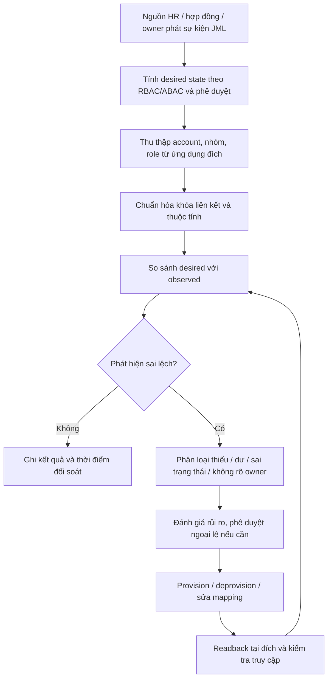

# So sánh account đích trong Account reconciliation

Trong **Identity and Access Management (IAM)**, **so sánh account đích** (*target-account comparison*) là hoạt động đối chiếu trạng thái tài khoản và quyền truy cập **đang tồn tại tại ứng dụng đích** với trạng thái **đáng lẽ phải tồn tại** theo nguồn dữ liệu có thẩm quyền và chính sách của tổ chức. Đây là bước cốt lõi của **account reconciliation**: xác định tài khoản thiếu, tài khoản dư, thuộc tính sai, quyền không phù hợp hoặc kết quả provisioning/deprovisioning chưa được thực thi đầy đủ.

Trong vòng đời **Joiner–Mover–Leaver (JML)**, phép so sánh có giá trị ở cả ba giai đoạn. Với Joiner, nó xác nhận tài khoản đã tạo và có đúng quyền; với Mover, nó tìm quyền từ vị trí cũ còn tồn dư; với Leaver, nó chứng minh tài khoản hoặc entitlement không còn cho phép truy cập. Chỉ thấy workflow **SCIM** thành công hay nhóm trong **IdP** đã thay đổi chưa đủ để kết luận trạng thái tại hệ thống đích đã khớp.

## 1. Account nguồn, account đích và trạng thái mong muốn

| Khái niệm | Ý nghĩa | Ví dụ |
| --- | --- | --- |
| **Identity gốc** | Chủ thể con người hoặc workload được tổ chức quản lý | Nhân viên có `personId=EMP-2084` |
| **Nguồn có thẩm quyền** | Hệ thống cung cấp sự kiện hoặc thuộc tính nghiệp vụ đáng tin | HRIS xác nhận nhân viên đã chuyển bộ phận |
| **Account đích** | Tài khoản tồn tại trên một ứng dụng/directory/SaaS cụ thể | User `u-884` trên CRM |
| **Desired state** | Trạng thái tài khoản, thuộc tính và quyền mà chính sách yêu cầu | Tài khoản active, role `ticket-reader` trong nhóm A |
| **Observed state** | Trạng thái thực tế đọc lại từ hệ thống đích | Tài khoản active, còn cả `ticket-reader` và `billing-admin` |
| **Reconciliation result** | Chênh lệch và quyết định xử lý | Thu hồi `billing-admin` chưa có căn cứ |

**Nguồn HRIS không phải lúc nào cũng là nguồn chân lý cho mọi quyền.** HR có thể là nguồn cho trạng thái lao động, bộ phận và ngày hiệu lực; còn chính sách IAM, phê duyệt từ data owner hoặc danh mục ứng dụng quyết định entitlement hợp lệ. Vì vậy, trạng thái mong muốn cần được **tính từ nhiều nguồn đúng trách nhiệm**, không đơn giản sao chép một trường HR sang ứng dụng.

## 2. Những yếu tố cần so sánh

Một account đích không chỉ có tên đăng nhập và cờ `active`. Phạm vi đối chiếu có thể gồm:

1. **Tồn tại và liên kết:** account có tồn tại, thuộc đúng identity và không bị trùng hoặc mồ côi?
2. **Trạng thái:** enabled, disabled, suspended, locked hoặc deleted có khớp chính sách?
3. **Thuộc tính:** email, department, organization, nhóm, manager, tenant hoặc loại account có đúng và đủ mới?
4. **Role/group:** quyền qua nhóm hoặc vai trò **RBAC** có đủ và không vượt phạm vi?
5. **Entitlement trực tiếp:** ACL, quyền cục bộ, role ứng dụng và quyền đặc biệt có được kiểm soát?
6. **Điều kiện ABAC:** thuộc tính người dùng/tài nguyên, dự án, khu vực, ngày hiệu lực có phản ánh ngữ cảnh hiện tại?
7. **Credential và phiên:** tài khoản đã vô hiệu hóa có còn đường truy cập thông qua API key, phiên hoặc token?
8. **Ownership và hạn dùng:** tài khoản dịch vụ, quyền tạm thời và account đối tác có owner và ngày hết hạn hợp lệ?

Không phải connector nào cũng cung cấp toàn bộ dữ liệu trên. Cần công bố rõ **phần nào đã kiểm chứng, phần nào chưa có khả năng quan sát** và áp dụng cách kiểm tra thay thế hoặc quản lý ngoại lệ khi cần.

## 3. Mô hình so sánh hai chiều

Đặt:

- `D` là tập account/entitlement **mong muốn** theo chính sách tại một thời điểm.
- `A` là tập account/entitlement **thực tế** đọc từ hệ thống đích.

Khi ánh xạ đã được chuẩn hóa, có thể phân loại:

```text
missing = D - A       # Thiếu account hoặc quyền cần có
extra   = A - D       # Dư account hoặc quyền không có căn cứ
match   = D ∩ A       # Đối tượng có mặt ở cả hai tập
```

Đây chỉ là mô hình đơn giản. **Có mặt trong cả hai tập không bảo đảm khớp mọi thuộc tính**: một account tồn tại ở cả nguồn và đích vẫn có thể mang sai trạng thái, sai nhóm hoặc phạm vi quyền. Việc triển khai phải so sánh từng trường/entitlement đã được chuẩn hóa, dựa trên chính sách và trạng thái hiệu lực.

Ví dụ:

| Account đích | Desired | Observed | Kết luận |
| --- | --- | --- | --- |
| CRM của Lan | Active, `ticket-reader`, team A | Active, `ticket-reader`, team A | Khớp phạm vi đã so sánh |
| ERP của Lan | Không còn `invoice-approver` | Vẫn có `invoice-approver` | **Quyền dư (residual access)** |
| Analytics của Lan | Có `analytics-reader` | Chưa có role | **Thiếu quyền** |
| CRM của người đã nghỉ | Disabled | Active | **Tài khoản hoạt động trái trạng thái nguồn** |
| Service `report-job` | Owner `team-data`, read-only | Không có owner, `admin` | **Mồ côi và quá quyền** |

Không nên tự động xóa mọi quyền xuất hiện trong `extra` trước khi kiểm tra nguồn phê duyệt hoặc ngoại lệ hợp lệ. Một quyền tạm thời còn hiệu lực và đã được phê duyệt có thể thuộc tập `D` dù không có trong bộ quyền chuẩn.

## 4. Khóa liên kết account: tránh so sánh nhầm người

Trước khi đối chiếu, hệ thống phải xác định account nào trên ứng dụng đích thuộc về identity nào. Khóa liên kết có thể gồm mã identity nội bộ, định danh account của ứng dụng, external ID do provisioning lưu, issuer và subject trong federation, hoặc bảng mapping có quản trị.

**Không dùng email làm khóa duy nhất nếu không có cơ chế bảo đảm phù hợp.** Email có thể đổi khi nhân viên chuyển bộ phận, được tái sử dụng hoặc không duy nhất giữa các môi trường. Đối với tài khoản SSO, giá trị `sub` thường cần được diễn giải trong ngữ cảnh `iss`; cùng một chuỗi `sub` từ hai nhà phát hành khác nhau không nhất thiết là cùng một người.

Minh họa bản ghi liên kết:

```json
{
  "identityId": "EMP-2084",
  "targetSystem": "customer-crm",
  "targetAccountId": "u-884",
  "externalId": "iam-2084-crm",
  "sourceRelationship": "employee",
  "lastObservedAt": "2026-11-23T01:00:00Z"
}
```

Đây là schema minh họa, không phải một schema bắt buộc của SCIM. Khi nhiều account có dấu hiệu khớp cùng một identity, cần đưa vào quy trình xử lý **ambiguous correlation** thay vì tự động gộp rồi thu hồi nhầm quyền.

## 5. Quy trình so sánh account đích



### Bước 1 — Tính trạng thái mong muốn

IAM/IGA tập hợp sự kiện **Joiner–Mover–Leaver**, trạng thái hợp đồng, ngày hiệu lực, role nền tảng, quyền đã phê duyệt và ngoại lệ chưa hết hạn. Các chính sách **RBAC** tạo entitlement theo vai trò; **ABAC** bổ sung phạm vi dự án, chi nhánh, độ nhạy cảm dữ liệu hoặc trạng thái phiên.

Phải dùng dữ liệu **có hiệu lực tại thời điểm đối soát**. Sự kiện Mover được nhập hôm nay nhưng có hiệu lực tuần tới không nhất thiết yêu cầu gỡ quyền ngay hôm nay; ngược lại, sự kiện Leaver đã có hiệu lực cần được ưu tiên xử lý theo SLA bảo mật.

### Bước 2 — Đọc dữ liệu thực tế ở ứng dụng đích

Thu thập trạng thái qua API quản trị, **SCIM**, connector chuyên dụng, báo cáo xuất từ ứng dụng hoặc quy trình thủ công được kiểm soát. Ghi thời điểm snapshot, số lượng account đọc được, phạm vi tenant/đơn vị và lỗi phân trang hoặc thiếu quyền đọc.

**Dữ liệu đọc về chưa chắc đầy đủ.** Ví dụ API chỉ trả những user đang active, không trả role cục bộ hoặc đã bị phân trang thiếu. Phải xem thiếu dữ liệu là tình trạng không chắc chắn, không được suy ra tài khoản không tồn tại khi chưa hoàn tất truy vấn.

### Bước 3 — Chuẩn hóa và liên kết dữ liệu

Chuẩn hóa các biểu diễn khác nhau, ví dụ `enabled=true` và `active=true` khi chúng thực sự tương đương theo hợp đồng tích hợp, hoặc tên role ứng dụng với entitlement ID trong IAM.

Không được gộp các trạng thái khác nghĩa. `suspended` có thể khác `disabled`; quyền kế thừa từ nhóm khác với quyền gán trực tiếp; role `admin` trong hai ứng dụng không nhất thiết có cùng tác động. Mỗi ánh xạ cần phiên bản, chủ sở hữu và quy tắc xử lý giá trị không xác định.

### Bước 4 — Phân loại sai lệch

Phân loại kết quả thành **missing account**, **unexpected account**, **missing grant**, **excess entitlement**, **attribute mismatch**, **status mismatch**, **orphan account** hoặc **unverified**. Một sự kiện có thể sinh nhiều sai lệch: ví dụ user CRM vẫn active và còn role admin sau Leaver.

Ưu tiên theo tác động. Tài khoản admin còn hoạt động sau khi chủ thể nghỉ việc thường cần xử lý khẩn cấp hơn một thuộc tính tên hiển thị chưa đồng bộ. Dẫu vậy, quyền thiếu cũng quan trọng vì làm gián đoạn hoạt động sau Joiner/Mover.

### Bước 5 — Khắc phục và xác minh lại

Đối với quyền thiếu, provisioning theo chính sách; đối với quyền dư, deprovisioning hoặc khóa theo chính sách. Thực hiện qua IdP, **SCIM/connector** hoặc API ứng dụng, theo dõi trạng thái và retry an toàn. Đối với account nghi mồ côi, xác minh owner và phụ thuộc nghiệp vụ trước khi xóa.

Sau sửa lỗi, **đọc lại trực tiếp từ đích** và kiểm tra kết quả thực thi quyền khi cần. Một HTTP 200 hay ticket “đã xử lý” chỉ chứng minh yêu cầu được tiếp nhận/đã hoàn tất ở một khâu, chưa đủ để kết luận entitlement đã đúng.

### Bước 6 — Ghi kiểm toán và theo dõi ngoại lệ

Lưu mã correlation, identity, target system, phiên bản chính sách, desired/observed, từng sai lệch, người duyệt ngoại lệ, thao tác sửa, readback và thời điểm giải quyết. Tránh ghi mật khẩu, token, private key hoặc dữ liệu cá nhân không cần thiết trong log.

Nếu hệ thống không hỗ trợ đọc quyền hiệu lực, đánh dấu rõ **không thể xác minh đầy đủ**, áp dụng kiểm tra thay thế và đưa tồn đọng vào danh sách ngoại lệ có owner và hạn xử lý.

## 6. Joiner, Mover, Leaver: kiểm tra trọng tâm khác nhau

| Giai đoạn | Cần so sánh | Thất bại dễ bị bỏ sót |
| --- | --- | --- |
| **Joiner** | Tài khoản mới tồn tại, enabled đúng thời điểm, nhóm và quyền ban đầu phù hợp | Tạo thành công user nhưng thiếu role; hoặc kích hoạt quá sớm |
| **Mover** | Thuộc tính mới, role mới, quyền cũ phải mất và quyền chung cần giữ | Chỉ cộng quyền mới khiến tích lũy đặc quyền |
| **Leaver** | Tài khoản bị vô hiệu hóa, nhóm/ACL bị thu hồi, phiên và token được xử lý | Khóa IdP nhưng SaaS vẫn active hoặc token vẫn gọi API |

Ví dụ Mover: Hà chuyển từ tài chính sang phân tích dữ liệu. HRIS ghi department mới; IdP bỏ nhóm `finance`; nhưng ứng dụng ERP vẫn giữ entitlement `invoice-approver` được gán trực tiếp. Nếu chỉ so sánh nhóm IdP, trạng thái có vẻ đúng. **Đọc quyền ở ERP** mới phát hiện quyền tồn dư cần thu hồi.

Ví dụ Leaver: một nhà thầu hết hợp đồng. SCIM đã đặt account thành `active=false`, song ứng dụng không kiểm tra trạng thái account trên những request sử dụng session cũ. Reconciliation về **trạng thái account** có thể đạt, nhưng **mục tiêu ngăn truy cập** vẫn chưa được chứng minh. Phải phối hợp kiểm tra session/token và chính sách truy cập tại điểm thực thi.

## 7. Account reconciliation với tài khoản dịch vụ

Tài khoản phi con người có thể không xuất hiện trong HRIS. Desired state cần xuất phát từ **danh mục dịch vụ, hệ thống triển khai, owner, môi trường chạy và chính sách quyền API**. Khi một nhân viên sở hữu workload nghỉ việc, cần xác minh service account vẫn có owner hợp lệ và credential không còn nằm trong quyền kiểm soát của người đã rời tổ chức.

Những câu hỏi quan trọng:

- Service account còn có workload thật sự sử dụng không?
- Owner và môi trường triển khai hiện tại có đúng không?
- API scope, role và credential còn cần thiết, còn hạn và được lưu an toàn không?
- Có khóa lâu dài, tài khoản dùng chung hoặc quyền quản trị không có căn cứ không?
- Nếu không còn sử dụng, có thể deprovision mà không làm gián đoạn phụ thuộc nghiệp vụ không?

Không nên tự động xóa service account chỉ vì không tìm thấy mã nhân viên trong HR; điều đó là dấu hiệu cần **loại cơ chế đối chiếu khác**, không phải bằng chứng chắc chắn tài khoản trái phép.

## 8. Những sai lầm khi so sánh account đích

| Sai lầm | Hậu quả | Cách xử lý |
| --- | --- | --- |
| So sánh theo email đơn thuần | Liên kết nhầm identity hoặc bỏ sót tài khoản đổi email | Dùng stable ID và mapping có quản trị |
| Chỉ so sánh số lượng user | Không phát hiện role thừa hoặc thiếu | Đối chiếu từng account và entitlement |
| Tin nhóm IdP là toàn bộ quyền | Bỏ qua ACL/role ứng dụng cục bộ | Readback từ ứng dụng đích |
| Dùng snapshot cũ | Báo sai hoặc bỏ sót thay đổi Mover/Leaver | Ghi timestamp, kiểm soát độ trễ và đối soát lại |
| Bỏ qua phân trang/lỗi API | Coi dữ liệu thiếu là tài khoản đã biến mất | Kiểm chứng tính đầy đủ của dữ liệu đầu vào |
| Tự động xóa account nghi mồ côi | Gây gián đoạn workload hoặc mất dữ liệu | Kiểm tra owner, phụ thuộc và phê duyệt |
| Chỉ sửa rồi đóng ticket | Không biết quyền thực tế đã thay đổi chưa | Readback và kiểm thử truy cập có kiểm soát |
| Không quản lý ngoại lệ | Quyền tồn dư kéo dài | Owner, hạn xử lý, biện pháp bù trừ và audit |

## 9. Chỉ số để đánh giá chất lượng reconciliation

Một số chỉ số hữu ích:

1. **Coverage:** tỷ lệ hệ thống, account và entitlement thuộc phạm vi có thể quan sát và đối chiếu.
2. **Match rate:** tỷ lệ account/entitlement khớp desired state ở thời điểm đo; cần ghi rõ mẫu số và phạm vi.
3. **Residual access count:** số quyền hoặc account không còn căn cứ nhưng vẫn hiệu lực.
4. **Missing access count:** số quyền cần có nhưng chưa được cấp.
5. **Time to reconcile:** thời gian từ sự kiện JML đến khi trạng thái tại đích được xác minh khớp.
6. **Orphan rate:** tỷ lệ account không xác định được identity hoặc owner đáng tin.
7. **Exception aging:** số ngoại lệ quá hạn và thời gian tồn đọng.
8. **Readback completeness:** tỷ lệ kết quả đối soát có bằng chứng đầy đủ từ ứng dụng đích.

Không nên chỉ báo cáo “99% đồng bộ thành công” mà bỏ qua 1% còn lại. Một account admin của người đã nghỉ có thể rủi ro cao hơn hàng nghìn account thông thường đã khớp. Cần phân lớp theo **mức độ nhạy cảm và tác động**.

## 10. Tình huống tự kiểm tra

**Tình huống A:** IdP không còn nhóm `finance` của nhân viên đã chuyển bộ phận, nhưng ERP vẫn lưu role `invoice-approver`. Reconciliation chỉ dựa vào IdP có đủ không? **Không.** Phải đọc entitlement trực tiếp ở ERP để nhận diện và thu hồi quyền tồn dư.

**Tình huống B:** API trả 200 nhưng chỉ xuất trang đầu gồm 100 user. Có thể coi các account không nằm trong trang đầu là không tồn tại không? **Không.** Phải hoàn tất phân trang và xác minh phạm vi dữ liệu.

**Tình huống C:** Một account không khớp `personId` nào trong HRIS, nhưng được dùng bởi tác vụ sao lưu của đội hạ tầng. Có nên xóa ngay không? **Không.** Đây có thể là service account; cần đối chiếu với danh mục workload và owner.

**Tình huống D:** SCIM đặt `active=false` cho tài khoản Leaver, nhưng access token cũ còn được API chấp nhận. Có thể coi toàn bộ mục tiêu deprovisioning đạt không? **Chưa.** Trạng thái account đã đổi nhưng cần xác minh khả năng truy cập và cửa sổ token còn hiệu lực.

**Tình huống E:** User có quyền tạm thời vượt role cơ bản, nhưng quyền chưa hết hạn và được data owner phê duyệt. Đó có chắc là quyền dư không? **Không.** Desired state phải bao gồm ngoại lệ có căn cứ và thời hạn trước khi tính sai lệch.

## Ghi nhớ

**So sánh account đích** là đối chiếu **desired state** của danh tính và quyền với **observed state** tại từng ứng dụng, không chỉ so sánh dữ liệu nguồn hay kết quả gửi lệnh provisioning. Cần liên kết account đúng chủ thể, đối chiếu trạng thái/thuộc tính/role/entitlement, phát hiện quyền dư và quyền thiếu, rồi **readback và xác minh sau khắc phục**. Trong IAM, sự phối hợp **HRIS, IdP/SSO, SCIM, RBAC/ABAC, quản lý service identity và kiểm toán** giúp quy trình **Joiner–Mover–Leaver** hạn chế tài khoản mồ côi, quyền tích lũy và truy cập tồn dư.
