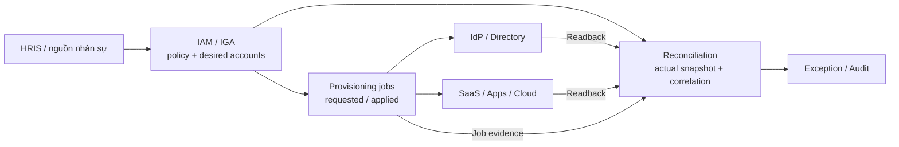
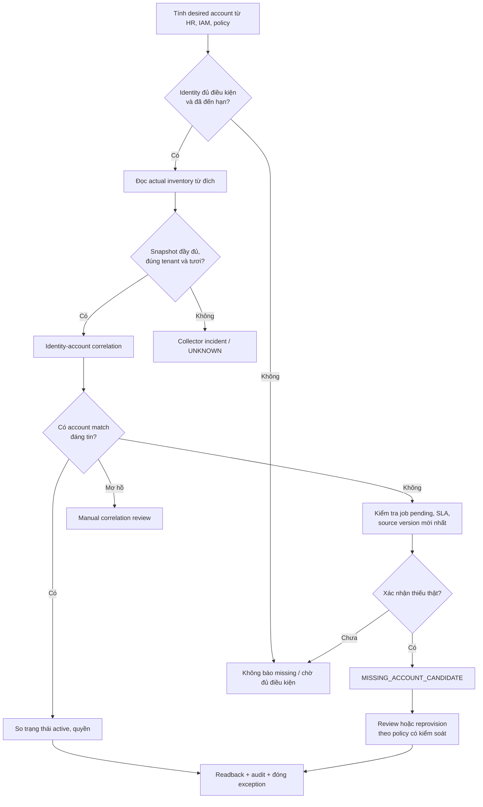

# Phát hiện account thiếu trong Account reconciliation của IAM

## Mục tiêu học tập

Sau bài học, người học có thể:

1. Giải thích **account thiếu (missing account)** trong quá trình **account reconciliation**, phân biệt với account mồ côi (orphan), account bị vô hiệu, account chưa liên kết và quyền/nhóm bị thiếu.
2. Xác định **account mong muốn (expected/desired)** từ nguồn nhân sự, chính sách IAM và trạng thái Joiner–Mover–Leaver (JML) thay vì coi mọi người đều cần account ở mọi ứng dụng.
3. Thu thập **account thực tế (observed/actual)** từ IdP, directory, SaaS, ứng dụng nội bộ và các đích SCIM/API với mốc thời gian và phạm vi rõ ràng.
4. Liên kết identity–account bằng ID đáng tin cậy; xử lý email đổi tên, account trùng, nhiều tenant, provisioning bất đồng bộ và dữ liệu kiểm kê chưa đầy đủ.
5. Thiết kế thuật toán phát hiện, phân loại, xác minh và khắc phục account thiếu có cơ chế chống cấp nhầm quyền và chống tạo account trùng.
6. Xây dựng quy trình cảnh báo, kiểm toán, SLA, đối soát sau sửa lỗi và chỉ số đánh giá chất lượng.
7. Giải thích sự khác nhau giữa việc khắc phục thiếu account ở Joiner, thay đổi account khi Mover và cố ý không còn account khi Leaver.

## 1. Account reconciliation là gì?

Trong **Identity and Access Management (IAM)**, **account reconciliation** là quá trình thu thập trạng thái thực tế từ các hệ thống đích, so sánh với trạng thái tài khoản/quyền mà tổ chức mong muốn theo chính sách, rồi xác định sai lệch cần điều tra hoặc xử lý.

Ví dụ nhân viên Lan bắt đầu làm việc, được phê duyệt sử dụng cổng nhân sự và hệ thống quản lý công việc. IAM đã tạo identity nội bộ, nhưng kiểm tra ứng dụng quản lý công việc không tìm thấy account tương ứng. Đây **có thể** là tình trạng account thiếu; cũng có thể là ứng dụng chưa đồng bộ, account đã tồn tại dưới ID khác hoặc quyền sử dụng chỉ được cấp khi người dùng đăng nhập lần đầu.

**Phát hiện account thiếu** là bài toán trả lời câu hỏi:

> **Một account có bắt buộc phải tồn tại cho identity này ở hệ thống đích, tại thời điểm này, nhưng hiện không tìm thấy account hợp lệ nào đáp ứng yêu cầu đó hay không?**

Để trả lời đúng phải có hai phía độc lập:

- **Desired state:** account nào cần có, ở tenant/hệ thống nào, cho identity nào, vào thời điểm nào và với điều kiện gì.
- **Actual state:** account nào hiện được quan sát ở đích, trạng thái gì, ánh xạ với identity nào và dữ liệu kiểm kê có đáng tin cậy hay không.

Chỉ nhìn account inventory rồi đếm “những người chưa có tài khoản” sẽ tạo nhiều cảnh báo sai nếu bỏ qua chính sách đủ điều kiện và trạng thái JML.

### 1.1. Những đối tượng thường bị nhầm lẫn

| Khái niệm | Dấu hiệu | Ý nghĩa | Cách xử lý ban đầu |
|---|---|---|---|
| **Missing account** | Chính sách yêu cầu account, nhưng không thấy account hợp lệ trong đích đã kiểm kê tin cậy | Khả năng provisioning bị thiếu hoặc sai | Xác minh nguồn, mapping, thời điểm và trạng thái đích |
| **Unlinked account** | Account tồn tại ở đích nhưng không liên kết được với identity mong muốn | Thiếu hoặc sai account correlation | Điều tra ID và nguồn, không tạo account mới ngay |
| **Orphan account** | Account ở đích không có identity/owner/nhu cầu hợp lệ liên kết | Có thể là truy cập tồn dư hoặc account ngoài quản trị | Xác minh owner, đánh giá disable/revoke theo policy |
| **Disabled account** | Account có tồn tại nhưng bị vô hiệu | Không nhất thiết “thiếu” về mặt tồn tại; có thể thiếu khả năng sử dụng | So với desired lifecycle/access state |
| **Missing entitlement** | Account có nhưng thiếu role, group hoặc permission | Sai lệch phân quyền, không phải thiếu account | Reconcile entitlement riêng |
| **Pending account** | Yêu cầu provisioning đang chờ hoặc trong cửa sổ đồng bộ | Có thể chưa tới hạn | Theo dõi deadline, không tạo trùng |
| **Dormant account** | Account tồn tại nhưng lâu không được sử dụng | Chưa chắc sai, có thể dùng định kỳ | Xác minh nhu cầu và owner |
| **Unknown / incomplete snapshot** | Không lấy được inventory đầy đủ từ ứng dụng | Chưa thể kết luận có account thiếu | Khắc phục thu thập và đánh dấu UNKNOWN |

Một account bị disable sau Leaver có thể được giữ để phục vụ audit và retention. Không được xem account đó là “thiếu” rồi kích hoạt lại vì vẫn thấy hồ sơ HR lịch sử.

### 1.2. “Không tìm thấy” khác “chắc chắn không tồn tại”

Giả sử API ứng dụng timeout hoặc tài khoản tích hợp chỉ đọc được 100 user đầu tiên. Kết quả truy vấn không thấy Lan **không phải bằng chứng đáng tin rằng account của Lan không tồn tại**.

Để kết luận, hệ thống cần xác định phạm vi kiểm kê, trạng thái phân trang, thời điểm snapshot, quyền của connector, tenant đang truy vấn và cách xử lý lỗi. Một số ứng dụng chỉ cho tìm theo email hoặc trả dữ liệu trễ, nên cần đối chiếu thêm bằng ID và bằng chứng provisioning.

## 2. Phạm vi bài toán và nguồn dữ liệu

Một identity có thể tương ứng nhiều account theo ứng dụng, môi trường hoặc cấp đặc quyền. Vì vậy, đối soát nên diễn ra ở mức **identity × target system × account purpose**, không giả định quan hệ một–một cho toàn tổ chức.

| Thành phần | Vai trò trong reconciliation | Ví dụ |
|---|---|---|
| **HRIS / nguồn nhà thầu** | Xác nhận quan hệ nhân sự, loại đối tượng, ngày hiệu lực | `personId`, trạng thái active, ngày bắt đầu |
| **IAM / identity registry** | Quản lý identity ID, correlation và vòng đời | `identityId`, `lifecycleState` |
| **IGA / policy engine** | Tính account/role cần có, approval và exception | Quyền cơ sở, entitlement theo công việc |
| **IdP / directory** | Cung cấp account xác thực, group và trạng thái thực tế | Object ID, enabled/disabled, groups |
| **SCIM / provisioning connector** | Tạo, cập nhật, tìm account và đồng bộ dữ liệu ở đích | `User.id`, `externalId`, `active` |
| **Ứng dụng SaaS/nội bộ** | Nguồn thực tế cuối cùng của account và quyền tại ứng dụng | Local account ID, app role |
| **PAM / cloud IAM** | Quản lý account đặc quyền và một số principal chuyên dụng | Privileged account, service principal |
| **Audit / observability** | Ghi bằng chứng, sai lệch, retry và tiến độ khắc phục | Correlation ID, trạng thái readback |

Nguồn HR có thẩm quyền quyết định **người có quan hệ làm việc hợp lệ hay không**, nhưng không nhất thiết quyết định ID account ở từng ứng dụng. Ngược lại, ứng dụng đích có thẩm quyền cho biết **account thực sự có mặt và có thể sử dụng ở đó hay không**.

### 2.1. Không được đồng nhất mong muốn với yêu cầu đã gửi

Một hệ thống có thể lưu lệnh `CREATE_USER` đã gửi thành công nhưng account vẫn chưa tồn tại vì connector chỉ nhận request và xử lý bất đồng bộ. **Desired state**, **provisioning request state** và **observed state** cần lưu riêng.



Nếu chỉ so sánh dữ liệu trong IAM với dữ liệu do IAM tự ghi “provisioned”, hệ thống có thể bỏ sót lỗi thực thi ở đích. **Reconciliation cần quan sát hệ thống đích**, không chỉ tin trạng thái workflow.

## 3. Cách quyết định account “phải tồn tại”

Không phải mọi người đều cần account trong mọi ứng dụng. Để tính **expected account**, policy phải xét ít nhất các yếu tố:

1. **Identity hợp lệ:** ID được liên kết với nguồn nhân sự/nguồn bảo trợ đúng đối tượng.
2. **Trạng thái vòng đời:** Joiner đã đủ điều kiện, Mover đang có vai trò phù hợp, hay Leaver đã hết quyền?
3. **Thời điểm hiệu lực:** account có được yêu cầu tồn tại ngay, hay chỉ khi bắt đầu làm việc?
4. **Loại identity:** nhân viên, nhà thầu, đối tác, account đặc quyền hay workload.
5. **Nhu cầu ứng dụng:** ứng dụng có thuộc tập quyền cơ sở hoặc có yêu cầu/phê duyệt hợp lệ?
6. **Identity proofing:** mức tin cậy đã đủ để tạo/kích hoạt account theo policy chưa?
7. **Ràng buộc môi trường và tenant:** đúng pháp nhân, tổ chức, dự án, production/test.
8. **Kiểu provisioning:** account được tạo trước, theo sự kiện, hay chỉ **JIT** khi đăng nhập?
9. **Ngoại lệ có thời hạn:** quyền trì hoãn, suspension, hold hoặc cấp tạm đã được phê duyệt.

### 3.1. Ma trận trạng thái mục tiêu

| Ngữ cảnh | Desired account | Lý do |
|---|---|---|
| Joiner chưa đến ngày bắt đầu, ứng dụng không pre-provision | **Không bắt buộc tồn tại ngay** | Chưa tới mốc hiệu lực |
| Joiner đủ điều kiện, app thuộc birthright đã phê duyệt | **Phải có** theo SLA | Cần sẵn sàng cho công việc |
| Joiner chưa hoàn thành proofing bắt buộc | **PENDING/HOLD** theo policy | Không kích hoạt quyền khi mức tin cậy chưa đạt |
| Mover không còn làm việc với ứng dụng A | **Không còn được phép có account active**, hoặc cần deprovision theo policy | Ngăn quyền tích lũy |
| Mover được duyệt ứng dụng B | **Phải có** khi đến hiệu lực và sau approval | Nhu cầu công việc mới |
| Leaver đã đến ngày hiệu lực | **Không còn account có quyền hoạt động** | Thu hồi truy cập; bản ghi disabled có thể được giữ |
| Ứng dụng dùng JIT provisioning | **Không nhất thiết có trước lần đăng nhập đầu** | Cách thiết kế ứng dụng |
| Nhà thầu hết hạn hợp đồng | **Không có account active** | Sponsor/hiệu lực không còn |
| Hệ thống đang có sự cố kiểm kê | **UNKNOWN** | Chưa đủ bằng chứng xác nhận sai lệch |

Đặc biệt, phải phân biệt **account hiện hữu** với **account hoạt động**. Một chính sách có thể yêu cầu account disabled được giữ để audit, nhưng không cho phép truy cập.

### 3.2. Ví dụ desired account record

Schema sau **chỉ là mô hình dữ liệu nội bộ minh họa**, không phải chuẩn SCIM:

```json
{
  "identityId": "IDN-2048",
  "sourcePersonId": "HR-4182",
  "targetSystem": "TASK_PORTAL",
  "targetTenant": "corporate-vn",
  "accountPurpose": "STANDARD_USER",
  "desiredExistence": "PRESENT",
  "desiredEnabled": true,
  "effectiveFrom": "2026-12-01T00:00:00+07:00",
  "requiredBy": "2026-12-01T09:00:00+07:00",
  "eligibilitySource": "birthright-task-portal",
  "policyVersion": "iam-reconcile-v3",
  "approvalId": null
}
```

Trong ví dụ này, ``desiredExistence=PRESENT` là mục tiêu tạo account; ``desiredEnabled=true` là yêu cầu sử dụng được. Hai thuộc tính nên tách nhau để nhận diện trường hợp “đã tạo nhưng đang disabled”.

## 4. Thu thập account thực tế từ hệ thống đích

Đối soát cần lấy **actual state** theo phạm vi đã công bố, thay vì chỉ nhìn những account từng được IAM cấp phát.

Các phương pháp phổ biến:

- Gọi API liệt kê/tìm User của IdP hoặc ứng dụng.
- Dùng SCIM API `/Users`, nếu hệ thống đích hỗ trợ.
- Đọc trạng thái tài khoản và membership qua directory connector.
- Đối chiếu account registry của ứng dụng không hỗ trợ SCIM.
- Với hệ thống legacy, dùng bản xuất dữ liệu có kiểm soát, mốc thời gian rõ và phương thức chứng thực độ đầy đủ.
- Đối với cloud/PAM, dùng API liệt kê principal, role và credential theo phạm vi quyền được cấp.

### 4.1. Một snapshot phải có metadata chất lượng

Ví dụ bản ghi kiểm kê:

```json
{
  "snapshotId": "SNAP-TASK-20261201-01",
  "targetSystem": "TASK_PORTAL",
  "targetTenant": "corporate-vn",
  "capturedAt": "2026-12-01T09:05:00+07:00",
  "coverage": {
    "paginationCompleted": true,
    "connectorAuthorized": true,
    "tenantVerified": true,
    "isComplete": true
  },
  "accounts": [
    {
      "targetAccountId": "APP-U-7781",
      "externalId": "IDN-2048",
      "userName": "lan@example.org",
      "active": true
    }
  ]
}
```

Đây là schema minh họa. Trong thực tế, inventory lớn nên được xử lý theo trang/stream hoặc kho trung gian thay vì nhúng toàn bộ vào JSON.

Nếu `isComplete=false`, **không được tự động kết luận hàng loạt account thiếu** chỉ từ dữ liệu chưa đầy đủ. Nên tạo sự kiện `INVENTORY_INCOMPLETE` và khắc phục lỗi collector.

### 4.2. Tính tươi mới và độ trễ

Phải đánh giá:

- Snapshot được lấy **trước hay sau** mốc account cần sẵn sàng?
- Ứng dụng có **eventual consistency** hoặc trì hoãn đồng bộ không?
- Connector có đủ quyền đọc mọi account trong tenant phù hợp không?
- Có snapshot hoặc API response bị cache không?
- Trang cuối của kết quả đã được tải thành công chưa?
- Có bộ lọc vô tình loại account disabled, guest hoặc account thuộc nhóm khác không?

Một sự cố mà API trả kết quả rỗng có thể là **lỗi kiểm kê**, không phải hàng nghìn account bị mất cùng lúc.

## 5. Identity–account correlation: bước dễ gây sai nhất

Trước khi đánh dấu “thiếu”, phải biết account thực tế có thể thuộc về identity nào. Cần ưu tiên các khóa **ổn định và có nguồn tin cậy**, ví dụ:

| Khóa | Vai trò | Độ tin cậy và lưu ý |
|---|---|---|
| `identityId` | Khóa quản trị nội bộ | Chỉ tin khi mapping với đích được thiết lập hợp lệ |
| `sourcePersonId` | Khóa HR/hợp đồng | Dùng để liên kết nguồn identity, không mặc định là ID account đích |
| `targetAccountId` | ID user ở ứng dụng/SCIM server | Ưu tiên cho truy vấn trạng thái account đã biết |
| `externalId` (SCIM) | ID do provisioning client định nghĩa | Chỉ có ý nghĩa khi connector đảm bảo cách ghi và phạm vi duy nhất phù hợp |
| `idpObjectId` | ID trong IdP | Không tự suy ra ID của ứng dụng khác |
| `userName` hoặc email | Thuộc tính đăng nhập/hiển thị | Có thể đổi, tái sử dụng hoặc trùng; không nên là khóa correlation duy nhất |
| `tenantId`/`realm` | Phạm vi hệ thống | Phải kết hợp với account ID để tránh nhầm tenant |

### 5.1. Các trạng thái correlation

Cần phân biệt:

1. **MATCHED:** có bằng chứng một account thực tế ánh xạ đúng identity và mục đích.
2. **NO_MATCH:** chưa thấy account hợp lệ trong snapshot đáng tin.
3. **AMBIGUOUS:** có nhiều ứng viên hoặc dữ liệu không thống nhất, chưa quyết định được.
4. **UNTRUSTED_MATCH:** chỉ khớp tên/email, chưa đủ bằng chứng để gộp.
5. **UNOBSERVABLE:** không thể xác minh vì collector/API lỗi hoặc thiếu quyền.

Chỉ trong một số trường hợp **NO_MATCH sau đầy đủ điều kiện** mới tạo kết luận missing account. Với `AMBIGUOUS`, tạo account mới ngay có thể sinh account trùng và liên kết nhầm dữ liệu của người khác.

### 5.2. Ví dụ trùng email sau tái tuyển dụng

Nhân viên An nghỉ việc năm trước, ứng dụng giữ account disabled để lưu dữ liệu. Năm nay An quay lại với cùng email nhưng HR phát hợp đồng mới. Trước khi tạo account mới, IAM phải:

- Xác định có phải cùng một identity theo chính sách tổ chức không.
- Xem trạng thái account cũ và nguyên nhân disabled.
- Kiểm tra role, dữ liệu sở hữu, session/token cũ và retention.
- Xác minh điều kiện Joiner/rehire và proofing cần thiết.
- Tính quyền mới theo chính sách hiện tại thay vì tự bật account với toàn bộ quyền cũ.

Một lần tìm theo email có thể đưa ra ứng viên, **không được thay thế quyết định correlation có kiểm chứng**.

## 6. Thuật toán phát hiện account thiếu

Bài toán tập hợp có thể viết đơn giản:

```text
ExpectedAccountKeys = tập account phải hiện hữu, đủ điều kiện, đã đến hạn
ObservedAccountKeys = tập account kiểm kê được và match tin cậy
MissingCandidates = ExpectedAccountKeys - ObservedAccountKeys
```

Nhưng trong thực tế phải xử lý account disabled, account chưa đến hạn, mapping mơ hồ và snapshot không đầy đủ. Nên xây dựng **phân loại sai lệch**, không chỉ phép trừ hai tập.

### 6.1. Bảng quyết định

| Desired state | Actual state | Snapshot | Kết quả |
|---|---|---|---|
| Không yêu cầu account | Không thấy | Đầy đủ | Không có vấn đề |
| Account bắt buộc, đã đến hạn | Không thấy match | Đầy đủ và mapping đáng tin | **MISSING_ACCOUNT_CANDIDATE** |
| Account bắt buộc, đã đến hạn | Tồn tại đúng account, active đúng | Đầy đủ | **IN_SYNC** |
| Account bắt buộc, đã đến hạn | Tồn tại nhưng disabled | Đầy đủ | **ACCOUNT_STATE_MISMATCH** |
| Account bắt buộc, đã đến hạn | Account có nhưng chưa link | Đầy đủ | **UNLINKED_ACCOUNT_REVIEW** |
| Account bắt buộc, đã đến hạn | Nhiều account khả nghi | Đầy đủ | **AMBIGUOUS_CORRELATION** |
| Account bắt buộc nhưng chưa tới SLA | Chưa thấy | Đầy đủ | **PROVISIONING_PENDING** |
| Account bắt buộc | Không thấy | Không đầy đủ/hết hạn | **INVENTORY_UNKNOWN** |
| Leaver đã hiệu lực | Account active | Đầy đủ | **RESIDUAL_ACTIVE_ACCOUNT** |
| Leaver đã hiệu lực | Account disabled được giữ | Đầy đủ | Theo policy retention, thường không phải missing |

**MISSING_ACCOUNT_CANDIDATE** là tín hiệu cần xác minh lại, không phải chỉ thị tạo user ngay lập tức.

### 6.2. Pseudocode đối soát an toàn

```text
function reconcileAccount(identity, target, now):
    source = loadVerifiedLifecycleSource(identity)
    desired = computeDesiredAccount(identity, target, source, now)

    if desired.status == HOLD_OR_NOT_APPLICABLE:
        return recordNoMissingAlert(desired.reason)

    snapshot = readTargetAccountInventory(target)
    if not snapshot.complete or snapshot.stale or snapshot.wrongTenant:
        return openCollectorException("INVENTORY_UNKNOWN")

    matches = correlateWithVerifiedKeys(
        identity,
        target,
        snapshot.accounts
    )

    if matches.status == AMBIGUOUS:
        return openReviewCase("AMBIGUOUS_CORRELATION")

    if matches.status == UNTRUSTED_ONLY:
        return openReviewCase("UNLINKED_ACCOUNT_REVIEW")

    if matches.status == MATCHED:
        return compareEnabledStateAndEntitlements(
            desired, matches.account
        )

    if now < desired.requiredBy:
        return recordPending("PROVISIONING_PENDING")

    if provisioningJobIsStillProcessing(identity, target):
        return recordPendingWithDeadline("PROVISIONING_IN_PROGRESS")

    if not lifecycleVersionStillCurrent(identity, source.version):
        return retryWithLatestSource()

    candidate = recordMissingAccountCandidate(
        identity, target, desired, snapshot
    )
    return routeToSafeVerificationAndRemediation(candidate)
```

Đây là pseudocode minh họa. Trong triển khai thật, cần thêm transaction/optimistic locking, giới hạn API, thứ tự sự kiện, nhiều account hợp lệ cho cùng identity và cơ chế tránh race condition. **Tuyệt đối không dùng “không có kết quả API” làm căn cứ tự động tạo account hàng loạt khi chưa biết API đã trả hết dữ liệu hay chưa.**

### 6.3. Phân biệt kết quả trạng thái tồn tại và khả năng sử dụng

Một account có thể:

- **Exists = true, active = false:** đã có bản ghi nhưng đăng nhập đang bị khóa.
- **Exists = true, active = true, permission = missing:** account sẵn sàng nhưng quyền nhóm/role còn thiếu.
- **Exists = true, active = true, login blocked:** policy MFA/conditional access hoặc trạng thái hợp đồng không cho truy cập.
- **Exists = false:** không tìm thấy account trong phạm vi quan sát đáng tin.
- **Exists = unknown:** chưa có bằng chứng inventory.

Chỉ trường hợp thứ tư mới là **thiếu account về mặt tồn tại**, và chỉ khi desired state thực sự yêu cầu nó. Những trường hợp khác cần workflow sửa account state, entitlement hoặc xác thực riêng.

## 7. SCIM hỗ trợ kiểm tra như thế nào?

**SCIM 2.0 (System for Cross-domain Identity Management)** có thể cung cấp API quản trị user/group từ IdP/IAM đến ứng dụng. Trong SCIM:

- `User.id` là ID do service provider cấp trong phạm vi đích.
- `externalId` là giá trị do provisioning client cung cấp để hỗ trợ correlation.
- `userName` là tên định danh người dùng ở service provider, không nên mặc định bất biến.
- `active` phản ánh trạng thái active theo semantics của service provider.

Ví dụ truy vấn account nếu đã có ID đích:

```http
GET /scim/v2/Users/{targetUserId}
Authorization: Bearer <redacted>
Accept: application/scim+json
```

Nếu connector hỗ trợ filter, có thể tìm bằng khóa externalId đã được gán đáng tin cậy:

```http
GET /scim/v2/Users?filter=externalId%20eq%20%22IDN-2048%22
Authorization: Bearer <redacted>
Accept: application/scim+json
```

Phần query đã URL-encode để minh họa. SCIM server có thể giới hạn khả năng filter, các thuộc tính được phép tìm kiếm hoặc phạm vi tenant. Kết quả 0, lỗi 404, lỗi 403 và timeout cần xử lý **khác nhau**:

| Phản hồi | Diễn giải khả dĩ | Hành động |
|---|---|---|
| `200` và tìm thấy một user đúng mapping | Account có tồn tại | Kiểm tra trạng thái/entitlement |
| `200` và `totalResults=0` trong truy vấn đáng tin | Có thể không có match | Kiểm tra loại query, tenant và dữ liệu đồng bộ |
| `404` cho ID đích đã biết | Account có thể không còn tại đích hoặc ID sai | Kiểm tra thời điểm, mapping, nguồn inventory |
| `401/403` | Connector thiếu xác thực/quyền truy cập | Không kết luận account thiếu |
| `429` | Bị giới hạn tốc độ | Backoff, retry có kiểm soát |
| `5xx`, timeout | Lỗi dịch vụ/kết nối | Đánh dấu UNKNOWN, retry/alert |
| Nhiều kết quả hoặc trùng correlation | Không rõ đúng account | Manual review, chặn tạo trùng |

### 7.1. SCIM active=false không phải missing account

Một `User` có `active=false` vẫn là resource tồn tại. Nếu identity đã Leaver, đây có thể là kết quả mong muốn. Nếu Joiner đã được duyệt account active, cần phân loại **ACCOUNT_DISABLED_UNEXPECTEDLY**, không tạo thêm account mới chỉ vì người dùng chưa đăng nhập được.

### 7.2. SCIM Group và quyền ứng dụng cũng là lớp riêng

Ngay cả khi `User` tồn tại, ứng dụng có thể thiếu membership trong `Group`, app-local role hoặc entitlement. Đó là **missing access/entitlement**, không nhất thiết missing account. Có ứng dụng quản trị quyền qua group trong SCIM; có ứng dụng nhận role qua SSO token hoặc API riêng.

Sự khác nhau quan trọng:

```text
Account existence   → User resource có tồn tại?
Account activation  → User được phép xác thực?
Group membership    → User thuộc nhóm nào?
Entitlement         → App thực sự cho thao tác nào?
Session/token       → Đường truy cập đã phát hành còn hiệu lực?
```

Mỗi lớp có chính sách và bằng chứng riêng; reconciliation account không nên tuyên bố đã xác minh toàn bộ authorization khi mới kiểm tra `User`.

## 8. Account thiếu trong Joiner–Mover–Leaver

### 8.1. Joiner: tình huống điển hình

Một nhân viên mới có identity hợp lệ và đã đủ điều kiện sử dụng ứng dụng cơ sở, nhưng provisioning connector lỗi. Sau SLA, target snapshot đáng tin không có account.

Quy trình xử lý:

1. Kiểm tra nguồn HR và identity proofing theo chính sách.
2. Xác định target app là birthright hay quyền được phê duyệt.
3. Xác minh mốc account phải sẵn sàng.
4. Tìm account theo ID đáng tin; nếu có account ứng viên, review mapping.
5. Xem job provisioning lỗi, pending hoặc bị duplicate request.
6. Nếu thật sự thiếu và vẫn đủ điều kiện, kích hoạt **provisioning lại có kiểm soát**.
7. Đọc lại account tại app, kiểm tra trạng thái active/role theo policy.
8. Ghi audit và cảnh báo nếu chưa hoàn thành.

**Không cấp đặc quyền chỉ để bù cho việc account chưa được tạo.** Giai đoạn sửa lỗi vẫn phải dùng quyền tối thiểu và approval hợp lệ.

### 8.2. Mover: có thể cần account mới ở ứng dụng khác

Khi Lan chuyển từ Sales sang Finance, có thể phải mất quyền CRM và được cấp account ở ứng dụng tài chính.

Nếu Finance app chưa có account sau mốc Mover được phê duyệt, đó có thể là **missing account** ở đích mới. Còn account CRM cũ vẫn active là **residual access**, không phải missing account. Cả hai sai lệch có thể tồn tại đồng thời.

```text
Desired sau Mover (minh họa):
  CRM/Sales: không còn access active
  Finance App: account active theo role được duyệt
  HR Portal: account vẫn active

Actual:
  CRM/Sales: account vẫn active             → RESIDUAL_ACCESS
  Finance App: chưa có account              → MISSING_ACCOUNT_CANDIDATE
  HR Portal: account active, đúng mapping   → IN_SYNC
```

Không nên xử lý “chuyển phòng ban” bằng cách sao chép tất cả nhóm Sales sang Finance. Cần tính lại desired accounts/roles và thu hồi quyền cũ.

### 8.3. Leaver: vắng mặt là đúng, active là sai

Khi một nhân viên đã nghỉ việc, policy thường yêu cầu không còn account hoạt động. Nếu ứng dụng trả 0 account vì đã xóa theo lịch hợp lệ, đây **không phải missing account cần tạo lại**. Nếu app vẫn giữ account disabled để bảo toàn dữ liệu, điều đó có thể đúng.

Ngược lại, account còn active sau mốc Leaver là bất thường nghiêm trọng. Sai lệch phải ưu tiên **thu hồi quyền**, không phải “khôi phục dữ liệu mong muốn” từ trạng thái trước đó.

Cần chống event Joiner/Mover cũ được gửi lại sau Leaver rồi tự kích hoạt hoặc cấp mới account đã bị thu hồi.

### 8.4. Rehire và account cũ

Với nhân viên tái tuyển dụng, IAM có thể chọn tái sử dụng account disabled hoặc tạo account mới tùy chính sách, khả năng ứng dụng và yêu cầu retention. Trước khi quyết định:

- Xác minh person–identity correlation, hợp đồng mới và proofing.
- Kiểm tra account cũ, quyền trước đây và dữ liệu cần bảo toàn.
- Thu hồi session/token cũ và kiểm soát cách kích hoạt lại.
- Tính desired access từ chính sách hiện tại, **không tự khôi phục toàn bộ role cũ**.

Nếu correlation chưa rõ, không nên xem đó là “missing account” để tạo thêm user trùng.

## 9. JIT provisioning và những ngoại lệ hợp lệ

Một số ứng dụng chỉ tạo account khi người dùng đăng nhập thành công lần đầu (**Just-in-Time / JIT provisioning**). Khi đó **không thấy account trước lần đăng nhập đầu** có thể là đúng theo thiết kế.

Do vậy, expected state nên có thuộc tính `provisioningMode`:

| Mode | Ý nghĩa | Cách đánh giá account thiếu |
|---|---|---|
| `PREPROVISIONED` | Account phải sẵn sàng trước mốc bắt đầu | Có thể cảnh báo khi quá hạn |
| `EVENT_DRIVEN` | Account được cấp bởi Joiner/Mover/approval event | Đối soát sau sự kiện và SLA |
| `JIT_ON_FIRST_LOGIN` | Account được tạo khi đăng nhập đầu tiên | Không báo thiếu chỉ vì chưa đăng nhập |
| `MANUAL_APPROVAL` | Có người duyệt trước khi tạo | Chỉ yêu cầu khi approval đã hợp lệ |
| `NOT_APPLICABLE` | Identity không cần app này | Không tạo expectation |
| `RETAIN_DISABLED` | Giữ account bị khóa phục vụ audit/retention | Không coi disabled là thiếu |

Một vấn đề khác là **ứng dụng chỉ cho phép account có role được gán từ IdP**, nhưng không có API lấy inventory trước JIT. Trong trường hợp đó, reconciliation có thể kiểm tra **eligibility/assignment** thay vì khẳng định account tồn tại. Phải báo rõ giới hạn quan sát.

## 10. Phát hiện, xác minh và khắc phục an toàn

Một workflow có thể chia thành:



**Không phải mọi missing-account candidate đều được tự động tạo mới.** Chính sách tự sửa lỗi phải kiểm tra:

1. Account còn cần thiết và được phê duyệt đúng thời điểm không?
2. Target system và tenant có đúng không?
3. ID tài khoản cũ có đang bị soft-delete hoặc retained không?
4. Có account chưa link hoặc account trùng username/email không?
5. Có yêu cầu provisioning trước đó đang xử lý không?
6. Connector có đủ quyền và việc tạo có thể rollback an toàn không?
7. Khi tạo xong, có bị gán nhóm/role vượt policy hay không?
8. Có giới hạn tạo hàng loạt và cảnh báo khi phát hiện tăng đột biến không?

### 10.1. Cần checkpoint trước khi reprovision

Một lỗi phổ biến: API search timeout trả danh sách rỗng, hệ thống tự tạo hàng trăm account trùng. Để ngăn, chỉ cho phép **reprovision** khi:

- Snapshot hoặc truy vấn được xác minh đáng tin.
- Target ID và correlation được kiểm tra không mơ hồ.
- Desired state chưa thay đổi sang Mover/Leaver/suspension.
- Không có job tạo account đang chạy.
- Phạm vi quyền tạo mới đúng policy và có approval nếu cần.
- Có idempotency key hoặc cơ chế kiểm tra tồn tại trước/sau ghi.
- Có giới hạn tốc độ/số lượng và kill switch cho đợt xử lý sai.

### 10.2. Trạng thái xử lý sai lệch

| Trạng thái nội bộ | Ý nghĩa |
|---|---|
| `DETECTED` | Phát hiện khác biệt ban đầu |
| `VERIFYING` | Kiểm tra dữ liệu nguồn, inventory, correlation và job |
| `WAITING_FOR_CONSISTENCY` | Trong cửa sổ đồng bộ cho phép |
| `CORRELATION_REVIEW` | Mapping mơ hồ hoặc chỉ khớp không đáng tin |
| `CONFIRMED_MISSING` | Đủ bằng chứng account cần có nhưng không tồn tại |
| `REMEDIATION_REQUESTED` | Đã yêu cầu xử lý |
| `REMEDIATION_APPLIED` | API/connector báo đã thao tác |
| `VERIFIED` | Readback xác nhận account và trạng thái mong muốn |
| `EXCEPTION_OPEN` | Chưa thể sửa, có owner và SLA |
| `CLOSED_NOT_APPLICABLE` | Kết luận account không cần tạo theo policy |

Đây là **mô hình workflow tham khảo**, không phải trạng thái chuẩn SCIM.

## 11. Retry và sự kiện không đúng thứ tự

Trong tích hợp nhiều hệ thống, lỗi timeout không chứng minh yêu cầu chưa được xử lý. Nếu sau timeout, IAM gọi create user lần nữa mà không kiểm tra tồn tại, ứng dụng có thể sinh account trùng.

### 11.1. Idempotency ở cấp identity–target

Nên lưu khóa logic từ:

```text
(identityId, targetSystemId, targetTenantId, accountPurpose)
```

Kết hợp `sourceEventId`, `sourceVersion`, `desiredStateVersion`, `provisioningJobId` và `targetAccountId` để kiểm soát retry. Nếu một identity có thể có nhiều account cùng purpose theo policy, khóa logic cần mở rộng bằng account slot/environment có quản lý.

### 11.2. Pseudocode xử lý reprovision

```text
function remediateConfirmedMissing(caseId):
    case = loadCase(caseId)
    latest = loadCurrentDesiredState(case.identityId, case.target)

    if latest.version != case.desiredStateVersion:
        return REEVALUATE_FROM_NEW_STATE

    if latest.existence != PRESENT or not latest.eligibleNow:
        return CLOSE_AS_NOT_APPLICABLE

    if hasActiveProvisioningJob(case.accountKey):
        return WAIT_FOR_EXISTING_JOB

    target = fetchAccountStateWithVerifiedMapping(case)
    if target.status == FOUND:
        return reconcileStateAndCloseIfCorrect(target)

    if target.status in [UNKNOWN, AMBIGUOUS, UNTRUSTED]:
        return REQUIRE_REVIEW

    job = createProvisioningJobIdempotently(
        case.accountKey, latest.policyVersion
    )
    executeProvisioning(job)
    return waitAndReadBackTarget(job)
```

Pseudocode chỉ thể hiện ý tưởng. Triển khai thật cần transaction hoặc lock, quy tắc xử lý event đến muộn và kiểm soát quyền của connector. **Đừng tự động coi account missing là lý do bật lại identity đã Leaver.**

### 11.3. Cửa sổ eventual consistency

Giả sử hệ thống tạo account qua SCIM lúc 09:00, nhưng danh sách User chỉ cập nhật ở API đọc lúc 09:03. Nếu reconciliation chạy lúc 09:01, phát hiện “thiếu” là kết luận quá sớm.

Cần quy định **grace period theo hệ thống**, ví dụ vài phút nếu được chứng minh bởi SLA, không sử dụng một thời gian chờ cứng cho mọi ứng dụng. Sau cửa sổ cho phép, đối soát lại bằng truy vấn trực tiếp và inventory thích hợp.

Grace period giúp tránh false positive nhưng không được sử dụng để trì hoãn **thu hồi account còn active sau Leaver**, vốn có rủi ro khác.

## 12. Audit, ticket và quyền riêng tư

Để điều tra một account thiếu, log cần trả lời: identity nào, đích nào, desired policy gì, ảnh chụp thực tế nào, correlation dựa vào ID nào, lỗi nằm ở đâu và kết luận ra sao.

Ví dụ sự kiện kiểm toán minh họa:

```json
{
  "reconciliationCaseId": "REC-2026-3182",
  "detectedAt": "2026-12-01T09:07:00+07:00",
  "identityId": "IDN-2048",
  "targetSystem": "TASK_PORTAL",
  "targetTenant": "corporate-vn",
  "accountPurpose": "STANDARD_USER",
  "desiredAccountState": "PRESENT_ACTIVE",
  "desiredStateVersion": 18,
  "policyVersion": "iam-reconcile-v3",
  "snapshotId": "SNAP-TASK-20261201-01",
  "snapshotComplete": true,
  "correlationState": "NO_MATCH",
  "provisioningState": "FAILED",
  "classification": "CONFIRMED_MISSING",
  "ownerTeam": "IAM-PROVISIONING",
  "resolutionState": "REMEDIATION_REQUESTED"
}
```

Lưu ý:

- Không ghi mật khẩu, access token, private key hoặc dữ liệu cá nhân không cần thiết.
- Bảo vệ danh sách identity/account và bằng chứng inventory bằng quyền truy cập theo vai trò.
- Ghi rõ thời điểm và phiên bản nguồn; không thay đổi im lặng lịch sử khi chính sách mới được áp dụng.
- Nếu dùng bản xuất người dùng từ SaaS, cần cơ chế retention và xóa bản kiểm kê đúng quy định.
- Một thao tác sửa được đánh dấu **VERIFIED** chỉ khi đọc lại trạng thái hợp lệ tại đích.

### 12.1. Ticket tự động cần những trường gì?

| Trường | Vì sao cần |
|---|---|
| Identity và ID nguồn nhân sự đã xác minh | Đảm bảo sửa đúng người |
| Target system/tenant và account purpose | Tránh tạo account sai hệ thống |
| Loại sai lệch | Missing, unlinked, disabled, permission mismatch hay unknown |
| Policy/approval và ngày hiệu lực | Chứng minh vì sao account phải có |
| Snapshot ID/thời gian/chất lượng | Chứng minh dữ liệu actual đáng tin |
| Provisioning job hoặc connector error | Truy ra nguyên nhân |
| Owner, severity, deadline | Trách nhiệm và ưu tiên xử lý |
| Hành động đã thực hiện và kết quả readback | Xác nhận hoàn tất hay còn ngoại lệ |

Không đưa screenshot chứng minh danh tính, hồ sơ HR chi tiết hoặc log token vào ticket rộng rãi nếu không thực sự cần.

## 13. Phân tích nguyên nhân gốc và cách phòng ngừa

| Nguyên nhân | Triệu chứng | Biện pháp |
|---|---|---|
| **Joiner event không tới IAM** | HR active nhưng desired provisioning chưa được phát | Đồng bộ nguồn, phát hiện missing events, đối soát HR → IAM |
| **Sai mapping identity–account** | Account hiện hữu nhưng báo thiếu | Stable IDs, mapping có bằng chứng, manual review |
| **SCIM/API thất bại** | Job failed, app không có user | Retry idempotent, alert, kiểm tra connector |
| **Quyền connector bị giảm** | API không trả đủ user hoặc 403 | Kiểm tra quyền, phân biệt UNKNOWN với NO_MATCH |
| **Sai tenant/pháp nhân** | Search ở tenant A nhưng account ở B | Chuẩn hóa target ID và scope |
| **Delay bất đồng bộ** | Đọc sớm sau khi create | SLA/grace period theo đích, readback |
| **Trùng username/email** | Create bị conflict hoặc link nhầm | Kiểm tra identity mapping và cơ chế giải quyết conflict |
| **Tài khoản bị xóa thủ công** | IAM mong có, app đột ngột mất | Audit app-local change, cấp lại theo policy đã xác minh |
| **Account JIT chưa tạo** | Chưa có login đầu tiên | Chính sách `JIT_ON_FIRST_LOGIN`, không báo sai |
| **Mất event Mover** | App mới chưa có account, app cũ còn active | Reconciliation JML hai chiều |
| **Policy birthright sai** | Kỳ vọng account cho người không đủ điều kiện | Rà soát role/identity type, quy tắc effective date |
| **Leaver event cũ/mới bị đảo** | Account đã khóa bỗng tạo lại | Version guard và tái kiểm tra lifecycle trước ghi |

### 13.1. Không dùng auto-remediation làm “vòng lặp sửa sai vô hạn”

Nếu policy sai yêu cầu account cho người đã nghỉ, một hệ thống có thể liên tục tạo lại account mà deprovisioning vừa xóa. Cần đặt **guardrails**:

- Bất kỳ lệnh tạo/re-enable nào cũng kiểm tra lifecycle state mới nhất.
- Chính sách tạo account và chính sách Leaver phải thống nhất theo thứ tự ưu tiên.
- Detect số lượng sai lệch tăng bất thường để dừng batch tự sửa.
- Có owner phê duyệt thay đổi chính sách gán nhóm/ứng dụng diện rộng.
- Mọi exception phải có giới hạn thời gian, không bị bỏ quên.

## 14. Chỉ số chất lượng reconciliation

| Chỉ số | Ý nghĩa |
|---|---|
| **Missing account candidate count** | Số nghi vấn phát hiện trước bước xác minh |
| **Confirmed missing account count** | Số trường hợp đã loại bỏ lỗi snapshot/correlation |
| **False-positive rate** | Tỷ lệ candidate hóa ra không thiếu thật |
| **Inventory completeness coverage** | Tỷ lệ target có snapshot đúng tenant, đầy đủ và tươi |
| **Account correlation coverage** | Tỷ lệ account có mapping identity đáng tin |
| **Time to detect missing account** | Từ mốc account phải có đến khi phát hiện |
| **Time to remediate and verify** | Từ khi xác nhận thiếu đến khi readback đạt desired state |
| **Provisioning failure rate** | Tỷ lệ yêu cầu tạo account thất bại theo hệ thống |
| **Duplicate-account incident count** | Account trùng xuất hiện do tạo lại sai |
| **Residual access after Mover/Leaver** | Account còn hoạt động không phù hợp chính sách |
| **Reconciliation exception age** | Thời gian case chưa giải quyết |
| **Rehire conflict rate** | Trường hợp account cũ/identity mới gây mơ hồ |

Để so sánh giữa các đích, cần công bố **mẫu số, SLA, cadence, loại provisioning (JIT/batch/event), mức độ kiểm kê và tiêu chí VERIFIED**.

Không nên tối ưu chỉ số “tạo account càng nhiều càng tốt”. Mục tiêu là **tài khoản đúng đối tượng, đúng ứng dụng, đúng thời điểm và đúng quyền**.

## 15. Tình huống thực hành: account bị báo thiếu nhưng thực tế đã có

**Bối cảnh:** Nhân viên Bình bắt đầu làm việc lúc 09:00. IAM đã tạo account IdP và gửi SCIM provisioning tới ứng dụng quản lý công việc. Lúc 09:03 reconciliation chạy và báo account Bình thiếu, vì truy vấn qua email `binh@example.org` trả về 0 kết quả. Một nhân viên IT định bấm “Create User” thủ công ngay.

Khi điều tra, nhóm IAM phát hiện:

- SCIM create lúc 09:01 đã được ứng dụng chấp nhận và trả `id=APP-2841`.
- Tên đăng nhập tại ứng dụng là `binh.nguyen@example.org`, khác địa chỉ email tra cứu.
- API list user cập nhật bất đồng bộ và có độ trễ vài phút.
- Connector từng lưu `externalId=IDN-2048` nhưng reconciliation chỉ tìm bằng email.
- Nhân viên Bình thuộc nhóm cần truy cập app sau 09:00, và approval đã hợp lệ.

### 15.1. Câu hỏi

1. Vì sao việc tra cứu email không thấy account chưa đủ để kết luận thiếu?
2. Cần dùng những khóa nào để tìm chính xác user đã provision?
3. Hệ thống nên phân loại sự kiện lúc 09:03 thế nào?
4. Nếu thử tạo user lần hai, rủi ro gì có thể xảy ra?
5. Khi nào có thể đánh dấu account đã sẵn sàng?
6. Nếu sau đó HR thông báo Bình không còn gia nhập, workflow phải thay đổi ra sao?

### 15.2. Gợi ý lời giải

**Bước 1 – Không tạo account ngay.** Kết quả tìm theo email không đáng tin vì email có thể khác `userName`, trong khi lệnh tạo đã có target ID.

**Bước 2 – Truy vấn bằng ID và mapping đáng tin.** Sử dụng `APP-2841`, `externalId=IDN-2048` và đúng tenant; kiểm tra account thực tế, trạng thái active và role.

**Bước 3 – Xem cửa sổ đồng bộ.** Lúc 09:03, nếu app có eventual consistency nằm trong SLA, phân loại `PROVISIONING_PENDING` hoặc `WAITING_FOR_CONSISTENCY`, không kết luận missing.

**Bước 4 – Ngăn duplicate.** Reprovision thiếu idempotency có thể tạo user trùng hoặc conflict, làm lẫn dữ liệu và quyền. Cần kiểm tra job tạo hiện hữu và ID target trước khi gọi lại.

**Bước 5 – Readback.** Khi API đích xác nhận account đúng identity, đúng trạng thái và quyền theo policy, đánh dấu `VERIFIED`. Nếu account đúng nhưng thiếu role, chuyển sang sai lệch entitlement.

**Bước 6 – JML mới nhất ưu tiên.** Nếu HR hủy Joiner hoặc phát Leaver có hiệu lực, desired state phải được tính lại. Không tiếp tục create/re-enable; IAM phải ngăn truy cập và thu hồi account/quyền đã cấp theo chính sách.

### 15.3. Bài tập đúng/sai

1. “Mọi người dùng active trong HR đều cần account ở tất cả ứng dụng doanh nghiệp.”
2. “Snapshot không đầy đủ không đủ để khẳng định một account không tồn tại.”
3. “Một account tồn tại nhưng bị disable phải luôn được phân loại là missing account.”
4. “SCIM User.id và identityId nội bộ bắt buộc giống nhau.”
5. “Email có thể dùng làm manh mối tra cứu nhưng không nên là khóa correlation duy nhất.”
6. “Account dùng JIT không nhất thiết có trước lần đăng nhập đầu tiên.”
7. “Sau timeout tạo user, nên thử tạo lại ngay mà không kiểm tra trạng thái cũ.”
8. “Mover có thể phát sinh missing account ở app mới và residual access ở app cũ cùng lúc.”
9. “Leaver đã hiệu lực mà account không còn tồn tại thì cần tạo lại để phục vụ reconciliation.”
10. “Kết quả readback từ ứng dụng đích quan trọng hơn việc connector chỉ báo đã gửi request.”
11. “Một ứng viên account trùng/mơ hồ nên được review thay vì tạo account mới ngay.”
12. “Chỉ số false positive giúp phát hiện lỗi tương quan hoặc độ trễ đồng bộ.”

**Đáp án:** 1 Sai; 2 Đúng; 3 Sai; 4 Sai; 5 Đúng; 6 Đúng; 7 Sai; 8 Đúng; 9 Sai; 10 Đúng; 11 Đúng; 12 Đúng.

## 16. Các nguyên tắc cần nhớ

1. **Account thiếu là sai lệch giữa điều kiện account phải có và trạng thái thật ở hệ thống đích**, không phải đơn giản một truy vấn không trả kết quả.
2. **Phân biệt missing, unlinked, orphan, disabled, entitlement missing và inventory unknown** để chọn biện pháp đúng.
3. **Desired state phải xuất phát từ nguồn có thẩm quyền, JML, proofing, policy, approval và thời điểm hiệu lực**.
4. **Đọc actual state trực tiếp từ hệ thống đích**, có kiểm tra completeness, tenant, freshness, quyền connector và phân trang.
5. **Correlation dùng ID ổn định và bằng chứng**, không chỉ dựa tên hoặc email.
6. **Cửa sổ đồng bộ, JIT và job đang chạy là tình huống bình thường** cần xét trước khi kết luận missing.
7. **Sửa lỗi bằng provisioning có kiểm soát, idempotent và đúng quyền**, không tự tạo account trùng hoặc kích hoạt người đã Leaver.
8. **Kiểm tra cả mặt thiếu và mặt thừa khi Mover/Leaver**, vì account cần có ở app mới có thể thiếu trong lúc account cũ vẫn còn quyền.
9. **Readback, audit và theo dõi exception là điều kiện đóng việc**; kết quả API thành công không tương đương trạng thái đã xác minh.
10. **Mục tiêu là đúng account, đúng người, đúng đích, đúng thời điểm, đúng quyền**, không phải tạo nhiều account nhất.

Phát hiện account thiếu là một mắt xích quan trọng trong **Account reconciliation** của IAM. Khi kết nối HRIS, identity registry, IdP, SSO, SCIM, RBAC/ABAC, tài khoản dịch vụ và kiểm toán vào một mô hình desired-versus-actual có kiểm chứng, tổ chức có thể khắc phục lỗi provisioning mà không tạo quyền vượt mức, giảm account trùng và hạn chế **quyền truy cập tồn dư** trong vòng đời Joiner–Mover–Leaver.
