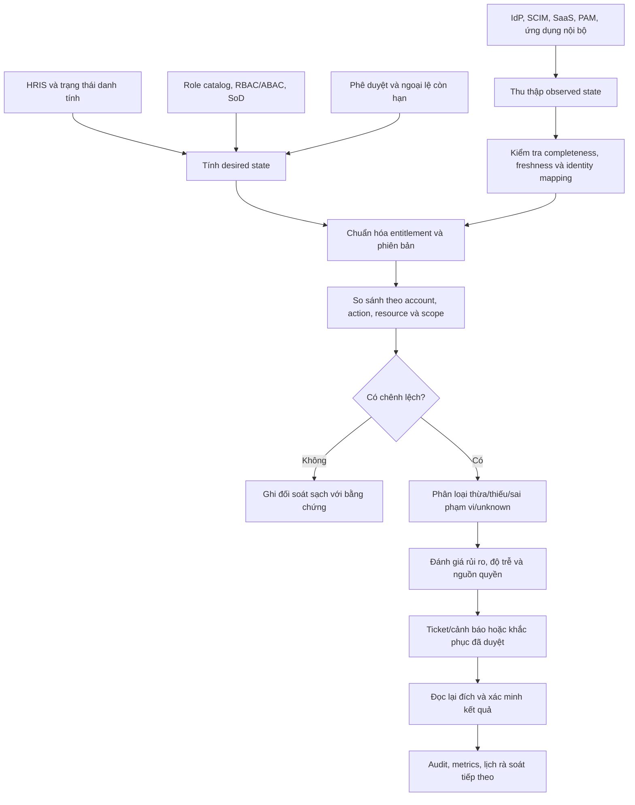

# Phát hiện quyền lệch trong Account Reconciliation của IAM

**Phát hiện quyền lệch** (*entitlement drift detection*) là quá trình xác định sự khác biệt giữa **quyền truy cập mà một danh tính được phép có theo chính sách hiện hành** và **quyền được gán hoặc thực sự có hiệu lực ở hệ thống đích**. Đây là một nhiệm vụ cốt lõi của **account reconciliation**: đối soát tài khoản, nhóm, vai trò và quyền xuyên nhiều hệ thống để tìm ra nơi mà trạng thái thực tế không còn phù hợp với trạng thái mong đợi.

Trong module `SECURITY_IDENTITY_ACCESS_MANAGEMENT_IDENTITY_LIFECYCLE`, bài học thuộc chương **Account reconciliation** và đặt việc phát hiện quyền lệch vào vòng đời **Joiner–Mover–Leaver (JML)**. Thông tin HR, danh tính trong IdP, phiên SSO, cấp phát SCIM/API, RBAC/ABAC, quyền cấp trực tiếp và tài khoản dịch vụ đều có thể góp phần tạo ra quyền hợp lệ hoặc quyền truy cập tồn dư. Mục tiêu của đối soát là **phát hiện có bằng chứng, phân loại đúng nguyên nhân và đưa sai lệch đến cơ chế xử lý phù hợp**, không chỉ đếm số quyền khác nhau.

Sau bài học, bạn có thể phân biệt trạng thái quyền mong đợi với quyền quan sát được và quyền hiệu lực; xác định sai lệch thừa, thiếu, sai phạm vi hoặc không rõ chủ sở hữu; thiết kế phép so sánh có xét nhiều nguồn cấp quyền, thời điểm và đồng bộ bất đồng bộ; xây dựng quy trình cảnh báo, đối soát lại và kiểm toán.

## 1. Vì sao quyền có thể bị lệch?

Hãy xem một nhân viên chuyển từ chăm sóc khách hàng sang kiểm toán. HRIS đã cập nhật bộ phận mới, IAM đã cấp vai trò chỉ đọc trong hệ thống báo cáo, nhưng quyền sửa hồ sơ khách hàng tại CRM vẫn còn vì trước đó một quản trị viên cấp trực tiếp. Nếu chỉ kiểm tra rằng **quyền mới đã được cấp**, quy trình Mover có vẻ hoàn tất. Nếu so sánh **toàn bộ quyền được phép có** với **quyền thực tế ở CRM**, sai lệch mới lộ ra.

Quyền có thể lệch do các nguyên nhân khác nhau:

- **Thay đổi vòng đời:** Joiner cấp thiếu, Mover giữ quyền cũ, Leaver chưa thu hồi hết.
- **Cấp quyền ngoài quy trình IAM:** quản trị viên thêm người vào nhóm hoặc gán role trực tiếp trong ứng dụng.
- **Lỗi tích hợp:** SCIM/API thất bại, giới hạn tốc độ, phân trang thiếu, retry sai, connector mất kết nối.
- **Độ trễ và cache:** IdP đã thay đổi nhưng ứng dụng chưa áp dụng, group cache cũ, phiên hoặc token chưa hết hạn.
- **Role mapping lỗi thời:** quyền trong một role đã thay đổi nhưng bản đồ quyền nghiệp vụ → quyền ứng dụng chưa được cập nhật.
- **Sai khớp danh tính:** email đổi hoặc được tái sử dụng khiến account được đối chiếu với sai người.
- **Ngoại lệ không hết hạn:** quyền dự án hoặc đặc quyền tạm được cấp mà không có cơ chế thu hồi.
- **Danh tính máy không được quản lý:** service account hoặc API key tiếp tục có quyền sau khi ứng dụng ngừng dùng hoặc người sở hữu nghỉ việc.

**Không phải mọi khác biệt đều là vi phạm bảo mật.** Một quyền hợp lệ chưa kịp được cấp là lỗi **thiếu quyền** ảnh hưởng năng suất; một quyền còn tồn tại nhưng không còn căn cứ là lỗi **thừa quyền** có thể tạo rủi ro; khác biệt do connector đang đồng bộ có thể là trạng thái chuyển tiếp có thời hạn. Hệ thống cần phân biệt trước khi hành động.

## 2. Ba lớp trạng thái: desired, observed và effective

Đối soát quyền phải trả lời ba câu hỏi khác nhau:

| Lớp | Định nghĩa | Nguồn thông tin | Ví dụ |
| --- | --- | --- | --- |
| **Desired state** — quyền mong đợi | Tập account và entitlement mà chủ thể *được phép* có tại thời điểm kiểm tra | HRIS, trạng thái danh tính, role catalog, RBAC/ABAC, phê duyệt, ngoại lệ còn hạn | Người dùng chỉ được `crm.customer.read` |
| **Observed state** — quyền được gán/ghi nhận | Những account, group, role hoặc ACL được hệ thống đích báo là đang tồn tại | API đọc từ IdP, SCIM, ứng dụng SaaS, directory, PAM, hệ thống nội bộ | CRM còn ghi `crm.customer.update` |
| **Effective access** — quyền có hiệu lực | Những hành động mà chủ thể thực sự có thể thực hiện sau khi xét quyền kế thừa, chính sách, phiên, token, phạm vi và deny | Bộ máy phân quyền, kiểm tra tại API, group expansion, tín hiệu phiên và cấu hình tài nguyên | API vẫn cho sửa khách hàng do session cũ hoặc quyền trực tiếp |

Sự khác biệt giữa **observed** và **effective** đặc biệt quan trọng:

- Group được gỡ khỏi IdP nhưng phiên ứng dụng còn dùng claims cũ: observed tại IdP đã đúng, effective tại ứng dụng có thể chưa đúng.
- Role vẫn nằm trong cơ sở dữ liệu ứng dụng nhưng một chính sách ABAC từ chối mọi thao tác: observed vẫn có quyền được gán, nhưng effective access đang bị giới hạn. Role dư đó vẫn cần xử lý để tránh tái kích hoạt ngoài ý muốn sau này.
- Một người có cả quyền `allow` và một quy tắc `deny`: không thể xác định khả năng thực thi chỉ bằng phép hợp tên role, mà phải xét cơ chế ưu tiên của từng nền tảng.

**Đối soát assignment** và **kiểm tra truy cập hiệu lực** là hai lớp kiểm soát bổ sung cho nhau. Khi hệ thống đích không cho phép truy vấn đầy đủ quyền hiệu lực, cần ghi rõ giới hạn bằng chứng và dùng phương pháp kiểm chứng phù hợp thay vì tuyên bố đã chứng minh toàn bộ truy cập bị chặn.

### Đơn vị so sánh phải có phạm vi

Quyền `read` ở CRM không đồng nghĩa `read` ở kho báo cáo; `order.update` tại chi nhánh A không giống `order.update` tại chi nhánh B. Một bản ghi entitlement chuẩn hóa nên đủ để mô tả:

```text
(identityId, targetSystem, targetAccountId,
 resourceType, resourceScope, action, grantSource,
 validFrom, validUntil, policyVersion)
```

Không phải hệ thống nào cũng trả đủ các trường này; đó là **mô hình đối chiếu minh họa**. Tối thiểu cần biết **ai**, **ở đích nào**, **được làm gì**, **trên phạm vi nào** và **quyền đến từ nguồn nào**. Nếu thiếu thông tin quan trọng, đánh dấu **không xác định/không đủ dữ liệu**, thay vì kết luận mặc định rằng không có quyền.

## 3. Những dạng sai lệch cần phát hiện

| Loại sai lệch | Điều kiện quan sát | Mức quan tâm chính | Ví dụ |
| --- | --- | --- | --- |
| **Thừa quyền** (*excess grant*) | Có ở observed nhưng không nằm trong desired và không có ngoại lệ hợp lệ | Bảo mật, quyền tối thiểu | Nhân viên mới vẫn có role quản trị của dự án cũ |
| **Thiếu quyền** (*missing grant*) | Có ở desired nhưng chưa xuất hiện trong observed | Trải nghiệm Joiner, tính liên tục công việc | Nhân viên không vào được ứng dụng cần dùng ngày đầu |
| **Sai phạm vi** (*scope mismatch*) | Cùng hành động nhưng phạm vi quá rộng/hẹp | Lộ dữ liệu hoặc gián đoạn | Được đọc mọi khu vực thay vì chỉ khu vực được giao |
| **Xung đột nhiệm vụ** (*SoD conflict*) | Kết hợp các quyền không được phép đồng thời | Gian lận, thao tác không được kiểm soát | Một người vừa tạo vừa duyệt cùng giao dịch nhạy cảm |
| **Tài khoản không rõ chủ thể** (*orphan account*) | Account tồn tại nhưng không liên kết được với danh tính hoặc owner hợp lệ | Khó thu hồi, không rõ trách nhiệm | Tài khoản SaaS cũ không có identityId tương ứng |
| **Quyền hết hạn chưa thu hồi** | `validUntil` đã qua nhưng quyền đích còn hiệu lực | Quyền tạm thời thành quyền cố định | JIT admin hết ca vẫn giữ role |
| **Sai trạng thái account** | Desired là disabled/deprovisioned nhưng đích báo active | Quyền tồn dư sau Leaver | Tài khoản VPN chưa bị khóa |
| **Phiên/token còn hiệu lực** | Account hoặc role đã bị thu hồi nhưng đường truy cập vẫn hoạt động | Khoảng trễ chặn truy cập | SaaS còn phiên cũ sau khi IdP khóa |
| **Không rõ dữ liệu** (*unknown*) | Không đọc được đầy đủ nguồn hoặc đích | Nguy cơ kết luận sai | API trả kết quả bị cắt do phân trang |

Các loại có thể chồng lấp: một account mồ côi vừa chứa quyền thừa vừa có thông tin xác thực tồn tại lâu. Phân loại chính xác giúp quyết định **ai xử lý**, **mức ưu tiên** và **cần bằng chứng nào để đóng vấn đề**.

## 4. Tạo desired state từ dữ liệu có thẩm quyền

Không thể phát hiện quyền lệch nếu chưa xác định **quyền nào được phép tồn tại**. Tập quyền mong đợi phải được tính tại thời điểm cụ thể dựa trên nhiều lớp điều kiện:

1. **Trạng thái danh tính:** người dùng còn hiệu lực không, ngày bắt đầu/kết thúc và loại quan hệ (nhân viên, nhà thầu, đối tác) từ nguồn có thẩm quyền.
2. **Vai trò nghiệp vụ:** bộ phận, nhiệm vụ, dự án và các role assignment còn hiệu lực.
3. **Ánh xạ role → entitlement:** nhóm, role, license hoặc quyền ở từng ứng dụng theo phiên bản catalog đã duyệt.
4. **Giới hạn RBAC/ABAC:** chi nhánh, tổ chức, tài nguyên, hành động, phân loại dữ liệu và ngữ cảnh được phép.
5. **Phê duyệt và ngoại lệ:** quyền bổ sung được duyệt, quyền khẩn cấp có giới hạn và thời hạn kết thúc.
6. **Xung đột SoD và deny:** các tổ hợp hoặc điều kiện buộc từ chối quyền dù role thông thường có thể yêu cầu chúng.

Ví dụ, nhân viên thuộc role `finance-analyst` có thể được cấp tài khoản FinanceApp với entitlement `report.read`; thuộc tính `allowedCostCenters` giới hạn dữ liệu. Nếu role đó đã hết hiệu lực do Mover, desired state phải bỏ quyền cũ. Nếu một ngoại lệ đọc báo cáo có phê duyệt còn đến ngày mai, nó có thể tồn tại trong desired state **theo phạm vi và thời hạn được duyệt**, không phải là quyền thừa.

### Quyền được yêu cầu bởi nhiều role

Giả sử `role-A` cần `{P1, P2}` và `role-B` cần `{P2, P3}`. Khi cả hai role hợp lệ, quyền mong đợi là `{P1, P2, P3}`. Nếu `role-A` kết thúc nhưng `role-B` còn hiệu lực, desired state trở thành `{P2, P3}`; **chỉ P1 bị mất căn cứ**. Gỡ toàn bộ quyền của `role-A` mà không xét role khác có thể thu hồi nhầm P2.

Một hệ thống nên giữ **nguồn gốc cấp quyền** (*grant provenance*) để giải thích vì sao mỗi entitlement tồn tại. Khi phát hiện chênh lệch, cần truy được role, phê duyệt hoặc quy tắc nào đã sinh quyền, và quy tắc đó còn hiệu lực hay không.

**Lưu ý:** không thể cộng tất cả role rồi cho phép nếu có deny/SoD. Việc tính desired state phải tôn trọng thứ tự ưu tiên và chính sách của tổ chức.

## 5. Thu thập observed state tại IdP và ứng dụng đích

Nguồn quan sát có thể gồm danh sách account, trạng thái active, thành viên nhóm trực tiếp/lồng nhau, role ứng dụng, entitlement, ACL, quyền cloud IAM, quyền PAM/JIT và các chính sách trên tài nguyên. Mỗi connector có khả năng và hạn chế riêng.

| Hệ thống | Có thể đọc gì? | Khoảng trống dễ gặp |
| --- | --- | --- |
| **IdP / directory** | Trạng thái user, group, role directory, kết quả cấp phát | Quyền trực tiếp ở ứng dụng không nằm trong IdP |
| **SCIM provider** | User, `active`, Groups hoặc thuộc tính được hỗ trợ | SCIM không bảo đảm liệt kê đầy đủ mọi quyền nghiệp vụ hoặc session |
| **Ứng dụng SaaS / REST API riêng** | Application role, tài khoản, quyền cấp trực tiếp | Pagination, rate limit, quyền đọc không đầy đủ, cache |
| **Database / ACL nghiệp vụ** | Quyền theo bản ghi/tài nguyên, phân quyền ở cấp dữ liệu | Đồ thị kế thừa, điều kiện động và tác động của deny |
| **Cloud / PAM / JIT** | Role assignment, đặc quyền và phiên nâng quyền | Quyền tạm, session chưa kết thúc, phạm vi tổ chức/tài nguyên |
| **Gateway / session service** | Phiên/token đã phát, khả năng revoke theo nền tảng | Không phải mọi token tự chứa có thể kiểm tra/thu hồi tức thời |

**Không suy ra quyền từ tên nhóm một cách tùy tiện.** Ví dụ nhóm tên `crm-admin` có thể được ứng dụng ánh xạ khác với tưởng tượng, hoặc đã bị đổi chính sách. Phải dựa vào cấu hình tích hợp thực tế và danh mục entitlement được xác nhận bởi chủ ứng dụng.

### Ánh xạ danh tính là điều kiện tiên quyết

Trước khi so sánh, đối chiếu `identityId` ổn định với `idpUserId`, `externalId` hoặc account ID ở từng đích. Email và username có thể thay đổi hoặc được tái sử dụng; không nên tự ghép hai account chỉ vì cùng tên. Nếu không đối chiếu được duy nhất, kết quả phải chuyển trạng thái `UNMATCHED_IDENTITY`, có người xác minh trước khi khắc phục.

### Phải biết dữ liệu đã đầy đủ hay chưa

Một snapshot được coi là **đủ để so sánh** khi connector đã đọc hết các trang dữ liệu cần thiết, biết phạm vi/trạng thái bộ lọc, không có lỗi quyền truy vấn và có thời điểm quan sát rõ ràng. **Không thấy account trong kết quả bị phân trang thiếu không chứng minh account đã bị xóa.** Với hệ thống có độ trễ nhất quán cuối cùng (*eventual consistency*), cần gắn thời điểm snapshot và tính đến khoảng trễ được phép.

## 6. Quy trình phát hiện quyền lệch đầu cuối



**Bước 1 — Đặt mốc so sánh.** Chọn thời điểm `asOf` và phiên bản chính sách. Với người dùng đang Mover, phải biết liệu role cũ hay mới có hiệu lực tại mốc này. Không so sánh dữ liệu HR ngày hôm nay với snapshot ứng dụng từ tuần trước rồi kết luận mọi khác biệt là lỗi.

**Bước 2 — Tạo quyền kỳ vọng.** Tính từ role, thuộc tính, phê duyệt, phạm vi và thời hạn. Lưu nguyên nhân của từng quyền, kể cả quyền được yêu cầu bởi nhiều role.

**Bước 3 — Thu quyền quan sát.** Đọc account, entitlement và nhóm từ những đích liên quan. Ghi phiên bản kết quả, trạng thái đầy đủ, thời điểm lấy dữ liệu, lỗi connector và quyền xem của chính connector.

**Bước 4 — Chuẩn hóa và ghép đúng chủ thể.** Quy đổi ký hiệu quyền giữa nguồn và đích thành cùng mô hình so sánh, bảo toàn `tenant`, resource, action và scope. Không hợp nhất hai quyền chỉ vì tên hiển thị giống nhau.

**Bước 5 — Tính và phân loại diff.** Xác định quyền thừa, thiếu, phạm vi sai, quyền hết hạn, account sai trạng thái, hoặc trường hợp không đủ dữ liệu. Phân biệt assignment drift với khả năng truy cập hiệu lực.

**Bước 6 — Ưu tiên và xử lý.** Dựa trên mức độ nhạy cảm, trạng thái JML, tài nguyên, thời gian tồn tại và khả năng lạm dụng. Quyền quản trị còn hiệu lực sau Leaver cần được xử lý khẩn hơn một license thông thường chưa cấp đủ cho Joiner.

**Bước 7 — Kiểm chứng sau xử lý.** Đọc lại trạng thái đích, kiểm tra phiên/token khi cần, giữ bằng chứng và đóng ticket khi đã đạt desired state hoặc có ngoại lệ được phê duyệt với thời hạn rõ ràng.

## 7. Một mô hình so sánh có thể triển khai

Giả sử IAM thu thập quyền ở mức `(target, resource, action, scope)`. Quyền có thể được cấp qua role, group lồng nhau hoặc trực tiếp; mỗi đường cấp phải có `grantSource`. Ví dụ snapshot minh họa:

```yaml
identityId: iam-user-1042
asOf: "2026-11-23T02:00:00Z"
identityStatus: ACTIVE
desired:
  - target: crm
    resource: customers
    action: read
    scope: branch-south
  - target: reports
    resource: audit-reports
    action: read
    scope: department-audit
observed:
  - target: crm
    resource: customers
    action: read
    scope: branch-south
    grantSource: group:crm-readers
  - target: crm
    resource: customers
    action: update
    scope: all-branches
    grantSource: direct:app-admin
  - target: reports
    resource: audit-reports
    action: read
    scope: department-audit
    grantSource: role:audit-viewer
```

Trong ví dụ này, hai quyền đọc tương ứng phù hợp; `crm/customers/update/all-branches` là **quyền thừa** cần điều tra và thu hồi nếu không có căn cứ khác. Tuy nhiên, nếu tài khoản CRM đang `DISABLED` và không còn bất kỳ đường truy cập hiệu lực nào, cần ghi nhận cả quyền được gán còn tồn tại **và** trạng thái truy cập hiện đã chặn, tránh báo sai rằng người dùng đang chắc chắn sửa được dữ liệu.

### Giả mã đối soát

```text
reconcile(identityId, target, asOf):
    identity = loadTrustedIdentity(identityId, asOf)
    desired = computeApprovedGrants(identity, roleCatalog, policies, asOf)
    observedResult = readAllTargetGrants(target, identityId)

    if observedResult.isIncomplete or observedResult.isStaleBeyondPolicy:
        recordFinding("UNKNOWN_SOURCE_STATE", target)
        scheduleRetryOrEscalation()
        return

    observed = normalizeWithScopeAndProvenance(observedResult.grants)
    expected = normalizeWithScopeAndProvenance(desired[target])

    extra = observed.assignments - expected.assignments
    missing = expected.assignments - observed.assignments
    wrongScope = detectScopeMismatch(expected, observed)
    conflicts = evaluateSoDAndDeny(identity, observed, policies)

    findings = classify(extra, missing, wrongScope, conflicts)
    findings = assessEffectiveAccessAndFreshness(findings, target, asOf)
    persistFindingsWithEvidence(findings)
    dispatchToApprovedRemediationWorkflow(findings)
```

Giả mã này **không phải thư viện hoàn chỉnh**. Một triển khai thực phải phân biệt quyền theo grant source (role, group, direct), xử lý quan hệ kế thừa, mức ưu tiên deny, trạng thái account, cache, thời điểm hiệu lực và sự kiện đồng bộ chưa hoàn tất. Phép trừ tập hợp chỉ hợp lệ khi hai phía đã được **chuẩn hóa cùng ý nghĩa**; không được lấy tên permission thô của các hệ thống khác nhau rồi trừ trực tiếp.

### Điều gì xảy ra khi một entitlement có nhiều nguồn cấp?

Nếu quyền `portal.read` đến từ cả role A và role B, gỡ role A không làm quyền đó trở thành quyền thừa khi role B vẫn còn hiệu lực. Ngược lại, nếu role A đã hết hạn nhưng ứng dụng vẫn ghi một **grant trực tiếp** cùng quyền, grant trực tiếp đó vẫn cần được đánh giá căn cứ dù quyền hiệu lực về mặt chức năng không thay đổi. **Nguồn cấp** giúp phân biệt quyền hợp lệ do nhiều căn cứ với một đường cấp quyền mồ côi hoặc không được duyệt.

## 8. Sai lệch do đồng bộ chưa xong khác gì quyền tồn dư thực sự?

Hệ thống IAM thường xử lý bất đồng bộ. HRIS cập nhật lúc 09:00, IdP thay đổi nhóm lúc 09:01, connector SCIM hoàn thành lúc 09:03 và ứng dụng có thể cập nhật cache ở một thời điểm khác. Nếu đối soát đúng lúc 09:01, quyền chưa khớp chưa chắc là một lỗi vĩnh viễn.

Thiết kế nên dùng **thời điểm hiệu lực** (`effectiveAt`), **mã sự kiện** (`eventId`), **phiên bản nguồn/chính sách**, trạng thái tác vụ cấp phát, **mốc dữ liệu quan sát** và **SLA theo mức rủi ro** để phân loại:

| Tình huống | Phân loại đề xuất | Hành động |
| --- | --- | --- |
| Joiner được phép dùng ứng dụng từ 09:00, tác vụ đang retry nhưng chưa cấp role | Thiếu quyền đang xử lý; theo dõi SLA | Kiểm tra connector, ưu tiên sửa nếu ảnh hưởng công việc |
| Mover đã hết quyền cũ; connector báo thành công nhưng đích vẫn còn role sau giới hạn cho phép | Quyền thừa cần khắc phục | Rà soát đường cấp trực tiếp, cache, retry/owner |
| Leaver khẩn cấp đã hợp lệ; account đặc quyền vẫn active | Sai lệch rủi ro cao | Ưu tiên chặn tại đích, cảnh báo khẩn, kiểm chứng |
| API đọc quyền bị giới hạn, chưa đọc hết trang | Không đủ dữ liệu | Không coi quyền vắng mặt là đã thu hồi; sửa truy vấn và đọc lại |
| Role mới đã được cấp nhưng ABAC giới hạn hành động đến phạm vi được phép | Có thể không có sai lệch hiệu lực; cần kiểm tra mapping | Đối chiếu cả quyền được gán lẫn điều kiện thực thi |

Đối với quyền rủi ro thấp, có thể có **khoảng dung sai đồng bộ** (*grace window*) đã được phê duyệt để giảm cảnh báo giả. Nhưng không áp một khoảng chờ dài và cố định cho **Leaver khẩn cấp hoặc đặc quyền nhạy cảm** chỉ để đồ thị cảnh báo trông sạch hơn. Cần phân biệt việc **chờ dữ liệu ổn định để kết luận nguyên nhân** với việc **chậm thực thi chặn truy cập**.

### Chống false positive và false negative

**False positive (báo lệch nhầm):** nguồn dữ liệu đích thiếu một trang, quyền đã hợp lệ theo ngoại lệ mới, hoặc observed và desired được chụp tại hai mốc khác nhau. **False negative (bỏ sót lệch):** chỉ kiểm tra group IdP, không đọc quyền cấp trực tiếp; thấy account disabled nhưng bỏ qua session cũ; hoặc chuẩn hóa sai khiến quyền quá rộng trông giống quyền hợp lệ.

Các biện pháp quan trọng là **định danh ổn định, nguồn quyền đầy đủ, timestamp và phiên bản rõ ràng, kiểm tra thành viên nhóm kế thừa, so sánh phạm vi tài nguyên, và xác minh đường truy cập thực tế khi có thể**.

## 9. Đánh giá mức ưu tiên và khắc phục an toàn

Việc phát hiện không đồng nghĩa nên tự xóa mọi quyền khác biệt. Một hệ thống còn phải đánh giá nguồn cấp, tác động vận hành và thẩm quyền sửa quyền.

| Phát hiện | Mức ưu tiên tương đối | Quy trình xử lý phù hợp |
| --- | --- | --- |
| Leaver còn account quản trị active hoặc phiên đặc quyền có hiệu lực | Rất cao | Chặn khẩn theo chính sách, xác minh, điều tra và ghi bằng chứng |
| Mover giữ quyền sửa dữ liệu nhạy cảm từ bộ phận cũ | Cao | Kiểm tra grant source, SoD và thu hồi quyền không còn căn cứ |
| Tài khoản dịch vụ không có owner và giữ quyền API rộng | Cao tùy tác động | Xác định phụ thuộc, chủ sở hữu, giới hạn/xoay vòng/thu hồi theo rủi ro |
| Joiner thiếu role cơ sở ở công cụ công việc | Ưu tiên vận hành | Sửa mapping/provisioning, xác minh quyền được cấp đúng |
| Account có license dư nhưng không có quyền dữ liệu quan trọng | Thường thấp hơn | Rà soát, thu hồi license theo chính sách và chi phí |
| Snapshot thiếu dữ liệu, không đối chiếu được account | Chưa thể kết luận | Sửa connector, làm rõ identity mapping, chạy lại trước khi ra quyết định |

**Tự động khắc phục** chỉ phù hợp với trường hợp đã có chính sách rõ ràng, phạm vi thay đổi được phép và cơ chế kiểm chứng/rollback hoặc bù trừ. Với role nhạy cảm, xung đột dữ liệu hoặc quyền từ nguồn không do connector sở hữu, cần phê duyệt hay sự tham gia của chủ ứng dụng theo quy định.

**Không tạo ra quyền mới chỉ để cho observed khớp desired bị tính sai.** Nếu role catalog có sai sót, việc đồng bộ mù quáng có thể nhân rộng một quyền quá mức đến nhiều người. Cần quản trị thay đổi role mapping, đánh giá tác động trước khi thực thi hàng loạt và có hàng rào bảo vệ khi số lượng thay đổi bất thường.

### Tác vụ khắc phục phải idempotent và có khả năng đối soát lại

Nếu connector timeout sau khi gửi lệnh gỡ quyền, chạy lại thao tác không được phục hồi quyền đã bị thu hồi hoặc tạo account trùng. Gắn mã sự kiện, identity ID, target ID và version chính sách; theo dõi trạng thái từng đích. Sau khắc phục, **đọc lại observed state** và, nếu đích hỗ trợ, kiểm tra quyền hiệu lực để xác minh.

Nếu một lỗi ảnh hưởng hàng nghìn tài khoản (ví dụ đọc thiếu phân trang), cần **ngừng thao tác hàng loạt có nguy cơ khóa nhầm** và điều tra dữ liệu đầu vào; không coi hàng nghìn quyền bỗng “dư” là bằng chứng tự đủ để thu hồi tức thì. Với chỉ thị chặn khẩn cấp đã xác thực cho account cụ thể, phải vẫn có đường xử lý riêng không phụ thuộc đợt đối soát lỗi.

## 10. Phát hiện quyền lệch trong Joiner, Mover và Leaver

### Joiner — phát hiện thiếu và thừa quyền ban đầu

Ngày đầu làm việc, nhân viên cần role cơ sở để truy cập email, ứng dụng tác nghiệp và dữ liệu trong phạm vi. Nếu quyền bị thiếu do SCIM không đồng bộ nhóm, người dùng không thể làm việc. Ngược lại, nếu bản đồ role cấp nhầm quyền quản trị, account có thể tạo ra rủi ro ngay khi kích hoạt.

**Đối soát Joiner** phải xác nhận đúng danh tính, ngày hiệu lực, tài khoản IdP, application account và các entitlement theo role đã duyệt. Đừng coi thành công chỉ vì account được tạo; phải biết **quyền đúng vừa đủ** đã được cấp và chưa có quyền dư.

### Mover — phát hiện privilege creep

Nhân viên chuyển bộ phận thường phải **gỡ quyền cũ và cấp quyền mới**. Lỗi phổ biến là thêm nhóm của bộ phận mới nhưng để lại nhóm/role cũ, quyền cấp trực tiếp hoặc ngoại lệ dự án hết hạn. Nếu hai vai trò tạo xung đột SoD, việc giữ quyền cũ trong thời gian chuyển đổi còn đặc biệt nguy hiểm.

**Đối soát Mover** cần dùng role và thuộc tính đã có hiệu lực, phân biệt quyền vẫn hợp lệ qua nhiều role với quyền tồn dư không còn căn cứ, rồi đối chiếu từng hệ thống. Với quyền bàn giao tạm thời, phải ghi phê duyệt và `validUntil` thay vì ngầm coi quyền cũ là hợp lệ vô thời hạn.

### Leaver — tìm mọi đường truy cập còn tồn dư

Khi quan hệ làm việc chấm dứt, desired state đối với những account/quyền dựa trên quan hệ đó thường là disabled hoặc không còn entitlement. **Vô hiệu hóa IdP không tự chứng minh mọi ứng dụng đã mất quyền**: tài khoản local, session SaaS, access token tự chứa, VPN và quyền cấp trực tiếp có thể vẫn tồn tại.

**Đối soát Leaver** cần kiểm tra trạng thái tại các đích và phân biệt chặn xác thực mới với chấm dứt phiên/token. Nếu hệ thống không thể thu hồi token ngay, ghi nhận thời hạn, biện pháp giảm thiểu và nguy cơ còn lại. Ngoại lệ về lưu trữ dữ liệu hoặc bàn giao công việc không đồng nghĩa cho người đã rời tổ chức tiếp tục đăng nhập.

## 11. Tài khoản dịch vụ và danh tính ứng dụng cũng có quyền lệch

Không phải mọi chủ thể đều có bản ghi HR. **Service account, workload identity, service principal và khóa API** có thể tiếp tục truy cập tài nguyên ngay cả khi người tạo ban đầu đã rời nhóm hoặc ứng dụng ngừng hoạt động.

Để đối soát danh tính máy, cần thêm các thuộc tính: **chủ sở hữu**, ứng dụng/tác vụ sử dụng, môi trường, tài nguyên/API được phép, scope/role, thời hạn credential, thông tin luân chuyển và ngày ngừng hoạt động dự kiến. Những trường hợp cần phát hiện gồm:

- Workload ở môi trường thử nghiệm nhưng có quyền trên dữ liệu production.
- Service account không còn owner hoặc owner đã nghỉ việc mà không có bàn giao.
- API key cũ vẫn hoạt động sau khi đã chuyển sang managed identity hoặc credential mới.
- Job đã dừng nhưng service principal và quyền cao vẫn tồn tại.
- Một danh tính máy có quyền rộng hơn các API/hành động mà tác vụ hiện tại thực sự cần.

Không nên tự động xóa ngay mọi service account không rõ owner nếu chúng có thể đang phục vụ hệ thống quan trọng. Cần **đánh giá phụ thuộc, hạn chế/thu hồi theo rủi ro, xác định người chịu trách nhiệm và kế hoạch thay thế credential**. Tuy nhiên, không có owner không phải lý do chấp nhận quyền tồn dư vô thời hạn.

## 12. Kiểm toán, chỉ số và kiểm thử

### Dấu vết của một finding có thể kiểm chứng

Mỗi phát hiện quyền lệch nên ghi: mã finding, danh tính và account đích, loại quyền, phạm vi tài nguyên, **desired** và **observed**, nguồn cấp quyền, phiên bản HR/chính sách, thời điểm hiệu lực, thời điểm snapshot, trạng thái đầy đủ của nguồn, mức rủi ro, người xử lý và kết quả kiểm chứng sau khắc phục.

Ví dụ biểu diễn tối giản:

```yaml
findingId: drift-2026-00071
identityId: iam-user-1042
target: crm
accountId: crm-541
type: EXCESS_GRANT
grant:
  action: customer.update
  scope: all-branches
  source: direct:app-admin
desired: absent
observed: present
observedAt: "2026-11-23T02:05:00Z"
evidenceCompleteness: complete
severity: high
owner: crm-access-owner
resolutionState: OPEN
```

Đây là schema minh họa. Không ghi password, access token, refresh token, khóa API hoặc dữ liệu HR không cần thiết vào finding/audit. Quyền xem bản ghi kiểm toán phải bị hạn chế; người điều tra cần bằng chứng về quyết định truy cập, không cần sao chép mọi bí mật của hệ thống.

### Chỉ số vận hành

| Chỉ số | Cách sử dụng |
| --- | --- |
| Số **excess grants** đang mở theo mức rủi ro | Theo dõi rủi ro quyền thừa, đặc biệt ở quyền admin và dữ liệu nhạy cảm |
| Số **missing grants** của Joiner quá hạn | Đo mức ảnh hưởng công việc và lỗi cấp quyền |
| Tỷ lệ account/entitlement đối soát được | Đánh giá độ phủ và chất lượng connector, tránh ảo tưởng “không có lệch” vì chưa quét |
| Tỷ lệ snapshot đầy đủ, còn mới | Phát hiện lỗi phân trang, đồng bộ hoặc API đọc trạng thái |
| Thời gian phát hiện và xử lý lệch | Đo từ thời điểm quyền sai có hiệu lực đến lúc phát hiện, khắc phục và xác minh |
| Tỷ lệ tái xuất hiện (*recurrence*) | Chỉ ra nguyên nhân gốc chưa được sửa như role mapping sai hoặc cấp quyền thủ công lặp lại |
| Số Leaver còn quyền truy cập sau mốc hiệu lực | Đánh giá rủi ro residual access và khả năng chặn truy cập |
| Tỷ lệ false positive/false negative được phát hiện qua kiểm định | Cải thiện chất lượng quy tắc so sánh và bằng chứng |

Không chỉ xem **số lượng finding**: việc mở rộng độ phủ ứng dụng có thể khiến số lỗi được phát hiện tăng, dù bảo mật thực tế đang được cải thiện. Nên báo cáo theo **mức rủi ro, độ phủ, chất lượng dữ liệu, tuổi finding, mức độ hoàn tất và khả năng tái diễn**.

### Những ca kiểm thử quan trọng

1. **Joiner đủ điều kiện:** desired và observed khớp; không có finding thừa/thiếu.
2. **Joiner thiếu role:** ghi `MISSING_GRANT`, sau khi cấp và đọc lại thì đóng finding.
3. **Mover giữ quyền cũ:** phát hiện `EXCESS_GRANT`, kể cả quyền cấp trực tiếp tại ứng dụng.
4. **Một quyền được cấp bởi hai role:** gỡ một role không được báo thiếu hoặc thu hồi nhầm quyền vẫn hợp lệ từ role kia.
5. **SoD conflict:** phát hiện tổ hợp quyền bị chính sách cấm, dù mỗi quyền riêng lẻ có vẻ hợp lệ.
6. **Leaver còn phiên:** account disabled nhưng quyền hiệu lực vẫn được đánh dấu chưa xác minh/chưa chặn đầy đủ.
7. **Snapshot phân trang thiếu:** trả `UNKNOWN` hoặc lỗi dữ liệu, không kết luận hàng loạt tài khoản đã biến mất.
8. **Sự kiện Mover cũ đến sau Leaver mới:** không tái tính quyền theo sự kiện lỗi thời rồi mở lại tài khoản.
9. **Quyền ngoại lệ còn hạn:** không báo là thừa; khi hết hạn phải trở thành finding nếu vẫn còn ở đích.
10. **Tài khoản dịch vụ mồ côi:** phát hiện thiếu owner, phân loại rủi ro và theo dõi quyết định xử lý.

## 13. Tình huống tổng hợp: ba loại quyền lệch trong một buổi đối soát

Giả sử tổ chức thực hiện đối soát các tài khoản CRM, báo cáo và VPN lúc 10:00. Ba hồ sơ phát sinh:

| Danh tính | Desired state theo chính sách | Observed / effective state | Phát hiện |
| --- | --- | --- | --- |
| **Nhân viên A — Joiner** | Có `reports.read` từ 09:00 | Không có application role do SCIM retry thất bại | `MISSING_GRANT`; xử lý độ trễ cấp phát |
| **Nhân viên B — Mover** | Có `reports.read`, không có `crm.update` | Vẫn có `crm.update` cấp trực tiếp; báo cáo đã cấp đúng | `EXCESS_GRANT` ở CRM; cần gỡ quyền ngoài role cũ |
| **Nhân viên C — Leaver** | IdP và ứng dụng không còn cho truy cập từ 09:30 | IdP disabled, VPN active, phiên CRM còn hợp lệ | Sai trạng thái VPN và residual session; cần ưu tiên chặn |

**Phân tích từng người:**

- Với **A**, nguyên nhân là thiếu quyền mới, không nhất thiết là lỗ hổng bảo mật. Cần kiểm tra task provisioning, trạng thái SCIM và SLA, sau đó xác minh user thực sự sử dụng được ứng dụng.
- Với **B**, quyền thừa được cấp trực tiếp nên chỉ đọc group IdP không phát hiện được. Cần xác định grant source, có ngoại lệ nào còn hạn không, rồi thu hồi đúng entitlement và đọc lại CRM.
- Với **C**, account IdP đã disabled nhưng Leaver chưa hoàn tất. VPN cần xử lý trực tiếp; với phiên CRM phải xác định khả năng revoke hoặc biện pháp chặn khác, đo khoảng quyền còn hiệu lực và lưu bằng chứng.

Nếu đợt đọc VPN bị lỗi hoặc trả snapshot thiếu, không được khẳng định “VPN đã sạch” chỉ vì không thấy account C. Cần chuyển trạng thái dữ liệu thành **không đủ bằng chứng**, cảnh báo theo mức rủi ro và xác minh lại.

## 14. Câu hỏi tự kiểm tra

**Câu 1.** Nhân viên đã bị gỡ khỏi nhóm admin IdP, nhưng ứng dụng vẫn cho thao tác quản trị bằng phiên cũ. Có phải đối soát IdP đã đủ?

**Trả lời:** Chưa. Observed assignment ở IdP đã thay đổi, nhưng effective access tại ứng dụng vẫn có thể tồn tại. Phải kiểm tra phiên/token, quyền ứng dụng và điểm thực thi chính sách.

**Câu 2.** Một quyền đọc được cấp qua hai business role. Mover chỉ mất một role. Quyền đọc có tự trở thành excess grant không?

**Trả lời:** Không, nếu role còn lại vẫn là căn cứ hợp lệ. Desired state phải tính từ toàn bộ role, điều kiện ABAC, phê duyệt và thời hạn còn hiệu lực.

**Câu 3.** API đích trả về danh sách quyền rỗng sau khi bị rate limit, có thể kết luận account không còn quyền không?

**Trả lời:** Không. Đó là trạng thái nguồn dữ liệu không đầy đủ hoặc không đáng tin, không phải bằng chứng quyền đã mất. Cần xử lý lỗi và thu thập lại snapshot.

**Câu 4.** Khi phát hiện một role dư, có nên tự động gỡ ngay trong mọi hệ thống không?

**Trả lời:** Không phải luôn luôn. Cần xác định grant source, phạm vi và thẩm quyền connector, ngoại lệ hợp lệ, tác động SoD, mức rủi ro và quy trình khắc phục được phê duyệt. Với trường hợp Leaver đặc quyền nguy hiểm, kích hoạt đường chặn khẩn theo chính sách.

**Câu 5.** Vì sao không thể chỉ đo số lượng sai lệch được phát hiện để đánh giá chất lượng đối soát?

**Trả lời:** Vì số phát hiện còn phụ thuộc độ phủ và chất lượng thu thập dữ liệu. Cần xét severity, thời gian tồn tại, độ đầy đủ snapshot, tốc độ khắc phục và sai lệch tái xuất hiện.

## Kết luận

**Phát hiện quyền lệch** là năng lực so sánh **quyền mong đợi theo trạng thái và chính sách IAM** với **quyền quan sát tại các hệ thống đích**, đồng thời đánh giá **quyền truy cập thực sự còn hiệu lực** khi cần. Đối soát đáng tin phải ghép đúng danh tính, nắm nguồn gốc cấp quyền, xét role/ABAC/SoD, phân biệt dữ liệu chưa đồng bộ với quyền tồn dư và không suy luận từ snapshot thiếu. Kết hợp HRIS, IdP/SSO, SCIM/API, ứng dụng, tài khoản dịch vụ và bằng chứng kiểm toán sẽ giúp phát hiện cấp thiếu ở Joiner, tích lũy quyền ở Mover và các đường truy cập chưa thu hồi ở Leaver. Quan trọng nhất, một finding chỉ thực sự được giải quyết khi **nguyên nhân đã được xử lý và trạng thái đích được xác minh lại**.
