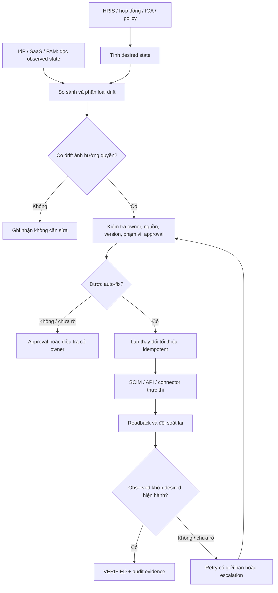
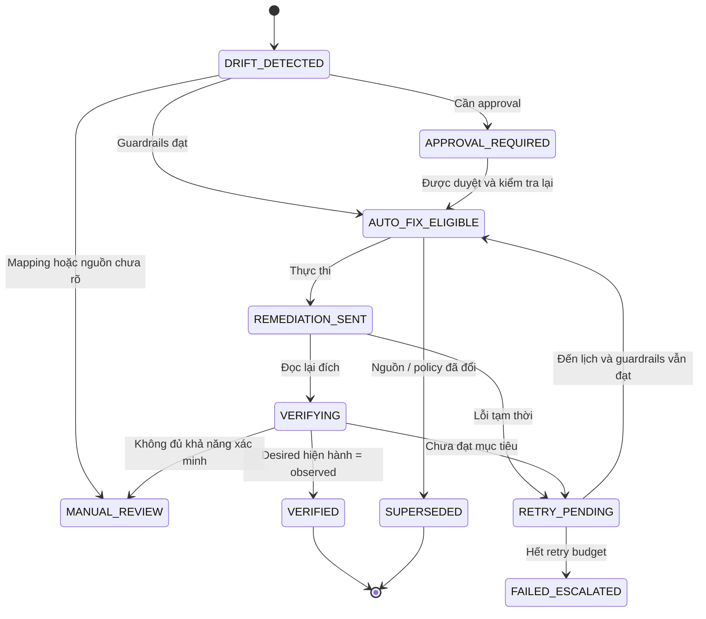

# Sửa lệch tự động trong Account reconciliation

## 1. Sửa lệch tự động là gì?

**Sửa lệch tự động (automated drift remediation)** là quá trình hệ thống IAM phát hiện trạng thái tài khoản hoặc quyền truy cập tại ứng dụng đích **khác với trạng thái được phép theo nguồn dữ liệu và chính sách hiện hành**, sau đó tự thực hiện **một thay đổi đã được kiểm soát** để đưa hệ thống về trạng thái mong muốn.

Trong **Account reconciliation (đối soát tài khoản)**, ba hoạt động phải được phân biệt:

1. **Thu thập trạng thái thực tế (observed state):** đọc tài khoản, nhóm, role, trạng thái kích hoạt và entitlement tại IdP, ứng dụng, hạ tầng.
2. **Phát hiện sai lệch (drift detection):** so sánh trạng thái thực tế với **desired state** được tính từ HRIS, dữ liệu dự án, hợp đồng, RBAC/ABAC, phê duyệt và các ngoại lệ còn hiệu lực.
3. **Sửa lệch (remediation):** quyết định **tự sửa, yêu cầu phê duyệt hoặc chuyển điều tra**; gửi thao tác, đọc lại trạng thái và lưu chứng cứ.

Ví dụ: HRIS xác nhận nhân viên đã nghỉ việc, IAM đặt trạng thái đích là `DISABLED`, nhưng ứng dụng SaaS vẫn báo tài khoản `ACTIVE`. Đây là một sai lệch nghiêm trọng. Nếu IAM chắc chắn đã ánh xạ đúng người và chính sách cho phép, bộ điều phối có thể tự gửi lệnh vô hiệu hóa tài khoản, rồi kiểm tra lại kết quả.

Ngược lại, nếu thấy một tài khoản lạ không gắn được với danh tính trong HRIS, **không được tự động xóa** chỉ vì không tìm thấy hồ sơ. Đó có thể là tài khoản dịch vụ, tài khoản break-glass, khách hàng, nhà thầu được quản lý ở nguồn khác hoặc lỗi ánh xạ. Phải nhận diện đúng nguồn sở hữu trước khi xử lý.

**Mục tiêu không phải làm cho mọi trường đều giống nhau**, mà là bảo đảm quyền truy cập hiệu lực đúng với **căn cứ nghiệp vụ còn hiệu lực**, có kiểm soát tối thiểu quyền và có thể kiểm toán.

## 2. Quan hệ giữa reconciliation, provisioning và Joiner–Mover–Leaver

**Provisioning** cố gắng thực thi thay đổi khi có sự kiện nghiệp vụ. **Reconciliation** kiểm tra lại tình trạng thực tế, phát hiện sự kiện bị bỏ sót, đồng bộ thất bại hoặc quản trị viên thay đổi quyền trực tiếp. **Sửa lệch tự động** khép vòng phản hồi bằng một hành động sửa được phê duyệt theo chính sách.

| Bối cảnh | Trạng thái mong muốn | Sai lệch có thể phát hiện | Hành động có thể phù hợp |
|---|---|---|---|
| **Joiner** | Người mới hợp lệ có tài khoản và quyền nền cần thiết | Ứng dụng thiếu tài khoản/nhóm do provisioning lỗi | Tạo hoặc cấp đúng quyền đã duyệt, nếu điều kiện còn hợp lệ |
| **Mover** | Vai trò và phạm vi dữ liệu phản ánh nhiệm vụ mới | Nhóm dự án cũ còn, role mới chưa có | Thu hồi quyền cũ; chỉ cấp quyền mới sau khi đủ phê duyệt |
| **Leaver** | Không còn đường truy cập trái với trạng thái kết thúc quan hệ | IdP đã khóa nhưng SaaS vẫn active | Ưu tiên khóa tài khoản, thu hồi quyền và xác minh |
| **Access review** | Chỉ các entitlement được tái xác nhận còn hiệu lực | Một ngoại lệ đã hết hạn vẫn được gán | Thu hồi nếu chính sách cho phép, hoặc chuyển chủ sở hữu |
| **Service account** | Workload có owner, mục đích, quyền và credential còn hợp lệ | Bot thuộc nhóm đặc quyền không còn cần | Rà soát nguồn sở hữu; thu hồi có kiểm soát theo tác động dịch vụ |

Một sự kiện được xử lý thành công trong hàng đợi **không chứng minh** trạng thái ở đích đã đúng. Ngược lại, reconciliation có thể sửa lệch **ngay cả khi không có sự kiện JML mới**, ví dụ tài khoản đã bị quản trị viên ứng dụng thêm vào nhóm quá quyền.

**Sửa lệch tự động không được vượt qua quy trình phê duyệt.** Nếu policy quy định một quyền cần chủ sở hữu dữ liệu duyệt, công cụ reconciliation không thể tự cấp quyền đó chỉ để làm hết chênh lệch.

## 3. Desired state, observed state và nguồn có thẩm quyền

Để tự sửa an toàn, IAM phải biết **ai đang quản lý thuộc tính nào** và có thể tin dữ liệu từ đâu.

| Dữ liệu | Nguồn có thẩm quyền thường gặp | Cách sử dụng |
|---|---|---|
| Trạng thái nhân viên, ngày nghỉ | HRIS/HCM | Xác định Joiner/Leaver, điều kiện tài khoản được active |
| Trạng thái hợp đồng nhà thầu | VMS, hợp đồng hoặc sponsor được phê duyệt | Xác định quyền guest/partner và ngày hết hạn |
| Đơn vị, vị trí, assignment | HRIS hoặc hệ thống phân công chính thức | Tính role nền, phạm vi dữ liệu theo vai trò |
| Quyền đặc biệt được duyệt | IGA / hệ thống yêu cầu quyền | Bổ sung entitlement ngoài role nền, theo thời hạn |
| SoD và chính sách truy cập | Policy engine / governance | Chặn tổ hợp quyền hoặc điều kiện bị cấm |
| Tài khoản/nhóm/role thực tế | IdP, directory, SaaS, ứng dụng đích | Quan sát quyền đã cấp và trạng thái áp dụng |
| Chủ sở hữu workload | Service catalog, CMDB, nền tảng workload | Quyết định vòng đời tài khoản dịch vụ |
| Phiên, token, credential | IdP, PAM và ứng dụng liên quan | Đánh giá những đường truy cập còn hoạt động |

**Nguồn sự thật là theo từng thuộc tính và loại chủ thể**, không nhất thiết chỉ có một hệ thống. HRIS có thể xác nhận nhân viên đã nghỉ, nhưng không có danh sách đầy đủ các role nội bộ của SaaS. Ứng dụng SaaS là nơi phải **quan sát** quyền hiệu lực ấy.

### 3.1. Định nghĩa desired state

Một mô hình khái niệm:

```text
desired_access(identity, target, time) =
    baseline_from_active_relationships
  + approved_role_entitlements
  + valid_time_limited_exceptions
  - explicitly_forbidden_entitlements

desired_account_state =
    active only if authoritative_relationship_is_valid
    and required_identity_controls_are_satisfied
    and security_policy_allows_activation
```

Đây là **mã giả**, không phải công thức đại số đủ cho mọi hệ thống. Một người có nhiều quan hệ hợp lệ có thể cần giữ một phần quyền; deny policy, nhóm lồng nhau, phạm vi ABAC và tài khoản đặc quyền có thể khiến cách tính thực tế phức tạp hơn phép cộng/trừ tập hợp.

### 3.2. Định nghĩa observed state

**Observed state** có thể gồm:

- Tài khoản có tồn tại và đang `ACTIVE`, `DISABLED` hoặc trạng thái riêng của provider.
- User thuộc nhóm nào, trực tiếp và gián tiếp nếu hệ thống hỗ trợ.
- Role, permission và grant trực tiếp trong ứng dụng.
- Những quyền được suy ra từ thuộc tính và ABAC.
- Phiên đang sống, refresh token, API token, khóa SSH hoặc credential độc lập nếu có khả năng quan sát.
- Thời điểm lần cuối đọc dữ liệu, tính nhất quán của API và độ trễ đồng bộ.

Việc đọc lại danh sách nhóm ở IdP **không đủ** để kết luận mọi ứng dụng đã cập nhật. Một app có thể lưu role local, cache claim SSO hoặc chưa đồng bộ thay đổi qua SCIM.

### 3.3. Sai lệch chưa chắc là vi phạm

Ví dụ hệ thống đích có quyền `project_reader` ngoài role nền. Nếu quyền đó được cấp bởi **ngoại lệ có phê duyệt và còn hạn**, việc tự gỡ là sai. Vì vậy cần xem **provenance (nguồn gốc quyền)**, lý do nghiệp vụ, owner, phê duyệt, ngày hiệu lực và điều kiện thu hồi.

## 4. Phân loại sai lệch để chọn hành động

Không nên dùng một quy tắc chung “thừa thì xóa, thiếu thì thêm” cho toàn bộ IAM.

| Loại sai lệch | Ví dụ | Hướng xử lý thường phù hợp |
|---|---|---|
| **Missing account** | Joiner đã hợp lệ nhưng ứng dụng chưa có tài khoản | Tự tạo nếu đã proofing và đủ phê duyệt; ngăn tạo trùng |
| **Unexpected active account** | Leaver đã có hiệu lực nhưng SaaS vẫn active | Khóa ưu tiên cao nếu ánh xạ và nguồn chắc chắn |
| **Missing baseline group** | Nhân viên active thiếu nhóm công cụ chung | Có thể tự thêm theo policy chuẩn |
| **Excess group membership** | Mover vẫn thuộc nhóm dự án cũ | Tự gỡ nếu không còn căn cứ và mapping chắc chắn |
| **Unexpected privileged role** | Tài khoản được gán quyền admin ngoài workflow | Cách ly/thu hồi theo policy khẩn cấp hoặc chuyển Security review |
| **Direct grant ngoài quản trị** | App có role gán tay, IGA không lưu nguồn | Đánh dấu ngoại lệ; xác minh owner trước khi sửa nếu chưa chắc |
| **Wrong attributes** | Phòng ban app khác HRIS | Cập nhật thuộc tính do HRIS sở hữu, kiểm tra tác động quyền |
| **Duplicate accounts** | Hai tài khoản tương ứng một worker ID | Điều tra quan hệ; không tự gộp/xóa khi chưa xác minh |
| **Orphan account** | Không tìm thấy chủ thể nghiệp vụ | Kiểm tra contractor, service account, guest và nguồn ngoài HRIS |
| **Stale session/token** | Đã gỡ role nhưng token cũ vẫn cấp quyền | Thu hồi phiên/token nếu hỗ trợ; ghi rủi ro còn tồn dư |

Có thể chia kết quả phân loại thành:

- **Auto-remediate:** bằng chứng đủ, hành động được policy cho phép và có thể xác minh.
- **Approval required:** cần chủ sở hữu dữ liệu, quản lý hoặc bộ phận an ninh phê duyệt.
- **Manual investigation:** dữ liệu mâu thuẫn, không đủ thông tin hoặc tác động nguy hiểm.
- **Observe only:** chưa có quyền thực thi hoặc đang trong khoảng đồng bộ chấp nhận được.
- **No action:** sai lệch chỉ là cách biểu diễn dữ liệu khác nhau nhưng quyền hiệu lực đã đúng.

## 5. Điều kiện tiên quyết để tự sửa an toàn

Một bộ điều phối chỉ nên tự sửa khi vượt qua các **guardrail** sau:

1. **Đúng đối tượng:** xác định chắc chắn identity ID, account ID, tenant và ứng dụng đích; không khớp bằng email hiển thị đơn lẻ.
2. **Nguồn tin cậy:** trạng thái HR/contract và chính sách đang được dùng đã hợp lệ, không thiếu trường bắt buộc.
3. **Dữ liệu còn mới:** không dựa trên snapshot quá cũ, event đã bị thay thế hoặc kết quả đọc chưa qua độ trễ đồng bộ.
4. **Quyền quản trị rõ ràng:** hệ thống biết nguồn nào sở hữu group, role hoặc thuộc tính; không tự ghi đè tài nguyên do hệ khác quản lý.
5. **Hành động được phê duyệt theo policy:** chỉ các thay đổi nằm trong danh mục auto-fix; quyền nhạy cảm có thể cần approval riêng.
6. **Phạm vi ảnh hưởng giới hạn:** thao tác chỉ nhắm đúng tài khoản/membership, không xóa nhóm dùng chung hoặc thay chính sách của nhiều người.
7. **Có chiến lược xử lý lỗi:** idempotency, concurrency check, retry có giới hạn và cách điều tra khi kết quả không rõ.
8. **Có readback:** API cho phép hoặc có cơ chế xác minh độc lập theo phạm vi phù hợp.
9. **Có audit:** lưu diff, căn cứ quyết định, request ID, policy version và bằng chứng kết quả.
10. **Có cơ chế dừng:** tự ngừng khi thấy biến động bất thường, nguồn dữ liệu lỗi hoặc số lượng thay đổi tăng đột biến.

**Nếu thiếu điều kiện xác định đúng chủ thể hoặc nguồn quyền, cần dừng tự sửa.** Quyền tự động hóa càng rộng thì kiểm soát trước khi thực thi càng phải chặt.

## 6. Luồng sửa lệch tự động đầu cuối

Quy trình tổng quát:

1. **Thu thập snapshot:** đọc trạng thái danh tính từ nguồn có thẩm quyền và trạng thái tài khoản/entitlement tại đích.
2. **Chuẩn hóa:** ánh xạ mã người dùng, group ID, role, tenant, loại tài khoản, ngày hiệu lực vào mô hình chung.
3. **Tính desired state:** áp dụng RBAC/ABAC, sự kiện JML, ngoại lệ được duyệt, deny policy và điều kiện thời gian.
4. **Phát hiện drift:** xác định sai lệch có ý nghĩa, phân biệt sai lệch quyền với chênh lệch hiển thị.
5. **Đánh giá an toàn:** kiểm tra nguồn, độ mới, tính chắc chắn của ánh xạ, xung đột SoD, tác động và phạm vi cho phép tự sửa.
6. **Lập kế hoạch tối thiểu:** chọn hành động cụ thể, tránh sửa nhiều hơn mức cần thiết.
7. **Thực thi:** gửi thao tác theo connector/API thích hợp, theo dõi kết quả bất đồng bộ hoặc lỗi.
8. **Xác minh:** đọc lại trạng thái sau độ trễ phù hợp và so sánh với desired state **hiện hành**.
9. **Ghi nhận hoặc chuyển xử lý:** `VERIFIED` khi đạt mục tiêu; `RETRY_PENDING`, `APPROVAL_REQUIRED` hoặc `MANUAL_REVIEW` khi chưa đủ căn cứ.
10. **Đối soát định kỳ:** tiếp tục phát hiện việc quyền bị thêm lại, lỗi đồng bộ hoặc tài khoản mới ngoài tầm quản lý.



Phần **kiểm tra desired state hiện hành** ở bước cuối là bắt buộc vì HRIS hoặc policy có thể thay đổi **trong khi** hệ thống đang sửa lệch.

## 7. Phép so sánh mong muốn và thực tế

Ở mức đơn giản, giả sử mỗi tài khoản có tập entitlement rõ ràng:

- `D`: tập quyền mong muốn sau khi đánh giá chính sách.
- `A`: tập quyền có hiệu lực tại ứng dụng.
- `Missing = D - A`: quyền có thể cần cấp.
- `Excess = A - D`: quyền có thể cần thu hồi.

Ví dụ:

```text
D = {employee_portal, finance_reader}
A = {employee_portal, sales_reader, export_sensitive}

Missing = {finance_reader}
Excess  = {sales_reader, export_sensitive}
```

Nếu HR đã xác nhận người dùng chuyển Sales → Finance và không có ngoại lệ còn hiệu lực, `sales_reader` cùng `export_sensitive` có thể là quyền tồn dư. Nhưng `finance_reader` **chỉ được tự cấp** khi mapping role và phê duyệt đủ điều kiện.

### 7.1. Vì sao không chỉ so sánh chuỗi tên quyền?

Hai hệ thống có thể dùng tên khác nhau cho cùng entitlement, hoặc cùng một tên nhóm có phạm vi khác nhau tùy tenant. Cần ánh xạ bằng **ID ổn định**, hệ thống nguồn, version của rule và phạm vi tài nguyên.

Một số quyền là **điều kiện động**: role `report_reader` có thể cho phép đọc mọi báo cáo thuộc phòng ban hiện tại theo ABAC. Đối soát chỉ nhóm `report_reader` mà không kiểm tra `department_id` có thể bỏ sót phạm vi dữ liệu sai.

### 7.2. Desired state có thể không đầy đủ

Nếu bộ phận dự án hoặc hệ thống ngoại lệ không đồng bộ, tập `D` có thể thiếu quyền vẫn được duyệt hợp lệ. Khi đó phép `A - D` có thể báo sai lệch giả. Cần kiểm tra **độ đầy đủ nguồn dữ liệu** trước khi tự thu hồi.

Ngược lại, việc không lấy được toàn bộ nhóm ở ứng dụng có thể khiến `A` thiếu quyền thực tế. Không được coi “API không trả về quyền” là bằng chứng quyền không tồn tại.

## 8. Chính sách quyết định auto-fix

Một hệ thống có thể định nghĩa **danh mục hành động tự động được phép** theo loại drift và rủi ro.

| Hành động | Tự động khi nào? | Khi nào phải dừng/chuyển duyệt? |
|---|---|---|
| **Cập nhật thuộc tính HR-owned** | Mapping tin cậy, không xung đột, nguồn còn mới | Thay đổi ảnh hưởng rộng, trường được bên khác sở hữu |
| **Cấp nhóm nền** | Joiner active, proofing/approval đạt, nhóm nằm trong baseline | Nguồn thiếu, người dùng inactive, nhóm đặc quyền |
| **Gỡ nhóm dự án đã hết hạn** | Có assignment kết thúc, không còn căn cứ khác, group ID đúng | Nhiều assignment chưa đối soát, nhóm shared ownership đặc biệt |
| **Disable tài khoản Leaver** | Leaver có hiệu lực, account mapping chắc chắn, policy yêu cầu | Không xác định đúng tài khoản hoặc quan hệ vẫn còn hợp lệ |
| **Thu hồi role đặc quyền ngoài policy** | Có cơ chế khẩn cấp được an ninh duyệt từ trước và xác minh chủ thể | Có break-glass được kích hoạt hợp lệ hoặc thiếu chứng cứ |
| **Xóa tài khoản** | Quy trình dữ liệu cho phép, đã hoàn tất lưu giữ và kiểm soát | Chưa đánh giá dữ liệu, ownership, legal hold hoặc hệ thống dùng chung |
| **Sửa ngoại lệ quyền trực tiếp** | Ngoại lệ có nguồn và hạn rõ, chính sách cho phép auto-expire | Chưa có provenance hoặc có tranh chấp phê duyệt |
| **Tài khoản mồ côi** | Đã xác nhận nguồn/owner và policy quy định cách xử lý | Không tìm được owner hoặc có thể là workload/guest |

**Dừng auto-fix không có nghĩa bỏ qua sai lệch.** Những trường hợp không chắc chắn cần có ticket, owner, deadline và kiểm soát bù nếu rủi ro cao.

### 8.1. Ví dụ rule minh họa

```yaml
rule_id: disable-leaver-account
version: 3
trigger: ACCOUNT_ACTIVE_WHEN_LEAVER
auto_remediate: true
guards:
  authoritative_status: TERMINATED
  effective_at_reached: true
  target_identity_mapping: VERIFIED
  other_active_relationships: NONE
  account_ownership: IAM_MANAGED
action:
  type: ENSURE_ACCOUNT_DISABLED
verify:
  field: active
  expected: false
on_uncertain_mapping: MANUAL_REVIEW
on_failure: RETRY_AND_ESCALATE
```

Đây là **cấu hình ý tưởng**, không phải đặc tả của một sản phẩm IAM. Trường `other_active_relationships` nhắc rằng kết thúc một hợp đồng không luôn có nghĩa **toàn bộ danh tính** phải bị disable.

### 8.2. Ngưỡng bảo vệ thay đổi hàng loạt

Một lỗi mapping có thể khiến hàng nghìn tài khoản bị đánh dấu sai. Trước khi thực thi batch lớn, nên có:

- **Dry-run / preview:** báo số lượng và loại quyền dự kiến thay đổi.
- **Giới hạn quy mô:** ngưỡng thay đổi trên mỗi tenant, tổ chức hoặc khoảng thời gian.
- **Canary:** kiểm tra một tập nhỏ và kết quả readback, nếu phù hợp.
- **Kill switch:** dừng luồng tự sửa khi số drift bất thường, thiếu dữ liệu HR hoặc connector lỗi hàng loạt.
- **Four-eyes approval:** cần phê duyệt hai bên đối với thao tác diện rộng/rủi ro cao.
- **Kế hoạch khắc phục:** biết thao tác nào có thể đảo ngược an toàn và thao tác nào không.

Không nên coi việc thay đổi hàng loạt thành công về API là kết quả an toàn về nghiệp vụ.

## 9. Sửa lệch qua IdP, SSO, SCIM và ứng dụng

### 9.1. IdP và directory

IdP/directory thường là nơi quản lý **tài khoản, trạng thái xác thực, nhóm và thuộc tính**. Auto-fix có thể sửa:

- Tài khoản Leaver vẫn `ACTIVE`.
- Người chuyển phòng ban vẫn thuộc nhóm role cũ.
- Thuộc tính tổ chức ở directory khác với nguồn HR có thẩm quyền.
- Thành viên nhóm tĩnh không còn căn cứ hợp lệ.

Cần hiểu nhóm **tĩnh**, **động** và **lồng nhau**. Với nhóm động, việc gỡ user trực tiếp có thể không có tác dụng hoặc bị rule tự thêm lại. Phải sửa nguồn thuộc tính hoặc policy đúng chủ sở hữu rồi kiểm tra kết quả.

### 9.2. SCIM provisioning

**SCIM (System for Cross-domain Identity Management)** thường hỗ trợ quản lý user và group ở ứng dụng. Với một tài khoản Leaver được xác minh, hành động minh họa để đặt `active=false`:

```http
PATCH /scim/v2/Users/target-user-1042 HTTP/1.1
Host: scim.example.org
Authorization: Bearer <redacted>
Content-Type: application/scim+json

{
  "schemas": ["urn:ietf:params:scim:api:messages:2.0:PatchOp"],
  "Operations": [
    { "op": "replace", "path": "active", "value": false }
  ]
}
```

Ví dụ chỉ mang tính minh họa; phải xác nhận đúng **target user ID, tenant và khả năng provider**. Một API có thể trả `2xx` trước khi trạng thái được đồng bộ hoàn toàn.

**SCIM không đảm bảo thu hồi mọi phiên hoặc token**. Ngoài ra, ứng dụng có thể có role gán nội bộ không quản lý qua SCIM. Reconciliation cần kiểm tra entitlement và đường truy cập theo khả năng thực tế của ứng dụng.

### 9.3. SSO và federation

Trong SAML/OIDC, ứng dụng có thể nhận claim nhóm hoặc role từ IdP khi đăng nhập. Sau khi cập nhật nhóm, **assertion/token cũ hoặc session cache** có thể tiếp tục phản ánh quyền trước đó. Cần kết hợp:

- Ngăn xác thực mới tại IdP khi Leaver.
- Logout/revocation, introspection hoặc policy kiểm tra tại truy cập nếu được hỗ trợ.
- Đồng bộ và đối soát role nội bộ ứng dụng.
- Đánh giá độ trễ token và session theo rủi ro.

**Tự sửa “nhóm đúng tại IdP” không đồng nghĩa sửa xong “quyền có hiệu lực tại app”.**

## 10. Mã giả bộ điều phối tự sửa

Một mô hình **desired-state controller** có thể xử lý theo logic dưới đây.

```text
function reconcile_identity(identity_id, target_id):
    source = read_authoritative_identity_and_relationships(identity_id)
    if source.missing_or_inconsistent:
        create_manual_review("SOURCE_NOT_TRUSTWORTHY")
        return

    target = resolve_target_account_by_stable_ids(identity_id, target_id)
    if target.ambiguous_or_wrong_tenant:
        create_manual_review("UNSAFE_ACCOUNT_MAPPING")
        return

    desired = compute_desired_state(
        source,
        approved_exceptions(),
        current_policy_version()
    )

    observed = read_target_state(target)
    if observed.stale_or_incomplete:
        schedule_recheck()
        return

    drift = compare_effective_access(desired, observed)
    if drift.is_empty:
        record_no_action()
        return

    plan = classify_and_plan_minimal_changes(drift)

    for action in plan:
        if not passes_auto_remediation_guards(action, source, target):
            create_approval_or_investigation(action)
            continue

        if source.version != read_current_source_version(identity_id):
            mark_superseded(action)
            schedule_reconciliation()
            continue

        execute_idempotently(action, stable_operation_id(action))
        verify_after_consistency_window(action)

    latest_desired = compute_desired_state(read_authoritative_state(identity_id))
    latest_observed = read_target_state(target)
    record_verified_or_open_exception(latest_desired, latest_observed)
```

Đây là **pseudocode**; triển khai thật cần giải quyết concurrency giữa nhiều worker, retry của connector, rate limit, chính sách phê duyệt, eventual consistency và thao tác đặc thù của từng target.

### 10.1. Vì sao kiểm tra phiên bản nguồn hai lần?

Giả sử IAM đọc rằng nhân viên đang thuộc phòng Sales, rồi HRIS cập nhật người đó sang Finance ngay trước khi auto-fix cấp quyền Sales. Nếu không kiểm tra **source version** trước khi thi hành, bộ điều phối có thể **cấp lại quyền cũ**.

Nguy hiểm hơn, một tác vụ Joiner cũ có thể chạy sau khi Leaver đã có hiệu lực. Hành động cấp quyền đã cũ cần được đánh dấu `SUPERSEDED`; workflow phải ưu tiên trạng thái mới và kiểm tra tài khoản đã tạo trước đó.

### 10.2. Tính idempotent và xử lý timeout

Thao tác `ENSURE_ACCOUNT_DISABLED` phù hợp với tư duy idempotent: dù thực hiện lại, trạng thái mong muốn vẫn là disabled. Nhưng request có thể timeout **sau khi đích đã áp dụng**. Cần đọc lại đích trước khi retry, không mặc nhiên gửi thêm những thao tác có tác dụng phụ khác.

Với `POST /Users`, retry mà không kiểm tra có thể tạo tài khoản trùng. Cần dùng ID đích ổn định, cơ chế idempotency khi provider hỗ trợ và xác minh không gộp nhầm hai người dùng chỉ vì email giống nhau.

## 11. Eventual consistency, ổn định hóa và tránh dao động

Không ít hệ thống IAM và SaaS có **độ trễ lan truyền dữ liệu**. Một API đọc ngay sau khi ghi có thể tạm trả trạng thái cũ; bộ điều phối không nên lập tức gửi thao tác ngược chỉ vì một snapshot chưa ổn định.

### 11.1. Các nguồn dao động

- HRIS cập nhật trạng thái nhưng directory chưa đồng bộ.
- SCIM provider xử lý bất đồng bộ.
- Ứng dụng cache role hoặc claim trong phiên đăng nhập.
- Hai connector cùng quản lý một thuộc tính/nhóm.
- Rule nhóm động tính lại rồi ghi đè membership thủ công.
- Phê duyệt ngoại lệ đến chậm so với lịch chạy reconciliation.
- Workflow cũ retry sau khi policy đã đổi.

### 11.2. Các biện pháp giảm sai sửa

1. **Consistency window:** chờ khoảng phù hợp với SLA lan truyền đã biết trước khi kết luận drift tồn tại lâu.
2. **Versioning:** dùng source version, policy version và revision/ETag của target nếu hỗ trợ.
3. **Single writer hoặc ownership rõ:** chỉ một hệ thống có trách nhiệm ghi mỗi nhóm thuộc tính hoặc entitlement.
4. **Stability check:** cần nhiều lần đọc nhất quán với drift ít nghiêm trọng trước khi tự sửa, khi policy cho phép.
5. **Tái tính desired state sau thao tác:** tránh kế hoạch cũ sửa đè quyết định mới.
6. **Rate limiting và cooldown:** không gửi thay đổi qua lại liên tục làm tăng lỗi hoặc giới hạn API.
7. **Cảnh báo oscillation:** theo dõi user/group bị add–remove nhiều lần và dừng workflow để điều tra.

**Không trì hoãn thu hồi khẩn cấp chỉ để chờ consistency window của quyền ít nhạy cảm.** Với Leaver hoặc quyền đặc quyền, chính sách có thể yêu cầu hành động ngăn truy cập ngay, đồng thời tiếp tục đối soát bất đồng bộ.

## 12. Retry, partial success và trạng thái chưa xác minh

Một đợt reconciliation có thể sửa đúng trên IdP nhưng lỗi ở SaaS khác. Cần theo dõi **từng tài khoản, entitlement và hệ thống đích**.

| Trạng thái tác vụ minh họa | Ý nghĩa |
|---|---|
| `DRIFT_DETECTED` | Đã thấy khác biệt cần đánh giá |
| `AUTO_FIX_ELIGIBLE` | Đã vượt các guardrail cho hành động tự động |
| `APPROVAL_REQUIRED` | Cần quyết định của người có thẩm quyền |
| `REMEDIATION_SENT` | Đã gửi thao tác; chưa xác nhận trạng thái thực tế |
| `VERIFYING` | Đang đọc lại theo cơ chế của target |
| `VERIFIED` | Observed khớp desired hiện hành trong phạm vi được kiểm tra |
| `RETRY_PENDING` | Lỗi có thể phục hồi; chờ thử lại |
| `MANUAL_REVIEW` | Không đủ dữ kiện hoặc lỗi cần xử lý thủ công |
| `SUPERSEDED` | Kế hoạch cũ không còn phù hợp với trạng thái nguồn mới |
| `FAILED_ESCALATED` | Quá hạn/ngân sách retry, có owner và cảnh báo |



**Không chuyển `REMEDIATION_SENT` thành `VERIFIED`** chỉ vì connector trả HTTP `200`. Cần đọc hoặc kiểm tra trạng thái phù hợp; nếu quyền không thể quan sát đầy đủ, ghi phạm vi chưa xác minh và giao owner xử lý.

### 12.1. Retry có kiểm soát

- Thử lại lỗi tạm thời như `429`, `503` với **backoff, jitter và Retry-After** nếu áp dụng.
- Với timeout không rõ kết quả, **readback trước retry** để tránh tạo account hoặc grant trùng.
- Với `403` do thiếu quyền, thường cần sửa cấu hình/ủy quyền, không lặp lại vô hạn.
- Khi hết retry budget, chuyển **DLQ/exception queue** có owner, deadline và audit.
- Mỗi lần retry phải kiểm tra action còn hợp lệ theo **desired state mới nhất**.

## 13. Ưu tiên Leaver và những quyền tồn dư nguy hiểm

Trong các tình huống IAM, sai lệch sau Leaver thường có **rủi ro cao** vì chủ thể không còn căn cứ truy cập.

Ví dụ:

| Hệ thống | Desired sau Leaver | Observed | Hành động |
|---|---|---|---|
| IdP | Disabled | Disabled | Xác minh đúng, không cần thay đổi |
| Ứng dụng báo cáo | Disabled, không còn role nhạy cảm | Account active, role `exporter` vẫn có | Ưu tiên disable + thu hồi role |
| VPN | Không còn session | Một phiên còn hoạt động | Thu hồi hoặc ngăn truy cập theo cơ chế hỗ trợ |
| SaaS cộng tác | Không còn group dự án | Group membership vẫn tồn tại | Gỡ membership và đọc lại |
| Kho mã nguồn | Không còn PAT/SSH key cá nhân | Chưa kiểm tra được | Ghi rủi ro, cảnh báo chủ sở hữu và xác minh |
| PAM | Không còn quyền quản trị | Role admin tồn tại | Thu hồi khẩn cấp và điều tra nguyên nhân |

**Thu hồi được tài khoản IdP chưa đủ.** SSO, access token, refresh token, session app, quyền local, nhóm trực tiếp và credential độc lập có thể tạo đường truy cập còn hoạt động.

### 13.1. Khi auto-fix không thể thực hiện

Nếu SaaS mất kết nối hoặc không hỗ trợ API thu hồi:

- Cảnh báo Security hoặc chủ sở hữu ứng dụng theo SLA.
- Áp dụng kiểm soát bù ở tầng có thể kiểm soát khi có thẩm quyền, chẳng hạn chặn tại IdP/gateway.
- Ghi quyền nào còn tồn dư và thời gian chưa thu hồi được.
- Duy trì retry và workflow thủ công cho đến khi trạng thái được xác minh.
- Không kết luận **offboarding hoàn tất** cho đích đang lỗi.

Không tự ý chặn toàn bộ mạng hoặc xóa tài nguyên dùng chung để xử lý một tài khoản; biện pháp bù cũng phải được đánh giá tác động.

## 14. Mover, RBAC/ABAC và giới hạn tự sửa quyền

### 14.1. Mover cần cả cấp lẫn thu hồi

Một nhân viên chuyển từ bộ phận Sales sang Finance:

- **Desired:** giữ quyền nền; mất quyền Sales; có thể nhận quyền Finance đã được duyệt.
- **Observed:** vẫn là member của nhóm Sales, chưa có nhóm Finance.
- **Auto-fix:** gỡ quyền Sales không còn căn cứ; cấp Finance nếu policy và phê duyệt cho phép.
- **Guardrail:** không cho auto-fix tự cấp quyền phê duyệt thanh toán đặc biệt chỉ dựa vào `department=FIN`.

### 14.2. RBAC và ABAC

Với **RBAC**, reconciliation có thể so sánh role và group với rule mapping hiện hành. Với **ABAC**, quyền còn phụ thuộc thuộc tính và ngữ cảnh, ví dụ dự án, phân loại tài liệu, trạng thái hợp đồng và thời gian.

Ví dụ chính sách minh họa:

```text
allow(user, "read", document) when
    user.account_status == "ACTIVE"
    and user.project_id == document.project_id
    and user.tenant_id == document.tenant_id
    and "project_reader" in user.approved_roles
```

Nếu IdP đã cập nhật `project_id` nhưng ứng dụng vẫn dùng claim cũ từ token, chỉ sửa membership tại directory chưa giải quyết hết quyền. Cần kiểm tra **policy thực thi và thông tin quyền trong phiên/token** theo cơ chế hỗ trợ.

### 14.3. Separation of Duties (SoD)

Người có thể **tạo yêu cầu thanh toán** không nhất thiết được **tự phê duyệt yêu cầu đó**. Nếu reconciliation phát hiện role cấp quyền mới tạo tổ hợp xung đột, phải chặn auto-grant và chuyển xử lý theo policy SoD.

Không nên “sửa lệch” bằng cách cấp thêm role để giải quyết lỗi nghiệp vụ nếu role đó vi phạm nguyên tắc phân tách nhiệm vụ.

## 15. Orphan account, nhiều quan hệ và danh tính máy

### 15.1. Tài khoản không tìm được chủ sở hữu

Một tài khoản không có bản ghi HRIS có thể là:

- Nhà thầu được quản lý bởi VMS/sponsor.
- Guest hoặc tài khoản khách hàng thuộc nền tảng khác.
- Service account, bot hoặc workload identity.
- Tài khoản break-glass được kiểm soát độc lập.
- Tài khoản nhân viên mồ côi thật sự hoặc kết quả mapping lỗi.

Do đó, **orphan detection và orphan remediation** cần có các bước khác nhau. Có thể tự tạo cảnh báo, hạn xác minh, hạn chế theo chính sách, nhưng **không tự gộp/xóa** nếu chưa xác định nguồn sở hữu và tác động.

### 15.2. Một người có nhiều hợp đồng/assignment

Nếu một assignment kết thúc nhưng assignment khác còn hợp lệ, desired state phải phản ánh **hợp của những quyền được phép theo các quan hệ còn hiệu lực**, sau khi áp dụng deny và SoD. Không disable toàn bộ danh tính chỉ vì một sự kiện chấm dứt hợp đồng con.

### 15.3. Service account và workload identity

Với tài khoản dịch vụ, nguồn có thẩm quyền thường là **service catalog, CMDB hoặc nền tảng workload**, không phải trạng thái HR của một con người. Auto-fix cần kiểm tra owner, mục đích, môi trường, credential và khả năng gián đoạn sản xuất.

Nếu chủ sở hữu service account nghỉ việc, một hành động an toàn có thể là **mở nhiệm vụ bàn giao owner và rà soát quyền**, không tự xóa tài khoản chạy ứng dụng quan trọng. Nếu workload đã bị hủy và được xác nhận, có thể thu hồi quyền/credential theo quy trình kỹ thuật.

## 16. Ví dụ xuyên suốt: phát hiện và tự sửa lệch

Giả sử **An** có mã nhân viên `W-4312`, làm việc tại Sales, rồi chuyển sang Finance từ ngày 01/12. IAM quản lý danh tính `identity-4312` và liên kết tài khoản tại ứng dụng báo cáo `reports-saas`.

### 16.1. Bước A — Xác định desired state

HRIS xác nhận assignment Finance có hiệu lực. IGA đã phê duyệt role đọc báo cáo tài chính. IAM tính quyền:

```text
desired.roles = {employee_reader, finance_report_reader}
desired.disabled = false
desired.expires = according_to_active_employment
```

### 16.2. Bước B — Đọc observed state

Ứng dụng SaaS trả:

```text
observed.roles = {employee_reader, sales_report_reader, sales_exporter}
observed.disabled = false
```

Sai lệch:

- **Missing:** `finance_report_reader`.
- **Excess:** `sales_report_reader` và `sales_exporter`.

IAM kiểm tra rằng hai quyền Sales không có ngoại lệ còn hiệu lực và role Finance đã có phê duyệt. Những điều kiện này phải dựa trên nguồn có thẩm quyền, không đoán từ tên role.

### 16.3. Bước C — Kế hoạch sửa tối thiểu

Kế hoạch gồm:

1. Gỡ `sales_exporter` và `sales_report_reader` theo mapping và quyền quản trị của SaaS.
2. Thêm `finance_report_reader` nếu role đã được duyệt và không vi phạm SoD.
3. Làm mới quyền/phiên liên quan theo cơ chế SaaS hỗ trợ nếu việc giữ token cũ gây rủi ro.
4. Đọc lại trạng thái sau khoảng đồng bộ phù hợp.

Kết quả một lần chạy **minh họa**:

```json
{
  "reconciliation_id": "recon-2026-0128",
  "identity_id": "identity-4312",
  "target_system": "reports-saas",
  "target_account_id": "reports-9831",
  "source_version": 28,
  "policy_version": "RBAC-FIN-V4",
  "drifts": [
    { "entitlement": "sales_exporter", "action": "REVOKE", "result": "VERIFIED" },
    { "entitlement": "sales_report_reader", "action": "REVOKE", "result": "VERIFIED" },
    { "entitlement": "finance_report_reader", "action": "GRANT", "result": "VERIFIED" }
  ],
  "verified_at": "2026-12-01T03:10:00Z"
}
```

Ví dụ giả định các thao tác đã được kiểm chứng. Trong thực tế, nếu app vẫn trả role cũ hoặc không hỗ trợ readback, phải ghi `PENDING` hoặc `UNVERIFIED` chứ không tự chọn `VERIFIED`.

### 16.4. Bước D — Sau đó An nghỉ việc

Một tháng sau, HRIS phát Leaver có hiệu lực. Tác vụ auto-fix cấp Finance trước đó **không được tự chạy lại** nếu connector retry từ hàng đợi lỗi. Bộ điều phối phải tải phiên bản nguồn mới, thấy trạng thái Leaver, hủy grant lỗi thời, disable tài khoản và thu hồi role/token liên quan.

Ví dụ này cho thấy **automatic remediation phải luôn hướng tới trạng thái hiện hành**, chứ không làm “cho xong” mọi lệnh đã từng được yêu cầu.

## 17. Kiểm toán, quan sát vận hành và KPI

Việc sửa lệch tự động trực tiếp tác động đến quyền truy cập, nên **mỗi quyết định và tác vụ** phải truy xuất được.

| Trường kiểm toán | Vai trò |
|---|---|
| `reconciliation_run_id`, `drift_id` | Phân biệt từng lần đối soát và sai lệch |
| `identity_id`, `source_system`, `source_version` | Xác định danh tính và bản ghi có thẩm quyền |
| `target_system`, `tenant_id`, `target_account_id` | Bảo đảm thao tác đúng đích |
| `desired_state` / `desired_hash` | Ghi căn cứ trạng thái mong muốn |
| `observed_state` / `observed_at` | Biết hệ thống thực tế báo gì và lúc nào |
| `policy_version`, `exception_reference` | Giải thích quyết định và ngoại lệ |
| `remediation_action`, `operation_id` | Theo dõi thao tác đã gửi |
| `guardrail_result` | Lý do được tự sửa hay phải chuyển duyệt |
| `execution_status`, `verified_at` | Phân biệt đã gửi, đã áp dụng và đã xác minh |
| `escalation_owner`, `deadline` | Trách nhiệm xử lý drift chưa hoàn tất |

Không ghi access token, secret, hồ sơ HR nhạy cảm hoặc toàn bộ payload chưa được redaction vào audit log nếu không cần. Cần giới hạn quyền xem log và thời hạn lưu giữ phù hợp.

### 17.1. Các chỉ số hữu ích

- **Drift detection rate:** số/tỷ lệ sai lệch theo ứng dụng, loại quyền và nguồn.
- **Auto-remediation eligibility rate:** phần trăm drift đủ điều kiện tự sửa.
- **Verified auto-fix rate:** phần trăm hành động được kiểm chứng thành công, không chỉ API trả `2xx`.
- **Mean time to remediate (MTTR):** thời gian từ phát hiện đến xác minh, phân loại theo rủi ro.
- **Leaver residual access age:** thời gian quyền còn tồn dư sau khi quan hệ kết thúc.
- **Reopened drift rate:** sai lệch xuất hiện trở lại sau khi được sửa.
- **False positive remediation rate:** số hành động tự sửa sai do dữ liệu nguồn/policy không chính xác.
- **Manual escalation backlog:** số lượng và tuổi ngoại lệ chưa giải quyết.
- **System coverage:** tỷ lệ đích có thể đọc entitlement và xác minh trạng thái.
- **Oscillation count:** số đối tượng bị đổi qua lại nhiều lần giữa các trạng thái.

KPI nên tránh khuyến khích “tự sửa càng nhiều càng tốt”; **tỷ lệ tự sửa cao nhưng sửa nhầm quyền** có thể nguy hiểm hơn một quy trình chậm nhưng có kiểm soát.

## 18. Các tình huống kiểm thử nên có

| Tình huống | Kết quả mong đợi |
|---|---|
| Joiner active thiếu nhóm nền hợp lệ | Tự cấp nếu policy cho phép và đủ approval |
| Leaver có hiệu lực nhưng account SaaS còn active | Ưu tiên disable, xác minh và kiểm tra phiên/token |
| Một assignment kết thúc nhưng assignment khác active | Không disable sai danh tính; chỉ gỡ quyền hết căn cứ |
| Account ID và tenant không khớp | Chặn tự sửa, điều tra mapping |
| Email trùng giữa hai người | Không tự gộp hoặc xóa tài khoản |
| Nhóm được gán thủ công có phê duyệt còn hạn | Không coi là quyền thừa và tự gỡ |
| Rule nhóm động tự thêm user trở lại | Phát hiện vòng lặp, sửa nguồn/rule theo owner |
| Nhóm lồng nhau còn đường cấp quyền khác | Đối soát quyền hiệu lực, không kết luận từ một membership |
| SCIM trả `2xx` nhưng role ứng dụng chưa đổi | Chưa VERIFIED; chờ/điều tra trạng thái đích |
| App chỉ trả snapshot trễ vài phút | Tôn trọng consistency window phù hợp |
| Sự kiện Joiner cũ retry sau Leaver | Không cấp quyền cũ; chuyển reconcile theo trạng thái mới |
| Policy thay đổi giữa lúc lập kế hoạch và thực thi | Tính lại desired state, chặn action cũ |
| Auto-fix tạo xung đột SoD | Chặn quyền xung đột và chuyển phê duyệt/điều tra |
| Drift hàng loạt sau lỗi mapping HR | Dừng batch/kill switch, preview và xác minh nguồn |
| Quyền admin xuất hiện ngoài workflow | Thực thi chính sách khẩn cấp nếu có hoặc chuyển Security review |
| Token cũ còn hiệu lực sau gỡ nhóm | Áp dụng kiểm soát phiên/token có thể thực hiện, ghi rủi ro tồn dư |
| Service account thiếu HR record | Kiểm tra service catalog/CMDB, không tự xóa |
| Không đọc được entitlement ở đích | Ghi `UNVERIFIED` và giao owner xác minh |
| Connector timeout sau khi đã disable | Readback trước retry; không đánh dấu thất bại sai |
| Sau auto-fix, permission lại xuất hiện | Tìm nguyên nhân đồng bộ/owner tranh chấp và ngừng dao động |

## 19. Sai lầm thường gặp

| Sai lầm | Hậu quả | Cách tránh |
|---|---|---|
| Xem mọi khác biệt là vi phạm | Xóa quyền hợp lệ hoặc thay đổi thuộc tính không thuộc quyền quản lý | Phân loại drift, provenance và ownership |
| Dùng HRIS làm nguồn cho mọi loại danh tính | Xóa nhầm guest, workload, break-glass | Xác định authoritative source theo loại chủ thể |
| Tự cấp quyền nhạy cảm khi thiếu role | Vượt phê duyệt, vi phạm SoD | Chặn auto-grant khi policy yêu cầu duyệt |
| Chỉ xem trạng thái IdP | Bỏ sót quyền local, session/token, quyền SaaS | Đối soát từng đích và quyền hiệu lực |
| Tin API thành công là đã sửa xong | Sai lệch còn tồn tại do eventual consistency | Readback và VERIFY |
| Dùng email làm khóa reconciliation | Ghép sai người khi email trùng/đổi | Khóa định danh và target account ID ổn định |
| Retry action cũ không kiểm tra nguồn | Cấp lại quyền sau Leaver | Source version và desired-state recompute |
| Hai connector cùng ghi một role | Dao động add/remove không dứt | Ownership rõ, phát hiện oscillation |
| Tự xóa hàng loạt tài khoản “orphan” | Gián đoạn dịch vụ hoặc mất dữ liệu | Guardrails, review, dry-run, kill switch |
| Không theo dõi trạng thái từng đích | Che mất lỗi thu hồi ở SaaS | Per-target evidence, retry và escalation |
| Không kiểm tra trạng thái nhiều assignment | Thu hồi sai quyền còn hợp lệ | Tính desired theo mọi quan hệ đang hiệu lực |
| Chỉ đo số lượng auto-fix | Không thấy các lỗi sửa sai hoặc quyền còn tồn dư | Đo verified rate, false positives, residual access |

## 20. Nguyên tắc cần ghi nhớ

**Sửa lệch tự động là vòng phản hồi đóng của Account reconciliation:** phát hiện khác biệt giữa quyền đang có và quyền đáng lẽ được phép, sửa trong phạm vi chính sách cho phép, rồi **xác minh trạng thái thực tế**.

Những nguyên tắc cốt lõi:

1. **Tính desired state từ nguồn có thẩm quyền** theo loại danh tính và thuộc tính, không suy từ email hay nhóm IdP đơn lẻ.
2. **Phát hiện và phân loại drift trước khi sửa**; khác biệt có thể là ngoại lệ hợp lệ, dữ liệu trễ hoặc lỗi mapping.
3. **Thiết lập guardrails:** đúng account/tenant, dữ liệu còn mới, quyền sở hữu rõ, approval và SoD hợp lệ.
4. **Chỉ thực hiện thay đổi tối thiểu:** tự sửa các trường hợp được policy cho phép, chuyển những trường hợp chưa chắc chắn sang điều tra.
5. **Phối hợp HRIS, IdP, SSO, SCIM, RBAC/ABAC và ứng dụng đích:** quyền thực tế có thể tồn tại ngoài nhóm hoặc tài khoản trung tâm.
6. **Ưu tiên Leaver và quyền rủi ro cao**, nhưng không xóa nhầm tài khoản dùng chung hoặc chủ thể còn quan hệ hợp lệ.
7. **Chịu lỗi và chống dao động:** idempotency, versioning, retry, consistency window, single writer và kill switch.
8. **Không cấp quyền theo thông tin cũ:** mỗi retry và mỗi kế hoạch tự sửa phải đối chiếu trạng thái mới nhất.
9. **Lưu bằng chứng per-target:** tách `SENT`, `APPLIED` và `VERIFIED`; ghi rõ ngoại lệ chưa quan sát được.
10. **Đo chất lượng thay vì số lượng:** giảm thời gian quyền tồn dư, số sửa nhầm, số drift tái diễn và độ trễ khắc phục.

**Kết luận:** công cụ tự sửa chỉ thực sự tăng an toàn khi nó biết **điều gì được phép, khi nào được phép tự hành động và cách chứng minh rằng quyền cuối cùng đã đúng**. Trong IAM lifecycle, đó là nền tảng để giảm **quyền truy cập tồn dư** mà không gây ra những lần cấp hoặc thu hồi sai.
