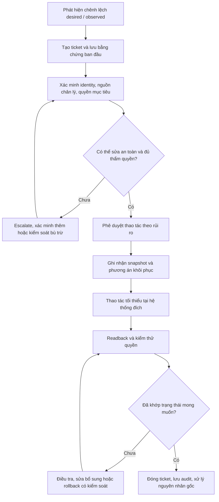

# Sửa lệch thủ công trong Account reconciliation

**Sửa lệch thủ công** (*manual reconciliation remediation*) là việc một người vận hành có thẩm quyền điều tra và khắc phục những sai khác giữa **trạng thái tài khoản, quyền truy cập mong muốn** (*desired state*) và **trạng thái thực tế** (*observed state*) ở hệ thống đích khi quy trình tự động không thể xử lý an toàn hoặc đầy đủ.

Trong **Identity and Access Management (IAM)**, so sánh tài khoản và quyền là khâu quan trọng để kiểm chứng vòng đời **Joiner–Mover–Leaver (JML)**. Một nhân viên mới có thể thiếu role sau khi provisioning; người chuyển bộ phận có thể giữ quyền từ vị trí cũ; người nghỉ việc có thể còn tài khoản hoặc phiên hoạt động tại ứng dụng cũ. Những sai lệch này không được bỏ qua chỉ vì **IdP**, **SCIM** hoặc công cụ đồng bộ hiển thị trạng thái thành công.

Sửa thủ công **không phải** cấp quyền tùy ý hoặc thay thế lâu dài cho tự động hóa. Đây là quy trình ngoại lệ có kiểm soát: xác minh căn cứ, phê duyệt thao tác, bảo vệ hệ thống, thực thi đúng phạm vi, đọc lại kết quả và lưu bằng chứng.

## 1. Khi nào cần sửa lệch thủ công?

Một số hệ thống có thể được đối soát nhưng không cung cấp API chỉnh sửa quyền, hoặc connector chỉ hỗ trợ cập nhật tài khoản mà không thể thu hồi role nội bộ. Có những tình huống tự động hóa cần dừng để tránh làm sai dữ liệu hay ngắt dịch vụ.

| Tình huống | Sai lệch quan sát được | Vì sao cần xử lý thủ công? |
| --- | --- | --- |
| Ứng dụng cũ không hỗ trợ SCIM/API đầy đủ | Account vẫn active sau Leaver | Chỉ giao diện quản trị mới cho phép disable |
| Role được gán trực tiếp tại ứng dụng | Mover đã bỏ nhóm IdP nhưng còn quyền `billing-admin` | Connector không quản lý entitlement cục bộ |
| Liên kết danh tính không chắc chắn | Hai account đích có thể thuộc cùng một người | Tự động gộp hoặc xóa có thể ảnh hưởng sai chủ thể |
| Connector trả lỗi hoặc timeout | Không xác định quyền đã được thêm/gỡ chưa | Retry mù có thể gây tác dụng phụ hoặc cấp quyền trùng |
| Tài khoản dịch vụ thiếu owner | Service account còn quyền quản trị | Xóa ngay có nguy cơ gián đoạn workload |
| Quyền tạm thời quá hạn | Entitlement còn hiệu lực | Cần kiểm tra phê duyệt, phụ thuộc và cách thu hồi |
| Quyền có xung đột SoD | Người dùng đồng thời có quyền lập và duyệt giao dịch | Cần xác nhận căn cứ và ưu tiên bảo mật |

Không phải sai lệch nào cũng cần thao tác ngay trên account. **Sai lệch dữ liệu nguồn, lỗi ánh xạ và quyền đặc thù có phê duyệt hợp lệ** cần được phân loại trước; sửa nhầm tại đích có thể bị quá trình đồng bộ kế tiếp ghi đè hoặc tạo trạng thái không nhất quán.

## 2. Xác định đúng desired state trước khi sửa

Account reconciliation đối chiếu nhiều nguồn dữ liệu có trách nhiệm khác nhau:

- **HRIS/HCM hoặc hệ thống hợp đồng:** chủ thể còn quan hệ hợp lệ không, bộ phận nào, ngày hiệu lực nào?
- **IAM/IGA:** bộ quyền chuẩn, yêu cầu/phê duyệt ngoại lệ, role và entitlement hiện được phép.
- **IdP/directory:** trạng thái đăng nhập, thuộc tính danh tính, nhóm và tài khoản liên kết.
- **Ứng dụng đích:** trạng thái account, ACL, role cục bộ, quyền truy cập tài nguyên.
- **Danh mục workload:** service account thuộc owner nào, chạy ở môi trường nào, credential còn cần thiết không?

Ví dụ một nhân viên đã chuyển từ Finance sang Analytics. HR xác nhận quan hệ vẫn `active` nhưng department mới là Analytics; IAM tính rằng `invoice-approver` phải được thu hồi, `analytics-reader` phải được cấp. Ứng dụng tài chính vẫn lưu quyền `invoice-approver`: đây là **excess entitlement** cần xử lý.

Ngược lại, nếu nhân viên đang được phê duyệt giữ một quyền bàn giao trong hai ngày, quyền ấy có thể là ngoại lệ hợp lệ thuộc desired state. Không được tự ý xóa trước khi xem xét quyết định và hạn hiệu lực.

## 3. Phân loại và ưu tiên sai lệch

| Loại sai lệch | Cách nhận biết | Hướng xử lý ưu tiên |
| --- | --- | --- |
| **Unexpected account** | Account đích không có căn cứ thuộc phạm vi cho phép | Xác minh identity/owner; khóa theo chính sách nếu rủi ro cao |
| **Orphan account** | Không xác định được chủ thể hoặc owner hợp lệ | Điều tra phụ thuộc và quyền; không xóa mù |
| **Missing account / grant** | Người đủ điều kiện không có tài khoản/quyền cần thiết | Xác minh chính sách rồi cấp đúng phạm vi |
| **Excess entitlement** | Quyền đích vượt quyền mong muốn | Ưu tiên thu hồi, nhất là quyền đặc quyền |
| **Attribute mismatch** | Bộ phận, tenant, ngày hiệu lực hoặc nhóm không khớp | Xác định trường nào là nguồn chân lý |
| **Account status mismatch** | Leaver cần bị khóa nhưng account vẫn active | Xử lý theo mức khẩn cấp của chính sách Leaver |
| **Session/credential residual** | Account đã khóa nhưng phiên hoặc API key còn dùng được | Thu hồi credential/phiên và xác minh tại điểm thực thi |
| **Ambiguous mapping** | Không chắc account thuộc người nào | Dừng thao tác có thể gây hại, chuyển đối soát định danh |

Đánh giá ưu tiên theo **mức nhạy cảm tài nguyên, quyền hiện có, trạng thái vòng đời, khả năng khai thác và tác động khi sửa sai**. Account admin của nhân viên đã nghỉ thường cần xử lý bảo mật nhanh hơn một trường tên hiển thị cập nhật chậm.

## 4. Quy trình sửa lệch thủ công có kiểm soát



### Bước 1 — Ghi nhận chênh lệch chính xác

Ticket cần có **correlation ID**, hệ thống đích, account ID ổn định, identity/owner liên quan, trạng thái mong muốn, trạng thái quan sát, timestamp và nguồn phát hiện. Đính kèm bản chụp cấu hình hoặc kết quả truy vấn đã lược bỏ dữ liệu nhạy cảm. Tránh chỉ mô tả mơ hồ “quyền sai”.

Ví dụ:

```json
{
  "ticketId": "IAM-REC-2407",
  "identityId": "EMP-2091",
  "targetSystem": "finance-erp",
  "targetAccountId": "erp-user-781",
  "discrepancyType": "EXCESS_ENTITLEMENT",
  "entitlement": "invoice-approver",
  "desired": false,
  "observed": true,
  "observedAt": "2026-11-23T03:15:00Z",
  "sourceEvent": "MOVER-183",
  "status": "PENDING_REVIEW"
}
```

Đây là schema minh họa, không phải định dạng bắt buộc. Nếu dữ liệu quan sát không đầy đủ hoặc có độ trễ, phải ghi rõ mức độ tin cậy trước khi thao tác.

### Bước 2 — Kiểm tra căn cứ và danh tính

Đối chiếu mã định danh gốc với account đích qua bảng liên kết có quản trị, `externalId` hoặc khóa kỹ thuật khác. **Không suy account thuộc về người nào chỉ dựa trên email** vì email có thể đổi hoặc được tái sử dụng. Với federation, subject cần được xét trong ngữ cảnh issuer; không ghép các account khác nguồn một cách tùy tiện.

Xác nhận ngày hiệu lực sự kiện JML và ngoại lệ đã duyệt. Mover có thể có giai đoạn bàn giao quyền cũ hợp lệ; Leaver phải dựa vào thời điểm chấm dứt có thẩm quyền. Nếu không đủ căn cứ, đặt ticket ở trạng thái cần điều tra và dùng biện pháp giảm rủi ro phù hợp thay vì tự ý cấp thêm quyền.

### Bước 3 — Phê duyệt và phân tách trách nhiệm

Quyền **thêm** và **gỡ** có thể chịu chính sách phê duyệt khác nhau. Cấp quyền nhạy cảm cần người quản lý, application owner hoặc data owner chấp thuận theo mức độ rủi ro. Thu hồi quyền trái chính sách, nhất là sau Leaver, thường cần thực thi kịp thời theo thẩm quyền đã được định nghĩa; không nên chờ chuỗi phê duyệt cấp quyền thông thường làm kéo dài truy cập tồn dư.

Với quyền đặc quyền, áp dụng **Segregation of Duties (SoD)**: người thực thi không nên đồng thời tự phê duyệt và tự xác nhận hoàn tất khi chính sách yêu cầu kiểm tra độc lập. Quyền truy cập quản trị dùng cho thao tác thủ công cũng nên là quyền tạm thời, có phạm vi và giám sát phù hợp.

### Bước 4 — Chuẩn bị phạm vi thay đổi và phương án phục hồi

Trước khi sửa, lưu **observed state** và xác định rõ phần cần thay đổi. Kiểm tra quyền đang được kế thừa từ nhóm hay gán trực tiếp; gỡ nhầm nhóm chung có thể ảnh hưởng nhiều người. Xác định khả năng rollback nếu thao tác gây mất quyền cần thiết, nhưng **không được dùng rollback để khôi phục quyền không hợp lệ sau Leaver**.

Đối với hệ thống có cơ chế đồng bộ định kỳ, xác định liệu lần chạy kế tiếp có ghi đè sửa đổi thủ công không. Nếu mapping IAM sai, phải xử lý hoặc tạo ticket sửa **nguồn chính sách/connector**, nếu không sai lệch có thể tái xuất hiện.

### Bước 5 — Thực hiện thay đổi tối thiểu

Người vận hành thao tác qua giao diện quản trị, API chính thức hoặc quy trình được phê duyệt. Chỉ chỉnh đúng tài khoản, role hoặc phạm vi được xác nhận; tránh cấp quyền quản trị rộng chỉ để tiện sửa một role nhỏ.

Ví dụ đối với tài khoản còn `invoice-approver` sau Mover, quản trị viên gỡ **role trực tiếp tại ERP** nếu đó là nguồn sai lệch; không nên khóa toàn bộ tài khoản khi người dùng vẫn cần phần quyền chung và những hệ thống khác.

Với Leaver có tài khoản còn active, cần chặn truy cập theo chính sách và xử lý phiên/token liên quan. Với service account có owner cũ, xác minh workload và chuyển quyền quản lý trước khi xoay secret hoặc gỡ quyền; tránh gián đoạn dịch vụ không cần thiết.

### Bước 6 — Readback và xác minh cả quyền cho phép lẫn quyền từ chối

Sau thao tác, **đọc lại trực tiếp từ hệ thống đích**, không chỉ tin thông báo “Saved successfully”. Kiểm tra account trạng thái mới, nhóm/role/ACL thực tế và thời điểm có hiệu lực.

Nên có hai loại kiểm tra:

- **Negative verification:** hành động trái quyền mới phải bị từ chối, chẳng hạn người đã chuyển bộ phận không thể phê duyệt hóa đơn.
- **Positive verification:** người vẫn có quyền hợp lệ thực hiện được công việc cần thiết, tránh sửa lệch gây mất quyền không liên quan.

Việc kiểm thử cần dùng tài khoản thử, chính sách kiểm soát hoặc bằng chứng được phê duyệt; không cố truy cập dữ liệu thật vượt quyền. Nếu còn access token hoặc session lưu quyền cũ, phải xác minh cửa sổ tồn dư và cơ chế thu hồi phù hợp.

### Bước 7 — Kết thúc ticket và xử lý nguyên nhân gốc

Lưu người thao tác, người phê duyệt, thời gian, đối tượng bị chỉnh, trạng thái trước/sau, kết quả readback, kiểm tra quyền và ngoại lệ. Nếu không thể xác minh hoàn toàn, không tự ghi “đã sửa xong”: cần nêu giới hạn, owner, thời hạn xử lý và biện pháp kiểm soát bù trừ.

Sửa lệch thủ công chỉ bền vững khi nguyên nhân gốc cũng được xử lý: mapping sai, thiếu sự kiện Mover/Leaver, connector mất quyền cập nhật, API phân trang chưa đủ hoặc ứng dụng có role cục bộ không được IGA theo dõi.

## 5. Kết nối với IdP, SSO, SCIM và RBAC/ABAC

| Thành phần | Vai trò trong xử lý sai lệch | Giới hạn cần nhớ |
| --- | --- | --- |
| HRIS/nguồn quan hệ | Xác nhận sự kiện và thuộc tính có hiệu lực | Không trực tiếp chứng minh quyền tại đích |
| **IdP** | Quản lý danh tính đăng nhập, nhóm và thuộc tính | Không bao phủ mọi role cục bộ của ứng dụng |
| **SSO** | Giúp đăng nhập liên kết | Phiên ứng dụng có thể còn hiệu lực khi nhóm IdP đã đổi |
| **SCIM/connector** | Đồng bộ user/group và một số thuộc tính | Không phải mọi entitlement đều có API hoặc schema chung |
| **RBAC** | Mô tả vai trò và tập quyền theo nghiệp vụ | Không tự giới hạn toàn bộ dữ liệu cùng role |
| **ABAC** | Giới hạn quyền theo thuộc tính chủ thể, tài nguyên, môi trường | Yêu cầu thuộc tính hiện hành, thực thi tại ứng dụng |
| **IGA/audit** | Quản lý ngoại lệ, phê duyệt, kiểm toán và đối soát | Không thay thế được kiểm tra quyền thực tế |

Ví dụ giả mã chính sách đích:

```text
ALLOW approve_invoice IF
    subject.lifecycle_status == "active"
    AND "invoice-approver" IN subject.roles
    AND resource.legal_entity IN subject.authorized_entities
    AND subject.sod_conflict == false
ELSE DENY
```

Đây không phải cú pháp chuẩn của một hệ thống IAM. Khi quyền `invoice-approver` đã thu hồi, ứng dụng phải ngăn hành động tương ứng, kể cả khi người dùng còn đăng nhập SSO hoặc giữ cookie phiên cũ.

## 6. Ba tình huống sửa lệch theo Joiner–Mover–Leaver

### Joiner: thiếu quyền sau khi tạo tài khoản

Nhân viên Lan có tài khoản CRM nhưng không có role `ticket-reader`. IAM xác nhận HR đã cho phép bắt đầu làm việc, role thuộc bộ quyền cơ bản và connector báo lỗi khi gán nhóm. Sau phê duyệt theo policy, người vận hành cấp đúng role tại CRM, đọc lại entitlement và kiểm tra Lan chỉ đọc được ticket của nhóm đã giao. Đồng thời cần sửa connector để lần Joiner sau không lặp lỗi.

### Mover: quyền cũ vẫn tồn tại

Nhân viên Hà chuyển từ Finance sang Analytics. HR và IdP đã cập nhật, nhưng ERP vẫn giữ `invoice-approver` gán cục bộ. Ticket xác nhận sự kiện Mover đã có hiệu lực và không có ngoại lệ bàn giao. Quản trị viên gỡ role, xác minh yêu cầu phê duyệt hóa đơn bị từ chối và quyền phân tích mới vẫn hoạt động. Đây là khắc phục **residual access**, không phải khóa toàn bộ identity.

### Leaver: tài khoản và phiên cũ chưa bị chặn

Nhà thầu kết thúc hợp đồng; IdP đã disable nhưng ứng dụng cũ vẫn cho dùng session đã tạo trước đó. Người vận hành xác minh owner và tài khoản, áp dụng cơ chế khóa hoặc thu hồi session mà ứng dụng hỗ trợ, đọc trạng thái và kiểm tra hành động cũ bị từ chối. Nếu ứng dụng không thể thu hồi access token trước hạn, phải ghi rõ thời gian còn hiệu lực, biện pháp chặn ở API hoặc gateway khi khả thi và thời điểm kiểm tra lại. **Không báo Leaver hoàn tất chỉ dựa trên việc disable IdP.**

## 7. Trường hợp đặc biệt: service account và workload

Một tài khoản kỹ thuật có thể là tài sản dùng chung của dịch vụ đang chạy. Thiếu `personId` trong HR không có nghĩa account này là trái phép. Cần đối chiếu với danh mục workload, môi trường triển khai và owner hiện hành.

Nếu người tạo service account đã nghỉ, hướng xử lý thường gồm chuyển owner, thu hồi khả năng truy cập secret của người nghỉ, xoay credential có rủi ro bị lộ và giảm quyền API của workload nếu vượt nhu cầu. Chỉ deprovision toàn bộ service identity khi đã xác nhận workload không còn dùng hoặc đã có phương án thay thế.

**Không thao tác với secret bằng cách dán vào ticket hoặc log.** Thay đổi credential phải qua secret manager, vault hoặc công cụ tương đương, có phân quyền và dấu vết kiểm toán phù hợp.

## 8. Kiểm soát rủi ro và chỉ số hiệu quả

| Rủi ro khi sửa thủ công | Biện pháp hạn chế |
| --- | --- |
| Sửa nhầm account cùng tên | Liên kết bằng stable ID, xác minh owner |
| Cấp quyền mới không có căn cứ | Phê duyệt, RBAC/ABAC, kiểm tra SoD |
| Thu hồi nhầm quyền thiết yếu | Snapshot, kiểm tra phụ thuộc, positive verification |
| Xóa nhầm service account | Điều tra workload và owner trước |
| Thao tác bị đồng bộ ghi đè | Sửa nguyên nhân gốc tại chính sách/connector |
| Không xử lý phiên/token | Kiểm tra khả năng truy cập tại điểm thực thi |
| Không có bằng chứng | Ticket, audit, readback, xác nhận độc lập |
| Quyền dư kéo dài vì chờ xử lý | Phân mức ưu tiên, SLA, kiểm soát bù trừ |

Những chỉ số nên theo dõi gồm:

- **Manual remediation rate:** tỷ lệ sai lệch phải sửa thủ công so với tổng sai lệch.
- **Mean time to remediate:** thời gian từ lúc phát hiện đến khi quyền thực tế đạt trạng thái mục tiêu.
- **Repeat discrepancy rate:** tỷ lệ lỗi tái xuất hiện sau lần đồng bộ kế tiếp.
- **High-risk aging:** số sai lệch quyền nhạy cảm tồn tại quá hạn.
- **Readback verification coverage:** tỷ lệ sửa lệch có bằng chứng đọc lại tại đích.
- **Approval/audit completeness:** tỷ lệ thao tác có căn cứ, người xử lý, phê duyệt cần thiết và lịch sử đầy đủ.

Khi tính các chỉ số, phải phân loại theo hệ thống và mức độ rủi ro. Một role admin còn hiệu lực sau Leaver nguy hiểm hơn nhiều lỗi tên hiển thị chưa cập nhật.

## 9. Câu hỏi tự kiểm tra

**Tình huống A:** CRM thiếu role của nhân viên Joiner, quản trị viên biết người đó cần làm việc ngay. Có nên tự cấp `admin` để khỏi chờ xử lý? **Không.** Phải xác minh căn cứ, cấp đúng entitlement tối thiểu và lưu phê duyệt phù hợp.

**Tình huống B:** ERP còn role tài chính sau Mover, nhưng ID account trùng email của người khác trong HR. Có thể gỡ ngay không? **Cần xác minh liên kết danh tính trước**, trừ khi chính sách ứng phó rủi ro cho phép biện pháp hạn chế an toàn đã được kiểm soát.

**Tình huống C:** Người vận hành đã gỡ quyền trên giao diện và thấy thông báo thành công. Có thể đóng ticket không? **Chưa đủ.** Cần đọc lại entitlement và xác minh hành vi truy cập tương ứng.

**Tình huống D:** Sửa role tại ứng dụng thành công nhưng đồng bộ đêm hôm sau tự thêm lại quyền cũ. Vấn đề nằm ở đâu? **Có thể do desired state, mapping hoặc connector vẫn sai**; phải xử lý nguyên nhân gốc thay vì chỉ sửa thủ công lặp đi lặp lại.

**Tình huống E:** Một account không có owner trong HR nhưng đang chạy tác vụ sao lưu. Có nên xóa ngay? **Không.** Cần xác minh danh tính workload, phụ thuộc và owner phù hợp.

## Ghi nhớ

**Sửa lệch thủ công** trong **Account reconciliation** là xử lý có kiểm soát những điểm không khớp giữa quyền mong muốn và quyền thực tế tại ứng dụng đích. Quy trình an toàn phải **xác minh danh tính và nguồn chân lý, phân loại rủi ro, phê duyệt theo thẩm quyền, thao tác tối thiểu, readback, kiểm tra quyền và lưu audit**. Kết hợp sự kiện **Joiner–Mover–Leaver** với **IdP/SSO, SCIM, RBAC/ABAC** và quản trị service identity giúp sửa đúng sai lệch, xử lý nguyên nhân gốc và giảm quyền truy cập tồn dư.
