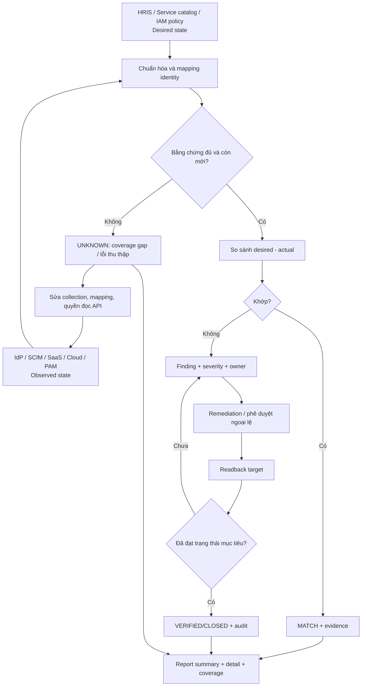

# Báo cáo reconciliation trong quản lý vòng đời tài khoản IAM

Một nhân viên đã rời tổ chức, hệ thống nhân sự ghi nhận trạng thái `TERMINATED`, và IAM đã gửi yêu cầu vô hiệu hóa tài khoản tới ứng dụng SaaS. Trên màn hình quản trị, yêu cầu được đánh dấu “thành công”. Tuy nhiên, khi kiểm tra trực tiếp ứng dụng, tài khoản vẫn còn hoạt động vì connector chỉ chấp nhận yêu cầu nhưng chưa áp dụng. Nếu tổ chức chỉ tổng hợp số lệnh đã gửi, báo cáo sẽ cho thấy một Leaver hoàn tất trong khi **quyền truy cập tồn dư** vẫn tồn tại.

**Báo cáo reconciliation (đối soát tài khoản)** là kết quả có cấu trúc của việc **so sánh trạng thái IAM mong muốn với trạng thái thực tế tại những hệ thống đích**, ghi nhận sai lệch, đánh giá mức độ rủi ro, phân công khắc phục và lưu bằng chứng xác minh. Báo cáo không chỉ để thống kê số tài khoản: nó là công cụ chứng minh các thay đổi **Joiner–Mover–Leaver (JML)** đã thực sự có hiệu lực.

Bài này trình bày cách thiết kế, đọc và sử dụng báo cáo reconciliation trong **Identity and Access Management (IAM)**, liên kết các nguồn nhân sự, **IdP, SSO, SCIM, RBAC/ABAC**, tài khoản đặc quyền, tài khoản dịch vụ và quy trình kiểm toán. Trọng tâm là **nội dung và chất lượng của báo cáo**: phạm vi, bằng chứng, trạng thái đối soát, các chỉ số và hành động tiếp theo.

## 1. Reconciliation và báo cáo reconciliation là gì?

**Account reconciliation** là hoạt động thu thập thông tin từ các nguồn và hệ thống đích, đối chiếu các tài khoản hoặc quyền truy cập đang tồn tại với trạng thái được chính sách cho phép, rồi phát hiện sai lệch.

**Báo cáo reconciliation** là tài liệu, bảng dữ liệu hoặc dashboard cho biết:

1. **Phạm vi kiểm tra:** các hệ thống, loại danh tính và khoảng thời gian được đối soát.
2. **Trạng thái mục tiêu:** account và entitlement nào *nên* tồn tại theo nguồn có thẩm quyền và policy.
3. **Trạng thái quan sát:** account và entitlement nào *đang* được hệ thống đích công nhận.
4. **Sai lệch:** đối tượng thiếu, dư, sai trạng thái, sai thuộc tính hoặc quyền không phù hợp.
5. **Độ tin cậy của bằng chứng:** nguồn dữ liệu, thời điểm chụp, giới hạn coverage và những phần chưa xác minh.
6. **Mức rủi ro và ưu tiên:** sai lệch nào cần xử lý ngay, đặc biệt quyền đặc quyền và Leaver.
7. **Kết quả xử lý:** owner, tác vụ, hạn hoàn tất, kiểm chứng sau khắc phục và trạng thái đóng.

Báo cáo có thể chạy theo lịch, theo sự kiện hoặc theo yêu cầu của kiểm toán. Nhưng một file CSV xuất ra hằng ngày **không mặc nhiên là reconciliation đáng tin** nếu dữ liệu thiếu, join sai danh tính hoặc không có quy trình xác minh sai lệch.

### 1.1. So sánh ba loại trạng thái

| Loại trạng thái | Câu hỏi | Ví dụ |
|---|---|---|
| **Desired state** | Theo nguồn chuẩn và chính sách, account/quyền *phải ở trạng thái nào*? | Nhân viên đã Leaver không còn quyền truy cập CRM. |
| **Requested/applied state** | IAM đã gửi hoặc hệ thống đích đã chấp nhận thao tác nào? | Connector đã gửi `active=false` và nhận phản hồi thành công. |
| **Observed/actual state** | Hệ thống đích hiện *thực sự ghi nhận và cho phép gì*? | CRM vẫn ghi account active và cho đăng nhập trực tiếp. |

Khác biệt quan trọng nhất là: **gửi yêu cầu thu hồi thành công không đồng nghĩa đã thu hồi thành công**. Báo cáo tốt phải có **readback**, tức truy vấn lại trạng thái sau thay đổi, trong giới hạn khả năng quan sát của hệ thống đích.

### 1.2. Account reconciliation khác access review thế nào?

- **Reconciliation:** so sánh dữ liệu/trạng thái mục tiêu với dữ liệu/trạng thái quan sát, tìm sai lệch kỹ thuật và quản trị.
- **Access review/certification:** người có thẩm quyền đánh giá nhu cầu nghiệp vụ của quyền đã cấp; có thể yêu cầu thu hồi dù dữ liệu không sai kỹ thuật.
- **Provisioning/deprovisioning:** thao tác tạo, cập nhật, vô hiệu hóa hoặc xóa account/quyền.
- **Audit:** lưu và kiểm tra bằng chứng ai quyết định, đã làm gì và kết quả.

Các hoạt động có liên quan nhưng không thay thế nhau. Ví dụ một role được cấp đúng như yêu cầu đã phê duyệt vẫn có thể trở nên không cần thiết sau vài tháng; access review phát hiện nhu cầu đổi, IAM cập nhật desired state, reconciliation kiểm tra ứng dụng đã áp dụng thay đổi.

## 2. Vì sao báo cáo reconciliation quan trọng trong JML?

Mỗi giai đoạn vòng đời tạo ra một kiểu rủi ro khác nhau.

| Giai đoạn | Trạng thái mục tiêu điển hình | Điều báo cáo cần phát hiện |
|---|---|---|
| **Joiner** | Tài khoản hợp lệ được tạo đúng nơi, đúng thời điểm, quyền tối thiểu. | Chưa tạo account cần thiết, tạo sai principal, quyền dư, account trùng. |
| **Mover** | Thuộc tính/role mới được áp dụng; quyền cũ không còn hợp lệ bị thu hồi. | Phòng ban đã đổi nhưng nhóm cũ còn, direct grant không bị gỡ, SoD conflict. |
| **Leaver** | Đăng nhập và quyền cá nhân bị chặn theo thời điểm hiệu lực; account được xử lý theo retention. | Account vẫn active, session/token ngoài chính sách, role admin còn, tác vụ thu hồi thất bại. |
| **Workload lifecycle** | Service principal chỉ tồn tại khi workload hợp lệ và có owner. | Account máy mồ côi, credential cũ, quyền cloud không còn mục đích. |
| **Access review** | Các quyết định giữ/gỡ quyền đã được thi hành. | Quyền bị reviewer yêu cầu thu hồi nhưng target chưa gỡ. |

Điểm chung: **mục tiêu không phải báo cáo đẹp mà là giảm khoảng cách giữa chính sách và quyền hiệu lực**. Quy trình reconciliation cần phát hiện sai lệch, chỉ định hành động và kiểm tra sau xử lý.

### 2.1. Ví dụ Leaver đơn giản

```text
HRIS:
  identity = person-1045
  employmentStatus = TERMINATED
  effectiveAt = 2026-12-01T17:00:00+07:00

IAM:
  target = crm-saas
  expectedAccountState = DISABLED
  requestedOperation = DISABLE_ACCOUNT

CRM readback lúc 17:08:
  accountId = crm-user-218
  actualAccountState = ACTIVE

Reconciliation:
  findingType = LEAVER_ACTIVE_ACCOUNT
  result = MISMATCH
  severity = CRITICAL (theo policy minh họa)
  action = Kiểm tra connector và chặn truy cập tại CRM
```

Bản ghi này có ý nghĩa hơn trạng thái “request completed”, vì nó chỉ ra **đường truy cập còn tồn tại**, hệ thống đích và việc cần làm.

## 3. Phạm vi của một báo cáo reconciliation

Trước khi tính bất kỳ chỉ số nào, phải quyết định **đối soát cái gì**.

### 3.1. Các lớp cần theo dõi

| Lớp | Đối tượng kiểm tra | Ví dụ sai lệch |
|---|---|---|
| **Identity** | Danh tính trong registry và nguồn có thẩm quyền. | Identity không có hồ sơ nguồn; hai bản ghi cùng một người. |
| **Account** | Account tại IdP, SaaS, ứng dụng nội bộ, cloud. | Target account không liên kết identity; Leaver vẫn active. |
| **Attribute** | Department, manager, status, loại hợp đồng, ngày hết hạn. | Mover đã có hiệu lực ở HRIS nhưng IdP giữ department cũ. |
| **Group / role** | Membership, role trực tiếp và các role kế thừa. | Nhân viên còn nhóm phòng ban cũ. |
| **Entitlement** | Hành động/tài nguyên mà principal được quyền truy cập. | Direct grant vượt tập quyền mục tiêu. |
| **Privileged access** | Role admin, PAM/PIM eligible/active, JIT access. | Người chuyển khỏi vận hành vẫn có khả năng kích hoạt admin. |
| **Credential/session** | Secret, key, chứng chỉ và phiên nếu nguồn quan sát được. | SSH key cá nhân vẫn hợp lệ sau Leaver. |
| **Non-human identity** | Service account, workload identity, bot, pipeline principal. | Account máy không có owner hoặc workload hợp lệ. |

Không phải connector nào cũng cho phép quan sát đầy đủ các lớp. Báo cáo phải ghi **cấp độ đối soát**: chỉ account, account + group, hay cả effective access, session và credential. Nếu báo cáo chỉ có `active` của SCIM User, không thể tuyên bố đã kiểm tra hết token hoặc quyền quản trị nội bộ.

### 3.2. Phạm vi hệ thống và loại subject

Cần ghi rõ:

- Hệ thống/tenant/project/region nào nằm trong kỳ báo cáo.
- Phạm vi account: nhân viên, nhà thầu, khách, service principal, bot, admin riêng.
- Nhóm quyền/role nào được xem là nhạy cảm.
- Trạng thái lifecycle được bao phủ.
- Các nguồn chưa tích hợp và vì sao chưa thu thập được.
- Hệ thống nào chỉ có khả năng kiểm tra thủ công.

**Không có dữ liệu** là một trạng thái phải công bố, không phải bằng chứng “không có sai lệch”.

## 4. Nguồn dữ liệu và nguồn có thẩm quyền

Báo cáo reconciliation thường ghép dữ liệu từ nhiều nơi:

| Nguồn | Dữ liệu cung cấp | Vai trò trong đối soát |
|---|---|---|
| **HRIS / hệ thống nhà thầu** | Trạng thái công tác, ngày hiệu lực, department, manager, sponsor. | Nguồn chuẩn của quan hệ nhân sự theo chính sách. |
| **Identity registry / IGA** | Subject ID, account mapping, quyền mục tiêu, ngoại lệ, phê duyệt. | Tính desired state và quản lý hành động. |
| **IdP / directory** | Tài khoản, thuộc tính, group, trạng thái xác thực. | Một phần observed state và đường cấp quyền. |
| **SCIM / API ứng dụng** | User/Group, trạng thái account và dữ liệu quyền mà connector hỗ trợ. | Bằng chứng tại target. |
| **Cloud IAM / PAM / PIM** | Role assignment, direct grant, eligible/active privilege. | Phát hiện đặc quyền ngoài nguồn nhóm thông thường. |
| **Secrets manager / PKI / gateway** | Metadata key/certificate, owner, thời hạn, trạng thái nếu có. | Đánh giá quyền kỹ thuật và credential. |
| **Service catalog / CI/CD** | Workload hợp lệ, môi trường, owner, trạng thái triển khai. | Nguồn lifecycle cho machine identity. |
| **Audit / ticket / workflow** | Request, phê duyệt, thao tác và kết quả xử lý. | Giải thích nguồn gốc sai lệch và chứng minh khắc phục. |

**Authoritative source phụ thuộc từng thuộc tính.** HRIS có thể xác nhận phòng ban của nhân viên nhưng không tự biết một quyền admin trực tiếp trong cơ sở dữ liệu. Ngược lại, database có thể báo role thực tế nhưng không nên tự quyết định tình trạng nhân sự của người dùng.

### 4.1. Mô hình dữ liệu đầu vào tối thiểu

Báo cáo có thể chuẩn hóa thành các tập dữ liệu:

1. **Identity snapshot:** `subjectId`, loại subject, trạng thái, thời điểm hiệu lực, source version.
2. **Account inventory:** `targetSystem`, `targetAccountId`, mapping đến subject, trạng thái, thời điểm quan sát.
3. **Desired entitlements:** role/quyền/tài nguyên hợp lệ theo policy và ngoại lệ.
4. **Actual entitlements:** role/quyền/tài nguyên thực tế, cùng đường cấp nếu có.
5. **Evidence metadata:** nguồn truy vấn, run ID, thời gian snapshot, độ đầy đủ, lỗi.
6. **Workflow state:** yêu cầu đã gửi, kết quả connector, trạng thái remediate/review.

Một số ứng dụng không hỗ trợ export role hoặc không thể đọc session. Khi đó báo cáo phải tách **đã xác minh account** khỏi **chưa xác minh quyền**, thay vì gắn nhãn toàn bộ đối tượng là compliant.

### 4.2. Ánh xạ identity với account

Báo cáo chỉ có giá trị khi ghép đúng:

```text
subjectId: person-1045
  ├── IdP account id: idp-018
  ├── CRM account id: crm-218
  ├── Cloud principal id: cloud-a91
  └── Admin account id: admin-1045
```

Không nên tự động ghép bằng **tên hoặc email** khi chưa có quy tắc xác minh: hai người có thể trùng tên, một email có thể đổi hoặc được dùng lại, service account có thể đặt tên giống nhân viên. Cần lưu namespace của ID, nguồn mapping và độ tin cậy của liên kết. Nếu mapping mơ hồ, báo cáo phải tạo **finding cần xác minh**, không tự chọn account rồi xóa.

## 5. Mô hình so sánh desired state và actual state

### 5.1. Báo cáo account existence/status

Một cách kiểm tra ban đầu:

| Desired account | Observed account | Diễn giải sơ bộ |
|---|---|---|
| Phải có, ACTIVE | Có, ACTIVE | Có thể khớp trạng thái account; cần kiểm quyền riêng. |
| Phải có, ACTIVE | Không tìm thấy | Thiếu account hoặc lỗi thu thập/mapping. |
| Phải DISABLED | Có, ACTIVE | Sai lệch nghiêm trọng nếu chủ thể đã mất quyền. |
| Phải DISABLED | Có, DISABLED | Account-level match, chưa chứng minh token/session đã ngừng. |
| Phải không còn theo chính sách xóa | Có | Account tồn dư hoặc còn hold/ngoại lệ cần xác minh. |
| Không có chủ thể/owner hợp lệ | Có | Orphan/unmanaged candidate; cần xác minh trước xử lý. |
| Phải có | Không thể thu thập target | **UNKNOWN**, không được coi là match hay missing chắc chắn. |

### 5.2. Báo cáo entitlement

Gọi \(D\) là tập quyền mục tiêu và \(A\) là tập quyền quan sát được trong **cùng phạm vi, cùng thời điểm và cùng cách định danh quyền**. Về mặt khái niệm:

\[
\text{Missing grants}=D\setminus A
\]

\[
\text{Unexpected grants}=A\setminus D
\]

\[
\text{Matched grants}=D\cap A
\]

Tuy nhiên **effective access** có thể đến từ nhiều đường: group trực tiếp, nested group, role trực tiếp, policy theo thuộc tính hoặc điều kiện thời gian. Vì vậy, phép trừ tập hợp chỉ đúng khi quá trình chuẩn hóa đã biểu diễn cùng một ngữ nghĩa quyền.

Ví dụ một quyền `reports.read` còn hiệu lực qua nhóm thứ hai dù nhóm chính đã bị gỡ. Báo cáo **membership reconciliation** có thể đánh dấu “gỡ nhóm thành công” nhưng **effective-permission reconciliation** vẫn cần báo quyền còn tồn tại.

### 5.3. Quy tắc ba trạng thái: khớp, sai lệch, chưa xác minh

Một điểm dễ gây báo cáo sai là biến lỗi truy vấn thành kết luận bảo mật.

- **MATCH / COMPLIANT:** có bằng chứng đủ để khẳng định điều kiện đối soát được thỏa trong phạm vi đã định.
- **MISMATCH / DRIFT:** có bằng chứng hợp lệ về khác biệt giữa trạng thái mục tiêu và thực tế.
- **UNKNOWN / INCOMPLETE:** chưa có bằng chứng đủ, ví dụ connector lỗi, API thiếu quyền đọc hoặc snapshot quá cũ.

Một báo cáo trưởng thành nên giữ thêm trạng thái **NOT_APPLICABLE** khi quy tắc không áp dụng, nhưng không cộng nó vào mẫu số kiểm tra như một bản ghi khớp nếu làm méo tỷ lệ.

## 6. Các loại finding trong báo cáo

Để người nhận có thể hành động, mỗi sai lệch phải có **loại rõ ràng**.

| Finding type | Dấu hiệu | Ưu tiên thường gặp |
|---|---|---|
| `LEAVER_ACTIVE_ACCOUNT` | Chủ thể đã kết thúc quan hệ nhưng target vẫn active. | Cao, tùy hệ thống và đường truy cập. |
| `RESIDUAL_PRIVILEGED_ACCESS` | Quyền admin/PAM/JIT còn dù không còn thẩm quyền. | Rất cao trên hệ thống nhạy cảm. |
| `ORPHAN_ACCOUNT` | Account không có identity hoặc owner hợp lệ. | Cần xác minh sớm, tránh xóa nhầm. |
| `MISSING_REQUIRED_ACCOUNT` | Joiner hợp lệ nhưng chưa được provision account cần thiết. | Ảnh hưởng onboarding/khả năng làm việc. |
| `EXCESS_ENTITLEMENT` | Có quyền thực tế ngoài tập quyền mục tiêu. | Tùy phạm vi và độ nhạy. |
| `MISSING_ENTITLEMENT` | Quyền cần thiết chưa được cấp. | Ảnh hưởng vận hành; không tự bypass approval. |
| `STALE_ATTRIBUTE` | Department/manager/status ở target lệch nguồn chuẩn. | Tùy ảnh hưởng của thuộc tính tới quyền. |
| `ROLE_OR_GROUP_DRIFT` | Membership hoặc role assignment khác trạng thái mục tiêu. | Tăng ưu tiên nếu dẫn đến nâng quyền. |
| `UNVERIFIED_REVOCATION` | Yêu cầu gỡ quyền đã gửi nhưng chưa có bằng chứng. | Cần theo dõi SLA và rủi ro. |
| `ACCOUNT_DUPLICATE_CANDIDATE` | Nhiều account có khả năng thuộc một identity. | Cần xác minh mapping trước hợp nhất/xóa. |
| `UNOWNED_SERVICE_PRINCIPAL` | Machine identity đang tồn tại nhưng thiếu owner hợp lệ. | Cao nếu có credential/quyền nhạy cảm. |
| `DATA_COLLECTION_FAILED` | Không thể đọc target hoặc không đủ scope. | Ưu tiên sửa coverage; chưa kết luận compliant. |

Tên finding ở trên là **phân loại minh họa**, không phải bộ mã tiêu chuẩn bắt buộc. Doanh nghiệp có thể bổ sung finding về SoD, ngày hết hạn nhà thầu, credential già cỗi và quyền tự nâng cấp.

## 7. Báo cáo cần có những phần nào?

Một báo cáo hữu ích nên cho phép cả lãnh đạo, IAM operations và auditor tìm được thông tin họ cần mà không phải tự ghép nhiều hệ thống.

### 7.1. Executive summary

Phần tóm tắt nên trả lời:

- Kỳ và phạm vi kiểm tra: ví dụ snapshot ngày 01/12 cho 4 ứng dụng production.
- Có bao nhiêu account/identity được đối soát và bao nhiêu hệ thống thu thập thành công?
- Số finding **theo mức độ nghiêm trọng và loại**, không chỉ tổng số.
- Bao nhiêu trường hợp Leaver/đặc quyền có đường truy cập tồn dư?
- Có target nào **không thu thập được** hoặc bằng chứng quá cũ?
- Sai lệch đã được xử lý, chưa xử lý và quá hạn.
- Rủi ro nổi bật, owner và quyết định cần hỗ trợ.

Không nên dùng một màu xanh “100% đồng bộ” nếu hệ thống nhạy cảm nhất không trả dữ liệu. Chất lượng bằng chứng là một phần kết quả.

### 7.2. Coverage và nguồn bằng chứng

Mục này ghi:

- Danh sách ứng dụng/tenant được cấu hình trong phạm vi.
- Các connector/API đã chạy, quyền đọc dữ liệu tương ứng.
- Mốc thời gian snapshot từng nguồn và thời gian tổng hợp.
- Target trả lỗi hoặc chỉ cung cấp dữ liệu một phần.
- Tỷ lệ account có identity mapping đáng tin.
- Phạm vi kiểm tra quyền: account state, group, role, direct grant, session, token...
- Những giả định có thể tạo false positive/false negative.

### 7.3. Bảng phát hiện chi tiết

Các cột nên đủ để mở ticket và kiểm chứng:

| Cột | Ý nghĩa |
|---|---|
| `findingId` | Mã phát hiện ổn định qua các lần chạy. |
| `runId` | Kỳ/snapshot và phiên bản quy tắc đã tạo finding. |
| `subjectId` | Danh tính được đối soát, nếu ánh xạ đủ tin cậy. |
| `targetSystem`, `accountId` | Đường dẫn tới account/tài nguyên tại hệ thống đích. |
| `findingType` | Loại sai lệch được chuẩn hóa. |
| `desiredState`, `observedState` | Giá trị mục tiêu và thực tế cùng phạm vi so sánh. |
| `evidenceAsOf` | Thời điểm dữ liệu target được quan sát. |
| `severity`, `reason` | Mức độ ưu tiên và căn cứ đánh giá. |
| `owner`, `dueAt` | Đơn vị chịu trách nhiệm và hạn xử lý. |
| `remediationStatus` | Mở, đang xử lý, chờ xác minh, đóng... |
| `exceptionId` | Ngoại lệ được phê duyệt nếu có. |
| `verificationEvidence` | Tham chiếu readback hoặc bằng chứng kiểm tra. |

### 7.4. Remediation và quyết định quản trị

Một phần riêng cần ghi:

- Việc đã sửa và kết quả đọc lại.
- Việc đang xử lý, người chịu trách nhiệm và mốc thời gian.
- Ngoại lệ được phê duyệt có lý do, phạm vi và ngày hết hạn.
- Sai lệch chưa thể xác nhận vì thiếu dữ liệu.
- Những phát hiện bị loại sau khi điều tra vì mapping sai hoặc quy tắc không áp dụng, kèm lý do.

Không được “làm đẹp” tỷ lệ bằng cách xóa finding khỏi lịch sử; nên giữ lifecycle của finding để có thể truy vết.

## 8. Ví dụ báo cáo đối soát account

Giả sử tổ chức chạy reconciliation lúc **18:00 ngày 01/12/2026** với một số account mục tiêu.

### 8.1. Snapshot đơn giản

| Subject / target | Desired | Observed | Finding | Ghi chú |
|---|---|---|---|---|
| Lan / CRM | DISABLED | ACTIVE | `LEAVER_ACTIVE_ACCOUNT` | Lan đã Leaver; target cần chặn. |
| Bình / Finance SaaS | ACTIVE + role reader | ACTIVE + role reader | MATCH | Chỉ khớp account và role đã quan sát. |
| Minh / Ticket SaaS | Không còn role support | Vẫn có role support | `EXCESS_ENTITLEMENT` | Minh chuyển phòng ban. |
| Service `invoice-sync` / Cloud IAM | ACTIVE + owner hợp lệ | ACTIVE, owner thiếu | `UNOWNED_SERVICE_PRINCIPAL` | Cần xác minh ownership, chưa xóa vội. |
| An / Analytics | ACTIVE + role viewer | Không đọc được API | `DATA_COLLECTION_FAILED` | UNKNOWN; chưa thể kết luận missing. |

Các hàng mô tả **tình huống giả lập**; một báo cáo thật còn cần target ID, timestamp của nguồn, evidence, độ nhạy và người xử lý.

### 8.2. Đọc đúng kết quả

Trong 5 hàng ví dụ:

- Có **3 finding được xác nhận là sai lệch** (Lan, Minh, service), với loại và rủi ro khác nhau.
- Có **1 trường hợp khớp** theo những trường đã kiểm tra (Bình).
- Có **1 trường hợp UNKNOWN** do không thu thập được dữ liệu (An).

Nếu chỉ tính tỷ lệ khớp trên những hàng có bằng chứng đủ, tỷ lệ mẫu minh họa là **1/4 = 25%**. Nhưng đây **không phải** tỷ lệ tuân thủ IAM của toàn tổ chức: dữ liệu quá ít, khác loại kiểm tra và có một target chưa quan sát. Báo cáo thực tế phải công bố **mẫu số và phạm vi**; tốt hơn nên phân tách account-level và entitlement-level checks.

### 8.3. Mẫu JSON cho một finding

```json
{
  "findingId": "rec-2026-12-01-0042",
  "runId": "iam-rec-prod-20261201",
  "subjectId": "person-lan",
  "targetSystem": "crm-saas",
  "targetAccountId": "crm-user-218",
  "findingType": "LEAVER_ACTIVE_ACCOUNT",
  "desired": {
    "accountState": "DISABLED",
    "effectiveAt": "2026-12-01T17:00:00+07:00"
  },
  "observed": {
    "accountState": "ACTIVE",
    "observedAt": "2026-12-01T18:00:00+07:00"
  },
  "assessment": {
    "result": "MISMATCH",
    "severity": "CRITICAL",
    "policyVersion": "iam-policy-v7"
  },
  "remediation": {
    "ownerTeam": "iam-operations",
    "status": "OPEN",
    "dueAt": "2026-12-01T18:15:00+07:00"
  },
  "evidenceRef": "evidence/rec-2026-12-01-0042"
}
```

Đây là **schema minh họa**, không phải định dạng bắt buộc của SIEM, IdP hoặc công cụ IGA. Mức `CRITICAL` và hạn xử lý ở ví dụ chỉ thể hiện **chính sách giả định**, không phải SLA chuẩn.

### 8.4. Mẫu summary dành cho người phụ trách

```text
RECONCILIATION RUN: iam-rec-prod-20261201
Window / snapshot: 2026-12-01 18:00 +07:00
In-scope systems: CRM, Finance SaaS, Ticket SaaS, Cloud IAM, Analytics

Checked examples:
  MATCH:                 1
  CONFIRMED MISMATCH:    3
  UNKNOWN:               1

Critical actions:
  - Chặn account CRM còn ACTIVE của Leaver
  - Gỡ role Support không còn hợp lệ sau Mover
  - Xác minh owner của service principal

Coverage issue:
  - Analytics API không trả đủ dữ liệu

Lưu ý: các giá trị trên chỉ là dữ liệu minh họa, không
phản ánh tình trạng hệ thống thực hay doanh nghiệp cụ thể.
```

## 9. Chỉ số và công thức trong báo cáo

Chỉ số tốt phải có **định nghĩa rõ mẫu số**, tính đến dữ liệu thiếu và phân biệt quyền ở nhiều lớp.

| Chỉ số | Cách tính/góc nhìn | Ý nghĩa |
|---|---|---|
| **Account match rate** | Số account checks MATCH / số account checks có kết quả kiểm chứng đủ. | Mức khớp trạng thái account trong phạm vi đã quan sát. |
| **Unverified coverage** | Số checks UNKNOWN / tổng checks dự kiến. | Quy mô vùng chưa thể kết luận. |
| **Target collection coverage** | Số target có snapshot đầy đủ / tổng target trong phạm vi. | Khả năng bao phủ thu thập. |
| **Identity correlation coverage** | Số account ánh xạ tin cậy đến identity / số account quan sát đủ. | Mức quản trị liên kết danh tính. |
| **Residual access count** | Số quyền/account không còn hợp lệ nhưng vẫn hiệu lực. | Nguy cơ Leaver/Mover chưa xử lý. |
| **Privileged drift count** | Số sai lệch đặc quyền đã xác nhận. | Phát hiện quyền rủi ro cao. |
| **Mean time to verify** | Thời gian từ event/đề nghị tới readback đạt tiêu chí; phân tách loại sự kiện. | Hiệu quả kiểm chứng. |
| **Overdue finding count** | Số finding OPEN quá hạn xử lý. | Backlog còn rủi ro. |
| **Repeat finding rate** | Tỷ lệ sai lệch xuất hiện lại sau khi đã được đánh dấu xử lý. | Chất lượng khắc phục và tự động hóa. |
| **Approved exception age** | Tuổi và số ngoại lệ còn hiệu lực hoặc quá hạn. | Ngăn ngoại lệ trở thành quyền tồn dư lâu dài. |

### 9.1. Các điểm phải công bố cùng KPI

Ví dụ *account match rate* chỉ nên tính cho kiểm tra mà cả desired và observed state có đủ bằng chứng. Nhưng phải trình bày **UNKNOWN cùng lúc**: một tỷ lệ khớp 100% trên 10% dữ liệu quan sát được có thể gây hiểu nhầm.

Các mốc thời gian nên phân biệt:

- **Event effective time:** khi quyền cần thay đổi về nghiệp vụ.
- **Event received time:** khi IAM nhận sự kiện.
- **Action submitted time:** khi lệnh được gửi đến target.
- **Target observed time:** khi trạng thái được đọc lại.
- **Verified remediation time:** khi bằng chứng đủ xác nhận sai lệch được khắc phục.

Nếu hệ thống có độ trễ đồng bộ hợp lệ, báo cáo nên nêu rõ **grace period theo chính sách** và không lẫn nó với thời hạn xử lý các quyền nhạy cảm.

### 9.2. Tránh mẫu số sai

Không nên cộng một account-level match, một entitlement-level match và một access-review certification thành ba kết quả tương đương. Cần phân tầng:

1. **Identity/account scope:** có đúng account và đúng trạng thái không?
2. **Assignment scope:** role/group/entitlement đã cấp đúng không?
3. **Effective access scope:** principal còn thực sự thực hiện được hành động nào?
4. **Credential/session scope:** có chứng cứ đường truy cập đang tồn tại không?

Chỉ tiêu phải được tính và diễn giải **trong cùng cấp và cùng phạm vi**, hoặc có phương pháp tổng hợp được công bố.

## 10. Đánh giá mức độ nghiêm trọng và ưu tiên khắc phục

Một finding có thể ảnh hưởng **bảo mật**, **khả năng làm việc**, **tuân thủ** hoặc **chất lượng dữ liệu**.

Các yếu tố đánh giá:

- **Lifecycle state:** Leaver, Mover, Joiner, tài khoản tạm thời, workload.
- **Mức đặc quyền:** admin, secrets, quyền phê duyệt giao dịch, quyền đọc dữ liệu nhạy cảm.
- **Phạm vi tài nguyên:** một nhóm nhỏ, toàn tenant hay production.
- **Khả năng lạm dụng thực tế:** account active, session còn hiệu lực, token dài hạn hoặc quyền chỉ nằm trên giấy.
- **Thời gian sai lệch:** tồn tại bao lâu sau mốc hiệu lực?
- **Khả năng khắc phục:** có thể chặn trực tiếp hay cần xử lý thủ công?
- **Độ tin cậy bằng chứng:** xác nhận trực tiếp từ target hay nghi vấn mapping?
- **Kiểm soát bù trừ:** đã chặn ở gateway, MFA hoặc policy khác chưa?

Ví dụ Leaver vẫn có **direct production admin grant** thường cần ưu tiên cao hơn một Joiner chưa được cấp quyền đọc tài liệu. Tuy vậy, báo cáo không nên gán mức severity chỉ theo tên finding mà không xét đường quyền và ngữ cảnh.

### 10.1. Sai lệch là vấn đề cần xử lý, không mặc nhiên là sự cố tấn công

Phát hiện account dư không tự chứng minh người đó đã truy cập trái phép. Cần **thu hồi/kiểm soát quyền** và nếu có dấu hiệu bất thường thì điều tra nhật ký phù hợp. Báo cáo nên tách rõ:

- **Observation:** trạng thái đọc được từ target.
- **Policy mismatch:** khác biệt với trạng thái mục tiêu.
- **Risk assessment:** hệ quả tiềm năng.
- **Incident conclusion:** kết luận điều tra, nếu có, dựa trên bằng chứng khác.

Tránh diễn đạt “bị tấn công” hoặc “lộ dữ liệu” chỉ từ một role chưa bị gỡ.

## 11. Quy trình tạo và phát hành báo cáo

Một quy trình có thể diễn ra theo các bước sau.

### Bước 1 — Chốt phạm vi và kỳ đối soát

Chọn target/tenant, loại subject và cấp kiểm tra; ghi rõ thời điểm snapshot, tiêu chí SLA và danh sách ngoại lệ.

### Bước 2 — Thu thập desired state

Từ HRIS, contractor registry, service catalog và IAM/IGA, xây dựng trạng thái mong muốn theo **policy version và ngày hiệu lực**. Với quyền đặc biệt, cần tính đến phê duyệt, JIT và ngoại lệ còn hạn.

### Bước 3 — Thu thập observed state

Dùng IdP API, SCIM, cloud IAM, PAM hoặc connector khác để đọc trạng thái account, nhóm, role và quyền thực tế có thể quan sát. Mỗi kết quả phải đi kèm timestamp và trạng thái đầy đủ của lần thu thập.

### Bước 4 — Liên kết account với danh tính

Ánh xạ bằng ID ổn định. Đánh dấu trường hợp mapping không rõ thay vì ghép theo tên/email một cách suy đoán.

### Bước 5 — Chuẩn hóa dữ liệu

Quy đổi trạng thái và role về ngôn ngữ báo cáo chung, giữ tham chiếu giá trị gốc. Ví dụ trạng thái ứng dụng `suspended` có thể tương đương một loại account disabled theo policy nội bộ; không tự suy luận nếu hành vi đăng nhập thực tế chưa rõ.

### Bước 6 — So sánh và phân loại

Áp dụng các rule theo từng loại tài khoản/tài nguyên, phát sinh MATCH/MISMATCH/UNKNOWN, loại finding, evidence và mức rủi ro.

### Bước 7 — Trừ ngoại lệ hợp lệ một cách minh bạch

Ngoại lệ có phê duyệt, phạm vi, thời hạn và chính sách có thể tác động tới **desired state**. Không xóa hẳn các trường hợp ngoại lệ khỏi báo cáo; cần thể hiện số lượng, hạn review và quyền đang được giữ do ngoại lệ.

### Bước 8 — Tạo finding và giao owner

Gắn finding với target, identity, nguyên nhân, ưu tiên, thời hạn và đội xử lý. Bảo đảm finding trùng ở nhiều kỳ được theo dõi thành **một vòng đời xử lý** khi thích hợp, thay vì mỗi ngày tạo ticket mới không liên kết.

### Bước 9 — Khắc phục và readback

Gửi lệnh gỡ/cấp phù hợp, điều tra dữ liệu sai hoặc quản lý ngoại lệ. Chỉ đánh dấu **VERIFIED** khi có bằng chứng đúng phạm vi từ target.

### Bước 10 — Phát hành báo cáo theo quyền truy cập

Cung cấp summary cho quản lý, báo cáo chi tiết cho IAM operations và bằng chứng kiểm toán cho người có thẩm quyền. Bảo vệ thông tin account/nhóm nhạy cảm, danh sách admin và dữ liệu nhân sự.

### 11.1. Sơ đồ workflow



Sơ đồ minh họa luồng logic. Khi phát hiện **Leaver còn quyền đặc biệt**, quy trình chặn truy cập có thể phải chạy ngay theo chính sách, không chờ báo cáo định kỳ được phát hành.

## 12. Reconciliation qua IdP, SSO và SCIM

### 12.1. IdP: thuộc tính và nhóm chưa phải toàn bộ quyền

IdP thường có account, trạng thái và group. Nhưng một người có thể còn:

- Role trực tiếp tại SaaS không đồng bộ từ group IdP.
- Tài khoản quản trị cục bộ.
- Direct grant tại cloud/database.
- Role từ nested group mà báo cáo chưa expand.
- Khả năng kích hoạt role qua PAM/PIM.
- Session hoặc token còn hiệu lực.

Vì vậy báo cáo lấy riêng dữ liệu IdP chỉ nên ghi **IdP-level reconciliation**, không tuyên bố “mọi quyền đã thu hồi”.

### 12.2. SSO: đăng nhập liên kết khác với trạng thái phiên tại ứng dụng

**Single Sign-On (SSO)** qua SAML/OIDC có thể cung cấp thông tin xác thực và claims cho ứng dụng. Việc đổi `employmentStatus` ở IdP hoặc khóa SSO thường ảnh hưởng tới **khả năng đăng nhập mới**, nhưng không mặc nhiên kết thúc mọi session đã mở.

Báo cáo nên tách:

- Account login được IdP cho phép hay chặn?
- Ứng dụng đích còn account active không?
- Nếu có khả năng đọc session/token, còn đường sử dụng hiện hành không?
- App có login cục bộ hoặc credential API không phụ thuộc SSO không?

Không có dữ liệu session nghĩa là **chưa xác minh ở lớp session**, không phải bằng chứng session đã bị thu hồi.

### 12.3. SCIM: phân biệt trạng thái User với quyền hiệu lực

**SCIM** chuẩn hóa quản lý một số đối tượng như User và Group ở hệ thống hỗ trợ. Báo cáo có thể dùng GET/List để kiểm tra account hoặc membership sau các thao tác provisioning.

Ví dụ:

- Desired: `active=false` với User của Leaver.
- Observed: SCIM User vẫn `active=true`.
- Finding: account status mismatch cần xử lý.
- Sau connector update, gọi readback để xem giá trị mới.

Nhưng `active=false` **không đồng nghĩa DELETE User**, và cả hai không tự chứng minh mọi token, role nội bộ hoặc session của ứng dụng đã bị chặn. Báo cáo phải thể hiện giới hạn này.

### 12.4. RBAC/ABAC cần nhìn vào quyền thực tế

- Với **RBAC**, báo cáo nên ghi role/group được cấp trực tiếp hoặc kế thừa, mapping từ role tới action, scope và quyền được cấp qua nhiều đường.
- Với **ABAC**, báo cáo cần kiểm tra nguồn và độ mới của thuộc tính, policy version, điều kiện resource/context và cách resource server đánh giá quyền.

Một bản ghi `department=finance` đã cập nhật ở IdP không chứng minh application ABAC đang dùng đúng giá trị mới nếu token còn claims cũ. Đối soát ABAC có thể cần **kiểm thử quyết định authorization** theo các ngữ cảnh được phê duyệt hoặc chứng cứ từ policy engine, không chỉ so sánh text field.

## 13. Kiểm tra quyền đặc biệt và tài khoản dịch vụ

### 13.1. Privileged reconciliation

Với quyền quản trị, báo cáo cần xem ít nhất:

- Role admin tại IdP, cloud và ứng dụng.
- **PAM/PIM eligible và active assignments**.
- Direct grants và quyền có thể tự cấp thêm quyền.
- Quyền truy cập secrets manager, khóa/certificate khi inventory có dữ liệu.
- Quyền tạm thời/JIT đã quá hạn.
- Ngoại lệ break-glass và owner có thẩm quyền.
- Trạng thái thu hồi của Leaver hoặc người đã Mover khỏi đội quản trị.

Nếu một nhân viên không có active admin role nhưng còn **eligible role có thể kích hoạt**, báo cáo chỉ đọc active assignments sẽ bỏ sót đặc quyền.

### 13.2. Reconciliation cho machine identity

Machine identity không có HRIS record theo kiểu nhân viên. Desired state có thể đến từ service catalog, hệ thống CI/CD, nền tảng workload hoặc hợp đồng tích hợp.

Các câu hỏi báo cáo nên trả lời:

- Service principal này thuộc ứng dụng, workload và môi trường nào?
- Owner team còn tồn tại và có chịu trách nhiệm không?
- Workload còn triển khai/hợp lệ hay đã decommission?
- Role và trust policy có vượt mục đích không?
- Credential nào sắp hết hạn hoặc đã quá kỳ rotation?
- Có principal không được sử dụng lâu nhưng vẫn có quyền production không?
- Khi kỹ sư tạo service account nghỉ việc, ownership và quyền truy cập secrets đã được bàn giao chưa?

**Không tự xóa service account chỉ vì nhân viên từng tạo nó Leaver.** Finding “owner missing” phải đưa đến xác minh workload và chuyển ownership hoặc decommission đúng chính sách.

## 14. Độ mới dữ liệu, eventual consistency và false positive

### 14.1. Snapshot khác thời điểm có thể tạo sai lệch giả

Giả sử HRIS cập nhật phòng ban lúc 09:00, IdP lúc 09:02 và ứng dụng lúc 09:05. Nếu báo cáo chụp HRIS lúc 09:01 nhưng chụp ứng dụng lúc 08:58, việc so sánh có thể báo sai lệch không phản ánh một snapshot hợp lệ cùng thời điểm.

Cần lưu **observedAt của từng nguồn**, window đối soát và mức trễ cho phép. Với ứng dụng bất đồng bộ, có thể dùng một cửa sổ quan sát đủ để xem kết quả hội tụ, nhưng **không áp dụng grace period rộng cho Leaver đặc quyền** khi chính sách yêu cầu chặn khẩn cấp.

### 14.2. Những nguồn gây false positive

- Sự kiện mới chưa tới thời điểm hiệu lực nhưng đã được tính desired state.
- Namespace account ID chưa mapping đúng; account đã tồn tại dưới ID khác.
- Ứng dụng dùng trạng thái `suspended` nhưng report chỉ hiểu `disabled`.
- Ngoại lệ giữ quyền bàn giao còn hiệu lực nhưng không được đưa vào desired state.
- Connector chỉ đọc một trang kết quả hoặc bị giới hạn quyền API.
- Thay đổi policy/role mapping chưa được đồng bộ phiên bản.
- Target thực thi quyền qua nhóm lồng nhau mà report chỉ đọc group trực tiếp.

### 14.3. Những nguồn gây false negative

- Báo cáo coi `active=false` là mọi phiên đã hết hiệu lực.
- Chỉ kiểm group IdP, bỏ qua direct grant trong cloud.
- Chỉ kiểm account con người, bỏ qua service principal và bot.
- App có local login nhưng inventory chỉ nắm SSO.
- Quyền cấp qua ABAC/claim cũ vẫn cho phép API gọi trong thời gian token còn hạn.
- Dùng timestamp quá cũ nhưng vẫn đánh dấu dữ liệu compliant.
- Target API trả danh sách rỗng vì thiếu quyền đọc; báo cáo hiểu là “không có quyền”.

Báo cáo tin cậy phải tách **sai lệch đã xác nhận**, **nghi vấn** và **coverage gap**, không sửa kết quả bằng cách bỏ qua các trường hợp khó.

## 15. Workflow khắc phục và vòng đời finding

Một finding không nên sống độc lập với hành động khắc phục. Có thể thiết kế:

| Trạng thái | Ý nghĩa |
|---|---|
| `OPEN` | Có sai lệch hoặc vấn đề coverage được xác định. |
| `TRIAGED` | Đã xác minh loại, rủi ro và owner. |
| `REMEDIATION_PENDING` | Đang chờ thao tác, approval hoặc thời điểm hiệu lực. |
| `REMEDIATION_APPLIED` | Lệnh đã áp dụng/target phản hồi, chưa xác minh đủ. |
| `PENDING_VERIFICATION` | Chờ readback hoặc cửa sổ hội tụ được phê duyệt. |
| `VERIFIED_CLOSED` | Bằng chứng tại target cho thấy trạng thái mục tiêu đạt yêu cầu. |
| `APPROVED_EXCEPTION` | Khác biệt được cho phép có phạm vi và ngày hết hạn. |
| `FALSE_POSITIVE_CLOSED` | Kết quả kiểm tra xác nhận finding do rule/mapping sai. |
| `BLOCKED_OR_ESCALATED` | Không thể khắc phục đúng hạn; cần điều phối rủi ro. |

Các trạng thái là **mẫu thiết kế**, không phải yêu cầu của một tiêu chuẩn cụ thể. Quan trọng là **REMEDIATION_APPLIED khác VERIFIED_CLOSED**.

### 15.1. Không tự động xóa mọi account bị báo orphan

“Không ánh xạ được identity” có thể do:

- Identity nguồn bị thiếu dữ liệu hoặc connector lỗi.
- Account là service account hợp lệ, cần owner theo nhóm.
- Account thuộc nhà cung cấp/đối tác do hệ thống khác quản lý.
- Account thực sự mồ côi sau Leaver.
- Account được tạo tạm vì khôi phục sự cố.

Cần xác minh trước hành động phá hủy hoặc tạo downtime. Với account có quyền đặc biệt và không rõ owner, có thể áp dụng biện pháp hạn chế truy cập theo quy trình rủi ro trong lúc điều tra.

### 15.2. Chống tái xuất hiện sai lệch

Sau khi gỡ một role tại target, nếu nguồn provisioning vẫn giữ role trong desired state, connector có thể **cấp lại** khi chạy đồng bộ tiếp theo. Vì thế remediation phải kiểm tra cả:

1. **Nguồn chính sách/trạng thái mục tiêu** đã đúng chưa?
2. **Tác vụ thay đổi tại target** đã áp dụng chưa?
3. **Readback** xác nhận quyền thực tế đã đổi chưa?
4. **Lần chạy reconciliation tiếp theo** có thấy sai lệch quay lại không?

Một finding tái diễn có thể chỉ ra lỗi thiết kế luồng nguồn, không chỉ lỗi thao tác đơn lẻ.

## 16. Thiết kế kỹ thuật cho báo cáo có thể lặp lại

### 16.1. Run ID, fingerprint và version

Mỗi lần chạy cần có `runId`, khoảng thời gian, tập target, phiên bản policy và thời điểm snapshot. Mỗi finding nên có **khóa định danh hoặc fingerprint ổn định** dựa trên loại sai lệch, target, account, entitlement và scope.

Ví dụ:

```text
Finding identity (khái niệm):
  targetSystem + targetAccountId
  + findingType + resourceScope + entitlementId

Run-specific fields:
  runId + observedAt + desiredState
  + actualState + evidenceRef + policyVersion
```

Nhờ đó, cùng một grant dư có thể được theo dõi xuyên nhiều kỳ mà không tạo 30 ticket không liên quan; nhưng mỗi kỳ vẫn giữ snapshot độc lập để kiểm toán.

### 16.2. Pseudocode tính finding

```text
reconcile(run):
    scope = loadApprovedScope(run)
    desired = loadDesiredState(scope, run.policyVersion)
    observed = collectActualState(scope)

    for target in scope.targets:
        if not observed[target].collectionComplete:
            emitCoverageFinding(target, "UNKNOWN")
            continue

        mappings = resolveIdentityAccountMappings(target)
        for mapping in mappings:
            if mapping.isAmbiguous:
                emitFinding("AMBIGUOUS_IDENTITY_MAPPING")
                continue

            expected = desired.forAccount(mapping)
            actual = observed[target].forAccount(mapping)
            outcome = compareSameSemantics(expected, actual)

            if outcome == MATCH:
                recordMatchWithEvidence()
            else if outcome == MISMATCH:
                openOrUpdateFindingWithOwnerAndEvidence()
            else:
                recordUnknownReason()

    publishSummaryWithCoverageAndLimitations()
```

Đây là **pseudocode**, không phải chương trình triển khai trực tiếp. Với dữ liệu lớn cần xử lý phân trang, concurrency, retry, rate limit, policy revision, quyền đọc API, bảo vệ PII và cơ chế snapshot nhất quán.

### 16.3. Chạy lại không được làm thay đổi quyền trái phép

Bản thân bước **reporting** nên ưu tiên read-only. Nếu có chế độ **auto-remediation**, cần tách rõ quyền và điều kiện kích hoạt:

- Chỉ chạy những hành động đã được chính sách cho phép.
- Không tự cấp quyền nhạy cảm vì một nguồn dữ liệu thiếu hoặc chưa xác minh.
- Kiểm tra account/target ID, phiên bản nguồn và thời điểm hiệu lực trước khi sửa.
- Có approval phù hợp, idempotency và nhật ký thay đổi.
- Không khôi phục quyền Leaver chỉ vì bước khác của workflow thất bại.
- Readback sau thao tác và giữ trạng thái cần kiểm tra nếu target không chắc chắn.

**Báo cáo phát hiện sai lệch** và **quyết định tự động sửa** là hai trách nhiệm khác nhau.

## 17. Bảo mật và quyền riêng tư của báo cáo reconciliation

Một báo cáo chi tiết có thể lộ:

- Danh sách người dùng và trạng thái nhân sự.
- Account admin, vai trò production hoặc dữ liệu cấu hình nhạy cảm.
- Service principal, điểm tích hợp và những target chưa có kiểm soát đầy đủ.
- Mối quan hệ giữa phòng ban, manager và resource owner.
- Đường cấp quyền, ngoại lệ và điểm yếu vận hành.

Vì vậy:

1. **Giới hạn người xem theo vai trò:** lãnh đạo thấy summary thích hợp; IAM operations thấy target và thông tin khắc phục; auditor được truy xuất bằng chứng theo thẩm quyền.
2. **Data minimization:** không xuất toàn bộ HRIS, mật khẩu, private key, token, secret hoặc tài liệu nhận dạng vào báo cáo.
3. **Tham chiếu bằng chứng:** lưu ID và đường truy cập bảo mật tới dữ liệu chi tiết thay vì sao chép dữ liệu nhạy cảm nhiều nơi.
4. **Bảo vệ tính toàn vẹn:** ghi ai tạo/sửa/đóng finding, chính sách và phiên bản dữ liệu.
5. **Giới hạn retention:** báo cáo và dữ liệu xuất phải có thời hạn lưu giữ phù hợp yêu cầu kiểm toán và pháp luật áp dụng.
6. **Cẩn trọng khi gửi email:** báo cáo chi tiết về đặc quyền có thể không phù hợp để gửi hàng loạt dưới dạng file đính kèm không kiểm soát.

Không nên gắn dữ liệu bí mật vào thông báo cảnh báo chỉ để đội xử lý nhìn thấy “đầy đủ”.

## 18. Tình huống thực hành

### Tình huống A — Leaver bị đánh dấu hoàn tất quá sớm

Một nhân viên đã Leaver. IAM gửi `active=false` tới ứng dụng qua SCIM và nhận HTTP thành công. Báo cáo ghi “đã thu hồi toàn bộ truy cập”, nhưng API token của ứng dụng vẫn còn được chấp nhận.

**Câu hỏi:** Báo cáo đang nhầm trạng thái nào? Cần bổ sung bằng chứng gì?

**Gợi ý:** phân biệt requested/applied với observed/effective access. Cần kiểm tra account tại target, quyền, cơ chế chấp nhận token/phiên và nêu rõ phần không thể quan sát.

### Tình huống B — Dữ liệu API trống

Một ứng dụng SaaS trả về danh sách group trống vì token của connector thiếu scope đọc group. Báo cáo đánh dấu tất cả account “không còn quyền”.

**Câu hỏi:** Kết quả nào là phù hợp hơn: MATCH, MISMATCH hay UNKNOWN?

**Gợi ý:** UNKNOWN hoặc DATA_COLLECTION_FAILED. Phải khắc phục scope/quyền truy vấn và đối soát lại trước khi kết luận.

### Tình huống C — Mover để lại quyền trực tiếp

Một nhân viên chuyển từ Support sang Finance. IdP đã gỡ group Support; báo cáo chỉ so nhóm IdP nên ghi MATCH. Ứng dụng CRM vẫn có direct role `cases.export`.

**Câu hỏi:** Báo cáo đang thiếu lớp kiểm tra nào?

**Gợi ý:** cần thu thập role/direct grant tại CRM và đánh giá effective entitlements, không chỉ membership ở IdP.

### Tình huống D — Account mồ côi là workload hợp lệ

Hệ thống phát hiện một cloud principal không liên kết được với mã nhân viên và định xóa tự động. Thực tế principal phục vụ pipeline sao lưu hằng đêm nhưng thiếu owner trong service catalog.

**Câu hỏi:** Phải xử lý finding thế nào?

**Gợi ý:** xác minh workload, nguồn xác thực và owner có thẩm quyền; đánh giá phạm vi quyền/credential. Có thể gắn owner mới hoặc decommission nếu không còn cần, không xóa dựa trên việc thiếu HRIS record.

### Tình huống E — Báo cáo xanh nhưng coverage thấp

Dashboard ghi “98% tài khoản khớp”, nhưng chỉ đối soát được 20% hệ thống do các connector còn lại bị lỗi.

**Câu hỏi:** Vì sao con số 98% gây hiểu nhầm? Cần thêm chỉ số và thông tin nào?

**Gợi ý:** công bố sample size, coverage theo target/rủi ro, UNKNOWN count và hệ thống thiếu dữ liệu. Không ngoại suy tình trạng của 80% hệ thống chưa kiểm tra.

## 19. Checklist thiết kế báo cáo reconciliation

Trước khi đưa báo cáo vào vận hành, hãy kiểm tra:

1. **Mục đích** đã rõ: hỗ trợ JML, audit, vận hành hay phát hiện quyền đặc quyền?
2. **Phạm vi** đã ghi rõ hệ thống, tenant, loại account và cấp đối soát?
3. **Nguồn có thẩm quyền** của trạng thái nhân sự, owner, role và policy đã được xác định theo thuộc tính?
4. **Identity mapping** sử dụng ID ổn định, namespace và quy tắc xử lý mơ hồ?
5. **Desired state** đã tính đúng thời điểm hiệu lực, ngoại lệ được phê duyệt và chính sách RBAC/ABAC?
6. **Actual state** đã được thu thập trực tiếp từ những target liên quan với quyền đọc đủ?
7. Có phân biệt **MATCH, MISMATCH, UNKNOWN và NOT_APPLICABLE**?
8. Có nêu rõ **độ mới snapshot**, source version, policy version và giới hạn eventual consistency?
9. Phân loại finding có hỗ trợ Leaver, Mover, Joiner, orphan, account dư, role dư và direct grant?
10. Có bao phủ tài khoản **Administrator, PAM/PIM eligible, JIT và tài khoản dịch vụ** theo khả năng?
11. Có phân biệt **trạng thái account** với **effective access**, session và credential?
12. **KPI** có mẫu số và cấp kiểm tra rõ ràng, không coi UNKNOWN là compliant?
13. Mỗi finding có owner, severity, hạn, bằng chứng và trạng thái remediation?
14. Có quy trình phát hiện **false positive**, mapping sai và ngoại lệ đã duyệt mà không xóa lịch sử?
15. Sau khắc phục có **readback** và chỉ đóng khi tiêu chí kiểm chứng đạt?
16. Có thể nhận diện finding tái diễn ở các lần chạy sau?
17. Tác vụ auto-remediation có quyền hạn riêng, phê duyệt, idempotency và kiểm tra trước khi sửa?
18. Báo cáo có giới hạn dữ liệu nhạy cảm, không chứa token, mật khẩu hoặc secret?
19. Nhật ký và bằng chứng có thể truy vết, bảo vệ toàn vẹn và retention theo chính sách?
20. Những hệ thống chưa thu thập được có được nêu rõ thành **coverage gap** cùng kế hoạch xử lý?

## Kết luận

**Báo cáo reconciliation** là cơ chế kiểm chứng và quản trị sai lệch giữa **trạng thái IAM mong muốn** và **trạng thái account/quyền thực tế** tại các hệ thống đích. Báo cáo tốt không chỉ nêu số lượng tài khoản đã cấp hoặc thu hồi, mà còn có **phạm vi, nguồn bằng chứng, thời điểm quan sát, loại sai lệch, mức rủi ro, owner, tiến độ xử lý và kết quả readback**.

Trong mô hình **Joiner–Mover–Leaver**, báo cáo giúp phát hiện account chưa được cấp, quyền cũ còn tồn tại sau thay đổi nhiệm vụ và đường truy cập chưa bị chặn khi người dùng rời tổ chức. **IdP, SSO, SCIM, RBAC/ABAC, PAM** và các ứng dụng cung cấp những lớp dữ liệu khác nhau; không lớp nào đơn lẻ bảo đảm mọi quyền đã được xác minh. Khi tổ chức công bố cả **mức độ khớp lẫn phần chưa quan sát được**, xử lý từng finding đến lúc có bằng chứng và theo dõi sai lệch tái diễn, reconciliation trở thành một biện pháp thực tế để giảm **quyền truy cập tồn dư** và tăng chất lượng kiểm toán IAM.
