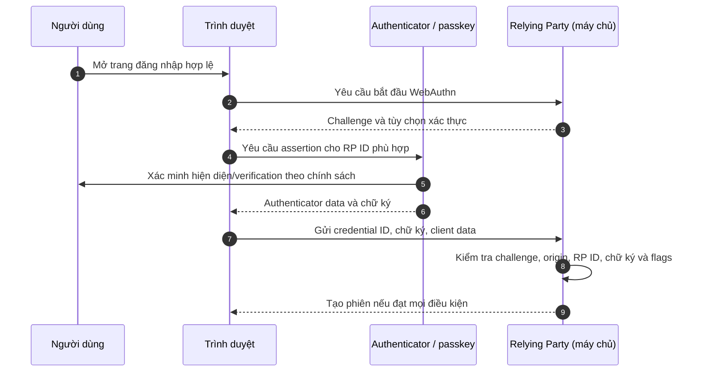
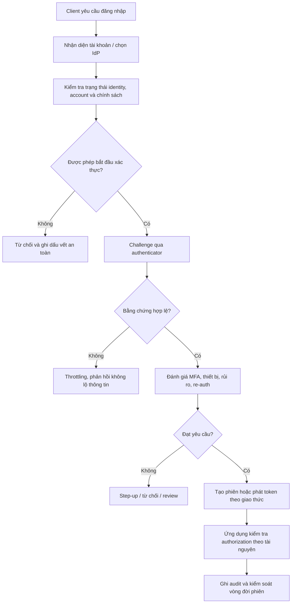

# Authentication là gì trong quản lý vòng đời danh tính IAM?

## 1. Khái niệm Authentication

**Authentication (xác thực)** là quá trình kiểm tra một chủ thể đang yêu cầu sử dụng hệ thống có thể **chứng minh quyền kiểm soát một hoặc nhiều phương tiện xác thực** đã được liên kết với danh tính hoặc tài khoản mà chủ thể tuyên bố hay không. Chủ thể có thể là con người, ứng dụng, dịch vụ tự động hoặc workload. Kết quả xác thực cho phép hệ thống đưa ra một khẳng định có giới hạn về **ai đang tương tác và mức độ tin cậy của lần tương tác**, chứ không tự cấp mọi quyền trên tài nguyên.

Ví dụ, nhân viên đăng nhập cổng nội bộ bằng passkey. Trình duyệt thực hiện thử thách mật mã với khóa riêng của người dùng; máy chủ kiểm tra kết quả bằng khóa công khai đã liên kết với tài khoản và các điều kiện bảo mật cần thiết. Nếu kiểm tra thành công, hệ thống có thể tạo phiên đăng nhập. Khi nhân viên mở báo cáo tài chính, ứng dụng vẫn phải kiểm tra **authorization**: người đó có vai trò và điều kiện truy cập báo cáo cụ thể hay không.

Trong module **SECURITY_IDENTITY_ACCESS_MANAGEMENT_IDENTITY_LIFECYCLE**, authentication là một thành phần của quản lý vòng đời danh tính theo **Joiner–Mover–Leaver (JML)**. Tổ chức cần xác minh chủ thể khi khởi tạo danh tính, đăng ký phương tiện xác thực khi cấp tài khoản, điều chỉnh chính sách khi chuyển vai trò và vô hiệu hóa phương tiện/phiên khi chấm dứt quan hệ. Nội dung liên hệ với **Identity Provider (IdP), Single Sign-On (SSO), SCIM, RBAC/ABAC, tài khoản dịch vụ, kiểm toán** và giảm quyền truy cập tồn dư.

Sau bài học, người đọc có thể giải thích authentication, phân biệt với identity proofing và authorization, nhận diện yếu tố xác thực, mô tả MFA/passkey/SSO và phiên đăng nhập, thiết kế biện pháp bảo vệ trước các kiểu tấn công thường gặp, cũng như xử lý thay đổi authentication trong toàn bộ vòng đời IAM.

## 2. Phân biệt nhận diện, xác minh danh tính, xác thực và phân quyền

Trong IAM, các thuật ngữ dễ bị dùng lẫn nhau. Một luồng truy cập đầy đủ có thể gồm nhiều quyết định độc lập.

| Hoạt động | Câu hỏi | Ví dụ | Điểm giới hạn |
| --- | --- | --- | --- |
| **Identification — nhận diện/khai báo danh tính** | Chủ thể nói mình là ai? | Nhập username hoặc chọn tài khoản | Tên tài khoản không chứng minh người khai báo là chủ tài khoản |
| **Identity proofing — kiểm chứng danh tính** | Bằng chứng có đủ để liên kết người thật với hồ sơ danh tính? | Kiểm tra tài liệu định danh và chủ thể theo chính sách | Không mặc nhiên tạo phiên đăng nhập hay quyền dữ liệu |
| **Enrollment/binding** | Phương tiện xác thực nào được liên kết với tài khoản nào? | Đăng ký passkey, gán khóa bảo mật cho `identityId` | Một liên kết sai người sẽ làm suy yếu các lần đăng nhập sau |
| **Authentication — xác thực** | Chủ thể hiện có chứng minh được quyền kiểm soát phương tiện đăng nhập không? | Xác minh WebAuthn assertion, mật khẩu/MFA | Không tự quyết được chủ thể đọc dữ liệu gì |
| **Authorization — ủy quyền** | Chủ thể đã xác thực được thực hiện hành động nào, trên tài nguyên nào, lúc nào? | RBAC/ABAC kiểm tra quyền đọc báo cáo | Quyền có thể bị thu hồi dù phiên xác thực vẫn tồn tại |
| **Accounting/audit** | Chuyện gì đã xảy ra và có thể truy vết không? | Ghi nhận đăng nhập thành công, thất bại, step-up | Nhật ký không được lưu mật khẩu, mã OTP hay token bí mật |

Một người biết `username` và mã nhân viên là **đã cung cấp thông tin nhận diện**, chưa xác thực thành công. Một tài khoản đã được HRIS xác nhận là nhân viên vẫn phải thiết lập và bảo vệ phương tiện đăng nhập. Một người đăng nhập bằng MFA vẫn có thể bị từ chối truy cập cơ sở dữ liệu vì không đủ quyền.

### Authentication chứng minh điều gì?

Kết quả xác thực phụ thuộc vào **loại phương tiện**, **cách thiết lập và lưu giữ**, **giao thức**, **điều kiện phiên** và **rủi ro hiện tại**. Chẳng hạn, việc kiểm tra mật khẩu cho biết ai đó biết bí mật liên kết với tài khoản, nhưng không đảm bảo người đó là chủ tài khoản ngoài đời; mật khẩu có thể bị lộ. Passkey có khả năng chống phishing tốt hơn trong những điều kiện triển khai đúng, nhưng vẫn cần bảo vệ thiết bị, quy trình khôi phục và chính sách đăng nhập.

Không nên dùng câu “đã xác thực” như một chứng nhận vô điều kiện rằng mọi thuộc tính của chủ thể đều chính xác. Các thuộc tính nghiệp vụ như `department`, `employmentStatus` hoặc `partnerId` phải lấy từ nguồn có thẩm quyền.

## 3. Các yếu tố và phương tiện xác thực

**Yếu tố xác thực** (*authentication factor*) mô tả loại bằng chứng mà chủ thể chứng minh quyền kiểm soát. Phân loại truyền thống gồm ba nhóm.

| Nhóm yếu tố | Ý nghĩa | Ví dụ | Rủi ro tiêu biểu |
| --- | --- | --- | --- |
| **Knowledge — điều biết** | Bí mật người dùng biết | Mật khẩu, PIN dùng để mở phương tiện xác thực | Phishing, đoán mật khẩu, tái sử dụng bí mật |
| **Possession — điều sở hữu/kiểm soát** | Thiết bị hoặc khóa người dùng kiểm soát | Khóa bảo mật FIDO2, ứng dụng tạo OTP, khóa riêng trong thiết bị | Mất thiết bị, đánh cắp token hoặc sao chép phương tiện yếu |
| **Inherence — đặc điểm của chủ thể** | Đặc trưng sinh trắc được kiểm tra | Vân tay, khuôn mặt dùng để mở khóa bộ xác thực | Sai số sinh trắc, trình diễn giả, khó thay đổi đặc điểm khi lộ |

Những tín hiệu như địa chỉ IP, vị trí, lịch sử thiết bị, giờ đăng nhập hoặc đánh giá hành vi **thường là thông tin ngữ cảnh/rủi ro**, không tự động được tính là yếu tố MFA độc lập. Việc nhập **hai mật khẩu** cũng không tạo thành xác thực hai yếu tố: cả hai đều thuộc nhóm *knowledge*.

Một phương tiện xác thực có thể cần nhiều cơ chế. Ví dụ passkey có thể yêu cầu vân tay hoặc PIN **cục bộ** để kích hoạt sử dụng khóa riêng; máy chủ thường kiểm tra bằng chứng mật mã từ authenticator, không trực tiếp nhận vân tay của người dùng. Cách tổ chức đáp ứng yêu cầu đa yếu tố phụ thuộc vào loại authenticator, tín hiệu user verification và chính sách xác thực áp dụng.

### Phương tiện và yếu tố không đồng nghĩa

**Authenticator** là phương tiện thực hiện cơ chế xác thực: ứng dụng OTP, khóa phần cứng, passkey hoặc bộ lưu trữ khóa. **Factor** là loại bằng chứng. Ví dụ ứng dụng tạo TOTP trên điện thoại là một phương tiện thuộc nhóm possession khi được kiểm soát đúng cách; nhập TOTP cùng mật khẩu kết hợp hai nhóm khác nhau. Tuy nhiên, mã TOTP vẫn có thể bị đánh cắp qua trang giả mạo và dùng gần thời gian thực.

## 4. Xác thực một yếu tố, MFA và step-up authentication

**Single-factor authentication (SFA)** sử dụng một yếu tố, ví dụ chỉ mật khẩu. **Multi-factor authentication (MFA)** yêu cầu các yếu tố thuộc **ít nhất hai nhóm độc lập** theo chính sách phù hợp. **Two-factor authentication (2FA)** là trường hợp MFA sử dụng hai yếu tố.

Ví dụ luồng đăng nhập bằng mật khẩu và TOTP:

1. Người dùng khai báo tài khoản và gửi mật khẩu qua kênh bảo vệ.
2. Máy chủ kiểm tra mật khẩu bằng cơ chế xác minh bí mật an toàn.
3. Hệ thống yêu cầu mã TOTP từ authenticator đã liên kết.
4. Máy chủ kiểm tra mã TOTP trong cửa sổ thời gian và các điều kiện chống thử lại/phát lại.
5. Nếu đạt chính sách, hệ thống tạo phiên với mức bảo đảm tương ứng và ghi nhận sự kiện xác thực.

**MFA không làm mọi kiểu tấn công biến mất.** Trang phishing có thể thu thập mật khẩu và TOTP rồi chuyển tiếp ngay; yêu cầu *push approval* có thể bị lợi dụng để gây mệt mỏi và dụ người dùng chấp thuận. Với ứng dụng nhạy cảm, nên cân nhắc **phương thức chống phishing** như WebAuthn/FIDO2 và đánh giá mức bảo đảm thực tế của từng luồng.

### Step-up authentication

**Step-up** là việc yêu cầu kiểm tra xác thực bổ sung hoặc mạnh hơn khi rủi ro hoặc độ nhạy cảm tăng. Một người có thể đăng nhập portal bằng phương thức thông thường, nhưng khi muốn thay tài khoản ngân hàng nhận thanh toán hoặc cấp quyền quản trị, hệ thống yêu cầu xác thực mới với phương tiện đáp ứng chính sách cao hơn.

Step-up không thay thế authorization. Sau khi xác thực mạnh hơn, ứng dụng vẫn phải kiểm tra người đó **được phép thực hiện thao tác** và có lý do nghiệp vụ hợp lệ.

### Xác thực thích ứng (*risk-based/adaptive authentication*)

Một IdP có thể xem xét thiết bị, mạng, hành vi bất thường và dữ liệu mối đe dọa để điều chỉnh yêu cầu xác thực. Tín hiệu rủi ro cần được sử dụng có giải trình, giảm dương tính giả và có cơ chế xử lý ngoại lệ. Không nên xem địa chỉ IP “ở văn phòng” là bằng chứng đủ để bỏ tất cả các bước xác thực đối với tác vụ có rủi ro cao.

## 5. Mật khẩu: cơ chế quen thuộc và giới hạn

Mật khẩu là cơ chế knowledge phổ biến nhưng dễ gặp rủi ro từ phishing, tái sử dụng, nhồi thông tin đăng nhập (*credential stuffing*), đoán tự động và rò rỉ cơ sở dữ liệu.

Một hệ thống còn dùng mật khẩu nên:

- Khuyến khích mật khẩu dài hoặc cụm mật khẩu có thể ghi nhớ, hỗ trợ trình quản lý mật khẩu và không áp đặt những quy tắc gây hại như bắt đổi định kỳ vô căn cứ.
- Chặn mật khẩu phổ biến hoặc đã bị lộ theo cơ chế đáng tin, hạn chế số lần thử tự động và giám sát bất thường.
- Truyền bí mật trên kết nối bảo vệ; không lưu hoặc gửi mật khẩu dạng rõ qua email, log hay telemetry.
- Lưu **bộ kiểm tra mật khẩu** bằng thuật toán password hashing có salt và chi phí phù hợp như Argon2id hoặc lựa chọn được đánh giá theo môi trường; không dùng hash nhanh thông thường một mình.
- Phân biệt lỗi xác thực với thông tin có thể tiết lộ tài khoản có tồn tại; có chính sách lockout/throttling hạn chế khả năng kẻ xấu khóa tài khoản người khác.
- Dùng MFA phù hợp, ưu tiên phương tiện chống phishing ở phạm vi rủi ro cao.

Ví dụ, **mã hóa có thể giải mã rồi lấy lại mật khẩu** không tương đương với password hashing một chiều có tham số chi phí. Tương tự, sử dụng SHA-256 thuần không phải lựa chọn tốt để lưu mật khẩu vì quá nhanh trước tấn công đoán ngoại tuyến.

### OTP, SMS và email magic link

- **TOTP:** mã ngắn sinh từ bí mật chung và thời gian. Dễ triển khai nhưng có thể bị phishing thời gian thực; phải bảo vệ seed TOTP, giới hạn thử và ngăn dùng lại khi chính sách yêu cầu.
- **SMS OTP:** dựa vào kênh viễn thông; có nguy cơ chuyển SIM (*SIM swap*), đánh cắp tin nhắn hoặc chuyển tiếp. Không nên mặc nhiên coi là phương thức chống phishing.
- **Email OTP/magic link:** thường chứng minh người dùng kiểm soát hộp thư trong thời điểm nhất định. Mức bảo đảm phụ thuộc an ninh của email, tính một lần, thời hạn, liên kết với giao dịch và khả năng chống phát lại. Email là kênh khôi phục hoặc xác thực hữu ích trong một số tình huống nhưng không tự động tương đương yếu tố possession độc lập khi mật khẩu và link cùng dựa vào một hộp thư bị chiếm đoạt.

Mọi mã hoặc đường liên kết khôi phục cần có hạn sử dụng, phạm vi, cơ chế sử dụng một lần khi thích hợp và khả năng vô hiệu hóa khi phát hiện bất thường.

## 6. Passkey, FIDO2/WebAuthn và khả năng chống phishing

**Passkey** thường là một credential dựa trên mật mã khóa công khai, được sử dụng qua **WebAuthn/FIDO2**. Trong quá trình đăng ký, authenticator tạo cặp khóa: **khóa riêng** được quản lý bởi authenticator hoặc hệ sinh thái đồng bộ được hỗ trợ, **khóa công khai** được lưu tại dịch vụ nhận xác thực. Khi đăng nhập, máy chủ gửi một thử thách; authenticator tạo phản hồi có chữ ký gắn với ngữ cảnh trang web dự kiến.



WebAuthn có khả năng **chống phishing** vì authenticator và trình duyệt ràng buộc việc sử dụng credential với **Relying Party ID/origin** phù hợp. Một trang giả mạo ở tên miền khác không thể tùy ý lấy chữ ký hợp lệ cho tên miền thật như cách lừa người dùng nhập OTP. Tính an toàn vẫn phụ thuộc triển khai kiểm tra server, bảo vệ thiết bị, quy trình đăng ký/khôi phục và các đường đăng nhập thay thế.

**Lưu ý kỹ thuật:**

- Máy chủ phải kiểm tra challenge, origin, RP ID hash, chữ ký bằng khóa công khai đã liên kết, các flags về user presence/user verification theo chính sách và các điều kiện liên quan.
- Quy trình **đăng ký passkey** quan trọng không kém đăng nhập; nếu kẻ tấn công có thể lén thêm khóa mới vào tài khoản, các lần xác thực sau sẽ sai chủ thể.
- Passkey có loại lưu trên thiết bị và loại đồng bộ giữa thiết bị; yêu cầu rủi ro hoặc môi trường quản trị cần chọn authenticator phù hợp.
- Vân tay hoặc khuôn mặt thường được kiểm tra **trên thiết bị** để cho phép dùng khóa; ứng dụng không nên mặc định nhận hoặc lưu dữ liệu sinh trắc gốc.
- Có thể cần cơ chế khôi phục khi mất thiết bị mà không hạ toàn bộ bảo đảm xác thực.

**Phishing-resistant không đồng nghĩa không thể bị chiếm tài khoản.** Malware trên thiết bị, phiên bị đánh cắp, quy trình recovery yếu hoặc thao tác cấp quyền sai có thể vượt qua những lợi thế của passkey ở tầng xác thực.

## 7. Quy trình authentication từ tài khoản đến phiên

Một hệ thống có thể xác thực trực tiếp hoặc ủy quyền cho IdP. Luồng cơ bản:



Các chính sách như account bị khóa, người dùng đã nghỉ việc hoặc guest hết hạn cần được kiểm tra **trước khi cấp phiên**, đồng thời vẫn phải có cơ chế xử lý **phiên đã tồn tại**. Authentication là một sự kiện có thời điểm; kết quả có thể mất giá trị khi chủ thể bị thu hồi, rủi ro tăng hoặc credential bị lộ.

### Session khác gì credential?

**Credential** là phương tiện xác thực danh tính, ví dụ khóa riêng hoặc mật khẩu. **Session** là trạng thái sau xác thực, cho phép hệ thống nhận biết các yêu cầu tiếp theo mà không lặp lại đầy đủ mọi bước. Một phiên có thể dùng cookie, token hoặc tham chiếu phía server.

Các kiểm soát phiên thường gồm:

- Cookie có cờ phù hợp như `Secure`, `HttpOnly`, `SameSite`; bảo vệ CSRF cho các luồng dùng cookie khi cần.
- Tạo session ID đủ ngẫu nhiên, luân chuyển sau đăng nhập hoặc thay đổi đặc quyền, kiểm soát timeout bất hoạt và thời hạn tối đa.
- Không đưa session token vào URL, log hoặc kho lưu trữ dễ bị đọc bởi mã không tin cậy.
- Có logout và cơ chế vô hiệu hóa phiên theo khả năng thiết kế.
- Đánh giá lại quyền khi chuyển vai trò hoặc khi truy cập dữ liệu nhạy cảm, không coi quyền trong một token cũ là vĩnh viễn.

**Access token** không phải lúc nào cũng là session cookie, và **ID token** của OIDC không phải thứ dùng thay authorization token cho mọi API. Mỗi loại có người nhận (*audience*), mục đích, thời hạn và yêu cầu kiểm tra riêng.

## 8. Identity Provider, SSO và federation

**Identity Provider (IdP)** là thành phần cung cấp dịch vụ xác thực danh tính, quản lý các phương tiện đăng nhập và phát các khẳng định hoặc token theo giao thức. **Single Sign-On (SSO)** cho phép người dùng sau một quá trình đăng nhập có thể truy cập nhiều ứng dụng trong phạm vi quan hệ tin cậy và chính sách phiên, không phải nhập lại credential tại từng ứng dụng.

**Federation** là quan hệ tin cậy giữa những miền danh tính khác nhau. Ví dụ, nhân viên đối tác đăng nhập ứng dụng của doanh nghiệp bằng IdP bên đối tác. Ứng dụng tiếp nhận có thể tin một số thông tin xác thực từ IdP ngoài, nhưng **quyền truy cập tài nguyên vẫn do tổ chức tiếp nhận quyết định**.

| Thành phần | Vai trò | Điểm cần kiểm soát |
| --- | --- | --- |
| **IdP** | Xác thực và cung cấp kết quả xác thực | Chính sách MFA, đăng ký/recovery credential, khóa phiên |
| **Service Provider/Relying Party** | Ứng dụng sử dụng kết quả xác thực | Kiểm tra nguồn token/assertion, audience, thời hạn, liên kết account |
| **SSO** | Tận dụng đăng nhập trung tâm giữa ứng dụng | Độ mới của phiên, logout và quản lý truy cập khi Leaver |
| **Federation trust** | Chấp nhận kết quả từ IdP thuộc miền khác | Giới hạn issuer, chứng chỉ/khóa, loại claim, cách luân chuyển trust |
| **SCIM/provisioning** | Tạo/cập nhật/disable user và group tại đích | Mapping, nguồn có thẩm quyền, quyền thực tế; **không phải giao thức đăng nhập** |
| **IGA** | Quản trị phê duyệt, vai trò và vòng đời quyền | Không cho sự kiện login tự cấp nhóm quản trị nếu chưa được duyệt |

### OpenID Connect (OIDC)

**OIDC** là lớp định danh dựa trên OAuth 2.0, cho phép client nhận thông tin về sự kiện xác thực và chủ thể qua token theo luồng phù hợp. Với ứng dụng web/mobile hiện đại, **Authorization Code Flow cùng PKCE** là lựa chọn phổ biến được khuyến nghị phù hợp kiến trúc. Phải kiểm tra giao thức đúng cách, bao gồm bảo vệ `state` và `nonce` khi áp dụng, ràng buộc redirect URI, không tiết lộ authorization code và xác minh token.

Ví dụ **payload ID token mang tính minh họa**, chưa phải một token đã ký:

```json
{
  "iss": "https://idp.example.org",
  "sub": "subject-1042",
  "aud": "enterprise-portal",
  "iat": 1795410000,
  "exp": 1795413600,
  "auth_time": 1795409900,
  "amr": ["pwd", "otp"]
}
```

Khi nhận ID token, client phải xác minh chữ ký, `iss`, `aud`, `exp` và các trường liên quan theo quy tắc giao thức; nếu ứng dụng yêu cầu một phương thức hoặc thời điểm xác thực, cần đánh giá `amr`, `acr`, `auth_time` theo **hợp đồng IdP và chính sách**. Giá trị `amr` không có một mức bảo đảm phổ quát nếu hai bên chưa thỏa thuận cách diễn giải.

**`sub` là định danh chủ thể do issuer cấp**; để liên kết tài khoản, phải xét trong ngữ cảnh issuer, và không mặc nhiên dùng email làm khóa duy nhất. Một số issuer dùng subject theo từng client/sector, nên việc nối danh tính nhiều ứng dụng cần mô hình liên kết thích hợp.

### SAML 2.0

**SAML 2.0** thường dùng trong federation doanh nghiệp. IdP phát assertion hoặc response được bảo vệ theo cấu hình tin cậy; ứng dụng nhận phải kiểm tra chữ ký, issuer, audience, recipient/destination, thời hạn, tương quan yêu cầu đăng nhập khi áp dụng và chống phát lại. Một assertion hợp lệ ở ứng dụng A không được tùy ý chấp nhận tại ứng dụng B.

**SSO đăng nhập thành công không chứng minh người dùng vẫn có hợp đồng hoặc vai trò nghiệp vụ hợp lệ.** Các thuộc tính này phải được đánh giá theo nguồn thẩm quyền và chính sách ở resource organization.

## 9. MFA tại IdP và authorization trong ứng dụng

Để hạn chế tích hợp sai, cần tách:

1. **Authentication policy tại IdP:** quy định credential/MFA, thiết bị, rủi ro và mức đảm bảo cho việc tạo phiên.
2. **Application access policy:** quy định danh tính, nhóm hoặc điều kiện nào được sử dụng ứng dụng.
3. **Resource authorization:** quyết định trên **từng hành động và tài nguyên** dựa vào RBAC/ABAC, không chỉ giao diện đã cho đăng nhập.

Ví dụ một người dùng đăng nhập thành công bằng passkey nhưng chỉ có vai trò `partner-order-reader`. Khi truy cập `GET /orders/583`, API cần kiểm tra `order.partnerId` trùng đối tác của người dùng, trạng thái hợp đồng đang hiệu lực và vai trò có quyền đọc. Việc token OIDC hợp lệ không cho phép trả về đơn hàng của đối tác khác.

Giả mã kiểm tra một request:

```text
authorizeOrderRead(request, currentTime):
    session = validateSessionOrAccessToken(request)
    if session.invalid:
        return UNAUTHENTICATED

    identity = loadCanonicalIdentity(session.subject)
    if identity.lifecycleStatus != ACTIVE:
        return FORBIDDEN

    order = loadOrder(request.orderId)
    if not policy.allows(
        subject=identity,
        action="order:read",
        resource=order,
        context={time: currentTime, assurance: session.assurance}
    ):
        return FORBIDDEN

    return order
```

Đây là **giả mã giải thích phân biệt xác thực và ủy quyền**, không phải mẫu API hoàn chỉnh. Trong hệ thống thực, xác minh token, audience, các nguồn thuộc tính, tenant isolation và khả năng thay đổi quyền giữa các request phải được thiết kế đầy đủ.

## 10. Authentication trong vòng đời Joiner–Mover–Leaver

Authentication không được thiết lập một lần rồi giữ nguyên. Quy trình vòng đời cần bảo đảm **chủ thể hợp lệ, phương tiện xác thực và phiên truy cập** luôn tương ứng với quan hệ nghiệp vụ hiện tại.

### Joiner — khởi tạo credential và liên kết đúng người

Sau khi HRIS hoặc nguồn hợp đồng xác nhận joiner, IAM/IGA xác định danh tính chuẩn. Tùy rủi ro, **identity proofing** giúp liên kết người thật với hồ sơ; bước **authenticator enrollment** gắn passkey, khóa bảo mật hoặc phương tiện MFA vào đúng account. IdP thiết lập trạng thái xác thực, còn provisioning/SCIM có thể tạo tài khoản ứng dụng.

Cần tránh gửi thông tin thiết lập tài khoản qua kênh dễ bị chiếm đoạt, tránh tự động liên kết MFA cho một người chỉ vì biết mã nhân viên, và không kích hoạt quyền nhạy cảm trước ngày hiệu lực. Nếu tài khoản được tạo trước ngày bắt đầu, chính sách phải quy định rõ **khi nào có thể đăng nhập** và **khi nào được truy cập tài nguyên** — hai thời điểm có thể khác nhau.

### Mover — thay đổi vai trò có thể thay yêu cầu xác thực

Khi một nhân viên chuyển sang vai trò quản trị hệ thống, quyền mới có thể đòi hỏi **phương tiện chống phishing**, MFA mạnh hơn hoặc step-up trước thao tác nhạy cảm. Các quyền truy cập được cấp/thu hồi theo RBAC/ABAC, nhưng IdP cũng phải cập nhật chính sách session, điều kiện thiết bị và nhóm liên quan.

Khi nhân viên không còn giữ quyền production, cần thu hồi đặc quyền và xem xét các phiên đang mang claim cũ, token đã phát hoặc phương tiện truy cập vào PAM. **Việc đổi role trong HRIS hay SCIM không tự bảo đảm mọi phiên cũ mất quyền lập tức.**

### Leaver — chặn đăng nhập và xử lý phiên đã tồn tại

Khi người dùng nghỉ việc, hợp đồng nhà thầu kết thúc hoặc guest hết hạn, hệ thống phải xử lý theo chính sách:

- Đánh dấu danh tính/account không còn được phép sử dụng dựa trên **nguồn có thẩm quyền** và thời điểm hiệu lực.
- Disable hoặc chặn đăng nhập mới ở IdP và ứng dụng đích phù hợp.
- Thu hồi hoặc làm hết hiệu lực session, refresh token, API token, thiết bị đăng ký hoặc phương tiện khác **trong phạm vi hệ thống hỗ trợ**.
- Thu hồi quyền cục bộ, nhóm và entitlement ở ứng dụng qua SCIM/API hoặc quy trình quản trị.
- Đối soát các tài khoản, phiên và quyền thực tế; ghi nhận hệ thống chưa hỗ trợ thu hồi ngay để áp biện pháp kiểm soát bổ sung.

**Lưu ý:** token tự chứa như JWT có thể còn được hệ thống chấp nhận đến lúc hết hạn nếu resource server chỉ kiểm tra chữ ký và hạn dùng mà không tra cứu trạng thái thu hồi. Vì vậy cần thiết kế TTL, kiểm tra trạng thái hoặc revocation/introspection khi phù hợp; không hứa “khóa IdP là mọi access token biến mất ngay”.

### Rehire và chuyển đổi quan hệ

Khi nhân viên quay lại hoặc nhà thầu chuyển thành nhân viên, đừng tự mở lại account và phục hồi mọi phương tiện MFA/role cũ chỉ vì cùng email. Cần xác minh liên kết danh tính theo quy trình, xem xét credential nào còn phù hợp, loại bỏ kênh recovery cũ không còn được kiểm soát và cấp quyền lại theo nhiệm vụ hiện tại.

## 11. Khôi phục tài khoản, thay credential và vòng đời MFA

**Account recovery** là một đường truy cập đặc biệt nhạy cảm: nếu kẻ tấn công vượt qua được khôi phục, MFA mạnh trong luồng đăng nhập thông thường có thể bị vô hiệu hóa về mặt thực tế.

Các tình huống phổ biến:

| Tình huống | Rủi ro | Hướng xử lý |
| --- | --- | --- |
| Mất điện thoại tạo OTP | Không còn yếu tố possession thông thường | Dùng phương án khôi phục đã đăng ký hoặc proofing lại theo rủi ro |
| Thay máy/passkey | Đăng ký khóa mới vào sai chủ thể | Yêu cầu xác thực hiện có hoặc quy trình kiểm tra thay thế đủ mạnh; ghi audit |
| Nhân viên thay email/số điện thoại | Kênh recovery cũ có thể bị tái sử dụng | Cập nhật qua nguồn và bước phê duyệt/kiểm chứng phù hợp |
| Nghi lộ credential | Kẻ xấu có thể tạo session mới | Vô hiệu hóa phương tiện bị ảnh hưởng, đăng ký lại và xử lý phiên liên quan |
| Người dùng bị khóa nhầm | Gián đoạn công việc và gây sức ép bỏ chính sách | Có tuyến hỗ trợ được kiểm soát, không chia sẻ secret |
| Quyền tài khoản quản trị tăng cao | Phương thức MFA cũ không đủ mức yêu cầu | Step-up hoặc chuyển phương thức theo chính sách đặc quyền |

Cần quản lý **binding** (đăng ký authenticator), **replacement** (thay), **revocation** (thu hồi) và **recovery** (khôi phục) như những sự kiện có thẩm quyền. Ghi nhận `credentialId`, loại authenticator, thời điểm đăng ký/thu hồi, mức bảo đảm và sự kiện xác minh; **không ghi secret, private key hoặc mã OTP vào log**.

Nếu hỗ trợ recovery codes, chúng phải đủ ngẫu nhiên, được lưu/kiểm chứng an toàn, dùng một lần hoặc bị vô hiệu hóa sau khi sử dụng theo thiết kế, và có quy trình phát hành lại thích hợp. Nhân viên helpdesk không nên bỏ qua chính sách chỉ vì người gọi biết tên, ngày sinh hoặc mã nhân sự — những thông tin đó có thể không còn bí mật.

## 12. Xác thực cho service account và workload identity

Không phải mọi danh tính đều là con người. Một service account có thể gọi API hằng đêm, một pod truy cập secret manager, hoặc một pipeline triển khai cần đăng nhập cloud. Những chủ thể này thường dùng **machine-to-machine authentication**, không phải MFA tương tác với người dùng.

| Phương thức | Ví dụ | Kiểm soát quan trọng |
| --- | --- | --- |
| **OAuth 2.0 client credentials** | Backend nhận access token để gọi API | Bảo vệ client authentication, giới hạn scope/audience, TTL và quyền API |
| **mTLS** | Hai dịch vụ xác thực qua chứng chỉ client/server | CA tin cậy, danh tính trong chứng chỉ, luân chuyển và thu hồi |
| **Managed/workload identity** | Workload cloud nhận token theo identity được nền tảng quản lý | Liên kết đúng workload/issuer/subject, hạn quyền và tránh secret dài hạn |
| **Workload federation** | CI/CD đổi bằng chứng từ nhà cung cấp sang quyền truy cập cloud | Kiểm tra issuer, audience, subject, workflow/repo/environment và hạn token |
| **API key hoặc secret tĩnh** | Ứng dụng legacy gọi API | Bảo vệ secret, quyền tối thiểu, luân chuyển, phát hiện lộ và thay thế khi có thể |

**OAuth 2.0 client credentials** thích hợp cho những luồng trao đổi token giữa các hệ thống, nhưng một access token chỉ có ích khi resource server xác minh issuer, audience, chữ ký hoặc introspection, hạn dùng và scope theo kiến trúc. Một bearer token bị lộ có thể bị dùng lại cho đến khi hết hạn hoặc bị vô hiệu hóa bởi các cơ chế có hỗ trợ; cần giảm mức đặc quyền và tuổi thọ token.

Với workload, quá trình thiết lập danh tính tập trung xác minh **dịch vụ nào đang chạy, môi trường nào, repo/deployment nào, ai là owner và có chính sách nào cho phép quyền**. Không yêu cầu tài liệu định danh cá nhân cho tài khoản máy và cũng không dùng email của kỹ sư tạo dịch vụ làm căn cứ duy nhất cho quyền dài hạn.

### Service account và JML

- **Joiner:** dịch vụ được đăng ký, owner xác nhận mục đích, workload nhận danh tính và credential phù hợp.
- **Mover:** ứng dụng đổi owner, môi trường hoặc nhiệm vụ; quyền API và trust condition phải được tính lại, luân chuyển credential khi cần.
- **Leaver:** workload ngừng sử dụng; thu hồi token/secret/chứng chỉ hoặc điều kiện trust, vô hiệu hóa danh tính và đối soát quyền ở hệ thống đích.

Nếu **chủ dịch vụ là nhân viên nghỉ việc** nhưng workload vẫn hoạt động, cần chuyển giao owner và rà soát quyền; không tự ngừng mọi workload chỉ vì người tạo ban đầu đã leaver. Ngược lại, account máy còn hoạt động nhưng không có owner hợp lệ là rủi ro phải xử lý.

## 13. Những kiểu tấn công authentication thường gặp

| Kiểu tấn công | Mô tả | Kiểm soát cần cân nhắc |
| --- | --- | --- |
| **Phishing** | Lừa người dùng nhập mật khẩu/OTP vào trang giả | Passkey/FIDO2 chống phishing, đào tạo và kiểm soát tên miền |
| **Credential stuffing** | Dùng cặp username/password rò rỉ thử trên nhiều dịch vụ | Throttling, phát hiện mật khẩu lộ, MFA, giám sát bất thường |
| **Password spraying** | Thử một vài mật khẩu phổ biến trên nhiều tài khoản | Rate limit theo nhiều chiều, cảnh báo và quản lý chính sách mật khẩu |
| **MFA fatigue/push bombing** | Gửi dồn thông báo MFA để dụ người dùng chấp thuận | Number matching khi phù hợp, hạn thử, MFA chống phishing, cảnh báo |
| **SIM swap** | Chiếm số điện thoại để nhận OTP | Giảm phụ thuộc SMS cho tài khoản nhạy cảm; quy trình thay số an toàn |
| **Session hijacking** | Đánh cắp cookie/session hoặc token và dùng lại | Bảo vệ cookie/token, chống XSS, TTL, phát hiện bất thường, revoke khi hỗ trợ |
| **OAuth/OIDC misconfiguration** | Token sai issuer/audience, redirect URI không an toàn hoặc thiếu kiểm tra | Validate đúng giao thức, dùng PKCE, `state`/`nonce` theo luồng, quản lý client |
| **SAML assertion replay** | Dùng lại assertion hoặc chấp nhận assertion sai ngữ cảnh | Kiểm tra chữ ký, recipient/audience, hạn, tương quan và chống phát lại |
| **Recovery abuse** | Vượt MFA bằng quy trình reset/helpdesk yếu | Proofing/recovery có rủi ro phù hợp, phê duyệt và audit |
| **Stale access after leaver** | Phiên/token còn hiệu lực sau khi nguồn danh tính đã chấm dứt | Đồng bộ leaver, TTL, session revocation, kiểm tra quyền runtime |
| **Service secret leakage** | Lộ API key hoặc client secret từ repo/log | Workload federation, secret manager, rotation, quyền tối thiểu |

Một hệ thống có thể phòng chống phishing tốt nhưng vẫn thất bại khi **authorization** kiểm tra sai dữ liệu. Ví dụ người dùng xác thực thật có thể khai thác lỗi *broken object-level authorization* để đọc tài nguyên của người khác. Vì vậy mô hình đe dọa nên kết nối xác thực, phiên, liên kết danh tính, phân quyền và vòng đời quyền.

## 14. Kiểm toán và quan sát sự kiện authentication

Nhật ký xác thực nên hỗ trợ điều tra an ninh, đánh giá chính sách và theo dõi JML, nhưng không được biến thành kho bí mật đăng nhập.

| Sự kiện nên theo dõi | Trường dữ liệu hữu ích | Điều cần tránh |
| --- | --- | --- |
| Đăng nhập thành công/thất bại | `identityId`, issuer, application, thời điểm, kết quả, mã tương quan | Ghi mật khẩu, OTP, raw token |
| MFA/step-up | Loại authenticator, mức bảo đảm, quyết định, ngữ cảnh rủi ro | Ghi seed TOTP, dữ liệu sinh trắc gốc |
| Đăng ký/thay/thu hồi credential | Credential reference, actor, kênh phê duyệt, kết quả | Lộ private key hoặc recovery code |
| Khóa/mở account | Nguồn JML, trạng thái trước–sau, actor và lý do | Dùng email đơn thuần làm định danh duy nhất |
| Phiên bị hủy hoặc hết hạn | Session ID dạng tham chiếu an toàn, ứng dụng, sự kiện kích hoạt | Lưu session cookie đầy đủ trong log |
| Đăng nhập workload | Service ID, issuer, audience, scope, môi trường, kết quả | Ghi bearer token, client secret hoặc API key |
| Xác thực ngoài qua federation | Đối tác/issuer, mapping identity, kết quả trust check | Tin claim nguồn ngoài vượt phạm vi cho phép |

Một hệ thống giám sát có thể phát hiện: nhiều đăng nhập sai từ nhiều nguồn, tài khoản đang ở trạng thái leaver vẫn có token hợp lệ, credential MFA mới được thêm ngay trước thao tác nhạy cảm, service account gọi API từ môi trường không được phê duyệt hoặc lỗi federation tăng sau khi thay chứng chỉ.

Các chỉ số vận hành cần diễn giải thận trọng:

- **Authentication success/failure rate:** theo ứng dụng, phương thức, nguồn và phân khúc rủi ro.
- **MFA coverage:** tỷ lệ tài khoản nằm trong diện yêu cầu MFA đã đăng ký và thực thi phương thức phù hợp.
- **Phishing-resistant coverage:** tỷ lệ trường hợp cần chống phishing thực sự sử dụng phương thức đáp ứng chính sách.
- **Recovery incident rate:** số quy trình khôi phục bất thường, lỗi hoặc bị lạm dụng.
- **Leaver session revocation latency:** thời gian từ tín hiệu chấm dứt có thẩm quyền đến khi các phiên cần vô hiệu hóa được xử lý theo khả năng từng hệ thống.
- **Non-human credential age/rotation compliance:** tuổi của bí mật, tình trạng owner và tuân thủ chính sách workload.

Mức mục tiêu phụ thuộc rủi ro và kiến trúc, không thể áp một con số chung cho mọi loại danh tính. Số lượng login thành công cao không đủ chứng minh chính sách bảo mật được tuân thủ.

## 15. Tình huống thực tế: một danh tính đi qua JML

Một doanh nghiệp có nhân viên **Mai** với `identityId=id-1042`. Mai làm việc trong nhóm chăm sóc khách hàng, đăng nhập qua IdP và sử dụng CRM với vai trò `customer-support-read`.

**Giai đoạn Joiner.** HRIS xác nhận Mai bắt đầu làm việc từ ngày được duyệt. IAM liên kết kết quả proofing với hồ sơ chuẩn, IdP yêu cầu Mai đăng ký passkey và phương án khôi phục phù hợp. IGA duyệt vai trò CRM cơ bản, bộ provisioning cấp tài khoản đích qua connector. Mai đăng nhập thành công; ứng dụng chỉ cho xem khách hàng thuộc phạm vi được phân quyền.

**Giai đoạn Mover.** Mai chuyển sang nhóm tài chính. HRIS cập nhật bộ phận và manager có hiệu lực từ ngày chuyển. IGA tính lại RBAC/ABAC, thu hồi quyền CRM không còn cần và cấp `finance-report-read`. Vì báo cáo tài chính nhạy cảm hơn, IdP/ứng dụng yêu cầu step-up hoặc điều kiện MFA đã được phê duyệt. Một phiên CRM cũ vẫn còn và ứng dụng chưa đánh giá lại quyền; hệ thống đối soát cảnh báo để xử lý thay vì tuyên bố mover hoàn tất.

**Giai đoạn Leaver.** Mai nghỉ việc. HRIS phát sự kiện chấm dứt; IAM yêu cầu chặn IdP, vô hiệu hóa các tài khoản ứng dụng và thu hồi quyền theo chính sách. Các phiên có thể thu hồi được bị kết thúc; những access token tự chứa ở hệ thống không kiểm tra revocation được quản lý bằng TTL và kiểm soát quyền phía resource server. Nhật ký cho thấy hệ thống nào đã xác nhận trạng thái và ngoại lệ nào còn chờ khắc phục.

Tình huống minh họa ba kết luận:

1. **Authentication trả lời việc chủ thể kiểm soát phương tiện đăng nhập**, không thay vai trò cấp quyền của IGA và ứng dụng.
2. **MFA mạnh chỉ phát huy ý nghĩa khi đăng ký/recovery và phiên cũng được bảo vệ.**
3. **Leaver yêu cầu xử lý cả đăng nhập mới và các đường truy cập hiện hữu**, không chỉ xóa một bản ghi tài khoản ở IdP.

## 16. Những hiểu lầm phổ biến

**Hiểu lầm 1 — Authentication = Authorization.** Xác thực thành công không tự cho phép xem dữ liệu. Phải kiểm tra quyền theo action/resource và chính sách.

**Hiểu lầm 2 — Đăng nhập qua SSO nghĩa là các ứng dụng không cần account hay quyền riêng.** Tùy sản phẩm, account đích vẫn được tạo/đồng bộ qua SCIM, JIT hoặc connector khác; quyền cục bộ có thể tồn tại độc lập.

**Hiểu lầm 3 — MFA bằng mọi phương thức đều chống phishing.** Mật khẩu + TOTP/SMS vẫn có thể bị lừa chuyển tiếp; nên hiểu khả năng bảo vệ của từng phương thức và ưu tiên chống phishing nơi cần thiết.

**Hiểu lầm 4 — Hai mã bí mật tương đương hai yếu tố.** Hai mã cùng loại knowledge không tự tạo MFA độc lập.

**Hiểu lầm 5 — Passkey loại bỏ mọi rủi ro account takeover.** Cần kiểm soát đăng ký authenticator, recovery, malware, session và đường login dự phòng.

**Hiểu lầm 6 — JWT hợp lệ về chữ ký thì người dùng chắc chắn vẫn được phép dùng tài nguyên.** Chữ ký và hạn token không tự phản ánh HRIS leaver, quyền đã đổi hoặc resource policy mới.

**Hiểu lầm 7 — Khóa IdP sẽ thu hồi mọi token và license ở ứng dụng.** SSO session, local account, API key và license có vòng đời riêng; phải đối soát từng đích.

**Hiểu lầm 8 — Service account phải xác thực như người dùng với OTP.** Workload cần phương tiện machine-to-machine, service owner và điều kiện trust riêng; không nên gắn tương tác người dùng giả tạo cho tác vụ tự động.

**Hiểu lầm 9 — Có log tất cả request thì càng an toàn.** Ghi token, mật khẩu, mã OTP hoặc dữ liệu định danh không cần thiết có thể tạo rủi ro nghiêm trọng.

## 17. Checklist thiết kế authentication trong IAM

Khi xây dựng hoặc đánh giá một hệ thống xác thực, cần trả lời:

1. **Đối tượng:** ai đăng nhập — nhân viên, nhà thầu, khách B2B/B2C hay workload? Danh tính được liên kết với account bằng khóa ổn định nào?
2. **Nguồn:** ai quyết định identity còn hợp lệ, ngày bắt đầu/kết thúc, đơn vị, hợp đồng hoặc service owner?
3. **Proofing và enrollment:** phương tiện xác thực có được đăng ký cho đúng chủ thể, qua quy trình có đủ mức tin cậy và chống gắn nhầm không?
4. **Authenticator:** chấp nhận mật khẩu, OTP, passkey, khóa bảo mật, mTLS hay workload identity? Mỗi loại phù hợp rủi ro nào?
5. **MFA:** có yêu cầu đúng các yếu tố độc lập, mức bảo đảm và phương thức chống phishing cho đường truy cập nhạy cảm không?
6. **SSO/federation:** IdP nào được tin cậy, ứng dụng kiểm tra issuer, audience, chữ ký, thời hạn, origin/redirect và chống phát lại theo giao thức thế nào?
7. **Session/token:** thời gian sống, bảo vệ cookie, refresh token, xử lý logout, step-up, session theft và thay đổi quyền ra sao?
8. **Authorization:** ứng dụng có kiểm tra RBAC/ABAC trên từng tài nguyên, tránh chỉ dựa vào việc đăng nhập không?
9. **Mover:** khi đổi vai trò, có cập nhật MFA/assurance, thu hồi quyền cũ và xử lý session/claim chưa mới không?
10. **Leaver:** có chặn đăng nhập mới và xử lý session, token, local account, API key cùng quyền tồn dư theo khả năng sản phẩm không?
11. **Recovery:** ai được phép thêm/thay authenticator, cần proofing hay phê duyệt gì, có phòng chống social engineering/helpdesk abuse không?
12. **Non-human identity:** workload dùng trust và credential gì, ai là owner, làm sao luân chuyển và thu hồi khi ngừng dịch vụ?
13. **Kiểm toán:** các quyết định đăng nhập, đăng ký MFA, khôi phục, khóa tài khoản, sự kiện JML và kết quả đối soát có được ghi mà không lộ secret không?

**Authentication là cơ chế xây dựng niềm tin vào chủ thể đang truy cập ở một thời điểm cụ thể.** Một hệ thống IAM an toàn không chỉ xác thực đúng khi đăng nhập mà còn phải **đăng ký credential đúng người, bảo vệ phiên, áp dụng quyền theo RBAC/ABAC và phản ứng kịp thời với các thay đổi Joiner–Mover–Leaver**. Khi IdP, SSO, SCIM, ứng dụng và hệ thống kiểm toán phối hợp đúng vai trò, tổ chức giảm rủi ro chiếm tài khoản và hạn chế quyền truy cập tồn dư mà không đánh đồng xác thực với việc được phép sử dụng mọi tài nguyên.
