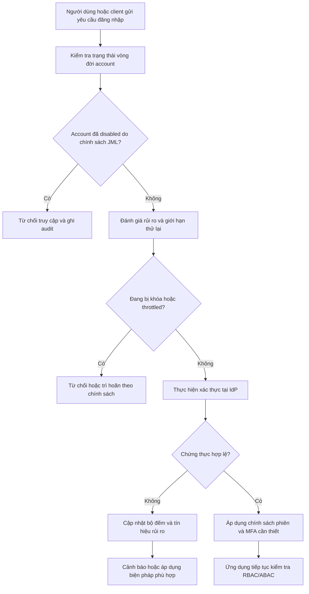

# Account lockout trong Authentication và vòng đời danh tính IAM

**Account lockout** (khóa tài khoản do sự kiện xác thực) là một biện pháp kiểm soát nhằm tạm thời hoặc theo chính sách ngăn tài khoản tiếp tục thực hiện một số thao tác đăng nhập sau khi xuất hiện dấu hiệu rủi ro, thường là **nhiều lần xác thực thất bại**. Trong **Identity and Access Management (IAM)**, mục tiêu của account lockout là hạn chế thử đoán mật khẩu, thử credential tự động và các hành vi chiếm tài khoản, đồng thời bảo vệ người dùng hợp lệ khỏi bị khóa kéo dài do kẻ tấn công cố tình gây ra.

Account lockout là một cơ chế thuộc **Authentication**, khác với quyết định cấp quyền theo **RBAC/ABAC** và khác với vô hiệu hóa tài khoản do sự kiện **Joiner–Mover–Leaver (JML)**. Khi thiết kế, tổ chức phải xác định rõ khóa điều gì, trong bao lâu, với căn cứ nào và phương thức khôi phục ra sao. Không có một ngưỡng khóa cố định phù hợp với mọi hệ thống, mọi loại tài khoản và mọi mức độ rủi ro.

## 1. Vì sao account lockout cần thiết?

Giả sử một kẻ tấn công thu thập danh sách tên đăng nhập của nhân viên và thử nhiều mật khẩu đối với mỗi tài khoản. Nếu endpoint xác thực cho phép thử không giới hạn, kẻ tấn công có thể dùng công cụ tự động để thực hiện **password guessing**, **password spraying** hoặc **credential stuffing**.

| Hình thức tấn công | Cách thực hiện | Vai trò của cơ chế chống thử lại |
| --- | --- | --- |
| **Brute-force/password guessing** | Thử nhiều mật khẩu cho một tài khoản | Giảm số lần thử trong một khoảng thời gian |
| **Password spraying** | Thử một vài mật khẩu phổ biến trên nhiều tài khoản | Cần phát hiện theo IP, mạng, thiết bị và toàn hệ thống, không chỉ theo từng account |
| **Credential stuffing** | Dùng cặp tài khoản/mật khẩu từ dữ liệu rò rỉ | Cần phát hiện lưu lượng, mật khẩu đã lộ và xác thực chống phishing |
| **Distributed guessing** | Chia yêu cầu trên nhiều IP, thiết bị hoặc vùng mạng | Cần tín hiệu rủi ro kết hợp và giới hạn phân tán |
| **Lockout abuse** | Cố tình nhập sai để khóa tài khoản của người khác | Cần giới hạn tác động từ chối dịch vụ và bảo vệ khôi phục |

**Khóa tài khoản không phải biện pháp duy nhất.** Nó cần được kết hợp với xác thực đa yếu tố (**MFA**), passkey/FIDO2 kháng phishing khi phù hợp, giới hạn tốc độ, phát hiện bất thường, bảo vệ phiên và giám sát. Đặc biệt, khóa dựa duy nhất vào số lần nhập sai có thể bị lợi dụng để gây **denial of service (DoS)** cho người dùng hợp lệ.

## 2. Phân biệt account lockout với các trạng thái khác

| Trạng thái hoặc hành động | Nguyên nhân thường gặp | Hệ quả |
| --- | --- | --- |
| **Temporary lockout** | Nhiều lần xác thực thất bại hoặc rủi ro tự động hóa | Từ chối hoặc trì hoãn lần thử tiếp theo trong khoảng thời gian nhất định |
| **Rate limiting / throttling** | Lưu lượng hoặc tần suất thử quá cao | Làm chậm, giới hạn hoặc từ chối yêu cầu mà không nhất thiết đặt account vào trạng thái khóa |
| **Suspension vì rủi ro** | Có tín hiệu chiếm tài khoản hoặc nghi vấn bảo mật | Có thể yêu cầu xác minh bổ sung hoặc xử lý của quản trị viên |
| **Disable do Leaver** | Quan hệ nhân sự/hợp đồng đã chấm dứt | Ngăn sử dụng tài khoản theo chính sách vòng đời, không phải khóa do nhập sai |
| **Revoke session/token** | Cần chấm dứt phiên đã cấp trước đó | Loại bỏ hoặc giảm khả năng dùng phiên/token còn hiệu lực |
| **Authorization deny** | Người dùng đã xác thực nhưng thiếu quyền | Từ chối thao tác trên tài nguyên dù account không bị khóa |

Một tài khoản bị khóa tại **Identity Provider (IdP)** có thể bị ngăn đăng nhập mới, nhưng không nhất thiết làm các **session ứng dụng** đã tạo trước đó mất hiệu lực. Nếu phát hiện chiếm quyền thực sự, phải xem xét thu hồi session, refresh token hoặc credential theo quy trình ứng phó, thay vì chỉ tăng bộ đếm lần đăng nhập thất bại.

## 3. Thành phần của chính sách account lockout

Một chính sách cần nêu rõ các quyết định sau:

1. **Phạm vi:** endpoint nào áp dụng, ví dụ đăng nhập mật khẩu, API xác thực cũ, thay đổi mật khẩu, đăng ký authenticator hoặc phục hồi tài khoản.
2. **Đối tượng:** human identity, tài khoản đặc quyền, tài khoản đối tác, service account; không áp dụng máy móc một chính sách cho tất cả.
3. **Sự kiện đếm:** xác thực thất bại nào tăng bộ đếm, sự kiện nào không tăng và khi nào đặt lại.
4. **Cửa sổ tính:** số lần thử trong một khoảng thời gian, cùng cách xử lý các yêu cầu đồng thời.
5. **Phản ứng:** trì hoãn tăng dần, từ chối tạm thời, kiểm tra rủi ro, yêu cầu bước xác thực khác hoặc khóa.
6. **Điều kiện mở khóa:** hết thời hạn, xác minh bổ sung, tự phục vụ có bảo vệ hoặc xử lý theo quy trình hỗ trợ.
7. **Theo dõi và kiểm toán:** cảnh báo, phát hiện tấn công phân tán và ghi nhận lý do thay đổi trạng thái.

Ví dụ một hệ thống **minh họa** có thể áp dụng độ trễ tăng dần sau nhiều lần nhập sai, rồi từ chối tạm thời yêu cầu mật khẩu khi vượt ngưỡng. Các giá trị số cần được xác định từ đánh giá rủi ro, đặc tính dịch vụ, yêu cầu truy cập và tiêu chuẩn áp dụng; **không nên coi một ví dụ ngưỡng là quy định chung**.

## 4. Account lockout được xử lý ở đâu?



Trong kiến trúc có **SSO**, IdP thường là nơi phù hợp để kiểm soát những lần đăng nhập tập trung. Tuy nhiên, nếu một ứng dụng vẫn cho phép đăng nhập bằng mật khẩu cục bộ hoặc có endpoint API xác thực riêng, chính sách IdP không tự bảo vệ các đường đi đó. Cần kiểm kê và kiểm soát từng luồng xác thực có thể sử dụng.

**SCIM** thường phục vụ tạo, cập nhật và vô hiệu hóa tài khoản/nhóm; không phải giao thức chuẩn để truyền trạng thái lockout tức thời hoặc thu hồi mọi session. Không nên dựa vào cập nhật SCIM đơn thuần để kết luận các lần thử đăng nhập đều đã bị chặn.

## 5. Thiết kế bộ đếm và giới hạn thử lại

### 5.1 Bộ đếm theo account

Hệ thống lưu thông tin thất bại tương ứng với một định danh account ổn định. Cách này hạn chế thử nhiều mật khẩu trên cùng một tài khoản nhưng dễ bị kẻ tấn công lạm dụng để khóa tài khoản nạn nhân.

Nên phân biệt rõ **tên đăng nhập người dùng nhập** với **account đã được giải quyết**. Nếu không tìm thấy account, hệ thống vẫn cần chống dò tên người dùng (*account enumeration*) và giới hạn lưu lượng phù hợp, nhưng không để lộ account có tồn tại hay đang khóa.

### 5.2 Bộ đếm theo nguồn và theo toàn hệ thống

Để phát hiện password spraying, cần bổ sung tín hiệu như IP, dải mạng, thiết bị, địa lý bất thường, user agent, tính liên tục phiên và số account bị thử. Đây là các tín hiệu không hoàn hảo: nhiều nhân viên có thể dùng cùng NAT/VPN; IP cũng có thể thay đổi hoặc bị phân tán qua botnet.

Vì vậy không nên chặn vô thời hạn một mạng lớn chỉ dựa trên số lỗi thô. Cần đánh giá rủi ro và ảnh hưởng tới người dùng hợp lệ.

### 5.3 Cửa sổ thời gian, đồng thời và lưu trữ phân tán

Bộ đếm đặt riêng trên từng máy chủ có thể cho phép vượt giới hạn khi lưu lượng được phân phối qua nhiều instance. Cần cơ chế tính nhất quán và cập nhật an toàn trong môi trường phân tán, đồng thời xử lý hợp lý khi kho lưu trạng thái giới hạn thử lại gặp sự cố.

Giả mã khái niệm:

```text
authenticate(request):
    identity = resolve_account_without_enumeration(request.username)
    if identity is disabled_by_lifecycle_policy:
        return generic_authentication_failure

    risk = assess_rate_limits_and_risk(identity, request.source)
    if risk.requires_temporary_denial:
        audit_denial(identity, request)
        return generic_authentication_failure

    result = verify_authenticator(identity, request)
    if result is failure:
        atomically_record_failure(identity, request.source)
        evaluate_lockout_policy(identity)
        return generic_authentication_failure

    update_failure_state_per_policy(identity)
    establish_session_with_required_assurance(identity)
```

Giả mã không đại diện cho API của sản phẩm cụ thể. Việc phân biệt thất bại do mật khẩu sai, lỗi hệ thống, timeout và MFA chưa hoàn tất cần thiết kế kỹ để không **tăng bộ đếm vì sự cố hạ tầng** hoặc giúp kẻ tấn công khai thác sự khác biệt phản hồi.

## 6. Cân bằng bảo mật và khả năng phục vụ

Account lockout tạo một đánh đổi: khóa quá dễ có thể làm gián đoạn công việc; khóa quá muộn có thể cho phép thử credential số lượng lớn.

| Cách kiểm soát | Lợi ích | Rủi ro/giới hạn |
| --- | --- | --- |
| Khóa cứng sau số lần sai | Giới hạn số lần thử vào account | Dễ bị dùng để khóa hàng loạt nhân viên |
| Độ trễ tăng dần | Làm giảm tốc độ đoán mật khẩu | Có thể tạo độ trễ cho người dùng hợp lệ |
| Giới hạn theo IP/nguồn | Hạn chế một nguồn phát sinh lưu lượng lớn | NAT/VPN và tấn công phân tán làm giảm độ chính xác |
| Đánh giá rủi ro thích ứng | Xử lý khác nhau theo bối cảnh | Cần chất lượng tín hiệu, kiểm thử thiên lệch và giám sát |
| Passkey/FIDO2 và MFA | Giảm rủi ro từ mật khẩu và phishing | Vẫn cần bảo vệ enrollment, recovery và phiên |
| Phát hiện credential stuffing | Phản ứng theo mẫu hành vi trên nhiều account | Cần phối hợp telemetry, bảo vệ dữ liệu và chống cảnh báo giả |

Khi áp dụng thông lệ hoặc tiêu chuẩn như **NIST SP 800-63**, cần đối chiếu đúng phiên bản và yêu cầu cụ thể với hệ thống, bao gồm các giới hạn thử xác thực; không tự suy ra rằng mọi sản phẩm phải khóa vĩnh viễn sau một số lỗi nhất định. **Throttling và kiểm soát số lần thử** có thể đáp ứng mục tiêu bảo vệ tốt hơn khóa cứng trong một số trường hợp.

## 7. Mở khóa và phục hồi tài khoản an toàn

Một quy trình mở khóa quá dễ có thể trở thành **đường vòng của xác thực mạnh**. Kẻ tấn công có thể cố ý khóa account, sau đó lừa nhân viên hỗ trợ cấp lại quyền truy cập.

Quy trình phục hồi cần:

- Xác minh người yêu cầu theo mức rủi ro và trạng thái danh tính hiện tại; không chỉ dựa vào câu hỏi bảo mật dễ đoán.
- Phân biệt **mở khóa do xác thực thất bại** với **kích hoạt lại account đã bị disabled vì Leaver**.
- Không tự động mở khóa một account bị đình chỉ do nghi vấn chiếm quyền mà thiếu đánh giá theo quy trình.
- Bảo vệ thay đổi authenticator, mật khẩu và phương thức MFA bằng kiểm soát phù hợp.
- Ghi lại người mở khóa, căn cứ, thời điểm, thiết bị/phiên và kết quả.
- Thông báo theo kênh đáng tin khi có thay đổi nhạy cảm, đồng thời không để thông báo lộ bí mật.

**Mở khóa không nhất thiết phải đặt lại mật khẩu.** Nếu không có dấu hiệu credential đã lộ, có thể chỉ cần kết thúc khóa tạm thời theo chính sách. Nhưng nếu phát hiện chiếm quyền, phải đánh giá việc đổi credential, thu hồi session và kiểm tra hành vi bất thường.

## 8. Account lockout trong Joiner–Mover–Leaver

### Joiner: khởi tạo tài khoản nhưng không để khóa nhầm

Người mới có thể đăng ký passkey/MFA, nhận lời mời kích hoạt hoặc đăng nhập lần đầu. IAM cần tách **trạng thái chưa đến ngày làm việc** với **khóa do xác thực thất bại**. Nếu một lời mời đã hết hạn, phải xử lý theo quy trình enrollment chứ không xem đó là sự kiện khóa do nhập sai mật khẩu.

Đồng thời, khi gửi hướng dẫn onboarding, cần tránh cho kẻ tấn công sử dụng tên tài khoản vừa tạo để gây khóa liên tục.

### Mover: thay đổi quyền không đồng nghĩa khóa account

Nhân viên chuyển bộ phận thường giữ cùng identity và phương thức xác thực. Quy trình **Mover** cập nhật nhóm/thuộc tính tại IdP và quyền theo **RBAC/ABAC** tại ứng dụng; không nên dùng account lockout để thay thế việc thu hồi quyền cũ.

Nếu vai trò mới yêu cầu mức xác thực cao hơn, có thể yêu cầu authenticator mạnh hơn hoặc **step-up authentication**. Thay đổi role không phải bằng chứng rằng người dùng đang tấn công.

### Leaver: vô hiệu hóa theo sự kiện nguồn, không dựa vào bộ đếm lỗi

Khi quan hệ lao động/hợp đồng chấm dứt, account cần được xử lý theo sự kiện **Leaver** và ngày hiệu lực có thẩm quyền. Khóa tạm thời do nhập sai có thể tự hết hạn; vì vậy **không được dùng temporary lockout làm biện pháp chấm dứt truy cập lâu dài**.

Ngoài IdP, IAM phải deprovision ứng dụng đích, xử lý phiên SSO/ứng dụng, refresh token, quyền đặc biệt và các đường truy cập độc lập. Mục tiêu là chứng minh **không còn quyền truy cập tồn dư**, không chỉ hiển thị trạng thái “locked”.

## 9. Trường hợp tài khoản dịch vụ và workload identity

Service account có thể được dùng bởi tiến trình tự động. Nếu sử dụng mật khẩu hoặc client secret và credential bị sai sau khi xoay vòng, một chính sách khóa cứng giống tài khoản người dùng có thể làm hàng loạt tác vụ ngừng hoạt động.

Các lưu ý gồm:

1. Ưu tiên **workload identity federation**, chứng thư hoặc credential ngắn hạn theo khả năng nền tảng, tránh mật khẩu cố định lâu dài.
2. Xác định owner, mục đích, môi trường, ứng dụng gọi và quyền API trước khi cấu hình giới hạn xác thực.
3. Giám sát lỗi xác thực sau thay đổi secret; phân biệt deploy lỗi với tấn công cố ý.
4. Cung cấp cảnh báo và quy trình phục hồi kỹ thuật có kiểm soát, không nới quyền quá rộng để ứng dụng chạy lại.
5. Khi workload ngừng hoạt động hoặc owner thay đổi, thu hồi credential và entitlement theo vòng đời, không chỉ chờ account tự khóa vì lỗi.

Tài khoản đặc quyền của con người cũng có thể cần chính sách và quy trình phục hồi riêng. Tuy nhiên, **ngoại lệ khỏi khóa cứng không được biến thành ngoại lệ khỏi giới hạn thử lại, giám sát hoặc xác thực mạnh**.

## 10. Quan hệ với IdP, SSO, SCIM, RBAC/ABAC và audit

| Thành phần | Vai trò với account lockout | Điều cần tránh hiểu nhầm |
| --- | --- | --- |
| **IdP** | Thực thi chính sách xác thực, chống thử lại và trạng thái account thuộc phạm vi quản lý | Khóa tại IdP không chắc vô hiệu hóa mọi session ứng dụng |
| **SSO** | Cho phép đăng nhập liên kết sau khi IdP xác thực | Logout hoặc lockout không bảo đảm mọi app tự kết thúc phiên |
| **SCIM/connector** | Đồng bộ user/group và trạng thái khi ứng dụng hỗ trợ | Không phải giao thức thu hồi phiên hay đồng bộ lockout tức thì phổ quát |
| **RBAC/ABAC** | Quyết định hành động nào được phép khi chủ thể đã xác thực | Đăng nhập thất bại không có nghĩa role đã bị thu hồi |
| **IGA/JML** | Quản lý nguồn HR, các sự kiện Joiner/Mover/Leaver và chính sách vòng đời | Temporary lockout không thay cho deprovisioning |
| **Audit/SIEM** | Ghi nhận thất bại, khóa/mở khóa, tín hiệu tấn công và ngoại lệ | Không ghi mật khẩu hoặc token thô vào log |

Ví dụ một người đăng nhập thành công qua SSO nhưng thiếu role truy cập dữ liệu thì ứng dụng phải từ chối theo authorization. Ngược lại, một người bị khóa do mật khẩu sai nhưng có session hợp lệ từ trước có thể vẫn thực hiện một số thao tác tùy thiết kế; khi đây là dấu hiệu tấn công, phải đánh giá việc thu hồi session và token.

## 11. Giám sát, kiểm toán và chỉ số vận hành

Log account lockout nên ghi **định danh account phù hợp chính sách riêng tư**, loại sự kiện, thời điểm, hệ thống, mức rủi ro, nguồn yêu cầu, quyết định throttling/lockout/unlock và liên kết với sự kiện liên quan. Không ghi mật khẩu người dùng nhập, mã OTP, cookie phiên, access token hoặc private key.

Những chỉ số hữu ích:

- **Failed attempts rate:** tỷ lệ/thời điểm xảy ra thử xác thực thất bại theo account, nguồn và nhóm ứng dụng.
- **Lockout frequency:** số account bị khóa theo giai đoạn, khu vực và loại chủ thể.
- **False-lockout impact:** số người dùng hợp lệ bị gián đoạn, thời gian khôi phục và mức ảnh hưởng nghiệp vụ.
- **Credential attack coverage:** mức phát hiện brute-force, password spraying và credential stuffing.
- **Unlock security:** số lần mở khóa không đúng chính sách, khôi phục thất bại và trường hợp nghi lạm dụng help desk.
- **Residual session risk:** số tình huống account bị khóa nhưng phiên cũ vẫn có thể truy cập tài nguyên nhạy cảm.

Đặc biệt, các đợt khóa hàng loạt trong vài phút có thể biểu thị **password spraying** hoặc một thay đổi cấu hình khiến ứng dụng gửi credential sai liên tục. Cần kết hợp log với thông tin deploy, dịch vụ xác thực và nguồn lưu lượng trước khi kết luận.

## 12. Tình huống thực hành

**Tình huống A:** Một kẻ tấn công thử mật khẩu sai trên hàng trăm account, mỗi account chỉ vài lần. Chỉ khóa sau nhiều lỗi trên một account có đủ không? **Không.** Cần phát hiện kiểu password spraying trên nhiều tài khoản và giới hạn nguồn/hành vi phân tán.

**Tình huống B:** Nhân viên vừa nghỉ việc bị khóa do nhập sai mật khẩu, nhưng khóa sẽ tự hết hạn sau một giờ. Có thể coi Leaver đã xử lý xong không? **Không.** Cần vô hiệu hóa theo chính sách vòng đời và thu hồi quyền/phiên ở các hệ thống liên quan.

**Tình huống C:** IdP khóa tài khoản sau nhiều lần sai, nhưng CRM vẫn chấp nhận session cũ. Có mâu thuẫn không? **Không nhất thiết.** Lockout có thể chỉ chặn đăng nhập mới; nếu cần chặn truy cập vì rủi ro, phải xử lý session CRM riêng.

**Tình huống D:** Service account nhập sai secret sau một đợt deploy và bị khóa, khiến tác vụ vận hành ngừng chạy. Có nên tắt toàn bộ kiểm soát không? **Không.** Cần sửa secret/cấu hình, giám sát, quy trình phục hồi và cơ chế xác thực workload thích hợp thay vì bỏ biện pháp bảo vệ.

**Tình huống E:** Người dùng gọi help desk và yêu cầu mở khóa chỉ bằng cách đọc tên, phòng ban. Có đủ an toàn không? **Không.** Phải xác minh theo chính sách phục hồi, đặc biệt với account có quyền nhạy cảm.

## Ghi nhớ

**Account lockout** là cơ chế hạn chế các lần thử xác thực có rủi ro, không phải công cụ cấp quyền hay thu hồi tài khoản theo vòng đời. Chính sách hiệu quả cần cân bằng **chống brute-force, password spraying, credential stuffing** với nguy cơ **DoS do khóa hàng loạt**, kết hợp throttling, MFA/passkey, kiểm soát phiên và phục hồi an toàn. Trong **IAM Joiner–Mover–Leaver**, cần phân biệt khóa tạm thời với disable do Leaver, đồng thời phối hợp **IdP/SSO, SCIM, RBAC/ABAC, quản trị workload và audit** để hạn chế quyền truy cập tồn dư.
