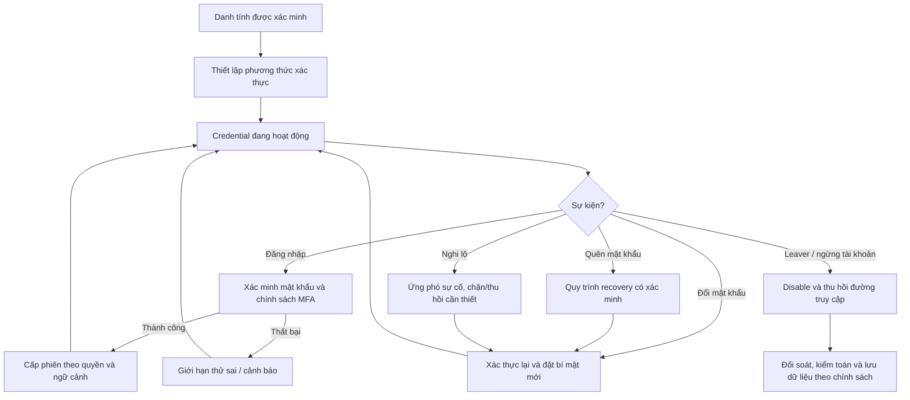

# Password lifecycle trong IAM: Từ khởi tạo đến thu hồi mật khẩu

**Password lifecycle** là vòng đời của một mật khẩu dùng để xác thực danh tính: **thiết lập hoặc phát hành**, **sử dụng và xác minh**, **thay đổi**, **khôi phục khi quên hoặc mất quyền kiểm soát**, và **làm mất hiệu lực khi không còn được phép sử dụng**. Trong một hệ thống quản lý danh tính và truy cập (*Identity and Access Management* — **IAM**), quản lý vòng đời mật khẩu không chỉ là yêu cầu người dùng đặt mật khẩu đủ mạnh. Đó là cách tổ chức bảo vệ bí mật xác thực từ lúc danh tính được tạo cho đến khi tài khoản bị vô hiệu hóa, đồng thời kiểm soát các phiên và quyền có thể vẫn hoạt động sau khi mật khẩu thay đổi.

Bài thuộc chương **Mật khẩu** của module `SECURITY_IDENTITY_ACCESS_MANAGEMENT_IDENTITY_LIFECYCLE`. Nội dung kết nối quản lý mật khẩu với **Joiner–Mover–Leaver (JML)**, IdP, SSO, MFA, RBAC/ABAC, SCIM, danh tính dịch vụ và kiểm toán. Mục tiêu là giảm nguy cơ bị đoán, tái sử dụng, đánh cắp hoặc lưu mật khẩu sai cách, nhưng vẫn hỗ trợ người dùng hợp lệ đăng nhập và khôi phục tài khoản thuận tiện.

Sau bài học, bạn có thể mô tả từng giai đoạn của password lifecycle; phân biệt mật khẩu với tài khoản, phiên và quyền; thiết kế quy trình cấp mật khẩu ban đầu và reset an toàn; hiểu yêu cầu cơ bản về băm mật khẩu ở phía máy chủ; xử lý sự cố lộ mật khẩu; và giải thích việc vô hiệu hóa mật khẩu liên quan thế nào đến quá trình Joiner, Mover và Leaver.

## 1. Mật khẩu đứng ở đâu trong IAM?

**Mật khẩu** là một *authentication secret* mà chủ thể biết và sử dụng để chứng minh quyền kiểm soát một tài khoản. **Username** hoặc email thường chỉ giúp tìm tài khoản; chúng không phải bí mật. Sau khi xác thực thành công, hệ thống còn phải quyết định người dùng được thao tác gì trên tài nguyên nào.

| Thành phần | Vai trò | Không được nhầm với |
| --- | --- | --- |
| **Identity** | Danh tính của nhân viên, nhà thầu, đối tác hoặc chủ thể khác | Chuỗi username hoặc một mật khẩu cụ thể |
| **Account** | Đối tượng tài khoản tại IdP hoặc ứng dụng | Danh tính duy nhất trên mọi hệ thống |
| **Password** | Yếu tố bí mật dùng trong một phương thức xác thực | Bằng chứng rằng chủ thể có quyền truy cập mọi ứng dụng |
| **MFA / passkey** | Phương thức hoặc yếu tố xác thực bổ sung/thay thế | Quyền nghiệp vụ RBAC/ABAC |
| **Session / token** | Trạng thái hoặc bằng chứng phiên đã xác thực | Bản thân mật khẩu; thay mật khẩu không tự hủy mọi token |
| **Role / entitlement** | Quyền cho phép thao tác trên ứng dụng, API hoặc tài nguyên | Thành công của bước đăng nhập |

Ví dụ: một nhân viên đăng nhập bằng mật khẩu và MFA tại Identity Provider (**IdP**), sau đó truy cập CRM qua **Single Sign-On (SSO)**. Đăng nhập thành công cho thấy IdP đã xác thực người dùng theo chính sách; CRM vẫn phải kiểm tra role, thuộc tính và phạm vi dữ liệu mà người đó được phép sử dụng. Mật khẩu mạnh **không khắc phục được** việc cấp sai quyền quản trị.

Một tổ chức có thể chuyển dần sang **passkey hoặc phương thức chống phishing**, nhưng trong thời gian chuyển đổi vẫn phải quản lý các mật khẩu còn tồn tại, kể cả mật khẩu của tài khoản ứng dụng cũ, tài khoản khẩn cấp và một số hệ thống kỹ thuật.

## 2. Các giai đoạn của password lifecycle

| Giai đoạn | Sự kiện thường gặp | Kiểm soát quan trọng | Đầu ra cần kiểm chứng |
| --- | --- | --- | --- |
| **Khởi tạo / enrollment** | Joiner có danh tính đã được xác minh | Đúng chủ thể; không dùng mật khẩu mặc định dùng chung | Tài khoản và phương thức thiết lập bí mật được gắn đúng người |
| **Thiết lập mật khẩu** | Người dùng tạo mật khẩu lần đầu | Quy tắc độ dài, danh sách bí mật bị lộ, kênh TLS | Hệ thống lưu bộ xác minh an toàn, không lưu bản rõ |
| **Sử dụng / verification** | Đăng nhập hoặc xác thực lại | Băm/kiểm tra an toàn, chống thử sai, MFA theo rủi ro | Phiên chỉ được cấp sau khi đủ điều kiện |
| **Thay đổi / change** | Người dùng muốn đổi hoặc có chỉ thị bảo mật | Xác thực lại thích hợp, kiểm tra mật khẩu mới | Bộ xác minh mới được cập nhật; xử lý phiên theo chính sách |
| **Quên mật khẩu / recovery** | Người dùng không còn biết mật khẩu | Xác minh người yêu cầu, token khôi phục dùng một lần | Khôi phục đúng chủ thể mà không mở đường chiếm đoạt tài khoản |
| **Nghi lộ / compromise response** | Có dấu hiệu bị lộ hoặc sử dụng trái phép | Chặn lạm dụng, thay bí mật, đánh giá session và MFA | Không còn chấp nhận bí mật bị lộ, các đường truy cập liên quan được kiểm soát |
| **Vô hiệu hóa / retirement** | Leaver, tài khoản hết hạn hoặc chuyển phương thức xác thực | Khóa account/phương thức, thu hồi phiên/token khi có thể | Bí mật cũ không thể dùng để xác thực theo phạm vi cần chặn |
| **Lưu bằng chứng / audit** | Trong suốt vòng đời | Nhật ký sự kiện không chứa bí mật | Giải thích được ai yêu cầu, khi nào, kết quả gì |

Các bước này **không nhất thiết diễn ra theo đường thẳng**. Một người có thể đổi mật khẩu nhiều lần, yêu cầu recovery, bị khóa tạm thời, rồi tiếp tục sử dụng tài khoản. Một tài khoản bị vô hiệu hóa không nên được khôi phục chỉ vì có người nhập lại đúng mật khẩu cũ.

### Sơ đồ trạng thái khái niệm



Sơ đồ chỉ biểu diễn các nhánh phổ biến. Một tổ chức có thể có trạng thái `PENDING_ACTIVATION`, `RESET_REQUIRED`, `LOCKED` hoặc `DISABLED` riêng. **Không mặc định** tên trạng thái hay hành vi của một nhà cung cấp IdP áp dụng cho mọi nền tảng.

## 3. Giai đoạn Joiner: thiết lập mật khẩu ban đầu an toàn

Khi HRIS hoặc nguồn có thẩm quyền xác nhận một Joiner, hệ thống IAM có thể chuẩn bị trước user tại IdP. Nhưng phải tách riêng **tạo account**, **xác minh người nhận**, **thiết lập phương thức đăng nhập** và **kích hoạt quyền**.

### 3.1. Không phát mật khẩu dùng chung hoặc mật khẩu dễ đoán

Những cách làm như `Welcome123!`, ghép tên với ngày sinh, gửi cùng một mật khẩu cho toàn bộ nhân viên mới hoặc yêu cầu đội hỗ trợ biết mật khẩu của từng người đều tạo rủi ro. Nếu một thông tin ban đầu bị lộ, người ngoài có thể đăng nhập vào nhiều tài khoản hoặc nhắm mục tiêu những người chưa đổi mật khẩu.

Một quy trình tốt có thể:

1. Nhận bản ghi Joiner đã được phê duyệt, đối chiếu bằng **ID nhân sự ổn định** thay vì chỉ dựa vào họ tên/email.
2. Tạo account ở trạng thái chưa được phép sử dụng hoặc hạn chế cho đến thời điểm hiệu lực theo chính sách.
3. Gửi **lời mời khởi tạo** bằng kênh phù hợp; sử dụng mã/token ngẫu nhiên, giới hạn thời gian và một lần sử dụng nếu sản phẩm hỗ trợ.
4. Xác minh rằng người thực hiện khởi tạo là **đúng chủ thể**, không chỉ là ai đó đang biết địa chỉ email; tăng mức kiểm tra theo độ nhạy cảm tài khoản.
5. Cho phép người dùng tự chọn mật khẩu an toàn hoặc đăng ký passkey/MFA theo quy định.
6. Chỉ kích hoạt các quyền ứng dụng tại thời điểm đủ điều kiện, sau đó kiểm tra kết quả provisioning.

**Đường dẫn kích hoạt không được xem là mật khẩu vĩnh viễn.** Token khởi tạo cần có mục đích cụ thể, được bảo vệ trong quá trình vận chuyển, có hạn dùng ngắn phù hợp, vô hiệu hóa sau khi sử dụng và không xuất hiện trong nhật ký công khai. Nếu URL chứa token, cần lưu ý rò rỉ qua lịch sử truy cập, log, referrer hoặc phần mềm phân tích.

### 3.2. Có thể chuẩn bị sớm nhưng không cấp quyền sớm

Ví dụ một nhân viên nhận việc lúc 09:00 ngày 01/12. Bộ phận IAM có thể tạo account từ vài ngày trước để người đó hoàn tất bước enrollment trong phạm vi chính sách cho phép. Tuy nhiên, việc có mật khẩu hợp lệ **không đồng nghĩa** với việc được truy cập CRM hoặc dữ liệu khách hàng trước ngày bắt đầu. IdP, nhóm, RBAC/ABAC và ứng dụng đích phải cùng kiểm tra trạng thái và thời điểm hiệu lực.

Nếu ngày nhận việc bị lùi, các tác vụ kích hoạt cũ phải được cập nhật. Nếu tài khoản nhầm người, cần dừng/khóa bước liên quan và xác minh lại thay vì phát thêm mật khẩu mới cho một account chưa được liên kết đúng.

## 4. Chính sách chọn mật khẩu: tăng sức chống đoán mà không tạo ma sát vô ích

Một chính sách mật khẩu hiện đại thường ưu tiên **độ dài và tính khó đoán**, khả năng dùng **password manager**, kiểm tra những mật khẩu đã bị lộ và phòng chống thử đoán. Những yêu cầu chỉ nhằm tạo vẻ phức tạp có thể khiến người dùng ghi mật khẩu ra giấy hoặc sử dụng lại cùng một mẫu.

| Nội dung chính sách | Cách tiếp cận nên cân nhắc | Điều nên tránh |
| --- | --- | --- |
| **Độ dài** | Cho phép mật khẩu dài/cụm mật khẩu, đặt giới hạn hợp lý theo chuẩn áp dụng và khả năng hệ thống | Trường nhập quá ngắn làm cắt mật khẩu mà người dùng không biết |
| **Tính khó đoán** | Khuyến khích chuỗi ngẫu nhiên do trình quản lý mật khẩu tạo hoặc passphrase dài, không phổ biến | Dùng tên công ty, username, ngày sinh hoặc mẫu `Password1!` |
| **Danh sách mật khẩu bị lộ** | So với danh sách mật khẩu phổ biến/bị xâm phạm bằng cơ chế bảo vệ dữ liệu phù hợp | Chấp nhận một mật khẩu chỉ vì có chữ hoa, số và ký tự đặc biệt |
| **Quy tắc ký tự** | Hỗ trợ khoảng trắng và ký tự hợp lệ theo nền tảng; quy tắc nhất quán, có hướng dẫn rõ | Ép kiểu tổ hợp phức tạp không cần thiết hoặc thay đổi ký tự để né máy kiểm tra |
| **Dán và tự điền** | Cho phép thao tác của password manager, cơ chế dán và tự điền an toàn | Chặn paste, gây khó dùng mật khẩu ngẫu nhiên dài |
| **Tái sử dụng** | Khuyến khích mỗi dịch vụ một bí mật riêng; chặn lại bí mật không đạt chính sách | Khuyến khích dùng chung một mật khẩu giữa email, IdP và ứng dụng cục bộ |
| **Chu kỳ thay đổi** | Yêu cầu thay đổi khi có bằng chứng bị lộ, mật khẩu khởi tạo hoặc chính sách rủi ro cụ thể | Ép đổi định kỳ quá thường xuyên mà không có lý do bảo mật, dẫn đến mẫu dễ đoán |
| **Hỗ trợ người dùng** | Giải thích vì sao bị từ chối và cách tạo mật khẩu phù hợp | Yêu cầu nhân viên cung cấp mật khẩu cho bộ phận hỗ trợ |

Chính sách chi tiết cần căn cứ **chuẩn an toàn đang áp dụng**, độ nhạy cảm của dịch vụ, quy định tổ chức và khả năng công nghệ. Đừng biến một ví dụ số ký tự trong bài học thành quy tắc phổ quát cho mọi IdP.

### Vì sao thay mật khẩu định kỳ không phải lúc nào cũng hiệu quả?

Nếu buộc đổi mật khẩu quá thường xuyên mà không có dấu hiệu bị lộ, người dùng dễ chuyển từ `MauKhauThang11!` sang `MauKhauThang12!`. Độ dài và chữ số có thể đáp ứng một số quy tắc hình thức, nhưng giá trị chống đoán không tăng tương xứng. Các hướng dẫn hiện đại thường **không khuyến nghị ép đổi định kỳ vô cớ**; thay đổi được ưu tiên khi có dấu hiệu lộ lọt, tài khoản bị chiếm đoạt hoặc một sự kiện xác thực cụ thể cần phản ứng.

Điều đó **không có nghĩa** bỏ qua quản lý vòng đời bí mật của tài khoản dịch vụ, khóa dùng chung hoặc những môi trường có yêu cầu riêng: với chúng, luân chuyển credential theo chính sách và mức rủi ro vẫn rất quan trọng.

## 5. Lưu trữ và xác minh mật khẩu ở phía máy chủ

Đây là một phân biệt kỹ thuật nền tảng: hệ thống xác thực **không nên lưu mật khẩu người dùng dưới dạng văn bản thuần** và không nên dùng mã hóa có thể giải ngược như cơ chế chính để kiểm tra mật khẩu. Thay vào đó, máy chủ lưu **password verifier** được tạo bằng thuật toán băm mật khẩu chuyên dụng, có salt và tham số được lựa chọn phù hợp.

### 5.1. Hash, salt và pepper

| Thành phần | Tác dụng | Lưu ý |
| --- | --- | --- |
| **Password hashing / KDF** | Biến mật khẩu thành giá trị kiểm tra bằng phép tính cố ý tiêu tốn tài nguyên | Ưu tiên thuật toán chuyên dụng như Argon2id; scrypt hoặc PBKDF2 khi phù hợp với nền tảng/yêu cầu tuân thủ |
| **Salt ngẫu nhiên riêng** | Làm cùng một mật khẩu ở hai tài khoản không cho cùng bộ xác minh | Sinh bằng nguồn ngẫu nhiên mật mã; thư viện password hashing tốt thường quản lý salt |
| **Tham số cost** | Quy định chi phí CPU/bộ nhớ khi thử mật khẩu | Cân bằng chống dò offline với năng lực hệ thống; điều chỉnh khi phần cứng và rủi ro thay đổi |
| **Pepper (tùy chọn)** | Bổ sung bí mật cấp hệ thống ngoài database để giảm tác hại của một số dạng lộ DB | Bảo vệ riêng bằng secret manager/HSM; cần quy trình thay thế nếu lộ; không dùng thay salt |
| **So sánh xác thực** | Kiểm tra mật khẩu người dùng nhập với verifier đã lưu | Dùng API kiểm tra của thư viện, tránh tự viết phép so sánh hay thuật toán băm |

**SHA-256(password)** đơn lẻ, kể cả có thêm một chuỗi tĩnh, không phải cơ chế lưu mật khẩu được khuyến nghị: nó được thiết kế để tính nhanh nên giúp kẻ tấn công thử nhiều mật khẩu sau khi có bản sao database. **Argon2id** và các thuật toán băm mật khẩu chuyên dụng giúp tăng chi phí dò offline bằng cơ chế thích hợp.

### 5.2. Luồng tạo và kiểm tra verifier

```mermaid
sequenceDiagram
    participant User as Người dùng
    participant App as Ứng dụng / IdP
    participant Vault as Kho verifier
    User->>App: Chọn mật khẩu qua TLS
    App->>App: Kiểm tra chính sách và mật khẩu bị lộ
    App->>App: Băm chuyên dụng với salt, cost phù hợp
    App->>Vault: Chỉ lưu verifier và metadata cần thiết
    Vault-->>App: Xác nhận lưu
    User->>App: Đăng nhập qua TLS
    App->>Vault: Đọc verifier theo account ID
    Vault-->>App: Trả verifier
    App->>App: Thư viện xác minh mật khẩu; áp MFA/rate limit
    App-->>User: Kết quả xác thực và phiên theo chính sách
```

Ví dụ giả mã cho một backend:

```text
setPassword(accountId, newPassword):
    require(identityAndAuthorizationChecksPassed(accountId))
    require(passwordPolicyAccepts(newPassword))
    require(notKnownCompromised(newPassword))

    verifier = passwordHasher.hash(newPassword)
    // passwordHasher dùng thuật toán chuyên dụng, salt và cost phù hợp.
    securelyStore(accountId, verifier, credentialVersion + 1)
    clearSensitiveInputAsPractical()
    audit("PASSWORD_SET", accountId, success=true)

verifyLogin(accountId, submittedPassword):
    applyRateLimitAndAbuseControls(accountId, requestContext)
    verifier = readVerifier(accountId)
    valid = passwordHasher.verify(submittedPassword, verifier)

    if not valid or not accountIsAllowedToAuthenticate(accountId):
        recordSafeFailureWithoutPassword()
        return genericAuthenticationFailure()

    requireApplicableMfaAndRiskChecks()
    return issueSessionWithinPolicy()
```

Đây là **giả mã giải thích nguyên tắc**, không phải đoạn triển khai hoàn chỉnh. API thực tế phải giải quyết thêm cạnh tranh khi cập nhật credential, phiên đăng nhập, CSRF với ứng dụng web, quản lý phiên/tài khoản, khả năng kháng tấn công đoán trực tuyến, ngưỡng tài nguyên của KDF và mã hóa truyền tải. Không nên tự phát minh thuật toán băm hoặc tự viết hàm xử lý mật khẩu thay cho thư viện được kiểm tra an toàn.

### 5.3. Những vị trí mật khẩu có thể vô tình bị lộ

Ngay cả khi database chỉ lưu hash, mật khẩu vẫn có thể xuất hiện trong **HTTP request log, trace, công cụ giám sát lỗi, telemetry, bộ nhớ dump, email, ảnh chụp màn hình hoặc tin nhắn hỗ trợ**. Cần kiểm soát log, phân quyền truy cập, giới hạn lưu giữ và loại bỏ trường bí mật khỏi hệ thống quan sát.

Nếu ứng dụng sử dụng IdP/SSO, nên để **IdP chuyên trách xác thực mật khẩu**; ứng dụng không cần lấy hoặc lưu mật khẩu người dùng chỉ để tin vào kết quả đăng nhập. Tránh yêu cầu người dùng nhập lại mật khẩu IdP trên một trang ứng dụng không phải kênh xác thực đã phê duyệt.

## 6. Xác thực hằng ngày: mật khẩu chỉ là một lớp

Kẻ tấn công có thể thử mật khẩu phổ biến, sử dụng mật khẩu từ vụ rò rỉ trước (*credential stuffing*) hoặc lừa người dùng nhập bí mật vào trang giả. Hệ thống cần nhiều lớp phòng thủ, thay vì kỳ vọng chỉ một quy tắc độ dài sẽ đủ.

### Các biện pháp quan trọng

1. **Bảo vệ kênh:** dùng TLS, không gửi mật khẩu qua HTTP không bảo vệ.
2. **Giới hạn thử sai:** rate limiting, giám sát bất thường và biện pháp chống tự động hóa, tránh tạo điểm từ chối dịch vụ dễ bị lợi dụng.
3. **MFA hoặc xác thực chống phishing:** áp phương thức mạnh hơn cho tài nguyên nhạy cảm, đặc biệt tài khoản quản trị và IdP.
4. **Phản hồi đăng nhập phù hợp:** hạn chế tiết lộ account có tồn tại hay không qua thông báo công khai và khác biệt xử lý dễ khai thác.
5. **Quản lý phiên:** session/token có TTL, ràng buộc và cơ chế thu hồi phù hợp; đăng xuất không chỉ là xóa một nút ở giao diện.
6. **Theo dõi rủi ro:** phát hiện đăng nhập bất thường, thiết bị không tin cậy, thử nhiều tài khoản hoặc dấu hiệu chiếm đoạt.

**MFA không thay thế phân quyền.** Người đăng nhập có cả mật khẩu đúng và MFA hợp lệ vẫn chỉ được truy cập những tài nguyên, thao tác và phạm vi mà RBAC/ABAC cho phép.

### Tại sao cần cân nhắc passkey?

Passkey dựa trên mật mã khóa công khai có thể giúp người dùng **không phải nhập bí mật dùng chung vào website**, qua đó giảm nguy cơ lộ mật khẩu và chống một số kiểu phishing tốt hơn. Tổ chức vẫn cần quản lý vòng đời **thiết bị xác thực, phương thức khôi phục, định danh account, session và quyền ứng dụng**. Triển khai passkey không tự giải quyết việc quyền của Leaver còn tồn tại.

## 7. Phân biệt thay đổi mật khẩu, reset và khôi phục danh tính

Ba hoạt động dễ bị gọi chung là “đổi mật khẩu” nhưng có điều kiện bảo mật khác nhau:

| Trường hợp | Người yêu cầu biết gì? | Cách xác minh | Rủi ro đặc biệt |
| --- | --- | --- | --- |
| **Change password** | Thường đang có phiên hợp lệ và có thể biết mật khẩu hiện tại | Xác thực lại hoặc kiểm tra mức bảo đảm phù hợp trước thao tác nhạy cảm | Phiên bị chiếm đoạt có thể đổi mật khẩu để khóa chủ thật |
| **Forgot password / reset** | Có thể không nhớ mật khẩu hiện tại | Quy trình recovery tách biệt, token một lần và xác minh chủ thể | Chiếm email/điện thoại có thể trở thành đường chiếm account |
| **Account recovery** | Có thể mất cả mật khẩu lẫn MFA hoặc thiết bị | Kiểm tra danh tính mạnh hơn, hỗ trợ có kiểm soát, bằng chứng theo chính sách | Kênh hỗ trợ yếu vô hiệu hóa mọi kiểm soát MFA |
| **Administrative reset** | Bộ phận hỗ trợ có yêu cầu đã xác minh | Phân quyền thao tác, phê duyệt, ghi audit; người dùng tự thiết lập bí mật mới | Quản trị viên biết hoặc giữ mật khẩu lâu dài của người dùng |

**Không bao giờ gửi lại mật khẩu cũ dưới dạng rõ**. Một hệ thống lưu verifier đúng cách không cần — và không nên có khả năng — đọc lại mật khẩu người dùng. Khi người dùng quên, hệ thống phải giúp **thiết lập bí mật mới sau khi xác minh đúng người**.

### 7.1. Quy trình forgot password an toàn

Một luồng thông dụng:

1. Người dùng yêu cầu reset qua kênh xác thực chính thức.
2. Hệ thống tạo token recovery từ **nguồn ngẫu nhiên mật mã**, chỉ dùng cho đúng account và đúng mục đích, có thời gian hết hạn ngắn theo chính sách.
3. Hệ thống chuyển thông báo đến kênh khôi phục đã đăng ký; phản hồi công khai không nên tiết lộ rõ tài khoản có tồn tại hay không.
4. Người dùng trình token và hoàn tất các bước xác minh bổ sung nếu mức rủi ro yêu cầu.
5. Hệ thống **tiêu thụ token theo cách nguyên tử**, đặt verifier của mật khẩu mới và vô hiệu hóa token reset khác theo chính sách.
6. Hệ thống đánh giá việc kết thúc session/refresh token, gửi thông báo bảo mật đến kênh liên lạc phù hợp và ghi audit **không chứa mật khẩu hoặc token**.

Token recovery thường nên được lưu dưới dạng hash hoặc một bộ kiểm tra tương đương có bảo vệ, thay vì lưu bản rõ dễ bị sử dụng nếu database lộ. Nên tránh để token xuất hiện ở log, công cụ phân tích, URL chia sẻ hoặc bên thứ ba ngoài ý muốn.

### 7.2. Recovery không được làm mất tác dụng MFA

Giả sử tài khoản quản trị sản xuất dùng passkey hoặc khóa bảo mật chống phishing, nhưng đội hỗ trợ chỉ cần số điện thoại tự khai báo để reset mật khẩu và vô hiệu hóa MFA. Khi đó, kẻ tấn công có thể tập trung vào quy trình hỗ trợ thay vì tấn công phương thức xác thực mạnh.

Cần thiết kế **mức bảo đảm khôi phục tương xứng với mức bảo đảm truy cập**, có xác minh danh tính, kiểm soát thao tác đặc quyền, phương án cho người mất thiết bị và cảnh báo sau khôi phục. Không nên coi việc nắm một địa chỉ email hoặc trả lời câu hỏi cá nhân dễ tìm là bằng chứng duy nhất đủ cho tài khoản nguy cơ cao.

### 7.3. Đổi mật khẩu có cần đăng xuất tất cả thiết bị?

Không có một hành vi mặc định phù hợp mọi ứng dụng. Khi người dùng chủ động đổi mật khẩu trong một phiên tin cậy, chính sách có thể cho phép quản lý phiên theo lựa chọn hoặc mức rủi ro. Khi có dấu hiệu **chiếm đoạt tài khoản**, cần xem xét thu hồi các phiên/refresh token đang hoạt động, yêu cầu đăng nhập và MFA lại, đồng thời đánh giá xem kẻ tấn công đã thay đổi phương thức khôi phục hay cấp thêm quyền chưa.

Điểm cốt lõi: **cập nhật password hash không tự động làm mất hiệu lực access token đã phát hành hoặc session ứng dụng**. Điều này cần được thực thi bởi cơ chế quản lý phiên/token của IdP và từng ứng dụng.

## 8. Khi nghi mật khẩu bị lộ: ứng phó theo nguy cơ

Một mật khẩu cần được xem xét thay đổi hoặc vô hiệu hóa khi có dấu hiệu bị lộ, ví dụ:

- Người dùng nhập mật khẩu tại trang giả mạo hoặc thông báo đã chia sẻ nhầm.
- Công cụ phát hiện credential bị lộ hoặc mật khẩu nằm trong dữ liệu xâm phạm có căn cứ phù hợp.
- Có dấu hiệu credential stuffing, đăng nhập từ ngữ cảnh bất thường hoặc account takeover.
- Một mật khẩu khởi tạo, mặc định hoặc dùng chung đã bị tiết lộ.
- Tài khoản có người quản trị cũ biết credential, hoặc có nghi vấn truy cập trái phép vào kho bí mật.

Quy trình phản ứng có thể gồm:

1. **Xác định phạm vi:** account nào, hệ thống nào, bí mật nào và mức độ tin cậy của tín hiệu.
2. **Hạn chế truy cập nguy hiểm:** khóa tạm thời hoặc chặn đăng nhập theo rủi ro, đặc biệt tài khoản đặc quyền.
3. **Thay/đặt lại bí mật qua kênh tin cậy:** xác minh đúng chủ tài khoản và phương thức recovery.
4. **Xử lý session, token, MFA và recovery methods:** nếu nghi bị chiếm đoạt, đánh giá mọi đường duy trì truy cập.
5. **Kiểm tra thao tác sau thời điểm nghi lộ:** quyền mới, token đã cấp, thay đổi cấu hình, xuất dữ liệu và dấu vết có liên quan.
6. **Ghi bằng chứng, thông báo và khắc phục nguyên nhân:** cải thiện chính sách, đào tạo, phát hiện hoặc cấu hình công cụ.

Đừng chỉ đổi mật khẩu rồi kết luận an toàn. Nếu kẻ tấn công đã tạo **API token riêng**, thêm phương thức MFA do họ kiểm soát hoặc cấp quyền trực tiếp ở ứng dụng, việc thay password không giải quyết các đường truy cập đó.

## 9. Password lifecycle trong Joiner–Mover–Leaver

### 9.1. Joiner — thiết lập bí mật lần đầu đúng người

**Tình huống:** HRIS xác nhận nhân viên mới bắt đầu ngày 01/12. IAM chuẩn bị account IdP và gửi lời mời đăng ký mật khẩu/MFA theo kênh đã duyệt. Quy trình phải đối chiếu identity ID ổn định, xác minh người nhận, không sử dụng mật khẩu mặc định cho cả nhóm và không cho truy cập tài nguyên nhạy cảm trước ngày bắt đầu.

Với ứng dụng có SSO, tài khoản đích có thể được provision qua SCIM/API; người dùng **không cần tự động nhận thêm mật khẩu cục bộ** nếu ứng dụng hỗ trợ đăng nhập liên kết. Điều này giảm số bí mật người dùng phải giữ và đơn giản hóa Leaver về sau.

### 9.2. Mover — quyền thay đổi, không nhất thiết mật khẩu thay đổi

Khi nhân viên chuyển phòng ban, việc quan trọng nhất là **gỡ quyền cũ và cấp quyền mới** theo RBAC/ABAC, đặc biệt khi có xung đột phân tách nhiệm vụ (*Separation of Duties* — **SoD**). Chuyển role **không mặc nhiên đòi hỏi đổi mật khẩu** nếu không có căn cứ liên quan đến độ tin cậy của credential.

Tuy nhiên, nếu người dùng từng biết **mật khẩu chia sẻ**, giữ khóa kỹ thuật hoặc bí mật quản trị của bộ phận cũ, cần rà soát và xoay vòng những credential đó. Không được xem việc gỡ group IdP là đủ nếu một mật khẩu dịch vụ dùng chung vẫn mở được hệ thống cũ.

### 9.3. Leaver — chặn đăng nhập và thu hồi những đường truy cập độc lập

Khi quan hệ công việc kết thúc, IAM cần dựa trên sự kiện có thẩm quyền và `effectiveAt` để:

1. **Vô hiệu hóa account hoặc phương thức đăng nhập** tại IdP/directory theo chính sách, ngăn xác thực mới.
2. **Thu hồi quyền ứng dụng** bằng nhóm, role, SCIM/API hoặc quy trình cục bộ phù hợp.
3. **Xử lý session và refresh/access token** theo khả năng nền tảng, không giả định khóa mật khẩu chấm dứt mọi phiên.
4. **Rà soát bí mật khác** mà người nghỉ việc từng biết hoặc quản lý: mật khẩu chung, khóa quản trị, API key, secret CI/CD.
5. **Đối soát trạng thái thực tế** và ghi bằng chứng thu hồi, cảnh báo các đích chưa đạt.

**Không nên chỉ đổi mật khẩu của người nghỉ việc rồi để account enabled.** Việc đó có thể bỏ sót phiên, tài khoản local hoặc đường khôi phục. Đồng thời, xóa account vội vàng có thể làm mất liên kết tới dữ liệu công việc hoặc kiểm toán cần được lưu giữ; disable và lưu trữ phải tuân theo chính sách thích hợp.

### 9.4. Rehire và thay đổi tư cách

Nếu người đã nghỉ quay lại, cần xác minh đúng danh tính và quan hệ mới. Tổ chức có thể khôi phục hoặc cấp account mới theo quy định, nhưng **phải thiết lập phương thức xác thực đạt yêu cầu và tính lại quyền theo vai trò hiện tại**. Không tự tái kích hoạt mật khẩu cũ, role đặc quyền hay phiên của đợt làm việc trước chỉ vì username giống nhau.

## 10. SSO, SCIM và nhiều kho mật khẩu

Một người có thể sử dụng nhiều ứng dụng nhưng chỉ nhớ một mật khẩu IdP nhờ **SSO**. Tuy nhiên, **SSO không đồng nghĩa mọi ứng dụng đều sử dụng cùng cơ sở dữ liệu mật khẩu**:

| Mô hình | Quản lý mật khẩu | Tác động password lifecycle |
| --- | --- | --- |
| Ứng dụng dùng SSO qua IdP | IdP thực hiện xác thực chính; ứng dụng tin vào kết quả qua giao thức liên kết | Đổi/reset mật khẩu chủ yếu ở IdP; vẫn phải quản lý session và role của ứng dụng |
| Ứng dụng có tài khoản local | Ứng dụng tự duy trì verifier/mật khẩu riêng | Cần chính sách thay đổi/reset/disable riêng hoặc di chuyển sang SSO |
| Ứng dụng được provision qua SCIM | SCIM đồng bộ user và thuộc tính/quyền theo năng lực đích | SCIM không mặc nhiên thay đổi mật khẩu ở mọi đích hoặc thu hồi mọi session |
| Tài khoản khẩn cấp (*break-glass*) | Có credential và quy trình bảo vệ đặc biệt để sử dụng khi dịch vụ chính lỗi | Phải bảo vệ mạnh, giám sát và kiểm thử; không sử dụng như đường tắt thường xuyên |

Trong một thiết kế tốt, **ứng dụng dựa vào IdP để xác thực không cần biết mật khẩu IdP của người dùng**. Nếu nhân viên rời tổ chức, khóa user tại IdP giúp chặn đăng nhập SSO mới nhưng chưa bảo đảm mọi ứng dụng đã kết thúc session, đặc biệt khi một ứng dụng còn cơ chế đăng nhập local hoặc API token riêng.

## 11. Mật khẩu và secret của tài khoản dịch vụ

Tài khoản dịch vụ, workload identity và ứng dụng thường dùng **API key, client secret, chứng chỉ hoặc token** chứ không phải lúc nào cũng nhập username/password tương tác. Chúng có vòng đời credential tương tự ở những điểm: phát hành, lưu trữ, sử dụng, xoay vòng, phát hiện lộ và thu hồi, nhưng **không thể bê nguyên quy trình forgot-password của nhân viên sang danh tính máy**.

Một thiết kế quản trị danh tính máy nên có:

| Thuộc tính | Nguyên tắc |
| --- | --- |
| **Owner** | Có nhóm hoặc người chịu trách nhiệm, không phụ thuộc duy nhất vào người đã tạo |
| **Purpose / environment** | Mục đích, ứng dụng và môi trường dev/test/prod rõ ràng |
| **Least privilege** | Quyền API hẹp, đúng tài nguyên; tách credential giữa các môi trường |
| **Secure storage** | Dùng secret manager, vault hoặc cơ chế định danh workload được hỗ trợ; không commit bí mật vào source code |
| **Rotation / expiry** | Có thời hạn và quy trình thay thế trước khi hết hạn, kiểm chứng việc chuyển sang credential mới |
| **Incident response** | Thu hồi hoặc xoay vòng ngay khi có nguy cơ lộ, đánh giá các dịch vụ phụ thuộc |
| **Decommission** | Thu hồi credential và role khi workload không còn được sử dụng |

### Ví dụ xoay vòng secret mà không gây gián đoạn

Giả sử dịch vụ `order-sync` đang dùng một client secret để gọi API báo cáo. Nếu hệ thống đích hỗ trợ hai secret còn hiệu lực tạm thời, quy trình có thể:

1. Phát hành secret mới trong vault và giới hạn quyền như secret cũ.
2. Cập nhật dịch vụ dùng phiên bản mới bằng kênh triển khai bảo vệ bí mật.
3. Kiểm tra dịch vụ đã xác thực và hoàn thành tác vụ bình thường với secret mới.
4. Thu hồi secret cũ theo cửa sổ chuyển đổi được phê duyệt.
5. Xác minh không còn yêu cầu nào dùng secret cũ và ghi bằng chứng.

Không phải mọi hệ thống cho phép chạy song song hai credential; khi không hỗ trợ, cần lập lịch và chiến lược chuyển đổi riêng. **Việc secret mới hoạt động không có nghĩa secret cũ đã được thu hồi.**

Khi một nhân viên sở hữu tích hợp nghỉ việc, không được tự động xóa mọi service account nếu dịch vụ còn cần thiết. Thay vào đó, cần chuyển owner, rà soát quyền, luân chuyển các bí mật mà người đó có thể biết và hoàn tất Leaver đối với **quyền riêng của người nghỉ việc**.

## 12. Sự kiện, trạng thái và kiểm toán trong password lifecycle

Một hệ thống IAM nên ghi **sự kiện xác thực và quản lý credential**, không ghi chính mật khẩu. Ví dụ:

```yaml
eventId: cred-event-2041
identityId: iam-user-0742
accountId: idp-user-310
eventType: PASSWORD_RESET_COMPLETED
occurredAt: "2026-11-23T03:00:00Z"
initiatedBy: self-service-recovery
policyVersion: pwd-policy-v4
credentialVersion: 8
result: SUCCESS
sessionReviewRequired: true
correlationId: recovery-74df
```

Các trường trên là **schema minh họa**, không phải chuẩn bắt buộc của một sản phẩm IAM. Nhật ký có thể chứa loại sự kiện, ID danh tính, cách xác minh, hệ thống xử lý, thời điểm, chính sách và kết quả. **Không lưu mật khẩu mới/cũ, token khôi phục, câu trả lời bảo mật hoặc API secret**.

### Các chỉ số cần theo dõi

| Chỉ số | Ý nghĩa |
| --- | --- |
| Tỷ lệ Joiner hoàn tất enrollment đúng thời điểm | Phát hiện account có nhưng chưa có phương thức đăng nhập hợp lệ |
| Tỷ lệ mật khẩu yếu/bị lộ bị từ chối khi thiết lập | Kiểm tra hiệu quả chính sách chặn bí mật không an toàn |
| Tỷ lệ đăng nhập thất bại, bị giới hạn và tín hiệu stuffing | Phát hiện tấn công và ma sát đăng nhập cần điều chỉnh |
| Tỷ lệ recovery thành công và yêu cầu hỗ trợ | Đánh giá tính an toàn và khả năng sử dụng của quy trình khôi phục |
| Thời gian từ phát hiện lộ đến thu hồi credential | Đo hiệu quả ứng phó với nguy cơ chiếm đoạt |
| Tỷ lệ session/token được xử lý theo chính sách sau reset/Leaver | Phát hiện khoảng trống giữa thay mật khẩu và kết thúc truy cập |
| Credential máy không có owner hoặc quá hạn | Phát hiện bí mật kỹ thuật tồn dư |
| Tỷ lệ account Leaver còn xác thực thành công sau mốc hiệu lực | Theo dõi sai lệch nghiêm trọng cần điều tra |

Không chỉ đo **số lần người dùng bị ép đổi mật khẩu**: nhiều lần đổi có thể phản ánh chính sách gây ma sát hơn là bảo mật tốt. Nên xem đồng thời mức rủi ro, tỉ lệ khôi phục an toàn, sự cố lộ lọt và hiệu quả ngăn truy cập trái phép.

## 13. Tình huống tổng hợp: mật khẩu thay đổi nhưng rủi ro còn lại

Giả sử một nhân viên hỗ trợ khách hàng đang làm việc qua IdP/SSO, CRM, VPN và công cụ báo cáo nội bộ.

| Mốc | Sự kiện | Kết quả IAM cần kiểm chứng |
| --- | --- | --- |
| **Joiner — ngày đầu** | Nhân viên xác minh danh tính và thiết lập mật khẩu/MFA | Account được gắn đúng identity ID; không lộ mật khẩu ban đầu; quyền cấp đúng role |
| **Trong quá trình làm việc** | Người dùng báo đã nhập mật khẩu ở trang giả | Thay bí mật qua kênh tin cậy; rà soát phiên/token, MFA và hoạt động bất thường |
| **Mover — chuyển sang nhóm phân tích** | Vai trò tại CRM không còn hợp lệ; báo cáo có quyền mới | Gỡ CRM role cũ, cấp quyền mới; không mặc nhiên ép đổi mật khẩu nếu không có lý do xác thực |
| **Leaver — kết thúc hợp đồng lúc 17:00** | HR phát sự kiện hợp lệ | IdP từ chối đăng nhập mới; ứng dụng/VPN và phiên/token được xử lý và đối soát |
| **Sau Leaver** | Dịch vụ báo cáo vẫn dùng một API key từng được người này quản lý | Chuyển owner và xoay vòng/thu hồi key theo rủi ro; không giữ quyền cá nhân |

Ở thời điểm Mover, nếu chỉ đổi mật khẩu nhưng không gỡ quyền CRM, **quyền thừa vẫn tồn tại**. Ở thời điểm Leaver, nếu chỉ khóa password tại IdP nhưng một session CRM vẫn hợp lệ hoặc VPN còn tài khoản riêng, **Leaver chưa được chứng minh hoàn tất**. Hai ví dụ cho thấy lifecycle của credential phải phối hợp với lifecycle của account, session và entitlement.

### Kiểm thử cần có trong một hệ thống thực

1. Nhân viên mới có thể hoàn tất enrollment bằng cơ chế xác minh an toàn mà không nhận mật khẩu mặc định dùng chung không?
2. Mật khẩu dài và do password manager sinh có được chấp nhận trong giới hạn hợp lý, không bị cắt âm thầm không?
3. Mật khẩu phổ biến hoặc đã bị lộ có bị từ chối theo chính sách không?
4. Có bảo đảm backend không ghi mật khẩu vào log, trace hoặc thông báo hỗ trợ không?
5. Reset token có hết hạn, dùng một lần, ràng buộc đúng account và không bị ghi vào log không?
6. Quy trình reset hoặc recovery có bị lợi dụng để bỏ qua MFA của tài khoản đặc quyền không?
7. Sau đổi mật khẩu do nghi chiếm đoạt, session/token có được xử lý theo chính sách không?
8. Khi account disabled, mật khẩu đúng có còn được sử dụng để tạo phiên mới không?
9. Một Mover không còn quyền tại ứng dụng có bị thu hồi entitlement mà không khóa nhầm toàn bộ account không?
10. Khi Leaver, hệ thống có phát hiện cả mật khẩu local, tài khoản VPN và credential máy liên quan không?

## 14. Câu hỏi tự kiểm tra

**Câu 1.** Vì sao server nên lưu password hash chuyên dụng thay vì lưu mật khẩu rõ hoặc chỉ dùng SHA-256 trực tiếp?

**Trả lời:** Vì lưu bản rõ tạo nguy cơ lộ trực tiếp, còn thuật toán băm nhanh cho phép thử nhiều mật khẩu khi dữ liệu bị đánh cắp. Password hashing chuyên dụng với salt và cost phù hợp làm tăng chi phí dò offline.

**Câu 2.** Nhân viên vừa chuyển từ bán hàng sang kế toán. Có cần ép họ đổi mật khẩu để gỡ quyền bán hàng không?

**Trả lời:** Không. Quyền phải được điều chỉnh bằng role/entitlement, chính sách RBAC/ABAC và hệ thống đích. Chỉ thay mật khẩu khi có căn cứ liên quan đến bí mật xác thực hoặc chính sách rủi ro.

**Câu 3.** Khi người dùng quên mật khẩu, bộ phận IT có nên đọc mật khẩu cũ từ database và gửi lại qua email không?

**Trả lời:** Không. Hệ thống không nên có khả năng đọc lại mật khẩu cũ. Phải xác minh người yêu cầu và cho họ thiết lập mật khẩu mới qua quy trình recovery an toàn.

**Câu 4.** Nếu đã đặt lại mật khẩu của tài khoản nghi bị chiếm đoạt, có chắc kẻ tấn công đã bị đăng xuất khỏi mọi ứng dụng chưa?

**Trả lời:** Chưa chắc. Phải xem xét session, refresh token, access token, phương thức MFA, khóa API và những thay đổi quyền được tạo trước đó; việc thay hash không tự thu hồi tất cả.

**Câu 5.** Một service account vẫn hoạt động sau khi người tạo nó nghỉ việc. Có nên xóa ngay để hoàn tất Leaver không?

**Trả lời:** Cần xác định owner mới và phụ thuộc vận hành, sau đó xoay vòng hoặc thu hồi credential/quyền theo rủi ro. Không giữ bí mật cũ vô thời hạn nhưng cũng không tự ý làm gián đoạn dịch vụ đang cần thiết.

## Kết luận

**Password lifecycle** là quá trình quản trị an toàn một bí mật xác thực từ lúc được thiết lập đến khi thay đổi, khôi phục hoặc không còn hiệu lực. Một thiết kế IAM tốt phải xác minh đúng người khi Joiner, bảo vệ mật khẩu bằng chính sách phù hợp và password hashing chuyên dụng, có MFA/khôi phục an toàn, xử lý dấu hiệu lộ lọt, đồng thời điều chỉnh quyền theo Mover và chặn mọi đường truy cập cần thiết khi Leaver. **Mật khẩu, account, session và entitlement là các đối tượng liên quan nhưng khác nhau**: hoàn tất một thao tác trên mật khẩu không đồng nghĩa toàn bộ quyền đã được thu hồi. Kết hợp IdP, SSO, RBAC/ABAC, SCIM, quản lý credential máy, đối soát và kiểm toán mới giúp tổ chức giảm truy cập tồn dư trong suốt vòng đời danh tính.
