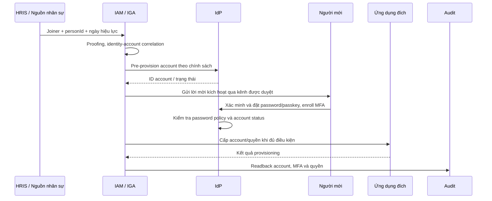
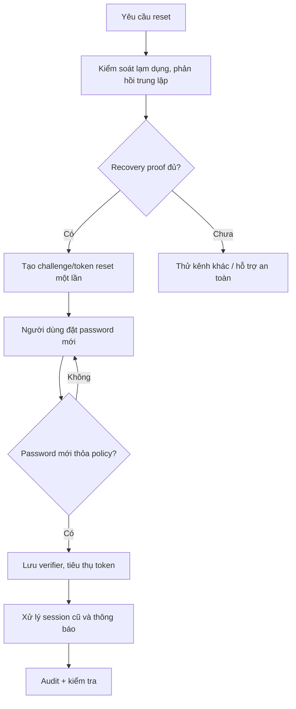

# Password policy trong quản lý vòng đời danh tính IAM

## Mục tiêu học tập

Sau bài học, người học có thể:

1. Giải thích **password policy (chính sách mật khẩu)** và phân biệt việc kiểm tra mật khẩu với identity proofing, authentication, authorization và account lifecycle.
2. Thiết kế những yêu cầu mật khẩu chú trọng **độ dài, chống mật khẩu phổ biến/đã lộ, khả năng sử dụng và giới hạn thử đăng nhập**, thay vì chỉ buộc người dùng thêm ký tự đặc biệt.
3. Mô tả cách verifier xử lý, lưu trữ và kiểm tra mật khẩu một cách an toàn; biết vì sao không được lưu plaintext hoặc dùng hash nhanh thông thường.
4. Áp dụng chính sách khi **Joiner**, **Mover**, **Leaver**, reset/recovery, rehire và trong các tình huống account bị nghi xâm nhập.
5. Xác định ranh giới giữa IdP, SSO, SCIM, MFA, passkey, password manager, RBAC/ABAC và các tài khoản ứng dụng riêng.
6. Phân biệt chính sách mật khẩu con người với cách quản lý **service account, workload identity, API key và secret máy–máy**.
7. Xây dựng kiểm soát vận hành, kiểm toán, đối soát và chỉ số để giảm khả năng lộ credential hoặc quyền truy cập tồn dư.

## 1. Password policy là gì?

Trong **Identity and Access Management (IAM)**, **password policy** là tập yêu cầu và kiểm soát quy định cách tạo, sử dụng, bảo vệ, thay đổi, đặt lại và ngừng sử dụng mật khẩu của những tài khoản trong một phạm vi xác định.

Chính sách thường có hai phần:

- **Quy tắc đối với người sử dụng:** cách chọn mật khẩu, trường hợp phải đổi, cách quản lý và khôi phục khi không còn đăng nhập được.
- **Quy tắc đối với hệ thống xác thực:** cách xác minh, lưu trữ password verifier, phát hiện mật khẩu yếu/đã lộ, kiểm soát thử sai, xử lý session và ghi audit.

Một policy tốt không chỉ kiểm tra mật khẩu khi đăng ký. Nó phải giải thích hệ thống sẽ làm gì **khi mật khẩu bị nghi lộ, khi người dùng chuyển vai trò, khi nghỉ việc, khi quên mật khẩu và khi ứng dụng không đồng bộ với IdP**.

Ví dụ, nhân viên Hà sử dụng tài khoản IdP để đăng nhập ứng dụng nội bộ qua SSO. Password policy ở IdP kiểm soát mật khẩu khi Hà đăng nhập vào IdP. Sau khi đăng nhập, quyền Hà được xem báo cáo tài chính hay không vẫn do **authorization policy** của ứng dụng quyết định, không phải do mật khẩu dài đến mức nào.

### 1.1. Phân biệt những lớp kiểm soát

| Lớp | Câu hỏi | Ví dụ |
|---|---|---|
| **Identity proofing** | Người được đăng ký có đúng danh tính đã khai báo hay không? | Xác minh hồ sơ nhân sự khi Joiner |
| **Authentication** | Bên đăng nhập có kiểm soát phương thức xác thực hợp lệ hay không? | Mật khẩu, passkey, MFA |
| **Password policy** | Mật khẩu được tạo, kiểm tra, lưu trữ, thay đổi và thu hồi như thế nào? | Chặn mật khẩu đã bị lộ, rate limiting |
| **Authorization** | Tài khoản đã xác thực được làm gì? | RBAC/ABAC, entitlement, resource scope |
| **Lifecycle management** | Account nên được tạo, duy trì, thay đổi hay vô hiệu lúc nào? | Joiner–Mover–Leaver |
| **Session management** | Phiên sau xác thực còn hợp lệ, hết hạn hay bị thu hồi ra sao? | Session cookie, refresh token, sign-out |

Một người đăng nhập đúng mật khẩu **không chứng minh** identity proofing ban đầu đã đủ. Một tài khoản có password mạnh **không được tự nhận** quyền quản trị. Khi Leaver, khóa account và thu hồi phiên quan trọng hơn việc chỉ thay mật khẩu.

### 1.2. Account có thể không dùng password

Không phải account nào cũng cần mật khẩu:

- **Passkey** sử dụng cơ chế khóa công khai; người dùng có thể mở khóa credential bằng PIN/sinh trắc học cục bộ.
- **Federated SSO** cho phép ứng dụng dựa vào IdP, không lưu mật khẩu ứng dụng riêng.
- **Workload identity** có thể sử dụng chứng chỉ, managed identity hoặc OIDC federation để nhận token ngắn hạn.
- **Service account cũ** có thể vẫn dùng password hoặc client secret và cần chính sách riêng.

Do đó, trong thiết kế IAM, password policy cần chỉ rõ **loại account và phương thức xác thực nào nằm trong phạm vi**, thay vì áp dụng mọi quy tắc của mật khẩu người dùng cho passkey hay API token.

## 2. Các mối đe dọa mà password policy cần giảm thiểu

| Mối đe dọa | Kịch bản | Biện pháp chính |
|---|---|---|
| **Password guessing** | Đoán nhiều mật khẩu cho một account | Mật khẩu khó đoán, giới hạn thử, phát hiện bất thường |
| **Password spraying** | Thử một số mật khẩu phổ biến trên rất nhiều account | Blocklist mật khẩu phổ biến, giám sát theo IP/device/campaign và rate limiting có kiểm soát |
| **Credential stuffing** | Dùng email/mật khẩu bị lộ ở dịch vụ khác để đăng nhập | Khuyến khích mật khẩu duy nhất, blocklist bị lộ, MFA/passkey, risk monitoring |
| **Phishing** | Trang giả lấy password hoặc mã OTP | MFA chống phishing khi phù hợp, passkey, đào tạo, bảo vệ session |
| **Offline cracking** | Kẻ tấn công lấy cơ sở dữ liệu password hash | Hash chuyên dụng có salt, tham số đủ mạnh, bảo vệ cơ sở dữ liệu |
| **Shoulder surfing / exposure** | Người khác thấy password khi nhập hoặc tìm thấy trong tài liệu | Password manager, UI an toàn, không log, chính sách lưu secret |
| **Account recovery abuse** | Kẻ tấn công chiếm kênh reset mật khẩu | Recovery có xác minh, token một lần, rate limiting, cảnh báo |
| **Session/token theft** | Cookie hoặc refresh token bị sao chép sau khi login | Session security, TTL, revoke, bảo vệ thiết bị và ứng dụng |
| **Legacy/shared account** | Nhiều người biết cùng một mật khẩu | Account riêng, PAM, secret rotation, giảm/chấm dứt account dùng chung |
| **Policy bypass** | Một ứng dụng có local login yếu hơn IdP | Inventory các đường xác thực, đối soát và loại bỏ bypass |

Chính sách không thể loại bỏ mọi rủi ro. Mật khẩu rất dài vẫn có thể bị phishing; hash tốt không giúp nếu người dùng nhập password vào trang giả. Vì vậy cần **defense in depth**: password policy, MFA/passkey, giám sát, quản lý phiên, authorization và lifecycle.

## 3. Nguyên tắc thiết kế chính sách mật khẩu hiện đại

### 3.1. Ưu tiên độ dài và khả năng chọn mật khẩu khó đoán

Một mật khẩu ngắn có ký tự đặc biệt theo mẫu đoán được không nhất thiết an toàn hơn một cụm từ dài và không phổ biến. Chính sách nên:

1. Đặt **độ dài tối thiểu** phù hợp chuẩn bảo đảm mà tổ chức áp dụng và kịch bản có/không có MFA.
2. Cho phép **mật khẩu dài**, hỗ trợ passphrase và password manager.
3. Không giới hạn mật khẩu ở độ dài quá ngắn hoặc âm thầm cắt bớt ký tự.
4. Chấp nhận dấu cách và các ký tự được hỗ trợ; định nghĩa rõ cách hệ thống xử lý Unicode.
5. Kiểm tra mật khẩu mới với danh sách mật khẩu quá phổ biến, dễ đoán hoặc đã bị lộ.
6. Không dùng các phép kiểm tra thành phần cứng nhắc như bắt buộc đồng thời chữ hoa, chữ thường, số, ký tự đặc biệt nếu các ràng buộc đó chỉ khuyến khích mẫu dễ đoán.

Ví dụ mật khẩu kiểu `Welcome2026!` có thể đáp ứng đủ bốn loại ký tự nhưng dễ dự đoán. Một chuỗi dài được sinh ngẫu nhiên bằng password manager hoặc một passphrase dài, không phổ biến, độc nhất thường phù hợp hơn.

**Không có một ngưỡng độ dài cố định đúng cho mọi dịch vụ.** Chính sách cần được hiệu chỉnh theo hướng dẫn/tiêu chuẩn hiện hành được tổ chức lựa chọn, mức độ rủi ro, khả năng triển khai MFA và năng lực hệ thống. Số liệu ở phần cấu hình mẫu phía dưới chỉ là ví dụ, không phải quy định mặc định cho mọi tổ chức.

### 3.2. Không ép đổi mật khẩu theo chu kỳ một cách máy móc

Yêu cầu “cứ 30/60/90 ngày phải đổi” có thể dẫn đến hành vi đặt mật khẩu dễ đoán, thay một ký tự hoặc viết password ra nơi không an toàn. Đối với mật khẩu người dùng thông thường, các thực hành hiện đại thường **không khuyến khích ép đổi định kỳ nếu không có dấu hiệu bị lộ**, thay vào đó chú trọng bảo vệ login và thay đổi khi có căn cứ.

Các tình huống hợp lý để buộc thay hoặc vô hiệu credential:

- Có bằng chứng password bị lộ hoặc xuất hiện trong danh sách credential bị xâm phạm.
- Account có dấu hiệu takeover, phishing hoặc đăng nhập rủi ro cao.
- Reset theo quy trình recovery.
- Credential tạm thời cho Joiner đã tới giai đoạn người dùng cần đặt password riêng.
- Mật khẩu dùng chung/service credential có người biết rời phạm vi quản lý, theo quy trình secret rotation.
- Có yêu cầu riêng từ tiêu chuẩn/quy định bắt buộc áp dụng cho hệ thống cụ thể.

**Không áp quy tắc của người dùng tương tác cho mọi service secret.** Với secret máy–máy, rotation có thể cần thường xuyên hoặc tự động vì rủi ro phân phối và sử dụng khác.

### 3.3. Không áp dụng quy tắc mật khẩu làm suy giảm khả năng dùng an toàn

Một password policy nên cho phép:

- Dán mật khẩu từ password manager và chức năng tự điền.
- Sử dụng chuỗi dài được sinh ngẫu nhiên.
- Hiển thị lựa chọn “show/hide password” có kiểm soát để giảm lỗi nhập.
- Nhận thông báo rõ về độ dài, mật khẩu bị chặn hoặc chính sách chưa thỏa, mà không tiết lộ dữ liệu nhạy cảm.
- Dùng ngôn ngữ và ký tự người dùng có thể nhập, với chính sách xử lý Unicode nhất quán.

Không nên cấm paste hoặc giới hạn người dùng chỉ ở vài ký tự ASCII mà không có lý do tương thích thực tế. Các cấm đoán như vậy có thể khiến người dùng chọn password đơn giản, dễ nhớ hơn nhưng dễ bị đoán.

### 3.4. Chặn mật khẩu phổ biến hoặc đã lộ

Khi đặt hoặc đổi password, verifier có thể kiểm tra password ứng viên với:

- Danh sách password phổ biến và dễ đoán.
- Danh sách password được biết là đã bị lộ.
- Password có chứa mẫu rõ ràng về tên người dùng, tên tổ chức hay dịch vụ nếu chính sách cho rằng nó dễ dự đoán.
- Tập password không phù hợp với yêu cầu bảo đảm của tổ chức.

Quy trình phải **bảo vệ giá trị ứng viên**. Không gửi plaintext password đến một dịch vụ kiểm tra không được tin cậy. Nếu dùng nguồn dữ liệu bên ngoài, cần đánh giá cơ chế bảo vệ quyền riêng tư, cách tra cứu, truyền tải và log. Không đưa password ứng viên vào telemetry hoặc ticket hỗ trợ.

Một kết quả “không có trong blocklist” **không chứng minh password đủ mạnh trong mọi trường hợp**; đó chỉ là một kiểm soát bổ sung.

## 4. Giới hạn thử đăng nhập và giảm credential attacks

### 4.1. Rate limiting là yêu cầu ở phía verifier

Hệ thống xác thực nên ngăn kẻ tấn công thử password không giới hạn. Biện pháp có thể kết hợp:

- Giới hạn số lần thất bại trong cửa sổ thời gian hoặc theo chiến lược thích hợp.
- Độ trễ tăng dần, thử thách bổ sung hoặc điều kiện chặn tạm thời khi có tín hiệu rủi ro.
- Phát hiện password spraying trải rộng nhiều user, IP, ASN, thiết bị hoặc ứng dụng.
- Phát hiện đăng nhập bất thường từ vị trí/ngữ cảnh lạ.
- Rate limit riêng các endpoint đăng nhập, reset, xác minh mã và recovery.
- Có cơ chế khôi phục an toàn cho người dùng bị khóa nhầm.

**Chỉ khóa account vĩnh viễn sau vài lần sai không phải lúc nào cũng là thiết kế tốt**: kẻ tấn công có thể cố tình khóa hàng loạt nhân viên bằng password spraying. Nên kết hợp kiểm soát theo account, nguồn, thiết bị, hành vi và độ nhạy của dịch vụ.

### 4.2. Chống account enumeration

Nếu endpoint login hoặc reset trả về lỗi khác biệt quá rõ giữa “account không tồn tại” và “password sai”, kẻ tấn công có thể xác định danh sách tài khoản hợp lệ.

Thông báo công khai có thể dùng một mẫu nhất quán, chẳng hạn:

> “Thông tin đăng nhập chưa hợp lệ hoặc không thể hoàn tất yêu cầu. Vui lòng thử lại theo hướng dẫn.”

Đối với reset, có thể thông báo “Nếu tài khoản phù hợp tồn tại, hướng dẫn sẽ được gửi qua kênh đã đăng ký”. Hệ thống nội bộ vẫn ghi reason code chính xác để kiểm toán, nhưng không tiết lộ xác suất tồn tại của account qua phản hồi và thời gian xử lý dễ đoán.

### 4.3. MFA và chống phishing

MFA bổ sung yếu tố xác thực ngoài password; **MFA không biến một mật khẩu dễ đoán thành vô hại**. Một số hình thức MFA như mã OTP vẫn có thể bị phishing hoặc lạm dụng qua push fatigue.

Đối với tài khoản có rủi ro cao, tổ chức nên ưu tiên **phương thức chống phishing** khi khả thi, như passkey/WebAuthn/FIDO2 dựa trên khóa công khai. Cần bảo vệ enrollment và recovery của MFA chặt chẽ tương xứng với đăng nhập, vì kẻ tấn công có thể nhắm vào kênh khôi phục thay vì password chính.

## 5. Phía máy chủ phải bảo vệ password như thế nào?

Password policy không chỉ là yêu cầu hiển thị trên form. Nếu hệ thống lưu mật khẩu dưới dạng plaintext hoặc dùng hash quá nhanh, việc kiểm tra “mật khẩu đủ dài” không bảo vệ được người dùng sau khi cơ sở dữ liệu bị lộ.

### 5.1. Password hashing chuyên dụng và salt riêng

Password verifier nên lưu kết quả của **thuật toán hash mật khẩu có chi phí tính toán được thiết kế riêng** như Argon2id, scrypt, bcrypt hoặc PBKDF2 trong các phạm vi và cấu hình được tiêu chuẩn/nền tảng phê duyệt. Chọn thuật toán và tham số theo nhu cầu bảo mật, hiệu năng và khả năng vận hành; định kỳ đánh giá khi phần cứng và mối đe dọa thay đổi.

Nguyên tắc:

- **Không lưu plaintext password**, password gốc trong log, message queue hoặc bản sao lưu không cần thiết.
- Dùng **salt ngẫu nhiên riêng cho từng password** theo yêu cầu thuật toán.
- Lưu metadata về thuật toán/tham số và phiên bản để có thể nâng cấp.
- Dùng thư viện bảo mật đã được kiểm chứng thay vì tự viết cơ chế hash.
- Không dùng trực tiếp hash nhanh như SHA-256/MD5 như một hệ thống lưu password hoàn chỉnh.
- Không nhầm password hashing với encryption hai chiều; ứng dụng thường không cần giải mã password gốc.
- Nếu sử dụng **pepper** bổ sung, bảo vệ giá trị này tách biệt bằng hệ thống quản lý secret/khóa và thiết kế recovery/rotation thích hợp.

Ví dụ một biểu diễn **minh họa**:

```json
{
  "accountId": "USR-4821",
  "passwordVerifier": {
    "algorithm": "argon2id",
    "parametersVersion": "password-kdf-v3",
    "encodedHash": "<PHC-encoded-hash>",
    "createdAt": "2026-11-23T01:00:00Z"
  }
}
```

Dữ liệu trên không phải password hash thật. Trong hệ thống thực, một PHC string phù hợp có thể chứa tham số, salt và kết quả hash. Không được đưa giá trị hash thực vào tài liệu công khai hay log ứng dụng; hash vẫn là dữ liệu nhạy cảm vì có thể bị tấn công đoán offline.

### 5.2. Một số sai lầm trong thiết kế verifier

| Sai lầm | Vì sao rủi ro | Cách tiếp cận phù hợp |
|---|---|---|
| Lưu plaintext hoặc mã hóa để có thể “gửi lại password cũ” | Rò rỉ password thật khi hệ thống bị xâm nhập | Salted password hash, reset thay vì gửi lại |
| Chỉ hash bằng SHA-256 không có KDF | Quá nhanh cho tấn công đoán offline | Password hashing KDF được cấu hình an toàn |
| Salt chung cho mọi user | Làm giảm tác dụng phân tách password verifier | Salt riêng theo thuật toán |
| Cắt âm thầm password ở độ dài cố định | Người dùng tưởng password dài đã được bảo vệ đầy đủ | Giới hạn tối đa phù hợp, xử lý từ chối minh bạch |
| So sánh hoặc ghi log thông tin nhạy cảm | Tăng nguy cơ rò rỉ qua log/error | Hạn chế log, dùng thư viện/kiểu so sánh phù hợp |
| Tự viết “thuật toán mã hóa mật khẩu” | Dễ mắc lỗi thiết kế và triển khai | Dùng công cụ/ thư viện có kiểm chứng |
| Tham số hash không được cập nhật | Chi phí đoán offline giảm theo thời gian | Benchmark, nâng cấp tham số có kế hoạch |
| Password đi qua HTTP không mã hóa | Có thể bị nghe lén trên đường truyền | TLS hợp lệ, cấu hình transport và session an toàn |

### 5.3. Unicode và giới hạn độ dài

Độ dài có thể được tính theo **ký tự, code point hoặc byte**, tùy framework và chính sách. Password có dấu tiếng Việt, emoji hoặc ký tự Unicode ghép có thể có nhiều biểu diễn; nếu frontend và backend xử lý khác nhau có thể gây lỗi đăng nhập khó giải thích.

Cần xác định nhất quán chính sách nhận ký tự, cách chuẩn hóa (nếu có), giới hạn độ dài ở đầu vào và cách chuyển vào KDF. Không tự ý chuẩn hóa một cách làm các password khác nhau trở thành giống nhau nếu điều đó chưa được đánh giá. Với bcrypt cần đặc biệt lưu ý giới hạn độ dài đầu vào theo byte ở nhiều implementation, tránh cắt âm thầm.

**Người sử dụng không cần hiểu thuật toán lưu password**, nhưng phải được bảo đảm rằng password họ đặt được xử lý trọn vẹn theo chính sách đã công bố.

## 6. Password policy khi Joiner

Trong giai đoạn **Joiner**, tổ chức nhận thông tin người mới từ HRIS/hệ thống quản lý nhà thầu, xác minh identity, tạo hoặc liên kết account, rồi cho người đó thiết lập phương thức đăng nhập phù hợp.

### 6.1. Không gửi mật khẩu mặc định cố định qua email

Các cách làm rủi ro:

- Cấp cho mọi người mới mật khẩu giống nhau như `Welcome@123`.
- Gửi plaintext mật khẩu qua email hoặc chat không có kiểm soát.
- Đặt password dựa trên ngày sinh, mã nhân viên, tên người dùng.
- Cho account đăng nhập production trước khi hoàn tất identity proofing và các điều kiện kích hoạt.

Một cách tiếp cận tốt hơn là gửi **lời mời thiết lập credential hoặc liên kết activation một lần, ngắn hạn**, qua kênh có xác minh quyền sở hữu, với thời hạn và điều kiện kiểm tra phù hợp. Người dùng tạo password/passkey riêng, đăng ký MFA theo policy và nhận quyền cơ sở sau khi các điều kiện Joiner đã đủ.

### 6.2. Luồng Joiner minh họa



Không phải mọi tổ chức đều sử dụng password: có thể khởi tạo bằng passkey. Và không phải mọi bước được kích hoạt ngay sau HR event; nhiều doanh nghiệp **pre-provision nhưng chưa mở login** cho tới ngày bắt đầu làm việc.

### 6.3. Password tạm thời nếu hệ thống cũ bắt buộc

Một số hệ thống legacy không hỗ trợ activation link hay passwordless. Nếu buộc phải cấp password tạm thời:

1. Sinh password đủ ngẫu nhiên bằng cơ chế an toàn, không theo mẫu đoán được.
2. Truyền qua kênh được kiểm soát có xác minh người nhận, hạn chế lưu trữ.
3. Giới hạn hiệu lực và quyền, ép thay theo chính sách khi đăng nhập đầu.
4. Không dùng lại password tạm thời cho nhiều tài khoản.
5. Giám sát việc kích hoạt; nếu quá hạn, vô hiệu credential tạm và xử lý hỗ trợ.
6. Không mở rộng quyền nhạy cảm trước khi proofing, MFA/step-up và approval đã đạt.

“Mật khẩu mặc định” không nên trở thành một mật khẩu chung lâu dài của nhóm người dùng.

## 7. Password policy khi Mover, Leaver và tái tuyển dụng

### 7.1. Mover: thay quyền không đồng nghĩa buộc đổi password

Khi nhân viên chuyển từ Sales sang Finance, IAM thường cần tính lại **role, group và entitlement** theo RBAC/ABAC. Chuyển Department thông thường **không tự tạo yêu cầu đổi password** nếu không có sự kiện rủi ro hoặc thay đổi phạm vi credential đặc biệt.

Cần đánh giá:

- Quyền và nhóm cũ có còn phù hợp không?
- Có account quản trị riêng hoặc ứng dụng mới yêu cầu MFA mạnh/step-up không?
- Người dùng có biết mật khẩu dùng chung của đội cũ không?
- Có secret, SSH key, API token hoặc password máy–máy cần xoay khi chuyển trách nhiệm không?
- Các session đang hoạt động có đang giữ quyền cũ sau khi Mover không?

Ví dụ Mover khỏi đội quản trị production có thể yêu cầu **rotate secret dùng chung và thu hồi PAM access**, chứ không chỉ buộc đổi mật khẩu account IdP thông thường.

### 7.2. Leaver: disable/revoke quan trọng hơn chỉ đổi mật khẩu

Khi HRIS/nguồn có thẩm quyền xác nhận Leaver, IAM phải ngăn các đường truy cập đúng thời điểm. **Chỉ reset password không phải Leaver hoàn chỉnh** vì tài khoản vẫn có thể được xác thực qua session, token, chứng chỉ, app password hoặc phương thức không cần password.

Các công việc có thể bao gồm:

- Vô hiệu account IdP và các account local/ứng dụng cần thiết.
- Thu hồi quyền nhóm, role, entitlement hoặc PAM access.
- Revoke session, refresh token và các credential khi hệ thống hỗ trợ.
- Thu hồi personal access token, API key, SSH key, chứng chỉ hoặc password dùng chung mà người nghỉ biết.
- Xác minh các ứng dụng sử dụng SSO lẫn các đường đăng nhập local.
- Đối soát trạng thái thực tế và xử lý ngoại lệ theo SLA.
- Bảo toàn dữ liệu, ownership và audit theo chính sách; không tái kích hoạt account cũ chỉ để tiện bàn giao.

Một access token đã phát hành có thể còn sống tới hết hạn nếu ứng dụng tự kiểm tra chữ ký mà không tra cứu revocation. Phải hiểu giới hạn của từng API/IdP và áp dụng biện pháp phù hợp.

### 7.3. Rehire: không tái sử dụng credential cũ một cách vô điều kiện

Khi nhân viên quay lại, HR có thể sử dụng hồ sơ nhân sự cũ hoặc phát hợp đồng mới. IAM cần xác minh identity correlation, proofing và quyền hợp lệ; nếu account cũ được giữ disabled, việc re-enable **không nên tự giữ toàn bộ group và credential cũ**.

Một workflow tốt sẽ:

1. Xác nhận trạng thái Joiner/rehire mới nhất từ nguồn có thẩm quyền.
2. Đối chiếu account cũ, mục đích giữ dữ liệu và yêu cầu retention.
3. Làm mới credential/enrollment theo quy trình an toàn tương ứng.
4. Tính lại role và entitlement dựa trên nhiệm vụ mới.
5. Xác minh session/token cũ không được khôi phục.
6. Ghi audit về quyết định khôi phục hoặc tạo account mới.

## 8. Password reset và account recovery

Password reset là một trong những điểm dễ bị tấn công nhất của IAM vì nó có thể **thay thế bằng chứng mật khẩu mà kẻ tấn công chưa biết**. Vì vậy cần thiết kế chặt chẽ từ lúc bắt đầu yêu cầu đến khi kết thúc.

### 8.1. Các bước reset an toàn

1. Người dùng bắt đầu reset qua kênh chính thức.
2. Hệ thống trả lời trung lập để tránh tiết lộ account nào tồn tại.
3. Áp dụng rate limiting và chống lạm dụng endpoint.
4. Xác minh người yêu cầu qua recovery method đã đăng ký và đủ độ tin cậy theo rủi ro.
5. Phát một token/challenge reset **ngắn hạn, ngẫu nhiên, một lần**, được ràng buộc với account và mục đích.
6. Người dùng đặt password mới; hệ thống áp dụng các kiểm tra password policy.
7. Vô hiệu reset token sau khi sử dụng; cân nhắc revoke các phiên/token cũ theo chính sách và mức độ rủi ro.
8. Thông báo sự kiện đổi password tới kênh liên hệ phù hợp và ghi audit.
9. Nếu nghi account takeover, escalates theo security workflow thay vì chỉ báo reset thành công.

Trong triển khai thật, reset token phải được bảo vệ ở lưu trữ và truyền tải; URL chứa token có thể lọt vào referrer hoặc log nếu xử lý kém. Tránh đưa token thật vào analytics và tránh thiết kế link cho phép nhiều lượt sử dụng.

### 8.2. Mô hình trạng thái recovery



Mô hình minh họa, không phải giao thức reset bắt buộc cho IdP cụ thể.

### 8.3. Các phương án recovery không nên dựa vào

- Dùng câu hỏi bí mật dễ đoán hoặc thông tin công khai như ngày sinh, tên trường học, tên người thân.
- Chỉ dựa vào một email chưa xác minh hoặc kênh liên lạc có thể đã bị chiếm.
- Nhân viên hỗ trợ đọc hoặc gửi lại password gốc.
- Cho phép quản trị viên đặt password mới mà không có ticket, thẩm quyền và audit.
- Cho phép đổi recovery method và reset password trong cùng phiên bị nghi compromise mà không step-up.
- Mặc định tắt MFA sau reset chỉ để người dùng đăng nhập dễ hơn.

Nếu mất cả password và MFA, tổ chức cần **account recovery với proofing/ủy quyền tương xứng**, có thể qua help desk được đào tạo, xác nhận nguồn HR hoặc quy trình kiểm tra tăng cường. Không tự biến “quên password” thành trường hợp có quyền vượt mọi kiểm soát.

### 8.4. Recovery phải tránh việc kích hoạt lại Leaver

Một account đã `DISABLED` do Leaver không được tự re-enable chỉ vì người dùng vẫn kiểm soát email recovery hoặc reset token cũ. Workflow phải kiểm tra **lifecycle state mới nhất** trước khi phát challenge và trước khi thực thi đổi password hay kích hoạt account.

Đây là nơi account recovery liên kết trực tiếp với kiểm soát JML và deprovisioning.

## 9. IdP, SSO và SCIM liên quan thế nào?

### 9.1. IdP là điểm đặt chính sách password cho đăng nhập liên thông

Khi ứng dụng dùng SSO, người dùng thường nhập password (nếu dùng) tại **IdP**, không phải từng ứng dụng. Nhờ đó:

- Chính sách độ dài, blocklist, rate limit và MFA có thể nhất quán hơn.
- Ứng dụng không cần tự lưu password người dùng.
- Quá trình thu hồi account có thể tập trung hơn.
- Có thể thay thế password bằng passkey/strong authentication mà không sửa mọi ứng dụng cùng lúc.

Nhưng IdP không tự giải quyết mọi đường truy cập. Các ứng dụng có thể có **local password**, emergency login, API key, app password hoặc phiên độc lập. Cần inventory các đường này để không tạo khoảng trống chính sách.

### 9.2. SSO không đồng nghĩa là cấp quyền

SAML/OIDC giúp ứng dụng tin việc xác thực từ IdP. Một tài khoản đăng nhập được vẫn cần **RBAC/ABAC** và account lifecycle đúng. Nếu ứng dụng duy trì group/role local, việc đổi password tại IdP **không thay thế provisioning/deprovisioning quyền**.

### 9.3. SCIM hỗ trợ quản lý account nhưng không thay thế password policy

**SCIM 2.0** thường dùng để tạo, cập nhật và vô hiệu resource `User` hoặc quản trị `Group`. SCIM User schema có thuộc tính liên quan password, nhưng **việc nhà cung cấp hỗ trợ thao tác đặt password, semantics, điều kiện bảo mật và đồng bộ không mặc nhiên giống nhau**.

Những lưu ý:

- SCIM không phải giao thức đăng nhập hoặc xác thực password tại ứng dụng.
- Một ứng dụng SSO-only có thể không cần mật khẩu local, dù User được provisioning qua SCIM.
- Không được tự gửi password plaintext qua SCIM chỉ vì một thuộc tính tồn tại trong schema.
- Không kỳ vọng password của IdP tự đồng bộ vào tất cả app qua SCIM.
- Với ứng dụng có local password bắt buộc, cần chính sách riêng hoặc kế hoạch loại bỏ local login nếu khả thi.
- `active=false` trong SCIM thể hiện User không còn active theo cách đích định nghĩa; vẫn cần kiểm tra session/token/app-local access.
- SCIM Group membership và User active state phải được đối soát riêng với password/credential state.

### 9.4. MFA/passkey và passwordless

MFA và passwordless có thể giảm mức phụ thuộc vào password, nhất là đối với người dùng có nguy cơ bị phishing. Tuy nhiên:

- Passkey dựa trên public-key cryptography, **khác với password được lưu hash**.
- PIN mở khóa thiết bị không tự trở thành password ứng dụng.
- Quản lý passkey cần kiểm soát enrollment, recovery, thiết bị mất và thu hồi credential khi Leaver.
- Tài khoản đặc quyền và ứng dụng cũ có thể cần chính sách chuyển tiếp.

Vì vậy chính sách IAM hiện đại thường quản lý rộng hơn **authentication methods**, trong đó password là một phương thức chứ không phải toàn bộ hệ thống xác thực.

## 10. RBAC/ABAC và điều kiện sử dụng password

Một password hợp lệ chứng minh người đăng nhập đã vượt qua **một bước authentication**, không quyết định họ được phép xem hoặc sửa dữ liệu nào.

Ví dụ policy minh họa:

```text
ALLOW(subject, action, resource) WHEN
    subject.identityLifecycle == ACTIVE
    AND subject.accountStatus == ENABLED
    AND subject.authentication.isValid
    AND subject.authentication.meetsRequiredAssurance
    AND subject.hasRoleFor(action, resource)
    AND request.context.withinPolicy
```

Đây là pseudocode, không phải cấu hình cụ thể của một IAM provider. RBAC quyết định dựa trên vai trò/nhóm; ABAC xét thuộc tính subject, resource, hành động và bối cảnh. Một quyền đặc biệt nhạy cảm có thể yêu cầu **step-up authentication** dù user đã đăng nhập bằng password đúng.

Ví dụ nhân viên phòng Tài chính không tự có quyền duyệt lệnh chuyển tiền chỉ vì chọn mật khẩu dài và dùng MFA. Việc duyệt còn cần role, approval, SoD và phạm vi dữ liệu phù hợp.

### 10.1. Authentication assurance là yếu tố đầu vào, không phải entitlement

Một token có thể mang thông tin về phương thức/độ mạnh xác thực. Ứng dụng chỉ nên sử dụng claim đã được issuer tin cậy ký và kiểm chứng, không chấp nhận header như `X-MFA: true` do client tự khai.

Khi user Mover sang vai trò rủi ro cao, IAM có thể yêu cầu passkey/MFA mạnh hoặc step-up cho quyền mới, **đồng thời** phải thu hồi quyền cũ không còn phù hợp.

## 11. Tài khoản đặc quyền và tài khoản dịch vụ

### 11.1. Privileged accounts

Account có quyền quản trị hạ tầng, cloud, database hoặc chính sách IAM có rủi ro cao hơn. Ngoài password policy cơ sở, nên xem xét:

- Phương thức MFA chống phishing nếu nền tảng hỗ trợ.
- Tách account thường và account đặc quyền khi chính sách yêu cầu.
- PAM hoặc cơ chế **Just-in-Time (JIT)** cấp quyền có thời hạn.
- Kiểm soát phiên quản trị, audit thao tác và phát hiện bất thường.
- Không chia sẻ password admin giữa nhiều người.
- Lưu tài khoản break-glass theo quy trình được bảo vệ và kiểm thử riêng.
- Xoay hoặc thu hồi credential khi thay owner, phát hiện lộ hoặc người có quyền quản trị rời tổ chức.

Chỉ yêu cầu password “phức tạp hơn” mà bỏ MFA, quản lý phiên và PAM sẽ không đủ cho các tài khoản này.

### 11.2. Service account và workload identity

**Service account/workload identity** là non-human identity. Một job CI/CD, microservice hoặc batch worker thường không thể tự thay password qua giao diện định kỳ như người dùng.

Ưu tiên khi khả thi:

1. **Managed identity**, federation, mTLS hoặc credential ngắn hạn gắn với runtime.
2. Khi hệ thống legacy buộc phải dùng password/client secret, lưu trong **secret manager/vault**, không hard-code trong Git, container image hoặc script.
3. Phân quyền secret theo workload, môi trường và owner.
4. Tự động luân chuyển/thu hồi theo chính sách đã đánh giá tác động hệ thống.
5. Giám sát secret sử dụng bất thường và credential không còn owner.
6. Không dùng account nhân viên để chạy tác vụ nền lâu dài.

Mật khẩu của service account nên được quản trị như **machine secret** với lifecycle, rotation và audit riêng. Không áp dụng một cách máy móc yêu cầu “người dùng đổi password khi đăng nhập đầu tiên” cho một workload không có người đăng nhập tương tác.

### 11.3. Shared account và người biết credential đã rời tổ chức

Nếu một hệ thống cũ chưa bỏ được account dùng chung, khi có Leaver hoặc Mover rời đội:

- Xác định ai còn biết secret và hệ thống nào đang dùng.
- Rotate credential theo cửa sổ an toàn, có kế hoạch tránh gián đoạn.
- Ngăn quyền truy cập khác của người rời khỏi nhóm.
- Ghi owner, inventory, nhật ký dùng và ngoại lệ được phê duyệt.
- Xây dựng lộ trình thay bằng account riêng hoặc workload identity để quy trách nhiệm.

Đổi password chung mà không xử lý token/sessions và nơi đã sao chép credential có thể vẫn để lại quyền tồn dư.

## 12. Ví dụ một password policy có thể kiểm tra

Ví dụ YAML sau là **mô hình policy minh họa**, không phải cú pháp cấu hình của một IdP hay tập yêu cầu bắt buộc của tiêu chuẩn nào. Tổ chức phải xác định ngưỡng và thuật toán theo tiêu chuẩn, rủi ro và sản phẩm đang dùng.

```yaml
policyId: corporate-human-password-v4
appliesTo:
  - human-interactive-accounts

passwordCreation:
  minimumLength: 15
  maximumLength: 128
  allowSpaces: true
  allowPasteAndAutofill: true
  rejectCommonOrCompromisedPasswords: true
  rejectPredictableContextualPatterns: true
  mandatoryCharacterClasses: false
  silentTruncationAllowed: false

passwordChange:
  periodicChangeWithoutRiskTrigger: false
  forceChangeOnConfirmedCompromise: true
  useOneTimeRecoveryChallenge: true
  preventUnverifiedRecovery: true

verification:
  useAdaptiveSaltedPasswordHash: true
  kdfConfigurationManagedSeparately: true
  rateLimitRepeatedFailures: true
  detectPasswordSpraying: true
  keepCredentialValuesOutOfLogs: true

additionalAuthentication:
  phishingResistantMfaForPrivilegedAccounts: true
  requireStepUpForHighRiskActions: true

lifecycle:
  prohibitActivationBeforeEligibility: true
  disableOnAuthorizedLeaverEvent: true
  revokeSupportedSessionsAndTokens: true
  verifyTargetStateAfterDisable: true

governance:
  ownerTeam: identity-security
  policyReview: periodic-and-on-change
  exceptionsRequireApprovalAndExpiry: true
```

**Đây chỉ là ví dụ để học cấu trúc quyết định**: một ứng dụng có thể không hỗ trợ Unicode, độ dài tối đa, blocklist hoặc session revoke giống ví dụ. Các giới hạn phải được xác minh trước triển khai để tránh cắt âm thầm password.

### 12.1. Ví dụ logic khi người dùng đặt password mới

```text
function evaluateNewPassword(account, candidate, context):
    if account.lifecycleState in [LEAVER, TERMINATED]:
        return REJECT("ACCOUNT_NOT_ELIGIBLE")

    if not context.isAuthorizedForPasswordChange:
        return REJECT("UNVERIFIED_CHANGE_REQUEST")

    if passwordLength(candidate) < policy.minimumLength:
        return REJECT("TOO_SHORT")

    if passwordLength(candidate) > policy.maximumLength:
        return REJECT("TOO_LONG")

    if passwordAppearsInDisallowedBlocklist(candidate):
        return REJECT("COMMON_OR_COMPROMISED")

    if passwordContainsDisallowedPredictableContext(candidate, account):
        return REJECT("PREDICTABLE_PATTERN")

    return ACCEPT_FOR_SECURE_HASHING_AND_AUDIT
```

Đây là **pseudocode**: hệ thống thật cần quy ước nhất quán cách đếm độ dài/Unicode, kiểm soát kênh reset, xử lý kết quả blocklist an toàn và lưu password bằng KDF. Việc “ACCEPT” chưa có nghĩa password sẽ được ghi vào log hoặc được gửi đến ứng dụng đích ở dạng plaintext.

### 12.2. Tránh quy tắc policy mâu thuẫn

Ví dụ một hệ thống đặt `maximumLength=20` nhưng quy định người dùng phải dùng password manager sinh 32 ký tự; hoặc cho phép passphrase có dấu cách ở giao diện nhưng backend tự trim và ghi hash phiên bản khác. Những mâu thuẫn này gây lỗi đăng nhập và đôi khi thúc đẩy người dùng chọn password yếu.

Cần kiểm thử toàn bộ hành trình **đăng ký → đăng nhập → đổi password → reset → MFA/SSO → Leaver**, đặc biệt khi có các ứng dụng legacy.

## 13. Triển khai policy đồng nhất trong môi trường đa ứng dụng

### 13.1. Inventory đường đăng nhập trước khi chuyển chính sách

Đầu tiên phải biết:

- Ứng dụng nào đã dùng IdP/SSO?
- Ứng dụng nào còn local password, account đặc quyền hoặc break-glass?
- Có ứng dụng nào phát API key, app password hoặc PAT độc lập?
- Password reset do IdP hay do ứng dụng thực hiện?
- Mật khẩu được lưu và xác minh bởi hệ thống nào?
- MFA/passkey được hỗ trợ ở những luồng nào?
- Khi Leaver, quyền và credential thực tế được thu hồi như thế nào?

Một chính sách mạnh trong IdP có thể chưa bảo vệ hệ thống cũ còn local login yếu và tài khoản mặc định.

### 13.2. Thay đổi chính sách cần kiểm soát tác động

Khi nâng yêu cầu độ dài hoặc thêm blocklist:

1. Kiểm kê những hệ thống không tương thích hoặc có giới hạn đầu vào.
2. Thử với tài khoản test, passphrase dài, Unicode, paste và password manager.
3. Rà soát recovery flow, account lockout và nguy cơ help-desk overload.
4. Triển khai theo nhóm có thể quan sát, đo tỷ lệ lỗi/khóa nhầm.
5. Có kế hoạch khắc phục cho người dùng không thể sử dụng phương thức mới.
6. Không công bố mẫu password bị chặn theo cách giúp kẻ tấn công đoán.
7. Ghi version policy, owner, lý do thay đổi và thời điểm áp dụng.
8. Đối soát các account/ứng dụng chưa tuân thủ sau triển khai.

Đặc biệt, không nên ép mọi người đổi password cùng ngày chỉ vì hệ thống thay version policy nếu chưa có đánh giá rủi ro và yêu cầu áp dụng rõ. Một phương án có thể áp dụng rule mới cho **password được tạo/đổi từ thời điểm hiệu lực**, đồng thời xử lý có ưu tiên các tài khoản có tín hiệu rủi ro.

### 13.3. Quản trị ngoại lệ có thời hạn

Một hệ thống cũ có thể chỉ hỗ trợ password ngắn hoặc chưa tích hợp SSO. Ngoại lệ phải có:

- Tên hệ thống và account/phạm vi cụ thể.
- Lý do kỹ thuật, owner và người phê duyệt.
- Biện pháp giảm rủi ro: network isolation, PAM, MFA ở gateway, secret vault, giám sát.
- Ngày hết hạn và kế hoạch nâng cấp/loại bỏ.
- Quy trình thu hồi khi Leaver hoặc sự cố.

Ngoại lệ vô thời hạn làm suy yếu toàn bộ hệ thống IAM, đặc biệt nếu account legacy có thể đăng nhập trực tiếp vào tài nguyên nhạy cảm.

## 14. Audit, đối soát và chỉ số password policy

### 14.1. Sự kiện kiểm toán nên ghi điều gì?

Ví dụ event **minh họa** khi đổi mật khẩu:

```json
{
  "eventType": "PASSWORD_CHANGED",
  "identityId": "IDN-1042",
  "accountId": "USR-4821",
  "targetSystem": "CORPORATE_IDP",
  "changeMethod": "SELF_SERVICE_RECOVERY",
  "policyVersion": "corporate-human-password-v4",
  "decision": "ACCEPTED",
  "sessionHandling": "REVOCATION_REQUESTED",
  "correlationId": "IAM-RESET-6702",
  "occurredAt": "2026-11-23T02:00:00Z"
}
```

Không bao giờ ghi giá trị mật khẩu cũ/mới, recovery token, session cookie hoặc secret vào audit. Đối với thông tin điều tra nhạy cảm như địa chỉ nguồn, dữ liệu thiết bị hay tín hiệu rủi ro, chỉ thu thập và lưu giữ khi có mục đích được phê duyệt và quyền truy cập phù hợp.

### 14.2. Những chỉ số cần theo dõi

| Chỉ số | Ý nghĩa |
|---|---|
| **Password reset rate** | Tần suất reset và dấu hiệu người dùng gặp khó khăn |
| **Compromised password rejection rate** | Tỷ lệ password ứng viên bị blocklist chặn |
| **Credential stuffing/spraying detections** | Khả năng phát hiện thử credential trên diện rộng |
| **Failed-login anomaly rate** | Sự kiện sai password bất thường cần phân tích |
| **Account lockout false-positive rate** | Tỷ lệ người hợp lệ bị khóa nhầm |
| **MFA/passkey adoption** | Mức áp dụng phương thức xác thực mạnh hơn password-only |
| **Legacy local-password coverage** | Hệ thống/account còn sử dụng password không kiểm soát tập trung |
| **Service secret ownership coverage** | Tỷ lệ machine secret có owner và lifecycle rõ |
| **Credential revocation latency** | Từ lúc có yêu cầu thu hồi đến khi trạng thái tại đích được xác minh |
| **Leaver residual credential count** | Token, key, session hoặc login còn hợp lệ ngoài policy |
| **Recovery escalation rate** | Tỷ lệ trường hợp reset phải chuyển xác minh/điều tra tăng cường |

Các chỉ số cần được đánh giá theo nhóm hệ thống, loại account, mức rủi ro và khả năng telemetry. Không nên biến việc tăng số lần password reset thành “thành công” nếu thực tế người dùng đang liên tục bị khóa nhầm.

### 14.3. Đối soát sau Leaver và sau sự cố

Một quy trình reconciliation có thể:

1. Lấy danh sách identity đã Leaver từ nguồn có thẩm quyền.
2. Liệt kê account và phương thức xác thực liên quan từ IdP/ứng dụng.
3. Kiểm tra trạng thái disabled/revoked và độ trễ cho phép.
4. Phát hiện token, API key, mật khẩu dùng chung hoặc phiên còn đường truy cập.
5. Tạo exception/ticket theo rủi ro, có owner và SLA.
6. Thực thi hoặc yêu cầu thu hồi, rotate secret và kiểm tra lại tại đích.
7. Chỉ đóng sau khi có bằng chứng phù hợp, không chỉ có lệnh `REQUESTED`.

## 15. Tình huống thực hành: chính sách password cũ gây rủi ro

**Bối cảnh:** Doanh nghiệp có chính sách “password ít nhất 8 ký tự, bắt buộc chữ hoa/chữ thường/số/ký tự đặc biệt, đổi mỗi 60 ngày”. IdP đã triển khai MFA nhưng ứng dụng CRM cũ vẫn có local login. Nhiều nhân viên chọn dạng `Summer2026!` rồi đổi số mỗi chu kỳ. Một số người ghi password vào bảng tính. Khi nhân viên Minh nghỉ việc, IT khóa account IdP nhưng CRM còn local password và một personal access token.

### 15.1. Câu hỏi phân tích

1. Vì sao một password thỏa đủ nhóm ký tự vẫn có thể rất dễ đoán?
2. Quy tắc buộc đổi định kỳ có thể tạo những hành vi bất lợi nào?
3. Vì sao chỉ bật MFA trên IdP chưa bảo vệ được local login của CRM?
4. Cần thay đổi password creation/verification policy theo hướng nào?
5. Khi Minh Leaver, những thao tác nào cần làm ngoài đổi hoặc khóa password IdP?
6. Có nên dùng cùng quy tắc đổi password bằng tay cho service account chạy cron không?

### 15.2. Gợi ý lời giải

**Bước 1 – Đánh giá mối đe dọa.** `Summer2026!` có hình thức phức tạp nhưng là mẫu dễ dự đoán. Tấn công credential stuffing, spraying và phishing không bị chặn chỉ nhờ có bốn loại ký tự.

**Bước 2 – Cải thiện tạo password.** Ưu tiên độ dài hợp lý, password manager, password độc nhất, blocklist phổ biến/đã lộ, hỗ trợ paste/passphrase và không ép đổi định kỳ thiếu lý do. Bổ sung rate limiting, giám sát và phương thức MFA chống phishing khi phù hợp.

**Bước 3 – Đóng đường vòng local login.** Kiểm kê ứng dụng CRM, tích hợp SSO nếu khả thi hoặc áp chính sách local credential và MFA/điều kiện truy cập tương đương. Kiểm soát password reset và account recovery riêng của CRM.

**Bước 4 – Hoàn tất Leaver.** Disable/revoke account tại CRM, thu hồi PAT, kiểm tra session, app-local role và các credential khác. Đối soát trạng thái thực tế ở đích, ghi exception cho hệ thống chưa hỗ trợ tự động.

**Bước 5 – Xử lý máy–máy.** Với cron/service account, ưu tiên managed identity hoặc secret manager và rotation có kiểm soát; không dùng password của nhân viên, không yêu cầu automation nhập password mới bằng tay như con người.

### 15.3. Bài tập đúng/sai

1. “Mật khẩu có đủ chữ hoa, chữ thường, số, ký tự đặc biệt chắc chắn khó đoán.”
2. “Password policy tốt nên chấp nhận dán từ password manager.”
3. “Password đã lộ nhưng vẫn dài thì không cần thay hoặc thu hồi.”
4. “Không nên lưu plaintext password trong cơ sở dữ liệu hoặc log.”
5. “Dùng SHA-256 trực tiếp là tương đương password hashing KDF có salt.”
6. “Không phải mọi password người dùng đều cần ép đổi theo chu kỳ nếu không có bằng chứng rủi ro.”
7. “IdP password đã bị đổi nghĩa là mọi app session và API key đều hết hạn tức thì.”
8. “SCIM User `active=false` có thể giúp quản lý account nhưng không thay thế hoàn toàn session/credential revocation.”
9. “Khi Leaver, chỉ đổi password mà giữ account active là đủ.”
10. “Passkey và password manager giải quyết những vấn đề khác nhau.”
11. “Service account legacy cần owner, vault, rotation và quyền tối thiểu riêng.”
12. “Password dài hơn luôn cho phép account tự vượt qua RBAC/ABAC.”
13. “Password reset cần rate limiting và chống account enumeration.”
14. “Khi rehire, có thể khôi phục tất cả credential và entitlement cũ mà không đánh giá lại.”
15. “Cần đối soát các ứng dụng có local login vì chúng có thể bypass chính sách IdP.”

**Đáp án:** 1 Sai; 2 Đúng; 3 Sai; 4 Đúng; 5 Sai; 6 Đúng; 7 Sai; 8 Đúng; 9 Sai; 10 Đúng; 11 Đúng; 12 Sai; 13 Đúng; 14 Sai; 15 Đúng.

## 16. Các nguyên tắc cần ghi nhớ

1. **Password policy quản lý credential, không thay thế identity proofing, authorization hoặc account lifecycle.**
2. **Ưu tiên độ dài, password độc nhất, blocklist bị lộ và trải nghiệm sử dụng an toàn**, không chỉ luật bắt buộc các loại ký tự.
3. **Không ép thay mật khẩu định kỳ thiếu căn cứ rủi ro**; cần thay hoặc revoke khi có dấu hiệu compromise, reset hoặc trường hợp bắt buộc.
4. **Rate limiting, giám sát spraying/stuffing, MFA/passkey và recovery an toàn** là những lớp bổ sung không thể thiếu.
5. **Verifier phải dùng password hashing chuyên dụng với salt và tham số phù hợp**, không lưu plaintext hoặc log credential.
6. **Joiner cần cấp credential qua kênh an toàn và sau điều kiện proofing/activation**; tránh password mặc định dùng chung.
7. **Mover điều chỉnh quyền RBAC/ABAC, không nhất thiết đổi password**, nhưng cần xử lý shared credential và privileged account khi thay trách nhiệm.
8. **Leaver phải disable account và thu hồi session/token/local login/secret**, không chỉ thay password ở IdP.
9. **IdP/SSO/SCIM có vai trò khác nhau** và không tự động chặn mọi đường truy cập của ứng dụng cũ.
10. **Service account và workload identity có secret lifecycle riêng**; ưu tiên federation/credential ngắn hạn và quản lý tập trung.
11. **Audit và reconciliation có readback** mới chứng minh credential đã được xử lý theo chính sách; ngoại lệ cần owner và thời hạn.

Một password policy phù hợp giúp giảm rủi ro credential bị đoán, tái sử dụng hoặc đánh cắp, đồng thời hỗ trợ quản trị danh tính nhất quán trong **Joiner–Mover–Leaver**. Khi liên kết với IdP, SSO, SCIM, MFA, RBAC/ABAC và account deprovisioning, chính sách mật khẩu trở thành một lớp bảo vệ có thể kiểm chứng thay vì chỉ là một bộ quy tắc nhập liệu.
