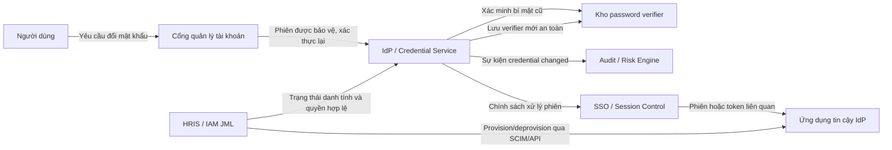
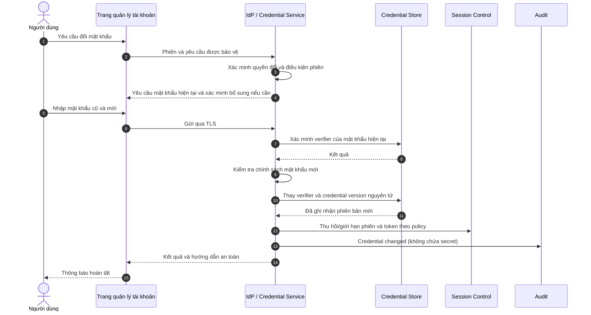

# Đổi mật khẩu trong quản lý vòng đời danh tính IAM

## 1. Đổi mật khẩu là gì?

**Đổi mật khẩu (password change)** là hoạt động thay thế một **bí mật xác thực đang được sử dụng** bằng bí mật mới, thông thường do chính người dùng đã có tài khoản chủ động thực hiện khi họ vẫn biết mật khẩu hiện tại. Trong **Identity and Access Management (IAM)**, đây là một thao tác thay đổi **authenticator**, không phải tự động thay đổi danh tính, vai trò hay mọi quyền truy cập.

Ví dụ: một nhân viên đăng nhập vào cổng quản lý tài khoản của **Identity Provider (IdP)**, nhập mật khẩu hiện tại, chọn mật khẩu mới và nhận xác nhận sau khi hệ thống cập nhật thành công. Từ lần xác thực mật khẩu tiếp theo, IdP phải kiểm tra với bí mật mới; mật khẩu cũ không được tiếp tục hợp lệ tại kho thông tin xác thực đó.

Đổi mật khẩu an toàn phải đáp ứng đồng thời:

- **Đúng chủ thể:** người yêu cầu có quyền thay đổi bí mật của tài khoản cụ thể.
- **Đúng điều kiện bảo mật:** hệ thống xác thực lại phù hợp rủi ro, không chỉ dựa vào một phiên đã tồn tại rất lâu.
- **Bí mật mới phù hợp chính sách:** đủ mạnh, không nằm trong danh sách mật khẩu phổ biến hoặc đã lộ theo khả năng kiểm tra.
- **Cập nhật an toàn:** thay đổi verifier theo cơ chế có bảo vệ, không để lộ mật khẩu thô hoặc tạo trạng thái nửa cũ nửa mới.
- **Kiểm soát phiên:** xử lý session, refresh token và đường đăng nhập khác theo chính sách, đặc biệt khi nghi ngờ bị chiếm tài khoản.
- **Có thể truy vết:** ghi ai đổi, lúc nào, qua phương thức nào, kết quả ra sao; không ghi nội dung mật khẩu.

Mật khẩu là **một phương thức xác thực**, không phải toàn bộ hệ thống IAM. **IdP, SSO, SCIM, RBAC/ABAC, quản lý vòng đời Joiner–Mover–Leaver (JML)** phối hợp để xác định ai được đăng nhập và được sử dụng tài nguyên nào.

## 2. Phân biệt đổi mật khẩu, đặt lại và thu hồi quyền

Các luồng có vẻ tương tự trên giao diện nhưng có điều kiện tin cậy khác nhau:

| Thao tác | Điều kiện khởi đầu | Mục tiêu | Điểm kiểm soát |
|---|---|---|---|
| **Password change** | Người dùng biết mật khẩu hiện tại và có phiên hợp lệ | Thay bí mật đang dùng bằng bí mật mới | Xác thực lại, kiểm tra chính sách, thông báo và xử lý phiên |
| **Password reset** | Người dùng quên mật khẩu hoặc mật khẩu không dùng được | Khôi phục khả năng thiết lập bí mật mới | Xác minh khôi phục độc lập, token một lần, chống chiếm tài khoản |
| **Admin-initiated reset** | Bộ phận hỗ trợ/an ninh có yêu cầu hợp lệ | Buộc thay bí mật khi xử lý sự cố hoặc hỗ trợ | Phê duyệt, phân quyền người thực hiện, audit và điều kiện xác minh |
| **Forced change at next login** | Tài khoản được cấp tạm bí mật hoặc chính sách yêu cầu | Buộc người dùng tự thiết lập mật khẩu lâu dài | Không dùng mật khẩu mặc định dùng chung; bảo vệ kênh cấp ban đầu |
| **Credential rotation** | Chính sách bảo mật hoặc nghi ngờ bí mật bị lộ | Đổi bí mật được hệ thống hoặc ứng dụng dùng | Đặc biệt quan trọng với tài khoản dịch vụ, secret, API key |
| **Disable/deprovision** | Quan hệ hoặc quyền truy cập không còn hợp lệ | Ngăn đăng nhập và thu hồi truy cập | Khóa tài khoản, phiên/token, entitlement và ứng dụng đích |

**Đổi mật khẩu không đồng nghĩa thu hồi quyền.** Nếu một nhân viên đã nghỉ việc, đổi mật khẩu của họ không bảo đảm mọi phiên cũ, tài khoản SaaS, token API, nhóm hoặc quyền trực tiếp đã mất hiệu lực. **Leaver cần quy trình offboarding riêng**.

**Đặt lại mật khẩu không nên được mô tả như đổi mật khẩu thông thường.** Khi người dùng đã quên mật khẩu, không thể dùng việc biết mật khẩu cũ làm bằng chứng; cần phương thức khôi phục đã thiết kế và xác minh đủ mạnh.

## 3. Mật khẩu được quản lý ở đâu?

Trước khi đổi, IAM phải xác định **hệ thống nào thực sự xác minh mật khẩu**.

| Kiến trúc | Nơi thường kiểm tra mật khẩu | Cách thực hiện đổi mật khẩu |
|---|---|---|
| **IdP tập trung** | IdP hoặc kho danh tính mà IdP sử dụng | Dẫn người dùng đến cơ chế thay đổi chính thức tại IdP |
| **Directory có tích hợp xác thực** | Directory hoặc dịch vụ mật khẩu được ủy quyền | Dùng giao thức/API và chính sách bảo vệ của hệ thống nguồn |
| **Ứng dụng có mật khẩu local** | Cơ sở thông tin xác thực riêng của ứng dụng | Đổi tại ứng dụng đó nếu không có quan hệ quản lý tập trung |
| **SAML/OIDC federation** | IdP/OP phát hành bằng chứng xác thực | Đổi tại bên thực sự nắm quyền xác thực, không tự sửa token |
| **Passwordless** | Passkey, khóa bảo mật hoặc phương thức khác | Quản lý authenticator tương ứng; có thể không có mật khẩu để đổi |
| **Tài khoản dịch vụ/workload** | Vault, secret manager, nền tảng hoặc dịch vụ đích | Rotation có kiểm soát, thường không dùng giao diện đổi mật khẩu cá nhân |

**SSO (Single Sign-On)** không có nghĩa tất cả ứng dụng cùng lưu một mật khẩu. Một ứng dụng SAML/OIDC có thể chỉ tin kết quả xác thực từ IdP, trong khi ứng dụng khác vẫn tồn tại tài khoản local độc lập.

**SCIM (System for Cross-domain Identity Management)** chủ yếu dùng cho quản lý người dùng, nhóm và thuộc tính. Dù mô hình SCIM có khả năng biểu diễn một số thuộc tính liên quan mật khẩu, **không được mặc định mọi ứng dụng hỗ trợ, không nên truyền mật khẩu thô hàng loạt và không coi SCIM là cơ chế đồng bộ mật khẩu phổ quát**.

### 3.1. Sơ đồ trách nhiệm



Hai đường quản trị cần tách biệt: **thay đổi bí mật xác thực** tại nguồn quản lý mật khẩu và **cấp/thu hồi tài khoản, quyền** theo nguồn nghiệp vụ cùng chính sách IAM.

## 4. Khi nào cần đổi mật khẩu?

Đổi mật khẩu phải được đặt trong **chính sách dựa trên rủi ro**, không chỉ là lịch nhắc cơ học.

| Tình huống | Đánh giá | Hành động phù hợp |
|---|---|---|
| Người dùng muốn đổi do nghi ngờ bí mật đã lộ | Có thể có nguy cơ chiếm tài khoản | Cho đổi qua quy trình bảo vệ; đánh giá phiên và sự kiện đáng ngờ |
| Hệ thống phát hiện mật khẩu xuất hiện trong danh sách đã lộ | Dấu hiệu bí mật không còn an toàn | Yêu cầu thay, tăng xác minh theo chính sách, xử lý phiên/token |
| Hỗ trợ xác nhận sự cố chiếm tài khoản | Nguy cơ attacker vẫn có phiên hợp lệ | Reset có kiểm soát, thu hồi phiên, rà soát MFA và quyền |
| Mật khẩu ban đầu chỉ dùng tạm thời | Phải chuyển sang bí mật do người dùng kiểm soát | Buộc đặt mới sau khi người dùng xác minh danh tính |
| Người dùng đổi vai trò (Mover) | Quyền đổi nhưng mật khẩu chưa chắc bị lộ | Tập trung thu hồi/cấp role; đổi mật khẩu nếu có căn cứ |
| Người dùng nghỉ việc (Leaver) | Tài khoản không còn được phép truy cập | Disable/deprovision, thu hồi phiên/token/quyền; không chỉ đổi mật khẩu |
| Tài khoản dịch vụ có secret bị lộ | Bí mật có thể bị sử dụng ngoài kiểm soát | Rotation và xử lý credential cũ theo quy trình workload |
| Chính sách đề xuất đổi định kỳ với mọi người | Không phải lúc nào cũng mang lại lợi ích | Xem lại theo tiêu chuẩn/chính sách hiện hành và rủi ro thực tế |

Một thực hành bảo mật hiện đại là **không ép người dùng thay mật khẩu vô cớ theo chu kỳ ngắn** nếu không có căn cứ về rủi ro hoặc yêu cầu kiểm soát cụ thể. Việc ép đổi quá thường xuyên có thể khiến người dùng chọn mẫu dễ đoán hoặc lưu trữ không an toàn. Khi **có dấu hiệu mật khẩu bị lộ**, việc buộc thay là hợp lý và cần đi kèm kiểm soát phiên.

## 5. Điều kiện trước khi cho phép đổi mật khẩu

Thao tác đổi mật khẩu có tác động đến khả năng đăng nhập, nên không thể chỉ tin một request HTTP nói rằng “hãy đổi mật khẩu”.

### 5.1. Xác định đúng tài khoản và quyền thao tác

- Xác thực yêu cầu qua một **phiên hợp lệ** hoặc kênh được IdP cho phép.
- Lấy **account ID từ ngữ cảnh xác thực phía máy chủ**, không mặc nhiên tin một trường `user_id` do trình duyệt gửi để đổi cho người khác.
- Kiểm tra tài khoản đang ở trạng thái phù hợp với luồng đổi; nếu bị khóa do rủi ro hoặc Leaver, không tự kích hoạt lại bằng việc đổi mật khẩu.
- Phân biệt **người dùng đổi bí mật của mình** với **quản trị viên yêu cầu reset**; áp dụng chính sách ủy quyền khác nhau.

### 5.2. Xác minh mật khẩu hiện tại

Trong luồng đổi mật khẩu thông thường, người dùng cung cấp **mật khẩu hiện tại** để hệ thống kiểm tra bằng verifier được lưu. Kiểm tra này giảm nguy cơ một phiên đã bị đánh cắp đủ để đổi bí mật.

Tuy nhiên, nếu chính mật khẩu hiện tại đã bị lộ thì việc biết nó **không bảo đảm người yêu cầu là chủ tài khoản**. Với quyền nhạy cảm, dấu hiệu bất thường hoặc phiên quá cũ, có thể cần **step-up authentication** bằng một yếu tố độc lập, ví dụ passkey hoặc MFA phù hợp.

### 5.3. Bảo vệ phiên và request

- Dùng HTTPS/TLS đúng cấu hình; không truyền mật khẩu qua query string hoặc URL.
- Xác thực lại khi thao tác rủi ro, kiểm tra tính mới của xác thực theo chính sách.
- Với giao diện dùng cookie, áp dụng **chống CSRF** phù hợp cùng SameSite và chính sách phiên.
- Giới hạn thử mật khẩu cũ, áp dụng rate limit hoặc biện pháp chống brute-force nhưng không tạo điều kiện từ chối dịch vụ dễ dàng.
- Không đưa mật khẩu vào log, analytics, telemetry, trang lỗi hoặc thông điệp gửi qua URL.
- Không dựa duy nhất vào fingerprint thiết bị, địa chỉ IP hoặc việc đã có session để bỏ các kiểm soát cần thiết.

### 5.4. Người dùng đã mất mật khẩu hiện tại

Nếu không thể chứng minh biết mật khẩu cũ, không nên làm một “đổi mật khẩu” giả có bước kiểm tra bị bỏ qua. Phải dùng **luồng password reset/account recovery**, với bằng chứng và cơ chế chống chiếm tài khoản riêng.

## 6. Quy trình đổi mật khẩu an toàn

Một luồng self-service điển hình:

1. Người dùng vào **trang quản lý tài khoản chính thức** từ ứng dụng hoặc IdP.
2. Hệ thống xác thực phiên và xác định account ID đúng.
3. Người dùng được yêu cầu nhập mật khẩu hiện tại; với rủi ro cao có thể cần MFA hoặc xác thực lại gần đây.
4. Hệ thống **xác minh mật khẩu hiện tại ở phía máy chủ**, có giới hạn thử và thông báo lỗi an toàn.
5. Người dùng nhập mật khẩu mới và xác nhận; hệ thống kiểm tra chính sách bí mật.
6. Cập nhật password verifier **một cách nguyên tử** và ghi phiên bản credential mới.
7. Áp dụng chính sách xử lý những phiên/token cũ; luân chuyển phiên hiện tại khi phù hợp.
8. Gửi thông báo bảo mật đến kênh đã được xác minh, **không đính kèm mật khẩu**.
9. Ghi audit metadata và trả kết quả rõ ràng, không khẳng định đã thu hồi mọi phiên nếu hệ thống chưa làm được.



Nếu bước xử lý phiên thất bại sau khi mật khẩu đã đổi, hệ thống phải **ghi rõ thất bại và xử lý tiếp**, không được lặng lẽ thông báo rằng mọi phiên đã được chấm dứt. Không thể rollback mật khẩu một cách tùy tiện chỉ vì một ứng dụng không hỗ trợ logout.

## 7. Kiểm tra mật khẩu mới: ưu tiên độ khó đoán và khả năng sử dụng

Mục tiêu của chính sách mật khẩu là giảm khả năng đoán được hoặc tái sử dụng bí mật đã lộ, đồng thời hỗ trợ người dùng tạo mật khẩu đủ mạnh.

| Chính sách | Cách hiểu phù hợp |
|---|---|
| **Độ dài đủ lớn** | Khuyến khích mật khẩu dài hoặc passphrase; giới hạn cụ thể theo mức assurance và chính sách áp dụng |
| **Không nằm trong danh sách phổ biến/đã lộ** | Chặn những bí mật đã biết dễ đoán, kể cả mẫu có tên công ty hoặc tên người dùng |
| **Cho phép password manager** | Hỗ trợ tạo mật khẩu ngẫu nhiên, độc nhất cho từng tài khoản |
| **Cho phép dán mật khẩu** | Hạn chế cản trở password manager và người dùng |
| **Hỗ trợ ký tự hợp lệ rộng rãi** | Không tùy ý hạn chế ký tự hoặc rút ngắn bí mật mà người dùng không biết |
| **Chặn dùng lại khi có căn cứ** | Có thể kiểm tra verifier lịch sử theo chính sách mà không lưu plaintext |
| **Không áp dụng quy tắc hình thức máy móc** | Ép một chữ hoa, một số, một ký tự đặc biệt có thể dẫn đến các mẫu đoán được |
| **Không ép đổi định kỳ không có lý do** | Ưu tiên đổi khi bị lộ, nghi ngờ lộ hoặc có yêu cầu kiểm soát hợp lý |

Ví dụ **không an toàn**: mật khẩu dựa trên tên công ty và năm hiện tại hoặc mẫu `Password123!`. Một chuỗi trông có đủ loại ký tự nhưng phổ biến vẫn dễ bị đoán.

Ví dụ **định hướng**: dùng password manager tạo một bí mật ngẫu nhiên dài, duy nhất cho tài khoản; hoặc dùng passphrase dài, không dựa trên câu phổ biến hay dữ kiện dễ tìm về bản thân.

### 7.1. Mật khẩu mới không được giống bí mật cũ

Ít nhất, nếu người dùng nhập mật khẩu mới **trùng chính xác** mật khẩu cũ, luồng đổi nên từ chối vì không tạo thay đổi bảo mật. Chính sách kiểm tra lịch sử mật khẩu phải được thực hiện bằng cách so sánh verifier an toàn hoặc cơ chế phù hợp; **không cần và không được lưu danh sách mật khẩu thô trong cơ sở dữ liệu**.

### 7.2. Vấn đề Unicode và chuẩn hóa

Nếu hệ thống hỗ trợ ký tự Unicode, các lớp frontend, API và backend phải xử lý **nhất quán** về encoding, so sánh và quy tắc chuẩn hóa theo chính sách. Không được âm thầm cắt chuỗi, đổi chữ hoặc tự loại ký tự ở một bước mà người dùng không biết: điều đó có thể làm mật khẩu đăng nhập sau này khác với mật khẩu họ tưởng đã lưu.

Mọi giới hạn độ dài phải được diễn đạt rõ và phù hợp khả năng của bộ kiểm tra mật khẩu. Không log nội dung bí mật nhằm debug lỗi encoding.

## 8. Lưu mật khẩu an toàn: không bao giờ lưu plaintext

Ứng dụng quản lý mật khẩu phải lưu **password verifier** chứ không lưu lại mật khẩu thô để đem so sánh trực tiếp.

Một mô hình phổ biến là dùng hàm **password hashing chuyên dụng có thể điều chỉnh chi phí** như Argon2id, scrypt hoặc PBKDF2 với cấu hình đáp ứng yêu cầu môi trường và tiêu chuẩn áp dụng. Cần **salt riêng và duy nhất đủ ngẫu nhiên** cho từng bí mật; có thể dùng thêm pepper được bảo vệ ở nơi riêng nếu kiến trúc và quy trình vận hành phù hợp.

Tránh dùng trực tiếp các hàm băm nhanh như SHA-256 thuần túy cho mật khẩu người dùng: chúng không được thiết kế để làm tốn tài nguyên đoán mật khẩu theo cách mà password hashing chuyên dụng cung cấp.

### 8.1. Quy tắc cập nhật verifier

1. Kiểm tra mật khẩu cũ thông qua verifier đang lưu và thuật toán cấu hình.
2. Đánh giá bí mật mới theo chính sách và danh sách chặn.
3. Sinh salt mới phù hợp, tính verifier mới với tham số chi phí đã duyệt.
4. **Thay thế nguyên tử** bản ghi verifier/phiên bản credential; không để hai bí mật cùng được dùng ngoài kế hoạch.
5. Sau thành công, làm mất hiệu lực mật khẩu cũ trong nguồn xác thực đó.
6. Không trả verifier, salt nhạy cảm của chính sách nội bộ hoặc bí mật mới trong response.
7. Ghi sự kiện thay đổi credential, không ghi plaintext, hash hoặc nội dung bí mật vào log.

Ví dụ **mã giả**, không phải triển khai bảo mật hoàn chỉnh:

```text
function change_password(session, current_password, new_password):
    account = authorize_account_from_server_side_session(session)
    require_recent_authentication_if_policy_demands(account, session)
    enforce_rate_limit(account, session)

    record = credential_store.load_with_version(account.id)

    if not verify_password(current_password, record.verifier):
        record_failed_attempt_without_secret(account.id)
        return generic_invalid_current_password()

    if not password_policy.accept(new_password, account):
        return policy_feedback_without_echoing_secret()

    if verify_password(new_password, record.verifier):
        return reject_reuse_of_current_password()

    new_verifier = password_hash_kdf(
        new_password,
        fresh_random_salt(),
        approved_cost_parameters()
    )

    changed = credential_store.compare_and_swap(
        account.id,
        expected_version = record.version,
        new_verifier = new_verifier,
        new_credential_version = record.version + 1
    )

    if not changed:
        return retry_flow_with_fresh_authentication()

    session_service.apply_credential_change_policy(account.id)
    audit.emit_password_changed_without_secrets(account.id)
    return success()
```

Thứ tự cụ thể của phát sự kiện và cập nhật phiên phải được thiết kế chịu lỗi: trong thực tế có thể cần **outbox hoặc hàng đợi bền vững** để không mất sự kiện thu hồi phiên khi tiến trình chết sau khi đã thay verifier. Không triển khai mã giả này nguyên dạng nếu chưa giải quyết quản lý phiên, lỗi giao dịch và API thực tế.

### 8.2. Vì sao cần cập nhật nguyên tử và versioning?

Hai tab hoặc hai thiết bị có thể cùng gửi yêu cầu đổi mật khẩu. Nếu đều kiểm tra verifier cũ rồi lần lượt ghi đè không kiểm soát, trạng thái cuối có thể khó dự đoán và mất tác dụng của lần đổi trước.

**Optimistic concurrency**, versioning hoặc cơ chế giao dịch phù hợp giúp bảo đảm chỉ một cập nhật dựa trên một phiên bản verifier cụ thể được chấp nhận. Nếu thấy xung đột, hệ thống cần yêu cầu xác thực lại theo trạng thái mới thay vì ghi đè im lặng.

## 9. Session, token và MFA sau khi đổi mật khẩu

Một trong những nhầm lẫn nguy hiểm nhất là: **“Mật khẩu đã đổi nên mọi phiên khác tự động mất hiệu lực.”** Điều này không đúng trong nhiều kiến trúc.

| Đường truy cập | Đổi mật khẩu có thể ảnh hưởng gì? | Kiểm soát bổ sung |
|---|---|---|
| **Đăng nhập mới bằng mật khẩu** | Verifier mới được dùng, mật khẩu cũ bị từ chối | Xác minh đổi thành công |
| **SSO session tại IdP** | Có thể vẫn tồn tại tùy chính sách | Thu hồi hoặc tái xác thực phiên theo rủi ro |
| **Session cookie của ứng dụng** | Ứng dụng có thể giữ session riêng | Logout/revocation của ứng dụng hoặc cơ chế phối hợp |
| **OIDC access token đã phát hành** | Nội dung token không tự đổi | TTL, introspection, revocation khi hỗ trợ, kiểm tra quyền động |
| **Refresh token** | Có thể tiếp tục lấy token mới nếu không thu hồi | Thu hồi/rotate theo khả năng của authorization server |
| **API key / SSH key / PAT** | Thường độc lập với mật khẩu tương tác | Kiểm kê và thu hồi khi có dấu hiệu nguy cơ |
| **MFA authenticator** | Thường vẫn liên kết với tài khoản | Rà soát thiết bị lạ hoặc thay MFA khi nghi chiếm tài khoản |

### 9.1. Xử lý theo rủi ro

- **Đổi tự nguyện, phiên tin cậy:** chính sách có thể cho phép giữ phiên hiện tại sau khi tái xác thực, nhưng thường nên kiểm soát hoặc thu hồi các phiên khác tùy rủi ro.
- **Nghi ngờ chiếm tài khoản:** ưu tiên thu hồi tất cả những phiên và token có thể thu hồi, xem xét MFA, recovery factor và các thay đổi quyền bất thường.
- **Đổi do sự cố hệ thống/bí mật bị lộ diện rộng:** thực hiện quy trình ứng phó sự cố và bảo vệ session/token tương ứng.
- **Tài khoản đặc quyền:** có thể yêu cầu xác thực mạnh hơn, thu hồi các phiên quản trị và kiểm tra PAM.

Không nên tuyên bố “đăng xuất khỏi mọi thiết bị” nếu hệ thống không thể kiểm soát các phiên ứng dụng độc lập. Giao diện và audit cần phản ánh đúng những gì đã thực hiện.

### 9.2. Đổi mật khẩu khác hủy MFA

Nếu một attacker đã đăng ký thiết bị MFA của họ vào tài khoản, chỉ đổi mật khẩu sẽ **không tự động xóa thiết bị đó**. Khi có nghi ngờ chiếm tài khoản, phải rà soát **authenticator đã đăng ký, kênh recovery, thiết bị tin cậy và phiên đang hoạt động** theo quy trình an ninh.

## 10. Đổi mật khẩu trong môi trường SSO và federation

Một doanh nghiệp có thể sử dụng IdP tập trung cho nhân viên, ứng dụng SaaS với SAML/OIDC và một số ứng dụng local legacy.

### 10.1. Mật khẩu tại IdP tập trung

Khi người dùng thay mật khẩu ở IdP, ứng dụng chỉ dùng SAML/OIDC để xác thực **thường không cần nhận mật khẩu mới**. Ứng dụng tiếp tục tin assertion/token được IdP phát hành theo cấu hình; điều cần đánh giá là **phiên cũ, claim quyền và cơ chế logout**.

### 10.2. Ứng dụng có mật khẩu local

Nếu ứng dụng có **cơ sở mật khẩu riêng**, việc thay ở IdP **không nhất thiết đổi mật khẩu local**. Tổ chức cần nhận diện tài khoản local và quyết định có thể tắt đăng nhập bằng mật khẩu local, liên kết SSO hoặc quản lý thay đổi riêng theo chính sách.

**Không đồng bộ một mật khẩu chung dạng plaintext tới nhiều ứng dụng** như giải pháp mặc định. Việc chia sẻ bí mật rộng làm tăng bề mặt tấn công, phụ thuộc vào connector và tạo rủi ro lưu/truyền bí mật.

### 10.3. Liên kết với bên thứ ba

Với **federated identity**, tài khoản nhà thầu có thể được xác thực tại IdP của đối tác. Tổ chức cung cấp tài nguyên **không có quyền và không nên tự sửa mật khẩu ở IdP đối tác** nếu không có cơ chế được thỏa thuận rõ. Điều họ kiểm soát là điều kiện truy cập, local account, nhóm, role và phiên của chính hệ thống mình.

## 11. Đổi mật khẩu và vòng đời Joiner–Mover–Leaver

### 11.1. Joiner: mật khẩu đầu tiên và kích hoạt tài khoản

Khi nhân viên mới gia nhập:

1. **HRIS hoặc nguồn có thẩm quyền** xác nhận quan hệ và ngày hiệu lực.
2. **Identity proofing** liên kết đúng con người với danh tính được cấp.
3. IAM/IdP tạo tài khoản hoặc chuẩn bị tài khoản chưa kích hoạt.
4. Người mới **tự thiết lập** bí mật đầu tiên qua luồng an toàn; nếu dùng bí mật tạm, phải giới hạn và yêu cầu thay.
5. IdP thiết lập MFA, passkey hoặc authenticator theo chính sách.
6. RBAC/ABAC và phê duyệt quyết định quyền; SCIM/API provision tài khoản/nhóm đến ứng dụng.
7. IAM xác minh trạng thái tài khoản và quyền theo thời điểm hợp lệ.

Không nên cấp **mật khẩu dùng chung mặc định** cho hàng loạt nhân viên. Nếu có invitation hoặc bootstrap token, chúng cần thời hạn, phạm vi, chống phát lại và chỉ dùng theo kênh đã được kiểm soát.

### 11.2. Mover: thay đổi vai trò không tự bắt buộc thay mật khẩu

Một nhân viên chuyển từ Sales sang Finance thường cần:

- Cập nhật quyền theo role/department/project hiện tại.
- **Thu hồi quyền cũ**, kể cả quyền gán trực tiếp và quyền có thời hạn.
- Cấp quyền mới sau phê duyệt, kiểm tra Separation of Duties (SoD).
- Đánh giá session/token cũ nếu quyền nhạy cảm thay đổi.

**Chuyển vai trò không nhất thiết khiến mật khẩu bị lộ.** Không nên dùng đổi mật khẩu thay cho việc thu hồi entitlement. Tuy nhiên, nếu thay đổi quyền đặc quyền hoặc có sự cố, tổ chức có thể yêu cầu **step-up authentication** hoặc rotation credential cụ thể.

### 11.3. Leaver: disable và deprovision, không chỉ đổi mật khẩu

Khi người dùng nghỉ việc hoặc hợp đồng kết thúc, phải xử lý:

1. Disable hoặc chặn đăng nhập IdP theo thời điểm và rủi ro.
2. Thu hồi các session và token phù hợp với khả năng hệ thống.
3. Gỡ group membership, role và quyền trực tiếp.
4. Deprovision ở ứng dụng qua SCIM/API hoặc workflow có kiểm soát.
5. Thu hồi credential độc lập (PAT, SSH key, tài khoản local hoặc secret cá nhân) khi liên quan.
6. Đối soát quyền hiệu lực và ghi bằng chứng hoàn tất theo từng đích.

**Đổi mật khẩu khi Leaver** có thể là một hành động kỹ thuật bổ sung trong tình huống đặc biệt, nhưng **không thể thay thế** disable và thu hồi quyền. Trong hệ thống có nhiều hợp đồng/assignment, phải xác định còn quan hệ hợp lệ khác trước khi khóa toàn bộ danh tính.

## 12. Tài khoản dịch vụ và mật khẩu không tương tác

Với **service account, bot, CI/CD runner và workload identity**, bí mật có thể là password, client secret, API key, khóa riêng hoặc chứng thư. Quá trình thay bí mật thường gọi là **credential rotation**, không nên bắt chước giao diện đổi mật khẩu của nhân viên.

Một quy trình rotation có kiểm soát:

1. Xác nhận workload, owner và phạm vi quyền tại **service catalog/CMDB hoặc nguồn kỹ thuật có thẩm quyền**.
2. Kiểm kê những thành phần đang dùng credential cũ, môi trường và ứng dụng phụ thuộc.
3. Tạo credential mới bằng phương thức an toàn, giữ trong **secret manager/vault** phù hợp.
4. Phân phối qua kênh bảo mật và cập nhật người tiêu thụ; kiểm tra workload hoạt động bằng credential mới.
5. Thu hồi credential cũ đúng thời điểm, không giữ vô hạn hai bí mật song song.
6. Ghi audit, xác minh không còn client lệ thuộc secret cũ và cập nhật owner/lịch rotation.

Nếu hệ thống đích **chỉ cho phép một credential hoạt động**, cần kế hoạch chuyển đổi hoặc thời gian bảo trì phù hợp để tránh gián đoạn. Nếu hỗ trợ **hai credential trong khoảng chuyển tiếp**, thời hạn chồng lấn phải ngắn và được kiểm soát.

Khi nhân viên sở hữu workload **chuyển vai trò hoặc nghỉ việc**, IAM cần bàn giao owner, rà soát quyền và cân nhắc rotation secret nếu nguy cơ còn truy cập cá nhân. **Không tự xóa workload còn hoạt động chỉ vì owner nhân sự đã Leaver**.

## 13. Luồng đặt lại và khôi phục khi người dùng không biết mật khẩu cũ

Dù bài học tập trung vào **đổi mật khẩu**, cần hiểu ranh giới với **password reset/account recovery**.

Một luồng reset an toàn thường:

- Cho phép người dùng khởi tạo yêu cầu mà không tiết lộ tài khoản có tồn tại hay không qua thông báo dễ bị khai thác.
- Xác minh người yêu cầu qua **phương thức khôi phục đã được đăng ký và kiểm soát**, với mức bảo đảm phù hợp rủi ro.
- Nếu dùng token khôi phục, token phải **khó đoán, có thời hạn, một lần sử dụng và gắn đúng tài khoản/mục đích**.
- Không gửi mật khẩu mới qua email hoặc kênh hỗ trợ; cho người dùng thiết lập trực tiếp tại nơi tin cậy.
- Giới hạn yêu cầu thử lại, không cho token bị phát lại sau khi hoàn tất.
- Kiểm soát session, MFA và recovery factor theo chính sách ứng phó chiếm tài khoản.
- Ghi audit và thông báo an ninh qua kênh đã được xác minh, không chứa bí mật.

**Email hoặc số điện thoại không phải bằng chứng tuyệt đối của danh tính.** Nếu kênh recovery đã bị attacker chiếm, luồng reset có thể trở thành đường chiếm tài khoản. Tài khoản đặc quyền và trường hợp có tín hiệu gian lận thường cần quy trình khôi phục mạnh hơn, có thể yêu cầu kiểm tra danh tính độc lập.

## 14. Xử lý lỗi, trải nghiệm người dùng và bảo vệ dữ liệu

### 14.1. Trạng thái lỗi nên phân biệt

| Tình huống | Cách phản hồi phù hợp |
|---|---|
| Mật khẩu hiện tại không đúng | Báo không xác minh được bí mật hiện tại; không cung cấp chi tiết verifier |
| Bí mật mới không đạt chính sách | Giải thích điều kiện chính sách hữu ích mà không hiển thị lại mật khẩu |
| Người dùng chưa xác thực lại khi policy yêu cầu | Điều hướng sang luồng reauthentication/step-up chính thức |
| Hai request đổi đồng thời | Chặn ghi đè; yêu cầu thao tác lại theo credential version mới |
| Request timeout sau khi DB đã cập nhật | Kiểm tra trạng thái nghiệp vụ an toàn; tránh trả kết quả sai hoặc tự khôi phục mật khẩu cũ |
| Đã cập nhật verifier nhưng thu hồi session lỗi | Ghi lỗi rõ, tiếp tục tác vụ thu hồi và thông báo phù hợp |
| IdP tạm thời không khả dụng | Không lưu bí mật tạm trong log/queue; cho thử lại an toàn |
| Tài khoản bị khóa do sự cố hoặc Leaver | Không tự kích hoạt bằng thao tác đổi mật khẩu |
| Chính sách xác thực bị chặn do thử sai nhiều lần | Thông báo có thể phục hồi và kênh hỗ trợ an toàn, tránh khóa vô hạn |

Một giao diện tốt cho phép người dùng **dùng password manager, dán mật khẩu, hiển thị/ẩn ký tự và nhận phản hồi rõ ràng**. Cần chú ý khả năng tiếp cận, giới hạn thử hợp lý và quy trình khi mất MFA; không khuyến khích người dùng gửi mật khẩu cho bộ phận hỗ trợ.

### 14.2. Không để lộ bí mật trong hệ thống phụ trợ

Không ghi mật khẩu vào:

- Server access log, URL query, error trace hoặc APM attribute.
- Event queue, dead-letter queue, message bus hoặc webhook sự kiện đổi mật khẩu.
- Audit log, phân tích trải nghiệm, màn hình hỗ trợ hoặc chat nội bộ.
- Email thông báo, thông báo đẩy và báo cáo kiểm toán.

Sự kiện `PASSWORD_CHANGED` chỉ cần mã tài khoản, thời gian, phương pháp, mức rủi ro, kết quả và correlation ID; không nên chứa plaintext, verifier hay mật khẩu cũ.

## 15. Thiết kế API và giao dịch đổi mật khẩu

Một API tự phục vụ có thể nhận mật khẩu cũ và mới trong **request body gửi qua TLS**, sau khi phiên và CSRF được kiểm soát. Dưới đây là **mẫu giao diện khái niệm**, không phải hợp đồng API chuẩn:

```http
POST /api/v1/me/change-password HTTP/1.1
Host: identity.example.org
Content-Type: application/json
Cookie: <secure-session-cookie>
X-CSRF-Token: <valid-csrf-token>

{
  "currentPassword": "<current-secret>",
  "newPassword": "<new-secret>"
}
```

Các giá trị trong ví dụ là **placeholder**, không được sao chép thành secret thực tế.

### 15.1. Những điều server phải tự quyết

- Tài khoản đích được lấy từ **phiên đã xác thực**, không nhận `accountId` tùy ý từ client.
- Chỉ chấp nhận qua HTTPS và kênh/endpoint đã được bảo vệ.
- Kiểm tra current password, session freshness/MFA và chính sách mật khẩu mới ở phía server.
- Rate limit theo ngữ cảnh phù hợp, lưu bản ghi audit không chứa secret.
- Ghi verifier mới nguyên tử và chống cạnh tranh cập nhật.
- Thu hồi hoặc giới hạn session/token theo chính sách; dùng cơ chế retry bền vững cho phần hậu xử lý thất bại.
- Không trả về plaintext, hash/verifier hoặc thông tin giúp suy đoán bí mật.

**Không nên cố làm một API “đổi mật khẩu của bất kỳ user nào”** rồi chỉ ẩn trường account ID ở giao diện. Tách API self-service và API quản trị có xác thực, ủy quyền, phê duyệt và kiểm toán riêng.

## 16. Ví dụ xuyên suốt: nhân viên chủ động đổi mật khẩu

Giả sử **Hà** là nhân viên đang có tài khoản `identity-2051` tại IdP doanh nghiệp và sử dụng SSO để vào ứng dụng tài liệu.

### 16.1. Trước khi đổi

Hà nhận được cảnh báo rằng một mật khẩu cũ có thể đã xuất hiện trong sự cố lộ dữ liệu ở dịch vụ khác. Hà mở **cổng quản lý tài khoản chính thức** từ đường dẫn tổ chức đã biết, tránh truy cập link lạ.

IdP kiểm tra phiên, yêu cầu mật khẩu hiện tại và một phương thức MFA phù hợp vì đây là tình huống có rủi ro. Hà dùng password manager tạo một mật khẩu ngẫu nhiên, duy nhất và đáp ứng chính sách.

### 16.2. Thay đổi credential

IdP xác minh mật khẩu hiện tại, chặn mẫu bí mật mới đã biết yếu và lưu verifier mới với salt/thuật toán password hashing phù hợp. Mật khẩu cũ không còn đăng nhập được vào IdP.

IdP ghi nhận sự kiện `PASSWORD_CHANGED`, xử lý phiên cũ và thông báo cho Hà qua kênh đã xác minh. Hà được hướng dẫn kiểm tra những phiên lạ và authenticator đã đăng ký nếu có nghi ngờ chiếm tài khoản.

### 16.3. Tác động đến SSO và ứng dụng

Ứng dụng tài liệu dùng SSO **không cần nhận mật khẩu mới**. Tuy nhiên, một phiên tài liệu đã mở trước đó có thể còn hiệu lực tùy cơ chế session của ứng dụng. IAM/IdP cần áp dụng logout/revocation và đánh giá rủi ro tồn dư theo khả năng của các thành phần.

Quyền xem tài liệu của Hà **không thay đổi** chỉ vì mật khẩu đã được đổi. RBAC/ABAC vẫn dựa trên vai trò, assignment và phê duyệt nghiệp vụ.

### 16.4. Nếu Hà chuyển phòng hoặc nghỉ việc

Khi Hà trở thành **Mover**, IAM cập nhật role/nhóm và thu hồi quyền cũ theo sự kiện HR; mật khẩu mới vẫn có thể tiếp tục được dùng nếu an toàn. Khi Hà trở thành **Leaver**, IAM disable tài khoản và thu hồi quyền/phiên ở các đích; **không coi việc Hà từng đổi mật khẩu là lý do giữ quyền sau khi nghỉ việc**.

## 17. Kiểm toán sự kiện đổi mật khẩu

Thông tin kiểm toán cần hỗ trợ phát hiện gian lận, điều tra sự cố và chứng minh tuân thủ mà không tạo thêm kho bí mật.

| Trường audit | Ý nghĩa |
|---|---|
| `event_id` | Định danh sự kiện đổi mật khẩu |
| `identity_id` / `account_id` | Chủ thể và tài khoản được thay đổi |
| `event_type` | Ví dụ `PASSWORD_CHANGED` hoặc `PASSWORD_CHANGE_FAILED` |
| `initiator_type` | Người dùng tự đổi, quản trị viên reset, hệ thống cưỡng chế |
| `auth_context` | Loại bước xác thực lại/MFA đã dùng, không chứa secret |
| `credential_version` | Phiên bản mới sau thay đổi, nếu hệ thống hỗ trợ |
| `occurred_at` | Thời điểm xử lý |
| `session_action` | Phiên/token đã thu hồi hoặc chưa thể thu hồi theo policy |
| `risk_reason` | Tự nguyện, nghi lộ, recovery, phản ứng sự cố |
| `result` / `correlation_id` | Kết quả và khả năng liên kết với sự kiện khác |

Ví dụ JSON **chỉ có metadata**:

```json
{
  "event_id": "pwd-change-2026-0042",
  "event_type": "PASSWORD_CHANGED",
  "identity_id": "identity-2051",
  "account_id": "idp-user-2051",
  "initiator_type": "SELF_SERVICE",
  "risk_reason": "USER_SUSPECTED_COMPROMISE",
  "credential_version": 7,
  "session_action": "REVOKE_OTHER_IDP_SESSIONS_REQUESTED",
  "session_action_verified": true,
  "occurred_at": "2026-11-23T08:30:00Z",
  "result": "SUCCESS",
  "correlation_id": "req-9017"
}
```

`session_action_verified=true` trong ví dụ **chỉ xác nhận phạm vi được IdP kiểm tra**, không chứng minh mọi phiên ứng dụng độc lập trên toàn hệ thống đã bị hủy.

### 17.1. Chỉ số theo dõi

- **Password change success rate:** tỷ lệ thao tác được xác minh thành công.
- **Failed current-password attempts:** số lần nhập sai bí mật hiện tại trước khi đổi.
- **Suspicious change attempts:** những lần đổi với tín hiệu bất thường cần đánh giá.
- **Session revocation coverage:** phạm vi phiên/token được thu hồi hoặc kiểm soát sau đổi.
- **Recovery vs change ratio:** tỷ lệ đặt lại do mất bí mật so với đổi khi còn biết bí mật.
- **Helpdesk override rate:** số tác vụ reset do quản trị viên, kèm lý do/phê duyệt.
- **Credential-related incident follow-up:** sự kiện đổi trong bối cảnh lộ mật khẩu có được điều tra và khép lại không.

Không đặt KPI “càng đổi mật khẩu nhiều càng an toàn”. Cần đo **chất lượng bảo vệ tài khoản và khả năng xử lý sự cố**, không phải số lần thay bí mật thuần túy.

## 18. Các trường hợp kiểm thử quan trọng

| Tình huống | Kết quả mong đợi |
|---|---|
| Người dùng hợp lệ, biết mật khẩu cũ, bí mật mới đạt policy | Đổi thành công, mật khẩu cũ không còn xác thực được |
| Nhập sai mật khẩu hiện tại | Từ chối, rate limit phù hợp và không đổi verifier |
| Phiên bị đánh cắp nhưng không biết mật khẩu cũ | Không thể đổi qua luồng thông thường; có step-up theo rủi ro |
| Mật khẩu mới trùng mật khẩu hiện tại | Không coi là thay đổi hợp lệ |
| Mật khẩu mới phổ biến hoặc nằm trong danh sách lộ | Từ chối theo chính sách |
| Người dùng dùng password manager và dán chuỗi dài | Hệ thống xử lý nhất quán, không cắt bí mật ngầm |
| Hai tab đồng thời gửi yêu cầu | Không ghi đè không kiểm soát; credential version nhất quán |
| DB đổi thành công nhưng response timeout | Hệ thống không tự khôi phục verifier cũ hoặc lưu plaintext |
| Đổi thành công nhưng session revocation lỗi | Có trạng thái/cảnh báo rõ và xử lý tiếp |
| Session app vẫn còn sau khi đổi ở IdP | Không giả định đã thu hồi; kiểm tra khả năng ứng dụng |
| Recovery token được dùng lại | Từ chối, không đặt lại lần thứ hai |
| Người dùng quên mật khẩu cũ | Chuyển sang reset/recovery có xác minh, không bỏ qua current-password check |
| Người dùng đã Leaver | Không cho đổi làm tài khoản active trở lại |
| Mover đổi bộ phận | Đổi role/quyền theo IAM; không coi password change là giải pháp phân quyền |
| Tài khoản có MFA lạ do attacker thêm | Quy trình phản ứng kiểm tra và thu hồi authenticator đáng ngờ |
| Ứng dụng dùng SSO và không có mật khẩu local | Không yêu cầu đồng bộ password vào ứng dụng |
| Một ứng dụng legacy còn mật khẩu local | Ghi nhận nguồn credential độc lập, không hứa đổi IdP đã đổi app |
| Service account rotation sau nghi lộ secret | Consumer chuyển sang secret mới, thu hồi secret cũ có kiểm chứng |
| API log hoặc error chứa secret | Kiểm thử phát hiện và chặn việc ghi lộ |
| Admin reset không có quyền/approval | Từ chối và ghi audit |
| HTTP request dùng ID tài khoản người khác | Server không cho phép đổi chéo tài khoản |

## 19. Những lỗi thường gặp cần tránh

| Sai lầm | Tác động | Cách khắc phục |
|---|---|---|
| Cho đổi mật khẩu chỉ vì có cookie phiên lâu ngày | Phiên bị chiếm có thể đổi bí mật | Xác thực lại và step-up theo rủi ro |
| Bỏ qua mật khẩu hiện tại trong luồng change | Nhầm sang reset yếu bảo mật | Tách change và recovery với tiêu chuẩn riêng |
| Chỉ áp dụng quy tắc ký tự cứng nhắc | Người dùng chọn mẫu dễ đoán | Khuyến khích chiều dài, chặn mật khẩu phổ biến/đã lộ |
| Ép đổi rất thường xuyên không có lý do | Tăng gánh nặng, hành vi không an toàn | Chính sách dựa trên rủi ro và yêu cầu kiểm soát |
| Lưu hoặc gửi mật khẩu plaintext | Lộ bí mật trên nhiều hệ thống | Password hashing chuyên dụng, TLS và redaction |
| Dùng SHA-256 thuần cho mật khẩu | Tăng tốc độ thử đoán offline nếu verifier bị lộ | Password hashing có cost thích hợp và salt riêng |
| Cập nhật verifier không nguyên tử | Ghi đè do thao tác đồng thời hoặc trạng thái bất định | Versioning, transactional/CAS update |
| Giữ tất cả phiên cũ sau sự cố | Kẻ tấn công có thể duy trì truy cập | Revoke session/token và rà soát recovery/MFA |
| Tưởng SSO đồng bộ mật khẩu đến mọi app | Bỏ sót tài khoản local độc lập | Kiểm kê hệ thống sở hữu credential |
| Đổi mật khẩu thay cho Leaver | Role, session, PAT và nhóm vẫn còn | Disable/deprovision và đối soát quyền |
| Admin reset qua ticket không xác minh | Dễ bị social engineering và chiếm tài khoản | Phê duyệt, xác minh danh tính và audit |
| Ép gửi mật khẩu mới cho helpdesk | Tạo thêm bên biết bí mật | Self-service và kênh reset an toàn |
| Rotation service account thiếu kiểm soát consumer | Gián đoạn workload hoặc vẫn dùng secret cũ | Vault, phân phối, xác minh và hủy secret theo kế hoạch |

## 20. Nguyên tắc cần ghi nhớ

**Đổi mật khẩu là thay đổi một bí mật xác thực của tài khoản**, không phải thay đổi danh tính hay tự động thu hồi mọi quyền IAM.

Để triển khai đúng trong hệ thống doanh nghiệp:

1. **Xác định nguồn quản lý mật khẩu:** IdP, directory, ứng dụng local hoặc secret manager; không đồng nhất với SSO/SCIM.
2. **Phân biệt password change, reset và account recovery:** mỗi luồng cần bằng chứng xác minh và quyền thao tác khác nhau.
3. **Bảo vệ bước thay đổi:** phiên an toàn, kiểm tra mật khẩu hiện tại, reauthentication, MFA/step-up, CSRF và rate limit theo rủi ro.
4. **Ưu tiên bí mật mới khó đoán:** đủ dài, không phổ biến/đã lộ, hỗ trợ password manager; tránh các quy tắc hình thức phản tác dụng.
5. **Lưu verifier chứ không lưu plaintext:** dùng password hashing chuyên dụng, salt riêng, cập nhật nguyên tử và versioning.
6. **Xử lý phiên/token đúng thực tế:** thay password ở IdP không tự hủy mọi cookie ứng dụng, access token và credential độc lập.
7. **Gắn vào JML:** Joiner thiết lập bí mật ban đầu; Mover cập nhật quyền; Leaver disable/deprovision và thu hồi đường truy cập.
8. **Quản lý tài khoản dịch vụ bằng rotation thích hợp**, có owner và kế hoạch chuyển đổi consumer, không sử dụng máy móc luồng của con người.
9. **Lưu audit an toàn:** chỉ lưu metadata cần thiết, không ghi mật khẩu, verifier hoặc secret trong log.
10. **Kiểm tra cả trường hợp lỗi:** thay đổi đồng thời, timeout, session revocation thất bại, ứng dụng local và quyền tồn dư.

**Kết luận:** một quy trình đổi mật khẩu tốt phải bảo vệ người dùng khỏi việc kẻ khác chiếm bí mật, cập nhật thông tin xác thực an toàn và phối hợp với IdP cùng các cơ chế kiểm soát phiên. Để giảm **quyền truy cập tồn dư**, vẫn cần đầy đủ quản lý vòng đời danh tính, RBAC/ABAC, provisioning, đối soát và thu hồi quyền theo sự kiện JML.
