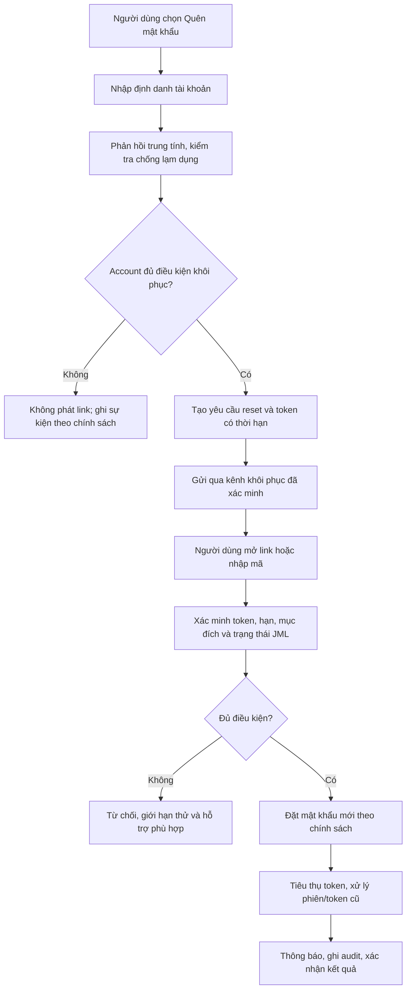

# Quên mật khẩu trong quản lý danh tính IAM

**Quên mật khẩu** (*forgot password*) là tình huống người dùng không còn nhớ bí mật đã dùng để đăng nhập và cần thiết lập một mật khẩu mới thông qua **quy trình khôi phục tài khoản** (*account recovery/password reset*). Trong **Identity and Access Management (IAM)**, đây không chỉ là một chức năng tiện ích: nếu quy trình đặt lại mật khẩu yếu, kẻ tấn công có thể chiếm tài khoản mà không cần biết mật khẩu hiện tại.

Một quy trình an toàn cần cân bằng **xác minh đúng chủ thể**, **khả năng khôi phục cho người hợp lệ**, **bảo vệ token và kênh liên lạc**, **kiểm soát phiên đang tồn tại** và **ghi nhận kiểm toán**. Đặc biệt, khả năng đặt lại mật khẩu phải phụ thuộc vào trạng thái vòng đời **Joiner–Mover–Leaver (JML)**: người đã nghỉ việc hoặc tài khoản đã bị vô hiệu hóa không được tự kích hoạt lại chỉ nhờ một liên kết “quên mật khẩu”.

## 1. Phân biệt quên mật khẩu với các thao tác khác

| Tình huống | Mục tiêu | Điều kiện khác biệt |
| --- | --- | --- |
| **Forgot password** | Thiết lập mật khẩu mới khi không nhớ mật khẩu cũ | Cần xác minh người yêu cầu bằng phương thức khôi phục |
| **Change password** | Đổi mật khẩu khi đang kiểm soát tài khoản | Thường có phiên hợp lệ và có thể cần xác thực lại |
| **Account unlock** | Gỡ khóa tạm thời do nhiều lần xác thực thất bại | Không mặc nhiên đổi mật khẩu hoặc kích hoạt tài khoản Leaver |
| **Authenticator recovery** | Khôi phục khả năng đăng nhập khi mất MFA/passkey | Cần đánh giá mức bảo đảm của phương thức thay thế |
| **Admin-initiated reset** | Quản trị viên hoặc help desk hỗ trợ reset | Phải xác minh yêu cầu và kiểm soát quyền của người hỗ trợ |
| **Lifecycle reactivation** | Kích hoạt tài khoản sau thay đổi quan hệ hợp lệ | Cần sự kiện nguồn/điều kiện JML, không phải một link reset |

**Đặt lại mật khẩu không phải bằng chứng rằng người yêu cầu là chủ sở hữu danh tính.** Quy trình khôi phục phải thiết lập cơ sở tin cậy đủ mạnh trước khi cho phép thay đổi credential. Đồng thời, đặt lại mật khẩu không tự sửa role hoặc entitlement tại các ứng dụng.

## 2. Những mối đe dọa đối với chức năng quên mật khẩu

| Mối đe dọa | Ví dụ | Kiểm soát cần xem xét |
| --- | --- | --- |
| **Account enumeration** | Phản hồi tiết lộ email nào có tài khoản | Phản hồi trung tính, cân bằng thời gian xử lý, giám sát |
| **Token đoán được** | Mã reset ngắn hoặc sinh bằng nguồn ngẫu nhiên yếu | Token đủ entropy từ CSPRNG, giới hạn thử |
| **Token bị lộ** | Link reset xuất hiện trong log, referrer hoặc công cụ phân tích | Không log token, kiểm soát URL/referrer, TLS |
| **Replay token** | Dùng lại link sau khi đã đặt mật khẩu mới | Token dùng một lần, hết hạn và vô hiệu hóa sau sử dụng |
| **Account takeover qua email** | Kẻ tấn công kiểm soát hộp thư nhận link | Bảo vệ kênh khôi phục, tăng mức xác minh khi rủi ro cao |
| **SIM swap / chiếm SMS** | Chiếm số điện thoại để nhận mã | Không coi SMS là phương thức chống phishing mạnh |
| **Help-desk social engineering** | Giả danh nhân viên để yêu cầu reset | Quy trình xác minh độc lập và audit hỗ trợ |
| **Reset flood** | Gửi hàng nghìn yêu cầu đến một người | Rate limiting và giới hạn gửi thông báo |
| **Session persistence** | Kẻ tấn công tiếp tục dùng phiên cũ sau reset | Thu hồi/đánh giá session và token theo rủi ro |

Rủi ro không chỉ xuất hiện ở giao diện người dùng. API khôi phục, email template, redirect, liên kết deep-link trên điện thoại, hệ thống hỗ trợ và dịch vụ gửi thông báo đều nằm trong bề mặt tấn công.

## 3. Luồng quên mật khẩu an toàn



Luồng trên mô tả **quyết định bảo mật**, không bắt buộc triển khai dưới dạng từng endpoint riêng. Nếu tài khoản có độ nhạy cảm cao hoặc có dấu hiệu chiếm quyền, tổ chức có thể yêu cầu bước xác minh bổ sung hoặc chuyển sang hỗ trợ có kiểm soát.

### Bước 1 — Tiếp nhận yêu cầu nhưng không tiết lộ tài khoản

Người dùng cung cấp email hoặc tên đăng nhập. Hệ thống nên sử dụng phản hồi tương đương cho trường hợp tài khoản tồn tại và không tồn tại, chẳng hạn: “Nếu thông tin phù hợp với tài khoản đủ điều kiện, bạn sẽ nhận được hướng dẫn khôi phục.”

Không nên tiết lộ ở bước này rằng tài khoản đã nghỉ việc, đang bị khóa do bảo mật hoặc không có địa chỉ khôi phục. **Phản hồi trung tính không thay thế rate limiting**; vẫn cần giới hạn yêu cầu theo account, địa chỉ nguồn và tín hiệu hành vi để chống quấy rối và dò tài khoản.

### Bước 2 — Kiểm tra trạng thái và khả năng khôi phục

IAM xác định danh tính gốc, account đích, chính sách cho phép reset và kênh khôi phục đã được đăng ký tin cậy. Cần phân biệt tài khoản **bị khóa tạm thời**, **đang đình chỉ do sự cố** và **đã disabled vì Leaver**.

Nếu account đã chấm dứt quan hệ, hệ thống không được cho phép dùng reset để tự mở lại truy cập. Nếu người dùng đang trong giai đoạn Joiner nhưng chưa đến ngày bắt đầu, hệ thống cũng cần bảo đảm việc cấp credential mới không vô tình kích hoạt quyền trước thời điểm có hiệu lực.

### Bước 3 — Tạo token khôi phục và ràng buộc đúng mục đích

Một thiết kế phổ biến là tạo token ngẫu nhiên bằng **cryptographically secure random number generator (CSPRNG)**, với độ khó đoán phù hợp. Token cần ràng buộc với **đúng account, mục đích reset, yêu cầu khôi phục và thời hạn**; phải có cơ chế ngăn sử dụng lại.

Ví dụ mô hình lưu trữ:

```json
{
  "resetRequestId": "PR-2049",
  "accountId": "idp-user-882",
  "purpose": "PASSWORD_RESET",
  "tokenDigest": "<hash-of-random-token>",
  "issuedAt": "2026-11-23T02:00:00Z",
  "expiresAt": "2026-11-23T02:15:00Z",
  "consumedAt": null,
  "requestState": "PENDING"
}
```

Đây là schema minh họa, không phải chuẩn bắt buộc. Thời hạn 15 phút chỉ là ví dụ; hệ thống cần chọn thời hạn theo rủi ro và trải nghiệm sử dụng. Có thể lưu **digest của token** thay vì token thô để hạn chế hậu quả khi dữ liệu backend bị lộ. Không ghi token trực tiếp vào log, analytics, URL được chia sẻ hoặc hệ thống ticket.

### Bước 4 — Bàn giao qua kênh khôi phục đáng tin

Email khôi phục là một kênh phổ biến nhưng không đương nhiên bảo đảm danh tính cao: nếu email bị chiếm quyền, kẻ tấn công có thể lấy link. Với tài khoản nhạy cảm, nên đánh giá thêm phương thức xác minh, thiết bị đã đăng ký, mã khôi phục đã phát trước đó hoặc quy trình hỗ trợ chuyên biệt.

Liên kết reset nên dùng **HTTPS**, domain chính thức của tổ chức, không chứa chuyển hướng tùy ý sang domain ngoài và không để token rò qua `Referer` khi tải tài nguyên của bên thứ ba. Giao diện reset cần hạn chế script/analytics không thiết yếu và áp dụng chính sách referrer phù hợp.

### Bước 5 — Xác minh token tại máy chủ

Khi người dùng mở link, server kiểm tra token có hợp lệ, chưa hết hạn, chưa bị tiêu thụ, đúng mục đích và gắn với account đang đủ điều kiện. Việc kiểm tra và tiêu thụ token cần được thiết kế **nguyên tử** hoặc có cơ chế tương đương để ngăn hai yêu cầu đồng thời cùng dùng một token.

Mã không hợp lệ, hết hạn hoặc đã dùng phải bị từ chối bằng phản hồi không làm rò thông tin nhạy cảm. Nếu sử dụng mã số ngắn thay vì token dài, phải giới hạn số lần thử, thời gian và ràng buộc giao dịch chặt chẽ để tránh brute-force.

### Bước 6 — Thiết lập mật khẩu mới

Người dùng nhập mật khẩu mới trên giao diện hợp lệ. Hệ thống áp dụng chính sách phù hợp: hỗ trợ mật khẩu dài, tránh các giá trị phổ biến hoặc đã bị lộ, không buộc quy tắc phức tạp thiếu hiệu quả và không ép đổi theo chu kỳ vô cớ nếu không có căn cứ rủi ro/chính sách.

Mật khẩu phải được truyền qua kênh bảo mật và lưu bằng **password hashing có salt** với thuật toán, tham số phù hợp như Argon2id theo khả năng hệ thống; không lưu plaintext hoặc dùng mã hóa có thể đảo ngược thay cho password hashing. Password manager và khả năng dán mật khẩu giúp người dùng chọn bí mật mạnh hơn.

Không gửi mật khẩu mới qua email hoặc hiển thị lại mật khẩu đã lưu. Sau khi cập nhật thành công, token reset phải mất hiệu lực để không thể dùng lại.

### Bước 7 — Xử lý phiên, credential và thông báo

Sau reset, hệ thống cần áp dụng chính sách với **session hiện có, refresh token, các phương thức xác thực khác và phiên ứng dụng liên kết**. Nếu có dấu hiệu account takeover, thu hồi phiên trên thiết bị khác và yêu cầu xác thực lại thường là hành động quan trọng; một số kiến trúc không hỗ trợ thu hồi access token tự chứa ngay trước hạn.

Gửi thông báo tới kênh đáng tin rằng mật khẩu vừa thay đổi, kèm hướng dẫn liên hệ hỗ trợ nếu không phải người dùng thực hiện. Thông báo **không chứa mật khẩu hoặc token**. Audit nên ghi thời điểm, account, kết quả, mức rủi ro, phương thức khôi phục và các hành động thu hồi phiên, không ghi bí mật.

## 4. Thiết kế API reset chống lỗi nghiệp vụ

Ví dụ giả mã phía máy chủ:

```text
request_password_reset(identifier, context):
    enforce_request_rate_limits(identifier, context)
    account = resolve_account(identifier)
    if account exists AND account.is_eligible_for_recovery():
        token = secure_random_token()
        store_digest_and_expiry(account, token)
        send_reset_message_to_verified_channel(account, token)
    return generic_response()

complete_password_reset(token, new_password):
    request = find_valid_reset_request_by_digest(token)
    if request is absent:
        return generic_invalid_or_expired_response()
    atomically:
        assert request.is_unused_and_unexpired()
        assert account_is_still_eligible(request.accountId)
        validate_new_password(new_password)
        update_password_hash(request.accountId, new_password)
        mark_request_consumed(request)
    apply_session_revocation_policy(request.accountId)
    send_security_notification(request.accountId)
    audit_without_secrets()
```

Giả mã chỉ minh họa các bất biến bảo mật. Hệ thống thực tế cần thiết kế giao dịch, xử lý lỗi gửi email, retry và cơ chế khôi phục nhất quán. Nếu cập nhật mật khẩu thành công nhưng thu hồi phiên thất bại, không được che giấu trạng thái rủi ro: phải ghi lỗi và tiếp tục xử lý theo quy trình.

## 5. Quên mật khẩu, IdP và SSO

Với **Single Sign-On (SSO)**, người dùng có thể có một tài khoản đăng nhập tập trung tại **Identity Provider (IdP)** và nhiều tài khoản ứng dụng liên kết. Khi quên mật khẩu, cần xác định **hệ thống nào thực sự quản lý credential**:

| Kiến trúc | Nơi cần xử lý | Lưu ý |
| --- | --- | --- |
| IdP tập trung, ứng dụng dùng SSO | IdP quản lý mật khẩu hoặc authenticator tương ứng | Không tạo đường reset mật khẩu cục bộ yếu hơn tại ứng dụng |
| Ứng dụng vẫn có login nội bộ | IdP và ứng dụng có thể có credential khác nhau | Kiểm kê và bảo vệ cả endpoint reset cục bộ |
| Liên kết từ IdP đối tác | Bên phát hành danh tính quản lý credential của họ | Ứng dụng tiếp nhận không nên giả vờ có quyền reset bí mật bên ngoài |
| Ứng dụng dùng passkey không mật khẩu | Không có mật khẩu để reset theo luồng thông thường | Dùng recovery hoặc đăng ký authenticator mới có kiểm soát |

**SCIM** thường hỗ trợ quản lý vòng đời user/group và thuộc tính theo tích hợp; không được mặc định xem SCIM là giao thức khôi phục mật khẩu an toàn cho mọi ứng dụng. Việc cập nhật credential phải theo khả năng và chính sách của hệ thống sở hữu authenticator.

## 6. Liên hệ RBAC/ABAC và Joiner–Mover–Leaver

**RBAC/ABAC** quyết định quyền truy cập sau khi xác thực thành công. Quên mật khẩu chỉ thay đổi phương thức xác thực; **không cấp thêm role hoặc mở rộng phạm vi tài nguyên**.

| Giai đoạn | Tình huống | Hành vi đúng |
| --- | --- | --- |
| **Joiner** | Nhân viên mới quên mật khẩu tạm khi chưa đến ngày hiệu lực | Hỗ trợ enrollment/recovery nhưng không bật quyền trước thời điểm cho phép |
| **Mover** | Nhân viên chuyển bộ phận và cần reset mật khẩu | Giữ cùng identity nếu thích hợp; role mới và quyền cũ được quản lý độc lập |
| **Leaver** | Người đã nghỉ vẫn truy cập trang quên mật khẩu | Không cho reset kích hoạt lại account đã vô hiệu hóa |
| **Tạm đình chỉ bảo mật** | Account bị nghi chiếm quyền | Quy trình phục hồi riêng, không tự giải tỏa đình chỉ chỉ bằng email reset |

Ví dụ nhân viên Hà chuyển từ kế toán sang phân tích dữ liệu. Sau khi Hà reset mật khẩu thành công, hệ thống ERP vẫn phải từ chối thao tác phê duyệt hóa đơn nếu entitlement ấy đã bị thu hồi ở Mover. Việc xác thực lại không có quyền khôi phục role cũ.

Với **Leaver**, phải xử lý cả tài khoản IdP, ứng dụng đích, session/token và credential tồn dư. Một link reset cũ được phát trước ngày nghỉ nhưng dùng sau khi nghỉ phải bị kiểm tra trạng thái vòng đời và từ chối nếu không còn đủ điều kiện.

## 7. Help desk, xác minh lại danh tính và kỹ thuật xã hội

Khi người dùng không còn quyền truy cập email hoặc MFA, self-service reset có thể không đủ. Help desk cần quy trình phục hồi **phù hợp mức rủi ro của account**, kiểm tra danh tính theo phương thức được phê duyệt và tránh dựa vào thông tin dễ tìm như họ tên, phòng ban, số điện thoại công khai.

Đối với account đặc quyền, yêu cầu xác minh mạnh hơn, phê duyệt bổ sung hoặc kiểm tra độc lập có thể cần thiết. Người hỗ trợ không nên đọc cho người dùng một mật khẩu do hệ thống lưu, bởi mật khẩu phải được lưu dưới dạng hash không thể đảo ngược.

Quy trình hỗ trợ cần có ticket, thông tin liên kết identity, người thực thi, căn cứ xác minh, thao tác được thực hiện và thông báo tới chủ tài khoản. Nếu phát hiện dấu hiệu lừa đảo hoặc yêu cầu khôi phục bất thường, chuyển sang quy trình ứng phó và không ép nhân viên hỗ trợ bỏ qua kiểm soát vì tính khẩn cấp tự khai.

## 8. Tài khoản dịch vụ và tình huống không có mật khẩu người dùng

**Service account/workload identity** không nên phụ thuộc vào chức năng “quên mật khẩu” dành cho người dùng. Khi một ứng dụng mất client secret hoặc khóa API, cần quy trình **rotation/reissue/revocation** cho credential kỹ thuật, gắn với service owner, môi trường chạy và thay đổi cấu hình được quản trị.

Nếu nền tảng hỗ trợ, ưu tiên workload identity federation hoặc credential ngắn hạn thay vì secret tĩnh. Khi buộc phải dùng secret, lưu trong **secret manager**, phân quyền đọc, kiểm toán, triển khai thay thế theo quy trình an toàn và thu hồi secret cũ.

Không khôi phục secret của workload bằng cách gửi mật khẩu cho email cá nhân của kỹ sư. Nếu nhân viên sở hữu workload nghỉ việc, IAM phải chuyển ownership, thu hồi khả năng người ấy đọc secret và đánh giá việc xoay credential, thay vì xóa tùy tiện tài khoản dịch vụ đang vận hành.

## 9. Kiểm toán và chỉ số vận hành

| Chỉ số | Mục đích |
| --- | --- |
| **Reset request rate** | Phát hiện flood và mật độ yêu cầu bất thường |
| **Reset completion rate** | Đo khả năng khôi phục thành công của người hợp lệ |
| **Token rejection rate** | Phát hiện thử token sai, hết hạn hoặc dùng lại |
| **Recovery abuse indicators** | Theo dõi dấu hiệu chiếm email/SMS hoặc social engineering |
| **Help-desk exception count** | Đánh giá số trường hợp bỏ qua self-service và lý do |
| **Session revocation coverage** | Xác nhận phiên/token chịu ảnh hưởng được xử lý |
| **Leaver reset denial** | Xác nhận reset không làm sống lại account hết quan hệ |

Nhật ký cần có định danh yêu cầu, account, timestamp, hệ thống, kênh khôi phục đã dùng (không lưu bí mật), quyết định rủi ro và kết quả. Dữ liệu log phải được hạn chế quyền truy cập và thời hạn lưu theo quy định tổ chức. **Không ghi token reset, mật khẩu mới, mã OTP, cookie phiên hoặc private key vào log**.

Đánh giá hiệu quả phải cân bằng: số reset bị chặn càng nhiều chưa chắc càng tốt nếu người dùng hợp lệ bị từ chối hàng loạt. Cần theo dõi cả chiếm quyền thành công, cảnh báo giả, khả năng phục hồi và thời gian hỗ trợ.

## 10. Các lỗi thiết kế thường gặp

| Sai lầm | Rủi ro | Biện pháp |
| --- | --- | --- |
| Phản hồi “email chưa đăng ký” | Dò tài khoản | Dùng phản hồi trung tính và bảo vệ lưu lượng |
| Token ngắn, dễ đoán | Brute-force link reset | Token CSPRNG, đủ entropy, giới hạn thử |
| Token không hết hạn hoặc không dùng một lần | Replay, chiếm tài khoản về sau | TTL, tiêu thụ nguyên tử, vô hiệu hóa |
| Link reset bị đưa vào log/analytics | Rò token sang hệ thống khác | Kiểm soát log, referrer và tài nguyên trang |
| Chỉ tin email bị chiếm | Khôi phục cho kẻ tấn công | Tăng kiểm tra theo rủi ro, bảo vệ kênh |
| Reset tự mở khóa tài khoản Leaver | Cấp lại truy cập trái chính sách | Kiểm tra trạng thái vòng đời ngay trước cập nhật |
| Không xử lý phiên đã tồn tại | Kẻ tấn công giữ phiên | Chính sách thu hồi session/refresh token, kiểm chứng |
| Help desk reset chỉ bằng thông tin công khai | Social engineering | Xác minh độc lập, audit và phân tách nhiệm vụ |

## 11. Tình huống tự kiểm tra

**Tình huống A:** Trang reset trả về “Không tìm thấy email này” đối với tài khoản lạ. Có vấn đề gì? **Có.** Phản hồi có thể giúp kẻ tấn công liệt kê account; cần dùng phản hồi trung tính và chống lạm dụng.

**Tình huống B:** Link reset có hiệu lực nhiều ngày và có thể dùng lại sau khi mật khẩu đã đổi. Có an toàn không? **Không.** Token cần hết hạn phù hợp, gắn mục đích và bị vô hiệu hóa sau lần sử dụng thành công.

**Tình huống C:** Người đã nghỉ việc nhận được link reset do yêu cầu gửi từ trước ngày nghỉ. Có nên cho đặt lại mật khẩu? **Không**, nếu account đã mất điều kiện theo chính sách Leaver; phải kiểm tra lại trạng thái tại lúc hoàn tất.

**Tình huống D:** Người dùng đổi mật khẩu nhưng một phiên cũ của kẻ tấn công vẫn hoạt động. Reset đã xử lý đủ sự cố chưa? **Chưa.** Cần đánh giá thu hồi session/token và điều tra hành vi chiếm quyền.

**Tình huống E:** Tác vụ báo cáo mất client secret. Có nên cho kỹ sư sử dụng trang “quên mật khẩu” cá nhân để lấy lại secret? **Không.** Cần dùng quy trình quản lý credential kỹ thuật, owner và secret manager.

## Ghi nhớ

**Quên mật khẩu** là một quy trình **khôi phục quyền kiểm soát credential** có nguy cơ trở thành đường vòng của authentication nếu thiết kế yếu. Cần bảo vệ từ khâu yêu cầu, phát token ngẫu nhiên có hạn và dùng một lần, xác minh đúng account, cập nhật mật khẩu bằng cơ chế lưu trữ an toàn, xử lý phiên/token và kiểm toán không lộ bí mật. Trong **IAM Joiner–Mover–Leaver**, reset không được tự kích hoạt account Leaver hay khôi phục quyền **RBAC/ABAC** đã thu hồi; phải phối hợp **IdP/SSO**, provisioning **SCIM** và quản trị service identity để hạn chế truy cập tồn dư.
