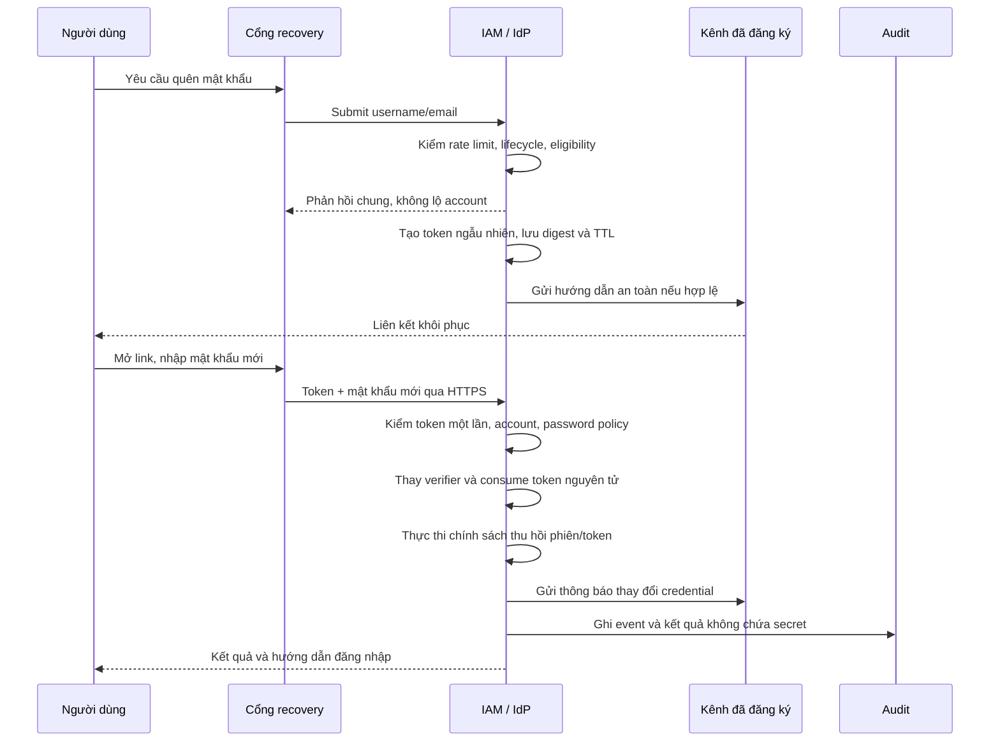

# Reset mật khẩu trong IAM: Xác minh, khôi phục và bảo vệ vòng đời tài khoản

Một nhân viên quên mật khẩu đăng nhập tài khoản công việc. Hệ thống cho phép bấm **“Quên mật khẩu”**, gửi một liên kết đến email và đặt mật khẩu mới. Về trải nghiệm, đó là thao tác đơn giản. Về bảo mật, đây lại là **điểm thay đổi quyền kiểm soát tài khoản**: nếu người thực hiện không phải chủ tài khoản hợp lệ, tính năng khôi phục có thể trở thành đường chiếm đoạt danh tính, kể cả khi luồng đăng nhập thông thường đã bật MFA.

Trong **Identity and Access Management (IAM)**, **reset mật khẩu (password reset)** là quy trình được kiểm soát để **thay thế bí mật xác thực của một tài khoản** khi chủ thể không thể hoặc không nên tiếp tục sử dụng mật khẩu hiện tại. Quy trình phải kiểm tra thẩm quyền yêu cầu, tạo cách xác minh khôi phục phù hợp mức rủi ro, thay đổi credential tại đúng nơi quản lý, xử lý phiên và token liên quan, thông báo, ghi audit và bảo đảm không làm sống lại quyền của danh tính đã bị thu hồi.

Bài này thuộc phần **Mật khẩu** trong mô-đun **Identity Lifecycle**, liên kết reset mật khẩu với **Joiner–Mover–Leaver (JML)**, **IdP, SSO, SCIM, RBAC/ABAC**, quản trị tài khoản đặc quyền, tài khoản dịch vụ, kiểm toán và giảm **quyền truy cập tồn dư (residual access)**.

## 1. Reset mật khẩu là gì?

**Reset mật khẩu** là thao tác thay giá trị bí mật dùng để xác thực một tài khoản, theo quy trình khôi phục hoặc quản trị được phê duyệt, **không dựa vào việc người dùng phải nhớ mật khẩu cũ**.

Một reset thành công có thể gồm:

1. Xác định đúng **danh tính và tài khoản** đang cần hỗ trợ.
2. Kiểm tra tài khoản **có đủ điều kiện được reset** hay không.
3. Xác minh người yêu cầu theo phương thức khôi phục và mức rủi ro áp dụng.
4. Cấp quyền đặt bí mật mới trong **phạm vi hẹp và thời gian ngắn**.
5. Lưu mật khẩu mới bằng cơ chế bảo vệ thích hợp.
6. Vô hiệu hóa bằng chứng khôi phục đã dùng và xử lý những bằng chứng/phiên cũ theo chính sách.
7. Thông báo, ghi nhật ký và cho phép người dùng tiếp tục đăng nhập an toàn.

**Reset không đồng nghĩa cấp quyền truy cập.** Nếu tài khoản đã bị khóa vì nhân viên nghỉ việc, một yêu cầu reset không được tự kích hoạt lại account hoặc tái cấp role đã thu hồi.

### 1.1. Phân biệt reset, change, recovery và unlock

| Thao tác | Người thực hiện thường ở trạng thái nào? | Mục tiêu và kiểm soát |
|---|---|---|
| **Change password** | Đã có phiên đăng nhập hợp lệ và có thể chứng minh quyền kiểm soát hiện tại. | Đổi mật khẩu theo nhu cầu; có thể yêu cầu xác thực lại cho thao tác nhạy cảm. |
| **Forgot-password reset** | Không đăng nhập được hoặc không nhớ mật khẩu hiện tại. | Khôi phục quyền kiểm soát thông qua phương thức thay thế đã được đăng ký và xác minh. |
| **Administrative reset** | Helpdesk/Administrator thực hiện theo quy trình đã ủy quyền. | Hỗ trợ người dùng, kèm xác minh, approval, audit và hạn chế đặc quyền quản trị. |
| **Forced reset** | Hệ thống yêu cầu thay credential do rủi ro hoặc chính sách. | Xử lý mật khẩu bị lộ, thiết bị bị chiếm quyền hoặc tình trạng không còn tin cậy. |
| **Account unlock** | Tài khoản bị khóa do nhiều lần thử hoặc chính sách vận hành. | Gỡ trạng thái khóa nếu đủ điều kiện; **không nhất thiết đổi mật khẩu**. |
| **MFA recovery/reset** | Người dùng mất hoặc không còn sử dụng yếu tố xác thực bổ sung. | Khôi phục hoặc đăng ký lại authenticator; là một quy trình rủi ro cao riêng. |
| **Service credential rotation** | Workload hoặc đội kỹ thuật cần thay secret/token/certificate. | Luân chuyển credential phi con người, khác với luồng “quên mật khẩu” của nhân viên. |

Một form “Đổi mật khẩu” khi đã đăng nhập không nên mặc nhiên được xem là giải pháp recovery khi người dùng mất cả mật khẩu lẫn thiết bị xác thực. **Khôi phục tài khoản yếu hơn đăng nhập thông thường** có thể làm giảm hiệu quả của toàn bộ hệ thống xác thực.

### 1.2. Thuật ngữ identity, account, credential và session

| Khái niệm | Ý nghĩa | Ảnh hưởng khi reset |
|---|---|---|
| **Identity** | Bản ghi danh tính tổ chức của người hoặc workload. | Không tạo identity mới chỉ vì quên mật khẩu. |
| **Account** | Đối tượng đăng nhập trên IdP hoặc ứng dụng. | Phải chọn đúng account và trạng thái lifecycle hiện hành. |
| **Password credential** | Bí mật xác thực thuộc account. | Được thay bằng mật khẩu mới sau khi kiểm tra quyền reset. |
| **Authenticator** | Phương tiện xác thực như passkey, OTP, khóa bảo mật hoặc mật khẩu theo thiết kế. | Có thể cần được sử dụng trong khôi phục hoặc quản trị riêng nếu mất. |
| **Session** | Phiên đăng nhập đã thiết lập. | Có thể cần hủy hoặc yêu cầu đăng nhập lại. |
| **Access/refresh token** | Bằng chứng hoặc khả năng nhận quyền đã được phát hành. | Cần đánh giá việc thu hồi và thời hạn; reset mật khẩu không bảo đảm tự thu hồi mọi token. |
| **Entitlement** | Role, group hoặc chính sách cho phép truy cập. | Không được tự mở rộng chỉ vì mật khẩu vừa đổi. |

## 2. Mục tiêu bảo mật và các mối đe dọa

Reset là thao tác nhạy cảm bởi vì kẻ tấn công có thể tìm cách **thay credential của người khác**. Các rủi ro cần phân tích gồm:

- **Account enumeration:** dùng thông báo lỗi khác nhau để suy ra email/username nào tồn tại.
- **Recovery-channel takeover:** email hoặc số điện thoại khôi phục bị chiếm đoạt.
- **Reset-token theft:** liên kết/token lộ qua log, trình duyệt, Referer, hệ thống phân tích hoặc thiết bị dùng chung.
- **Brute force hoặc token guessing:** thử hàng loạt mã reset quá ngắn hoặc xác suất đoán cao.
- **Replay:** dùng lại mã đã tiêu thụ, hoặc dùng đồng thời hai lần trước khi trạng thái cập nhật.
- **Helpdesk social engineering:** giả danh nhân viên để nhờ hỗ trợ đổi mật khẩu.
- **Session persistence:** kẻ tấn công đang có phiên cũ tiếp tục truy cập sau khi mật khẩu được thay.
- **Privilege reactivation:** reset của một tài khoản đã Leaver vô tình kích hoạt lại quyền.
- **Password reset flooding:** gửi quá nhiều email/tin nhắn khiến người dùng bị làm phiền hoặc gây từ chối dịch vụ.
- **Credential stuffing:** kẻ tấn công sử dụng mật khẩu lộ từ hệ thống khác sau khi người dùng đặt lại cùng bí mật.

Mô hình đe dọa phải xét **mức độ nhạy cảm của tài khoản**. Một tài khoản xem thông tin chung và một tài khoản có quyền quản trị IAM production không nên mặc nhiên có cùng quy trình recovery.

### 2.1. Các thuộc tính an toàn cần đạt

Một luồng reset tốt bảo đảm:

1. **Đúng chủ thể:** người yêu cầu đã đáp ứng mức xác minh cần thiết.
2. **Đúng account:** mã định danh liên kết tới tài khoản mục tiêu được kiểm soát.
3. **Không tiết lộ thông tin không cần thiết:** phản hồi công khai hạn chế account enumeration.
4. **Token an toàn:** khó đoán, chỉ dùng cho reset, có hạn và không thể tái sử dụng.
5. **Không cấp lại quyền sai:** trạng thái account, JML và entitlement được tôn trọng.
6. **Xử lý phiên phù hợp:** thu hồi hoặc hạn chế các đường truy cập cũ theo rủi ro và khả năng của sản phẩm.
7. **Truy vết:** có audit đủ giải thích ai yêu cầu, cơ chế xác minh, kết quả và hành động hậu reset.
8. **Phục hồi hợp lệ:** người dùng thật có cách khôi phục mà không buộc dùng quy trình yếu hoặc tiết lộ bí mật cho nhân viên hỗ trợ.

## 3. Xác định nơi quản lý mật khẩu và phạm vi reset

Trong doanh nghiệp, một người có thể đăng nhập qua nhiều hệ thống:

- **IdP/directory** quản lý mật khẩu cho tài khoản tổ chức.
- **SSO** cho phép nhiều ứng dụng tin cậy quá trình xác thực từ IdP.
- **Ứng dụng có tài khoản cục bộ** duy trì mật khẩu riêng ngoài IdP.
- **Cloud/legacy system** có tài khoản quản trị riêng hoặc đường xác thực độc lập.
- **Tài khoản dịch vụ** có password/secret cho kết nối tự động.

Đầu tiên phải xác định **hệ thống nào thực sự sở hữu credential** và **hệ thống nào chỉ sử dụng kết quả đăng nhập**.

### 3.1. Ví dụ phân biệt IdP và ứng dụng

Một nhân viên đăng nhập ứng dụng báo cáo bằng SSO. Nếu ứng dụng không lưu mật khẩu riêng, nút “Quên mật khẩu” trên ứng dụng nên dẫn người dùng về **luồng recovery của IdP** thay vì tạo một mật khẩu cục bộ mới không được quản trị.

Ngược lại, nếu ứng dụng có chế độ đăng nhập local cho account cũ, đổi mật khẩu ở IdP **không mặc nhiên làm mật khẩu local thay đổi**. Tổ chức phải biết đường xác thực nào đang tồn tại và có thể bị sử dụng.

### 3.2. Danh sách cần xác định trước khi thiết kế

| Câu hỏi | Vì sao quan trọng? |
|---|---|
| Account dùng SSO hay password local? | Để reset tại đúng nguồn credential. |
| IdP có phải nơi kiểm soát duy nhất không? | Tránh bỏ sót login cục bộ hoặc tài khoản quản trị riêng. |
| Có MFA, passkey hoặc yếu tố khôi phục đã đăng ký không? | Chọn phương thức xác minh đủ mạnh. |
| Account có quyền đặc biệt không? | Có thể cần step-up, manual review và kiểm soát bổ sung. |
| Có phiên, refresh token hoặc API token đang hoạt động không? | Chọn phương án thu hồi sau reset. |
| Trạng thái JML là gì? | Ngăn reset kích hoạt lại Leaver hoặc tài khoản bị đình chỉ vì bảo mật. |
| Có kênh gửi thông báo nào đã xác minh không? | Tránh gửi reset link tới địa chỉ kẻ tấn công vừa thay đổi. |

## 4. Bước 1 — Tiếp nhận yêu cầu mà không làm lộ account

Giao diện phổ biến yêu cầu người dùng nhập tên đăng nhập hoặc email công việc. Sau đó ứng dụng kiểm tra tài khoản và gửi hướng dẫn tới **kênh đã đăng ký** nếu đủ điều kiện.

### 4.1. Chống account enumeration

Không nên phản hồi:

- “Email này không tồn tại” cho account không hợp lệ.
- “Đã gửi link đặt lại” chỉ với account tồn tại, còn account khác trả lỗi.
- Trạng thái HTTP hoặc thời gian xử lý khác biệt rõ rệt chỉ vì có account hay không.

Một thông báo phù hợp hơn:

> Nếu thông tin khớp với một tài khoản đủ điều kiện, chúng tôi sẽ gửi hướng dẫn khôi phục qua kênh đã đăng ký.

Trên API, có thể dùng phản hồi chung như `202 Accepted` cho yêu cầu hợp lệ về định dạng bất kể account có tồn tại hay không, đồng thời giảm khác biệt về thời gian và kích thước phản hồi khi hợp lý. **Không có biện pháp đơn lẻ nào loại bỏ hoàn toàn mọi kênh suy luận**; cần kết hợp rate limiting và giám sát.

### 4.2. Rate limiting và chống lạm dụng

Áp dụng kiểm soát theo nhiều chiều:

- Giới hạn **số yêu cầu** theo account, IP, thiết bị hoặc ngữ cảnh rủi ro.
- Giới hạn **số lần thử mã/token không hợp lệ**.
- Có cơ chế làm chậm hoặc thử thách bổ sung theo nguy cơ, nhưng không để captcha thay cho xác minh danh tính.
- Phát hiện luồng gửi email/tin nhắn bất thường và tránh spam.
- Đảm bảo kẻ tấn công không dễ khóa vĩnh viễn quyền khôi phục của người dùng thật bằng cách gửi yêu cầu liên tục.

Thông báo hạn chế cần thận trọng để không vô tình tiết lộ rằng username có tồn tại. Giới hạn và thời gian cụ thể nên được xác định theo mức rủi ro, lưu lượng và khả năng phục vụ hợp lệ của hệ thống.

## 5. Bước 2 — Xác minh người yêu cầu khôi phục

**Identity proofing** và **authentication** liên quan nhưng không đồng nghĩa. Tài khoản đã được proofing lúc Joiner có thể vẫn bị kẻ khác tìm cách khôi phục sau này.

### 5.1. Các phương thức recovery

| Phương thức | Có thể phù hợp khi nào? | Giới hạn và rủi ro |
|---|---|---|
| **Liên kết gửi tới email đã đăng ký và kiểm soát** | Một số trường hợp rủi ro phù hợp theo chính sách. | Chứng minh khả năng truy cập inbox, không phải luôn chứng minh đầy đủ chủ danh tính. |
| **Authenticator còn hoạt động** | Người dùng quên mật khẩu nhưng vẫn giữ khóa bảo mật/passkey hoặc yếu tố khác. | Cần cơ chế khôi phục phù hợp và chống dùng lại. |
| **Recovery code đã cấp trước** | Người dùng lưu mã dự phòng an toàn theo hướng dẫn. | Mã có thể bị lộ; cần dùng một lần và xử lý vòng đời. |
| **Xác minh qua Helpdesk có kiểm soát** | Người dùng mất kênh tự phục hồi. | Dễ bị social engineering nếu chỉ dựa vào thông tin công khai. |
| **Quy trình định danh lại theo mức bảo đảm yêu cầu** | Mất mọi yếu tố hoặc tài khoản nhạy cảm. | Chi phí vận hành cao nhưng có thể cần để tránh hạ chuẩn bảo mật. |
| **Tin nhắn/điện thoại** | Có thể được một số hệ thống dùng như kênh khôi phục trong chính sách phù hợp. | Rủi ro chuyển SIM, chiếm số, chuyển hướng hoặc mất thiết bị. |

Không nên dựa vào **câu hỏi bảo mật kiểu “tên thú cưng”, “nơi sinh”, “trường học”** như một bằng chứng mạnh: câu trả lời có thể đoán, thu thập hoặc bị lộ. Cũng không nên cho nhân viên Helpdesk yêu cầu người dùng tiết lộ mật khẩu hiện tại, mã MFA đang dùng hoặc mã khôi phục để đọc qua cuộc gọi.

### 5.2. Kênh khôi phục cũng có vòng đời

Email hoặc điện thoại khôi phục có thể đã thay đổi, hết hiệu lực hoặc bị kẻ khác chiếm quyền. Khi yêu cầu reset:

1. Đọc **địa chỉ/kênh đã được xác minh trước đó** theo policy.
2. Không tin địa chỉ mới do người chưa xác thực vừa nhập làm kênh khôi phục.
3. Nếu gần đây có thay đổi thông tin recovery, áp dụng kiểm soát bổ sung theo mức rủi ro.
4. Nếu người dùng mất cả mật khẩu lẫn MFA/kênh dự phòng, chuyển sang **account recovery nâng cao** có bằng chứng và authority phù hợp.
5. Thông báo tới kênh đã được đăng ký/giám sát khi có thay đổi quan trọng, nếu không gây tiết lộ thông tin.

**Đăng nhập bằng MFA mạnh nhưng recovery chỉ bằng email dễ bị chiếm đoạt** có thể khiến recovery trở thành mắt xích yếu nhất. Quy trình cần được đánh giá như một phương thức cấp lại quyền kiểm soát account.

### 5.3. Tài khoản đặc quyền

Đối với Administrator, nhân viên bảo mật hoặc chủ thể có quyền production, yêu cầu reset có thể cần:

- Xác thực lại bằng yếu tố còn tin cậy hoặc quy trình xác minh có mức bảo đảm cao hơn.
- Xác nhận danh tính và tư cách công tác ở nguồn có thẩm quyền.
- Phê duyệt/kiểm tra độc lập phù hợp nguyên tắc **Separation of Duties (SoD)**.
- Tạm hạn chế quyền nhạy cảm trong lúc đang điều tra nguy cơ chiếm đoạt.
- Thông báo và giám sát hậu reset.
- Kiểm tra lại các phiên đặc quyền và khả năng kích hoạt **PAM/JIT**.

Không dùng cùng một quy trình tự phục vụ rủi ro thấp cho mọi tài khoản admin nếu nó có thể bypass xác thực mạnh.

## 6. Bước 3 — Tạo và bảo vệ reset token

Trong luồng tự phục vụ, hệ thống thường gửi một **reset token** hoặc đường dẫn có giá trị bí mật đến kênh đã xác minh. Token là bằng chứng cho phép thực hiện **một hành động nhạy cảm có phạm vi rất hẹp**.

### 6.1. Các thuộc tính bắt buộc của token

- **Khó đoán:** tạo bằng bộ sinh số ngẫu nhiên mật mã an toàn, đủ entropy; không dùng timestamp, mã nhân viên hoặc số tăng dần.
- **Ràng buộc đúng account:** server biết token được cấp cho tài khoản nào, không nhận account ID tùy ý từ người gọi để đổi đích.
- **Giới hạn mục đích:** token đặt lại mật khẩu không phải access token, không dùng được cho API khác.
- **Thời gian sống ngắn:** giới hạn hiệu lực tùy mức rủi ro và trải nghiệm thực tế.
- **Một lần sử dụng:** sau khi reset thành công token không thể dùng lại.
- **Vô hiệu hóa khi không còn hợp lệ:** account Leaver, bị khóa vì bảo mật, hoặc token được thay thế theo chính sách thì không được cấp quyền reset sai.
- **Chống lộ:** không ghi token thô vào log, analytics, crash report hoặc thông báo theo dõi lỗi.

Token đủ entropy có thể được lưu dưới dạng **digest/HMAC để đối chiếu** thay vì giữ plaintext trong cơ sở dữ liệu. Đây là cơ chế bảo vệ token ngẫu nhiên; **không đồng nghĩa có thể hash mật khẩu người dùng bằng SHA-256 đơn thuần**.

### 6.2. Mô hình bản ghi token

```json
{
  "requestId": "reset-2026-0042",
  "accountId": "idp-user-1045",
  "tokenDigest": "<derived-value-not-a-real-token>",
  "purpose": "PASSWORD_RESET",
  "issuedAt": "2026-11-23T10:00:00+07:00",
  "expiresAt": "2026-11-23T10:15:00+07:00",
  "consumedAt": null,
  "accountSecurityVersion": 17
}
```

JSON là **schema minh họa**; thời hạn 15 phút chỉ là ví dụ, không phải giá trị bắt buộc. `accountSecurityVersion` có thể giúp vô hiệu hóa token cũ khi những điều kiện bảo mật của account thay đổi, nếu hệ thống được thiết kế nhất quán.

### 6.3. Nguyên tắc xử lý token một lần

Quy trình sử dụng token nên:

1. Nhận token qua kênh HTTPS tin cậy.
2. Tính digest hoặc cách kiểm tra phù hợp, tìm đúng bản ghi.
3. Kiểm tra purpose, thời hạn, trạng thái account và phiên bản an ninh.
4. Kiểm tra token chưa bị dùng hoặc vô hiệu hóa.
5. Cho người dùng đặt bí mật mới theo password policy.
6. **Đảm bảo thao tác thay credential và tiêu thụ token có tính nguyên tử**, hoặc có cơ chế giao dịch an toàn tương đương.
7. Vô hiệu hóa các token reset còn lại theo policy.
8. Xử lý session/refresh token, thông báo và audit.

Nếu hai request đến đồng thời, chỉ một request được phép tiêu thụ token thành công. Không triển khai bằng kiểu “đọc `consumed=false`, đổi password rồi mới đánh dấu used” mà không có kiểm soát tranh chấp.

### 6.4. Pseudocode phía server

```text
completePasswordReset(rawToken, proposedPassword):
    requireSecureTransport()
    token = lookupBySecureDigest(rawToken)

    if token is missing or expired or consumed:
        return genericInvalidOrExpiredResponse()

    account = loadAccountForUpdate(token.accountId)

    if not isResetEligible(account, currentAuthoritativeLifecycleState):
        recordRejectedAttemptWithoutSecrets()
        return genericInvalidOrExpiredResponse()

    if token.purpose != PASSWORD_RESET:
        return genericInvalidOrExpiredResponse()

    if token.accountSecurityVersion != account.securityVersion:
        return genericInvalidOrExpiredResponse()

    validateNewPasswordAgainstPolicy(proposedPassword)

    beginAtomicTransaction()
        consumeTokenIfUnusedAndValid(token)
        setPasswordVerifier(account, hashPasswordWithApprovedKDF(
            proposedPassword, freshSalt, configuredParameters))
        incrementAccountSecurityVersion(account)
        invalidateOtherOutstandingResetTokens(account)
    commitTransaction()

    applySessionAndTokenRevocationPolicy(account)
    sendSecurityNotification(account)
    writeAuditWithoutPasswordOrRawToken()
    return success()
```

Đây là **pseudocode học thuật**, không phải chương trình hoàn chỉnh. Trong triển khai thực tế phải xử lý rollback giao dịch, lỗi gửi thông báo, khóa đồng thời, khả năng thu hồi phiên tại IdP/ứng dụng và bảo vệ các endpoint. Thao tác gửi email không nên làm cho mật khẩu bị đặt lại hai lần khi retry.

### 6.5. Tránh rò rỉ token qua URL và ứng dụng bên thứ ba

Link reset thường chứa token trên URL. Các biện pháp cần xét:

- HTTPS trên toàn bộ hành trình.
- Không nhúng script quảng cáo/analytics hoặc tài nguyên bên thứ ba không cần thiết trên trang sử dụng token.
- Cấu hình **Referrer-Policy** phù hợp, ví dụ `no-referrer`, để hạn chế lộ URL qua yêu cầu đi nơi khác.
- Không đưa token vào access log, proxy log, theo dõi lỗi hoặc ảnh chụp tự động.
- Tránh chuyển token qua nhiều redirect không kiểm soát.
- Sau khi xác minh token, sử dụng cơ chế trạng thái phía server phù hợp để hạn chế tiếp tục giữ token trong URL; làm sạch URL khi có thể.
- Dùng POST và bảo vệ chống CSRF cho hành động đổi mật khẩu nếu thiết kế session/cookie yêu cầu; không thực hiện reset chỉ bằng GET.

Không nên để dịch vụ quét liên kết trong email **tự tiêu thụ token** chỉ vì truy cập URL bằng GET. Cần có bước xác nhận thay đổi mật khẩu thực sự từ phía người dùng.

## 7. Bước 4 — Đặt mật khẩu mới và lưu trữ đúng cách

Một mật khẩu mới phải được bảo vệ cả ở thời điểm nhập, truyền và lưu trữ.

### 7.1. Chính sách mật khẩu hướng tới chất lượng thực tế

Các nguyên tắc hữu ích:

- Cho phép **mật khẩu dài hoặc passphrase**, hỗ trợ password manager, dán và tự điền phù hợp.
- Đặt yêu cầu độ dài hợp lý theo chính sách và mức rủi ro; tránh giới hạn tối đa quá ngắn.
- Kiểm tra mật khẩu quá phổ biến hoặc nằm trong tập đã biết bị lộ; áp dụng cách kiểm tra an toàn dữ liệu.
- Không yêu cầu quy tắc độ phức tạp hình thức khiến người dùng chọn biến thể dễ đoán, nếu chính sách có thể dùng cách tốt hơn.
- Tránh buộc đổi mật khẩu theo chu kỳ tùy tiện khi không có lý do rủi ro/chính sách; ưu tiên reset khi có dấu hiệu bị lộ và biện pháp kiểm soát khác.
- Không chấp nhận mật khẩu trùng với username hay giá trị cực kỳ dễ đoán theo quy tắc phù hợp.
- Không hiển thị hoặc gửi lại **mật khẩu mới qua email**.

Mật khẩu nên được tạo và quản lý qua password manager khi có thể. MFA/passkey giúp bổ sung cơ chế bảo vệ nhưng **không thay thế** việc xử lý password credential đúng cách nếu account vẫn hỗ trợ mật khẩu.

### 7.2. Không lưu plaintext, không mã hóa thuận nghịch tùy tiện

Server cần lưu **password verifier** dạng băm sử dụng **password-hashing/KDF chuyên dụng có tham số phù hợp**, ví dụ Argon2id hoặc lựa chọn phù hợp tiêu chuẩn/chính sách của nền tảng. Mỗi mật khẩu cần **salt ngẫu nhiên riêng** và cơ chế nâng cấp tham số theo khả năng hệ thống.

Không dùng:

```text
storedPassword = plaintextPassword
storedPassword = SHA256(password)     # quá nhanh nếu dùng trực tiếp
storedPassword = MD5(password)        # không phù hợp để lưu password
```

Ví dụ mô hình đúng ở mức khái niệm:

```text
salt = secureRandomSalt()
verifier = passwordKDF(
    password = newPassword,
    salt = salt,
    parameters = reviewedCostConfiguration
)
store(accountId, algorithmId, parameters, salt, verifier)
```

Đây là minh họa, không phải API của một thư viện cụ thể. Việc chọn tham số cần theo khả năng phần cứng, mức rủi ro và hướng dẫn an ninh được tổ chức duyệt. Nếu dùng **pepper** như lớp tăng cường, phải quản trị khóa riêng, vòng đời và kế hoạch rotation phù hợp.

### 7.3. Đổi mật khẩu không được làm đổi quyền

Một account có thể bị giới hạn, tạm ngừng hoặc thuộc danh tính đã Leaver. Sau reset:

- Không tự đặt `employmentStatus=ACTIVE`.
- Không tự thêm lại group hay role bị thu hồi.
- Không bỏ qua MFA/conditional access chỉ vì vừa xác minh email.
- Không xóa flag kiểm soát sự cố nếu chưa được người có thẩm quyền giải quyết.
- Không phục hồi tài khoản quản trị đã bị deprovision.

Mật khẩu là **credential**, không phải **entitlement**.

## 8. Bước 5 — Xử lý phiên, refresh token và cảnh báo

Đây là bước dễ bị bỏ sót nhất sau khi đổi credential.

### 8.1. Reset không tự động thu hồi mọi phiên

Một hệ thống có thể:

- Đã phát hành session cookie ở ứng dụng SaaS.
- Đã phát hành access token tự chứa có thời hạn.
- Có refresh token cho thiết bị di động.
- Cho phép đăng nhập local tách khỏi IdP.
- Có phiên đặc quyền được tạo qua PAM/bastion.

Đổi password hash ở IdP **không mặc nhiên làm toàn bộ phiên hoặc token ở mọi ứng dụng mất hiệu lực ngay**. Phải biết từng target hỗ trợ logout/revoke/invalidation theo cách nào.

### 8.2. Chính sách phiên sau reset

| Trường hợp | Hướng xử lý cần xem xét |
|---|---|
| Người dùng chủ động đổi mật khẩu trong phiên đã xác thực | Theo chính sách, có thể giữ một phiên vừa xác thực mạnh, nhưng nên đánh giá các phiên khác. |
| Forgot-password reset do mất quyền truy cập | Thường nên cân nhắc vô hiệu hóa những phiên và refresh token cũ theo mức rủi ro. |
| Reset do nghi ngờ credential bị lộ | Ưu tiên chặn phiên/refresh token cũ và theo dõi sự kiện bất thường; kiểm tra cả yếu tố recovery. |
| Admin account bị reset | Rà soát phiên đặc quyền, eligible/active PAM, đường API/CLI và quyền thay thế. |
| Session/token không thể revoke tức thì | Xác định TTL, cơ chế chặn tại resource server/gateway và giám sát cho tới khi hết rủi ro. |

Với JWT tự chứa được API kiểm tra cục bộ, việc xóa session ở IdP có thể **chưa đủ** nếu resource server không tra cứu trạng thái hiện hành. Cần thiết kế TTL thích hợp, revocation/introspection hoặc kiểm tra chính sách ở resource theo khả năng.

### 8.3. Thông báo sau reset

Sau reset thành công, nên gửi thông báo tới kênh bảo mật đã được đăng ký/đánh giá phù hợp, ví dụ:

- Mật khẩu tài khoản đã được đổi.
- Thời gian và một số ngữ cảnh không quá nhạy cảm nếu policy cho phép.
- Hướng dẫn liên hệ bộ phận hỗ trợ qua kênh chính thức nếu người dùng **không thực hiện** thao tác.
- Cảnh báo không chia sẻ mã hoặc liên kết reset.

**Không đính kèm mật khẩu mới, token reset hoặc session token.** Thông báo không thay thế audit và không nên tiết lộ thêm dữ liệu nhạy cảm không cần thiết.

## 9. Luồng reset tự phục vụ end-to-end

### 9.1. Sơ đồ trình tự



Sơ đồ là một **luồng khái niệm**; một account nhạy cảm có thể yêu cầu bước verification/approval khác trước khi phát hành token. Không phải luồng nào cũng dùng email; có thể dùng recovery code hoặc authenticator còn hợp lệ.

### 9.2. Tách khôi phục khỏi đăng nhập thông thường

Một reset token chỉ nên cho phép đặt **credential mới** theo chính sách. Nó **không nên tự đóng vai trò access token** cho ứng dụng nghiệp vụ hoặc cho phép đọc dữ liệu nhạy cảm trước khi hoàn thành xác thực phù hợp.

Sau reset, có thể yêu cầu người dùng **đăng nhập lại** qua luồng bình thường, gồm MFA/conditional access nếu hệ thống yêu cầu. Không cấp một session quyền cao chỉ vì người dùng sở hữu reset link.

### 9.3. Khi liên kết đã hết hạn hoặc đã dùng

Phản hồi nên:

- Không tiết lộ chi tiết account ngoài mức cần thiết.
- Nêu rằng liên kết không còn hợp lệ hoặc đã hết hạn.
- Cho phép bắt đầu lại quy trình theo rate limit.
- Không tự kéo dài thời hạn token cũ.
- Ghi nhận hành vi đáng ngờ nếu có nhiều lần dùng lại.

Không nên cho phép đổi mật khẩu khi token đã hết hạn chỉ vì trình duyệt còn giữ form.

## 10. Quy trình Helpdesk và reset bởi Administrator

Không phải ai cũng còn khả năng nhận email hoặc sử dụng authenticator. Khi đó Helpdesk có thể cần hỗ trợ, nhưng chính luồng hỗ trợ là mục tiêu phổ biến của **social engineering**.

### 10.1. Xác minh người gọi bằng cơ chế có thẩm quyền

Trước khi reset hộ:

1. Xác định **identity/account** và trạng thái nguồn nhân sự hoặc nhà thầu.
2. Đối chiếu yêu cầu qua kênh và phương thức xác minh được tổ chức phê duyệt.
3. Không dùng các dữ kiện công khai như tên, chức danh, số điện thoại hiển thị trên danh bạ làm bằng chứng độc lập đủ mạnh.
4. Nếu account có quyền admin hoặc có dấu hiệu bị chiếm đoạt, áp dụng quy trình xác minh nâng cao và phê duyệt độc lập thích hợp.
5. Không yêu cầu nhân viên tiết lộ password, OTP đang sử dụng, private key hay recovery code qua điện thoại/chat.
6. Ghi mã yêu cầu, người xác minh, quyết định và lý do thao tác.

Không nên biến việc “manager xác nhận qua tin nhắn” thành căn cứ duy nhất cho mọi loại reset, vì manager cũng có thể bị giả mạo hoặc tài khoản liên lạc bị chiếm đoạt.

### 10.2. Quyền Helpdesk phải giới hạn

Một Helpdesk Administrator có thể được phép **khởi tạo reset cho người dùng thông thường** trong phạm vi đơn vị. Điều đó không đồng nghĩa họ được:

- Reset mật khẩu của Global Admin hoặc chính họ mà không có kiểm soát khác.
- Tắt MFA cho bất kỳ ai.
- Thay email recovery của người dùng tùy ý.
- Xóa nhật ký reset hoặc tự phê duyệt ngoại lệ rủi ro cao.
- Tạo session đăng nhập nhân danh người dùng mà không qua cơ chế được kiểm soát.

RBAC/ABAC nên giới hạn **ai được reset tài khoản nào**, loại thao tác, phạm vi tổ chức, môi trường và điều kiện phê duyệt. SoD có thể yêu cầu người phê duyệt khác người thực hiện ở các trường hợp nhạy cảm.

### 10.3. Mật khẩu tạm thời có phải cách tốt?

Một số hệ thống cũ hỗ trợ admin đặt mật khẩu tạm thời và yêu cầu người dùng thay ở lần đăng nhập tiếp theo. Nếu phải dùng:

- Không gửi mật khẩu tạm qua kênh không được bảo vệ hoặc hiển thị cho nhiều nhân viên.
- Hạn chế thời gian sử dụng và khả năng lạm dụng; yêu cầu đổi ở phiên đầu.
- Xác minh người nhận qua quy trình phù hợp.
- Giảm quyền trong thời gian chuyển tiếp khi cần.
- Ưu tiên **luồng tự đặt mật khẩu qua token một lần** nếu hệ thống hỗ trợ để Helpdesk không biết bí mật của người dùng.

Mật khẩu tạm không phải một biện pháp recovery mạnh chỉ vì nó được hệ thống sinh ngẫu nhiên; việc phân phối và xác minh người nhận quyết định rủi ro.

## 11. Reset mật khẩu trong Joiner–Mover–Leaver

### 11.1. Joiner: thiết lập credential đầu tiên

Khi một nhân viên mới được xác minh và đăng ký identity, hệ thống có thể phát hành lời mời **thiết lập mật khẩu ban đầu**. Luồng đó có kỹ thuật gần reset (token một lần, TTL, xác minh người nhận) nhưng mục đích khác: **enrollment credential đầu tiên**.

Cần:

- Xác minh identity và trạng thái gia nhập có thẩm quyền.
- Chỉ kích hoạt account theo ngày/điều kiện đã được phê duyệt.
- Không gửi plaintext password cố định từ HRIS đến hàng loạt ứng dụng.
- Khuyến khích đăng ký MFA/passkey phù hợp ngay khi onboarding.
- Ghi nhận account đã được thiết lập credential, không tự cấp role ngoài quyền ban đầu.

### 11.2. Mover: đổi công việc không mặc nhiên phải reset mật khẩu

Khi nhân viên chuyển phòng ban, IAM thường cần **đánh giá lại quyền truy cập**, không nhất thiết phải đổi password. Một số tình huống có thể yêu cầu rotation hoặc reset, ví dụ nhân viên không còn được quản lý các secret chung của đội cũ, hoặc có nguy cơ credential bị lộ.

Điều quan trọng là:

- Tính **quyền mục tiêu theo role/department mới**.
- Thu hồi quyền của phòng ban cũ, gồm account admin và PAM eligible không còn hợp lệ.
- Xử lý ownership của service account/secret đã từng quản lý.
- Nếu reset password theo chính sách, không nhầm thao tác đó với việc gỡ entitlement.

**Reset mật khẩu không giải quyết privilege creep**: mật khẩu mới vẫn cho truy cập bằng các role cũ nếu chúng chưa được thu hồi.

### 11.3. Leaver: reset không được tái kích hoạt account

Một người đã nghỉ việc có thể cố dùng chức năng “Quên mật khẩu” để lấy lại tài khoản. Hệ thống phải kiểm tra **nguồn lifecycle hiện hành** và chính sách account:

- Nếu account không đủ điều kiện recovery, không phát hành cách đặt lại cho phép tái đăng nhập.
- Account bị disabled/terminated vẫn phải giữ trạng thái này sau các thao tác credential được phép thực hiện vì lý do quản trị.
- Token reset đã phát hành trước Leaver cần bị vô hiệu hóa hoặc không được chấp nhận sau mốc hiệu lực theo thiết kế.
- Quyền, nhóm và session được xử lý qua **deprovisioning** độc lập với password reset.
- Giữ audit/hồ sơ theo retention, không giữ khả năng đăng nhập.

Một sự kiện reset hoặc thay đổi account cũ đến sau sự kiện Leaver không được làm sống lại quyền đã thu hồi. Cần kiểm tra thứ tự sự kiện, version và trạng thái nguồn mới nhất trước khi hoàn tất.

### 11.4. Nhà thầu và người dùng bên ngoài

Contractor có thể sử dụng tài khoản trong thời gian hợp đồng. Luồng reset cần xét:

- Sponsor/owner có thẩm quyền và thời hạn hợp đồng.
- Kênh khôi phục có thể không thuộc email công ty.
- Bằng chứng xác minh danh tính theo mức rủi ro của dữ liệu được truy cập.
- Trạng thái account sau khi hợp đồng hết hạn.
- Tài khoản local hoặc SSO của đối tác và nơi thực sự sở hữu credential.

Không áp dụng cứng quy trình HRIS cho mọi external identity; nhưng cũng không cho phép tự phục hồi vô thời hạn khi quan hệ hợp tác đã kết thúc.

## 12. IdP, SSO và SCIM liên quan thế nào tới reset?

| Thành phần | Vai trò trong reset | Giới hạn cần hiểu |
|---|---|---|
| **IdP** | Có thể là nơi quản lý password credential, account recovery, MFA và trạng thái đăng nhập. | Cần xác định cơ chế session/token, trạng thái Leaver và account admin riêng. |
| **SSO / SAML / OIDC** | Ứng dụng dựa vào IdP để đăng nhập. | SSO không tự đặt lại mọi mật khẩu local hay thu hồi ngay tất cả app sessions. |
| **SCIM** | Đồng bộ User/Group và một số thuộc tính/account theo khả năng triển khai. | SCIM **không phải giao thức recovery chung** và không bảo đảm reset password, MFA hoặc thu hồi token trong mọi ứng dụng. |
| **RBAC** | Xác định người quản trị nào có quyền khởi tạo reset cho tài khoản nào. | Role Helpdesk không tự cho quyền reset mọi Global Admin. |
| **ABAC** | Giới hạn theo loại tài khoản, đơn vị, trạng thái lifecycle, mức rủi ro và context. | Thuộc tính phải từ nguồn đáng tin và còn mới. |
| **PAM/PIM** | Kiểm soát reset credential đặc quyền, phiên và khả năng nâng quyền. | Phải kiểm tra cả quyền active/eligible và credential dùng ngoài IdP. |
| **Audit / SIEM** | Theo dõi yêu cầu, xác minh, thay credential, lỗi, thông báo và hậu quả. | Không ghi bí mật hoặc reset token thô. |

### 12.1. SCIM có trường password không?

Một số mô hình dữ liệu/triển khai SCIM có biểu diễn thuộc tính liên quan mật khẩu, nhưng **khả năng hỗ trợ, ý nghĩa và chính sách của từng sản phẩm khác nhau**. Không nên xây dựng quy trình khôi phục chỉ vì thấy một trường mang tên `password` trong tài liệu schema.

Reset qua API của IdP hoặc hệ thống đích cần tuân theo **giao diện được nhà cung cấp hỗ trợ**, yêu cầu xác minh/ủy quyền và quy định không làm lộ credential. Việc một connector SCIM cập nhật User thành công không đủ để khẳng định tất cả đường xác thực đã được thay.

### 12.2. Reset trong môi trường federation

Giả sử doanh nghiệp dùng IdP A để xác thực nhân viên, còn SaaS B tin cậy OIDC từ A:

1. Nhân viên quên mật khẩu, reset tại **A** theo quy trình.
2. SaaS B không cần lưu mật khẩu A.
3. Các lần đăng nhập mới vào B qua A sử dụng trạng thái xác thực mới.
4. Nếu B có session đã tạo trước đó, cần xử lý theo cơ chế phiên của B.
5. Nếu B cho phép login local, tài khoản local đó cần policy riêng.

Vì vậy **một thao tác reset password không đồng nghĩa global logout hoặc global deprovisioning**.

## 13. Tài khoản dịch vụ: không dùng luồng “quên mật khẩu” của người

Một **service account/workload identity** có thể dùng secret, client credential, API key hoặc chứng chỉ. Khi cần thay đổi, quy trình phù hợp thường là **credential rotation** hoặc **re-issuance**, chứ không gửi liên kết “quên mật khẩu” tới email của một nhân viên đã tạo account.

### 13.1. Quy trình rotation cho workload

1. Xác định service identity, workload, owner team và mục đích còn hợp lệ.
2. Kiểm kê credential hiện tại, nơi lưu, hệ thống đích và mọi bản sao được biết.
3. Xác định phương thức thay thế: secret mới, chứng chỉ mới hoặc workload federation/token ngắn hạn.
4. Cấp credential mới qua kênh quản lý bí mật phù hợp; không ghi vào mã nguồn hoặc log.
5. Cập nhật workload và kiểm chứng kết nối.
6. Thu hồi credential cũ ngay khi có thể theo kế hoạch rủi ro; kiểm tra bản cũ không còn được chấp nhận.
7. Cập nhật inventory, lịch review và audit.

Trong hệ thống hỗ trợ, việc chấp nhận đồng thời credential cũ và mới trong một cửa sổ chuyển đổi ngắn có thể giảm gián đoạn. Cửa sổ đó phải được xác định, giám sát và **kết thúc bằng việc vô hiệu hóa credential cũ**.

### 13.2. Khi người tạo service account nghỉ việc

Nếu kỹ sư từng quản lý tài khoản dịch vụ rồi Leaver:

- Thu hồi quyền **cá nhân** đối với secret, vault và cloud role.
- Chuyển owner của service account sang đội có thẩm quyền.
- Đánh giá rotation với credential có thể đã bị người rời đi biết hoặc sao chép.
- Không tự xóa một workload hợp lệ chỉ vì owner cũ nghỉ.
- Không tự cấp lại quyền nhân sự đã Leaver để “cứu” job.
- Theo dõi service principal không có owner hoặc không còn workload để xử lý riêng.

Vòng đời của **người dùng** và **danh tính máy** có liên hệ về ownership nhưng không đồng nhất.

## 14. Giao diện, API và khả năng chống lạm dụng

### 14.1. Endpoint khởi tạo reset

API có thể được thiết kế ở mức khái niệm:

```http
POST /account-recovery/password-reset-requests HTTP/1.1
Host: example.invalid
Content-Type: application/json

{"loginHint":"employee@example.invalid"}
```

Phản hồi chung:

```http
HTTP/1.1 202 Accepted
Content-Type: application/json

{"message":"Nếu tài khoản đủ điều kiện, hướng dẫn sẽ được gửi qua kênh đã đăng ký."}
```

Đây là **ví dụ API minh họa**, không phải đặc tả phải áp dụng nguyên văn. Các lớp bảo vệ cần có bao gồm HTTPS, giới hạn tần suất, validation, không tiết lộ tồn tại account và audit an toàn.

### 14.2. Endpoint hoàn tất reset

```http
POST /account-recovery/password-resets/complete HTTP/1.1
Host: example.invalid
Content-Type: application/json

{
  "resetToken": "<one-time-token>",
  "newPassword": "<provided-directly-by-user>"
}
```

Các giá trị trong dấu ngoặc nhọn là **placeholder**, không phải credential thật. Truyền mật khẩu mới trong HTTPS request có thể là cần thiết cho hệ thống xác thực; server không được ghi raw body chứa mật khẩu hoặc token vào log.

### 14.3. Kiểm soát ở phía trình duyệt

Một trang reset nên:

- Chỉ được phục vụ qua HTTPS và hạn chế cache dữ liệu nhạy cảm.
- Có chính sách chống nhúng trang/phishing phù hợp, bảo vệ form và chống CSRF khi cần.
- Hạn chế tài nguyên bên thứ ba trên trang mang token.
- Không gắn token vào query của các API analytics.
- Không tự hoàn tất reset khi chỉ mở link.
- Cung cấp phản hồi rõ ràng nhưng không tiết lộ nội bộ account.
- Hỗ trợ password manager và khả năng truy cập phù hợp.
- Không tự gửi mật khẩu qua kênh hỗ trợ hoặc email.

### 14.4. Khôi phục khi email/tin nhắn đến chậm

Người dùng có thể bấm “Gửi lại” nhiều lần và nhận các link khác nhau. Hệ thống cần quy tắc nhất quán:

- Có thể vô hiệu hóa token cũ khi phát hành token mới, hoặc cho nhiều token chưa hết hạn cùng tồn tại theo policy, nhưng tránh nhầm lẫn và race condition.
- Token đã dùng hoặc bị hủy phải luôn bị từ chối.
- Kiểm tra hạn sử dụng từ phía server, không tin đồng hồ của trình duyệt.
- Thông báo đủ để người dùng biết dùng link mới nhất theo hành vi sản phẩm.
- Đảm bảo việc gửi lại không bỏ qua rate limit.

## 15. Reset do nghi ngờ tài khoản bị chiếm đoạt

Một luồng forgot-password thông thường có thể chưa đủ khi hệ thống phát hiện **credential compromise**.

### 15.1. Các dấu hiệu đáng chú ý

- Mật khẩu xuất hiện trong tập dữ liệu rò rỉ được xác minh phù hợp.
- Đăng nhập bất thường gắn với phiên hoặc thiết bị mới, theo hệ thống phát hiện.
- Người dùng báo có email reset không do mình yêu cầu.
- Thay đổi trái phép recovery email hoặc yếu tố xác thực.
- Có dấu hiệu đăng nhập từ nhiều nơi bất thường hoặc tạo API token trái phép.
- Tài khoản có quyền đặc biệt bị sử dụng không rõ nguyên nhân.

Những dấu hiệu này **không tự chứng minh đã có xâm nhập thành công**, nhưng có thể kích hoạt đánh giá rủi ro và quy trình ứng phó.

### 15.2. Thứ tự xử lý khi nghi bị chiếm đoạt

1. Xác minh và phân loại cảnh báo theo chính sách ứng phó sự cố.
2. Khi phù hợp mức rủi ro, chặn hoặc giới hạn đăng nhập/phiên đáng ngờ trước hoặc song song với reset.
3. Kiểm tra và bảo vệ kênh recovery; tránh gửi link tới email vừa bị kẻ khác kiểm soát.
4. Buộc đặt credential mới qua quy trình có mức xác minh phù hợp.
5. Xử lý MFA/passkey, recovery codes và phiên/token nếu có dấu hiệu bị lộ, theo thủ tục riêng.
6. Rà soát những thay đổi role, group, token, forwarding rule hoặc account liên quan được thực hiện gần thời điểm nghi vấn.
7. Thông báo cho người dùng và lưu bằng chứng, phối hợp security operations khi cần.

**Chỉ đổi mật khẩu** có thể không đủ nếu kẻ tấn công đã tạo **session, API token hoặc phương thức recovery mới**. Việc xử lý phải bao quát đường truy cập còn hiệu lực.

## 16. Audit và chỉ số chất lượng password reset

### 16.1. Sự kiện nên được ghi

Một bản ghi audit hữu ích có thể chứa:

| Trường | Ý nghĩa |
|---|---|
| `eventId` | Mã sự kiện duy nhất. |
| `subjectId` / `accountId` | Danh tính và account sau khi ánh xạ an toàn. |
| `eventType` | Reset requested, challenge issued, completed, rejected... |
| `initiatorType` | Self-service, Helpdesk, admin policy hoặc security action. |
| `verificationMethod` | Phương thức xác minh dạng mã phân loại, không ghi bí mật. |
| `lifecycleState` | Trạng thái account/danh tính tại thời điểm thao tác. |
| `outcome` | Thành công, bị từ chối, hết hạn hoặc cần escalation. |
| `policyVersion` | Phiên bản policy đánh giá yêu cầu. |
| `sessionAction` | Đã yêu cầu revoke, đã xác minh hoặc còn ngoại lệ. |
| `observedAt` | Thời điểm ghi nhận/kết quả từ target. |
| `riskReference` | Tham chiếu ticket/incident khi có. |

Ví dụ:

```json
{
  "eventId": "audit-reset-0442",
  "accountId": "idp-user-1045",
  "eventType": "PASSWORD_RESET_COMPLETED",
  "initiatorType": "SELF_SERVICE",
  "verificationMethod": "REGISTERED_AUTHENTICATOR",
  "lifecycleState": "ACTIVE",
  "result": "SUCCEEDED",
  "policyVersion": "password-recovery-v4",
  "sessionRevocation": "REQUESTED_AND_PARTIALLY_VERIFIED",
  "occurredAt": "2026-11-23T10:11:00+07:00"
}
```

Đây là dữ liệu **hư cấu**. Không ghi password, token thô, mã OTP, câu trả lời phục hồi hoặc thông tin cá nhân không cần thiết. Với yêu cầu khởi tạo không biết account có tồn tại hay không, audit phải bảo đảm bảo vệ chống enumeration và giới hạn ai được xem kết quả chi tiết.

### 16.2. KPI và cảnh báo

| Chỉ số | Câu hỏi cần trả lời |
|---|---|
| **Reset success rate** | Bao nhiêu yêu cầu hợp lệ hoàn tất mà không cần hỗ trợ ngoài dự kiến? |
| **Recovery abandonment rate** | Bao nhiêu luồng bị bỏ giữa chừng vì không nhận link, token hết hạn hoặc UX khó? |
| **Token misuse/replay detections** | Có nhiều lần dùng token không hợp lệ, hết hạn hoặc đã tiêu thụ không? |
| **Helpdesk escalation rate** | Tỷ lệ người dùng mất kênh tự phục hồi và cần xác minh thủ công? |
| **Privileged reset review coverage** | Bao nhiêu reset tài khoản đặc quyền đã tuân thủ policy kiểm tra bổ sung? |
| **Session revocation coverage** | Bao nhiêu phiên/target bắt buộc có thể xác nhận đã bị chặn sau reset? |
| **Reset-after-Leaver rejects** | Có yêu cầu recovery nhắm tới account đã mất tư cách không? |
| **Reset request flooding** | Bao nhiêu account/kênh chịu tần suất yêu cầu bất thường? |
| **Mean time to safe recovery** | Mất bao lâu để người dùng hợp lệ phục hồi được mà vẫn đạt kiểm soát an ninh? |
| **Post-reset suspicious activity** | Có truy cập bất thường sau reset cần điều tra không? |

Cần tách **khôi phục thành công cho người hợp lệ**, **reset bị từ chối đúng chính sách** và **yêu cầu có dấu hiệu tấn công**. Một tỷ lệ hoàn tất thấp chưa chắc là lỗi UX nếu nhiều yêu cầu bị chặn vì không đủ điều kiện; phân tích phải căn cứ vào dữ liệu và khả năng xác minh.

## 17. Các lỗi thiết kế thường gặp

| Sai lầm | Rủi ro | Cách cải thiện |
|---|---|---|
| Trả “email không tồn tại” cho một số yêu cầu. | Cho phép dò tài khoản. | Phản hồi chung, giới hạn tần suất, giảm khác biệt xử lý. |
| Token dựa trên timestamp hoặc chuỗi tuần tự. | Dễ bị đoán và lạm dụng. | Token ngẫu nhiên mật mã đủ entropy. |
| Token reset dùng được nhiều lần. | Có thể bị replay sau khi mật khẩu đổi. | Tiêu thụ token một lần bằng cơ chế nguyên tử. |
| Token sống quá lâu hoặc không có purpose. | Tăng cửa sổ chiếm quyền, dễ dùng nhầm. | TTL ngắn phù hợp, ràng buộc account và mục đích. |
| Ghi link/token vào log hoặc analytics. | Lộ quyền reset account. | Redaction, tách luồng logging, hạn chế tài nguyên bên thứ ba. |
| Khôi phục qua email mà không đánh giá rủi ro inbox bị lộ. | Recovery bypass MFA mạnh. | Verification phù hợp rủi ro, recovery code/authenticator còn tin cậy. |
| Helpdesk chỉ hỏi thông tin công khai. | Bị social engineering. | Quy trình định danh lại và quyền Helpdesk có kiểm soát. |
| Gửi password mới bằng email. | Bí mật có thể bị đọc qua mailbox/forwarding. | Cho người dùng tự đặt qua kênh an toàn. |
| Lưu SHA-256 trực tiếp làm password hash. | Hash quá nhanh để chống đoán offline. | Password KDF chuyên dụng, salt riêng, tham số phù hợp. |
| Reset xong tự kích hoạt account disabled. | Có thể hồi sinh quyền Leaver. | Kiểm tra trạng thái lifecycle và tách credential/entitlement. |
| Reset xong mặc định mọi session đã hết. | Phiên/token cũ có thể tiếp tục truy cập. | Chính sách thu hồi và readback theo target. |
| Dùng reset người dùng cho service account. | Credential dài hạn, owner không rõ, rủi ro gián đoạn. | Rotation được quản lý, workload identity/federation. |
| Không kiểm tra admin/PAM/JIT. | Quyền đặc biệt còn khả năng bị lạm dụng. | Kiểm soát reset đặc quyền và session theo mức rủi ro. |
| Dùng GET để đổi mật khẩu ngay khi mở link. | Email scanner/link preview có thể kích hoạt ngoài ý muốn. | Xác minh token và yêu cầu thao tác đặt mật khẩu qua POST. |
| Chỉ dựa vào phản hồi API thành công. | Token/phiên hoặc account tại target có thể chưa đổi như mong đợi. | Đối soát trạng thái và ghi ngoại lệ. |

## 18. Bài tập tình huống

### Tình huống A — Link reset trên tài khoản đã nghỉ việc

Một nhân viên đã Leaver. Trước ngày nghỉ, họ nhận được một link reset còn hạn. Sau ngày nghỉ, họ bấm link, đặt mật khẩu mới và thử đăng nhập.

**Câu hỏi:** Quy trình cần kiểm tra những gì khi tiêu thụ token để không khôi phục quyền?

**Gợi ý:** kiểm tra trạng thái lifecycle mới nhất, ngày hiệu lực, phiên bản an ninh account, tính hợp lệ token và account policy; không cho reset tự kích hoạt account đã bị vô hiệu hóa.

### Tình huống B — Mất điện thoại và email bị chiếm quyền

Một Administrator mất điện thoại chứa MFA. Họ cũng báo email khôi phục bị truy cập trái phép. Helpdesk đề xuất gửi reset link tới email đó để xử lý nhanh.

**Câu hỏi:** Vì sao rủi ro cao? Có giải pháp nào phù hợp hơn?

**Gợi ý:** email không còn là kênh đáng tin. Cần quy trình recovery nâng cao, identity proofing phù hợp và kiểm soát độc lập cho đặc quyền; đánh giá các session/token hiện có.

### Tình huống C — Hai request cùng dùng một token

Hai tab trình duyệt gửi token giống nhau gần như đồng thời. Cả hai tiến trình đều đọc trạng thái `consumed=false` rồi đổi mật khẩu.

**Câu hỏi:** Sai lầm ở đâu?

**Gợi ý:** thiếu kiểm soát nguyên tử/concurrency; cần bảo đảm chỉ một request tiêu thụ token và cập nhật credential thành công, request còn lại bị từ chối.

### Tình huống D — SSO reset nhưng SaaS vẫn còn phiên

Nhân viên phát hiện mật khẩu có thể đã lộ và reset thành công tại IdP. Ứng dụng SaaS vẫn mở được trên máy tính cũ mà không yêu cầu đăng nhập lại.

**Câu hỏi:** Reset đã loại bỏ hoàn toàn rủi ro chưa?

**Gợi ý:** chưa thể kết luận. Cần kiểm tra cơ chế session và token tại SaaS, khả năng logout/revoke và cách ứng dụng đánh giá authorization sau thay đổi.

### Tình huống E — Tài khoản dịch vụ bị lộ client secret

Một pipeline có client secret cố định trong file cấu hình đã bị lộ. Nhóm vận hành đề xuất thực hiện thao tác “quên mật khẩu” bằng email của người từng tạo pipeline.

**Câu hỏi:** Quy trình phù hợp hơn là gì?

**Gợi ý:** xác định owner và workload hợp lệ, cấp/triển khai credential mới qua quản lý bí mật, thu hồi secret cũ, kiểm tra sử dụng bất thường; cân nhắc workload federation ngắn hạn nếu có thể.

### Tình huống F — Helpdesk tự reset quyền quản trị

Một nhân viên Helpdesk có quyền reset password cho mọi account trong tenant và tự đặt mật khẩu mới cho tài khoản Global Admin.

**Câu hỏi:** Vấn đề RBAC/ABAC và SoD là gì?

**Gợi ý:** quyền Helpdesk quá rộng, không phân loại target/đặc quyền. Cần giới hạn loại tài khoản có thể reset, xác minh người yêu cầu, approval độc lập cho trường hợp nhạy cảm và audit.

## 19. Checklist kiểm tra một luồng reset mật khẩu

Trước khi triển khai hoặc đánh giá quy trình, hãy xác nhận:

1. Đã xác định **đúng IdP hoặc hệ thống sở hữu password credential** chưa?
2. Có phân biệt **change password**, **forgot-password reset**, **admin reset**, **MFA recovery** và **account unlock** không?
3. Yêu cầu reset có tránh lộ **account existence** qua thông báo/HTTP/timing khi hợp lý không?
4. Có giới hạn rate theo account/IP/ngữ cảnh và chống spam recovery không?
5. Phương thức xác minh có đủ mức tin cậy cho **loại tài khoản và quyền** đang bảo vệ không?
6. Email/điện thoại khôi phục có được xác minh và bảo vệ khỏi thay đổi trái phép không?
7. Trường hợp mất cả MFA lẫn recovery factor có luồng kiểm tra nâng cao không?
8. Token có ngẫu nhiên mật mã, đủ entropy, ràng buộc purpose/account và TTL không?
9. Token có được lưu/đối chiếu an toàn, không ghi plaintext vào log/analytics không?
10. Token có **chỉ sử dụng một lần**, xử lý nguyên tử khi request song song không?
11. Trang reset có HTTPS, bảo vệ token trong URL/Referrer và không đổi mật khẩu qua GET không?
12. Password mới có tuân thủ policy, kiểm tra mật khẩu yếu/bị lộ và lưu bằng **KDF chuyên dụng + salt** không?
13. Luồng có kiểm tra **account status/JML** trước khi hoàn tất, không kích hoạt lại Leaver không?
14. Việc đổi password có tránh tự thêm role, group, entitlement hoặc quyền PAM không?
15. Có chính sách **revoke session/refresh token** theo mức rủi ro và khả năng target không?
16. Có thông báo hậu reset mà **không gửi password hoặc token** không?
17. Helpdesk có thẩm quyền theo RBAC/ABAC và không thể tùy ý reset tài khoản đặc quyền không?
18. Có xem xét account admin riêng, local password và đường đăng nhập ngoài SSO không?
19. Có dùng **rotation**, không dùng password reset người dùng, với service account/workload không?
20. Có audit đầy đủ actor, phương thức, thời điểm, trạng thái, kết quả và ngoại lệ nhưng không chứa secret không?
21. Có chỉ số giám sát reset flooding, replay, thất bại recovery và truy cập bất thường sau reset không?
22. Những hệ thống không thể thu hồi phiên ngay có được ghi nhận **giới hạn và kế hoạch giảm rủi ro** không?

## Kết luận

**Reset mật khẩu** trong IAM là một quy trình **khôi phục hoặc thay thế credential có kiểm soát**, không chỉ là gửi một link rồi cho nhập mật khẩu mới. Thiết kế đúng phải xác minh người yêu cầu theo rủi ro, dùng **token ngẫu nhiên một lần có thời hạn**, bảo vệ dữ liệu credential bằng password KDF phù hợp, hạn chế account enumeration, xử lý **phiên/token** theo khả năng thực tế và lưu audit không chứa bí mật.

Đặt trong **Joiner–Mover–Leaver**, reset phục vụ thiết lập/khôi phục credential cho danh tính hợp lệ nhưng **không tự tạo lại account hoặc entitlement bị thu hồi**. **IdP/SSO** xác định nơi đăng nhập và quản lý credential, **SCIM** hỗ trợ đồng bộ đối tượng trong phạm vi được triển khai, **RBAC/ABAC** kiểm soát ai được khởi tạo reset cho ai, còn **PAM/JIT** và quy trình rotation riêng bảo vệ account đặc quyền và machine identity. Khi việc khôi phục gắn với trạng thái lifecycle hiện hành và cơ chế thu hồi được kiểm chứng, tổ chức vừa hỗ trợ người dùng lấy lại quyền đăng nhập hợp lệ vừa giảm nguy cơ chiếm đoạt tài khoản và **quyền truy cập tồn dư**.
