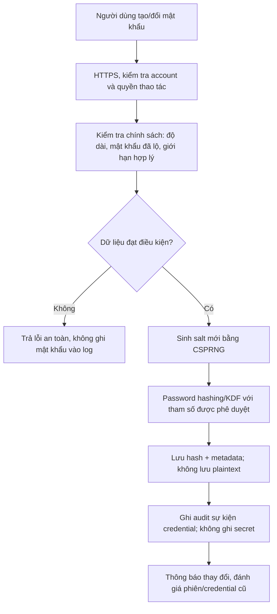
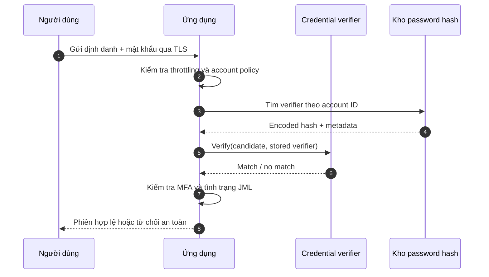

# Password storage: Lưu trữ mật khẩu an toàn trong IAM

## 1. Password storage là gì?

**Password storage** là tập hợp các cơ chế và quy trình dùng để lưu **dữ liệu kiểm chứng mật khẩu** (*password verifier*) sao cho hệ thống có thể xác thực người dùng khi họ đăng nhập mà không cần giữ bản rõ của mật khẩu. Trong ứng dụng dùng mật khẩu cục bộ, máy chủ thường lưu **kết quả của một thuật toán băm mật khẩu chuyên dụng** (*password hashing/key derivation function — KDF*) cùng thông tin cần thiết để kiểm chứng, chứ không lưu mật khẩu có thể đọc lại.

Giả sử nhân viên An đặt mật khẩu cho tài khoản portal. Khi đăng ký, portal sử dụng thuật toán như Argon2id với **salt ngẫu nhiên riêng** và tham số chi phí phù hợp để tạo bản ghi kiểm chứng. Khi An đăng nhập, portal áp dụng đúng thuật toán/tham số cho mật khẩu vừa nhập rồi so sánh bằng hàm kiểm chứng của thư viện. Người vận hành cơ sở dữ liệu không cần, và không nên có khả năng xem lại mật khẩu An đã chọn.

Trong module **SECURITY_IDENTITY_ACCESS_MANAGEMENT_IDENTITY_LIFECYCLE**, lưu trữ mật khẩu là một phần của kiến trúc **Identity and Access Management (IAM)** xuyên suốt **Joiner–Mover–Leaver (JML)**. Nó liên quan đến bước đăng ký phương tiện xác thực, thay đổi và khôi phục credential, tích hợp **IdP/SSO**, cấp phát tài khoản qua **SCIM**, kiểm soát quyền bằng **RBAC/ABAC**, quản lý tài khoản dịch vụ, kiểm toán và thu hồi các đường truy cập tồn dư.

Bài học tập trung vào **bảo vệ password verifier ở phía hệ thống lưu trữ**, không chỉ vào việc chọn mật khẩu mạnh. Sau bài, người học có thể giải thích vì sao không lưu mật khẩu dạng rõ hoặc dùng SHA-256 thuần, phân biệt **salt** với **pepper**, lựa chọn KDF phù hợp, thiết kế schema và luồng lưu/xác minh, nâng cấp hash cũ, xử lý sự cố rò rỉ và đưa chính sách lưu trữ mật khẩu vào vòng đời IAM.

> Mục tiêu an toàn không phải biến mật khẩu thành một chuỗi “không ai nhìn hiểu”, mà là làm cho việc khôi phục mật khẩu từ dữ liệu bị đánh cắp **tốn kém nhất có thể**, đồng thời quản lý đúng quyền truy cập, bí mật hệ thống và các phương thức xác thực thay thế.

## 2. Mô hình đe dọa: hệ thống cần chống những gì?

Password storage phải được thiết kế với giả định **cơ sở dữ liệu chứa password verifier có thể bị lộ** do SQL injection, lỗi phân quyền, sao lưu bị đánh cắp, tài khoản vận hành bị chiếm hoặc bản dump dữ liệu bị công bố.

| Kịch bản | Kẻ tấn công có gì? | Tại sao cách lưu quan trọng? |
| --- | --- | --- |
| Rò rỉ bảng người dùng | Username, salt, hash và tham số | Kẻ tấn công có thể thử đoán mật khẩu **ngoại tuyến** không chịu rate limit của endpoint đăng nhập |
| Rò rỉ bản sao lưu | Dữ liệu credential lịch sử | Password verifier cũ có thể vẫn có ích nếu người dùng tái sử dụng mật khẩu |
| Rò rỉ mã nguồn | Thuật toán, cấu hình và logic xác minh | Thuật toán không được coi là bí mật; an toàn dựa vào thiết kế, salt và bí mật bảo vệ đúng nơi |
| Lộ cả cơ sở dữ liệu lẫn secret/pepper | Hash và khóa bổ sung | Tác dụng phòng vệ của pepper có thể mất; cần kế hoạch ứng phó và xoay vòng |
| Chiếm quyền máy chủ xác thực | Có thể quan sát dữ liệu trong bộ nhớ hoặc lệnh xác minh | Hashing không tự chống được máy chủ đang bị kiểm soát hoàn toàn |
| Credential stuffing trực tuyến | Danh sách mật khẩu lộ từ nơi khác | Password hashing **không thay thế** MFA, rate limiting, phát hiện đăng nhập bất thường |
| Người dùng bị lừa nhập mật khẩu | Mật khẩu rõ tại trang giả | KDF ở server không chống phishing; cần MFA chống phishing và phương thức như passkey |

**Password hashing giúp giảm hậu quả khi dữ liệu verifier bị lộ**, đặc biệt với tấn công đoán mật khẩu ngoại tuyến. Nhưng nó không giải quyết mọi lớp rủi ro: phishing, đánh cắp session, lỗi authorization hoặc việc người dùng tái sử dụng mật khẩu vẫn cần kiểm soát riêng.

### Phân biệt tấn công trực tuyến và ngoại tuyến

Ở tấn công **trực tuyến**, kẻ xấu phải gửi yêu cầu đăng nhập đến hệ thống; có thể bị giới hạn tốc độ, cảnh báo, MFA hoặc khóa theo rủi ro. Ở tấn công **ngoại tuyến**, kẻ xấu đã lấy được hash và có thể thử nhiều ứng viên trên phần cứng của mình; rate limit trên API đăng nhập **không còn tác dụng**. Do đó password hashing cần **chi phí tính toán và bộ nhớ cố ý cao**, cùng salt riêng cho từng verifier.

## 3. Vì sao không lưu plaintext, mã hóa thông thường hoặc hash nhanh?

### 3.1 Plaintext và mã hóa có thể đảo ngược

Lưu `password = "P@ssword..."` dưới dạng rõ khiến bất kỳ người nào đọc được bảng, bản sao lưu hoặc log đều nhìn thấy mật khẩu. Dùng **Base64, hex, ROT13 hoặc một phép biến đổi định dạng** không phải bảo vệ mật khẩu: đây là biểu diễn có thể đảo lại trực tiếp.

**Mã hóa đối xứng** bằng một khóa cũng không phải lựa chọn mặc định để lưu mật khẩu đăng nhập. Máy chủ có khóa có thể giải mã toàn bộ mật khẩu; nếu khóa bị lộ, nhiều tài khoản bị ảnh hưởng ngay lập tức. Mã hóa dữ liệu ở mức ổ đĩa hoặc database vẫn cần thiết để bảo vệ hạ tầng, nhưng **không thay thế băm mật khẩu** trong cột verifier.

Một **trình quản lý mật khẩu** cần giải mã bí mật để người dùng sử dụng là trường hợp nghiệp vụ khác: nó bảo vệ kho bí mật bằng mật mã với mô hình khóa và phân quyền riêng. Đừng dùng lý do “password manager có thể giải mã” để biện minh việc ứng dụng xác thực lưu mật khẩu người dùng có thể giải mã.

### 3.2 Vì sao SHA-256, SHA-1 hoặc MD5 thuần không phù hợp?

Các hàm băm mật mã tổng quát như SHA-256 được thiết kế để chạy **nhanh**, phù hợp nhiều mục đích kiểm tra toàn vẹn và chữ ký nhưng **không phù hợp sử dụng đơn độc để bảo vệ mật khẩu**. Tốc độ cao giúp kẻ tấn công thử nhiều ứng viên nhanh khi có hash.

Ví dụ khái niệm cần tránh:

```text
# KHÔNG dùng làm password storage
stored = SHA256(password)
# Cũng KHÔNG đủ:
stored = SHA256(salt || password)
```

Thêm salt vào hash nhanh có thể ngăn dùng một bảng hash chung cho mọi người nhưng **không làm phép thử mật khẩu đủ đắt**. Cần một thuật toán **password hashing/KDF** được thiết kế cho mật khẩu, có tham số chi phí điều chỉnh được.

### 3.3 Hash một chiều không có nghĩa mật khẩu không thể bị đoán

Không có phép “giải mã ngược” trực tiếp cho một hash mật mã được thiết kế tốt, nhưng kẻ tấn công có thể đoán ứng viên: tính KDF của từng mật khẩu thử với salt/tham số đã biết rồi so kết quả. Vì vậy, độ mạnh của mật khẩu, khả năng chống mật khẩu đã bị lộ và chi phí của KDF đều quan trọng.

## 4. Salt: ngẫu nhiên, riêng từng mật khẩu và được lưu cùng hash

**Salt** là một giá trị ngẫu nhiên được sinh bằng bộ tạo số ngẫu nhiên mật mã (CSPRNG), dùng làm đầu vào cùng mật khẩu khi băm. Mỗi password verifier phải có salt riêng; khi đổi mật khẩu hoặc thiết lập verifier mới, tạo salt mới.

Salt mang lại những lợi ích thiết yếu:

1. Hai người dùng chọn cùng mật khẩu thường không có kết quả verifier giống nhau.
2. Kẻ tấn công không thể dùng một bảng tính sẵn chung cho tất cả salt.
3. Muốn thử cùng một ứng viên trên nhiều account, kẻ tấn công phải tính riêng cho từng salt.
4. Việc thay đổi mật khẩu có thể tạo verifier độc lập với bản cũ.

**Salt không cần bí mật.** Nó thường được lưu ngay trong chuỗi kết quả do thư viện password hashing tạo. Điều cần đảm bảo là salt **khó đoán trước do được sinh ngẫu nhiên đúng cách**, đủ dài theo yêu cầu thuật toán/thư viện và **không tái sử dụng có chủ đích** cho nhiều verifier.

### Những lựa chọn sai

- Dùng username hoặc email làm salt: hai giá trị này có thể dự đoán, thay đổi và không đảm bảo ngẫu nhiên.
- Dùng cùng một salt cấu hình cho toàn bộ người dùng: khiến lợi thế salt riêng biến mất.
- Tự tạo salt bằng timestamp, `Math.random()` hoặc mã tăng dần: không đảm bảo tính ngẫu nhiên mật mã.
- Cố “giấu salt” trong một bảng riêng như thể salt là khóa bí mật: không giải quyết trọng tâm bảo vệ.
- Dùng salt cố định để kiểm tra người dùng có đặt cùng mật khẩu hay không: việc so sánh password giữa người dùng không phải mục tiêu của cơ chế lưu trữ.

Nên dùng thư viện có chức năng **hash password** và **verify password** để quản lý đúng salt và định dạng thay vì tự ghép chuỗi theo cách riêng.

## 5. Chọn thuật toán password hashing/KDF

Các thuật toán khác nhau về mức sử dụng CPU, bộ nhớ, khả năng chống tấn công phần cứng và yêu cầu tương thích. Lựa chọn phải phù hợp hệ thống, khuyến nghị an ninh đang áp dụng, chính sách tuân thủ và **được đo trên hạ tầng thật**.

| Thuật toán | Tính chất | Khi nào cân nhắc | Lưu ý |
| --- | --- | --- | --- |
| **Argon2id** | KDF có thể cấu hình chi phí bộ nhớ, thời gian và song song; kết hợp đặc tính chống một số dạng tấn công side-channel của các biến thể Argon2 | Lựa chọn ưu tiên trong nhiều hệ thống mới không bị ràng buộc đặc biệt | Chọn tham số đủ mạnh nhưng phù hợp tài nguyên máy chủ; dùng thư viện được duy trì |
| **scrypt** | KDF có yêu cầu bộ nhớ đáng kể, với tham số chi phí điều chỉnh được | Hệ thống không hỗ trợ Argon2id nhưng có scrypt chất lượng tốt | Cần cấu hình bộ nhớ/CPU phù hợp; tránh chọn thông số gây quá tải |
| **bcrypt** | Password hashing lâu đời, có tham số cost cho CPU | Hệ thống legacy, môi trường có thư viện bcrypt được bảo trì | Một số triển khai chỉ xử lý tối đa **72 byte đầu vào**; phải kiểm tra hành vi thư viện, encoding và tránh cắt mật khẩu âm thầm |
| **PBKDF2-HMAC** | KDF tiêu chuẩn dựa trên số vòng lặp HMAC, chủ yếu chi phí CPU | Môi trường có yêu cầu tuân thủ hoặc hạ tầng hỗ trợ PBKDF2 | Chọn số vòng theo khuyến nghị phù hợp và nâng cấp khi cần; kém memory-hard hơn Argon2id/scrypt |
| **MD5/SHA-1/SHA-256 thuần** | Hàm băm nhanh | **Không dùng trực tiếp để lưu mật khẩu mới** | Salt hoặc nhiều vòng tự chế không biến nó thành một thiết kế KDF đã được đánh giá |

**Argon2id thường là lựa chọn hợp lý cho hệ thống mới**, nhưng không nên sao chép tham số từ ví dụ rồi tuyên bố đã an toàn. Đánh giá cần xét tốc độ đăng nhập bình thường, thời gian xác minh dưới tải lớn, bộ nhớ mỗi worker, số yêu cầu đồng thời, cấu hình container, quy trình tăng tham số và nguy cơ từ chối dịch vụ (DoS).

### Argon2id có những tham số nào?

- **Memory cost (`m`)**: lượng bộ nhớ cho mỗi phép hash; góp phần làm tăng chi phí thử đoán ngoại tuyến.
- **Time cost (`t`)**: số lượt xử lý hoặc pass theo thiết kế thuật toán.
- **Parallelism (`p`)**: mức song song và cách sử dụng tài nguyên.
- **Salt**: dữ liệu ngẫu nhiên độc lập cho verifier.
- **Output length**: độ dài kết quả theo yêu cầu định dạng/triển khai.

Không chỉ nhìn vào `t` mà bỏ qua `m`. Một phép hash quá rẻ khi đo trên phần cứng thật có thể dễ bị thử hàng loạt; ngược lại, mỗi phép hash quá tốn bộ nhớ trên hệ thống phục vụ nhiều kết nối có thể khiến máy chủ cạn tài nguyên khi bị dồn yêu cầu đăng nhập.

### Trường hợp bcrypt và mật khẩu Unicode

Một số bcrypt implementation truyền thống giới hạn đầu vào ở 72 byte; **72 byte không tương đương 72 ký tự Unicode**. Nếu thư viện cắt đầu vào mà không báo lỗi, các mật khẩu khác nhau chỉ ở phần sau giới hạn có thể được xác minh như nhau. Phải kiểm tra tài liệu và hành vi chính xác của thư viện; nên có chiến lược tương thích hoặc nâng cấp sang Argon2id/scrypt. Không tự giải quyết bằng cách băm nhanh mật khẩu rồi đẩy kết quả tùy ý vào bcrypt nếu chưa đánh giá toàn bộ thiết kế, vì có những rủi ro về encoding, byte đặc biệt và tương thích.

## 6. Pepper là gì, khác salt thế nào?

**Pepper** là một bí mật hệ thống bổ sung cho cơ chế băm mật khẩu, được quản lý **ngoài cơ sở dữ liệu chứa verifier**, chẳng hạn trong secret manager, KMS hoặc HSM. Nếu kẻ tấn công chỉ lấy được database, pepper chưa bị lộ có thể làm tăng khó khăn khi thử đoán hash ngoại tuyến.

| Thuộc tính | Salt | Pepper |
| --- | --- | --- |
| Tính bí mật | Không cần bí mật | **Phải được giữ bí mật** |
| Phạm vi | Thường riêng cho từng password verifier | Có thể dùng cho một nhóm verifier theo thiết kế và phiên bản khóa |
| Nơi lưu | Có thể nằm trong chuỗi hash | Hệ thống quản lý secret/tầng bảo mật riêng, không chung bảng hash |
| Cách tạo | Ngẫu nhiên bằng CSPRNG, đủ dài | Khóa ngẫu nhiên đủ mạnh, có chính sách truy cập và luân chuyển |
| Khi bị lộ | Salt lộ là bình thường | Mất thêm lớp phòng vệ; cần đánh giá tác động và xoay vòng |
| Khi đổi | Tạo lại khi tạo verifier mới | Phải có kế hoạch luân chuyển và tương thích dữ liệu cũ |

Pepper **không thay thế salt hay KDF**. Cách kết hợp pepper với verifier cần dựa trên mẫu đã được đánh giá, ví dụ dùng cơ chế HMAC có khóa trên kết quả KDF theo thiết kế, hoặc phương thức được thư viện/kiến trúc chấp thuận. **Không nên tự nối chuỗi mật khẩu, pepper và salt theo một công thức tùy tiện** rồi coi đó là tiêu chuẩn.

### Thử thách khi xoay vòng pepper

Nếu một verifier phụ thuộc vào pepper cũ và hệ thống không giữ mật khẩu rõ của người dùng, chỉ thay pepper trong cấu hình **không đủ để tự tính lại toàn bộ hash**. Các phương án có thể gồm:

- Hỗ trợ `pepperKeyId` và giai đoạn chuyển tiếp có kiểm soát khi người dùng đăng nhập thành công.
- Yêu cầu đặt lại mật khẩu với nhóm tài khoản không còn khả năng kiểm chứng an toàn.
- Khẩn cấp vô hiệu hóa hoặc buộc reset tùy mức độ lộ và chính sách.

Việc giữ nhiều khóa cũ để xác minh phải có giới hạn và bảo vệ; pepper bị nghi lộ không nên được giữ vô thời hạn chỉ để tránh quy trình reset.

## 7. Lưu những gì trong cơ sở dữ liệu?

Một record phù hợp thường chỉ cần một **định danh account ổn định** và **verifier có metadata**: thuật toán, phiên bản, thông số, salt và kết quả. Thư viện Argon2id thường có thể tạo chuỗi theo kiểu định dạng PHC, chẳng hạn:

```text
$argon2id$v=19$m=<memory>,t=<passes>,p=<parallelism>$<salt-encoded>$<hash-encoded>
```

Chuỗi trên là **mẫu cú pháp**, không phải hash hợp lệ để chạy. Trong triển khai, hãy lưu nguyên đầu ra của thư viện và dùng hàm `verify` tương ứng. Không tự ghép hoặc sửa format nếu thư viện không cam kết tương thích.

Ví dụ bảng dữ liệu tối giản:

```sql
CREATE TABLE local_password_verifiers (
    account_id          VARCHAR(80) PRIMARY KEY,
    password_hash       VARCHAR(512) NOT NULL,
    hash_scheme_version VARCHAR(40) NOT NULL,
    changed_at          TIMESTAMP NOT NULL,
    credential_status   VARCHAR(24) NOT NULL
);
```

Đây chỉ là **schema minh họa**. Độ dài cột, kiểu timestamp, ràng buộc khóa và quy tắc lưu vết cần tuân theo database và thư viện cụ thể. Nếu chuỗi hash đã mã hóa thuật toán/tham số, trường `hash_scheme_version` có thể dùng làm metadata quản trị chứ không nhất thiết phải lặp đầy đủ thông tin. Không trộn `password_hash` với `reset_token`, `api_key` hay `session_token` vào một cột credential chung.

### Điều không nên lưu

- Mật khẩu bản rõ, kể cả “tạm thời trong vài ngày”.
- Mật khẩu mã hóa có thể giải mã hàng loạt chỉ để kiểm tra đăng nhập.
- Mật khẩu hoặc mã OTP trong request/response log, APM trace, metrics label, message queue hay lỗi exception.
- Danh sách mật khẩu cũ dạng rõ để chống tái sử dụng.
- Pepper trong cùng database backup với các verifier mà nó bảo vệ.
- Ảnh chụp giấy tờ định danh, token truy cập hoặc private key bên cạnh verifier khi không cần thiết.

Nếu kiểm tra lịch sử mật khẩu, cần thiết kế cơ chế xác minh các password verifier lịch sử bằng phương pháp phù hợp, bảo vệ dữ liệu và giới hạn lưu giữ; không lưu bản rõ để so sánh.

## 8. Luồng đăng ký và lưu mật khẩu



**Trước khi băm**, ứng dụng phải xác minh người yêu cầu có quyền tạo/thay password verifier cho account. Với Joiner, việc đăng ký credential cần liên kết đúng người đã được kiểm chứng theo chính sách; với đổi mật khẩu, có thể yêu cầu xác thực lại hoặc step-up; với khôi phục, cần quy trình recovery đã phê duyệt.

### Đầu vào và xử lý chuỗi

Mật khẩu có thể chứa Unicode, khoảng trắng, ký tự không in được và nhiều byte cho một ký tự hiển thị. Hệ thống cần:

1. Chọn quy tắc encoding (thường UTF-8) nhất quán giữa **hash** và **verify**.
2. Tôn trọng chính sách chuẩn hóa nếu được áp dụng, hiểu rằng chuẩn hóa có thể làm hai chuỗi khác nhau thành cùng giá trị.
3. Không tự ý `trim()`, `toLowerCase()`, cắt ký tự hoặc biến đổi mật khẩu khác với quy tắc đã công bố và kiểm thử.
4. Giới hạn kích thước đầu vào hợp lý để phòng DoS nhưng tránh giới hạn quá thấp hoặc cắt thầm mật khẩu dài.
5. Không đưa plaintext vào telemetry, error reporting hay hàng đợi xử lý bất đồng bộ không cần thiết.

**Validation độ dài và các giới hạn** không đồng nghĩa việc ép người dùng phải thêm ký tự đặc biệt và thay mật khẩu mỗi 30 ngày. Chính sách nên ưu tiên độ dài, chống mật khẩu phổ biến/đã lộ và hỗ trợ password manager, đồng thời đáp ứng yêu cầu hiện hành của tổ chức.

### Pseudocode lưu verifier

```text
registerOrChangePassword(actor, accountId, candidate):
    require canManageCredential(actor, accountId)
    require secureAuthenticatedChannel()
    require credentialEnrollmentOrReauthenticationPolicySatisfied(actor)
    require passwordPolicy.accepts(candidate)
    require not knownCompromisedPassword(candidate)

    salt = CSPRNG.generateSaltForApprovedKDF()
    encodedVerifier = passwordKdf.hash(
        password=candidate,
        salt=salt,
        params=approvedCostParameters(),
        pepper=pepperProvider.ifConfigured()
    )

    credentialStore.replaceVerifierAtomically(
        accountId=accountId,
        encodedVerifier=encodedVerifier,
        changedAt=now()
    )
    audit.recordPasswordChangedWithoutSecret(accountId, actor)
    invalidateSessionsOrCredentialsAsPolicyRequires(accountId)
    return SUCCESS
```

Đây là **giả mã mô tả các trách nhiệm**; API `hash(..., pepper=...)` không phải chữ ký chung của các thư viện. Trong thực tế, nên sử dụng SDK đáng tin cậy, bảo vệ bộ nhớ/secret trong phạm vi hỗ trợ và tách logic pepper nếu thư viện không hỗ trợ trực tiếp.

## 9. Luồng xác minh mật khẩu lúc đăng nhập

Khi người dùng đăng nhập, hệ thống lấy verifier của account và dùng hàm `verify(candidate, storedVerifier)` do thư viện cung cấp. Nó đọc thuật toán/tham số/salt của verifier, thực hiện phép kiểm tra tương ứng rồi trả kết quả an toàn.



**Không cần giải mã hash.** Hệ thống chỉ tính và so sánh trong quy trình kiểm chứng được thiết kế. Với thư viện phù hợp, không nên tự viết phép so sánh chuỗi hash bằng `==` nếu có hàm `verify` chuẩn; thư viện sẽ xử lý format, salt, tham số và cách so sánh theo thiết kế của nó.

### Kiểm soát chống tấn công online

- Giới hạn tốc độ theo account, nguồn và dấu hiệu tấn công; tránh cho kẻ xấu lợi dụng cơ chế khóa để từ chối dịch vụ với người dùng hợp lệ.
- Thông báo lỗi đăng nhập không để lộ quá mức việc account có tồn tại hoặc trạng thái cụ thể.
- MFA phù hợp, đặc biệt với quyền đặc biệt; ưu tiên yếu tố chống phishing khi cần.
- Đánh giá tình trạng account/identity từ nguồn có thẩm quyền, không chỉ hash match; người đã Leaver vẫn không được tạo phiên mới.
- Đặt giới hạn tài nguyên cho công đoạn KDF, giám sát hàng đợi và bất thường để chống DoS.
- Xử lý account không tồn tại theo hướng tránh chênh lệch phản hồi có thể dùng để dò username; biện pháp như kiểm chứng một **dummy verifier** được hiệu chỉnh phù hợp có thể giúp cân bằng đường xử lý, nhưng không thay thế giám sát và rate limiting.

### Tài nguyên tính toán và độ trễ

Cố ý dùng KDF tốn tài nguyên không có nghĩa để bất kỳ client nào tiêu thụ vô hạn CPU/RAM. Định lượng số request đồng thời tối đa, phân bổ bộ nhớ cho mỗi worker và khả năng xử lý khi có đợt tấn công. Tham số phải được **benchmark dưới tải**, có ngưỡng giới hạn và kế hoạch điều chỉnh theo thay đổi hạ tầng.

## 10. Password storage liên hệ thế nào với IdP, SSO và SCIM?

Không phải ứng dụng nào cũng nên có bảng password verifier riêng. Kiến trúc IAM hiện đại thường **tập trung xác thực tại IdP** và để ứng dụng tin kết quả theo giao thức như OIDC hoặc SAML.

| Thành phần | Có cần lưu password verifier người dùng? | Trách nhiệm liên quan |
| --- | --- | --- |
| **IdP có đăng nhập bằng mật khẩu** | Thường có, nếu chính IdP quản lý mật khẩu | Băm, kiểm tra, đăng ký/khôi phục, MFA và khóa account |
| **Ứng dụng dùng SSO hoàn toàn** | Thường **không cần** lưu mật khẩu cho user SSO | Kiểm tra token/assertion hợp lệ, liên kết account và authorization |
| **Ứng dụng có tài khoản local fallback** | Có thể cần nếu còn cơ chế đăng nhập local | Bảo vệ verifier riêng; giảm/kiểm soát đường đăng nhập dự phòng |
| **SCIM service provider** | Không phải lúc nào; phụ thuộc cơ chế đăng nhập đích | Đồng bộ User/Group/trạng thái, không mặc nhiên nhận hoặc xuất mật khẩu |
| **IGA** | Thường không cần lưu password của nhân viên chỉ để quản trị quyền | Phê duyệt, governance, JML, kiểm toán, điều phối provisioning |
| **API resource server** | Không cần mật khẩu người dùng nếu nhận access token hợp lệ | Kiểm tra token và RBAC/ABAC theo tài nguyên |

**SCIM không phải giao thức đăng nhập.** SCIM có mô hình quản lý tài nguyên danh tính, nhưng việc dùng một khả năng thuộc tính mật khẩu ở một tích hợp (nếu hỗ trợ và được thiết kế an toàn) không phải lý do phát tán password thật đến nhiều ứng dụng. Tích hợp SSO nên tránh mô hình mỗi hệ thống đích phải nhận cùng một mật khẩu người dùng.

**OIDC/SAML** chủ yếu truyền kết quả xác thực qua ranh giới tin cậy, không yêu cầu ứng dụng tiếp nhận biết mật khẩu. Tổ chức vẫn phải bảo vệ session, refresh token, quyền cục bộ và những account không đi qua IdP trung tâm.

### Trách nhiệm khi IdP xác thực thành công

Token hợp lệ chỉ phản ánh một kết quả xác thực trong phạm vi issuer, audience, thời hạn và chính sách. Nó **không tự chứng minh** người dùng còn thuộc bộ phận hiện tại hoặc được đọc dữ liệu nhạy cảm. Ứng dụng vẫn phải kiểm tra **RBAC/ABAC, tenant isolation, contract status** và xử lý phiên/token cũ khi quyền thay đổi.

## 11. Chính sách mật khẩu và nâng cấp thuật toán theo thời gian

Một hệ thống sẽ tồn tại lâu hơn vòng đời của một cấu hình KDF. Do đó nên coi tham số và thuật toán như **cấu hình có phiên bản**, có lịch đánh giá chứ không phải giá trị cố định vĩnh viễn.

### Khi nào cần rehash?

Có thể cần **rehash** khi:

- Thuật toán cũ không còn đáp ứng mức bảo vệ yêu cầu, chẳng hạn từng dùng hash nhanh hoặc một cấu hình quá yếu.
- Cấu hình Argon2id/scrypt/PBKDF2 được nâng cấp vì phần cứng và năng lực vận hành thay đổi.
- Thay đổi phiên bản định dạng/metadata hoặc quy trình pepper theo kế hoạch.
- Người dùng đặt mật khẩu mới hoặc đăng nhập thành công với verifier cũ và hệ thống có thể chuyển đổi an toàn.

**Rehash cần mật khẩu ứng viên được cung cấp trong một quy trình đáng tin cậy.** Không thể lấy một hash cũ rồi “băm thêm một lần” và coi đó luôn tương đương với việc tạo mới password verifier bằng KDF tốt hơn trên chính mật khẩu. Đặc biệt, cách xếp lớp đơn giản có thể giữ nguyên rủi ro của tầng cũ và làm phức tạp migration.

### Nâng cấp khi đăng nhập (*opportunistic rehash*)

Một chiến lược triển khai thường dùng:

```text
authenticateAndMaybeUpgrade(accountId, candidate):
    record = credentialStore.load(accountId)

    if not verifyUsingRecordedAlgorithm(candidate, record):
        return AUTHENTICATION_FAILED

    require identityAndAccountActive(accountId)
    require otherAuthenticationPolicySatisfied(accountId)

    if hashPolicy.needsUpgrade(record):
        newVerifier = approvedPasswordKdf.hashWithFreshSalt(candidate)
        credentialStore.compareAndSwapVerifier(
            accountId,
            expectedVersion=record.version,
            newVerifier=newVerifier
        )
        audit.recordVerifierUpgradeWithoutSecret(accountId)

    return AUTHENTICATED
```

Chỉ rehash sau **xác minh mật khẩu thành công**, kiểm soát quyền cập nhật, giữ trạng thái cạnh tranh an toàn và không ghi plaintext. `compare-and-swap` hoặc cơ chế tương tự giúp tránh ghi đè khi người dùng đổi mật khẩu đồng thời với một yêu cầu đăng nhập cũ.

### Tài khoản không đăng nhập và hash rất cũ

Nếu người dùng không đăng nhập trong thời gian dài, migration lúc đăng nhập không chạy. Cần chính sách **yêu cầu reset ở lần tới, vô hiệu hóa tài khoản không còn cần hoặc theo dõi ngoại lệ**. Không giữ mãi verifier yếu của account đặc quyền chỉ vì chủ tài khoản ít sử dụng.

## 12. Migrating từ hệ thống legacy

Nhiều doanh nghiệp tích hợp ứng dụng cũ đã lưu verifier theo MD5, SHA-1, bcrypt cấu hình yếu hoặc một định dạng tự chế. Di chuyển an toàn cần bắt đầu từ **kiểm kê tình trạng thật**, không chuyển cả cột mật khẩu sang nơi mới rồi mặc nhiên coi như đã hiện đại hóa.

| Tình trạng legacy | Phương án xử lý | Cần tránh |
| --- | --- | --- |
| Plaintext/reversible encrypted password | Xem là rủi ro cao, loại bỏ khả năng đọc lại, thiết lập KDF mới qua quy trình an toàn và đánh giá phản ứng sự cố | Di chuyển plaintext sang nhiều hệ thống đích |
| Hash nhanh có salt | Xác minh theo thuật toán cũ trong giai đoạn được kiểm soát, tạo verifier mới với mật khẩu người dùng nhập đúng lúc | Giữ thuật toán yếu làm cơ chế mặc định vĩnh viễn |
| Bcrypt với giới hạn đầu vào | Xem hành vi thư viện và dấu vết mật khẩu có thể đã bị cắt; lên kế hoạch chuyển đổi phù hợp | Giả định mọi chuỗi Unicode dài đều được băm đầy đủ |
| PBKDF2/bcrypt còn dùng được nhưng cost thấp | Đánh giá tham số, áp dụng rehash dần hoặc reset theo chính sách | Tăng cost tùy tiện trên verifier cũ mà không hiểu format |
| Không rõ thuật toán/format | Cách ly, điều tra và xây dựng đường reset có kiểm chứng | Đoán format và thử nghiệm trực tiếp lên dữ liệu sản xuất |
| SSO hoàn toàn, không có mật khẩu local | Không tạo password storage mới; quản lý account liên kết và phiên | Buộc user SSO tạo mật khẩu cục bộ không cần thiết |

**Đừng tự động đổi mật khẩu toàn bộ người dùng bằng một mật khẩu mặc định giống nhau** để tiện di chuyển. Nếu cần reset, sử dụng quy trình tạo credential mới có kênh khôi phục và kiểm tra danh tính phù hợp.

### Kế hoạch cutover

1. Kiểm kê các nơi có thể chứa mật khẩu hoặc verifier: IdP, ứng dụng local, export, backup và hệ thống support.
2. Xác định thuật toán/định dạng và ràng buộc kỹ thuật; không đọc plaintext trừ khi thực sự có căn cứ/ủy quyền và biện pháp bảo vệ đặc biệt.
3. Chọn KDF, policy và thư viện tiêu chuẩn, kiểm tra tương thích Unicode và mật khẩu dài.
4. Xây dựng luồng verify legacy có giới hạn và rehash hoặc reset với người dùng.
5. Dùng telemetry an toàn để theo dõi tỷ lệ chuyển đổi mà không ghi bí mật.
6. Giảm dần số account chỉ còn verifier legacy; hết hạn cửa sổ chuyển đổi và loại bỏ đường kiểm chứng cũ.
7. Đối soát tài khoản và quyền JML, đặc biệt những account đã leaver không được kích hoạt lại trong migration.

## 13. Reset mật khẩu, đổi mật khẩu và khôi phục tài khoản

**Password reset** thường diễn ra khi người dùng quên mật khẩu hoặc không còn phương tiện xác thực. **Password change** thường do người dùng đã xác thực chủ động thực hiện. Hai quy trình có mức độ rủi ro và bước kiểm tra khác nhau.

### Khi người dùng đổi mật khẩu

Nên yêu cầu một tín hiệu xác thực đủ mạnh theo rủi ro, kiểm tra chính sách mật khẩu mới, tạo salt mới và verifier mới. Sau đó, tổ chức cần cân nhắc **vô hiệu hóa các phiên/refresh token** liên quan hoặc yêu cầu đăng nhập lại ở những nơi cần thiết; việc thay password verifier không tự hủy tất cả token đã phát.

### Khi người dùng quên mật khẩu

Một luồng recovery an toàn thường gồm:

- Nhận yêu cầu mà không tiết lộ quá mức account có tồn tại.
- Sử dụng kênh hoặc phương thức khôi phục đã đăng ký từ trước, hoặc tái kiểm tra danh tính theo mức rủi ro.
- Phát **reset token** ngẫu nhiên, phạm vi một tài khoản/thao tác, có thời hạn và tốt nhất dùng một lần.
- Lưu token khôi phục bằng **dạng kiểm chứng bảo vệ phù hợp**, không lưu token bản rõ có thể dùng ngay; bảo vệ kênh truyền.
- Khi dùng token hợp lệ, cho đặt mật khẩu mới và tạo verifier mới; vô hiệu hóa token/đường khôi phục đã sử dụng.
- Thông báo sự kiện và xử lý phiên/credential theo chính sách, ghi audit mà không ghi mật khẩu hoặc token.

Không gửi “mật khẩu cũ” qua email: một hệ thống lưu password verifier đúng cách **không thể đọc lại mật khẩu cũ**. Việc helpdesk yêu cầu người dùng cung cấp mật khẩu cũng không phải bước xác minh danh tính phù hợp.

**Khôi phục tài khoản là đường vòng có thể làm suy yếu MFA.** Nếu một tài khoản dùng passkey chống phishing nhưng bất kỳ người nào biết ngày sinh và số nhân viên đều đặt lại mật khẩu được, tổng thể hệ thống không đạt mức bảo vệ như mong muốn.

## 14. Password storage trong vòng đời Joiner–Mover–Leaver

### Joiner: thiết lập verifier đúng chủ thể

Ở bước Joiner, HRIS/nguồn hợp đồng xác nhận quan hệ nghiệp vụ, IAM cấp định danh chuẩn, còn **identity proofing/enrollment** đảm bảo phương tiện xác thực gắn với người đúng. Nếu IdP quản lý mật khẩu, ứng dụng SSO không cần tạo password riêng. Nếu buộc dùng account local, cần quy trình khởi tạo có quyền kiểm soát, truyền an toàn và lưu verifier bằng KDF ngay từ đầu.

Không nên cấp “mật khẩu mặc định của phòng ban” dùng chung cho mọi Joiner. Nếu có mật khẩu khởi tạo tạm theo hệ thống cũ, phải tạo riêng, giới hạn sử dụng, yêu cầu thay theo quy trình và ưu tiên loại bỏ mô hình đó khi có lựa chọn tốt hơn.

### Mover: không phải lúc nào cũng cần đổi mật khẩu

Khi nhân viên chuyển bộ phận, phần quan trọng là **đánh giá lại RBAC/ABAC, quyền đặc quyền, phương thức MFA và các phiên hiện tại**. Thay đổi phòng ban **không tự yêu cầu đổi mật khẩu** nếu không có nghi ngờ lộ, yêu cầu chính sách hoặc thay đổi trong trách nhiệm quản lý credential.

Tuy nhiên, chuyển sang vai trò quản trị nhạy cảm có thể yêu cầu bước xác thực mạnh hơn, passkey/khóa bảo mật hoặc tách tài khoản đặc quyền; tổ chức cần tránh tái sử dụng một mật khẩu cho nhiều account quản trị.

### Leaver: vô hiệu hóa đường đăng nhập và xử lý verifier

Khi HRIS, sponsor hoặc nguồn hợp đồng xác nhận Leaver, IdP/ứng dụng phải **chặn quyền đăng nhập theo thời điểm được duyệt**, đồng thời xử lý session, refresh token, API key, tài khoản cục bộ và quyền còn tồn dư theo khả năng từng hệ thống.

Có nên xóa ngay cột `password_hash` hay giữ account ở trạng thái disabled? Điều này phụ thuộc chính sách dữ liệu, quy trình rehire, nghĩa vụ lưu giữ, điều kiện ứng dụng và yêu cầu kiểm toán. **Việc giữ verifier để phục vụ một quy trình hợp pháp không đồng nghĩa cho phép xác thực**: hệ thống phải kiểm tra lifecycle status và không tạo phiên cho account không còn hợp lệ. Khi không còn căn cứ giữ credential, cần hủy hoặc xóa theo quy trình đã xác định.

**Không đánh đồng `passwordHash` đã bị xóa với quyền ứng dụng đã bị thu hồi.** Một phiên hoặc token đã phát trước Leaver có thể vẫn được chấp nhận nếu ứng dụng không kiểm tra trạng thái hiện tại. Cần kết hợp deprovisioning qua SCIM/API, token/session policy và reconciliation.

### Rehire

Nếu nhân viên quay lại, cần xác minh quan hệ mới, xem xét lại việc liên kết identity/account và **đăng ký hoặc xác minh lại phương tiện đăng nhập** theo chính sách. Không tự khôi phục toàn bộ quyền, reset link, nhóm hoặc kênh recovery cũ chỉ vì email giống nhau.

## 15. Service account, API key và bí mật máy–máy

**Service account/workload identity** thường không đăng nhập tương tác như nhân viên. Nếu một công việc tự động cần gọi API, nên ưu tiên **managed identity, workload federation, OAuth 2.0, mTLS hoặc token ngắn hạn** khi kiến trúc và sản phẩm hỗ trợ, thay vì gán một mật khẩu người dùng dùng chung cho nhiều dịch vụ.

Có hai tình huống phải phân biệt:

1. **Ứng dụng xác minh mật khẩu người dùng:** lưu password verifier một chiều bằng KDF. Ứng dụng **không cần đọc lại** mật khẩu.
2. **Dịch vụ cần sử dụng secret để đăng nhập hệ thống khác:** nó có thể cần truy xuất bí mật để trình cho bên nhận. Đây là bài toán **secret management**, thường đòi hỏi vault/KMS, mã hóa, phân quyền, audit, rotation và hạn sử dụng; không thể thay một secret cần sử dụng bằng hash một chiều trong mọi trường hợp.

Ví dụ dịch vụ `svc-invoice-export` đang dùng mật khẩu static của một hệ thống legacy. Hệ thống cần đăng ký owner, mục đích, thời hạn và quyền tối thiểu; cất bí mật trong secret manager, không hardcode trong repository hoặc biến môi trường bị ghi ra log, và lên kế hoạch thay bằng phương thức có credential ngắn hạn khi khả thi.

**Leaver của kỹ sư tạo service account không nhất thiết là Leaver của dịch vụ.** IAM phải chuyển giao owner, rà soát quyền và thông tin xác thực. Khi chính workload ngừng, hệ thống cần thu hồi secret, token, chứng chỉ và quyền, đồng thời đối soát đường truy cập còn lại.

## 16. Bảo vệ verifier trong hạ tầng và vận hành

Một thuật toán băm tốt có thể bị vô hiệu hóa lợi thế nếu cả hệ thống lưu trữ thiếu kiểm soát.

| Lớp kiểm soát | Mục tiêu | Biện pháp |
| --- | --- | --- |
| **Truy cập database** | Giới hạn người có thể đọc hoặc sửa verifier | Tài khoản DB đặc quyền tối thiểu, phân tách vai trò vận hành và audit |
| **Bảo vệ backup** | Không để bản sao cũ lộ dữ liệu | Mã hóa, phân quyền, retention, xóa đúng hạn, kiểm tra restore an toàn |
| **Pepper/secret manager** | Tách bí mật bổ sung khỏi hash DB | KMS/HSM/vault, truy cập theo workload identity, key version và rotation |
| **Logging/observability** | Không rò rỉ input hay secret qua công cụ phụ | Redaction, kiểm thử log trong lỗi, phân quyền APM và trace |
| **Kết nối** | Bảo vệ plaintext khi đăng nhập/đổi mật khẩu | TLS, chống downgrade, cấu hình endpoint và cookie an toàn |
| **Ứng dụng** | Tránh đọc/sửa verifier trái phép | Parameterized query, authz của thao tác đổi/reset, kiểm soát service endpoint |
| **Tài nguyên KDF** | Cân bằng độ khó brute force với dịch vụ ổn định | Benchmark, giới hạn concurrency, throttling, cảnh báo DoS |
| **Kiểm toán** | Truy được hành động đối với credential | Ghi actor, `identityId`, thời điểm, loại thay đổi, kết quả; không ghi bí mật |
| **Sao lưu hệ thống legacy** | Loại bỏ verifier yếu và bản xuất dữ liệu cũ | Inventory, thời hạn di chuyển và quy trình xóa an toàn |

Cần ngăn nhân viên hỗ trợ hoặc ứng dụng khác có quyền truy cập thẳng cột `password_hash` nếu không có mục đích vận hành hợp lệ. **Hash vẫn là dữ liệu nhạy cảm về xác thực**: nó có thể bị khai thác offline và hỗ trợ chiếm account nếu người dùng chọn mật khẩu yếu.

### Credential stuffing và password spray không được giải quyết bởi hashing

Khi kẻ tấn công **đã biết mật khẩu đúng** từ rò rỉ nơi khác, hệ thống hash an toàn vẫn xác minh mật khẩu đó là đúng. Phải bổ sung **MFA chống phishing, kiểm tra mật khẩu đã lộ, rate limiting và phát hiện bất thường**. Không nên coi nâng tham số Argon2id là biện pháp đủ để chống mọi tấn công trực tuyến.

## 17. Ứng phó khi password verifier bị lộ

Nếu phát hiện bảng hash, backup hoặc hệ thống password storage bị truy cập trái phép, cần đánh giá và hành động theo quy trình ứng phó sự cố.

1. **Khoanh vùng:** xác định nguồn rò rỉ, dữ liệu nào bị lộ, thuật toán, tham số, salt, pepper và hệ thống liên quan; bảo toàn bằng chứng an toàn.
2. **Đánh giá mức độ phơi nhiễm:** hash legacy nhanh và mật khẩu yếu làm rủi ro đoán cao hơn; pepper còn an toàn hay không ảnh hưởng đáng kể nhưng không loại bỏ rủi ro hoàn toàn.
3. **Ngăn tiếp diễn:** vá lỗ hổng, thu hồi credential quản trị/connector bị lộ, giới hạn quyền DB, quản lý sao lưu và endpoint.
4. **Quyết định reset/rotation:** buộc người dùng bị ảnh hưởng đặt lại mật khẩu hoặc áp biện pháp bổ sung theo mức độ; xử lý phiên/token và phương thức recovery nếu có nguy cơ.
5. **Thông báo và hỗ trợ:** thực hiện nghĩa vụ thông báo theo pháp luật/chính sách áp dụng; giúp người dùng phát hiện tái sử dụng mật khẩu và dùng password manager/MFA.
6. **Nâng cấp thiết kế:** cập nhật KDF/param, quản lý pepper, giới hạn quyền và chất lượng log; kiểm tra cả các bản sao/verifier cũ.
7. **Đối soát IAM:** xác nhận account đặc quyền, guest, danh tính leaver và service account không còn đường truy cập bất thường.

**Không tuyên bố “hash đã được salt nên rò rỉ không sao”.** Salt giúp chống bảng tính sẵn và tấn công theo nhiều account, không loại bỏ rủi ro mật khẩu ngắn, phổ biến hoặc bị tái sử dụng. Cũng không thể tự khẳng định pepper còn an toàn nếu máy chủ xử lý pepper bị chiếm.

## 18. Tình huống thực tế: từ ứng dụng legacy sang SSO

Một doanh nghiệp đang có ứng dụng quản lý ticket với bảng `users(password_md5)`. Công ty chuẩn hóa IAM qua IdP với SSO và muốn chuyển ứng dụng sang OIDC. Đồng thời có nhân viên mới, người đổi bộ phận và người đã nghỉ việc.

**Giai đoạn khảo sát.** Đội IAM xác nhận cột verifier đang dùng MD5 thuần và một số bản sao lưu còn chứa dữ liệu cũ. Đây là rủi ro vì MD5 rất nhanh khi thử đoán offline. Họ không tìm cách giải mã để gửi mật khẩu cũ sang IdP mới.

**Giai đoạn chuyển đổi.** Ứng dụng nhận xác thực từ IdP theo OIDC, ánh xạ tài khoản theo khóa ổn định được kiểm chứng. Người dùng đăng ký phương tiện xác thực mới tại IdP qua quy trình có đủ mức tin cậy. Những người vẫn cần đăng nhập local trong cửa sổ chuyển đổi phải dùng cơ chế KDF phù hợp; đường legacy chỉ có thời hạn và được giám sát. Khi SSO hoàn tất, ứng dụng không tạo mới mật khẩu local không cần thiết.

**Joiner.** Nhân viên mới được HRIS xác nhận và proofing theo chính sách. IAM/IdP tạo danh tính và phương tiện đăng nhập; ứng dụng ticket được cấp account qua SCIM/API hoặc liên kết qua SSO. Không tồn tại “mật khẩu chung cho toàn bộ nhân viên mới”.

**Mover.** Nhân viên từ support sang kiểm toán; IGA cập nhật quyền từ `ticket-edit` sang `ticket-audit-read`. IdP tiếp tục xác thực nhưng ứng dụng kiểm tra quyền mới, xử lý session/claim cũ theo rủi ro. Không ép thay mật khẩu nếu không có lý do riêng về credential.

**Leaver.** HRIS phát sự kiện chấm dứt. IdP và ứng dụng chặn đăng nhập, thu hồi quyền và đối soát phiên/token. Cột password verifier legacy còn tồn tại trong một bản backup cũ được đưa vào kế hoạch retention và xử lý rủi ro; việc khóa IdP không cho phép bỏ qua account local đang có đường login dự phòng.

**Kết quả mong muốn:** nơi phải quản lý mật khẩu sẽ lưu verifier bằng KDF đáng tin cậy; ứng dụng đã dùng SSO không cần giữ mật khẩu riêng; mọi đường xác thực và phân quyền được kiểm soát theo JML. Cả dữ liệu đang hoạt động lẫn verifier trong hệ thống legacy/bản sao lưu được xử lý có trách nhiệm.

## 19. Những sai lầm phổ biến

**Sai lầm 1 — “Đã băm SHA-256 là an toàn”.** Hash nhanh không phù hợp làm password verifier; dùng KDF chuyên dụng như Argon2id với salt và tham số được đánh giá.

**Sai lầm 2 — Dùng một salt chung hoặc salt lấy từ email.** Salt phải được sinh ngẫu nhiên riêng cho verifier, không chỉ là chuỗi có vẻ độc đáo.

**Sai lầm 3 — Lưu pepper cạnh hash hoặc hardcode trong source.** Bí mật bổ sung phải được bảo vệ ở hệ thống riêng, có quyền truy cập và kế hoạch luân chuyển.

**Sai lầm 4 — Đặt cost KDF cao nhất mà không benchmark.** Có thể gây cạn RAM/CPU khi nhiều request đồng thời, tạo cơ hội DoS.

**Sai lầm 5 — Cắt mật khẩu dài để vừa giới hạn bcrypt mà không thông báo.** Có thể khiến các chuỗi khác nhau xác minh như nhau, nhất là với Unicode nhiều byte.

**Sai lầm 6 — Tự “mã hóa mật khẩu” và giữ khóa giải mã cùng DB.** Nếu bị lộ cả hai, attacker đọc lại được mật khẩu hàng loạt.

**Sai lầm 7 — Gửi mật khẩu trong log, email hoặc sự kiện SCIM.** Secret bị nhân bản ra nhiều vùng truy cập, làm tăng hậu quả khi một nơi bị lộ.

**Sai lầm 8 — Chỉ reset mật khẩu mà bỏ qua session/token hiện hành.** Những phiên đang tồn tại có thể vẫn dùng được sau khi verifier thay đổi.

**Sai lầm 9 — Coi login SSO thành công là quyền tài nguyên vẫn hợp lệ.** Quyền phải được kiểm tra bằng RBAC/ABAC; Mover/Leaver có thể thay đổi quyền giữa các lần đăng nhập.

**Sai lầm 10 — Dùng password hashing một chiều cho secret mà dịch vụ cần gửi lại khi gọi API.** Đây là bài toán secret management, cần kho bí mật và chiến lược giảm phụ thuộc credential tĩnh.

**Sai lầm 11 — Mở lại credential cũ khi rehire chỉ vì cùng email.** Phải xác minh liên kết danh tính và kiểm soát phương thức khôi phục trước khi kích hoạt.

## 20. Checklist thiết kế Password storage trong hệ thống IAM

1. **Phạm vi:** ứng dụng thực sự cần xác minh mật khẩu local hay có thể dùng IdP/SSO và không lưu verifier riêng?
2. **Thuật toán:** đã chọn KDF được duy trì, với cấu hình đo được trên phần cứng và mức đồng thời thực tế chưa?
3. **Salt:** được tạo riêng bằng CSPRNG và quản lý qua thư viện chuẩn hay chưa?
4. **Pepper:** nếu dùng, secret được tách khỏi DB, có quyền tối thiểu và quy trình xoay vòng/ứng phó lộ khóa chưa?
5. **Định dạng:** bản ghi có thuật toán, tham số, salt và hash phù hợp, hỗ trợ đọc và nâng cấp từng verifier không?
6. **Đầu vào:** mật khẩu được truyền qua TLS, xử lý Unicode/độ dài nhất quán, không cắt thầm, không rò qua telemetry chưa?
7. **Chính sách:** đã hỗ trợ mật khẩu dài, kiểm tra mật khẩu đã bị lộ, hạn chế đoán trực tuyến và MFA phù hợp chưa?
8. **Đăng ký/đổi:** chỉ actor có thẩm quyền được tạo/thay verifier; có step-up/re-auth và ghi log không chứa bí mật chưa?
9. **Recovery:** reset token có scope, hạn sử dụng, khả năng dùng một lần, bảo vệ lưu trữ và quy trình proofing phù hợp chưa?
10. **Xác minh:** dùng hàm `verify` của thư viện, hạn chế rò timing/user enumeration và kiểm soát tài nguyên KDF chưa?
11. **Migration:** có kế hoạch xử lý verifier MD5/SHA/legacy, opportunistic rehash và tài khoản lâu không đăng nhập chưa?
12. **JML:** Joiner gắn credential đúng người; Mover cập nhật chính sách; Leaver chặn session, token và local login theo trạng thái nguồn chưa?
13. **SCIM/SSO:** có ngăn phân tán password tới các ứng dụng không cần giữ mật khẩu và đối soát quyền cục bộ không?
14. **Tài khoản dịch vụ:** đã tách password verifier của con người khỏi secret cần dùng cho M2M, có owner và rotation chưa?
15. **Dữ liệu/backup:** hash, pepper, bản sao, log và các hệ thống cũ có retention, mã hóa, phân quyền và cơ chế xóa phù hợp không?
16. **Sự cố:** có khả năng xác định verifier nào bị lộ, buộc reset, thu hồi phiên, nâng cấp KDF và theo dõi kết quả không?

**Password storage an toàn bắt đầu từ việc không cần biết lại mật khẩu người dùng.** Thay vì lưu bản rõ hoặc hàm hash nhanh, hệ thống sử dụng password hashing/KDF với salt riêng và tham số phù hợp, có thể bổ sung pepper được quản lý độc lập. Khi kết hợp với kiểm soát nhập liệu, quy trình đổi/reset, IdP/SSO, MFA, RBAC/ABAC, provisioning và sự kiện Joiner–Mover–Leaver, IAM mới có thể giảm thiểu rủi ro khi dữ liệu verifier bị lộ **và** thu hồi hiệu quả các đường truy cập không còn hợp lệ.
