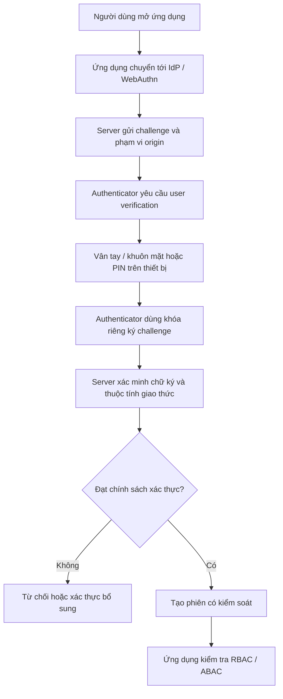

# Inherence factor trong xác thực đa yếu tố (MFA)

**Inherence factor** là yếu tố xác thực dựa trên **đặc điểm vốn có của một người** (*something you are*), thường được thể hiện qua thông tin sinh trắc học như vân tay, khuôn mặt hoặc mống mắt. Trong **Multi-Factor Authentication (MFA)**, inherence factor thuộc một nhóm khác với yếu tố tri thức (*something you know*, chẳng hạn mật khẩu) và yếu tố sở hữu (*something you have*, chẳng hạn khóa bảo mật). Khi thiết kế Identity and Access Management (**IAM**), cần hiểu rõ **sinh trắc học được dùng ở đâu, đang xác minh điều gì và không thể thay thế những kiểm soát nào**.

Ví dụ một nhân viên đăng nhập bằng **passkey** trên điện thoại, chạm cảm biến vân tay để mở khóa phương tiện xác thực. Vân tay có thể được thiết bị dùng để xác minh người dùng tại chỗ; còn dịch vụ từ xa nhận và kiểm tra **chữ ký mật mã của passkey**, chứ không nhất thiết nhận mẫu vân tay. Điều này khác với hệ thống trực tiếp thu ảnh khuôn mặt rồi so khớp sinh trắc học ở máy chủ.

Trong vòng đời **Joiner–Mover–Leaver (JML)**, việc đăng ký, sử dụng, khôi phục và chấm dứt phương thức xác thực có liên quan đến IdP, SSO, quản lý credential, kiểm toán và giảm truy cập tồn dư. Tuy nhiên, **inherence factor không tự quyết định quyền truy cập RBAC/ABAC**, cũng không tự chứng minh một nhân viên vẫn còn quan hệ hợp lệ với tổ chức.

## 1. Phân biệt ba nhóm yếu tố xác thực

| Nhóm yếu tố | Tên thường dùng | Ví dụ | Rủi ro tiêu biểu |
| --- | --- | --- | --- |
| **Knowledge** | Điều bạn biết | Mật khẩu, mã PIN được ghi nhớ | Phishing, đoán, tái sử dụng, lộ bí mật |
| **Possession** | Điều bạn sở hữu hoặc kiểm soát | Khóa FIDO2, thiết bị giữ private key, authenticator | Mất thiết bị, đánh cắp, chiếm quyền đăng ký |
| **Inherence** | Đặc điểm của chính bạn | Vân tay, khuôn mặt, mống mắt | Giả mạo mẫu, sai số, lộ dữ liệu sinh trắc học |

**Hai phép kiểm tra không tự động tạo thành hai yếu tố.** Mật khẩu cộng câu hỏi bảo mật vẫn chủ yếu là yếu tố tri thức; hai cách quét khuôn mặt vẫn thuộc cùng nhóm inherence. Một xác thực nhiều yếu tố thực sự phải dựa trên các yếu tố độc lập theo cơ chế được thiết kế.

Khái niệm *inherence* không nên đánh đồng với mọi dấu hiệu hành vi. Gõ phím, nhịp di chuyển hoặc đặc điểm giọng nói có thể được hệ thống phân tích làm tín hiệu rủi ro, nhưng khả năng được chấp nhận như yếu tố xác thực còn phụ thuộc phương pháp và chính sách bảo đảm cụ thể.

## 2. Inherence factor xác minh điều gì?

Sinh trắc học thường dùng để **so khớp mẫu thu được khi xác thực với mẫu tham chiếu đã đăng ký**. Hệ thống phải trả lời: mẫu hiện tại có đủ giống mẫu đã đăng ký theo ngưỡng cho phép hay không?

Quá trình thường gồm:

1. **Enrollment:** thu mẫu ban đầu bằng phương thức và thiết bị được chấp thuận.
2. **Tạo hoặc lưu tham chiếu:** xử lý thành dạng biểu diễn phù hợp; quản lý nơi lưu và quyền truy cập.
3. **Verification:** thu mẫu mới và so khớp theo thuật toán, ngưỡng, chính sách.
4. **Quyết định:** cho phép tiếp tục bước xác thực, từ chối hoặc dùng phương án dự phòng.
5. **Audit:** ghi nhận kết quả và độ tin cậy cần thiết, không ghi dữ liệu sinh trắc học thô vào log.

**So khớp thành công không tự chứng minh danh tính pháp lý.** Nếu mẫu sinh trắc học ban đầu bị đăng ký cho sai người, những lần so khớp sau chỉ xác nhận người hiện tại giống với mẫu đã gắn sai. Vì vậy **identity proofing** và **authenticator enrollment** là các khâu cần tách biệt.

## 3. Các loại sinh trắc học thường gặp

| Loại | Cách sử dụng | Ưu điểm | Hạn chế cần xem xét |
| --- | --- | --- | --- |
| **Vân tay** | Quét cảm biến trên điện thoại hoặc thiết bị | Thao tác nhanh, phổ biến | Cảm biến, tay bị thương, mẫu giả |
| **Khuôn mặt** | Camera và thuật toán so khớp | Tiện trên thiết bị có camera | Ảnh/video giả, thay đổi ánh sáng, thiên lệch |
| **Mống mắt** | Thiết bị thu ảnh mống mắt | Có thể cho khả năng phân biệt tốt trong môi trường phù hợp | Thiết bị chuyên dụng, trải nghiệm và điều kiện thu mẫu |
| **Giọng nói** | Phân tích đặc điểm âm thanh | Hữu ích cho một số kênh tương tác | Replay, tổng hợp giọng nói, môi trường ồn |
| **Hành vi** | Nhịp gõ phím hoặc cách tương tác | Có thể hỗ trợ phát hiện bất thường liên tục | Biến động theo ngữ cảnh, khó coi là yếu tố độc lập |

Hiệu quả của từng công nghệ phụ thuộc thiết bị, thuật toán, điều kiện vận hành, nhóm người dùng và quy trình chống giả mạo. Không có loại sinh trắc học nào **bất biến, chính xác tuyệt đối hoặc miễn nhiễm với tấn công**.

## 4. Sinh trắc học cục bộ và sinh trắc học phía máy chủ

Đây là sự phân biệt quan trọng khi đánh giá MFA.

### 4.1 So khớp cục bộ trên thiết bị

Thiết bị lưu hoặc quản lý tham chiếu sinh trắc học trong vùng bảo vệ thích hợp, sử dụng vân tay/khuôn mặt để **mở khóa authenticator hoặc cho phép thực hiện thao tác mật mã**. Dịch vụ từ xa thường nhận bằng chứng mật mã và kết quả xác minh người dùng theo giao thức, chứ không phải ảnh sinh trắc học.

Với **WebAuthn/FIDO2**, authenticator có thể hỗ trợ **user verification** bằng sinh trắc học hoặc PIN. Cả hai cách đều có thể cho phép sử dụng khóa riêng, nhưng **PIN thuộc nhóm tri thức**, còn sinh trắc học thuộc nhóm inherence. Relying party cần kiểm tra các điều kiện của chứng thực và chính sách áp dụng; không được suy rằng flag user verification luôn chứng minh vân tay đã được dùng.

### 4.2 So khớp phía máy chủ

Hệ thống có thể gửi thông tin sinh trắc học đến một dịch vụ để so khớp với mẫu tham chiếu. Thiết kế này mở rộng phạm vi dữ liệu nhạy cảm phải bảo vệ: truyền tải, kho mẫu, quyền truy cập, nhà cung cấp, thời hạn lưu trữ, xóa dữ liệu và khả năng bị giả mạo.

Các rủi ro gồm đánh cắp dữ liệu sinh trắc học, dùng lại mẫu, chèn ảnh/video, replay và việc người dùng khó thay đổi một đặc điểm cơ thể nếu dữ liệu bị lộ. Vì vậy không nên chọn lưu trữ sinh trắc học tập trung chỉ vì thuận tiện nếu có thể đáp ứng mục tiêu bằng cơ chế xác thực mật mã với so khớp cục bộ.

## 5. Sinh trắc học trong passkey có phải MFA không?

Cần phân tích **toàn bộ cơ chế**, không chỉ việc người dùng chạm vân tay.

Một passkey được bảo vệ bằng user verification có thể kết hợp **possession của authenticator** với **inherence** khi xác minh bằng vân tay, hoặc với **knowledge** khi xác minh bằng PIN. Theo cách đánh giá và thuộc tính của giao thức, đây có thể là **authenticator đa yếu tố**. Tuy nhiên, dịch vụ không nên tuyên bố luôn biết chắc phương thức user verification cụ thể đã được dùng nếu giao thức và thiết bị không cung cấp thông tin đó.

**Quét vân tay đơn lẻ không mặc nhiên là MFA.** Một ứng dụng chỉ so ảnh khuôn mặt với ảnh lưu trong cơ sở dữ liệu chưa chứng minh có yếu tố sở hữu độc lập. Ngược lại, một phương thức có mã hóa mạnh vẫn cần được đánh giá đúng việc đăng ký khóa, khôi phục tài khoản và giới hạn của thiết bị.

## 6. Các rủi ro bảo mật đặc thù

### 6.1 Presentation attack và giả mạo

Kẻ tấn công có thể đưa ảnh, video, mặt nạ hoặc mẫu nhân tạo vào cảm biến thay cho cơ thể người thật. **Presentation Attack Detection (PAD)** hoặc kiểm tra sống (*liveness detection*) có thể giúp giảm rủi ro nhưng không loại bỏ hoàn toàn giả mạo; mức hiệu quả phải được kiểm thử trong điều kiện thực tế.

Đối với giọng nói, công nghệ tổng hợp giọng nói tạo thêm rủi ro replay và giả mạo. Không nên tin một câu nói mẫu hoặc bản ghi âm như bằng chứng nhận diện duy nhất cho thao tác nhạy cảm.

### 6.2 False accept và false reject

Thuật toán sinh trắc học cho kết quả xác suất:

- **False Match Rate (FMR):** tỷ lệ một mẫu không thuộc cùng người vẫn bị so khớp nhầm trong điều kiện kiểm thử.
- **False Non-Match Rate (FNMR):** tỷ lệ mẫu đúng người nhưng bị từ chối.
- **False Accept/Reject Rate:** các chỉ số ở mức quyết định hệ thống có thể phụ thuộc thêm PAD, số lần thử và quy trình.

Điều chỉnh ngưỡng thường tạo đánh đổi giữa bảo mật và trải nghiệm. Tăng độ nghiêm ngặt để giảm chấp nhận nhầm có thể làm tăng từ chối nhầm. Không nên quảng cáo “chính xác 100%”, và cần đánh giá hiệu năng trên nhóm người dùng, thiết bị và điều kiện khác nhau.

### 6.3 Không thể thay đổi đặc điểm cơ thể dễ dàng

Người dùng có thể đổi mật khẩu khi lộ; nhưng không thể “đổi vân tay” theo nghĩa tương tự. Mẫu sinh trắc học hoặc dữ liệu dẫn xuất phải được coi là **dữ liệu nhạy cảm**, với thu thập tối thiểu, bảo vệ mạnh và thời hạn lưu giữ rõ ràng. Khi nghi lộ mẫu hoặc bị chiếm authenticator, cần thu hồi liên kết credential/thiết bị và chuyển sang phương thức khác theo chính sách.

### 6.4 Ép buộc, thiết bị bị chiếm và môi trường không tin cậy

Sinh trắc học không thay thế kiểm soát thiết bị. Thiết bị bị chiếm hoặc quy trình đăng ký bị giả mạo có thể làm suy yếu hệ thống ngay cả khi cảm biến so khớp tốt. Với giao dịch nhạy cảm, chính sách có thể yêu cầu xác thực lại, thiết bị quản lý hoặc phê duyệt bổ sung.

## 7. Quy trình đăng ký inherence factor an toàn

Giai đoạn **Joiner** thường là lúc người dùng được hướng dẫn đăng ký authenticator mới. Quy trình cần:

1. **Xác minh đúng identity:** dựa trên proofing và nguồn nhân sự/quan hệ có thẩm quyền tương ứng với rủi ro.
2. **Liên kết đúng account:** dùng mã identity ổn định; tránh gắn thiết bị người này vào tài khoản người khác.
3. **Khởi tạo từ luồng tin cậy:** IdP hoặc hệ thống xác thực yêu cầu enrollment bằng phiên/điều kiện phù hợp.
4. **Đăng ký thiết bị/authenticator:** xác minh người dùng tại chỗ hoặc bằng phương thức được chấp thuận.
5. **Kiểm chứng binding:** thử xác thực sau đăng ký, ghi loại authenticator và thời điểm.
6. **Quản lý phương thức dự phòng:** bảo đảm người dùng hợp lệ có thể phục hồi khi thiết bị mất, cảm biến lỗi hoặc không thể sử dụng sinh trắc học.
7. **Bảo vệ quyền riêng tư:** không thu mẫu nhiều hơn cần thiết, không chép ảnh/vân tay vào ticket hoặc log.

Việc người mới đăng ký vân tay trên một thiết bị **không tự động cho phép đăng nhập** nếu ngày bắt đầu làm việc chưa có hiệu lực. Khả năng xác thực cần phối hợp trạng thái tài khoản và chính sách **Joiner**.

## 8. Mover và Leaver: không nhầm xác thực với quyền truy cập

| Giai đoạn JML | Thay đổi điển hình | Cách xử lý inherence/MFA |
| --- | --- | --- |
| **Joiner** | Danh tính và account mới | Đăng ký authenticator sau khi xác minh phù hợp |
| **Mover** | Chuyển bộ phận hoặc nhận quyền nhạy cảm | Xem xét yêu cầu xác thực mạnh hơn; thu hồi RBAC/ABAC cũ |
| **Leaver** | Hết quan hệ lao động/hợp đồng | Disable account, thu hồi credential/phiên và quyền tại ứng dụng |
| **Rejoiner** | Người từng nghỉ việc quay lại | Đánh giá lại binding và chính sách enrollment, không khôi phục mọi quyền cũ |

**Mover:** khi nhân viên chuyển sang vị trí quản trị, tổ chức có thể yêu cầu passkey hoặc khóa bảo mật phù hợp mức bảo đảm cao hơn. Việc đổi vai trò **không mặc nhiên yêu cầu thu lại mẫu vân tay**; quan trọng là xác thực đáp ứng rủi ro mới, còn quyền được tính lại theo chính sách.

**Leaver:** việc một thiết bị vẫn nhận diện vân tay của người nghỉ không đồng nghĩa tài khoản còn được truy cập. IdP và ứng dụng phải chặn đăng nhập, thu hồi phiên/token phù hợp và gỡ entitlement. Xóa mẫu vân tay cục bộ khỏi thiết bị cá nhân không thể thay cho deprovisioning tại hệ thống đích.

Nếu thiết bị thuộc tổ chức được bàn giao cho người khác, cần áp dụng quy trình quản lý thiết bị để xóa tài khoản, credential và dữ liệu cục bộ theo chính sách; không cố truy xuất mẫu sinh trắc học của người dùng từ thiết bị.

## 9. IdP, SSO, SCIM và RBAC/ABAC phối hợp như thế nào?

| Thành phần | Vai trò | Giới hạn cần nhớ |
| --- | --- | --- |
| **Identity proofing** | Thiết lập căn cứ người đăng ký là đúng chủ thể | So khớp sinh trắc học sau đó không sửa được proofing sai |
| **IdP** | Đăng ký authenticator, áp dụng MFA, quản lý đăng nhập | Không tự quyết định mọi quyền tài nguyên |
| **SSO** | Cho phép dùng kết quả xác thực tại ứng dụng tin cậy | Phiên ứng dụng có thể tồn tại độc lập; logout cần kiểm chứng |
| **SCIM/connector** | Tạo, cập nhật, vô hiệu hóa account và nhóm | Không phải giao thức trao đổi mẫu sinh trắc học phổ quát |
| **RBAC** | Phân quyền theo role nghiệp vụ | Sinh trắc học thành công không tự cấp role |
| **ABAC** | Giới hạn truy cập theo trạng thái, ngữ cảnh, loại tài nguyên | Cần thuộc tính mới và enforcement tại ứng dụng |
| **Audit/IGA** | Theo dõi enrollment, đổi thiết bị, phục hồi và deprovisioning | Không lưu mẫu sinh trắc học hay bí mật trong log |

Ví dụ: Lan đăng nhập CRM qua SSO bằng passkey có xác minh vân tay. CRM vẫn phải kiểm tra `teamId` và role trước khi cho xem ticket. Nếu Lan chuyển nhóm, **MFA thành công không hợp thức hóa quyền của nhóm cũ**. Nếu Lan nghỉ việc, session cũ phải bị xử lý dù cảm biến trên thiết bị vẫn xác minh đúng vân tay.

## 10. Service account và workload có inherence factor không?

**Service account/workload identity** không có đặc điểm sinh trắc học của con người. Tác vụ tự động không nên dùng vân tay của kỹ sư vận hành như credential cho ứng dụng chạy nền.

Đối với workload, xác thực cần dựa trên định danh kỹ thuật, chứng thư, khóa mật mã, workload identity federation hoặc secret được quản lý. IAM xác minh **workload nào, môi trường nào, owner nào, phạm vi API nào** và áp dụng vòng đời credential tương ứng.

Kỹ sư có thể sử dụng MFA sinh trắc học khi **quản trị** dịch vụ, nhưng đó là xác thực của **human identity**; nó không biến workload thành chủ thể có inherence factor. Cần giữ riêng audit của thao tác quản trị và danh tính được workload dùng khi gọi API.

## 11. Khôi phục, hỗ trợ tiếp cận và quyền riêng tư

Một số người dùng không thể sử dụng nhất quán vân tay hoặc khuôn mặt do khuyết tật, chấn thương, thiết bị không tương thích hoặc môi trường làm việc. Hệ thống cần **phương án thay thế có mức bảo đảm phù hợp**, chẳng hạn PIN bảo vệ authenticator hoặc khóa bảo mật khác, không buộc mọi người dùng chỉ có một cách truy cập.

Quy trình phục hồi khi mất thiết bị cần xác minh danh tính theo rủi ro, thu hồi credential cũ khi cần và ghi audit. **Help desk không được mở đường vòng yếu hơn toàn bộ chính sách MFA** chỉ vì người yêu cầu khai đã mất điện thoại.

Về quyền riêng tư, cần giải thích mục đích xử lý, căn cứ hợp lệ, bên có quyền truy cập, nơi lưu giữ, thời hạn, khả năng xóa và lựa chọn thay thế phù hợp. Ưu tiên thiết kế giữ mẫu trên thiết bị được bảo vệ thay vì tập trung hóa không cần thiết; không gửi hình ảnh khuôn mặt hoặc vân tay qua email/chat để “xác minh nhanh”.

## 12. Kiểm toán và chỉ số vận hành

Các sự kiện nên được ghi lại: đăng ký authenticator, thay đổi thiết bị, xác thực thành công/thất bại, khóa do thử lại, thay đổi chính sách, phục hồi tài khoản, thu hồi credential và sự kiện Joiner/Mover/Leaver có liên quan.

| Chỉ số | Điều phản ánh |
| --- | --- |
| **Enrollment success rate** | Người hợp lệ đăng ký phương thức thành công hay không |
| **False rejection impact** | Tỷ lệ và tác động của việc từ chối người dùng hợp lệ |
| **PAD effectiveness** | Khả năng phát hiện tấn công trình diện trong điều kiện kiểm thử phù hợp |
| **Recovery failure rate** | Các trường hợp khôi phục không hoàn tất hoặc gặp lỗi |
| **Authenticator revocation delay** | Thời gian từ sự kiện thu hồi đến khi credential thực sự không còn sử dụng được |
| **Residual access count** | Số tài khoản/phiên/quyền còn hiệu lực trái chính sách JML |

Không ghi ảnh sinh trắc học, template, mã PIN, private key, mã OTP, access token hoặc cookie phiên trong nhật ký thông thường. Dữ liệu kiểm toán cần đủ để truy vết nhưng phải được tối thiểu hóa, giới hạn truy cập và thời hạn lưu giữ.

## 13. Câu hỏi tự kiểm tra

**Tình huống A:** Một người đăng nhập bằng passkey và quét vân tay trên điện thoại. Server có nhất thiết nhận vân tay không? **Không.** Trong mô hình WebAuthn, server thường xác minh chữ ký mật mã; việc kiểm tra sinh trắc học có thể diễn ra cục bộ trên authenticator.

**Tình huống B:** Ứng dụng quét khuôn mặt hai lần. Đó chắc chắn là MFA hai yếu tố không? **Không.** Hai lần kiểm tra cùng loại inherence không tự tạo hai yếu tố độc lập.

**Tình huống C:** Nhân viên đã nghỉ việc vẫn mở khóa điện thoại bằng vân tay. Người đó còn được truy cập CRM không? **Không được nếu Leaver đã được thực thi đúng.** Trạng thái account, session và entitlement phải chặn truy cập dù xác minh cục bộ vẫn thành công.

**Tình huống D:** Người dùng không có khả năng quét vân tay ổn định. Có phải loại họ khỏi hệ thống không? **Không.** Cần phương thức thay thế có bảo đảm phù hợp và quy trình phục hồi có kiểm soát.

**Tình huống E:** Đăng ký nhận diện khuôn mặt cho sai account, nhưng lần sau so khớp đều thành công. Hệ thống đã biết đúng danh tính chưa? **Chưa.** Sai sót identity proofing hoặc binding ban đầu không được khắc phục bởi việc so khớp lặp lại.

## Ghi nhớ

**Inherence factor** là yếu tố xác thực dựa trên đặc điểm của người dùng, thường là **sinh trắc học**. Giá trị của nó trong MFA phụ thuộc vào **đăng ký đúng người, cơ chế chống giả mạo, nơi lưu mẫu, sự kết hợp với yếu tố độc lập và quy trình khôi phục an toàn**. Với passkey/FIDO2, sinh trắc học thường dùng để xác minh cục bộ nhằm mở khóa authenticator; server xác minh bằng chứng mật mã. Trong **IAM Joiner–Mover–Leaver**, phải phối hợp **IdP, SSO, SCIM, RBAC/ABAC, quản lý credential và audit** để xác thực đúng chủ thể mà không để lại quyền truy cập tồn dư.
