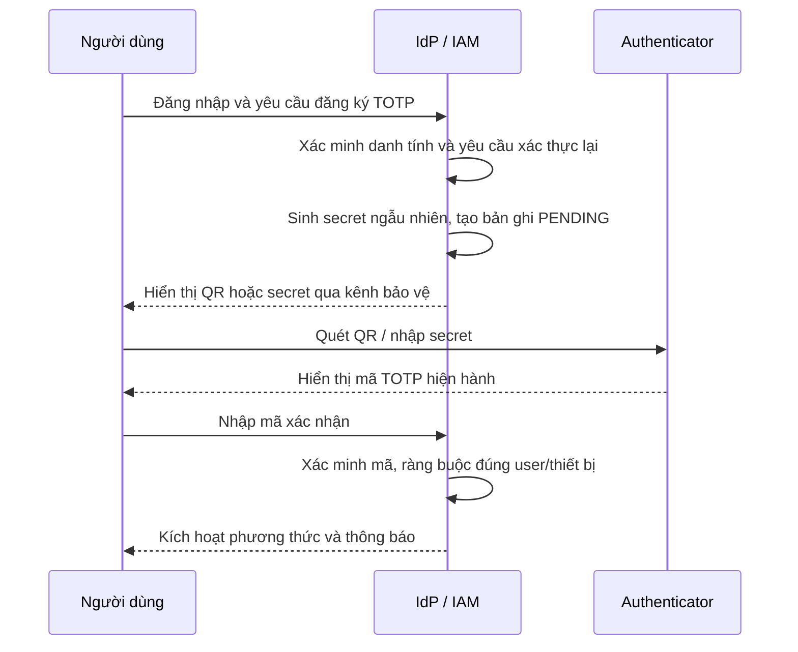
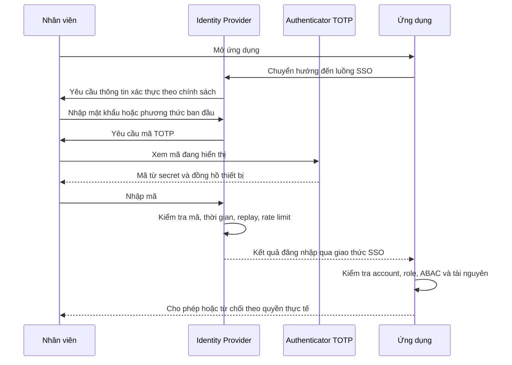

# TOTP trong MFA: Cơ chế, đăng ký, xác minh và quản lý vòng đời danh tính

**TOTP** (*Time-based One-Time Password*) là cơ chế sinh **mã xác thực dùng một lần dựa trên thời gian** từ một khóa bí mật được chia sẻ giữa ứng dụng xác thực và máy chủ xác minh. Người dùng thường nhìn thấy mã gồm sáu chữ số trong ứng dụng authenticator và nhập mã đó khi đăng nhập. Mã tự thay đổi theo từng khoảng thời gian ngắn, phổ biến là 30 giây. TOTP được mô tả trong **RFC 6238** và xây dựng trên cơ chế **HOTP** của RFC 4226.

Trong chương **MFA** thuộc module `SECURITY_IDENTITY_ACCESS_MANAGEMENT_IDENTITY_LIFECYCLE`, TOTP được nhìn nhận như một **phương thức xác thực có vòng đời riêng**: đăng ký đúng chủ thể, lưu giữ khóa bí mật an toàn, sử dụng và kiểm tra mã, thay thế hoặc khôi phục khi mất thiết bị, và vô hiệu hóa khi nhân viên chuyển vai trò hoặc rời tổ chức theo mô hình **Joiner–Mover–Leaver (JML)**. TOTP cần được tích hợp với Identity Provider (**IdP**), SSO, chính sách RBAC/ABAC, SCIM và hệ thống kiểm toán để không biến một lần xác thực hợp lệ thành quyền truy cập vượt phạm vi.

Sau bài học, bạn có thể giải thích cách tính TOTP, phân biệt TOTP với SMS OTP và passkey, thiết kế enrollment và verifier an toàn, xử lý sai lệch đồng hồ và thử sai, phân tích phishing/replay, xây dựng phương án recovery và thu hồi MFA trong toàn bộ vòng đời danh tính.

## 1. TOTP là gì và đóng vai trò gì trong MFA?

**Multi-Factor Authentication (MFA)** yêu cầu từ hai yếu tố thuộc **những nhóm khác nhau**, thường là:

- **Something you know — điều bạn biết:** mật khẩu hoặc một bí mật ghi nhớ.
- **Something you have — thứ bạn sở hữu/kiểm soát:** ứng dụng xác thực chứa TOTP secret, khóa bảo mật phần cứng hoặc thiết bị xác thực phù hợp.
- **Something you are — đặc điểm sinh trắc:** ví dụ xác minh sinh trắc tại thiết bị, theo cơ chế của phương thức xác thực.

Trong mô hình phổ biến **mật khẩu + TOTP**, mật khẩu là yếu tố kiến thức, còn **quyền kiểm soát authenticator lưu khóa TOTP** được sử dụng như yếu tố sở hữu. Mã TOTP **không phải mật khẩu thứ hai để nhớ**, dù giao diện đôi khi gọi là “mã xác minh”. Việc nhập hai mật khẩu khác nhau **không tự tạo MFA** vì chúng thuộc cùng nhóm kiến thức.

Ví dụ: nhân viên đăng nhập cổng công ty bằng username và mật khẩu. IdP kiểm tra hai thông tin đó, sau đó yêu cầu mã TOTP từ ứng dụng authenticator đã đăng ký. Nếu mã hợp lệ theo thời gian và chính sách, IdP có thể hoàn tất bước xác thực. Sau đó, ứng dụng vẫn phải kiểm tra **người đó được truy cập chức năng và dữ liệu nào**; TOTP không thay thế RBAC/ABAC.

| Phương thức | Đặc điểm | Giới hạn cần hiểu |
| --- | --- | --- |
| **TOTP trong authenticator** | Tạo mã tại thiết bị từ khóa bí mật và thời gian; thường hoạt động ngoại tuyến | Người dùng có thể bị lừa nhập mã vào trang giả; khóa bí mật có thể bị sao chép |
| **HOTP** | Mã dựa trên bộ đếm thay vì thời gian | Cần quản lý đồng bộ counter và cửa sổ chấp nhận |
| **SMS OTP** | Mã được gửi qua mạng di động | Phụ thuộc số điện thoại, mạng viễn thông; có rủi ro chuyển SIM, chặn/đọc tin nhắn |
| **Push approval** | Người dùng phản hồi yêu cầu trong ứng dụng | Có nguy cơ push fatigue hoặc phê duyệt nhầm nếu không có ràng buộc phù hợp |
| **FIDO2/WebAuthn/passkey** | Dùng khóa công khai và cơ chế gắn với nguồn gốc website | Có thể cung cấp xác thực chống phishing tốt hơn TOTP; vẫn cần quản lý đăng ký và khôi phục |

**TOTP không phải phương thức MFA chống phishing (*phishing-resistant*)**: mã có thể bị kẻ tấn công chuyển tiếp tức thời từ trang giả sang trang thật trong thời hạn còn hiệu lực. Với tài khoản đặc quyền, dữ liệu nhạy cảm hoặc hệ thống nguy cơ cao, cần đánh giá phương thức chống phishing như FIDO2/WebAuthn thay vì cho rằng “bất kỳ MFA nào cũng bảo vệ như nhau”.

## 2. TOTP khác mật khẩu và token truy cập như thế nào?

Một **TOTP secret** là khóa đối xứng được chia sẻ giữa authenticator và thành phần xác minh. Mã sáu chữ số là kết quả tính toán từ khóa đó tại một mốc thời gian, không phải bản thân khóa. Người quan sát biết **một mã** không trực tiếp biết khóa bí mật; tuy vậy họ vẫn có thể **dùng mã trong cửa sổ còn hiệu lực** để đăng nhập hoặc chuyển tiếp qua phishing.

| Thành phần | Nơi thường tồn tại | Mục đích |
| --- | --- | --- |
| **TOTP secret** | Thiết bị authenticator và kho xác minh được bảo vệ | Căn cứ để hai phía cùng tính mã theo thời gian |
| **TOTP code** | Hiển thị ngắn hạn trên thiết bị, người dùng nhập tại IdP | Chứng minh quyền kiểm soát khóa trong khoảng thời gian tương ứng |
| **Mật khẩu** | Người dùng nhớ, server giữ verifier an toàn | Yếu tố xác thực độc lập theo cơ chế mật khẩu |
| **Session / cookie / access token** | Trình duyệt, ứng dụng hoặc hệ thống phiên sau xác thực | Đại diện cho phiên hoặc quyền ủy quyền đã được cấp |
| **Role / entitlement** | IAM, IdP và/hoặc ứng dụng đích | Xác định quyền nghiệp vụ cụ thể |

Nếu mã TOTP hết thời hạn, điều đó **không tự làm hết hạn phiên SSO đã được cấp**. Nếu người dùng bị thu hồi role, mã TOTP vẫn có thể được tạo trên thiết bị, nhưng ứng dụng phải từ chối các hành động không còn được phép. Nếu nhân viên nghỉ việc, vô hiệu hóa tài khoản và quyền liên quan quan trọng hơn việc chỉ xóa ứng dụng authenticator trên điện thoại.

## 3. Nguyên lý tính mã theo RFC 6238

TOTP dùng hàm HOTP với một bộ đếm suy ra từ thời gian. Gọi:

- **K:** khóa bí mật được chia sẻ; phải đủ ngẫu nhiên và được bảo vệ.
- **T0:** mốc thời gian gốc (thường là Unix epoch).
- **X:** độ dài một bước thời gian, ví dụ 30 giây.
- **UnixTime:** số giây từ Unix epoch tại thời điểm tính.
- **C:** bộ đếm bước thời gian.

Ta có:

\[
C = \left\lfloor \frac{\mathrm{UnixTime} - T_0}{X} \right\rfloor,
\qquad \mathrm{TOTP}(K,t) = \mathrm{HOTP}(K,C).
\]

HOTP tạo mã từ **HMAC** của khóa K với biểu diễn bộ đếm C, sau đó thực hiện *dynamic truncation* và lấy kết quả theo số chữ số yêu cầu. RFC 6238 cho phép các biến thể HMAC-SHA-1, HMAC-SHA-256 và HMAC-SHA-512 khi hai phía thống nhất; trong nhiều ứng dụng tương thích, thiết lập mặc định thông dụng là HMAC-SHA-1 với 6 chữ số và bước 30 giây. **TOTP dùng HMAC-SHA-1 không có nghĩa server được lưu mật khẩu người dùng bằng SHA-1**: đây là hai mục đích mật mã khác nhau.

Ví dụ với `T0=0` và `X=30`:

| UnixTime (giây) | Counter C | Ý nghĩa |
| --- | ---: | --- |
| 0–29 | 0 | Cùng một mã được tính cho bước này |
| 30–59 | 1 | Khi chuyển sang giây 30, mã thay đổi |
| 60–89 | 2 | Một bước thời gian kế tiếp |
| 90–119 | 3 | Cứ mỗi 30 giây lại có bước mới |

**Mã không phải là phép đếm ngược đơn giản.** Nó là kết quả của hàm mật mã phụ thuộc **khóa bí mật và bộ đếm**. Hai tài khoản có secret khác nhau sẽ tạo mã khác nhau dù cùng dùng cùng một đồng hồ. Vì mã thường chỉ có 6 chữ số (một triệu khả năng), **giới hạn số lần thử mã trên server là bắt buộc về mặt thiết kế**, không thể dựa hoàn toàn vào bí mật của thuật toán.

### Giả mã tạo mã TOTP

```text
generateTotp(secret, unixSeconds, timeStepSeconds, digits, algorithm):
    counter = floor((unixSeconds - T0) / timeStepSeconds)
    mac = HMAC(algorithm, secret, encodeUint64BigEndian(counter))
    offset = lastByte(mac) AND 0x0F
    value = dynamicTruncate31Bits(mac, offset)
    number = value MOD (10 ^ digits)
    return leftPadWithZeros(number, digits)
```

Đây là **giả mã giải thích nguyên lý**, không phải thư viện triển khai production. Hai phía phải thống nhất secret, thuật toán, số chữ số, time step và T0. Nên dùng thư viện TOTP có kiểm thử theo vector chuẩn, không tự viết thao tác HMAC/truncation để đưa vào sản xuất.

## 4. Enrollment: Đăng ký TOTP cho đúng danh tính

Enrollment là bước liên kết **một authenticator cụ thể với đúng user tại IdP**. Nếu kẻ tấn công có thể đăng ký secret của chính họ cho tài khoản nạn nhân, MFA không những không bảo vệ tài khoản mà còn có thể giúp kẻ tấn công duy trì truy cập.



Các bước cần có:

1. **Xác nhận chủ thể:** người dùng đã được xác thực đúng tài khoản. Với việc thêm/thay MFA, yêu cầu *reauthentication* hoặc một phương thức đã đăng ký có mức bảo đảm phù hợp; tránh chỉ tin một phiên cũ có thể bị chiếm đoạt.
2. **Sinh secret chất lượng mật mã:** dùng nguồn ngẫu nhiên an toàn, secret riêng cho từng enrollment. Không dùng username, ngày sinh, mã nhân viên hoặc chuỗi bí mật cố định.
3. **Chuyển secret qua giao diện bảo vệ:** hiển thị QR hoặc mã nhập tay cho người dùng đã xác minh, qua TLS, tránh cache/log/referrer ngoài ý muốn.
4. **Xác minh sở hữu trước khi kích hoạt:** yêu cầu một mã TOTP hợp lệ từ authenticator mới. Không kích hoạt ngay khi QR được mở vì chưa chứng minh thiết bị có secret.
5. **Ghi trạng thái rõ ràng:** từ `PENDING` sang `ACTIVE` khi xác minh thành công; đặt hạn dùng cho bản ghi enrollment chưa hoàn tất.
6. **Thông báo và kiểm toán:** ghi sự kiện phương thức mới được thêm hoặc thay thế, gửi thông báo bảo mật và cung cấp kênh báo cáo nếu người dùng không thực hiện.

### Mã QR và URI `otpauth://`

Nhiều authenticator hỗ trợ biểu diễn cấu hình TOTP theo dạng URI để tạo mã QR. Ví dụ **giả định, không dùng làm secret thật**:

```text
otpauth://totp/ExampleCompany:an.nguyen%40example.com
  ?secret=JBSWY3DPEHPK3PXP
  &issuer=ExampleCompany
  &algorithm=SHA1
  &digits=6
  &period=30
```

Khi truyền thực tế, URI là **một chuỗi liền mạch**, không chứa khoảng xuống dòng/space như cách trình bày ở đây. Secret ví dụ ngắn chỉ để minh họa cấu trúc, **không nên dùng để tạo account thực tế**. Trường `secret` chứa khóa bí mật dạng Base32; `issuer` và nhãn chỉ giúp phân biệt tài khoản, **không thay thế bước xác minh danh tính**.

**QR là vật chứa secret**. Người khác chụp ảnh mã QR có thể sao chép khóa vào authenticator của họ và sinh các mã hợp lệ trong tương lai. Vì vậy:

- Không đưa QR TOTP vào ticket hỗ trợ, email công khai, ảnh chụp màn hình hoặc tài liệu onboarding.
- Không lưu URI chứa secret ở log truy vấn, công cụ phân tích, lịch sử ứng dụng hoặc thông điệp không bảo vệ.
- Hạn chế hiển thị lại secret sau khi enrollment hoàn tất; nếu nghi lộ phải **thay thế factor bằng secret mới**, không chỉ đổi tên hiển thị.
- Nếu cần nhập thủ công cho mục đích trợ năng, sử dụng một luồng bảo vệ có mức kiểm soát tương đương với QR.

## 5. Lưu giữ khóa TOTP ở IdP và trên thiết bị

Khác với verifier của mật khẩu, **máy chủ xác minh TOTP cần có khả năng sử dụng khóa đối xứng K để tính HMAC**. Vì vậy không thể lưu TOTP secret **chỉ bằng password hash một chiều** rồi vẫn xác minh mã theo cơ chế chuẩn. Nền tảng phải lưu hoặc truy xuất secret theo cách được bảo vệ, chẳng hạn mã hóa khi lưu trữ với quản lý khóa riêng, dịch vụ khóa/secret manager hoặc khả năng phù hợp của HSM.

| Thành phần | Yêu cầu quản lý |
| --- | --- |
| **Sinh secret** | Dùng nguồn ngẫu nhiên mật mã; độc lập theo từng factor/account; độ dài đáp ứng yêu cầu thuật toán và chính sách |
| **Lưu phía server** | Mã hóa hoặc bảo vệ bằng hệ thống quản lý khóa thích hợp; phân quyền đọc/hạn chế thao tác nhạy cảm |
| **Lưu trên authenticator** | Sử dụng cơ chế bảo vệ của thiết bị/ứng dụng; người dùng cần giữ quyền kiểm soát thiết bị |
| **Đồng bộ hoặc sao lưu authenticator** | Hiểu rõ ứng dụng có thể xuất/đồng bộ secret sang thiết bị khác hay không và đánh giá chính sách rủi ro |
| **Log và monitoring** | Không đưa secret, QR, URI provisioning hoặc mã TOTP thật vào nhật ký thông thường |
| **Backup/restore** | Bảo vệ bản sao secret và quyền phục hồi; kiểm thử khôi phục có kiểm soát |
| **Xóa/luân chuyển** | Thu hồi factor cũ theo trạng thái vòng đời; chặn sử dụng secret cũ sau khi thay mới |

Một thiết bị authenticator có thể bị thất lạc, bị cài phần mềm độc hại hoặc bị sao chép bí mật qua chức năng backup/export. **TOTP là factor dựa trên secret có thể sao chép**, không có cam kết phần cứng không thể xuất khóa như một số phương thức dựa trên khóa bảo mật chuyên dụng. Cần đánh giá mức bảo đảm trên mỗi nhóm tài khoản và không ghi nhận nhầm TOTP là bằng chứng một thiết bị cụ thể không thể nhân bản.

## 6. Verifier: Xác minh mã đúng, chống đoán và chống dùng lại

TOTP không được coi là hợp lệ chỉ vì có đúng sáu chữ số. Verifier phải:

1. Xác định **account và factor đang ACTIVE** đã được đăng ký trước đó, không nhận secret từ client lúc đăng nhập.
2. Xác định **time step**, thuật toán, số chữ số và mốc T0 từ cấu hình factor đáng tin cậy.
3. Tính mã trong **cửa sổ chấp nhận** theo chính sách, xét sai lệch đồng hồ.
4. So sánh kết quả an toàn qua thư viện xác minh phù hợp.
5. Áp **rate limiting, giới hạn thử sai, giám sát và chống enumeration** theo user, IP/ngữ cảnh và phương thức.
6. **Không chấp nhận lại cùng một bước/mã đã được sử dụng thành công** trong phạm vi bảo vệ chống replay của phiên/thao tác.
7. Chỉ tạo hoặc nâng mức phiên sau khi mọi yêu cầu mật khẩu, MFA và chính sách rủi ro được thỏa mãn.

### 6.1. Sai lệch đồng hồ (*clock drift*)

Authenticator và IdP đều dùng thời gian; nếu đồng hồ lệch, mã đúng trên điện thoại có thể bị từ chối tại server. Một số verifier kiểm tra bước hiện tại và một số bước lân cận (chẳng hạn trước/sau một bước) để giảm lỗi khi mã vừa chuyển. Tuy nhiên, **mở rộng cửa sổ làm tăng số mã hợp lệ cùng lúc và tăng bề mặt thử đoán**, nên phải giới hạn cửa sổ và số lần thử.

Ví dụ với `X=30` giây, server có counter hiện tại là `100`. Một cấu hình có thể thử `99, 100, 101`; đây chỉ là ví dụ, **không phải cấu hình mặc định bắt buộc**. Nếu điện thoại lệch nhiều phút, tốt hơn là kiểm tra đồng hồ thiết bị và nguồn thời gian IdP thay vì liên tục nới rộng cửa sổ chấp nhận.

Các timestamp phải dựa trên đồng hồ đáng tin cậy và quy ước thời gian chính xác. Múi giờ hiển thị **không thay đổi UnixTime**; vấn đề thường là đồng hồ vật lý sai hoặc đồng bộ thời gian không đúng, không phải người dùng ở quốc gia khác.

### 6.2. Replay: mã còn thời hạn không có nghĩa được dùng nhiều lần

Trong cùng một bước 30 giây, authenticator thường hiển thị **cùng một mã**. Nếu verifier chấp nhận vô hạn lần dùng mã đó trong khoảng thời gian hợp lệ, người quan sát hoặc kẻ tấn công có thể sử dụng lại mã đã bị lộ. Verifier cần lưu trạng thái **counter hoặc lần xác minh đã được chấp nhận** trong phạm vi factor và xử lý yêu cầu đồng thời một cách an toàn.

Ví dụ giả mã:

```text
verifyTotp(userId, factorId, submittedCode, serverTime):
    factor = loadActiveFactor(userId, factorId)
    if factor is missing or account is not allowed to authenticate:
        return GENERIC_DENY

    enforceRateLimit(userId, factorId, requestContext)
    candidates = countersInApprovedTimeWindow(serverTime, factor.period)

    for counter in candidates:
        expected = trustedTotpLibrary.generate(factor.secret, counter)
        if secureCompare(expected, submittedCode):
            atomically:
                if counter already accepted for this factor:
                    return GENERIC_DENY
                recordAcceptedCounter(factorId, counter)
            auditSafeSuccess(userId, factorId)
            return ACCEPT

    auditSafeFailureWithoutCode(userId, factorId)
    return GENERIC_DENY
```

Đây là **giả mã khái niệm**, không phải mẫu mã hoàn chỉnh. Triển khai thực phải giải quyết thứ tự counter khi chấp nhận các bước lân cận, nhiều máy chủ xác minh, giao dịch đồng thời, khả năng retry hợp lệ và lưu trạng thái chống replay. Kiểm tra và cập nhật counter nên có tính nguyên tử/nhất quán trong hệ phân tán. Không ghi secret hoặc submittedCode vào log.

### 6.3. Tại sao rate limiting quan trọng?

Mã sáu chữ số có (10^6) khả năng. Nếu verifier chấp nhận ba bước thời gian cùng lúc, về mặt đơn giản có thể có khoảng ba mã đúng trong cửa sổ, nhưng việc đoán thành công còn phụ thuộc chính sách và cơ chế kiểm tra. **Không cho phép kẻ tấn công thử số lượng lớn mã không giới hạn**. Kiểm soát phải hạn chế yêu cầu lặp lại và phát hiện hoạt động bất thường, đồng thời tránh cơ chế khóa toàn cục quá dễ bị lợi dụng để gây từ chối dịch vụ cho người dùng hợp lệ.

### 6.4. Mã hợp lệ không tự có nghĩa yêu cầu nghiệp vụ hợp lệ

Nếu một nhân viên nhập đúng TOTP, IdP mới có bằng chứng xác thực tại thời điểm đó. Quyết định người dùng có được phê duyệt thanh toán hoặc truy cập dữ liệu khách hàng hay không vẫn phụ thuộc RBAC/ABAC, chính sách nghiệp vụ và các yếu tố khác. Với giao dịch đặc biệt nhạy cảm, **step-up authentication** có thể yêu cầu xác thực mới hoặc phương thức mạnh hơn, nhưng việc nhập lại cùng TOTP **không làm nó trở thành xác thực chống phishing**.

## 7. Những nguy cơ chính đối với TOTP

| Nguy cơ | Cách xảy ra | Biện pháp phòng vệ |
| --- | --- | --- |
| **Phishing chuyển tiếp mã** | Trang giả lấy mật khẩu và TOTP rồi đăng nhập vào trang thật ngay | Ưu tiên FIDO2/WebAuthn chống phishing cho tài khoản nguy cơ cao; đào tạo và giám sát |
| **Đánh cắp secret** | QR bị chụp, secret lộ trong log/backup hoặc bị phần mềm độc hại lấy | Bảo vệ enrollment, mã hóa secret, giới hạn quyền, thay factor khi nghi lộ |
| **Dò mã trực tuyến** | Thử hàng loạt OTP 6 chữ số | Rate limiting, giới hạn retry, cảnh báo, cửa sổ thời gian hẹp |
| **Replay trong cửa sổ** | Mã đã dùng được gửi lại khi chưa hết thời gian | Theo dõi counter đã chấp nhận và từ chối sử dụng lại |
| **Sai lệch thời gian** | Đồng hồ thiết bị hoặc server sai | Đồng bộ thời gian, cửa sổ kiểm tra hợp lý, hướng dẫn khắc phục |
| **Chiếm quy trình recovery** | Kẻ tấn công xin reset MFA bằng thông tin dễ giả mạo | Xác minh danh tính tương xứng, phê duyệt có kiểm soát, audit và thông báo |
| **Mất thiết bị** | Người dùng mất điện thoại chứa authenticator | Backup/recovery an toàn, thu hồi factor cũ, đăng ký lại có xác minh |
| **Session tồn dư** | Factor bị xóa nhưng một phiên SSO hoặc ứng dụng đã có vẫn hoạt động | Quản lý session/token riêng; revoke theo chính sách và khả năng đích |
| **MFA fatigue bằng quy trình hỗ trợ** | Tấn công qua yêu cầu hỗ trợ liên tục hoặc thao tác thêm factor không được kiểm soát | Chống lạm dụng ở helpdesk, reauthentication và giám sát thay đổi factor |

**TOTP có ích nhưng không phải lớp bảo vệ đủ cho mọi rủi ro.** Khi kẻ tấn công có khả năng điều khiển trình duyệt hoặc hoạt động trong phiên đã xác thực, việc biết một OTP không nhất thiết là điều kiện để họ tiếp tục thực hiện hành động. Bảo vệ endpoint, phiên, ứng dụng và quyền vẫn quan trọng.

## 8. Khôi phục khi mất điện thoại hoặc đổi thiết bị

Đây thường là điểm yếu nhất trong vòng đời TOTP. Người dùng có thể mất điện thoại, thay máy, xóa authenticator hoặc không còn truy cập được bộ mã. Hệ thống cần quy trình khôi phục **an toàn nhưng không đẩy nhân viên vào việc chia sẻ mã hoặc secret cho người hỗ trợ**.

### Các phương án cần được thiết kế từ trước

- **Thêm nhiều authenticator được phép** nếu chính sách và IdP hỗ trợ, mỗi factor có quản lý riêng.
- **Recovery code dự phòng** được phát hành qua luồng an toàn, có phạm vi và cơ chế dùng một lần; hướng dẫn người dùng cất giữ riêng.
- **Phương thức xác thực thay thế có bảo đảm phù hợp**, chẳng hạn khóa bảo mật đã đăng ký, phục vụ khi mất thiết bị chính.
- **Helpdesk-assisted recovery** với xác minh danh tính, phê duyệt theo rủi ro, giới hạn người được thao tác và nhật ký đầy đủ.

### Quy trình thay TOTP khi thiết bị cũ không còn tin cậy

1. Xác định đúng account và xác minh người yêu cầu bằng kênh/phương thức tin cậy còn lại hoặc quy trình khôi phục được duyệt.
2. Đánh giá nguyên nhân: **đổi điện thoại bình thường** khác với **nghi bị chiếm đoạt thiết bị/secret**.
3. Thu hồi hoặc vô hiệu hóa factor cũ theo chính sách; khi nghi lộ, xem xét ngay các phiên và tài khoản có thể bị ảnh hưởng.
4. Sinh **secret mới độc lập**, chuyển qua kênh enrollment được bảo vệ và yêu cầu xác minh bằng mã TOTP mới.
5. Chỉ kích hoạt factor mới sau xác minh thành công; gửi thông báo và lưu bằng chứng có thể kiểm toán.
6. Kiểm tra đăng nhập lại theo mức bảo đảm cần thiết, đồng thời tránh tự cấp thêm quyền ứng dụng.

**Không nên xóa tất cả yếu tố MFA chỉ vì ai đó biết email và gọi đến helpdesk.** Với tài khoản quản trị hoặc người có quyền xem dữ liệu nhạy cảm, recovery phải được thiết kế để không trở thành đường vòng yếu hơn rất nhiều so với MFA bình thường. Nếu dùng mã dự phòng, người dùng phải bảo vệ mã như credential và không gửi mã cho người khác.

### Điện thoại mới nhưng factor cũ còn trên thiết bị khác

Một số authenticator cho phép sao lưu, xuất hoặc đồng bộ khóa. Do đó, đăng ký hoặc khôi phục trên điện thoại mới **không luôn chứng minh** thiết bị cũ không còn tạo mã được. Nếu muốn thu hồi hoàn toàn quyền tạo OTP từ thiết bị cũ, **thay secret TOTP tại IdP** là cách buộc mọi bản sao của secret cũ không còn hợp lệ. Việc gỡ ứng dụng trên điện thoại mới không tự xóa secret trên các bản sao khác.

## 9. TOTP trong Joiner–Mover–Leaver

### 9.1. Joiner — đăng ký factor trước khi cấp truy cập nhạy cảm

Khi nhân viên mới được xác minh tại HRIS, IAM có thể chuẩn bị user ở IdP và yêu cầu enrollment MFA ở thời điểm hợp lệ. Quy trình Joiner cần xác nhận đúng **identityId**, người đăng ký factor và trạng thái tài khoản; không chỉ kiểm tra rằng một QR code đã được hiển thị.

**Ví dụ:** nhân viên bắt đầu làm việc ngày 01/12. Ngày 28/11, theo chính sách tổ chức có thể cho người đó thực hiện bước bảo mật ban đầu ở một kênh enrollment hạn chế. Các ứng dụng tác nghiệp chỉ được phép truy cập từ thời điểm quan hệ có hiệu lực và sau khi tài khoản, role, MFA cùng đáp ứng yêu cầu. Nếu enrollment MFA chưa hoàn tất, không nên tự động bỏ qua MFA để kịp ngày đầu; cần cơ chế hỗ trợ và ngoại lệ được phê duyệt theo rủi ro.

### 9.2. Mover — thay đổi quyền không nhất thiết phải thay TOTP

Khi một nhân viên chuyển bộ phận, IAM phải tính lại quyền RBAC/ABAC, nhóm và entitlement ứng dụng. **Không nhất thiết thu hồi TOTP factor chỉ vì role thay đổi**, nếu account và phương thức xác thực còn đáng tin. Tuy nhiên, nếu vai trò mới yêu cầu mức bảo đảm cao hơn, chính sách có thể yêu cầu đăng ký **phương thức chống phishing**, khóa bảo mật hoặc tăng điều kiện step-up.

Ví dụ người dùng chuyển sang quản trị sản xuất: TOTP có thể vẫn được giữ để truy cập thông thường, nhưng tài nguyên production admin có thể yêu cầu FIDO2/WebAuthn và cấp quyền JIT/PAM. Việc **có TOTP hợp lệ không đủ** để tự kích hoạt quyền quản trị mới. Nếu người dùng không còn cần một ứng dụng, IAM phải gỡ quyền ở đích thay vì chỉ đổi hoặc xóa factor.

### 9.3. Leaver — chặn account, factor, phiên và các đường truy cập

Khi nhân viên nghỉ việc, quy trình Leaver cần dựa trên sự kiện có thẩm quyền và thời điểm có hiệu lực:

1. Vô hiệu hóa tài khoản hoặc khả năng xác thực tại IdP/directory theo chính sách.
2. Vô hiệu hóa hoặc thu hồi các factor TOTP và phương thức MFA liên kết khi phù hợp.
3. Thu hồi các phiên/refresh token hoặc kết thúc session khi nền tảng hỗ trợ, vì **xóa TOTP secret không tự chấm dứt mọi phiên đã đăng nhập**.
4. Deprovision quyền và tài khoản ứng dụng qua SCIM/API hoặc quy trình của chủ ứng dụng, kể cả đường đăng nhập cục bộ.
5. Đối soát trạng thái thực tế, token, quyền đặc quyền và ngoại lệ; ghi lại đích chưa thu hồi được.

TOTP authenticator trên điện thoại cá nhân có thể vẫn hiển thị những mã theo secret cũ; điều đó **không có nghĩa mã còn được IdP chấp nhận** nếu factor đã vô hiệu hóa. Ngược lại, nếu account đã bị vô hiệu hóa tại IdP nhưng một ứng dụng có phiên độc lập, người dùng có thể còn truy cập qua phiên đó. **Đối soát Leaver phải kiểm tra đường truy cập thực tế**, không chỉ nhìn vào màn hình MFA.

### 9.4. Rehire — tái tuyển dụng cần xác minh lại factor

Một người quay lại tổ chức có thể dùng lại một username theo chính sách, nhưng không được tự khôi phục **mọi phương thức MFA, session và quyền cũ** chỉ vì username trùng. Cần kiểm tra identity ID, trạng thái quan hệ lao động mới, chính sách xác thực hiện hành và việc người dùng còn thực sự kiểm soát authenticator cũ hay không. Tùy chính sách, hệ thống có thể yêu cầu enrollment lại hoặc thay TOTP secret.

## 10. TOTP, IdP/SSO, SCIM và quyền ứng dụng

TOTP thường được xác minh **tại IdP** trong luồng đăng nhập SSO. Ứng dụng dựa vào kết quả xác thực do IdP công bố theo giao thức, đồng thời thực thi quyền riêng. **SCIM** thường quản lý tài khoản và nhóm/thuộc tính tại ứng dụng đích; **không phải giao thức chung để đồng bộ seed TOTP giữa các ứng dụng**.



Nếu ứng dụng có cơ chế TOTP cục bộ **ngoài IdP**, nó cần vòng đời factor và quy trình Leaver riêng; không thể mặc định vô hiệu hóa TOTP tại IdP sẽ xóa factor của mọi ứng dụng.

### AAL và mức bảo đảm xác thực

Việc sử dụng TOTP trong một hệ thống MFA có thể đáp ứng **một số yêu cầu về mức bảo đảm xác thực** tùy toàn bộ luồng, cách xác minh, yếu tố đi kèm và chính sách. Không nên tuyên bố rằng “có TOTP là đạt mọi mức bảo đảm” hoặc “TOTP chống phishing” khi chưa đối chiếu yêu cầu của tiêu chuẩn và cấu hình cụ thể. Cần xem toàn bộ **đăng ký factor, cách ràng buộc, mật khẩu/MFA khác, giới hạn thử mã, recovery, session và kiểm toán**.

## 11. TOTP có phù hợp với tài khoản dịch vụ không?

TOTP thiết kế phổ biến cho **người dùng tương tác**, phải đọc và nhập mã từ authenticator. **Tài khoản dịch vụ và workload identity** thường không nên buộc một người trực ca đọc OTP rồi đưa vào pipeline tự động: điều đó khuyến khích chia sẻ secret, gây phụ thuộc cá nhân và làm mất khả năng vận hành.

Với machine-to-machine, ưu tiên các cơ chế phù hợp như **workload identity federation, managed identity, chứng chỉ/mTLS, OAuth client credentials** hoặc thông tin xác thực ngắn hạn theo năng lực nền tảng và chính sách. Mỗi danh tính máy cần chủ sở hữu, quyền tối thiểu, phạm vi API và kế hoạch luân chuyển/thu hồi credential.

Trong một số tình huống tài khoản quản trị hoặc thiết bị hạ tầng cũ buộc dùng TOTP, cần có quy trình quản trị rõ: không chia sẻ một QR code giữa nhiều nhân viên, hạn chế người có thể truy cập secret, kiểm toán và thay thế factor khi nhân viên biết secret nghỉ việc. TOTP **không nên được dùng để hợp thức hóa tài khoản dùng chung thiếu trách nhiệm cá nhân**.

## 12. Kiểm toán, giám sát và chỉ số chất lượng

Một hệ thống MFA cần ghi **thông tin sự kiện, không ghi bí mật**. Những trường hữu ích có thể gồm `eventId`, `identityId`, `factorId`, loại sự kiện, thời điểm, nguồn yêu cầu, kết quả, phiên bản chính sách, số lần thất bại tổng hợp, correlation ID và tình trạng rủi ro.

Ví dụ audit tối giản:

```yaml
eventId: mfa-event-00741
identityId: iam-user-1042
factorId: totp-factor-2
eventType: TOTP_VERIFICATION_SUCCESS
occurredAt: "2026-11-23T03:00:00Z"
policyVersion: mfa-policy-v5
result: SUCCESS
correlationId: sign-in-abc94
```

Không lưu **mã OTP đã nhập, TOTP secret, QR provisioning, recovery code thật hoặc session token** vào log. Dữ liệu kiểm toán cần được phân quyền, bảo vệ tính toàn vẹn, giới hạn thời gian lưu theo chính sách và không mở quyền xem rộng cho người không có nhiệm vụ.

| Chỉ số | Cần quan sát | Nguy cơ/lỗi được phát hiện |
| --- | --- | --- |
| **Tỷ lệ enrollment hoàn tất** | Số người đã kích hoạt factor hợp lệ trên số người phải có MFA | Joiner chưa thể đăng nhập an toàn |
| **Tỷ lệ xác minh thất bại** | Thất bại theo account/ngữ cảnh và thời điểm, không ghi OTP | Dò mã, thiết bị sai giờ hoặc trải nghiệm bất thường |
| **Rate-limit events** | Số trường hợp bị giới hạn, ngữ cảnh, cảnh báo | Brute force và cơ chế khóa gây gián đoạn |
| **Tỷ lệ reset/recovery** | Số lần thay factor, kênh thực hiện, lý do | Kênh hỗ trợ yếu hoặc khó dùng |
| **Factor cũ còn active sau thay thế** | Trạng thái trong IdP và cơ sở dữ liệu quản lý factor | Rủi ro secret bị sao chép, factor tồn dư |
| **Leaver còn factor hoặc session** | Số trường hợp vượt `effectiveAt` chưa chặn/đối soát | Quyền truy cập tồn dư sau nghỉ việc |
| **Tỷ lệ tài khoản nguy cơ cao dùng phương thức chống phishing** | Đối chiếu chính sách ứng dụng/nhóm đặc quyền | TOTP vẫn là mức kiểm soát chưa đủ cho tài nguyên nhạy cảm |

**Không nên đặt KPI chỉ dựa vào “100% người dùng có TOTP”**. Tỷ lệ cao không chứng minh enrollment không bị chiếm đoạt, recovery không bị lạm dụng hoặc quyền Leaver đã mất hiệu lực. Cần theo dõi cả chất lượng factor, khả năng chống phishing, rủi ro phiên và thời điểm thu hồi thực tế.

## 13. Tình huống thực hành: TOTP xuyên suốt JML

Giả sử tổ chức có nhân viên **An** đăng nhập IdP qua mật khẩu + TOTP và dùng CRM qua SSO. CRM sử dụng SCIM để nhận trạng thái user và role cơ sở. Ngoài ra một dịch vụ báo cáo chạy tự động có workload identity riêng.

| Sự kiện | Hành động | Trạng thái cần kiểm chứng |
| --- | --- | --- |
| **Joiner** — ngày đầu | Xác minh An, tạo account, đăng ký TOTP secret và yêu cầu mã xác nhận | Factor ACTIVE gắn đúng identity ID; role CRM đúng thời điểm |
| **Mất điện thoại** | An yêu cầu thay TOTP qua quy trình recovery được duyệt | Factor cũ bị thu hồi theo rủi ro, secret mới độc lập, phiên liên quan được đánh giá |
| **Mover** — chuyển sang kiểm toán | Gỡ role chỉnh sửa CRM, cấp role báo cáo được phê duyệt | TOTP có thể giữ nguyên; **quyền CRM cũ phải mất** dù OTP còn hợp lệ |
| **Vai trò quản trị tạm thời** | An cần thao tác đặc quyền theo phê duyệt | Xem xét FIDO2/WebAuthn/JIT/PAM thay vì coi TOTP thông thường là đủ |
| **Leaver** — nghỉ việc | Khóa IdP, xử lý factor, session và quyền tại ứng dụng | SSO mới bị chặn, CRM/VPN/ứng dụng cục bộ được đối soát; không có quyền tồn dư |
| **Sau Leaver** | Dịch vụ báo cáo vẫn hoạt động | Workload identity có owner mới và credential/role phù hợp, không phụ thuộc TOTP cá nhân của An |

### Hai lỗi cần tránh trong tình huống trên

**Lỗi A — lộ QR khi Joiner:** IT gửi ảnh mã QR chứa secret qua một nhóm chat nhiều người. Sau này dù An đổi mật khẩu, người đã lưu QR có thể vẫn tạo mã TOTP. Cần xem factor bị lộ, **thay secret** bằng enrollment mới, xử lý phiên/tài khoản theo rủi ro và chấm dứt cách gửi QR thiếu bảo vệ.

**Lỗi B — xóa factor sau Leaver nhưng session vẫn mở:** IAM xóa TOTP của An ở IdP, song một phiên CRM đã xác thực trước đó vẫn hoạt động. Mục tiêu Leaver chưa được chứng minh hoàn tất. Cần kiểm tra và chặn phiên/đường truy cập ở CRM, đối soát quyền và ghi bằng chứng chứ không chỉ kiểm tra `factorStatus=DISABLED`.

## 14. Checklist thiết kế TOTP an toàn

1. Có xác định phương thức MFA phù hợp mức rủi ro không, đặc biệt khi cần chống phishing?
2. Enrollment có xác minh đúng account, yêu cầu reauthentication thích hợp và xác nhận OTP trước khi kích hoạt không?
3. Secret có được sinh ngẫu nhiên, tách riêng theo factor, bảo vệ khi truyền và lưu trữ không?
4. QR/URI chứa secret có bị ghi vào log, ticket, screenshot hoặc phân phối ngoài phạm vi không?
5. Verifier có thống nhất time step, thuật toán, số chữ số, T0 và dùng thư viện kiểm thử chuẩn không?
6. Cửa sổ thời gian có bị mở quá rộng, thiếu rate limiting hoặc chấp nhận lại counter đã dùng không?
7. Có phát hiện brute force, phishing và hành vi thêm/thay factor bất thường không?
8. Recovery có xác minh danh tính tương xứng và hạn chế người hỗ trợ bỏ qua MFA không?
9. Khi mất thiết bị hoặc nghi secret bị sao chép, có vô hiệu hóa factor cũ và đánh giá session không?
10. Joiner/Mover/Leaver có xử lý TOTP **song song nhưng tách biệt** với quyền RBAC/ABAC, tài khoản ứng dụng, SCIM và phiên không?
11. Tài khoản dịch vụ có được sử dụng xác thực workload thích hợp, thay vì chia sẻ TOTP cá nhân không?
12. Có bằng chứng kiểm toán đủ để xác nhận yếu tố nào còn hoạt động, do ai đăng ký và đã được thu hồi khi nào không?

## 15. Câu hỏi tự kiểm tra

**Câu 1.** Mã TOTP thay đổi mỗi 30 giây có nghĩa nó chống phishing tốt như passkey không?

**Trả lời:** Không. Mã TOTP có thể bị chuyển tiếp trong thời gian còn hiệu lực. Phương thức dựa trên WebAuthn/FIDO2 có khả năng chống phishing tốt hơn vì cơ chế xác thực gắn với nguồn gốc website hợp lệ.

**Câu 2.** Hai người dùng có cùng username ở hai hệ thống khác nhau có phải sẽ tạo cùng mã TOTP không?

**Trả lời:** Không. Mã chủ yếu phụ thuộc **secret riêng**, counter thời gian và cấu hình thuật toán. Username là nhãn hiển thị/đăng nhập, không phải khóa tạo mã.

**Câu 3.** Nếu xóa ứng dụng authenticator trên điện thoại, server có tự biết secret đã bị thu hồi không?

**Trả lời:** Không. Xóa app phía người dùng không nhất thiết làm thay đổi trạng thái factor ở IdP; secret còn ở bản sao khác vẫn có thể tạo mã. Cần thu hồi hoặc thay thế factor **ở hệ thống xác minh**.

**Câu 4.** Một nhân viên chuyển bộ phận nhưng vẫn dùng cùng IdP. Có bắt buộc reset TOTP để gỡ quyền của phòng ban cũ không?

**Trả lời:** Không. Quyền phải điều chỉnh bằng RBAC/ABAC và deprovisioning; TOTP chỉ là yếu tố xác thực. Chỉ thay factor nếu có yêu cầu mức bảo đảm mới, dấu hiệu lộ secret hoặc chính sách liên quan.

**Câu 5.** Sau Leaver, TOTP vẫn hiển thị mã trên máy cũ, vậy account chắc chắn còn đăng nhập được?

**Trả lời:** Không. Authenticator có thể tiếp tục tính mã offline. Việc mã **có được IdP chấp nhận** phụ thuộc account và factor đã bị vô hiệu hóa chưa. Đồng thời phải đánh giá các phiên/token đã tạo trước khi khóa.

**Câu 6.** Vì sao server không nên cho phép thử vô hạn mã TOTP, dù secret không được công khai?

**Trả lời:** Vì mã thường chỉ gồm sáu chữ số và có số lượng khả năng hữu hạn. Cửa sổ thời gian càng rộng càng có thêm ứng viên có thể hợp lệ; rate limiting, theo dõi chống brute force và chống replay là các kiểm soát quan trọng.

## Kết luận

**TOTP là cơ chế tạo OTP dựa trên thời gian và khóa bí mật chia sẻ**, thường được dùng làm yếu tố sở hữu trong MFA kết hợp với mật khẩu. Nó giúp giảm phụ thuộc vào một mật khẩu nhưng **không chống phishing bằng cơ chế ràng buộc nguồn gốc** và có thể bị lạm dụng nếu secret, quy trình enrollment hoặc recovery không được bảo vệ. Trong IAM, vòng đời TOTP phải có đăng ký đúng chủ thể, lưu giữ khóa an toàn, verifier chống đoán/replay, thay thế factor có xác minh và thu hồi khi cần. Gắn các bước ấy với IdP/SSO, RBAC/ABAC, SCIM, quản lý session và sự kiện Joiner–Mover–Leaver giúp tổ chức duy trì khả năng xác thực hợp lệ, giảm tài khoản/phương thức còn sót và chứng minh trạng thái truy cập sau mỗi thay đổi danh tính.
