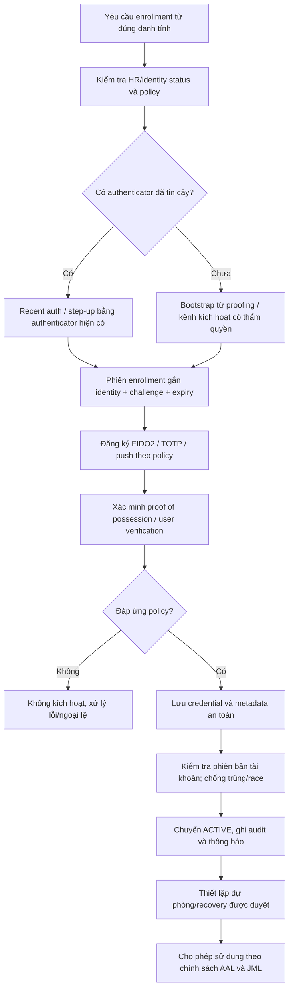
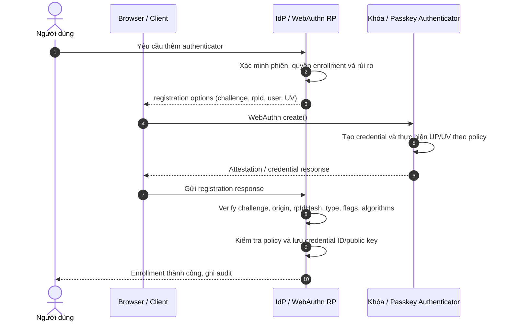
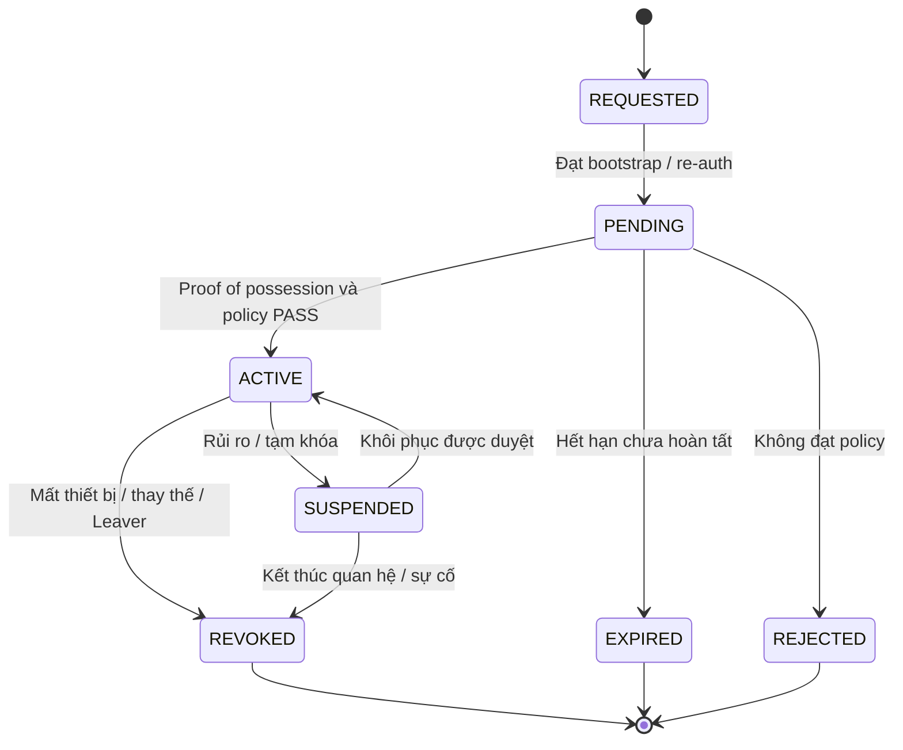

# MFA enrollment trong quản lý vòng đời danh tính IAM

## 1. MFA enrollment là gì?

**MFA enrollment (đăng ký phương thức xác thực đa yếu tố)** là quy trình liên kết một hoặc nhiều **authenticator** với đúng danh tính/tài khoản, nhằm cho phép hệ thống yêu cầu bằng chứng xác thực mạnh hơn khi người dùng đăng nhập hoặc thực hiện hành động nhạy cảm. Trong quản lý vòng đời danh tính **Identity and Access Management (IAM)**, enrollment là một bước an ninh quan trọng của **Joiner** và tiếp tục được quản lý ở các giai đoạn **Mover–Leaver**.

**Multi-Factor Authentication (MFA)** thường dựa vào những loại yếu tố độc lập:

- **Something you know:** bí mật đã ghi nhớ, ví dụ mật khẩu/PIN.
- **Something you have:** thiết bị hoặc khóa bảo mật được đăng ký và có thể chứng minh quyền sở hữu.
- **Something you are:** đặc điểm sinh trắc học, thường được sử dụng như bước mở khóa/bảo vệ authenticator khi được phép.

**MFA enrollment không đơn thuần là “bật một nút MFA”**. Hệ thống phải trả lời được:

1. Danh tính này đã được xác lập và có quan hệ làm việc hợp lệ chưa?
2. Ai đang yêu cầu đăng ký authenticator, qua phiên hoặc kênh nào?
3. Loại authenticator có đáp ứng chính sách rủi ro và mức bảo đảm mong muốn không?
4. Thiết bị/khóa có thực sự thuộc quyền kiểm soát của người đăng ký không?
5. Đã xác minh authenticator hoạt động trước khi ghi nhận là `ACTIVE` chưa?
6. Authenticator được sử dụng, thay thế, khôi phục và thu hồi ra sao trong toàn bộ vòng đời?

Ví dụ: một nhân viên nhận tài khoản IdP, đăng ký khóa bảo mật FIDO2 rồi hoàn tất một thử thách hợp lệ. Khi đó IdP liên kết credential với đúng danh tính và có thể yêu cầu khóa ấy khi đăng nhập. Việc chỉ gửi một email “hãy bật MFA” không phải bằng chứng enrollment đã hoàn tất.

## 2. Phân biệt MFA, enrollment, authentication và recovery

| Khái niệm | Câu hỏi | Đầu ra |
|---|---|---|
| **Identity proofing** | Người được tạo danh tính có đúng là chủ thể đã khai báo? | Kết quả xác minh danh tính đủ tin cậy |
| **MFA enrollment** | Authenticator nào đã được gắn với đúng danh tính? | Credential và bản ghi liên kết authenticator |
| **MFA authentication** | Người đăng nhập có chứng minh đang kiểm soát authenticator hợp lệ không? | Kết quả xác thực và phiên theo chính sách |
| **Step-up authentication** | Hành động nhạy cảm có cần bằng chứng xác thực mạnh hơn phiên hiện tại không? | Xác thực bổ sung trong giao dịch cụ thể |
| **Authenticator replacement** | Cần thay thiết bị/khóa cũ bằng thiết bị/khóa mới? | Authenticator mới được duyệt, credential cũ được thu hồi |
| **Account recovery** | Người dùng mất phương thức đăng nhập có thể lấy lại tài khoản bằng cách nào? | Khôi phục có xác minh và kiểm soát nguy cơ chiếm tài khoản |
| **Authorization (RBAC/ABAC)** | Danh tính được phép truy cập tài nguyên nào? | Quyền được cấp theo chính sách |

Enrollment và authentication có liên hệ nhưng là **hai thời điểm khác nhau**. Một thiết bị chưa từng được xác minh không nên trở thành yếu tố đăng nhập được tin cậy chỉ vì client gửi ID thiết bị. Ngược lại, một lần đăng nhập MFA thành công không tự động trao thêm quyền vào hệ thống tài chính.

Cần phân biệt **IAL** (đảm bảo về danh tính đã proofing), **AAL** (đảm bảo về phương thức xác thực) và **FAL** (đảm bảo liên kết xác thực trong federation) nếu tổ chức áp dụng hệ quy chiếu này. Không được suy diễn rằng một tài khoản dùng MFA mạnh thì nguồn gốc danh tính ban đầu chắc chắn đã được xác minh tốt.

## 3. Tại sao đăng ký MFA là bước có rủi ro cao?

Một kẻ tấn công có thể **chiếm tài khoản mà không cần đánh cắp MFA hiện có** nếu chúng tìm được cách tự đăng ký authenticator của mình vào tài khoản nạn nhân. Những lỗ hổng hay gặp:

- Người dùng mới chỉ biết username và một mật khẩu tạm dùng chung nhưng đã có thể thêm thiết bị MFA.
- Helpdesk chấp thuận thêm số điện thoại mới chỉ dựa trên câu hỏi dễ đoán hoặc thông tin công khai.
- Một liên kết enrollment trong email bị chuyển tiếp hoặc đánh cắp, không ràng buộc với đúng tài khoản và phiên.
- Người dùng đăng nhập bằng phiên cũ bị chiếm; giao diện cho phép đăng ký thêm authenticator không cần xác thực lại.
- Token bootstrap không giới hạn thời hạn, không dùng một lần hoặc bị ghi vào log.
- Một kênh recovery yếu có thể dùng để loại bỏ MFA mạnh, biến chính sách mạnh trên giấy thành vô nghĩa.

**Đăng ký authenticator mới là thay đổi thuộc tính an ninh của tài khoản**, vì thế thường cần bảo vệ ít nhất tương xứng với việc thay hoặc khôi phục authenticator. Đặc biệt, với tài khoản quản trị, quyền thanh toán và dữ liệu nhạy cảm, cần quy trình có mức tin cậy cao.

## 4. Các loại authenticator thường đăng ký

| Phương thức | Cách hoạt động khái quát | Khả năng chống phishing | Điều cần lưu ý khi enrollment |
|---|---|---|---|
| **Khóa bảo mật FIDO2/WebAuthn** | Khóa giữ private key, đăng ký public key với RP/IdP | Có thể chống phishing nhờ ràng buộc theo RP/origin | Bảo vệ challenge, RP ID, origin, user verification và quản lý thiết bị |
| **Passkey** | Credential WebAuthn được tạo trên thiết bị/nền tảng; có thể đồng bộ tùy loại | Có đặc tính ràng buộc RP, chống phishing khi xác thực đúng giao thức | Phân biệt credential **device-bound** và credential **syncable** theo chính sách |
| **TOTP app** | Ứng dụng sinh mã thời gian dựa trên secret được chia sẻ | **Không chống phishing**: mã có thể bị chuyển tiếp đến trang giả | Bảo vệ secret/QR, yêu cầu nhập mã để xác nhận, chống replay |
| **Push authenticator** | Ứng dụng nhận yêu cầu và người dùng chấp thuận | Push thông thường **không mặc nhiên chống phishing** | Ngăn MFA fatigue, ràng buộc giao dịch, number matching nếu hỗ trợ |
| **SMS/voice OTP** | Mã gửi qua mạng viễn thông | Không chống phishing và có nguy cơ SIM swap | Cân nhắc hạn chế sử dụng cho hệ thống nhạy cảm theo chính sách |
| **Recovery code** | Mã khẩn cấp dùng khi mất authenticator | Không thay MFA chính và có thể bị lộ nếu lưu sai | Sinh ngẫu nhiên, dùng một lần, bảo vệ khi hiển thị và lưu verifier an toàn |
| **Authenticator dạng chứng thư/thiết bị doanh nghiệp** | Khóa riêng hoặc chứng thư gắn với thiết bị được quản lý | Phụ thuộc thiết kế giao thức và chính sách | Quản lý phát hành, thiết bị, thu hồi chứng thư, vòng đời khóa |

**Hai mã từ cùng một ứng dụng không tạo ra hai yếu tố độc lập.** MFA cần xem xét nguồn gốc và tính độc lập của các yếu tố. Một phương thức có thể được coi là **multi-factor cryptographic authenticator** nếu thiết kế kết hợp possession với user verification như PIN/sinh trắc học bảo vệ khóa, nhưng việc đáp ứng mức bảo đảm cụ thể vẫn do chính sách và thông số xác thực quyết định.

### 4.1. Passkey không phải lúc nào cũng tương đương khóa cứng quản trị

Passkey WebAuthn có thể là **đồng bộ qua hệ sinh thái thiết bị** hoặc **ràng buộc với một thiết bị vật lý**. Cả hai đều có ưu điểm ràng buộc đăng nhập theo miền hợp lệ, nhưng chính sách tài khoản đặc quyền có thể yêu cầu thiết bị được quản lý hoặc khóa không thể xuất/đồng bộ. Do đó, cần lưu đặc tính authenticator được xác minh theo khả năng nền tảng, không chỉ gán nhãn chung “passkey = mức cao nhất”.

### 4.2. TOTP và SMS không bằng chứng chống phishing

Người dùng có thể vô tình nhập mã OTP vào trang giả và mã bị dùng ngay tại dịch vụ thật. Với những ứng dụng có rủi ro cao, nên ưu tiên các phương thức **phishing-resistant** phù hợp khả năng IdP và chính sách tổ chức, không coi thêm “một mã nữa” là đủ chống mọi loại tấn công.

## 5. Điều kiện tiên quyết trước khi enrollment

Một yêu cầu đăng ký MFA nên kiểm tra đồng thời **danh tính, quan hệ nghiệp vụ, độ mạnh của phiên, quyền thao tác và rủi ro**.

### 5.1. Danh tính và quan hệ làm việc

- **HRIS/HCM** hoặc nguồn hợp đồng có thẩm quyền xác nhận Joiner hay danh tính hiện tại.
- **Identity proofing** đã đáp ứng yêu cầu tạo tài khoản theo chính sách.
- Identity ID/worker ID được liên kết đúng với tài khoản IdP.
- Tài khoản không đang bị chặn do sự cố, đình chỉ hoặc Leaver.
- Những trường hợp chưa đến ngày bắt đầu hoặc đang `PRE_HIRE` chỉ được enrollment nếu chính sách cho phép, với truy cập nghiệp vụ vẫn bị hạn chế đúng thời điểm.

Một hồ sơ nhân sự hợp lệ **chưa chứng minh người đang cầm thiết bị là nhân sự đó**. Đặc biệt khi thiết lập MFA lần đầu từ xa, quy trình bootstrap phải ràng buộc đúng người với danh tính đã được proofing.

### 5.2. Quyền thao tác và xác thực lại

- Tài khoản đích lấy từ ngữ cảnh xác thực phía server hoặc yêu cầu được ủy quyền; không tin `user_id` do trình duyệt tự khai báo.
- Nếu đã có authenticator, việc thêm một authenticator mới thường cần **xác thực lại gần đây** bằng phương thức đủ mạnh hoặc step-up.
- Nếu **chưa có MFA nào**, cần luồng bootstrap dựa trên xác minh danh tính có thẩm quyền, token enrollment bảo vệ và điều kiện rủi ro rõ ràng.
- Với tài khoản đặc quyền, cân nhắc quy trình enrollment trên thiết bị quản lý và kiểm tra bổ sung theo policy.
- Khi có dấu hiệu tài khoản bị chiếm, không cho tự thêm authenticator mới chỉ dựa vào session đáng ngờ.

### 5.3. Chống giả mạo phiên

- Chỉ dùng kênh HTTPS/TLS được bảo vệ, miền IdP chính thức.
- Áp dụng CSRF protection cho giao diện dựa vào cookie.
- Mỗi phiên enrollment có **request ID, challenge/nonce**, thời hạn và ràng buộc với danh tính đúng.
- Giới hạn số lần thử, ngăn brute-force hoặc spam xác minh.
- Không tiết lộ secret, seed, challenge nhạy cảm, mã bootstrap hoặc token vào URL query, log, analytics.
- Kiểm tra lại trạng thái tài khoản và policy **trước bước commit**, tránh enrollment hoàn tất sau khi tài khoản vừa bị khóa.

## 6. Quy trình MFA enrollment tổng quát

Một luồng enrollment an toàn có thể chia thành các bước:

1. **Khởi tạo:** IAM/IdP xác định lý do enrollment, identity ID, phương thức được phép và chính sách rủi ro.
2. **Đánh giá bootstrap:** người dùng đã có authenticator tin cậy hay đang đăng ký đầu tiên? Chọn cách xác minh phù hợp.
3. **Tạo phiên có kiểm soát:** cấp challenge hoặc enrollment transaction ngắn hạn, liên kết với đúng tài khoản.
4. **Khởi tạo authenticator:** người dùng thực hiện thao tác tạo credential trên thiết bị hoặc nhận seed/QR theo giao thức đã chọn.
5. **Chứng minh quyền kiểm soát:** server xác minh phản hồi challenge, chữ ký hoặc OTP hợp lệ, chứ không chỉ nhận dữ liệu đăng ký.
6. **Kiểm tra chính sách:** phương thức và đặc tính authenticator có đáp ứng yêu cầu với loại tài khoản không?
7. **Commit liên kết:** lưu credential ID, public key hoặc secret được bảo vệ cùng metadata cần thiết; chuyển trạng thái `ACTIVE` bằng thao tác an toàn.
8. **Cung cấp phương án dự phòng:** đăng ký authenticator thứ hai hoặc recovery đã kiểm soát để tránh khóa tài khoản.
9. **Thông báo và audit:** ghi thời điểm, loại phương thức, kết quả, context và cảnh báo thêm authenticator mới.
10. **Xác minh hậu enrollment:** kiểm tra khả năng dùng authenticator theo quy trình phù hợp; tiếp tục theo dõi bất thường.



Sơ đồ minh họa một luồng chung. Giao thức cụ thể khác nhau nhiều giữa WebAuthn, TOTP và ứng dụng push. **Không áp dụng chung một cách kiểm tra challenge cho mọi phương thức**.

## 7. Enrollment WebAuthn/FIDO2 và passkey

**WebAuthn/FIDO2** sử dụng cặp khóa mật mã không đối xứng. Khi đăng ký, authenticator tạo credential cho một **Relying Party (RP)**; server giữ public key và thông tin định danh credential, trong khi private key phải được bảo vệ bởi authenticator hoặc nền tảng tương ứng.

### 7.1. Các bước khái niệm

1. Người dùng bắt đầu đăng ký tại **origin hợp lệ** của IdP/RP.
2. Server tạo **challenge khó đoán, ngắn hạn, dùng cho một lần đăng ký** và cấu hình RP ID, user handle, thuật toán cho phép, chính sách user verification.
3. Browser/client gọi API WebAuthn tạo credential trên authenticator.
4. Authenticator tạo khóa và phản hồi dữ liệu đăng ký, có thể kèm attestation tùy thiết bị và chính sách.
5. Server xác minh **challenge**, loại ceremony, origin, RP ID hash, cấu trúc dữ liệu, thuật toán và các điều kiện user presence/user verification liên quan.
6. Nếu policy yêu cầu attestation hay thiết bị quản lý, đánh giá bằng chứng theo chính sách đó; không tự giả định mọi thiết bị đều cung cấp attestation tin cậy.
7. Server liên kết **credential ID/public key** với đúng identity ID và ghi metadata.
8. Trạng thái chuyển sang `ACTIVE` sau khi commit; các lần xác thực tiếp theo dùng challenge mới và chữ ký của authenticator.



### 7.2. Cấu trúc metadata mẫu

```json
{
  "identity_id": "identity-4821",
  "authenticator_id": "authn-209",
  "type": "WEBAUTHN",
  "credential_id_ref": "cred-5f2a",
  "public_key_ref": "pubkey-5f2a",
  "user_verification_required": true,
  "credential_policy": "PHISHING_RESISTANT_V2",
  "enrolled_at": "2026-11-23T09:10:00Z",
  "status": "ACTIVE"
}
```

Đây là **bản ghi minh họa**, không phải phản hồi chuẩn WebAuthn. Trong ứng dụng thật, cần lưu đủ thuộc tính để thực hiện xác thực và chính sách, ví dụ thuật toán khóa, signature counter khi được hỗ trợ và thông tin thiết bị/phương thức được xác minh.

**Server không lưu private key của WebAuthn authenticator**. Không được xuất private key từ authenticator chỉ để tiện quản trị. Nếu người dùng mất thiết bị, phải dùng authenticator dự phòng hoặc recovery được kiểm soát.

### 7.3. Những kiểm soát quan trọng

- Xác minh **origin và RP ID** chính xác để tránh credential bị đăng ký cho miền khác.
- Ràng buộc challenge với **đúng phiên, đúng người và thời hạn**; chống replay.
- Kiểm tra **user verification** khi chính sách yêu cầu, không đánh đồng user presence với xác minh người dùng.
- Không coi attestation “không có” đồng nghĩa đăng ký thất bại trong mọi trường hợp; chính sách doanh nghiệp quyết định có bắt buộc hay không.
- Phân biệt credential **syncable** và **device-bound** nếu cần quản lý đảm bảo của thiết bị; không khẳng định mọi passkey là phần cứng không xuất được.
- Thận trọng với signature counter: thiết bị đồng bộ có thể có đặc tính counter khác nhau; đây là tín hiệu hỗ trợ chứ không phải tiêu chí đơn lẻ để xác định xâm nhập.
- Rà soát credential bị đăng ký trùng, bất thường hoặc không nằm trong loại được phép.

## 8. Enrollment TOTP qua ứng dụng authenticator

**TOTP (Time-based One-Time Password)** sử dụng **một secret chia sẻ** giữa verifier và ứng dụng sinh mã, cộng thời gian để tạo OTP có hạn ngắn. Luồng phổ biến gồm một QR code chứa URI cấu hình hoặc chuỗi secret được cung cấp qua giao diện bảo vệ.

### 8.1. Quy trình đúng

1. Người dùng đã vượt qua điều kiện bootstrap/re-authentication.
2. Server sinh **secret đủ ngẫu nhiên** và lưu ở trạng thái `PENDING`, liên kết với đúng tài khoản/phiên enrollment.
3. Ứng dụng authenticator quét QR hoặc nhập secret theo cơ chế bảo vệ.
4. Người dùng nhập mã TOTP được ứng dụng tạo.
5. Server kiểm tra mã, cửa sổ thời gian và giới hạn số lần thử; ngăn dùng lại OTP đã được chấp nhận theo chính sách.
6. Chỉ khi xác minh thành công, authenticator mới được **kích hoạt** cho tài khoản.
7. Mã/QR khởi tạo không được tiếp tục hiển thị vô hạn; phiên enrollment hết hạn được dọn an toàn.
8. Ghi audit và khuyến nghị người dùng đăng ký phương thức dự phòng.

### 8.2. Những sai lầm dễ gặp

| Sai lầm | Rủi ro |
|---|---|
| Quét QR là lập tức `ACTIVE` | Chưa chứng minh người dùng kiểm soát app/secret |
| Secret TOTP xuất hiện trong log URL hoặc ticket | Kẻ khác tạo được mã như chủ tài khoản |
| Cho thử mã không giới hạn | Tăng khả năng brute force |
| Dùng cửa sổ thời gian quá rộng hoặc không chống replay | Mã có thể được dùng lại hoặc kéo dài thời gian tấn công |
| Secret lưu plaintext không kiểm soát | Dễ sao chép toàn bộ seed nếu kho dữ liệu lộ |
| Coi TOTP là phishing-resistant | Mã có thể bị chuyển tiếp theo thời gian thực |
| Không có phương án mất thiết bị | Người dùng bị khóa và helpdesk dễ bị social engineering |

**Secret TOTP khác password verifier.** Verifier cần dùng secret để tính/kiểm tra mã, nên secret thường phải **được mã hóa và kiểm soát truy cập tại nơi lưu** hoặc bảo vệ theo cơ chế mật mã phù hợp; không thể thay bằng một hash một chiều đơn giản rồi vẫn kiểm tra TOTP theo cách thông thường.

### 8.3. Ví dụ bản ghi trạng thái không chứa secret

```json
{
  "identity_id": "identity-4821",
  "authenticator_id": "authn-210",
  "type": "TOTP",
  "state": "ACTIVE",
  "secret_location_ref": "vault-ref-opaque",
  "proof_of_possession_verified": true,
  "last_accepted_time_step": 18810023,
  "enrolled_at": "2026-11-23T09:15:00Z"
}
```

Trường `last_accepted_time_step` chỉ minh họa cách theo dõi chống dùng lại mã trong một khoảng chấp nhận. Trong thực tế cần thiết kế kiểm soát đồng thời và xử lý lệch đồng hồ phù hợp; không ghi secret thật hoặc QR chứa secret vào ví dụ, audit hay log.

## 9. Enrollment push MFA và các phương thức hạn chế hơn

Ứng dụng push có thể đăng ký thiết bị thông qua khóa được sinh trên thiết bị, liên kết tài khoản và trao đổi challenge. **Một số hệ thống chỉ gửi push phê duyệt**, trong khi hệ thống mạnh hơn cung cấp số đối chiếu, ngữ cảnh giao dịch và xác thực trên thiết bị.

### 9.1. Push enrollment

- Chứng minh người đang đăng ký có quyền liên kết thiết bị.
- Liên kết chính xác app instance/device key với identity ID.
- Yêu cầu **chứng minh quyền kiểm soát** thiết bị qua thử thách đã được kiểm tra.
- Giới hạn đăng ký nhiều thiết bị trong khoảng ngắn hoặc từ nguồn bất thường.
- Có thông báo qua kênh trước đó đã tin cậy khi thêm thiết bị mới.
- Khi đăng nhập, hạn chế **MFA fatigue** do kẻ tấn công spam các yêu cầu phê duyệt.

**Number matching giúp giảm phê duyệt nhầm**, nhưng tự nó không biến mọi push MFA thành phương thức chống phishing. Mức bảo đảm phụ thuộc vào ràng buộc kênh, mật mã, ngữ cảnh giao dịch và thiết kế cụ thể.

### 9.2. SMS và voice OTP

SMS/voice OTP có thể hữu ích khi thiết bị không hỗ trợ phương thức mạnh hơn, nhưng có rủi ro **SIM swap, chuyển hướng số và phishing mã**. Việc thêm hoặc đổi số điện thoại cần được xem như **thay đổi authenticator nhạy cảm**, không chỉ cập nhật trường số điện thoại trong hồ sơ HR.

Với hệ thống nhạy cảm, nên ưu tiên phương thức phù hợp yêu cầu phishing resistance. Nếu vẫn cần SMS theo chính sách, phải quản lý rủi ro và lộ trình nâng cấp.

## 10. Bootstrap: đăng ký MFA lần đầu trong Joiner lifecycle

**Bootstrap** là phần khó vì người mới **chưa có authenticator MFA đã được tin cậy** để xác thực lại. Hệ thống không thể yêu cầu “dùng MFA cũ” khi chưa tồn tại MFA nào.

Ví dụ một quy trình nhân viên mới:

1. HRIS phát sự kiện Joiner được duyệt, kèm identity/worker ID, ngày bắt đầu và người quản lý.
2. Người mới hoàn thành **identity proofing** theo chính sách: từ xa hoặc trực tiếp, đối chiếu với nguồn có thẩm quyền.
3. IAM/IdP tạo tài khoản ở trạng thái chuẩn bị, chưa có quyền nghiệp vụ ngoài phạm vi kích hoạt cần thiết.
4. Người mới nhận **invitation/enrollment transaction** qua kênh đã xác minh, có thời hạn, một lần dùng và ràng buộc đúng tài khoản.
5. Người dùng thiết lập phương thức xác thực ban đầu và đăng ký MFA loại được phép.
6. Server kiểm tra proof of possession và chính sách authenticator trước khi chuyển `ACTIVE`.
7. Người dùng thiết lập **phương án dự phòng hoặc recovery** được quản trị.
8. Khi quan hệ làm việc có hiệu lực và các điều kiện quyền được phê duyệt, IAM mới cấp/kích hoạt tài khoản và entitlement cần thiết.

### 10.1. Không dùng mật khẩu tạm làm bằng chứng duy nhất

Nếu mật khẩu tạm được gửi qua một email có thể bị chiếm, kẻ tấn công biết mật khẩu và có thể đăng ký MFA của mình. Vì vậy, luồng bootstrap cần **kết hợp bằng chứng xác minh danh tính và kênh phát hành đủ tin cậy**, không coi việc biết mật khẩu tạm là đủ.

### 10.2. Pre-provisioning không phải pre-authorization

Doanh nghiệp có thể chuẩn bị tài khoản trước ngày làm việc để cấp thiết bị và hỗ trợ người mới. Nhưng **hoàn thành MFA enrollment không tự kích hoạt quyền truy cập nghiệp vụ** khi quan hệ HR chưa có hiệu lực hoặc phê duyệt chưa hoàn thành. Những điều kiện này phải được kiểm tra riêng.

## 11. Thêm authenticator thứ hai và thiết kế phương án dự phòng

Một người chỉ có một thiết bị MFA sẽ dễ bị khóa khi mất máy. Tổ chức có thể khuyến khích đăng ký **một phương thức dự phòng độc lập** mà vẫn bảo vệ thao tác thêm phương thức mới.

### 11.1. Thêm thiết bị mới

Luồng an toàn nên:

1. Yêu cầu phiên đăng nhập hợp lệ và **recent MFA/step-up** bằng authenticator đã được tin cậy theo chính sách.
2. Xác định danh tính từ phía server; không cho client chỉ định tài khoản người khác.
3. Tạo phiên enrollment mới với challenge riêng, thời hạn ngắn và giới hạn thử.
4. Xác minh quyền kiểm soát authenticator mới.
5. Kiểm tra policy về loại thiết bị, số lượng được phép và các dấu hiệu gian lận.
6. Lưu vào danh sách authenticator và gửi thông báo an ninh.
7. Cho phép người dùng xem và nhận diện các thiết bị mình đã đăng ký.

**Thêm một authenticator mới không được làm yếu khả năng khôi phục hay tự động xóa phương thức mạnh đang có**. Nếu một thao tác cần thay thế, phải xác minh mới trước khi thu hồi cũ khi điều kiện cho phép.

### 11.2. Mất thiết bị

Các lựa chọn có thể gồm:

- Dùng khóa bảo mật/passkey dự phòng đã đăng ký.
- Sử dụng recovery code một lần được lưu an toàn.
- Dùng luồng khôi phục có kiểm tra danh tính và phê duyệt theo mức rủi ro.
- Liên hệ bộ phận hỗ trợ theo quy trình được phân quyền, có audit và kiểm soát chống social engineering.

**Mất thiết bị không phải lý do bỏ qua mọi xác minh.** Nếu có dấu hiệu bị chiếm tài khoản, cần ưu tiên thu hồi phiên/credential đáng ngờ và điều tra trước khi cho thêm thiết bị mới.

## 12. Recovery codes và chính sách khôi phục an toàn

Recovery code là phương án xử lý khi người dùng không thể dùng authenticator chính. Vì có thể vượt qua một phần luồng MFA thông thường, **recovery là một trong những mắt xích có nguy cơ bị tấn công nhất**.

Thiết kế nên:

- Sinh code **đủ ngẫu nhiên**, giới hạn số lượng, mỗi code chỉ dùng một lần.
- Chỉ hiển thị ở bước được kiểm soát, khuyến khích lưu trong password manager hoặc phương án an toàn khác.
- Không gửi code ở dạng plaintext trong email, ticket hoặc log.
- Lưu **verifier được bảo vệ** thay vì code thô khi thiết kế cho phép; kiểm tra và đánh dấu đã dùng nguyên tử.
- Giới hạn số lần thử, cảnh báo lần dùng bất thường và cho phép vô hiệu hóa code.
- Sau khi dùng để khôi phục, yêu cầu liên kết authenticator mới qua luồng đủ tin cậy.
- Không cho một recovery code đã sử dụng hoặc hết hạn được dùng lại.

### 12.1. Helpdesk-assisted recovery

Nhân viên hỗ trợ có thể bị **social engineering** để thêm thiết bị của kẻ tấn công. Quy trình nên có:

- Xác minh danh tính theo phương thức được chấp thuận, không chỉ câu hỏi bí mật dễ đoán.
- Xác nhận ticket, phạm vi và lý do khôi phục.
- Phê duyệt bổ sung hoặc phân tách nhiệm vụ với tài khoản đặc quyền.
- Phát hiện và cảnh báo hành động thay authenticator với người dùng qua kênh tin cậy.
- Ghi dấu vết người duyệt, thời điểm, kết quả và trạng thái các authenticator cũ.

Không nên **tắt MFA tạm thời vô hạn** để giúp người dùng đăng nhập. Nếu cần exception, phải có lý do, người duyệt, thời hạn và kiểm soát bù tương xứng.

## 13. MFA enrollment và Mover lifecycle

Khi người dùng đổi vai trò, MFA enrollment thường **không cần lặp lại toàn bộ** nếu authenticator hiện có vẫn đáp ứng chính sách. Tuy nhiên, quyền và rủi ro mới có thể yêu cầu thay đổi.

| Sự kiện Mover | Câu hỏi | Hành động phù hợp |
|---|---|---|
| Chuyển từ nhóm ít nhạy cảm sang nhóm tài chính | Authenticator có đáp ứng chính sách truy cập mới không? | Yêu cầu phương thức mạnh hơn hoặc step-up nếu cần |
| Được cấp quyền quản trị sản xuất | Có yêu cầu khóa bảo mật device-bound/thiết bị được quản lý không? | Kiểm tra loại authenticator, thiết bị và phê duyệt quyền |
| Chuyển sang làm việc từ xa | Rủi ro đăng nhập và thiết bị thay đổi thế nào? | Đánh giá policy theo ngữ cảnh, không tự cấp thêm quyền |
| Đổi người quản lý | Ai có thẩm quyền phê duyệt recovery/exception? | Cập nhật luồng phê duyệt |
| Chuyển pháp nhân hoặc tenant | Credential có thể dùng ở RP/IdP mới không? | Đánh giá federation và yêu cầu enrollment riêng nếu cần |
| Tài khoản đặc quyền bị thu hồi | Có authenticator riêng gắn với quyền đặc quyền không? | Thu hồi quyền và phiên; quản lý credential theo policy |

**Thêm MFA mạnh không thay thế RBAC/ABAC hay kiểm tra SoD.** Một người có authenticator tốt vẫn không được giữ nhóm cũ không còn cần khi chuyển vai trò.

### 13.1. Step-up khác re-enrollment

- **Step-up:** dùng authenticator đã đăng ký để chứng minh lại quyền kiểm soát trong một thao tác nhạy cảm.
- **Re-enrollment:** đăng ký mới hoặc thay đổi authenticator, có thể do thiết bị cũ không đáp ứng chính sách hoặc bị mất.
- **Re-proofing:** xác minh lại danh tính con người nếu độ tin cậy gốc không đủ hoặc có nghi ngờ mạo danh.

Không nên sử dụng ba thuật ngữ thay thế cho nhau.

## 14. MFA và Leaver: thu hồi đúng thời điểm

Khi nhân viên nghỉ việc hoặc nhà thầu hết hợp đồng, quy trình Leaver phải chấm dứt truy cập **bất kể họ có MFA mạnh đến đâu**.

Một workflow Leaver thường:

1. Nhận sự kiện chấm dứt quan hệ có thẩm quyền từ HRIS/VMS/sponsor.
2. Khóa hoặc disable tài khoản IdP theo thời điểm hiệu lực và mức rủi ro.
3. Thu hồi phiên, refresh token và các đường truy cập được kiểm soát.
4. Thu hồi nhóm, vai trò, quyền trực tiếp ở IdP và ứng dụng qua SCIM/API hoặc quy trình thủ công.
5. Vô hiệu hóa credential/authenticator liên kết với tài khoản theo chính sách tài khoản và lưu giữ.
6. Xử lý tài khoản local, khóa API, SSH key và credential độc lập.
7. Đối soát trạng thái tại các hệ thống đích, lưu bằng chứng hoàn tất.

### 14.1. Xóa authenticator có đủ không?

**Không.** Xóa TOTP seed hoặc credential WebAuthn có thể ngăn người đó dùng phương thức MFA ấy trong lần đăng nhập mới, nhưng:

- Một phiên SSO/app có thể đang hoạt động.
- Một refresh/access token còn hiệu lực theo đặc tính hệ thống.
- Một tài khoản local của SaaS có thể có mật khẩu riêng.
- Nhóm/role/credential kỹ thuật vẫn còn quyền.

Do đó, **MFA de-enrollment là một phần của offboarding**, không thay thế disable tài khoản và thu hồi entitlement.

### 14.2. Nhiều quan hệ hợp lệ

Nếu một cá nhân kết thúc assignment A nhưng vẫn có hợp đồng B đang hiệu lực, không tự xóa mọi authenticator chỉ vì một nguồn báo kết thúc. IAM cần xác định danh tính/tài khoản gắn với từng quan hệ và chính sách tương ứng. Khi một tenant hoặc IdP riêng hết quyền truy cập, credential ở tenant đó có thể cần thu hồi mà không ảnh hưởng đến một tài khoản khác được phép còn tồn tại.

## 15. Tài khoản dịch vụ và ranh giới áp dụng MFA enrollment

**Service account, bot, CI/CD runner, workload identity** không phải người đang cầm điện thoại hoặc khóa bảo mật để nhập OTP. Với danh tính máy, cần dùng những cơ chế xác thực phù hợp:

- Workload identity được nền tảng cấp dựa trên môi trường triển khai và bằng chứng nguồn gốc.
- Chứng thư, mTLS, khóa mật mã, token ngắn hạn hoặc cơ chế federation workload-to-workload.
- Secret manager/vault, rotation và phân quyền tối thiểu cho workload.
- Owner được xác định qua service catalog, CMDB hoặc hệ thống triển khai.
- Thu hồi khi workload hết hoạt động hoặc owner/quan hệ nghiệp vụ thay đổi theo chính sách.

Không nên dùng **một tài khoản cá nhân với TOTP chia sẻ cho nhiều service** như giải pháp mặc định; cách đó khó bảo vệ bí mật, không có trách nhiệm rõ và khiến offboarding phức tạp.

Tuy vậy, **con người quản trị service account** có thể cần MFA phishing-resistant khi truy cập console, vault hoặc thao tác phát hành credential. Khi owner là một nhân viên chuyển vai trò/nghỉ việc, IAM cần chuyển ownership và rà soát quyền quản trị, không mặc nhiên hủy workload còn cần chạy.

## 16. IdP, SSO, SCIM, RBAC/ABAC và chính sách MFA

Các thành phần của hệ thống IAM có trách nhiệm khác nhau:

| Thành phần | Vai trò đối với MFA enrollment | Không được giả định |
|---|---|---|
| **HRIS / nguồn danh tính** | Cung cấp trạng thái quan hệ, ngày hiệu lực, người quản lý | HRIS tự xác minh thiết bị MFA |
| **Identity proofing** | Xác lập độ tin cậy về người đang đăng ký lần đầu | Proofing tự tạo credential MFA |
| **IdP** | Quản lý authenticator, xác thực, MFA policy, session | IdP biết hết quyền local của mọi SaaS |
| **SSO / SAML / OIDC** | Truyền kết quả xác thực giữa hệ thống qua assertion/token | MFA claim trong token chứng minh mọi quy trình enrollment đã được kiểm tra theo policy hiện hành |
| **SCIM / provisioning** | Tạo/cập nhật/disable user và group ở ứng dụng | SCIM là giao thức enrollment MFA dùng chung |
| **RBAC / ABAC** | Quyết định quyền theo role/thuộc tính, có thể yêu cầu mức xác thực cao hơn cho tài nguyên | MFA mạnh tự cấp thêm role |
| **IGA / Access governance** | Phê duyệt, review, SoD, theo dõi JML | Chỉ bật MFA thì quyền tồn dư tự biến mất |
| **PAM** | Yêu cầu authenticator mạnh hơn với tác vụ đặc quyền | Mọi quyền quản trị được quản lý qua cùng một IdP |

### 16.1. Truyền thông tin MFA qua federation

Một ứng dụng có thể yêu cầu IdP chứng minh phiên đã đáp ứng một **authentication context** nhất định. Trong OIDC hoặc SAML, các claim/attribute về phương thức hoặc mức xác thực có thể được dùng khi có hợp đồng tin cậy rõ ràng.

Không nên chỉ tin một chuỗi client tự khai báo như `mfa=true`. Bên nhận phải xác minh **issuer, chữ ký, audience, thời điểm xác thực và chính sách mapping** tương ứng. Một assertion đúng chữ ký nhưng đã quá cũ hoặc không mang context mong muốn không tự đáp ứng yêu cầu step-up của ứng dụng nhạy cảm.

## 17. Thiết kế dữ liệu quản lý authenticator

Một danh tính có thể đăng ký **nhiều authenticator** với mức assurance và trạng thái khác nhau.

| Thuộc tính logic | Ví dụ | Mục đích |
|---|---|---|
| `identity_id` / `account_id` | `identity-4821` | Liên kết đúng chủ thể và tài khoản |
| `authenticator_id` | `authn-209` | Khóa định danh nội bộ cho authenticator |
| `type` | `WEBAUTHN`, `TOTP`, `PUSH` | Xác định loại và giao thức |
| `enrollment_method` | `JOINER_BOOTSTRAP`, `STEP_UP` | Truy vết cách thêm thiết bị |
| `status` | `PENDING`, `ACTIVE`, `REVOKED` | Kiểm soát hiệu lực sử dụng |
| `credential_reference` | ID khóa hoặc vị trí secret được bảo vệ | Không lưu secret trong audit |
| `policy_version` | `MFA-ENROLL-V3` | Giải thích điều kiện được duyệt |
| `enrolled_at` / `last_used_at` | ISO 8601 time | Audit và review |
| `revoked_at` / `revocation_reason` | Thời điểm và lý do | Điều tra sự cố và Leaver |
| `assurance_properties` | `phishing_resistant` nếu được xác minh | Áp dụng chính sách phù hợp |
| `device_management_ref` | Tham chiếu thiết bị nếu có | Kiểm soát thiết bị doanh nghiệp |
| `risk_and_review_state` | `REQUIRES_REVIEW` | Xử lý đăng ký bất thường |

### 17.1. Trạng thái gợi ý



Đây là một **state machine minh họa**. Hệ thống thực tế có thể cần trạng thái theo từng transaction enrollment và theo từng credential. **Không nên chuyển `PENDING` sang `ACTIVE` chỉ vì người dùng đã nhìn thấy QR hoặc bấm “Xong”.**

### 17.2. Đồng thời và trạng thái lỗi

Nếu hai phiên cùng đăng ký thiết bị, IAM phải tránh ghi đè authenticator hoặc cho kích hoạt trùng một credential không hợp lệ. Nên dùng **transaction ID, versioning, unique credential binding, kiểm tra phiên hiện hành và commit nguyên tử** ở mức phù hợp.

Một request có thể timeout sau khi server đã commit authenticator; client không nên tự tạo thêm credential mới vô hạn chỉ vì chưa thấy thông báo thành công. Phải kiểm tra trạng thái giao dịch và cho retry an toàn.

## 18. Mối đe dọa và biện pháp kiểm soát

| Mối đe dọa | Cơ chế tấn công | Biện pháp giảm rủi ro |
|---|---|---|
| **MFA enrollment hijack** | Attacker có session hoặc mật khẩu yếu rồi tự thêm authenticator | Recent auth/step-up, proofing đủ mạnh, thông báo kênh tin cậy |
| **Enrollment token theft** | Link mời bị lộ hoặc chuyển tiếp | Token khó đoán, thời hạn ngắn, ràng buộc account/transaction, single-use |
| **QR/TOTP seed exposure** | QR hiển thị qua screenshot, log, support ticket | Giới hạn hiển thị, TLS, bảo vệ secret, không lưu log |
| **MFA fatigue** | Spam push khiến người dùng bấm duyệt | Rate limit, number matching, cảnh báo và chặn mẫu bất thường |
| **Real-time phishing OTP** | Đưa mã TOTP/SMS vào trang giả rồi chuyển tiếp | Ưu tiên phishing-resistant authenticators |
| **SIM swapping** | Chiếm số điện thoại để nhận OTP hoặc recovery | Hạn chế SMS, kiểm soát đổi số và đánh giá rủi ro |
| **Malicious helpdesk reset** | Kẻ gian giả danh nhân viên để yêu cầu đổi MFA | Proofing, phê duyệt, SoD và audit |
| **Stale session** | Phiên cũ còn quyền thêm authenticator sau khi tài khoản bị khóa | Recheck source/account state trước commit và thu hồi phiên |
| **Wrong identity linking** | Credential thêm vào tài khoản có email trùng | Dùng identity/account ID ổn định từ server |
| **Recovery bypass** | Kênh khôi phục yếu hơn chính sách MFA | Recovery đủ đảm bảo, code một lần, kiểm soát ngoại lệ |
| **Overbroad device policy** | Cho thiết bị không được phép vào tài khoản admin | Phân loại device-bound/synced, policy theo mức rủi ro |
| **Audit secret leakage** | Ghi seed/OTP/challenge vào log | Redaction, audit metadata tối thiểu |

**Không có một biện pháp đơn lẻ đủ mạnh.** Phishing-resistant authentication giảm một lớp tấn công, nhưng enrollment vẫn cần bảo vệ quyền liên kết credential, kênh recovery và các thay đổi do quản trị viên thực hiện.

## 19. Kiểm toán và các chỉ số vận hành

Quy trình MFA cần có audit để trả lời: **ai đăng ký phương thức nào, thông qua quy trình tin cậy nào, khi nào được kích hoạt hoặc thu hồi?**

### 19.1. Dữ liệu audit nên có

| Trường | Ý nghĩa |
|---|---|
| `event_id` / `request_id` | Khóa tra cứu giao dịch |
| `identity_id` / `account_id` | Đúng chủ thể được liên kết |
| `event_type` | `MFA_ENROLLMENT_REQUESTED`, `MFA_ENROLLED`, `MFA_REVOKED` |
| `authenticator_id` / `method` | Phương thức và thiết bị/credential logic |
| `enrollment_context` | Bootstrap, step-up, recovery hay admin-assisted |
| `verification_result` | Proof of possession/UV và policy có đạt không |
| `policy_version` | Căn cứ chính sách áp dụng |
| `requested_at` / `verified_at` | Độ trễ và thời điểm quyết định |
| `initiator` / `approver` | Người thực hiện hoặc người duyệt ngoại lệ |
| `risk_signals` | Mã tín hiệu an ninh cần thiết, không chứa PII dư thừa |
| `result` / `correlation_id` | Liên kết các bước xử lý, hỗ trợ điều tra |

Ví dụ bản ghi audit **không chứa TOTP seed, passkey private key, SMS OTP hoặc recovery code**:

```json
{
  "event_id": "mfa-event-2026-0141",
  "event_type": "MFA_ENROLLED",
  "identity_id": "identity-4821",
  "account_id": "idp-user-4821",
  "authenticator_id": "authn-209",
  "method": "WEBAUTHN",
  "enrollment_context": "JOINER_BOOTSTRAP",
  "verification_result": "PASSED",
  "policy_version": "MFA-ENROLL-V3",
  "verified_at": "2026-11-23T09:10:00Z",
  "result": "SUCCESS",
  "correlation_id": "request-8910"
}
```

### 19.2. Các chỉ số hữu ích

- **Enrollment completion rate:** tỷ lệ người dùng hoàn tất đăng ký được xác minh.
- **Time to enrollment:** thời gian từ Joiner được chấp thuận đến khi authenticator hoạt động.
- **Phishing-resistant coverage:** tỷ lệ tài khoản có phương thức chống phishing đáp ứng policy.
- **Authenticator backup coverage:** tỷ lệ tài khoản có phương án dự phòng hợp lệ.
- **Enrollment anomaly rate:** số yêu cầu đăng ký từ phiên, thiết bị hoặc vị trí có rủi ro.
- **Recovery/re-enrollment rate:** tỷ lệ đăng ký lại do mất thiết bị hoặc sự cố.
- **Suspicious device additions:** số thiết bị thêm trong điều kiện bất thường.
- **Leaver credential revocation time:** độ trễ thu hồi authenticator/credential sau Leaver.
- **Audit completeness:** tỷ lệ sự kiện có đủ identity, method, policy version và kết quả kiểm chứng.
- **Helpdesk override rate:** số ngoại lệ cần admin-assisted enrollment và phê duyệt.

Không nên tối ưu duy nhất tỷ lệ bật MFA. **Một phương thức MFA dễ bị phishing được đăng ký qua luồng bootstrap yếu vẫn để lại rủi ro đáng kể**.

## 20. Tình huống thực tế: nhân viên từ xa được cấp passkey

Giả sử **Linh** được tuyển làm nhân viên phân tích tại công ty, mã nhân sự `W-4821`, ngày bắt đầu 01/12. Linh làm việc từ xa và sẽ truy cập hệ thống báo cáo thông qua SSO.

### Giai đoạn A — Joiner và proofing

HRIS xác nhận hợp đồng, manager và ngày bắt đầu. IAM tạo identity ID `identity-4821` và tài khoản IdP ở trạng thái chuẩn bị. Linh thực hiện identity proofing theo kênh được phê duyệt để chứng minh mình là người được tuyển.

### Giai đoạn B — MFA enrollment

IdP tạo một giao dịch đăng ký passkey mới, có challenge và thời hạn riêng. Browser và authenticator thực hiện WebAuthn registration. IdP kiểm tra origin, RP ID, response, user verification theo policy rồi lưu public key và credential ID của Linh.

Linh đăng ký thêm phương thức dự phòng được policy chấp nhận. Hệ thống **không yêu cầu Linh chia sẻ mật khẩu, private key, TOTP seed hoặc recovery code với helpdesk**.

### Giai đoạn C — Kích hoạt và quyền ban đầu

Đến ngày làm việc có hiệu lực, IAM kiểm tra HR status, kết quả proofing và MFA enrollment. IdP cho phép đăng nhập theo chính sách. SCIM/API provision tài khoản hoặc nhóm vào công cụ cộng tác; RBAC/ABAC giới hạn quyền báo cáo theo dự án của Linh.

**Đã enrollment passkey không đồng nghĩa được cấp quyền quản trị.** Các entitlement nghiệp vụ vẫn cần phê duyệt.

### Giai đoạn D — Mover sang quyền nhạy cảm

Sau một năm, Linh được giao nhiệm vụ cần truy cập dữ liệu tài chính nhạy cảm. Policy có thể yêu cầu một **khóa bảo mật được quản lý và device-bound**, tùy rủi ro. Nếu credential hiện có chưa đáp ứng, IAM tổ chức enrollment thêm theo luồng recent MFA/step-up và phê duyệt liên quan.

Quyền cũ của dự án trước vẫn phải được thu hồi. Một khóa MFA mạnh không làm các quyền cũ trở nên hợp lệ.

### Giai đoạn E — Mất thiết bị

Linh bị mất điện thoại. Linh sử dụng khóa dự phòng hoặc recovery được kiểm soát; IdP thu hồi authenticator gắn với thiết bị mất và yêu cầu xác minh đủ mạnh để đăng ký thiết bị mới. Nếu nghi ngờ thiết bị đã bị xâm nhập, xử lý thêm session và credential liên quan.

### Giai đoạn F — Leaver

Khi Linh kết thúc hợp đồng, HRIS phát sự kiện Leaver. IAM disable tài khoản IdP, thu hồi quyền và phiên liên quan tại các ứng dụng, vô hiệu hóa credential theo chính sách và **đối soát trạng thái thực tế**. Việc Linh từng đăng ký MFA mạnh không cho phép duy trì truy cập sau nghỉ việc.

## 21. Những tình huống kiểm thử quan trọng

| Tình huống kiểm thử | Kết quả mong đợi |
|---|---|
| Joiner có HR record hợp lệ nhưng chưa proofing | Không cho enrollment/activation vượt mức policy cho phép |
| Người mới nhận link mời đã hết hạn | Từ chối và yêu cầu giao dịch bootstrap mới |
| Enrollment token bị dùng lại | Từ chối replay; không tạo authenticator trùng |
| Người dùng gửi account ID của người khác | Server không cho liên kết credential vào tài khoản không được ủy quyền |
| Session cũ bị chiếm, yêu cầu thêm MFA | Bị chặn nếu thiếu recent auth/step-up thích hợp |
| WebAuthn challenge không khớp | Không tạo credential ACTIVE |
| WebAuthn origin hoặc RP ID sai | Từ chối đăng ký |
| WebAuthn thiếu user verification khi policy bắt buộc | Từ chối hoặc giữ pending |
| Authenticator không có attestation mà policy không yêu cầu | Không từ chối chỉ vì thiếu attestation |
| Policy yêu cầu khóa device-bound, client dùng credential syncable | Chỉ chấp nhận nếu đáp ứng chính sách; nếu không, chọn phương thức khác |
| TOTP QR đã hiển thị nhưng chưa nhập OTP hợp lệ | Giữ `PENDING`, không kích hoạt |
| TOTP OTP bị phát lại hoặc thử quá nhiều | Từ chối, rate limit, ghi dấu vết |
| Push MFA bị spam liên tục | Rate limit, cảnh báo và phòng chống MFA fatigue |
| SMS bị đổi số bất thường | Xác minh bổ sung, không cập nhật kênh recovery chỉ từ dữ liệu tự khai |
| Admin thêm thiết bị cho tài khoản đặc quyền | Có approval, proofing và audit theo chính sách |
| Người dùng mất tất cả thiết bị | Recovery độc lập, không tắt MFA vô hạn |
| Recovery code dùng lại | Từ chối lần thứ hai |
| Thêm MFA nhưng HR đã phát Leaver trong lúc transaction | Chặn commit, không hồi sinh tài khoản |
| Mover cần mức authenticator cao hơn | Yêu cầu phương thức phù hợp, không tự cấp thêm quyền |
| Session app còn tồn tại sau de-enrollment | Không đánh dấu đã thu hồi mọi truy cập; xử lý session/token |
| Service account cần đăng nhập máy–máy | Dùng workload identity/secret rotation, không ép TOTP cá nhân |
| Hai phiên đồng thời đăng ký cùng credential | Kiểm tra uniqueness/transaction và không tạo trạng thái sai |
| Audit log sinh ra sau enrollment | Không chứa secret/OTP/recovery code/private key |

## 22. Các sai lầm phổ biến cần tránh

| Sai lầm | Hậu quả | Biện pháp |
|---|---|---|
| Chỉ cần biết mật khẩu tạm để đăng ký MFA đầu tiên | Attacker có mật khẩu tạm dễ chiếm tài khoản | Proofing/bootstrapping và liên kết phiên an toàn |
| Chỉ bấm “đã quét QR” là kích hoạt TOTP | Người dùng chưa chứng minh kiểm soát secret | Yêu cầu và xác minh OTP hợp lệ |
| Không xác minh origin/challenge/RP ID của WebAuthn | Credential binding không an toàn | Xác minh ceremony ở phía server |
| Coi mọi MFA đều chống phishing | Vẫn bị phishing OTP hoặc push fatigue | Ưu tiên phishing-resistant khi cần |
| Cho thêm authenticator mới không yêu cầu recent auth | Phiên bị chiếm có thể mở đường đăng nhập lâu dài | Step-up và risk assessment |
| Dùng SMS làm phương thức cao nhất cho mọi tài khoản | SIM swap và phishing mã | Đánh giá rủi ro, dùng phương thức mạnh hơn |
| Không có backup hoặc recovery an toàn | Người dùng mất thiết bị bị khóa, helpdesk phải bypass | Phương thức dự phòng và quy trình recovery có kiểm soát |
| Ghi QR seed, OTP hoặc recovery code vào audit | Lộ bí mật xác thực | Chỉ lưu metadata được phép và redaction |
| Tự gỡ MFA cho Leaver mà không disable tài khoản | Session hoặc quyền khác tiếp tục hiệu lực | Offboarding cả IdP, phiên, token, entitlement |
| Mover chỉ nâng MFA mà không thu hồi quyền cũ | Quyền truy cập tồn dư ngày càng lớn | RBAC/ABAC, access review, reconciliation |
| Coi MFA policy chỉ là một cờ boolean | Không biết phương thức, độ mạnh và trạng thái | Lưu metadata authenticator và policy version |
| Đăng ký MFA bằng email trùng user khác | Credential liên kết sai danh tính | Identity/account ID ổn định từ server |
| Dùng TOTP của người cho bot hoặc CI/CD | Bí mật chia sẻ khó quản trị, phụ thuộc cá nhân | Workload identity và secret manager |
| Không kiểm soát helpdesk reset | Social engineering có thể phá toàn bộ MFA | Phê duyệt, proofing, SoD và audit |

## 23. Nguyên tắc cần ghi nhớ

**MFA enrollment là quá trình tạo mối liên kết có căn cứ giữa danh tính và authenticator**, giúp những lần xác thực sau có thể đạt mức bảo đảm cao hơn. Để triển khai hiệu quả trong IAM lifecycle:

1. **Xác minh đúng người và quan hệ có thẩm quyền:** đặc biệt ở Joiner lần đầu và recovery.
2. **Bảo vệ chính hành động enrollment:** recent auth/step-up, bootstrap token ngắn hạn, chống CSRF/replay và giới hạn thử.
3. **Xác minh quyền kiểm soát authenticator trước khi kích hoạt:** challenge WebAuthn, OTP TOTP hoặc cơ chế proof of possession phù hợp.
4. **Ưu tiên phương thức phishing-resistant** khi rủi ro yêu cầu; hiểu giới hạn của OTP, SMS và push.
5. **Quản lý nhiều authenticator cùng vòng đời:** đăng ký bổ sung, dự phòng, trạng thái, thu hồi, mất thiết bị và khôi phục an toàn.
6. **Không làm yếu MFA qua recovery:** helpdesk và kênh đặt lại cần kiểm soát tương xứng.
7. **Kết nối JML:** Joiner đăng ký an toàn, Mover tăng mức xác thực khi cần nhưng vẫn thu hồi quyền cũ, Leaver chặn truy cập và vô hiệu hóa credential.
8. **Phân biệt IdP/SSO, SCIM và authorization:** MFA chứng minh quyền kiểm soát authenticator, không tự trao entitlement nghiệp vụ.
9. **Xử lý riêng danh tính máy:** dùng workload identity và credential lifecycle, không áp luồng đăng ký OTP cá nhân.
10. **Xác minh trạng thái thực tế và ghi audit an toàn:** không khẳng định hoàn tất chỉ từ nút bấm, response API hoặc một cờ `mfa_enabled`.

**Kết luận:** đăng ký MFA chỉ thực sự nâng an toàn khi **đúng người được đăng ký đúng authenticator qua một quy trình đáng tin**, và khi những authenticator đó tiếp tục được quản lý, thu hồi và đối soát song hành với toàn bộ vòng đời danh tính. Đây là một lớp bảo vệ quan trọng nhưng **không thay thế** RBAC/ABAC, kiểm toán, deprovisioning hay việc giảm **quyền truy cập tồn dư**.
