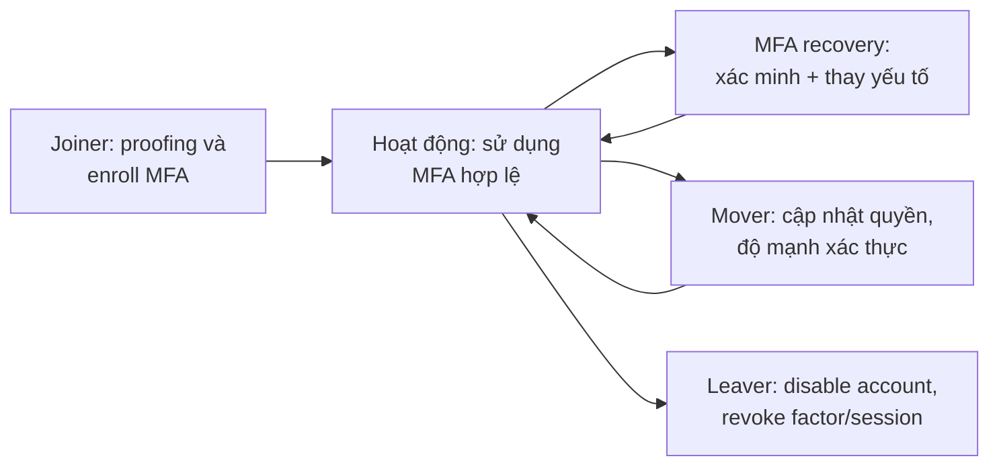
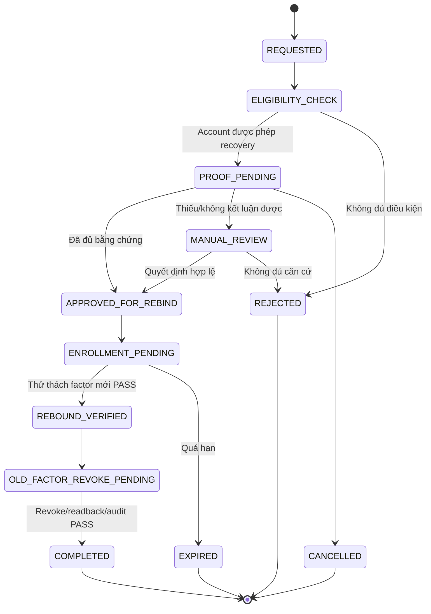
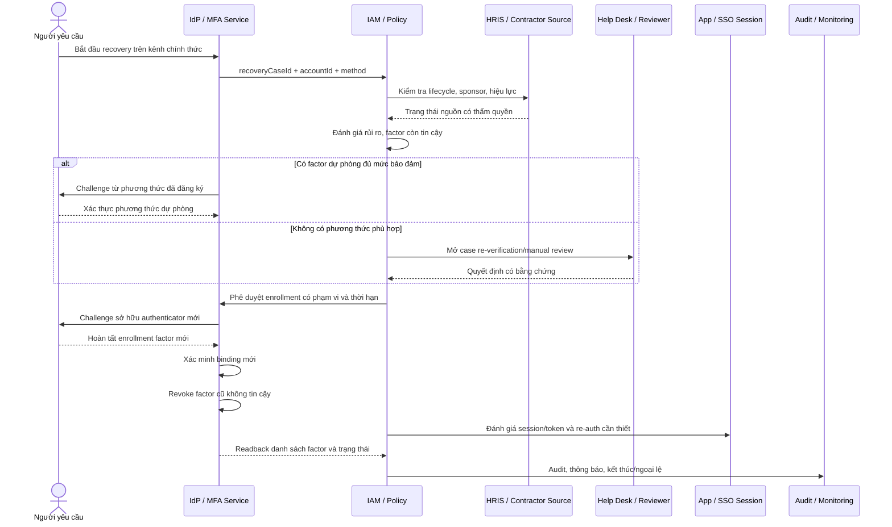

# MFA recovery trong quản lý vòng đời danh tính IAM

## Mục tiêu học tập

Sau bài học, người học có thể:

1. Giải thích **MFA recovery** là gì, phân biệt khôi phục quyền kiểm soát tài khoản, thay thế authenticator, đặt lại MFA và cấp quyền ứng dụng.
2. Phân tích các nguyên nhân phải khôi phục: mất điện thoại, hỏng khóa bảo mật, đổi thiết bị, mất passkey, khóa tài khoản, nghi ngờ bị chiếm đoạt hoặc sai lệch dữ liệu.
3. Thiết kế **đường khôi phục có mức bảo đảm thích hợp** thông qua authenticator dự phòng, mã khôi phục, re-proofing hoặc kiểm tra thủ công có kiểm soát.
4. Ngăn các cuộc tấn công vào kênh recovery như social engineering, SIM swapping, giả danh nhân viên, đánh cắp email và đăng ký yếu tố xác thực mới trái phép.
5. Mô tả cách kết nối recovery với **IAM/IGA, IdP, SSO, SCIM, RBAC/ABAC và Joiner–Mover–Leaver** để không khôi phục nhầm account đã nghỉ việc hoặc cấp quyền ngoài chính sách.
6. Xử lý an toàn recovery đối với account đặc quyền, nhà thầu, thiết bị BYOD và các danh tính không phải con người.
7. Thiết lập bằng chứng audit, bước xác minh sau recovery, cơ chế khiếu nại và chỉ số giám sát để giảm quyền truy cập tồn dư.

## 1. MFA recovery là gì?

**Multi-Factor Authentication (MFA)** kết hợp các bằng chứng xác thực thuộc các nhóm khác nhau, chẳng hạn thứ người dùng biết, thứ họ sở hữu hoặc thuộc tính sinh trắc học được kiểm tra thông qua thiết bị/phương thức phù hợp. Trong hệ thống IAM, một người có thể phải dùng password kết hợp security key, ứng dụng tạo mã xác thực, push authenticator hoặc phương thức mạnh hơn theo chính sách.

**MFA recovery** là quy trình **khôi phục khả năng xác thực hợp lệ khi người dùng không còn sử dụng được phương thức MFA đã đăng ký**, đồng thời giữ mức tin cậy cần thiết rằng người đang yêu cầu thực sự có quyền kiểm soát identity/account đó.

Ví dụ: Lan đổi điện thoại, ứng dụng TOTP cũ không còn và Lan không thể đăng nhập IdP. Recovery có thể giúp Lan xác minh bằng một security key dự phòng hoặc kênh kiểm tra được duyệt để **đăng ký phương thức xác thực mới**. Sau đó Lan mới tiếp tục đăng nhập và sử dụng ứng dụng theo các quyền đang được phê duyệt.

**MFA recovery không phải nút “tắt MFA tạm để ai đó đăng nhập”.** Nếu kênh recovery yếu hơn quá nhiều so với đăng nhập thường ngày, kẻ tấn công sẽ nhắm vào recovery thay vì tấn công phương thức MFA chính.

### 1.1. Phân biệt các đối tượng được khôi phục

| Khái niệm | Câu hỏi | Hành động minh họa |
|---|---|---|
| **Account recovery** | Người dùng có được quyền kiểm soát account khi mất đường xác thực không? | Xác minh lại identity, thiết lập khả năng đăng nhập |
| **MFA recovery** | Làm thế nào thay thế/khôi phục yếu tố MFA đã mất? | Dùng recovery code, factor dự phòng hoặc re-proofing |
| **Authenticator enrollment** | Đăng ký authenticator mới vào đúng account bằng cách nào? | Gắn security key, passkey hoặc TOTP mới |
| **Factor revocation** | Yếu tố cũ không còn đáng tin có bị vô hiệu không? | Gỡ đăng ký thiết bị TOTP/key đã mất |
| **Password reset** | Người dùng có cần đặt lại password? | Reset qua quy trình độc lập khi password cũng bị mất |
| **Session recovery** | Có giữ hoặc tạo lại phiên đăng nhập không? | Re-authentication, revoke các phiên theo mức rủi ro |
| **Authorization** | Sau khi xác thực, được làm gì? | RBAC/ABAC xác định quyền; recovery không cấp thêm role |

Nếu người dùng quên password nhưng security key vẫn hoạt động, đó có thể là **password recovery**. Nếu chỉ mất điện thoại nhưng vẫn dùng được một authenticator dự phòng, đó thường là **MFA recovery**. Nếu tổ chức không thể xác định chắc người yêu cầu là ai, cần luồng **identity re-verification**, không được tự gán quyền từ việc người đó cung cấp tên/email.

### 1.2. MFA recovery nằm ở đâu trong vòng đời danh tính?

Một account được tạo ở Joiner, thay đổi quyền khi Mover và bị vô hiệu ở Leaver. MFA authenticator có vòng đời riêng: **enroll → sử dụng → thay/khôi phục → revoke/retire**.



Khôi phục MFA chỉ hợp lệ nếu **identity và account vẫn đủ điều kiện theo lifecycle**. Một account đã `TERMINATED` không được tự kích hoạt lại chỉ vì người yêu cầu còn một recovery code.

## 2. Khi nào cần MFA recovery?

| Tình huống | Tín hiệu quan sát | Hướng xử lý |
|---|---|---|
| **Mất điện thoại** | Không còn ứng dụng TOTP/push | Xác minh qua phương thức dự phòng; revoke factor trên máy mất |
| **Hỏng hoặc mất security key** | Khóa không dùng được hoặc không còn sở hữu | Kiểm tra yếu tố khác, re-proof nếu cần, gỡ credential cũ |
| **Đổi máy có kế hoạch** | Thiết bị cũ còn dùng được | Đăng ký phương thức mới khi vẫn đăng nhập mạnh, kiểm thử, rồi gỡ yếu tố cũ |
| **Passkey không còn khả dụng** | Thiết bị hoặc kho đồng bộ passkey bị mất | Sử dụng passkey dự phòng/backup phù hợp; rebind theo chính sách |
| **Mã khôi phục đã sử dụng hết** | Không còn recovery code hợp lệ | Xác minh lại trước khi phát mã mới; vô hiệu bộ mã cũ |
| **Điện thoại bị đánh cắp, nghi bị truy cập trái phép** | Có nguy cơ yếu tố xác thực bị xâm phạm | Ưu tiên bảo vệ account, revoke session/factor và điều tra |
| **Không nhận được push/mã** | Thiết bị không kết nối, lệch giờ hoặc dịch vụ lỗi | Kiểm tra lỗi kỹ thuật; chưa vội reset MFA |
| **User mất khả năng dùng phương thức hiện tại** | Khó khăn tiếp cận hoặc thay đổi thiết bị đặc biệt | Cung cấp phương thức thay thế có mức bảo đảm tương ứng |
| **Nhà thầu đổi đơn vị bảo trợ** | Chủ sở hữu account/đường liên hệ đổi | Xác minh sponsor và điều kiện hợp đồng trước re-enroll |
| **Account bị khóa hoặc đã Leaver** | Lifecycle không còn cho phép đăng nhập | Không tự recovery; xử lý theo nguồn có thẩm quyền |

Nhiều sự cố “MFA không hoạt động” thực tế là sự cố hệ thống, thiết bị lệch thời gian, mất mạng hoặc cấu hình sai. **Không cần reset yếu tố tin cậy nếu có thể khắc phục sự cố mà không làm thay đổi binding**.

## 3. Vì sao recovery là bề mặt tấn công nhạy cảm?

Kẻ tấn công có thể không có passkey hoặc MFA key của nạn nhân, nhưng có thể cố thuyết phục help desk **xóa yêu cầu MFA và đăng ký thiết bị của kẻ tấn công**. Vì vậy, chính sách recovery phải được xem là một phần của chính sách xác thực chứ không phải chỉ là thao tác hỗ trợ người dùng.

### 3.1. Mô hình đe dọa

| Tấn công | Cách thất bại có thể xảy ra | Kiểm soát cần có |
|---|---|---|
| **Giả danh gọi help desk** | Nhân viên hỗ trợ tin tên, mã nhân viên hoặc giọng nói | Re-verification có căn cứ độc lập; không coi caller ID là bằng chứng |
| **Social engineering qua chat/email** | Yêu cầu khẩn có vẻ xuất phát từ lãnh đạo | Kênh chính thức, xác nhận nguồn, bước phê duyệt có dấu vết |
| **SIM swap / số điện thoại bị chiếm** | SMS recovery đến kẻ chiếm số | Không dựa đơn độc vào SMS cho account rủi ro cao |
| **Email takeover** | Link reset đến hộp thư đã bị chiếm | Xác minh độc lập, risk check, không coi email là bằng chứng duy nhất |
| **Recovery code bị lộ** | Mã dự phòng bị lấy từ cloud/tệp không được bảo vệ | Mã ngẫu nhiên, dùng một lần, giới hạn thử, thu hồi/rotate |
| **Phishing recovery link** | Người dùng nhập thông tin vào website giả | Kênh chính thức, bảo vệ URL/token, hướng dẫn nhận diện |
| **MFA fatigue** | Kẻ tấn công spam yêu cầu push để nạn nhân chấp thuận | Number matching/biện pháp chống fatigue khi hỗ trợ, phát hiện và khóa bất thường |
| **Đăng ký factor mới trái phép** | Kẻ xấu lợi dụng session vừa chiếm để thêm authenticator | Step-up gần thời điểm thao tác, cảnh báo độc lập, audit |
| **Replay callback / stale event** | Kết quả xác minh cũ bị tái dùng | Ràng buộc case/attempt/version, nonce, expiry và idempotency |
| **Recovery cho Leaver** | Reset yếu tố khiến account đã nghỉ trở lại active | Guard theo trạng thái nguồn HR mới nhất; không auto re-enable |
| **Nhân viên nội bộ lạm dụng** | Operator tự reset MFA rồi cấp quyền | Phân quyền tối thiểu, dual control ở trường hợp nhạy cảm, log reviewer |

Một cuộc gọi “tôi cần truy cập gấp để chốt lương” không đủ để bỏ qua recovery policy. **Tính khẩn cấp có thể tăng ưu tiên xử lý, không được làm giảm bằng chứng xác minh.**

### 3.2. Điểm yếu của thông tin cá nhân tĩnh

Ngày sinh, tên quản lý, chức danh, mã nhân viên, số điện thoại và địa chỉ email có thể đã xuất hiện trên mạng hoặc trong dữ liệu bị lộ. Các thuộc tính này có thể hỗ trợ **tìm hồ sơ đúng**, nhưng không tự đủ làm **bằng chứng người yêu cầu kiểm soát identity**.

Câu hỏi bí mật (“trường đầu tiên”, “tên thú cưng”) cũng dễ đoán, dễ tìm và thường bị tái sử dụng. Vì vậy không nên thiết kế quy trình recovery quan trọng dựa duy nhất vào thông tin kiểu knowledge-based verification dễ bị khai thác.

## 4. Các phương thức MFA recovery

Tổ chức có thể hỗ trợ nhiều phương thức khác nhau. Điều cần đánh giá là **độ tin cậy, khả năng phục hồi, khả năng tiếp cận và rủi ro takeover** của từng phương thức.

### 4.1. Dùng authenticator dự phòng đã đăng ký

Đây thường là lựa chọn thuận lợi nếu người dùng vẫn sở hữu một authenticator độc lập, đáng tin:

- Security key thứ hai đã gắn với cùng account.
- Passkey hợp lệ trên thiết bị khác hoặc trong hệ thống đồng bộ passkey được tổ chức chấp nhận.
- Một phương thức MFA khác đã đăng ký và vẫn đạt chính sách xác thực.
- Thiết bị quản trị doanh nghiệp đáp ứng chính sách, kết hợp bước xác thực bổ sung khi cần.

Quy trình điển hình:

1. Người dùng đăng nhập hoặc thực hiện step-up bằng authenticator dự phòng.
2. Hệ thống kiểm tra account vẫn active, phương thức phù hợp với rủi ro và chưa bị revoke.
3. Người dùng bắt đầu workflow **thêm authenticator mới**.
4. IdP yêu cầu chứng minh sở hữu authenticator mới (ví dụ thử thách WebAuthn hoặc xác minh TOTP).
5. Sau khi lưu binding mới và xác minh hoạt động, thu hồi authenticator cũ không còn tin cậy.
6. Thông báo sự kiện và ghi audit.

**Không đánh đồng “tôi biết password” với đủ bằng chứng thay MFA**: nếu password là yếu tố đầu tiên đã có, chỉ password đó không cung cấp bảo đảm tương đương MFA.

### 4.2. Mã khôi phục (recovery codes)

Mã khôi phục là các secret dự phòng đã phát cho người dùng khi đăng ký hoặc khi tạo lại bộ mã. Chúng có thể cho phép khôi phục khi thiết bị MFA chính bị mất, **trong phạm vi và điều kiện của chính sách**.

Các yêu cầu thiết kế:

- Sinh mã bằng nguồn ngẫu nhiên mật mã thích hợp, không dựa tên người dùng hoặc số điện thoại.
- Mỗi mã chỉ sử dụng **một lần**; theo dõi trạng thái đã dùng và chống replay.
- Bảo vệ dữ liệu mã tại server, không lưu plaintext ở log hoặc ticket.
- Giới hạn số lần thử, theo dõi brute force và tránh tiết lộ mã nào còn hợp lệ.
- Có hướng dẫn lưu mã dự phòng an toàn, tách khỏi thiết bị chính khi phù hợp.
- Khi bộ mã bị nghi lộ hoặc sau sự kiện recovery, đánh giá vô hiệu hóa và phát bộ mới.
- Không tạo mã rồi gửi cho bất kỳ người nào chỉ qua email/ticket chưa xác minh.

**Recovery code không phải OTP TOTP thông thường.** TOTP thay đổi theo thời gian và thiết bị; recovery code là tài liệu dự phòng nên có mô hình phát hành, bảo quản và tiêu thụ riêng. Cần tránh nhầm “mã khôi phục để quay lại enrollment” với “đăng nhập vô hạn không cần MFA”.

### 4.3. Passkey và nhiều thiết bị

Passkey dùng mật mã khóa công khai, có thể được lưu trên security key hoặc trong kho đồng bộ được thiết kế phù hợp. Khả năng khôi phục phụ thuộc loại passkey, cơ chế đồng bộ, thiết bị và chính sách tổ chức.

- **Device-bound credential:** có thể không thể sao chép sang thiết bị mới; nên có authenticator dự phòng.
- **Synced passkey:** có thể được khôi phục khi người dùng khôi phục kho đồng bộ hợp lệ, nhưng độ bảo đảm phụ thuộc an toàn của tài khoản/kênh đồng bộ đó.
- **Security key:** cần quy trình thay/thu hồi khi khóa bị mất, kể cả trường hợp nhiều key đã đăng ký.
- **Enterprise policy:** có thể hạn chế phương thức đồng bộ hoặc chỉ chấp nhận credential đáp ứng yêu cầu quản trị nhất định.

Đừng giả định “có passkey” đồng nghĩa không cần recovery. Cần quản lý **enrollment và recovery của nơi lưu passkey**, đặc biệt khi nhân viên mất toàn bộ thiết bị.

### 4.4. Re-proofing và hỗ trợ thủ công

Nếu người dùng mất tất cả authenticator và recovery code, cần luồng **identity re-verification** hoặc hỗ trợ trực tiếp có đủ thẩm quyền. Quá trình này có thể dùng nguồn nhân sự, hồ sơ đã xác lập, quy trình kiểm chứng độc lập hoặc điểm tiếp nhận trực tiếp tùy quy định.

Manual review phải có:

- Reason code và case ID rõ.
- Người kiểm tra được ủy quyền và giới hạn quyền truy cập bằng chứng.
- Tiêu chí proofing phù hợp mức rủi ro của account.
- Phê duyệt bổ sung cho account đặc quyền hoặc tình huống nghi gian lận khi policy yêu cầu.
- Khóa tạm hành động khôi phục nếu có bất đồng dữ liệu chưa được giải quyết.
- Kết quả được ghi audit trước khi cho phép binding yếu tố mới.

**Reviewer không nên có một nút “VERIFIED” không cần bằng chứng.** Một thao tác override chỉ hợp lệ khi có lý do, thẩm quyền, kiểm soát bổ sung và phạm vi rõ ràng.

### 4.5. SMS hoặc email recovery

SMS và email có tính tiện dụng, nhưng có thể bị chiếm qua SIM swap, email takeover, chuyển tiếp thư và social engineering. Nếu tổ chức sử dụng chúng cho bất kỳ tình huống recovery nào, cần phân loại **mức rủi ro và điều kiện cho phép**.

Đối với tài khoản đặc quyền, giao dịch nhạy cảm hoặc khi có dấu hiệu takeover, không nên dựa vào **một kênh email/SMS duy nhất** để chứng minh chủ account. Có thể cần authenticator dự phòng, re-proofing tăng cường, dual approval hoặc kênh bảo đảm khác.

## 5. Phân cấp rủi ro và mức bảo đảm khi recovery

Không có một phương thức duy nhất phù hợp mọi tài khoản. Recovery cho nhân viên đọc cẩm nang nội bộ có thể khác recovery cho người quản trị IdP, hệ thống thanh toán hoặc hạ tầng production.

| Phạm vi | Tác động nếu kẻ xấu khôi phục thành công | Ví dụ kiểm soát phù hợp |
|---|---|---|
| **Account cơ sở** | Truy cập thông tin và dịch vụ thông thường | Authenticator dự phòng hoặc recovery đã đăng ký, giám sát và thông báo |
| **Account chứa dữ liệu nhạy cảm** | Lộ hồ sơ khách hàng/tài chính | Re-verification mạnh hơn, giới hạn hành động, step-up sau recovery |
| **Privileged account** | Có thể sửa quyền, cấu hình hoặc tài khoản khác | MFA chống phishing, PAM, dual control/review theo policy, kiểm soát phiên |
| **Recovery có dấu hiệu takeover** | Có thể trao quyền cho kẻ tấn công | Hold, điều tra, thu hồi session và xác minh độc lập |
| **Nhà thầu/đối tác** | Phụ thuộc sponsor, hợp đồng và tenant | Xác minh quan hệ còn hiệu lực, sponsor theo kênh đã đăng ký |
| **Account Leaver** | Khôi phục đường truy cập đã bị thu hồi | Từ chối recovery tự động; chỉ giải quyết qua lifecycle workflow có thẩm quyền |

Mức độ xác minh nên tương xứng với **assurance của account hoặc hành động cần tiếp tục**. Một phương thức recovery có độ bảo đảm thấp không nên tự mở đường quản trị nhạy cảm dù account từng sử dụng MFA chống phishing.

### 5.1. Tách quyền khôi phục đăng nhập khỏi quyền truy cập nhạy cảm

Một thiết kế có thể cho người dùng hoàn tất enrollment yếu tố mới nhưng yêu cầu **step-up hoặc risk review** trước khi:

- Tạo credential mới khác.
- Đổi email/số điện thoại recovery.
- Tạo API token hoặc reset factor của account đặc quyền.
- Sửa IAM policy, role hoặc dữ liệu tài chính.
- Tải dữ liệu nhạy cảm hàng loạt.

Nếu nền tảng không hỗ trợ tách, cần chọn một quy trình recovery có độ bảo đảm cao hơn ngay từ đầu, thay vì dựa vào việc “chặn ở bước sau” không thực thi được.

### 5.2. Không coi mã số mức bảo đảm là một trường tự phát

Trong tài liệu nội bộ có thể có mức giả định như `ORG_ASSURANCE_HIGH`. Giá trị như vậy **không mặc định tương ứng với một cấp AAL/IAL của tiêu chuẩn ngoài tổ chức**. Nếu doanh nghiệp áp dụng tiêu chuẩn cụ thể, mapping cần được security/policy owner xây dựng và đánh giá toàn bộ authenticator, re-proofing và recovery.

## 6. Thiết kế vòng đời MFA recovery case

Để giám sát và chống callback cũ, nên quản lý một **recovery case** riêng với account, có phiên bản và thời hạn.

| Trạng thái | Ý nghĩa | Giới hạn |
|---|---|---|
| `REQUESTED` | Nhận yêu cầu khôi phục | Chưa cho phép đăng ký factor mới |
| `ELIGIBILITY_CHECK` | Kiểm tra lifecycle, account và policy | Chặn Leaver/suspended trái policy |
| `PROOF_PENDING` | Chờ authenticator dự phòng hoặc xác minh khác | Có hạn và giới hạn thử |
| `MANUAL_REVIEW` | Cần reviewer có thẩm quyền | Không được tự chuyển sang approved |
| `APPROVED_FOR_REBIND` | Đủ điều kiện bắt đầu binding mới | Phạm vi/TTL/attempt rõ |
| `ENROLLMENT_PENDING` | Chờ người dùng chứng minh sở hữu factor mới | Không coi đã khôi phục |
| `REBOUND_VERIFIED` | Binding mới đã lưu và thử thách xác minh thành công | Cần xử lý factor cũ và session |
| `OLD_FACTOR_REVOKE_PENDING` | Đang gỡ factor cũ không còn đáng tin | Ghi ngoại lệ nếu thất bại |
| `COMPLETED` | Đã readback và audit các bước trong phạm vi | Không đồng nghĩa cấp quyền mới |
| `REJECTED` | Không đáp ứng điều kiện | Có thể appeal theo policy |
| `EXPIRED` | Phiên hết hạn | Không tái sử dụng token cũ |
| `CANCELLED` | Người dùng hoặc Security hủy | Không phát hành quyền từ callback muộn |



Mô hình này chỉ **minh họa trạng thái workflow**, không phải chuẩn bắt buộc của SCIM hoặc sản phẩm IdP. Một số phương thức dự phòng có thể không cần hủy factor cũ (ví dụ đơn thuần thêm key thứ hai); khi đó bước revoke được ghi “not applicable” sau khi xác minh. Nếu factor cũ bị mất hoặc nghi bị chiếm, xử lý revoke là bắt buộc theo chính sách rủi ro.

## 7. Quy trình MFA recovery từ đầu đến cuối



### 7.1. Bước 1 — Kiểm tra nguồn, identity và account

Một yêu cầu recovery nên bắt đầu từ **kênh chính thức** của IdP/help desk, không từ link ngẫu nhiên trong email. Hệ thống cần biết:

- Account ID và tenant đích.
- Identity ID tương ứng được mapping đáng tin.
- Trạng thái nhân sự/nhà thầu hiện tại và mốc hiệu lực.
- Những phương thức MFA đã đăng ký và trạng thái revoke.
- Loại quyền liên quan: account thường hay privileged.
- Có dấu hiệu account takeover, thiết bị mất hoặc rủi ro bất thường không.

**Không dùng email giống nhau để tự gộp account.** Trong trường hợp tái tuyển dụng, tên và email có thể trùng nhưng lifecycle state hoặc mapping khác.

### 7.2. Bước 2 — Chọn kênh recovery hợp lệ

Ưu tiên kênh dự phòng đã đăng ký hợp pháp và còn sử dụng được. Nếu không có, chuyển tới luồng xác minh mạnh hơn tương xứng với độ nhạy account.

Phải tránh vòng lặp kiểu “để lấy lại MFA cần đăng nhập bằng MFA bị mất”. Recovery phải có lộ trình dự phòng khả thi, nhưng lộ trình này không được biến thành bypass dễ khai thác.

### 7.3. Bước 3 — Chỉ cấp quyền binding tạm thời, không cấp app role

Khi proofing/recovery đủ điều kiện, hệ thống có thể cấp **quyền thực hiện enrollment giới hạn phạm vi và thời gian**: chỉ đăng ký phương thức mới, không mở quyền quản trị tài chính hoặc mở toàn bộ ứng dụng.

Đối với ứng dụng có yêu cầu đăng nhập mạnh, sau enrollment có thể cần re-authentication/step-up trước khi tiếp tục. Quyết định này thuộc policy xác thực của tổ chức và năng lực nền tảng.

### 7.4. Bước 4 — Xác minh authenticator mới

Với TOTP, người dùng cần chứng minh ứng dụng mới tạo mã hợp lệ trước khi hoàn tất. Với WebAuthn/passkey, server phải xác minh thử thách đăng ký, origin/RP ID và dữ liệu khóa công khai theo cơ chế giao thức; không chỉ tin giá trị “success” do client tự gửi.

Chỉ khi binding được xác nhận, hệ thống mới coi recovery đạt bước **enrollment verified**.

### 7.5. Bước 5 — Thu hồi factor cũ, phiên và credential có rủi ro

Nếu điện thoại bị mất, không nên giữ TOTP enrollment cũ vô thời hạn. Nếu key bị đánh cắp, cần revoke credential tương ứng. Nếu chỉ đổi máy có kiểm soát và factor cũ còn an toàn, lịch thay phải rõ.

Ngoài ra, khi nghi bị chiếm account cần cân nhắc:

- Revoke các session IdP và app-local session được hỗ trợ.
- Vô hiệu refresh token hoặc token API có nguy cơ liên quan.
- Xem lại password, recovery methods và yếu tố khác có thể đã bị thay đổi.
- Kiểm tra các yếu tố mới được enroll gần đây mà chủ account không nhận ra.
- Thông báo qua kênh độc lập; nếu có tranh chấp, tạm giữ account theo quy trình IR.

**Gỡ factor khỏi IdP không tự thu hồi mọi JWT hoặc session ứng dụng.** Cần kiểm tra cơ chế token lifetime, refresh, introspection và sign-out của hệ thống.

### 7.6. Bước 6 — Readback và đóng case

Workflow chỉ hoàn tất khi bằng chứng cho thấy:

1. Account vẫn đúng identity và đủ điều kiện lifecycle.
2. Factor mới đã được lưu và hoạt động.
3. Factor cũ không còn tin cậy đã bị revoke theo chính sách.
4. Recovery token/challenge đã tiêu thụ hoặc hết hiệu lực.
5. Các session/credential liên quan đã xử lý theo mức rủi ro và khả năng nền tảng.
6. Audit, thông báo, reviewer/approval và exception đã được ghi nhận.

Nếu một API chỉ trả 2xx nhưng danh sách factor chưa phản ánh thay đổi, cần giữ trạng thái **APPLIED_UNVERIFIED** thay vì báo thành công.

## 8. Self-service recovery và Help Desk recovery

### 8.1. Self-service: giảm phụ thuộc nhưng phải an toàn

Self-service phù hợp khi người dùng vẫn có một phương thức dự phòng đáng tin hoặc mã khôi phục hợp lệ. Một trải nghiệm tốt nên:

- Cho biết phương thức nào còn khả dụng mà không tiết lộ quá nhiều về account cho người chưa xác thực.
- Hỗ trợ người dùng không sử dụng được điện thoại/camera hoặc có yêu cầu tiếp cận.
- Có hướng dẫn rõ khi mã dự phòng đã hết/không dùng được.
- Cho phép dừng và chuyển sang kênh hỗ trợ chính thức.
- Hạn chế thử sai, phát hiện hành vi bất thường và gửi cảnh báo sau thay đổi.

Không được coi việc người dùng kiểm soát phiên đăng nhập cũ là đủ cho mọi thao tác thay MFA; cần cân nhắc **reauthentication hoặc step-up gần thời điểm thay đổi**, đặc biệt với account đặc quyền.

### 8.2. Help Desk: chống social engineering bằng quy trình

Help desk thường là mục tiêu dễ bị giả mạo vì nhân viên hỗ trợ muốn giúp người dùng nhanh. Checklist nên bao gồm:

1. Mở case trên hệ thống được quản trị, không quyết định chỉ từ tin nhắn trực tiếp.
2. Xác minh account ID/identity ID và nguồn HR/sponsor.
3. Kiểm tra chính sách cho phép recovery theo loại account.
4. Yêu cầu bằng chứng độc lập theo policy, tránh dùng câu hỏi bí mật dễ tìm.
5. Không coi caller ID, giọng nói hoặc tên hiển thị trong chat là xác thực.
6. Không dùng số điện thoại/email mới do người yêu cầu tự khai mà không có xác minh.
7. Với account rủi ro cao, áp dụng reviewer thứ hai hoặc approval độc lập khi được policy yêu cầu.
8. Chỉ cho phép thực hiện hành động rebind đã phê duyệt, không cấp quyền ứng dụng.
9. Ghi thời gian, actor, lý do, decision, factor ID và readback.
10. Thông báo sau thao tác qua kênh thích hợp và cung cấp đường báo cáo nếu thay đổi trái phép.

### 8.3. Phân tách nhiệm vụ (SoD)

Người có quyền xem bằng chứng identity, người quyết định chấp thuận recovery và người thực thi thay đổi factor có thể là các vai trò khác nhau trong tình huống nhạy cảm.

| Vai trò | Được phép | Không nên tự được phép |
|---|---|---|
| **Người yêu cầu** | Tạo case, cung cấp bằng chứng, thử factor mới | Chọn bỏ qua toàn bộ kiểm tra |
| **Help Desk agent** | Hướng dẫn, mở ticket, kiểm tra điều kiện | Tự chấp thuận recovery đặc quyền không bằng chứng |
| **Identity reviewer** | Đánh giá proofing/recovery theo checklist | Tự cấp role production ngoài scope |
| **Approver / Risk owner** | Chấp thuận ngoại lệ theo thẩm quyền | Tự bỏ qua log hoặc approval bổ sung |
| **IdP automation** | Ràng buộc case, thực thi rebind/revoke | Nhận lệnh chưa được xác thực nguồn |
| **Security monitoring** | Giám sát bất thường, điều tra takeover | Tự sửa dữ liệu HR ngoài quyền sở hữu |

Không phải case nào cũng cần hai người duyệt, nhưng **privileged recovery** hoặc điều tra lạm dụng nên có quy trình tăng cường rõ ràng theo rủi ro.

## 9. Identity re-verification khi mất mọi yếu tố

Mất toàn bộ authenticator là tình huống khó vì không còn bằng chứng “người này sở hữu factor đã đăng ký”. Phải **xác lập lại quyền liên kết người yêu cầu với identity** theo phương thức phù hợp.

### 9.1. Đối chiếu nguồn có thẩm quyền

Một reviewer có thể cần kiểm tra:

- Nhân viên/nhà thầu có còn active không?
- Nguồn HR hoặc sponsor đã xác nhận phân công và email liên hệ theo kênh nào?
- Dữ liệu ID có trùng/khác với account đang xin recovery không?
- Có sự kiện thay đổi tên, Mover hoặc tái tuyển dụng làm mapping thay đổi không?
- Có dấu hiệu chiếm đoạt identity, thiết bị thất lạc hoặc kháng nghị đang mở không?
- Chính sách yêu cầu mức proofing nào cho tài khoản này?

Thông tin HR chỉ đáng tin nếu đến từ **nguồn được quản trị**, không phải ảnh chụp màn hình HR do người yêu cầu tự gửi mà không xác minh.

### 9.2. Không tự sửa bản ghi HR để “khớp”

Nếu tên hoặc dữ liệu nhân sự khác với thông tin người yêu cầu, không được cho help desk tự đổi thuộc tính có thẩm quyền trên IdP để hợp thức hóa. Phải chuyển sai lệch cho **HR data owner** hoặc reviewer có quyền và bằng chứng phù hợp.

Một hồ sơ tên trùng không đủ để tự gộp hai identity. Trong IAM, **identity correlation** phải được xác minh tách biệt với yêu cầu MFA recovery.

### 9.3. Tính công bằng và khả năng tiếp cận

Người dùng có thể không có điện thoại, không thể đến văn phòng hoặc không thể sử dụng một phương pháp sinh trắc học. Cần cung cấp lựa chọn thay thế có độ bảo đảm tương đương, không coi việc không dùng được kênh số là bằng chứng gian lận.

Ngược lại, không được hạ chuẩn đơn thuần vì một phương pháp thiếu tiện lợi. **Khả năng tiếp cận cần được thiết kế từ đầu** qua nhiều phương thức và hỗ trợ phù hợp.

## 10. Bảo mật token/challenge trong recovery

Khi dùng recovery link, one-time token hoặc challenge, hệ thống cần tuân thủ những nguyên tắc:

- Token được tạo bằng nguồn ngẫu nhiên mật mã, đủ khó đoán.
- Ràng buộc token với **account, recoveryCaseId, mục đích, phạm vi và thời hạn**.
- Chỉ sử dụng một lần, có kiểm soát chống replay và race condition.
- Giới hạn thử mã/challenge và theo dõi hành vi bất thường.
- Không để token trong log, analytics, URL referrer, screenshot hoặc ticket.
- Không tạo endpoint cho phép đổi email recovery và đăng ký MFA trong cùng bước không xác minh.
- Yêu cầu TLS và chính sách bảo vệ cookie/session phù hợp.
- Xử lý token hết hạn/hủy/rejected theo trạng thái case hiện tại.
- Không cho callback của case cũ vượt lên quyết định phiên bản mới.

### 10.1. Schema minh họa

```json
{
  "recoveryCaseId": "MFA-REC-2026-0817",
  "identityId": "IDN-1042",
  "targetAccountId": "IDP-U-9921",
  "tenantId": "corp-vn",
  "purpose": "REPLACE_LOST_AUTHENTICATOR",
  "riskClass": "STANDARD",
  "status": "PROOF_PENDING",
  "proofMethod": "BACKUP_AUTHENTICATOR",
  "policyVersion": "mfa-recovery-v5",
  "attemptCount": 1,
  "sourceLifecycleVersion": 32,
  "createdAt": "2026-11-23T02:30:00Z",
  "expiresAt": "2026-11-23T03:00:00Z",
  "currentAttemptId": "ATT-003",
  "recoveryTokenReference": "restricted-token-ref"
}
```

Đây là **schema và giá trị minh họa**, không phải định dạng bắt buộc của IdP hay SCIM. Không lưu token/challenge thực trong log thông thường; `recoveryTokenReference` nên là tham chiếu nội bộ được bảo vệ. Thời hạn ví dụ chỉ để mô tả cấu trúc và phải được tổ chức xác định theo rủi ro.

### 10.2. Pseudocode xử lý yêu cầu recovery

```text
function requestMfaRecovery(accountId, method, requestContext):
    identity = lookupTrustedIdentityMapping(accountId)
    if identity is unknown or ambiguous:
        return GENERIC_RESPONSE_AND_REVIEW

    lifecycle = getAuthoritativeLifecycle(identity)
    if lifecycle.status not in ALLOWED_FOR_RECOVERY:
        auditBlockedRecovery(accountId, "LIFECYCLE_NOT_ELIGIBLE")
        return GENERIC_RESPONSE_AND_CONTROLLED_ESCALATION

    policy = loadRecoveryPolicy(accountId, identity, requestContext)
    if riskSignalsRequireSecurityReview(accountId, requestContext):
        return OPEN_SECURITY_REVIEW_CASE

    case = createBoundedRecoveryCase(
        identity.id, accountId, lifecycle.version, method, policy
    )

    return beginApprovedRecoveryProof(case)
```

Pseudocode này không phải code sản phẩm. Các thao tác phải kiểm tra phân quyền dịch vụ, source authenticity và transaction; response công khai cần được thiết kế để không tiết lộ tài khoản nào tồn tại.

### 10.3. Ngay trước khi ghi factor mới phải kiểm tra lại lifecycle

```text
function completeRecoveryAndRebind(caseId, proofResult, newFactor):
    case = loadCurrentCase(caseId)

    if case.status not in [PROOF_PENDING, ENROLLMENT_PENDING]:
        return REJECT_STALE_OR_CLOSED_CASE

    if proofResult.caseId != case.id:
        return REJECT_UNRELATED_PROOF

    latestLifecycle = getAuthoritativeLifecycle(case.identityId)
    if latestLifecycle.version != case.sourceLifecycleVersion:
        return REEVALUATE_POLICY_BEFORE_REBIND

    if latestLifecycle.status not in ALLOWED_FOR_RECOVERY:
        return DENY_AND_AUDIT

    if not proofResult.isVerifiedFor(case.requiredAssurance):
        return HOLD_FOR_PROOF_OR_REVIEW

    if not verifyNewAuthenticatorBinding(case.accountId, newFactor):
        return REJECT_UNVERIFIED_FACTOR

    persistBoundFactorTransactionally(case.accountId, newFactor)
    revokeStaleFactorsAsRequired(case)
    handleSessionsAndNotify(case)
    return READBACK_AND_AUDIT_RESULT
```

Triển khai thật cần chống race condition, xác thực callback/issuer, giới hạn attempt và đảm bảo không nhận **kết quả stale** sau khi case đã hủy hoặc account đã Leaver.

## 11. IdP, SSO và SCIM trong MFA recovery

### 11.1. IdP quản lý đăng ký yếu tố xác thực

Trong mô hình SSO phổ biến, **IdP** là nơi quản lý MFA enrollment, danh sách authenticator, challenge, phiên đăng nhập và recovery policy. IAM/IGA có thể cung cấp identity lifecycle, approval và audit; help desk sử dụng API được ủy quyền của IdP.

Một ứng dụng SaaS đăng nhập qua IdP thường không cần giữ TOTP riêng. Tuy nhiên, một số ứng dụng vẫn có **MFA local hoặc login độc lập**, nên recovery tại IdP **không tự khôi phục/thu hồi** các yếu tố cục bộ đó.

### 11.2. SSO và token assurance

Ứng dụng có thể dùng SAML/OIDC nhận thông tin phương thức/độ mạnh xác thực từ IdP. Cần kiểm tra issuer, audience, chữ ký, thời điểm xác thực, nguồn claim và chính sách sử dụng claim.

Nếu recovery kết thúc và người dùng tạo session mới, application có thể yêu cầu step-up cho hành động nhạy cảm. Một claim trong token cũ **không bảo đảm** người dùng vừa chứng minh yếu tố mới, vì token có thể được cấp trước recovery.

### 11.3. SCIM không phải giao thức khôi phục MFA

**SCIM 2.0** chủ yếu phục vụ quản lý resource `User`, `Group` và thuộc tính ở hệ thống đích. SCIM có thể giúp account được kích hoạt/vô hiệu hoặc cập nhật thông tin liên quan, nhưng **không mặc định cung cấp quy trình MFA recovery, proofing hay enroll passkey/TOTP**.

| Thành phần | Chức năng chính | Không nên tự suy ra |
|---|---|---|
| **IAM/IGA** | Lifecycle, policy eligibility, approval, audit | Có thể thay mọi yếu tố xác thực chỉ bằng cập nhật HR |
| **IdP/MFA provider** | Authenticator lifecycle, challenge, rebind/revoke | Việc factor mới được add đồng nghĩa app session cũ đã bị thu hồi |
| **SSO (SAML/OIDC)** | Liên thông kết quả xác thực | Thay thế account provisioning hoặc identity proofing |
| **SCIM** | User/group provisioning, account status | Tự động khôi phục MFA và kiểm tra quyền sở hữu thiết bị |
| **Ứng dụng đích** | Authorization, app-local session và yếu tố riêng nếu có | Luôn đồng bộ với IdP ngay lập tức |
| **RBAC/ABAC** | Kiểm tra quyền và bối cảnh truy cập | Đăng nhập MFA thành công cho phép mọi role |

### 11.4. MFA recovery không được cấp thêm entitlement

Trong JML, **khôi phục đăng nhập ≠ khôi phục tất cả quyền**. IAM cần tính quyền từ HR, role, approval và lifecycle. Một user vừa recovery nhưng đã bị Mover sang đơn vị khác phải được cấp quyền theo trạng thái mới, không theo snapshot trước đó.

Với Leaver, workflow phải ưu tiên deprovisioning: disable account, revoke group/role, session và credential. Recovery request không được làm sống lại account.

## 12. MFA recovery cho account đặc quyền

Các tài khoản quản trị IdP, cloud, tài chính, database hoặc production có thể gây tác động lớn nếu bị takeover. Quy trình khôi phục cần mức kiểm soát tương xứng:

- Ưu tiên authenticator chống phishing được tổ chức duyệt.
- Duy trì phương thức dự phòng được quản trị, không phụ thuộc hoàn toàn vào một thiết bị.
- Re-proofing bằng kênh tin cậy, có kiểm tra nguồn HR/owner.
- Có reviewer/approver độc lập khi yêu cầu đặc biệt nhạy cảm.
- Chỉ cấp quyền enrollment có thời hạn/phạm vi hẹp.
- Kiểm tra yếu tố và session hiện tại trước/sau khi reset.
- Xem xét hạn chế tạm các thao tác nguy cơ cao cho đến khi re-authentication đúng mức.
- Lưu audit rõ ai yêu cầu, ai duyệt, ai thực thi, factor nào bị gỡ/thêm.
- Cảnh báo Security và chủ tài khoản qua kênh không phụ thuộc yêu cầu vừa gửi.

**Break-glass account** là cơ chế khẩn cấp để duy trì khả năng quản trị khi IdP/MFA chính gặp sự cố. Nó cần vault, hạn chế sử dụng, dual control, giám sát và diễn tập riêng. Không nên coi “mất MFA của một admin” là lý do phát hành password break-glass cho bất kỳ người gọi help desk nào.

## 13. MFA recovery trong Joiner–Mover–Leaver

### 13.1. Joiner: chuẩn bị recovery ngay lúc enroll

Joiner là cơ hội thiết lập khả năng phục hồi an toàn:

1. HR/nguồn bảo trợ xác nhận người gia nhập.
2. IAM liên kết đúng identity và account.
3. Proofing đạt mức cần thiết để kích hoạt đăng nhập.
4. Người dùng enroll MFA/passkey theo policy.
5. Hệ thống hướng dẫn đăng ký phương thức dự phòng và lưu recovery code an toàn nếu được áp dụng.
6. Xác minh factor có thể sử dụng trước khi cấp quyền ứng dụng cần MFA.
7. Audit trạng thái enrollment, nguồn yêu cầu và policy version.

Không nên gửi recovery code trong email onboarding cho một địa chỉ chưa được xác minh hoặc tự tạo factor gắn với thiết bị của người quản trị thay cho người dùng.

### 13.2. Mover: quyền thay đổi, mức xác thực có thể phải tăng

Khi chuyển vai trò, account có thể yêu cầu MFA mạnh hơn. Ví dụ nhân viên chuyển sang đội quản trị production được yêu cầu passkey/security key phù hợp và step-up.

- Đánh giá yếu tố hiện tại có đáp ứng chính sách vai trò mới không.
- Đăng ký factor mạnh hơn trước khi kích hoạt entitlement đặc quyền.
- Thu hồi nhóm/role cũ không còn phù hợp.
- Kiểm tra mọi session cũ mang quyền trước Mover.
- Nếu recovery diễn ra đúng lúc chuyển vai trò, policy mới nhất phải được áp dụng.

Một lần Mover không nhất thiết yêu cầu reset MFA nếu factor hiện có vẫn phù hợp; **đừng vô hiệu phương thức hoạt động không cần thiết** làm người dùng bị khóa nhầm.

### 13.3. Leaver: recovery không được vượt qua deprovisioning

Leaver là điều kiện ưu tiên cao. Khi nguồn có thẩm quyền xác nhận account không còn được phép hoạt động:

- Chặn hoặc từ chối recovery tự động.
- Disable account/đăng nhập ở IdP.
- Thu hồi MFA authenticator và recovery code theo chính sách.
- Thu hồi session/token, local login và quyền ở các ứng dụng liên quan.
- Ghi yêu cầu recovery đến sau như một sự kiện rủi ro cần xem xét, không tự cấp lại account.
- Đối soát account thực tế tại các hệ thống để giảm residual access.

Nếu một sự kiện HR Leaver đến trong lúc recovery case đang mở, phải **vô hiệu phiên recovery còn hiệu lực hoặc đánh giá lại trước khi rebind**, không cho callback “VERIFIED” cũ kích hoạt account đã nghỉ.

### 13.4. Rehire và identity correlation

Tái tuyển dụng không phải lý do khôi phục toàn bộ factor cũ. Tổ chức cần xác minh người quay lại, account cũ, tenant, quyền và chính sách mới. Một factor đã từng dùng không chứng minh chủ thể vẫn kiểm soát nó hiện tại.

Nếu account cũ có dữ liệu cần giữ, có thể xử lý re-enable theo quy trình riêng, nhưng **phương thức xác thực và entitlement phải được rà soát/tái thiết lập** theo chính sách hiện hành.

## 14. Nhà thầu, BYOD, tài khoản dịch vụ và tình huống đặc biệt

### 14.1. Nhà thầu và partner identity

Nhà thầu có thể sử dụng IdP của đối tác hoặc account doanh nghiệp. Recovery cần biết bên nào quản lý authenticator và nguồn nào quyết định người đó còn được phép truy cập.

Nếu federated partner IdP chịu trách nhiệm MFA, tổ chức có thể không trực tiếp reset factor của họ; cần quy trình liên hệ đối tác và chính sách trust phù hợp. Không tin một email từ nhà thầu tự tuyên bố “hợp đồng đã gia hạn” để bỏ qua kiểm tra sponsor.

### 14.2. BYOD và thiết bị mất

Khi mất điện thoại BYOD, IAM nên xử lý token, factor và quyền truy cập phía server. Doanh nghiệp không mặc nhiên có quyền wipe toàn bộ điện thoại cá nhân; MDM có thể chỉ quản lý work profile và có khả năng selective wipe theo thỏa thuận.

MFA recovery cần phối hợp với **device lifecycle**: thay điện thoại đăng ký phương thức mới, thu hồi factor trên thiết bị cũ, cập nhật device trust nếu cần và đọc lại các đăng ký liên quan.

### 14.3. Account dùng chung và privileged emergency access

Một account dùng chung gây khó quy trách nhiệm, đặc biệt khi nhiều người biết secret hoặc cùng đăng ký một MFA device. Nên ưu tiên account cá nhân, PAM và phương thức cấp quyền có thời hạn. Nếu chưa loại bỏ được, mỗi lần người biết credential rời đội cần đánh giá rotate và thu hồi yếu tố được chia sẻ.

### 14.4. Service account/workload identity

Workload identity không nên dùng **MFA recovery của người dùng**. Một CI/CD runner, microservice hoặc batch job có thể xác thực bằng managed identity, OIDC federation, mTLS, certificate hoặc secret chuyên dụng.

Nếu workload mất credential, xử lý theo **secret/certificate rotation và owner approval**, không giả danh một nhân viên để nhận SMS/TOTP. Khi người quản trị workload nghỉ việc, chuyển ownership và kiểm tra quyền; không tự disable dịch vụ còn hoạt động chỉ vì người tạo đã Leaver.

## 15. Vận hành, giám sát và kiểm toán

### 15.1. Những sự kiện audit cần lưu

Một recovery case nên trả lời:

1. Identity/account nào được yêu cầu khôi phục, ở tenant nào?
2. Ai yêu cầu qua kênh nào và khi nào?
3. Lifecycle state khi mở case và ngay trước khi rebind là gì?
4. Phương thức recovery nào được chọn, mức rủi ro nào áp dụng?
5. Ai là reviewer/approver, dựa trên bằng chứng và policy version nào?
6. Authenticator ID nào được thêm, gỡ hoặc vô hiệu?
7. Session/token/recovery code được xử lý như thế nào?
8. Bước nào đã được **readback** xác nhận, bước nào còn ngoại lệ?
9. Có cảnh báo bất thường/appeal hoặc incident được mở không?

Ví dụ audit JSON nội bộ:

```json
{
  "eventType": "MFA_RECOVERY_COMPLETED",
  "caseId": "MFA-REC-2026-0817",
  "identityId": "IDN-1042",
  "targetAccountId": "IDP-U-9921",
  "tenantId": "corp-vn",
  "lifecycleState": "ACTIVE",
  "method": "BACKUP_AUTHENTICATOR",
  "policyVersion": "mfa-recovery-v5",
  "recoveryDecision": "APPROVED",
  "newFactorType": "FIDO2_SECURITY_KEY",
  "newFactorId": "FCT-284",
  "revokedFactorIds": ["FCT-119"],
  "rebindReadback": "VERIFIED",
  "sessionRiskReview": "COMPLETED",
  "notificationState": "SENT",
  "correlationId": "IAM-JOB-8812"
}
```

Đây là **schema minh họa**. Không ghi recovery code, OTP, password, private key, token hoặc ảnh giấy tờ thô vào log phổ thông. Bằng chứng proofing nhạy cảm cần lưu tách biệt, hạn chế quyền và có retention policy.

### 15.2. Các chỉ số nên theo dõi

| Chỉ số | Mục đích |
|---|---|
| **MFA recovery request rate** | Theo dõi nhu cầu và xu hướng bất thường |
| **Recovery completion rate** | Bao nhiêu yêu cầu hợp lệ được xử lý xong |
| **Median/P95 recovery latency** | Thời gian người dùng hợp lệ phải chờ |
| **Manual review backlog** | Khối lượng case cần người xử lý, tuổi case |
| **High-risk recovery attempts** | Tần suất khôi phục tài khoản đặc quyền/rủi ro |
| **Rejected or challenged attempts** | Phát hiện lạm dụng hoặc cấu hình gây khóa nhầm |
| **Authenticator revocation lag** | Thời gian từ khi báo mất đến khi factor cũ được xác minh revoke |
| **Recovery-induced lockout** | Người hợp lệ mất hoàn toàn khả năng đăng nhập sau thao tác |
| **Unauthorized factor enrollment incidents** | Số sự kiện gắn factor trái phép |
| **Recovery while Leaver count** | Số yêu cầu recovery đối với account không còn đủ điều kiện |
| **Sessions remaining after compromise** | Phiên/token chưa được xử lý theo policy |
| **Audit evidence completeness** | Case có đủ source, approval, readback, thông báo và ngoại lệ |

Chỉ số phải có mẫu số, phạm vi tài khoản, cách tính thời gian và phân nhóm loại sự cố. **Tỷ lệ recovery thành công cao không đủ chứng minh an toàn** nếu help desk cấp factor mới quá dễ.

### 15.3. Cảnh báo đáng chú ý

- Nhiều yêu cầu recovery thất bại trên cùng một account.
- Một nguồn gửi yêu cầu trên nhiều account khác nhau.
- Mới thay email/số recovery rồi ngay lập tức yêu cầu reset MFA.
- Thêm factor mới sau session có rủi ro cao hoặc từ thiết bị bất thường.
- Help desk reviewer lặp lại nhiều trường hợp bypass với cùng lý do.
- Factor cũ vẫn hoạt động sau khi báo mất/đánh cắp.
- Account Leaver hoặc suspended nhận kết quả recovery “successful”.
- Re-enroll factor xảy ra ngay trước khi tạo token đặc quyền hoặc tải dữ liệu lớn.

Các tín hiệu trên cần được đánh giá cùng ngữ cảnh, tránh kết luận tự động rằng người dùng thật đã gian lận chỉ vì đổi điện thoại hoặc cần hỗ trợ nhiều lần.

## 16. Chính sách recovery minh họa

YAML dưới đây là **mẫu mô hình quyết định**, không phải cấu hình trực tiếp cho một IdP hay yêu cầu chuẩn cố định. Tên trạng thái, thời hạn và cách triển khai cần được owner chính sách đánh giá.

```yaml
policyId: mfa-recovery-v5
scope:
  - human-interactive-identities
prerequisites:
  trustedIdentityCorrelation: true
  authoritativeLifecycleStateRequired: true
  accountStatesAllowed:
    - ACTIVE
  denyAutomaticRecoveryForLeaver: true
methods:
  registeredBackupAuthenticator:
    permitted: true
    requiredAssurance: policy-dependent
  oneTimeRecoveryCode:
    permitted: true
    rateLimited: true
    singleUse: true
  assistedReverification:
    permitted: true
    reviewerAuthorized: true
    evidenceRequired: true
  smsOnlyForPrivileged:
    permitted: false
  emailOnlyForPrivileged:
    permitted: false
enrollment:
  proofPossessionOfNewFactor: true
  recheckLifecycleBeforeCommit: true
  timeBoundRebindAuthorization: true
  revokeLostOrCompromisedFactor: true
  notifyThroughIndependentChannelWhenPossible: true
highRisk:
  requireSecurityReviewWhenSuspectedTakeover: true
  privilegedRecoveryUsesEnhancedControls: true
  considerSessionRevocationAndStepUp: true
audit:
  recordSourcePolicyAndDecision: true
  recordFactorIdentifiersNotSecrets: true
  requireTargetReadback: true
  recordAndAssignOpenExceptions: true
```

Không nên sao chép YAML này vào môi trường production khi chưa chuyển thành rule có thể thực thi, test và phê duyệt trên nền tảng IdP cụ thể.

## 17. Kiểm thử kịch bản trước khi triển khai

Một bộ test nên kiểm tra cả **trường hợp hợp lệ** và **đường vòng tấn công**.

| Kiểm thử | Kết quả mong muốn |
|---|---|
| Người dùng mất TOTP nhưng còn security key dự phòng | Recovery được phép nếu factor đủ chính sách; gắn factor mới và readback |
| Người dùng không còn bất kỳ factor nào | Chuyển re-proofing/help desk, không auto bỏ MFA |
| Người dùng báo thiết bị bị đánh cắp | Revoke factor cũ, xem xét session/token và Security alert |
| User có email nhưng account đã Leaver | Không được re-enable qua recovery |
| Recovery callback từ case đã EXPIRED | Bị từ chối, ghi audit |
| Hai case recovery đồng thời cho cùng account | Có kiểm soát version/concurrency; không ghi đè tùy tiện |
| Mã khôi phục được dùng lần thứ hai | Bị từ chối, cảnh báo replay nếu cần |
| Help desk cố reset MFA tài khoản privileged không approval | Bị chặn và ghi dấu vết |
| Provider API trả thành công nhưng factor không có trong IdP | Không đánh dấu VERIFIED, tiếp tục đối soát |
| Đổi điện thoại BYOD, dữ liệu cá nhân ngoài phạm vi MDM | Chỉ xử lý công việc/credential theo policy |
| User vừa Mover sang role nhạy cảm | Recovery tuân thủ mức assurance mới và step-up |
| Ứng dụng local MFA không được quản lý ở IdP | Có quy trình đối soát/recovery riêng cho app |

Nên chạy thử với môi trường kiểm thử và account không chứa dữ liệu thật trước khi thay đổi chính sách diện rộng. Không dùng credential production trong tài liệu hoặc test case.

## 18. Tình huống thực hành: mất điện thoại và bị giả danh qua Help Desk

**Bối cảnh:** Nhân viên Minh đang dùng password + ứng dụng TOTP cho IdP. Điện thoại của Minh bị mất khi di chuyển. Minh không có backup authenticator, nhưng có thể truy cập email cá nhân. Cùng ngày, help desk nhận một cuộc gọi nói rằng “Minh là quản lý tài chính, đang họp gấp và cần bỏ MFA để duyệt chi”. Người gọi cung cấp chính xác họ tên, phòng ban, mã nhân viên và ngày sinh. Một admin trực ca đề xuất tắt MFA trong một giờ rồi bật lại.

### 18.1. Câu hỏi

1. Vì sao những thông tin do người gọi cung cấp chưa đủ xác minh đây là Minh?
2. Có thể dùng email cá nhân như bằng chứng duy nhất để reset MFA không?
3. Hệ thống nên chọn quy trình nào khi không còn factor dự phòng?
4. Nếu có dấu hiệu điện thoại bị đánh cắp, cần xử lý factor và session cũ ra sao?
5. Vì sao bật/tắt MFA trong một giờ là đường vòng nguy hiểm?
6. Nếu Minh vừa Mover sang role có quyền phê duyệt tài chính, recovery phải xét điều gì?
7. Khi nào được đóng case và thông báo cho người dùng?

### 18.2. Gợi ý giải

**Bước 1 – Phân loại rủi ro.** Minh có thể thật sự mất điện thoại, nhưng cuộc gọi với dữ liệu cá nhân tĩnh không đủ chứng minh người gọi là Minh. Đặc biệt, yêu cầu “tắt MFA để duyệt chi” làm tăng rủi ro takeover.

**Bước 2 – Không bỏ MFA để xử lý nhanh.** Help desk cần mở case chính thức, xác minh lifecycle và account, áp dụng kiểm tra độc lập có mức bảo đảm phù hợp. Nếu nghi social engineering, chuyển Security hoặc reviewer có thẩm quyền.

**Bước 3 – Re-proofing khi mất toàn bộ factor.** Vì không có factor dự phòng, tổ chức áp dụng quy trình kiểm chứng tăng cường đã được phê duyệt. Email cá nhân chỉ có thể là một tín hiệu/kênh liên lạc, không nên tự đủ cho việc tái gắn factor account tài chính nhạy cảm.

**Bước 4 – Binding mới theo phạm vi.** Sau approval, cấp quyền enrollment có thời hạn, yêu cầu thử thách chứng minh sở hữu factor mới và đọc lại trạng thái IdP. Không cấp role tài chính thông qua thao tác khôi phục.

**Bước 5 – Thu hồi yếu tố cũ.** Revoke factor TOTP trên điện thoại mất, đánh giá cần revoke session/token, kiểm tra có factor lạ mới được đăng ký không. Nếu nghi người khác truy cập được thiết bị, phối hợp MDM/Security để xử lý thiết bị và credential liên quan.

**Bước 6 – Kiểm tra role sau Mover.** Nếu Minh đã chuyển sang role nhạy cảm, yêu cầu về phương thức xác thực/step-up có thể cao hơn trước. Cần kiểm tra policy mới nhất và SoD/approval của quyền tài chính; không dùng quyền cũ làm cơ sở.

**Bước 7 – Readback và audit.** Chỉ đóng khi factor mới được xác minh, factor cũ không tin cậy đã bị xử lý, recovery case và session có trạng thái rõ, thông báo được gửi và ngoại lệ có owner.

### 18.3. Câu hỏi tự kiểm tra đúng/sai

1. “MFA recovery cho phép người dùng bỏ qua mọi bước xác thực khi bị mất điện thoại.”
2. “Một authenticator dự phòng đã đăng ký hợp lệ có thể giảm nhu cầu kiểm chứng thủ công.”
3. “Khôi phục MFA đồng nghĩa cấp lại những entitlement đã bị thu hồi trong Mover.”
4. “Recovery code cần có cơ chế dùng một lần và chống đoán thử.”
5. “Tên, phòng ban, ngày sinh và caller ID tự đủ chứng minh người yêu cầu là chủ account.”
6. “Sau khi rebind factor mới, nên kiểm tra factor cũ không còn tin cậy đã bị revoke.”
7. “Leaver đã có hiệu lực vẫn được reset MFA để đăng nhập nếu họ còn email cũ.”
8. “Một IdP factor reset không tự thu hồi mọi session ứng dụng hoặc token đã phát hành.”
9. “SCIM là giao thức chuẩn chuyên dùng để khôi phục TOTP và passkey.”
10. “Tài khoản đặc quyền có thể cần reviewer/approval độc lập và phương pháp recovery mạnh hơn.”
11. “Recovery callback thuộc case đã EXPIRED có thể được dùng lại nếu trả kết quả VERIFIED.”
12. “Password reset và MFA recovery là hai luồng có thể liên quan nhưng không hoàn toàn giống nhau.”
13. “Service account/workload identity nên được xử lý bằng secret/credential lifecycle riêng.”
14. “Khả năng tiếp cận có thể được giải quyết bằng kênh thay thế vẫn đáp ứng mức bảo đảm.”
15. “Kết quả API 2xx là đủ chứng minh MFA đã được khôi phục và mọi rủi ro đã đóng.”

**Đáp án:** 1 Sai; 2 Đúng; 3 Sai; 4 Đúng; 5 Sai; 6 Đúng; 7 Sai; 8 Đúng; 9 Sai; 10 Đúng; 11 Sai; 12 Đúng; 13 Đúng; 14 Đúng; 15 Sai.

## 19. Những nguyên tắc cần ghi nhớ

1. **MFA recovery là một quá trình xác lập lại authenticator có kiểm soát**, không phải nút tạm tắt MFA.
2. **Kiểm tra quyền kiểm soát identity/account ở mức tương xứng với rủi ro**, đặc biệt khi mất toàn bộ factor hoặc có nghi ngờ takeover.
3. **Ưu tiên phương thức dự phòng đã đăng ký**, mã khôi phục dùng một lần hoặc re-proofing có thẩm quyền; không chỉ dựa vào email/SMS/các thông tin cá nhân tĩnh cho trường hợp nhạy cảm.
4. **Khôi phục khả năng đăng nhập không đồng nghĩa khôi phục entitlement**. RBAC/ABAC, approval, SoD và trạng thái vòng đời vẫn quyết định quyền.
5. **Factor mới phải được xác minh bằng thử thách thực tế**, factor cũ bị mất/compromised phải được thu hồi theo policy.
6. **Recovery token/challenge phải ngắn hạn, có phạm vi, chống replay, rate limited và được bảo vệ khỏi log hoặc rò rỉ URL**.
7. **Help desk cần chống social engineering**, giữ decision trail, phân quyền reviewer và kiểm soát đặc biệt với privileged account.
8. **Joiner thiết kế recovery từ lúc enroll; Mover cập nhật mức assurance; Leaver chặn recovery và thu hồi account/factor/session**.
9. **IdP/SSO, SCIM, ứng dụng đích và workload identity có vai trò khác nhau**; không nhầm reset factor tại IdP với deprovisioning hoàn chỉnh.
10. **Readback, audit, thông báo và xử lý ngoại lệ** giúp chứng minh recovery thực sự hoàn tất mà không tạo quyền truy cập tồn dư.

Một quy trình MFA recovery hiệu quả giúp người dùng hợp lệ lấy lại khả năng đăng nhập khi mất thiết bị hoặc yếu tố xác thực, nhưng vẫn bảo vệ identity trước social engineering và account takeover. Khi gắn recovery với HR/identity proofing, IdP, SSO, RBAC/ABAC và vòng đời **Joiner–Mover–Leaver**, tổ chức vừa giảm gián đoạn công việc vừa ngăn kênh hỗ trợ trở thành lối đi vòng qua kiểm soát IAM.
