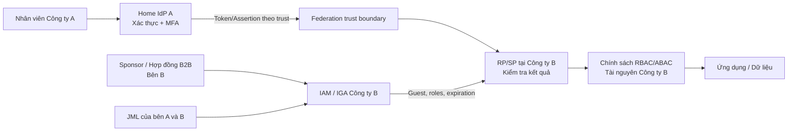
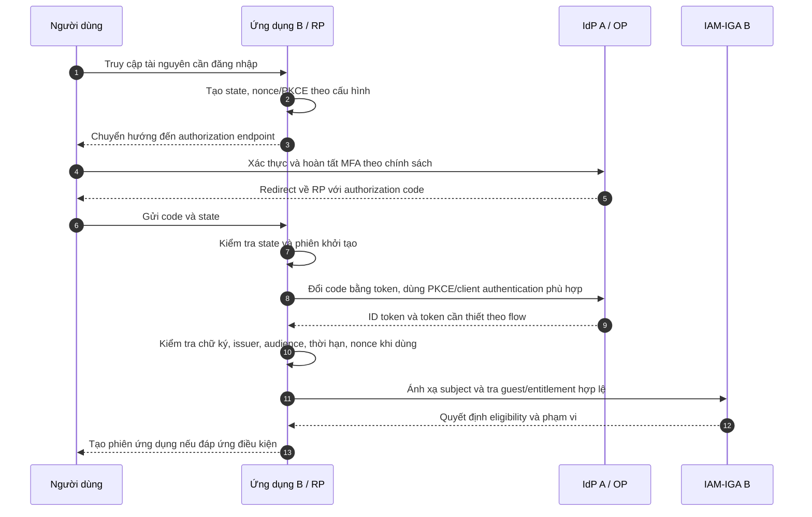
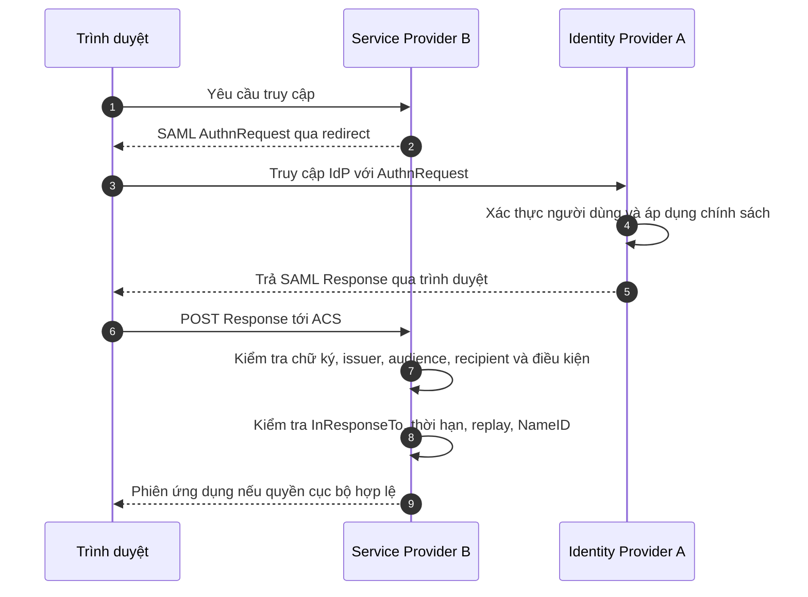
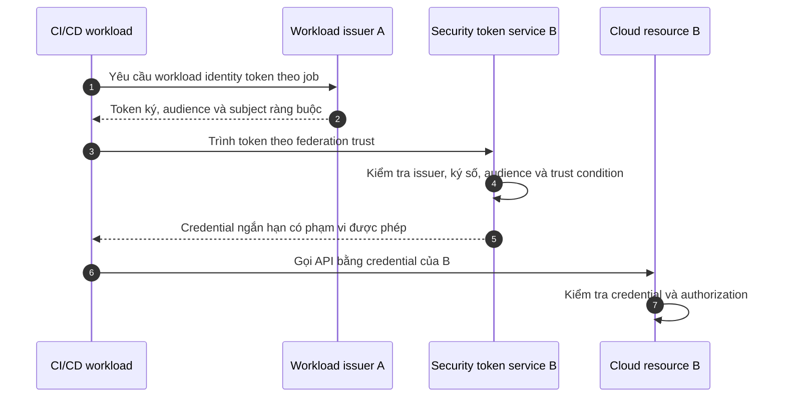

# Identity federation trong quản lý danh tính và truy cập IAM

## 1. Identity federation là gì?

**Identity federation (liên kết danh tính liên miền)** là mô hình cho phép một hệ thống hoặc tổ chức **chấp nhận kết quả xác thực và một số khẳng định về danh tính từ một nhà cung cấp danh tính khác** thông qua quan hệ tin cậy và giao thức đã thỏa thuận. Thay vì mỗi ứng dụng tự yêu cầu người dùng đăng ký mật khẩu, tổ chức có thể dùng **Identity Provider (IdP)** thực hiện xác thực, còn ứng dụng nhận kết quả với vai trò **Relying Party (RP)** trong OpenID Connect hoặc **Service Provider (SP)** trong SAML.

Ví dụ: nhân viên của Công ty A cần truy cập cổng dự án do Công ty B vận hành. Công ty B có thể cho người đó đăng nhập qua IdP của Công ty A. Khi đăng nhập thành công, IdP A phát một kết quả xác thực được bảo vệ mật mã; cổng B kiểm chứng kết quả, liên kết đến danh tính khách (*guest*) được B chấp thuận, rồi tự quyết định quyền xem dự án. **B tin vào kết quả xác thực theo phạm vi đã định, không giao cho A toàn quyền truy cập dữ liệu của B.**

Trong module **SECURITY_IDENTITY_ACCESS_MANAGEMENT_IDENTITY_LIFECYCLE**, federation kết nối hệ thống định danh trong vòng đời **Joiner–Mover–Leaver (JML)**: xác minh và tạo liên kết cho người mới, điều chỉnh thuộc tính/quyền khi đổi vai trò, ngừng quyền truy cập khi nghỉ việc hoặc hết hợp đồng. Mô hình phối hợp với **IdP, SSO, SCIM, RBAC/ABAC, tài khoản dịch vụ, kiểm toán và kiểm soát quyền truy cập tồn dư**. Một liên kết federation đúng giúp giảm mật khẩu rải rác, nhưng **không tự động giải quyết** cấp phát account, quản trị quyền hay deprovisioning.

**Mục tiêu bài học:** hiểu các thành phần và ranh giới tin cậy trong identity federation; phân biệt federation với SSO, OAuth và provisioning; mô tả OIDC/SAML; biết cách liên kết chủ thể và kiểm tra token/assertion; tổ chức JML cho nhân viên, đối tác và workload; nhận diện lỗi cấu hình cùng biện pháp kiểm toán.

## 2. Tại sao cần federation?

Khi một tổ chức có nhiều ứng dụng, mỗi hệ thống tự giữ tài khoản và mật khẩu có thể gây trải nghiệm đăng nhập rời rạc, nhiều đường khôi phục yếu và khó áp dụng nhất quán chính sách MFA. Với hợp tác B2B, buộc người dùng đối tác tạo mật khẩu khác ở mỗi doanh nghiệp còn làm tăng chi phí hỗ trợ và nguy cơ mật khẩu trùng lặp.

Federation có thể đem lại:

- **Tái sử dụng xác thực tại IdP phù hợp:** người dùng đăng nhập ở nơi tổ chức quản lý phương tiện xác thực, MFA và điều kiện phiên.
- **Giảm số mật khẩu ứng dụng cần lưu:** RP/SP không nhất thiết phải quản lý password verifier cho người dùng federated.
- **Hỗ trợ hợp tác liên tổ chức:** bên tiếp nhận không cần sở hữu mật khẩu của toàn bộ nhân viên đối tác.
- **Quản trị ranh giới tin cậy rõ:** chỉ chấp nhận issuer, client, audience và thuộc tính được phép theo hợp đồng.
- **Liên kết hoạt động vận hành:** các sự kiện JML, onboarding B2B và chính sách truy cập có thể được điều phối giữa các bên.

Tuy nhiên, **federation có thể làm tăng phạm vi ảnh hưởng của một IdP bị xâm nhập**. Nó cũng tạo phụ thuộc vào dịch vụ bên ngoài, quản lý khóa/chứng thư, metadata và quy trình xử lý khi một tổ chức ngừng hợp tác. Vì vậy federation cần kiến trúc tin cậy, quản trị truy cập và kiểm soát vòng đời, không chỉ cấu hình một nút “Login with…”.

## 3. Các thành phần và thuật ngữ chính

| Khái niệm | Vai trò | Ví dụ |
| --- | --- | --- |
| **Identity Provider (IdP)** | Xác thực người dùng và phát kết quả xác thực có thể kiểm chứng | IdP của tổ chức quản lý nhân viên |
| **Relying Party (RP)** | Ứng dụng sử dụng kết quả xác thực OIDC | Cổng báo cáo nội bộ đăng nhập qua OIDC |
| **Service Provider (SP)** | Ứng dụng nhận khẳng định xác thực SAML | SaaS nhận SAML Response |
| **Identity subject** | Chủ thể mà kết quả xác thực đề cập | Nhân viên, đối tác hoặc người dùng guest |
| **Issuer** | Thực thể phát token/assertion theo cấu hình tin cậy | URL issuer trong OIDC hoặc SAML EntityID |
| **Audience / recipient** | Đối tượng được phép tiếp nhận kết quả | Client ID của RP hoặc SP EntityID |
| **Trust relationship** | Quy tắc chấp nhận nguồn, khóa, giao thức và phạm vi dữ liệu | B chỉ tin IdP A cho tập đối tác đã được duyệt |
| **Claim / attribute** | Thông tin được nguồn khẳng định về chủ thể hoặc sự kiện | `sub`, email, tên, mức xác thực |
| **Subject mapping** | Quy tắc gắn định danh bên ngoài với bản ghi nội bộ | `(issuer, sub)` → `identityId` của guest |
| **Federation metadata** | Cấu hình phục vụ khám phá endpoint, khóa và tham số | OIDC discovery/JWKS hoặc SAML metadata |
| **Federated session** | Phiên hoặc trạng thái đăng nhập liên quan giữa các hệ thống | Phiên IdP và phiên riêng của ứng dụng |

Trong OIDC, **RP** thường được gọi là *client*. Trong SAML, thuật ngữ **SP** phổ biến hơn. Đôi khi tài liệu doanh nghiệp dùng chung “SP” hoặc “ứng dụng”, nhưng việc kiểm tra kỹ thuật phải bám theo giao thức cụ thể.

**Identity federation khác identity proofing.** IdP có thể khẳng định người dùng đã đăng nhập thành công mà không có nghĩa họ đã trải qua quy trình kiểm chứng giấy tờ pháp lý ở mức tổ chức tiếp nhận cần. RP cần biết thỏa thuận bảo đảm danh tính, cơ chế MFA, nguồn thuộc tính và mức tin cậy thực sự.

## 4. Federation, SSO, OAuth và provisioning khác nhau như thế nào?

| Cơ chế | Câu hỏi giải quyết | Điều nó **không** tự giải quyết |
| --- | --- | --- |
| **Federation** | Có thể tin kết quả xác thực/claim từ một miền danh tính khác không? | Không tự quyết các quyền nghiệp vụ ở bên tiếp nhận |
| **Single Sign-On (SSO)** | Người dùng có thể dùng một trải nghiệm đăng nhập cho nhiều ứng dụng không? | Không nhất thiết đòi hỏi nhiều tổ chức; không quản lý toàn bộ quyền |
| **OpenID Connect (OIDC)** | Ứng dụng nhận và kiểm tra thông tin về sự kiện xác thực và chủ thể bằng giao thức nào? | Không thay thế authorization chi tiết cho từng tài nguyên |
| **OAuth 2.0** | Client có thể nhận quyền truy cập được ủy quyền vào tài nguyên/API theo cơ chế nào? | Bản thân OAuth 2.0 không phải giao thức xác thực danh tính người dùng |
| **SAML 2.0** | Hai bên trao đổi khẳng định về chủ thể/xác thực qua giao thức XML như thế nào? | Không quản lý vòng đời account ứng dụng theo mặc định |
| **SCIM** | Tạo/cập nhật/vô hiệu hóa User, Group tại hệ thống đích ra sao? | Không phải giao thức đăng nhập hoặc kiểm chứng MFA |
| **IGA/RBAC/ABAC** | Ai có quyền nào, theo chính sách và phê duyệt nào? | Không tự chứng minh mật khẩu/token đã được xác thực đúng |
| **Deprovisioning** | Cần chặn, thu hồi, vô hiệu hóa những account/credential nào? | Không được đảm bảo chỉ nhờ phiên đăng nhập federation kết thúc |

**SSO và federation có thể đi cùng nhau nhưng không đồng nghĩa.** Một tổ chức dùng cùng IdP cho năm ứng dụng nội bộ đã có SSO ngay cả khi không liên kết hai miền tổ chức độc lập. Ngược lại, một quan hệ federation giữa hai công ty có thể áp dụng cho một ứng dụng duy nhất.

**Federation và SCIM bổ sung cho nhau.** B có thể chấp nhận việc A xác thực nhân viên, nhưng vẫn cần một bản ghi guest tại B với `partnerId`, `sponsorId`, ngày hết hạn và quyền truy cập đã phê duyệt. B có thể tạo bản ghi đó trước bằng SCIM/API hoặc theo JIT nếu chính sách cho phép.

## 5. Ranh giới tin cậy: ai kiểm soát điều gì?

Federation hoạt động vì có **ranh giới trách nhiệm và niềm tin được cấu hình có chủ đích**. Giữa Công ty A và Công ty B:

- A quản lý tài khoản nhân viên, credential, chính sách xác thực và trạng thái workforce trong miền của A.
- B sở hữu tài nguyên, điều kiện truy cập, guest identity, chính sách phân quyền và thời hạn hợp tác tại miền B.
- B chỉ tin **những khẳng định cụ thể** của A sau khi kiểm tra issuer, chữ ký, người nhận, thời hạn và điều kiện giao thức.
- A không được tự cấp quyền `finance-admin` tại B bằng một claim do A phát nếu B chưa chấp thuận quy tắc ánh xạ đó.
- Khi người dùng rời A hoặc hợp tác A–B kết thúc, B vẫn cần **con đường phát hiện và thu hồi quyền cục bộ**, không thể chỉ chờ người dùng ngừng đăng nhập.



**Một token ký đúng chỉ chứng minh nó được ký bằng khóa tương ứng với issuer đã được cấu hình tin cậy; không tự chứng minh mọi claim là đúng theo nghiệp vụ của RP.** RP phải quy định *claim nào* có thể dùng, *nguồn nào* có thẩm quyền và *quyền gì* được tính từ chúng. Nếu B chỉ muốn biết người dùng đã xác thực tại A, B có thể sử dụng `issuer + subject` rồi tra quyền trong kho riêng thay vì tin một nhóm `admins` từ đối tác.

### Home identity và local guest identity

Một người có thể đồng thời có:

1. **Home identity:** hồ sơ định danh trong IdP A.
2. **Federated subject identifier:** khóa nhận diện trong assertion/token A phát cho B.
3. **Local guest identity:** bản ghi do IAM B quản lý, có sponsor, chính sách và ngày hết hạn.
4. **Application account:** biểu diễn kỹ thuật tại hệ thống cụ thể của B.

Các đối tượng đó có thể liên kết với nhau nhưng **không phải một bản ghi duy nhất**. Khi B thu hồi guest, A vẫn có thể giữ tài khoản nhân viên hợp lệ để làm việc tại A.

## 6. Luồng đăng nhập federation với OIDC

**OpenID Connect** cung cấp lớp xác thực danh tính trên nền OAuth 2.0. Với ứng dụng web và nhiều loại client hiện đại, **Authorization Code Flow** với cấu hình bảo vệ phù hợp (thường gồm **PKCE**) là cách triển khai phổ biến.



**OIDC ID token** thường là một JWT chứa các claim về xác thực và chủ thể. Ví dụ **payload để giải thích** (chưa có chữ ký và không dùng trực tiếp như token thật):

```json
{
  "iss": "https://login.partner-a.example",
  "sub": "user-pairwise-19",
  "aud": "project-portal-b",
  "iat": 1795410000,
  "exp": 1795413600,
  "auth_time": 1795409900,
  "amr": ["hwk", "user"]
}
```

Đối với một token nhận từ IdP, RP phải kiểm tra theo hồ sơ giao thức và cấu hình đã đăng ký: **chữ ký và thuật toán được phép, issuer chính xác, audience/client ID, thời hạn, thời điểm phát hành khi liên quan, nonce nếu áp dụng, và các điều kiện khác của flow**. Khi muốn bảo đảm MFA hoặc độ mới của lần xác thực, có thể xét `acr`, `amr`, `auth_time` **theo hợp đồng với IdP**; không tự suy rằng mọi giá trị `amr` của các nhà cung cấp có cùng ý nghĩa.

### Vì sao state, nonce và PKCE quan trọng?

- **`state`** liên kết response với yêu cầu của phiên khởi tạo và hỗ trợ chống CSRF/mix-up theo cách triển khai đúng.
- **`nonce`** liên kết ID token với giao dịch xác thực trong những flow yêu cầu/sử dụng nó; RP phải đối chiếu đúng.
- **PKCE** ràng buộc authorization code với client khởi tạo thông qua code verifier, giúp giảm nguy cơ code bị chặn và sử dụng trái phép.
- **Redirect URI** phải được đăng ký và kiểm tra chặt; một redirect không được kiểm soát có thể làm rò code hoặc token.
- **Token endpoint và JWKS** phải đến từ cấu hình/metadata tin cậy, không lấy tùy ý từ tham số do client cung cấp.

Không nên sử dụng **access token** phát cho API A để coi như ID token của người dùng tại B; access token có mục đích, audience và quy tắc xác minh riêng. ID token cũng không thay thế chính sách authorization cho mọi API của B.

## 7. Luồng federation với SAML 2.0

**Security Assertion Markup Language (SAML) 2.0** thường được dùng cho SSO doanh nghiệp. Trong mô hình thông dụng, **SP** yêu cầu IdP xác thực người dùng, IdP gửi **SAML Response chứa Assertion** về **Assertion Consumer Service (ACS)** đã đăng ký, rồi SP tạo phiên ứng dụng sau khi kiểm tra điều kiện tin cậy.



Những hạng mục quan trọng trong xác minh SAML:

- **Chữ ký số và vị trí chữ ký:** xác minh phần nội dung thực sự được xử lý, không chỉ tìm một chữ ký đúng ở một nơi bất kỳ trong XML. Cần phòng tránh **XML signature wrapping**.
- **Issuer và metadata:** chỉ chấp nhận IdP EntityID và chứng thư/khóa được tin cậy cho quan hệ này.
- **Audience, Recipient, Destination:** assertion/response phải hướng đến đúng SP, endpoint và đối tượng nhận.
- **Conditions và thời gian:** kiểm tra `NotBefore`, `NotOnOrAfter` cùng chênh lệch đồng hồ được cho phép.
- **`InResponseTo`:** với flow do SP khởi tạo, gắn kết response vào yêu cầu phù hợp; xử lý IdP-initiated flow nếu có bằng chính sách riêng.
- **Chống replay:** không để cùng assertion được sử dụng tạo nhiều phiên ngoài điều kiện đã cho phép.
- **NameID/thuộc tính:** đối sánh đúng chủ thể; phân biệt loại NameID có tính ổn định khác nhau.

**SAML assertion hợp lệ không đồng nghĩa toàn bộ quyền ứng dụng đã được cấp.** Sau khi xác thực, B vẫn phải tra guest identity, hợp đồng, vai trò và chính sách tài nguyên trước khi tạo phiên hoặc thực hiện hành động nhạy cảm.

## 8. OIDC và SAML: khi nào phù hợp?

| Tiêu chí | OIDC | SAML 2.0 |
| --- | --- | --- |
| Biểu diễn thông tin | Thường dùng JSON/JWT và endpoint HTTP | XML assertion/response và binding HTTP |
| Vai trò điển hình | OP/IdP và RP/client | IdP và SP |
| Trải nghiệm phổ biến | Ứng dụng web/mobile/API hiện đại | Ứng dụng doanh nghiệp và SaaS có SAML SSO |
| Cơ chế tin cậy | Issuer, discovery/JWKS, key, client/audience, token validation | EntityID, metadata, chứng thư, chữ ký XML và điều kiện assertion |
| Liên kết chủ thể | `iss` + `sub` theo phạm vi issuer/sector | NameID hoặc thuộc tính ổn định đã thỏa thuận |
| MFA và ngữ cảnh | `acr`, `amr`, `auth_time` nếu có hợp đồng | AuthnContext và thuộc tính liên quan theo thỏa thuận |
| Điểm dễ sai | Redirect, state/nonce, PKCE, token mix-up, audience, claim trust | XML signature wrapping, replay, recipient/audience, NameID thay đổi |
| Provisioning | **Không phải** cơ chế SCIM | **Không phải** cơ chế SCIM |

Không có kết luận rằng một giao thức “luôn an toàn hơn” chỉ vì định dạng mới hơn. **An toàn phụ thuộc profile giao thức, thư viện, cấu hình, quản lý khóa, cách xử lý claim và vòng đời quyền**. Nếu ứng dụng có hỗ trợ OIDC tốt và kiến trúc phù hợp, OIDC là lựa chọn thường gặp; khi cần tích hợp một SaaS chỉ hỗ trợ SAML, SAML vẫn có thể được vận hành an toàn với kiểm tra đúng.

## 9. Liên kết định danh: tránh nhầm người và tạo trùng account

Đây là phần quan trọng nhất của identity federation đối với IAM lifecycle. Một token có chữ ký đúng vẫn có thể được liên kết **sai tài khoản nội bộ**, khiến người dùng A nhận quyền của người dùng B.

### Không dùng email làm khóa toàn cục mặc định

Email có thể thay đổi theo tên hoặc doanh nghiệp, có thể được tái sử dụng sau khi một người nghỉ việc và có thể chưa được xác minh ở mức tổ chức tiếp nhận cần. Với IdP ngoài, trường `email` thậm chí có thể là dữ liệu tự khai hoặc không có bảo đảm cụ thể nếu không có hợp đồng tin cậy.

Khóa thường phù hợp hơn với OIDC:

```text
federatedSubjectKey = (trustedIssuer, subjectWithinIssuer)
localIdentityId     = "guest-id-7821"
applicationAccount  = "portal-user-204"
```

**`sub` có ý nghĩa trong phạm vi issuer và hợp đồng client/sector.** Có IdP phát subject dạng *pairwise* nên cùng một người có thể có `sub` khác nhau cho các client/sector khác nhau. Khi gom liên kết giữa nhiều ứng dụng, cần chính sách và bằng chứng tương quan phù hợp; không giả định hai token có email giống nhau luôn chỉ cùng một người.

Với SAML, NameID có thể là `persistent`, `transient` hoặc một định dạng khác theo cấu hình. **Transient NameID không phải khóa lâu dài** để liên kết account; doanh nghiệp cần thỏa thuận thuộc tính hoặc cơ chế mapping đáng tin cậy, có thể kết hợp nguồn SCIM/IGA.

### Ví dụ bảng mapping

| Thuộc tính | Giá trị minh họa | Ý nghĩa |
| --- | --- | --- |
| `homeIssuer` | `https://login.partner-a.example` | IdP được B chấp nhận |
| `homeSubject` | `user-pairwise-19` | Subject theo hợp đồng issuer/client |
| `localIdentityId` | `guest-id-7821` | Khóa nội bộ B dùng để quản lý vòng đời |
| `sponsorId` | `employee-id-518` | Người bảo trợ từ B |
| `partnerId` | `partner-a` | Phạm vi tổ chức đối tác |
| `accessExpiresAt` | `2027-01-31T00:00:00Z` | Hạn truy cập B đã chấp thuận |
| `applicationAccountRef` | `portal-user-204` | Tài khoản ở ứng dụng đích |

Đây là **schema nghiệp vụ minh họa**, không phải chuẩn SCIM hoặc OIDC bắt buộc. Hệ thống thật cần lưu lịch sử mapping và kiểm soát người có quyền thay đổi, đặc biệt khi đối tác thay IdP, hợp nhất tổ chức, đổi domain hoặc có người tái tuyển dụng.

### Khi nào cần manual review?

- Hai guest identity cũ cùng có vẻ khớp email/thuộc tính.
- Một IdP thay issuer hoặc dùng subject namespace mới sau di chuyển tenant.
- Người dùng mất tài khoản home và được cấp home account mới.
- Có yêu cầu gộp identity đối tác với identity nhân viên.
- Account đích đã tồn tại nhưng không có bằng chứng đúng chủ thể.

Không tự gộp tài khoản hoặc chuyển quyền chỉ từ claim tên/email trùng. B phải có quy trình xác nhận do chủ sở hữu có thẩm quyền và ghi audit.

## 10. Claim và nguồn thuộc tính: tin có điều kiện, không tin toàn bộ

Một token/assertion có thể chứa `name`, `email`, `groups`, `department`, `tenant`, `roles` và các thuộc tính khác. **Chữ ký hợp lệ chứng minh nguồn phát**, nhưng không bảo đảm IdP nguồn có thẩm quyền quyết định mọi thuộc tính ấy trong miền nhận.

| Thuộc tính | Nguồn có thể có thẩm quyền | Cách dùng an toàn |
| --- | --- | --- |
| `iss`, `sub` | IdP phát token theo hợp đồng | Nhận diện và liên kết subject trong phạm vi đúng |
| `auth_time`, `acr`, `amr` | IdP xác thực | Đánh giá mức/thời điểm xác thực nếu đã quy định ý nghĩa |
| Họ tên, email | IdP hoặc hồ sơ liên kết; độ xác minh tùy ngữ cảnh | Hiển thị/liên hệ có kiểm soát, không mặc định làm khóa hoặc quyền |
| `employmentStatus` của nhân viên A | HRIS/IdP của A theo hợp đồng | Là một tín hiệu; B vẫn phải kiểm tra sponsor/hợp đồng của chính B |
| `partnerId` trong miền B | Contract registry/IGA của B | Không tin giá trị bên ngoài tự khai để vượt tenant isolation |
| Nhóm/role bên A | IdP hoặc IGA của A | Chỉ ánh xạ các nhóm đã được B cho phép, không thừa kế `admins` tự động |
| Entitlement tài nguyên B | IGA, application/data owner B | B ra quyết định cuối theo RBAC/ABAC và phạm vi tài nguyên |
| Trạng thái account tại B | IAM/ứng dụng của B | Phải chặn nếu guest hết hạn dù A vẫn cho login |

**Tránh privilege escalation qua claim mapping.** Ví dụ IdP A phát `groups=["admins"]`. Nếu B tự động biến bất kỳ giá trị `admins` thành `tenant-admin` tại B, A có thể gián tiếp cấp quyền cao tại một hệ thống nó không quản lý. Cần catalog ánh xạ có owner, phê duyệt, giới hạn issuer/client và điều kiện bổ sung.

### Vai trò của RBAC và ABAC

- **RBAC** ánh xạ guest/nhân viên đã được chấp thuận sang những vai trò nghiệp vụ và nhóm quyền của B. Có thể kết hợp một số claim đã tin cậy làm *input*, không biến chúng thành quyết định duy nhất.
- **ABAC** đánh giá các thuộc tính như `partnerId`, `contractActive`, mức dữ liệu, ngữ cảnh phiên và mục đích. Những thuộc tính quan trọng cần đến từ nguồn B có thẩm quyền.
- **SoD (Segregation of Duties)** kiểm tra các vai trò xung đột, nhất là quyền quản trị hoặc phê duyệt giao dịch. Federation không miễn trừ phê duyệt nội bộ.

Một ứng dụng có thể chấp nhận kết quả xác thực của A nhưng **từ chối truy cập** nếu guest B đã hết hạn hoặc resource thuộc đối tác khác.

## 11. Federation kết hợp với account provisioning: SCIM và JIT

Liên kết đăng nhập không nhất thiết tạo được hồ sơ người dùng và entitlement tại ứng dụng. Hai mô hình thường gặp:

### 11.1 Pre-provisioning qua SCIM/API

Trước khi người dùng đăng nhập, IGA/IAM của bên tiếp nhận hoặc một nguồn provisioning được tin cậy tạo guest/account và nhóm/role đã duyệt tại ứng dụng. **SCIM** có thể quản lý `User`, `Group`, `active` và một số thuộc tính khác tùy mức hỗ trợ; API riêng có thể xử lý entitlement chi tiết.

Ưu điểm là bên tiếp nhận có thể thực thi kiểm tra sponsor, hợp đồng, phạm vi và phê duyệt **trước lần đăng nhập đầu**, đồng thời kiểm soát disable/thu hồi chủ động. Nhưng phải quản lý ánh xạ `externalId`, ID User do provider cấp, lỗi trùng, thay đổi email và reconcile để không tạo tài khoản mồ côi.

### 11.2 Just-in-time (JIT) provisioning

Một số ứng dụng tạo hoặc liên kết account tại thời điểm nhận token/assertion hợp lệ lần đầu. **JIT không có nghĩa “bất kỳ ai đăng nhập từ IdP tin cậy đều được tạo account và cấp quyền”.** Quy tắc đúng nên kiểm tra *eligibility*, tổ chức đối tác, lời mời hoặc sponsor, ngày hiệu lực, tính ổn định của liên kết subject và quyền tối thiểu.

Một luồng JIT an toàn:

1. Kiểm tra token/assertion đúng giao thức, issuer và audience.
2. Liên kết subject với local identity hiện có qua khóa đã thỏa thuận.
3. Nếu chưa có mapping, kiểm tra lời mời/đơn đăng ký, sponsor và hợp đồng.
4. Tạo local identity/account có trạng thái giới hạn theo chính sách, không tự cấp đặc quyền.
5. Áp RBAC/ABAC và điều kiện phiên; ghi audit, hạn và đối soát.
6. Từ chối hoặc chuyển review nếu thông tin không đủ hoặc có xung đột.

**Một kết quả login không thay thế deprovisioning.** Nếu ứng dụng chỉ tạo account bằng JIT và không có SCIM/connector thu hồi, bên tiếp nhận cần đường riêng để disable/delete quyền khi hợp đồng hết hạn, không thể coi “không có login mới” là trạng thái đã an toàn.

## 12. Vòng đời Joiner–Mover–Leaver trong federation

Federation có thể **giảm số nơi phải quản lý mật khẩu**, nhưng **gia tăng nhu cầu điều phối thay đổi** giữa home IdP và tài nguyên bên tiếp nhận. Mỗi bên cần định nghĩa nguồn sự thật và thời gian phản ứng với sự kiện.

| Sự kiện | Trách nhiệm bên nguồn (Home IdP/đối tác) | Trách nhiệm bên tiếp nhận (RP/SP/resource owner) |
| --- | --- | --- |
| **Joiner** | Xác minh chủ thể, thiết lập account, MFA, định danh ổn định | Xác nhận lời mời, sponsor, quan hệ đối tác, guest, hạn và quyền nội bộ |
| **Mover** | Cập nhật vai trò, đơn vị hoặc điều kiện xác thực theo nguồn có thẩm quyền | Tính lại quyền RBAC/ABAC, scope, SoD, xử lý session/claim cũ |
| **Leaver** | Disable account home và xử lý credential/session theo chính sách | Chặn guest, thu hồi account/quyền/phiên tại B dù A chưa hoàn tất |
| **Hợp đồng hết hạn** | Có thể không thay đổi home identity | B tự thu hồi guest và truy cập vì quan hệ với B đã kết thúc |
| **Đổi IdP/tenant** | Thay issuer/cấu hình và thông báo kế hoạch di chuyển | Đánh giá trust, mapping, kiểm tra identity, giới hạn thời gian chuyển đổi |
| **Sự cố IdP/khóa** | Thu hồi/luân chuyển khóa và xử lý sự cố | Hạn chế trust, chặn token nghi vấn, đánh giá session và quyền cục bộ |

### Joiner: chấp thuận truy cập trước khi liên kết

Ví dụ đối tác A đưa một chuyên gia vào dự án B. A xác thực người đó; B phải có sponsor nội bộ, lý do công việc, thời hạn hợp đồng và quyền được phê duyệt. Sau đó B tạo guest identity và mapping subject. Nếu chỉ tin domain email của A hoặc token đầu tiên gửi đến, B có thể vô tình nhận người không có hợp đồng hợp lệ.

### Mover: claim mới không đủ nếu quyền cũ tồn dư

Nhân viên A chuyển khỏi dự án mà B đang vận hành. A có thể cập nhật `department` hoặc `groups`, nhưng ứng dụng B có thể vẫn giữ nhóm cũ gán trực tiếp hoặc token/phiên đã phát. B cần **quyết định về quyền mong muốn**, thu hồi quyền không còn cần, xử lý phiên và kiểm tra trạng thái thực tế.

Một chuyển vai trò sang quyền đặc quyền có thể yêu cầu **mức bảo đảm xác thực cao hơn**, nhưng B không nên suy rằng `amr` hoặc `AuthnContext` trong mọi IdP tương đương nhau. Cần hợp đồng mức bảo đảm và phương án step-up/điều kiện thiết bị khi phù hợp.

### Leaver: không chờ home IdP để khóa guest

Chuyên gia A nghỉ việc, nhưng B vẫn có guest account. Nếu A đã khóa account, người đó có thể không đăng nhập mới từ A; tuy nhiên B vẫn có **phiên ứng dụng riêng**, **token API**, quyền chia sẻ hoặc tài khoản local. B phải thu hồi theo khả năng hệ thống. Ngược lại, khi hợp đồng A–B kết thúc mà chuyên gia vẫn làm việc ở A, B phải tự chặn guest theo nguồn hợp đồng của B.

**Không đồng nhất Leaver tại A với Leaver tại B.** Hai bên có cơ sở nghiệp vụ và thời điểm hiệu lực khác nhau. Cần luồng thông báo/hợp đồng và điều kiện fail-safe được thỏa thuận.

## 13. Session, logout và thời gian tồn dư sau khi thu hồi

Một liên kết federation thường tạo nhiều trạng thái độc lập:

1. Phiên đăng nhập tại **home IdP**.
2. ID token/SAML assertion dùng trong quá trình xác thực.
3. Phiên hoặc cookie của **RP/SP** sau khi chấp nhận đăng nhập.
4. Access token, refresh token hoặc credential ứng dụng/API liên quan.

**Kết thúc phiên IdP không nhất thiết kết thúc phiên ứng dụng.** Nếu B đã tạo cookie phiên cục bộ và không nhận hoặc xử lý tín hiệu logout, người dùng có thể tiếp tục sử dụng B đến khi phiên hết hạn hoặc bị chặn ở tầng authorization. Với JWT tự chứa, resource server chỉ kiểm tra chữ ký và `exp` có thể vẫn chấp nhận token cho đến khi hết hạn nếu không có cơ chế introspection/revocation hoặc kiểm tra trạng thái hiện hành.

Các kiểm soát cần cân nhắc theo rủi ro:

- Thời hạn token và session phù hợp, idle timeout và absolute timeout cho ứng dụng nhạy cảm.
- Session/token revocation khi có khả năng, và chính sách kiểm tra tình trạng danh tính/entitlement ở tài nguyên.
- Logout có khả năng phối hợp theo giao thức và sản phẩm, nhưng không hứa một thao tác sẽ hủy toàn bộ phiên trong mọi hệ thống.
- Yêu cầu tái xác thực (*reauthentication*) hoặc step-up cho tác vụ nhạy cảm nếu thông tin đăng nhập quá cũ.
- Giới hạn cache thuộc tính và nhóm; cập nhật authorization khi Mover hoặc Leaver.
- Kế hoạch ứng phó khi nguồn IdP không khả dụng: tránh mở quyền quản trị chỉ để “bypass” sự cố.

### Deprovisioning không phải logout

Một người có thể logout khỏi ứng dụng nhưng vẫn còn entitlement và guest account; ngược lại account đã disable có thể còn access token chưa hết hạn. **Deprovisioning** phải bao gồm quyết định và thực thi chặn quyền ở IdP/ứng dụng/resource server, đối soát đường truy cập còn lại và xử lý ngoại lệ có kiểm soát.

## 14. Quản lý trust, metadata và vòng đời khóa/chứng thư

Liên kết federation là một cấu hình bảo mật phải được **đăng ký, rà soát, xoay vòng và có cơ chế thu hồi**. Một quan hệ trust để quên nhiều năm có thể chấp nhận IdP hoặc khóa không còn được phép.

**Thành phần cấu hình điển hình:**

| Hạng mục | OIDC | SAML 2.0 |
| --- | --- | --- |
| Danh tính issuer | Issuer URL chính xác | IdP EntityID được phê duyệt |
| Metadata | Discovery document do issuer tin cậy công bố | SAML metadata của IdP/SP |
| Khóa kiểm chứng | JWKS và quy tắc rotation/trust | Chứng thư khóa ký trong metadata được tin cậy |
| Đối tượng nhận | Client ID/audience, redirect URI | SP EntityID/audience, ACS endpoint |
| Endpoint | Authorization/token/JWKS/userinfo nếu sử dụng | SSO endpoint, ACS, logout nếu cấu hình |
| Claim | `sub`, `acr`, `amr`, nhóm được cho phép | NameID, AuthnContext, attributes được cho phép |
| Chế độ lỗi | Từ chối token không hợp lệ/issuer ngoài danh sách | Từ chối response sai chữ ký/đích/điều kiện |

**Rotation phải có kế hoạch.** Với OIDC, IdP có thể đưa khóa ký mới vào JWKS trước khi sử dụng; RP cần cập nhật bộ khóa đúng nguồn và hỗ trợ giai đoạn chuyển tiếp hợp lý. Với SAML, các bên cần cập nhật và xác nhận metadata/chứng thư trước thời điểm thay ký. **Không được tắt xác minh chữ ký hoặc chấp nhận mọi certificate để “giữ SSO chạy”.**

Một quy trình quản trị trust hợp lý:

1. Đăng ký mục đích, tổ chức đối tác, người sở hữu mối quan hệ và hệ thống chịu trách nhiệm.
2. Xác minh issuer/entity ID và metadata qua kênh tin cậy, không lấy từ input tùy ý.
3. Quy định client/SP, redirect/ACS endpoint, khóa, scope/claim và mức assurance.
4. Kiểm thử login, từ chối token giả, token sai audience, token hết hạn và mapping không rõ.
5. Ghi phiên bản cấu hình, người phê duyệt, ngày rà soát và kế hoạch rotation.
6. Giám sát lỗi xác thực, thất bại do ký số, thay đổi metadata và account bất thường.
7. Khi hết hợp tác, vô hiệu hóa trust, guest account, phiên/quyền liên quan theo thứ tự an toàn.

**Không nên tự động khám phá issuer rồi tin mọi metadata mà một tham số `issuerUrl` của người dùng cung cấp.** Hành vi đó có thể dẫn đến tin nhầm miền, truy xuất URL không an toàn hoặc chấp nhận khóa do kẻ tấn công kiểm soát. Danh sách issuer và metadata cần được quản trị.

## 15. Federation cho workload và service account

Khái niệm federation không chỉ áp dụng cho đăng nhập người dùng tương tác. Trong **workload identity federation**, một dịch vụ hoặc pipeline có thể dùng bằng chứng định danh do một nền tảng phát hành để nhận quyền truy cập tại hệ thống khác mà **không cần lưu khóa dài hạn của đích**.

Ví dụ, một CI/CD job từ nền tảng A nhận một OIDC token đã ký, rồi dùng cơ chế trao đổi token hoặc một trust policy tại cloud B để lấy credential ngắn hạn. Đích B phải kiểm tra **issuer, audience, subject và các claim ràng buộc workload** trước khi cấp quyền.



**Trust phải giới hạn tới workload cụ thể**, không đơn thuần tin “mọi token do platform A phát”. Có thể cần ràng buộc repo, branch, environment, namespace, service account Kubernetes, project, workflow hoặc audience theo công nghệ; các giá trị nào đáng tin phụ thuộc cách issuer thực sự phát và kiểm chứng.

So với lưu client secret tĩnh trong pipeline, workload federation có thể giảm nhu cầu phân phối secret dài hạn. Nhưng **không tự miễn trừ quản lý service owner, phạm vi quyền, log, rotation trust, thời hạn credential và deprovisioning**. Khi dự án dừng hoặc đổi chủ sở hữu, IAM phải cập nhật trust condition và thu hồi quyền đích.

Không nhầm **OAuth client credentials** với “workload identity federation” trong mọi trường hợp: client credentials là grant OAuth dùng cho client truy cập tài nguyên; federation cần quan hệ tin cậy và bằng chứng từ miền khác, có thể sử dụng nhiều cơ chế trao đổi/ủy quyền tùy nền tảng.

## 16. Threat model và lỗi cấu hình thường gặp

| Tình huống | Nguy cơ | Biện pháp kiểm soát |
| --- | --- | --- |
| Chấp nhận mọi issuer | Token từ miền tùy ý được tin là danh tính hợp lệ | Allowlist issuer/entity ID, trust onboarding có phê duyệt |
| Không kiểm tra audience | Token cấp cho ứng dụng khác được dùng ở B | Kiểm tra audience/client/SP đúng ngữ cảnh |
| Tin claim role từ IdP ngoài | Tự nâng quyền qua `admins`, `tenant` | Attribute authority matrix, catalog ánh xạ và phê duyệt nội bộ |
| Liên kết account theo email | Chiếm guest cũ hoặc gộp nhầm khi email tái sử dụng | Mapping theo issuer/subject và bằng chứng khi thay liên kết |
| Không kiểm tra chữ ký/thuật toán | Chấp nhận token/assertion bị giả hoặc sửa | Thư viện được duy trì, policy thuật toán và khóa tin cậy |
| Replay SAML assertion | Dùng lại assertion để tạo phiên ngoài dự kiến | Kiểm tra thời hạn, request correlation, replay cache |
| OIDC redirect/PKCE/state sai | Code injection, CSRF, đổi flow hoặc rò code | Redirect URI nghiêm ngặt, state, PKCE, nonce theo profile |
| XML signature wrapping | SP kiểm tra chữ ký ở dữ liệu khác với assertion được xử lý | Xác minh đúng XML element và dùng parser an toàn |
| Không xoay khóa/chứng thư | SSO ngừng khi hết hạn hoặc tiếp tục tin khóa bị lộ | Quy trình rotation, monitoring, phản ứng sự cố |
| Chỉ khóa home IdP | Session/token/guest ở B vẫn hoạt động | Local deprovisioning, token policy, reconciliation |
| JIT tự cấp quyền mặc định quá rộng | Bất kỳ nhân viên đối tác nào cũng được tạo account có quyền cao | Sponsor, scope, expiry, approval và least privilege |
| Workload issuer trust quá rộng | Job/repo không được duyệt nhận quyền cloud cao | Giới hạn subject/audience và điều kiện workload |

**Federation giảm số lần nhập mật khẩu, không loại bỏ nguy cơ chiếm tài khoản.** Một IdP bị xâm nhập hoặc một quy trình recovery yếu có thể ảnh hưởng hàng loạt RP. Cần đánh giá phương thức MFA, thiết bị, xác minh chủ thể và phương án điều tra sự kiện ở cả hai phía.

### Khi IdP bị gián đoạn hoặc nghi lộ khóa

Bên tiếp nhận cần có **người chịu trách nhiệm trust**, khả năng hạn chế/dừng chấp nhận issuer hoặc khóa có rủi ro, quy trình xử lý phiên hiện hành và kế hoạch liên lạc với đối tác. Không tự tạo đường login local yếu cho tất cả guest như một “giải pháp dự phòng” nếu chưa có phương án kiểm soát và phê duyệt.

## 17. Kiểm toán, đối soát và chỉ số vận hành

Để giải trình một phiên federated, phải nối được **sự kiện xác thực ở IdP**, **quyết định chấp nhận ở RP/SP** và **quyết định quyền trong hệ thống tài nguyên**.

Một audit trail phù hợp có thể ghi:

- Danh tính RP/SP, issuer/entity ID và phiên bản trust policy.
- Local `identityId` hoặc guest ID, tham chiếu subject bên ngoài theo mức cần thiết và chính sách bảo vệ dữ liệu.
- Thời điểm xác thực, mức assurance hoặc phương thức nếu hai bên có hợp đồng ý nghĩa.
- Kết quả kiểm tra token/assertion, mã lỗi, request/trace ID; **không lưu toàn bộ token nhạy cảm, secret hoặc private key**.
- Quyết định RBAC/ABAC, sponsor, hợp đồng, quyền/môi trường được phép và lý do từ chối.
- Sự kiện tạo account, đổi mapping, Mover/Leaver, vô hiệu hóa session/guest và kết quả SCIM/API.
- Sự kiện rotation khóa/chứng thư, thay issuer, thay client, trust bị đình chỉ hoặc chấm dứt.

| Chỉ số | Câu hỏi cần trả lời |
| --- | --- |
| **Federated login success/failure rate** | Có lỗi issuer, audience, chữ ký, cấu hình hay người dùng không? |
| **Unknown/mismatched subject rate** | Bao nhiêu login không liên kết đúng với local identity đã chấp thuận? |
| **JIT provisioning exception rate** | Có guest tạo mới ngoài lời mời, sponsor hoặc scope đã duyệt không? |
| **Expired partner guest count** | Có guest hết hợp đồng mà account/quyền vẫn hoạt động không? |
| **Time to revoke federated access** | Bao lâu từ sự kiện leaver/hết hạn đến khi quyền thực tế ở B bị chặn? |
| **Trust certificate/key expiry risk** | Quan hệ nào sắp thay khóa nhưng chưa xác minh kế hoạch rotation? |
| **Reconciliation drift** | Quyền thực tế, role và session còn lệch chính sách B bao nhiêu? |
| **Ownerless trust relationships** | Có liên kết IdP nào không còn chủ quan hệ và ngày rà soát? |

**Reconciliation** phải quan sát những gì còn tồn tại tại ứng dụng và token/session theo khả năng sản phẩm. Một sự kiện “IdP đã disable user” là bằng chứng nguồn, **không đủ để kết luận B đã xóa mọi quyền cục bộ**. Các ngoại lệ chưa xử lý cần owner, hạn và mức rủi ro rõ ràng.

## 18. Tình huống thực tế: đối tác truy cập cổng dự án

Công ty B vận hành cổng quản lý dự án chỉ dành cho nhân viên của B và các kỹ sư được duyệt từ Công ty A. Một kỹ sư tên Hương có home identity tại IdP A. Công ty B có hợp đồng với A, sponsor nội bộ và chỉ muốn Hương xem tài liệu của dự án `project-orion`.

**Giai đoạn thiết lập federation.** Nhóm IAM B đăng ký issuer của A, client ID/metadata, khóa/chứng thư, redirect/ACS phù hợp và quy tắc liên kết subject. B không cho mọi email miền A truy cập; sponsor tạo lời mời cho Hương, hợp đồng và thời hạn. IAM B tạo guest `guest-7821`, ánh xạ `issuer + subject` qua quy trình đã kiểm chứng và gán vai trò `orion-read`.

**Đăng nhập bình thường.** Hương mở cổng B; B chuyển hướng đến IdP A. A xác thực theo chính sách MFA, phát token/assertion hợp lệ. B kiểm tra issuer, audience, chữ ký, thời hạn, mapping, sau đó kiểm tra guest còn hiệu lực và RBAC/ABAC. Hương chỉ xem tài liệu Orion, không thể đổi `projectId` trong URL để xem dự án khác vì ứng dụng kiểm tra đối tượng tài nguyên.

**Mover tại A.** Hương chuyển nhóm và không còn làm dự án Orion. A cập nhật thuộc tính và thông báo thay đổi theo cơ chế đã thỏa thuận. B rà soát guest, thu hồi `orion-read` và xử lý phiên đang còn hiệu lực. Việc A vẫn xác thực Hương thành công cho các ứng dụng nội bộ A không cho phép Hương giữ quyền Orion.

**Leaver tại B nhưng không phải tại A.** Hợp đồng Orion kết thúc; Hương vẫn là nhân viên của A. B dựa vào contract registry và sponsor để chấm dứt guest/quyền, vô hiệu hóa account ứng dụng và đối soát. B không yêu cầu A xóa tài khoản của Hương. Nếu token/phiên B còn dùng được do ứng dụng không kiểm tra lại quyền, B xử lý theo khả năng revocation/TTL và đánh dấu ngoại lệ chưa hoàn tất.

**Đổi IdP của A.** Sau đó A di chuyển từ IdP cũ sang IdP mới. B không tự nối guest chỉ bằng email Hương; cần kế hoạch thay trust, mapping subject, chứng cứ liên kết và cắt chuyển có kiểm soát để tránh tạo trùng hoặc trao quyền sai người.

Qua tình huống, federation giải quyết **xác thực liên miền**, còn vòng đời danh tính, sponsor, quyền dự án, phiên và việc thu hồi tại B vẫn thuộc trách nhiệm của B.

## 19. Checklist triển khai Identity federation

1. **Mục tiêu:** cần federation giữa miền nào, cho người dùng hay workload, phục vụ ứng dụng và tài nguyên cụ thể nào?
2. **Chủ sở hữu quan hệ:** trust có sponsor, application owner, security owner và ngày rà soát không?
3. **Giao thức:** OIDC hay SAML phù hợp với năng lực hệ thống? Có profile và thư viện xác minh được bảo trì không?
4. **Trust boundary:** issuer/entity ID, client/SP, redirect/ACS, audience, khóa/chứng thư và endpoint đã được đăng ký qua kênh tin cậy chưa?
5. **Xác thực:** IdP nguồn cam kết phương thức MFA, mức bảo đảm, recovery và thông tin `acr`/`amr`/AuthnContext ở mức nào?
6. **Tương quan identity:** dùng khóa `(issuer, subject)` hoặc mapping ổn định phù hợp chưa? Có xử lý subject pairwise, đổi IdP và gộp sai tài khoản không?
7. **Thuộc tính:** claim nào có thẩm quyền, claim nào chỉ để hiển thị, và nguồn nào của bên nhận quyết định hợp đồng, tenant, role?
8. **Cấp phát:** cần pre-provisioning bằng SCIM/API hay JIT? Guest có sponsor, hạn và quyền tối thiểu không?
9. **RBAC/ABAC:** quyền được tính từ catalog và nguồn dữ liệu đáng tin cậy, kiểm tra scope, tenant isolation và SoD chưa?
10. **Bảo vệ giao thức:** OIDC có kiểm tra chữ ký, issuer, audience, thời hạn, state, PKCE và nonce theo profile; SAML có signature, destination, conditions, replay và InResponseTo theo flow chưa?
11. **Phiên:** IdP session, RP session, refresh token, access token và logout được quản lý riêng thế nào?
12. **JML:** Joiner tạo liên kết đúng người; Mover thu hồi quyền cũ; Leaver/hết hợp đồng chặn truy cập ở bên nhận ngay cả khi IdP nguồn còn hoạt động chưa?
13. **Workload:** trust đã giới hạn issuer/audience/subject và môi trường, credential đích ngắn hạn, owner rõ ràng chưa?
14. **Rotation:** có kiểm thử đổi khóa/chứng thư, thay metadata/issuer, xử lý sự cố và khả năng tắt quan hệ trust không?
15. **Kiểm toán:** có thể nối xác thực liên miền, mapping account, quyết định quyền, provisioning/deprovisioning và observed state mà không lộ token/secret không?
16. **Đối soát:** có đo account guest mồ côi, phiên/quyền tồn dư, nhóm sai lệch và trust không có owner không?

**Identity federation là một quan hệ tin cậy có phạm vi, không phải sự chuyển giao toàn bộ thẩm quyền danh tính và quyền truy cập.** OIDC/SAML giúp RP/SP chấp nhận kết quả xác thực từ IdP khác; SCIM/JIT giúp xử lý account; RBAC/ABAC và IGA quyết định quyền; còn JML cùng reconciliation bảo đảm danh tính và quyền được cập nhật, thu hồi đúng lúc. Khi thiết kế rõ ranh giới nguồn, mapping chủ thể, vòng đời khóa, phiên và trách nhiệm giữa các bên, federation vừa tạo trải nghiệm SSO thuận tiện vừa giảm rủi ro mạo danh và quyền truy cập tồn dư.
