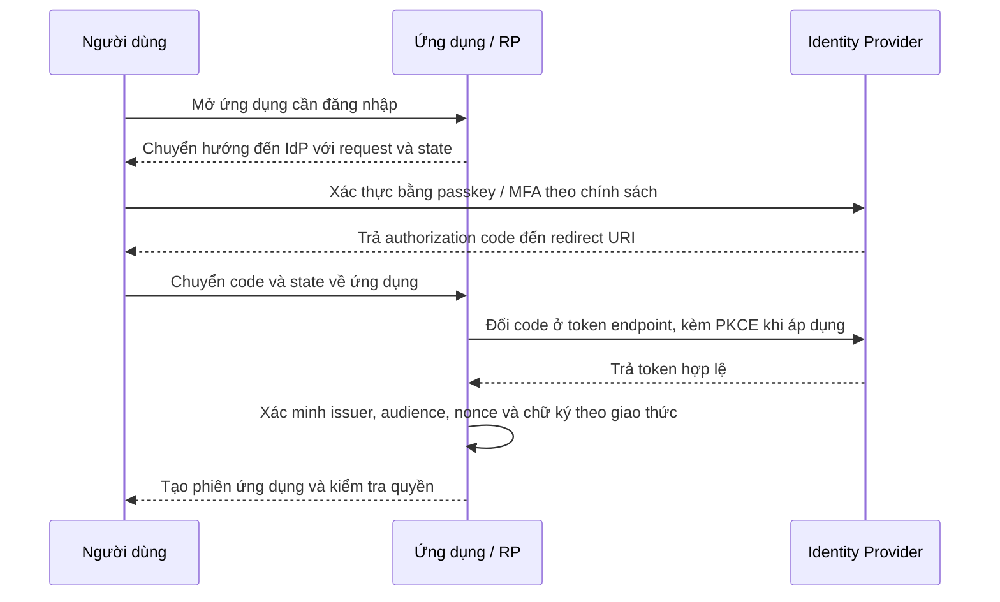

# Identity provider trong Federation và vòng đời danh tính IAM

**Identity Provider (IdP)** là hệ thống thực hiện hoặc điều phối xác thực danh tính và cung cấp **bằng chứng xác thực** cho một ứng dụng hoặc dịch vụ tin cậy. Trong **identity federation**, IdP và **Relying Party (RP)** hoặc **Service Provider (SP)** thiết lập quan hệ tin cậy để người dùng đăng nhập ở một nơi mà vẫn truy cập được các dịch vụ liên kết. Thông qua các giao thức như **OpenID Connect (OIDC)** hoặc **SAML 2.0**, ứng dụng tiêu thụ thông tin do IdP phát hành mà không cần tự thu thập mật khẩu của người dùng.

Trong hệ thống **Identity and Access Management (IAM)**, IdP là một thành phần trung tâm của quản lý vòng đời **Joiner–Mover–Leaver (JML)**, nhưng không phải toàn bộ hệ thống IAM. **Joiner** cần xác minh danh tính, tạo tài khoản, đăng ký authenticator và cho truy cập đúng thời điểm; **Mover** cần cập nhật thuộc tính, nhóm và quyền; **Leaver** cần ngăn đăng nhập, chấm dứt phiên/token và thu hồi quyền tại ứng dụng đích. **IdP/SSO**, **SCIM**, **RBAC/ABAC**, quản trị tài khoản dịch vụ và audit phối hợp để đạt các mục tiêu này.

## 1. Vai trò của Identity Provider trong Federation

| Thành phần | Nhiệm vụ chính | Ví dụ |
| --- | --- | --- |
| **Identity Provider (IdP)** | Xác thực người dùng, quản lý phiên đăng nhập, phát hành assertion hoặc token | IdP doanh nghiệp xác thực nhân viên |
| **Relying Party / Service Provider** | Tin cậy kết quả xác thực hợp lệ từ IdP, tạo phiên ứng dụng, thực thi quyền | CRM, ERP, portal nội bộ |
| **User / Subject** | Chủ thể yêu cầu truy cập; có thể có nhiều account tại các hệ thống | Nhân viên, đối tác |
| **Identity governance / lifecycle** | Quản lý trạng thái, chính sách cấp/thu hồi quyền và phê duyệt | IAM/IGA xử lý JML |
| **Provisioning connector / SCIM** | Tạo/cập nhật/vô hiệu hóa tài khoản hoặc nhóm ở ứng dụng đích | Đồng bộ tài khoản vào SaaS |
| **Policy enforcement point** | Kiểm tra quyền thao tác ở tài nguyên thực | API xác minh role, nhóm, thuộc tính |

**IdP xác thực người dùng là ai hoặc người dùng kiểm soát phương thức xác thực nào; ứng dụng quyết định người dùng được làm gì.** IdP có thể cung cấp nhóm hoặc claim làm đầu vào cho phân quyền, nhưng quyền hiệu lực còn phụ thuộc ứng dụng, dữ liệu tài nguyên và chính sách **RBAC/ABAC**.

Một tổ chức có thể có nhiều IdP, ví dụ IdP nhân viên, IdP khách hàng và IdP đối tác. Ứng dụng cần biết chính xác **nhà phát hành (issuer) nào được tin cậy**, không chấp nhận mọi token chỉ vì chúng có chữ ký hợp lệ.

## 2. IdP khác Directory, IAM, SSO và SCIM như thế nào?

| Khái niệm | Mục đích | Không nên hiểu nhầm |
| --- | --- | --- |
| **Directory** | Lưu và tra cứu account, nhóm, thuộc tính | Có directory không đồng nghĩa đã có federation |
| **IdP** | Xác thực và phát hành thông tin xác thực cho bên tin cậy | IdP không tự quản lý mọi quyền tại ứng dụng |
| **SSO** | Trải nghiệm dùng kết quả đăng nhập để truy cập nhiều dịch vụ | SSO không bảo đảm đồng bộ account hoặc thu hồi mọi phiên |
| **Federation** | Thiết lập tin cậy giữa các miền danh tính và ứng dụng | Federation không có nghĩa các bên dùng chung cơ sở mật khẩu |
| **SCIM** | Giao thức quản lý user/group giữa các hệ thống khi được hỗ trợ | SCIM không phải giao thức đăng nhập thay OIDC/SAML |
| **IGA/JML** | Quy định ai đủ điều kiện có tài khoản/quyền và khi nào thu hồi | Quy trình governance không thay thế xác thực runtime |

Một ứng dụng hỗ trợ OIDC có thể cho phép đăng nhập SSO nhưng vẫn yêu cầu admin tạo user cục bộ thủ công. Ngược lại, ứng dụng hỗ trợ SCIM có thể đồng bộ account nhưng không mặc nhiên nhận federation login từ cùng IdP. Thiết kế phải phân biệt **luồng xác thực** và **luồng quản lý vòng đời tài khoản**.

## 3. Cách hoạt động của federation với IdP

Ví dụ luồng **OIDC Authorization Code Flow** ở mức khái niệm:



Sơ đồ lược bớt chi tiết giao thức. Trong triển khai thực tế, ứng dụng phải tuân thủ cấu hình client, bảo vệ redirect URI, sử dụng **state**, **PKCE** theo loại client và thực hiện xác minh token/nonce theo ngữ cảnh OIDC. **Access token dùng để gọi API không được tự động coi là bằng chứng đăng nhập phù hợp cho mọi RP**; với OIDC, **ID token** phục vụ xác nhận sự kiện xác thực cho client phù hợp.

Với **SAML 2.0**, IdP phát hành **SAML assertion** đến SP qua binding được cấu hình. SP cần xác minh chữ ký thích hợp, issuer, audience, recipient, điều kiện thời gian, `InResponseTo` khi phù hợp và chống replay. Chỉ giải mã XML hoặc kiểm tra email trong assertion mà bỏ qua kiểm tra tin cậy là không đủ.

## 4. Thiết lập quan hệ tin cậy giữa IdP và ứng dụng

Một tích hợp federation an toàn cần quản lý:

1. **Issuer/entity ID:** định danh chính xác IdP được chấp nhận.
2. **Client ID hoặc SP entity ID:** ứng dụng nhận thông tin xác thực.
3. **Audience/recipient:** assertion/token chỉ có hiệu lực cho đúng ứng dụng hoặc API.
4. **Redirect URI / ACS endpoint:** điểm nhận phản hồi đã đăng ký và kiểm soát chặt.
5. **Khóa ký và metadata:** quy trình phân phối, xác minh, xoay vòng và thu hồi khóa.
6. **Claim/attribute mapping:** quy tắc ánh xạ subject, email, nhóm, đơn vị và vai trò.
7. **Authentication policy:** mức bảo đảm, MFA, session và điều kiện step-up.
8. **Logout và sự kiện vòng đời:** phạm vi thu hồi session, token, account và entitlement.

**Tin cậy có phạm vi**, không phải một cờ cho phép chung. Một token hợp lệ từ IdP A không được sử dụng ở ứng dụng chỉ tin IdP B. Một assertion dành cho SP X không được chấp nhận tại SP Y. Khi xoay khóa ký hoặc đổi metadata, cần có quy trình chuyển tiếp an toàn để tránh vừa ngắt đăng nhập, vừa vô tình tin khóa không còn hợp lệ.

## 5. Subject, claim và liên kết account

Một người có thể có nhiều account ở những ứng dụng khác nhau. Sau đăng nhập federation, ứng dụng cần gắn thông tin từ IdP với đúng **local account**. Không nên chỉ dựa vào tên hiển thị hoặc địa chỉ email vì email có thể đổi, không được xác minh hoặc được tái sử dụng.

Với OIDC, cặp **`iss` + `sub`** thường là điểm xuất phát để định danh subject theo issuer; với SAML cần chọn **NameID** hoặc thuộc tính định danh ổn định phù hợp thiết kế. Đối với một số cấu hình, subject ID có thể khác nhau giữa các RP; vì vậy việc liên kết phải dựa trên hợp đồng và chính sách được quản trị.

Ví dụ mapping minh họa:

```json
{
  "identityId": "EMP-5021",
  "idpIssuer": "https://login.example.org",
  "federatedSubject": "a7f83c2",
  "targetApplication": "customer-crm",
  "targetAccountId": "crm-1942",
  "mappingVersion": "2026-11"
}
```

Dữ liệu trên chỉ minh họa, không phải schema giao thức. **Không tự động liên kết một tài khoản mới với tài khoản đang tồn tại chỉ vì email trùng nhau.** Nếu có dấu hiệu trùng lặp hoặc không chắc chắn, cần quy trình identity correlation có kiểm chứng để tránh đăng nhập vào tài khoản của người khác.

## 6. IdP và MFA: xác thực mạnh không đồng nghĩa quyền cao

IdP có thể yêu cầu mật khẩu, TOTP, khóa bảo mật FIDO2 hoặc passkey. Những ứng dụng xử lý dữ liệu nhạy cảm có thể yêu cầu **step-up authentication** hoặc mức bảo đảm cao hơn thay vì chỉ dựa vào phiên đăng nhập trước đó.

| Kiểm soát tại IdP | Mục tiêu | Giới hạn |
| --- | --- | --- |
| **MFA** | Giảm khả năng kẻ tấn công dùng mật khẩu bị lộ | Phương thức yếu vẫn có rủi ro phishing hoặc phục hồi bị lạm dụng |
| **Passkey/FIDO2** | Chống phishing nhờ xác thực mật mã gắn origin/RP | Cần đăng ký, đồng bộ và khôi phục an toàn |
| **Conditional access** | Đánh giá trạng thái thiết bị, vị trí, mức rủi ro | Thuộc tính có thể sai hoặc bị trễ |
| **Step-up** | Yêu cầu xác thực mạnh hơn cho thao tác nhạy cảm | Ứng dụng phải biết yêu cầu và kiểm tra bằng chứng phù hợp |
| **Session policy** | Kiểm soát thời gian đăng nhập và tái xác thực | Không tự thu hồi mọi session ứng dụng độc lập |

Ví dụ Lan đăng nhập SSO thành công bằng passkey. CRM vẫn phải kiểm tra Lan có quyền `ticket-reader` và tài nguyên thuộc nhóm được giao. **MFA thành công không cấp vai trò quản trị** và không được dùng thay cho kiểm tra **RBAC/ABAC**.

## 7. Identity Provider trong Joiner lifecycle

Khi nhân viên mới gia nhập:

1. HRIS hoặc hệ thống quan hệ xác nhận danh tính, ngày hiệu lực và trạng thái Joiner.
2. Quy trình identity proofing/enrollment liên kết đúng người với identity gốc.
3. IAM/IGA tạo tài khoản IdP hoặc chuẩn bị hồ sơ đăng nhập phù hợp.
4. Người dùng đăng ký authenticator theo quy trình được bảo vệ.
5. Chính sách gán nhóm/role cơ bản và yêu cầu phê duyệt quyền nhạy cảm được áp dụng.
6. Ứng dụng nhận account qua SCIM/connector hoặc tự liên kết theo thiết kế; IAM đối soát entitlement.
7. Truy cập chỉ có hiệu lực đúng ngày/giờ được chính sách cho phép.

**Tạo account trước ngày bắt đầu không đồng nghĩa được phép truy cập trước ngày bắt đầu.** Tách trạng thái chuẩn bị kỹ thuật và trạng thái kích hoạt giúp tránh cấp quyền quá sớm.

## 8. Identity Provider trong Mover lifecycle

Khi một người chuyển bộ phận, IdP có thể cập nhật thuộc tính `department`, nhóm hoặc chính sách xác thực. Nhưng cần phân biệt **claim mới do IdP phát hành** với **quyền thực tế đang có tại ứng dụng**:

- Role mới cần được cấp theo chính sách RBAC và phê duyệt.
- Role cũ không còn phù hợp phải được thu hồi, kể cả role cục bộ không xuất phát từ IdP.
- Điều kiện ABAC như dự án, chi nhánh và phạm vi dữ liệu phải phản ánh trạng thái mới.
- Session/token phát hành trước Mover có thể chứa claim cũ; cần đánh giá khả năng thu hồi hoặc kiểm tra quyền tại thời điểm truy cập.
- Kết quả phải được đối soát ở hệ thống đích, không chỉ đọc thuộc tính tại IdP.

Ví dụ Hà chuyển từ Finance sang Analytics. HR xác nhận Mover; IdP bỏ nhóm `finance`, thêm `analytics`. Nếu ERP vẫn giữ role `invoice-approver` gán trực tiếp, Hà vẫn có thể thực hiện thao tác không còn phù hợp. **Chỉ thay đổi nhóm IdP chưa hoàn tất Mover**.

## 9. Identity Provider trong Leaver lifecycle

Khi nhân viên, đối tác hoặc nhà thầu chấm dứt quan hệ, IdP thường là nơi chặn một đường đăng nhập quan trọng, nhưng **Leaver không kết thúc ở việc disable IdP**.

| Đối tượng | Hành động cần xem xét | Bằng chứng hoàn tất |
| --- | --- | --- |
| IdP account | Disable và ngăn xác thực mới | Account không thể đăng nhập lại |
| Phiên SSO | Kết thúc phiên theo khả năng IdP | Phiên IdP không còn dùng được |
| Phiên ứng dụng | Thu hồi hoặc chặn bằng trạng thái/role tại ứng dụng | Phiên cũ bị từ chối khi truy cập |
| Refresh/access token | Thu hồi khi hỗ trợ hoặc kiểm soát hạn hiệu lực còn lại | API không còn chấp nhận quyền không hợp lệ |
| App account và entitlement | SCIM/connector/API gỡ nhóm, role, quyền cục bộ | Readback tại ứng dụng |
| Credential và tài khoản đặc quyền | Thu hồi credential độc lập, tài khoản quản trị | Không còn đường truy cập khác |

**Single logout không bảo đảm mọi ứng dụng tự chấm dứt phiên**. Các ứng dụng có session độc lập hoặc JWT tự chứa có thể tiếp tục chấp nhận token đến khi hết hạn nếu không kiểm tra trạng thái bổ sung. Cần theo dõi thời gian truy cập thực sự mất hiệu lực và xử lý ngoại lệ đúng mức rủi ro.

## 10. Federation với đối tác và nhiều tổ chức

Federation hữu ích khi nhân viên của doanh nghiệp đối tác cần vào cổng B2B nhưng tổ chức cung cấp dịch vụ không muốn quản lý trực tiếp mật khẩu của từng người.

Ví dụ **Tổ chức A** vận hành IdP cho nhân viên đối tác và **Tổ chức B** vận hành cổng cung cấp dịch vụ. B tin cậy kết quả xác thực từ A theo hợp đồng federation. Tuy vậy, B vẫn cần:

- Xác định **ai là sponsor/owner** của quyền truy cập B2B.
- Gắn subject từ IdP A với đúng account đối tác tại B.
- Duy trì danh sách account và quyền dựa trên hợp đồng/dự án hợp lệ.
- Không cấp quyền chỉ vì một subject xác thực thành công ở A.
- Thu hồi account, phiên và entitlement ở B khi hợp đồng kết thúc hoặc sponsor rút quyền.
- Thống nhất quy trình thông báo sự kiện nghỉ việc hoặc chấm dứt quan hệ của người dùng tại A.

Độ tin cậy của federation không có nghĩa B có thể phó mặc hoàn toàn trách nhiệm **authorization**, kiểm toán và thu hồi quyền cho A. Nếu A ngừng tài khoản nhưng B vẫn giữ phiên đã thiết lập, B phải có kiểm soát phù hợp.

## 11. Service account và workload federation

Không phải mọi chủ thể xác thực là con người. **Workload identity federation** cho phép một dịch vụ hoặc tác vụ nhận credential ngắn hạn từ quan hệ tin cậy giữa môi trường triển khai và hệ thống phát hành token. Cách này có thể giảm nhu cầu lưu **client secret** lâu dài trong mã nguồn hoặc pipeline.

Ví dụ một job chạy trong môi trường đã được chứng thực dùng identity của workload để nhận token chỉ có phạm vi đọc báo cáo. IAM cần quản lý **owner, môi trường chạy, audience, scope và thời hạn**, không nhầm định danh workload với nhân viên đã tạo job. Khi một kỹ sư rời tổ chức, cần thu hồi quyền truy cập của người ấy vào pipeline và secret, đồng thời chuyển owner workload theo quy trình trước khi thay đổi các phụ thuộc nghiệp vụ.

Token của workload phải được giới hạn đúng bên nhận và mục đích; **federation không mặc nhiên cấp quyền admin**. API đích vẫn thực thi quyền theo scope, role hoặc chính sách phù hợp.

## 12. Rủi ro thường gặp và biện pháp

| Rủi ro | Hậu quả | Kiểm soát |
| --- | --- | --- |
| Chấp nhận token của issuer không tin cậy | Giả mạo đăng nhập | Allowlist issuer, kiểm tra metadata và chữ ký |
| Không kiểm tra audience/recipient | Dùng token của ứng dụng khác | Xác minh chính xác bên nhận |
| Redirect URI không kiểm soát | Rò code hoặc token | Đăng ký URI chính xác, state/PKCE theo giao thức |
| Liên kết account bằng email chưa đủ tin cậy | Account takeover do mapping sai | Stable subject và quy trình correlation |
| Claim/nhóm bị cache quá lâu | Dùng quyền cũ sau Mover/Leaver | Cập nhật chính sách và kiểm tra entitlement thực tế |
| Chỉ disable IdP khi Leaver | Phiên và role ở ứng dụng còn hiệu lực | Thu hồi tại ứng dụng, token và readback |
| Không quản lý xoay vòng khóa ký | Mất khả năng xác thực hoặc tin sai khóa | Metadata lifecycle và kiểm thử rotation |
| Bỏ qua tài khoản dịch vụ | Workload có secret hoặc role tồn dư | Owner, audience/scope, expiry, workload identity |

## 13. Kiểm toán và chỉ số chất lượng

Một thiết kế federation tốt có bằng chứng về cấu hình trust, phiên bản metadata, đăng ký ứng dụng, thay đổi claim mapping, đăng ký authenticator, đăng nhập, lỗi xác thực, cấp/thu hồi account, tình trạng session/token và kết quả đối soát.

Các chỉ số nên theo dõi gồm **tỷ lệ đăng nhập liên kết thành công**, lỗi kiểm tra issuer/audience, số mapping tài khoản không chắc chắn, số entitlement dư sau Mover, số ứng dụng chưa có deprovisioning, thời gian chặn truy cập sau Leaver và số đối tác/workload không có owner hợp lệ.

Không ghi mật khẩu, access token, refresh token, mã xác thực hoặc khóa riêng vào audit log. Dữ liệu định danh cần được tối thiểu hóa, phân quyền và lưu giữ theo quy định tổ chức.

## 14. Tình huống tự kiểm tra

**Tình huống A:** Ứng dụng nhận JWT có chữ ký hợp lệ nhưng `aud` dành cho ứng dụng khác. Có được cho đăng nhập không? **Không.** Phải xác minh đúng audience/issuer và các điều kiện khác của giao thức.

**Tình huống B:** Đã bật SSO nhưng ứng dụng không có user mới. SSO có tự tạo account không? **Không mặc nhiên.** Cần SCIM, connector hoặc cơ chế just-in-time provisioning nếu được hỗ trợ và quản trị.

**Tình huống C:** Nhân viên chuyển nhóm; IdP phát claim mới, nhưng CRM vẫn giữ role cũ. Mover đã hoàn tất chưa? **Chưa.** Phải đối soát entitlement tại CRM.

**Tình huống D:** Người dùng đối tác nghỉ việc nhưng phiên ở cổng B2B vẫn dùng được. B có thể chỉ chờ IdP đối tác khóa account không? **Không.** B phải quản lý và kiểm chứng quyền, phiên và quy trình thu hồi thuộc trách nhiệm của mình.

**Tình huống E:** Dịch vụ backend muốn dùng token cá nhân dài hạn của kỹ sư. Có lựa chọn tốt hơn không? **Có.** Xem xét workload identity federation và token ngắn hạn với scope, owner và audience phù hợp.

## Ghi nhớ

**Identity Provider** là thành phần xác thực và phát hành bằng chứng tin cậy trong **federation**; **SSO** giúp người dùng truy cập nhiều ứng dụng nhưng không tự quản lý mọi account hoặc entitlement. **OIDC/SAML** cần kiểm tra chặt issuer, audience, chữ ký, thời gian và liên kết subject. Trong **IAM Joiner–Mover–Leaver**, phối hợp **IdP/SSO, SCIM/connector, RBAC/ABAC, workload federation và kiểm toán** giúp tạo, thay đổi và thu hồi quyền có kiểm chứng, giảm tài khoản và phiên truy cập tồn dư.
