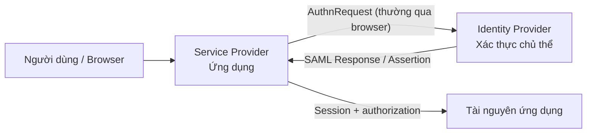
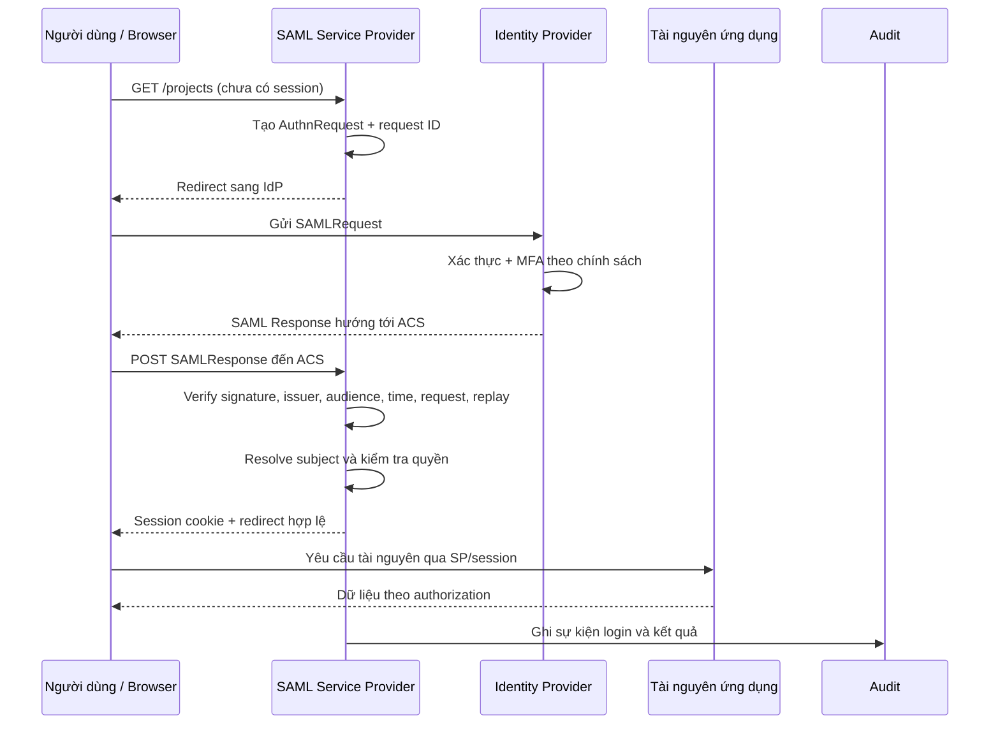
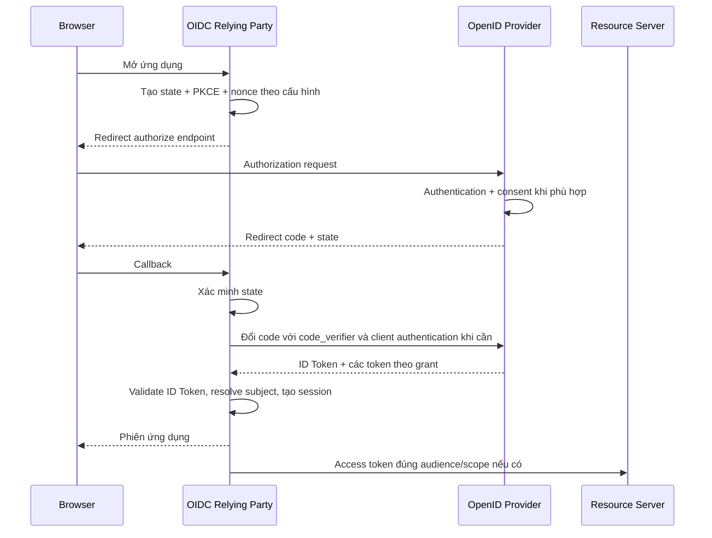

# Service Provider trong Federation: Vai trò, luồng SSO và quản lý vòng đời danh tính

Một doanh nghiệp sử dụng **Identity Provider (IdP)** để nhân viên đăng nhập vào nhiều ứng dụng bằng một danh tính công việc. Khi người dùng mở cổng quản lý dự án, ứng dụng chuyển trình duyệt sang IdP, nhận kết quả xác thực, tạo phiên làm việc và quyết định người đó có được xem hay sửa dự án không. Trong mô hình **SAML Federation**, ứng dụng này được gọi là **Service Provider (SP)**.

Thoạt nhìn, SP có vẻ chỉ “nhận thông báo đăng nhập thành công”. Thực tế, nó là **điểm thực thi tin cậy**: xác minh thông điệp từ IdP, xác định đúng chủ thể, chống giả mạo và phát lại, quản lý phiên ứng dụng, áp dụng phân quyền và xử lý thay đổi danh tính theo **Joiner–Mover–Leaver (JML)**. Nếu SP chỉ tin vào một trường email chưa kiểm chứng, bỏ qua chữ ký hoặc tiếp tục giữ phiên sau khi nhân viên rời tổ chức, SSO có thể hoạt động về mặt giao diện nhưng vẫn để lại **quyền truy cập tồn dư**.

Bài học tập trung vào **Service Provider trong Federation**, phân biệt SP của **SAML** với **Relying Party (RP)** trong **OpenID Connect (OIDC)**, đồng thời liên kết với **IAM, IdP, SSO, SCIM, RBAC/ABAC, tài khoản dịch vụ, kiểm toán** và quy trình thu hồi quyền.

## 1. Service Provider là gì?

Trong **SAML 2.0**, **Service Provider (SP)** là hệ thống cung cấp dịch vụ cho người dùng và **dựa vào xác nhận danh tính (assertion) của một Identity Provider** để thiết lập phiên xác thực hoặc hỗ trợ quyết định truy cập.

Ví dụ:

- Một ứng dụng quản lý nhân sự sử dụng IdP doanh nghiệp để nhân viên đăng nhập.
- Một cổng báo cáo SaaS chấp nhận SAML Response từ IdP đã đăng ký.
- Một ứng dụng nội bộ nhận SAML assertion từ một đối tác danh tính được tin cậy.
- Một ứng dụng của doanh nghiệp B cho nhân viên doanh nghiệp A đăng nhập qua federation được thiết lập giữa hai bên.

SP **không nhất thiết giữ mật khẩu** của người dùng nếu chỉ sử dụng đăng nhập liên kết. Thay vào đó, SP phải biết **IdP nào được tin cậy, cho ứng dụng nào, theo giao thức nào và với điều kiện xác minh nào**.

### 1.1. SP là một thành phần của mối quan hệ tin cậy

Một mô hình đơn giản:



Đường đi thực tế phụ thuộc binding SAML và cách chuyển hướng trình duyệt; sơ đồ chỉ thể hiện trách nhiệm logic.

**IdP** xác thực người dùng và phát hành thông điệp phù hợp. **SP** xác minh thông điệp nhận được và quyết định có tạo phiên hay không. **Chủ tài nguyên hoặc policy engine** quyết định những thao tác ứng dụng cho phép. Trách nhiệm này có thể nằm trong cùng một ứng dụng nhưng vẫn cần tách bạch về mặt an ninh.

### 1.2. Phân biệt SP, IdP, RP và Resource Server

| Thuật ngữ | Giao thức/ngữ cảnh | Vai trò chính |
|---|---|---|
| **Identity Provider (IdP)** | Federation nói chung, đặc biệt SAML | Xác thực người dùng và phát hành xác nhận danh tính. |
| **Service Provider (SP)** | SAML | Nhận, xác minh SAML assertion và cung cấp dịch vụ/phiên ứng dụng. |
| **OpenID Provider (OP)** | OIDC | Bên xác thực và phát hành ID Token theo OIDC. |
| **Relying Party (RP)** | OIDC | Ứng dụng dựa vào ID Token/luồng OIDC để đăng nhập người dùng. |
| **OAuth Client** | OAuth 2.0 | Ứng dụng yêu cầu authorization/token để thực hiện tác vụ theo một grant. |
| **Resource Server** | OAuth 2.0 | API/tài nguyên tiếp nhận và kiểm tra access token phù hợp với chính nó. |
| **SCIM Client/Server** | SCIM | Các bên thực hiện và tiếp nhận thao tác quản lý User/Group. |

Trong hội thoại kỹ thuật, nhiều người gọi mọi ứng dụng tích hợp SSO là “SP”. Nhưng **trong SAML, SP là thuật ngữ giao thức chính xác**; còn trong OIDC, tên tiêu chuẩn tương ứng cho ứng dụng đăng nhập là **Relying Party**, cũng thường đóng vai trò OAuth Client. Không nên gọi một API kiểm tra access token là SAML SP nếu API đó chỉ làm Resource Server của OAuth.

**Authentication** và **authorization** cũng khác nhau: “IdP đã xác thực Alice” không có nghĩa “Alice được phép xóa dữ liệu production”.

## 2. Vì sao doanh nghiệp dùng Service Provider trong Federation?

### 2.1. Lợi ích

- **Đăng nhập tập trung:** SP không cần duy trì một kho mật khẩu riêng cho mọi người dùng.
- **Kiểm soát xác thực thống nhất:** IdP có thể áp dụng MFA, đánh giá rủi ro, chính sách thiết bị và các yêu cầu xác thực tương ứng.
- **Dễ mở rộng tới SaaS:** tổ chức tích hợp nhiều ứng dụng mà không yêu cầu mỗi ứng dụng tự triển khai quy trình chứng minh danh tính.
- **Phân tách trách nhiệm:** IdP tập trung xác thực; SP tập trung dịch vụ, tài nguyên, phiên và quyền đặc thù ứng dụng.
- **Hỗ trợ hợp tác B2B:** doanh nghiệp có thể chấp nhận danh tính từ tổ chức khác theo mối quan hệ tin cậy.
- **Hỗ trợ quản lý JML:** sự kiện của nhân viên có thể cập nhật IdP và qua provisioning tới ứng dụng.

### 2.2. Các giả định không an toàn

Federation không tự bảo đảm:

- SP luôn nhận được thuộc tính và trạng thái nhân sự mới nhất.
- Mọi ứng dụng đều thu hồi phiên ngay khi account IdP bị khóa.
- Tài khoản cục bộ của SP không còn dùng được.
- SP không có role trực tiếp hoặc nhóm quyền khác với IdP.
- Email trong assertion/token đủ để liên kết một người mà không cần quy tắc kiểm chứng.
- SCIM đồng bộ User/Group cũng sẽ thu hồi tất cả API key, session và credential.
- Một IdP được tin cậy cho ứng dụng A mặc nhiên được tin cậy với cùng phạm vi cho ứng dụng B.

Lợi ích Federation chỉ đạt được khi SP **xác minh đúng thông điệp, giới hạn niềm tin và duy trì quyền truy cập theo trạng thái hợp lệ**.

## 3. Các thành phần kỹ thuật của SAML Service Provider

### 3.1. Entity ID

**SP Entity ID** là định danh của SP trong miền SAML, thường ở dạng URI. Đây là **tên định danh logic**, không nhất thiết là endpoint để trình duyệt mở.

Ví dụ hư cấu:

```text
SP entityID:
  https://projects.example.invalid/saml/metadata

IdP entityID:
  https://login.example.invalid/idp
```

SP có thể dùng Entity ID làm **Audience** mà assertion phải hướng tới. Khi cấu hình, không nên chỉ nhìn URL trông quen thuộc; cần so **định danh chính xác theo metadata/trust configuration** và quy tắc của sản phẩm.

### 3.2. Assertion Consumer Service (ACS)

**ACS** là endpoint của SP nhận SAML Response hoặc assertion theo binding đã cấu hình, thường là HTTP POST trong những triển khai browser SSO.

Ví dụ:

```text
ACS URL:
  https://projects.example.invalid/saml/acs
```

ACS không chỉ là “URL nhận form”. Nó phải thực hiện **kiểm tra chữ ký và nội dung**, chống replay, kiểm tra request correlation, mục tiêu, thời hạn và đối tượng nhận trước khi tạo phiên.

### 3.3. Metadata của SP

SAML metadata có thể công bố:

- Entity ID của SP.
- ACS endpoints và binding được hỗ trợ.
- Các khóa/chứng chỉ công khai phục vụ verify hoặc encryption theo cấu hình.
- Yêu cầu chữ ký của một số thông điệp.
- Một số thông tin liên hệ hoặc cấu hình bổ sung.

Ví dụ cấu trúc rút gọn **chỉ để đọc hiểu**, không phải metadata hoàn chỉnh có thể triển khai ngay:

```xml
<md:EntityDescriptor
    xmlns:md="urn:oasis:names:tc:SAML:2.0:metadata"
    entityID="https://projects.example.invalid/saml/metadata">
  <md:SPSSODescriptor
      protocolSupportEnumeration="urn:oasis:names:tc:SAML:2.0:protocol">
    <md:AssertionConsumerService
        Binding="urn:oasis:names:tc:SAML:2.0:bindings:HTTP-POST"
        Location="https://projects.example.invalid/saml/acs"
        index="0"/>
  </md:SPSSODescriptor>
</md:EntityDescriptor>
```

Trong thực tế, metadata còn có thể chứa key descriptors, NameID formats, yêu cầu ký thông điệp và cấu hình khác. **Tuyệt đối không dùng metadata ví dụ như một tệp đã được xác thực hoặc đã cấu hình đầy đủ.**

### 3.4. Khóa, chữ ký và chứng chỉ

SP phải có tập **IdP signing key** được tin cậy từ metadata hoặc quy trình cấu hình đáng tin. Chữ ký số bảo vệ tính toàn vẹn và nguồn phát hành thông điệp trong phạm vi được ký.

Cần phân biệt:

- **Signing certificate/public key:** dùng để kiểm tra chữ ký do IdP phát hành.
- **Encryption key/certificate:** có thể dùng để mã hóa assertion cho SP nếu liên kết yêu cầu.
- **TLS certificate:** bảo vệ kết nối HTTPS; không thay thế kiểm tra chữ ký SAML trong những kịch bản cần xác minh assertion.
- **Metadata signing:** có thể được dùng trong mô hình phân phối metadata có kiểm soát; tính tin cậy phụ thuộc cơ chế quản trị khóa và xác minh metadata.

**Không nên tin bất kỳ khóa công khai nào được gửi kèm thông điệp chưa xác thực** chỉ vì khóa đó có thể xác minh chữ ký của chính thông điệp. Khóa xác minh phải được ràng buộc với IdP được tin cậy bằng cấu hình hoặc cơ chế phân phối metadata bảo mật.

## 4. Luồng đăng nhập SAML SP-initiated

**SP-initiated SSO** bắt đầu khi người dùng mở ứng dụng SP nhưng chưa có phiên hợp lệ.

### 4.1. Các bước chính

1. Người dùng truy cập tài nguyên ở SP.
2. SP xác định người dùng chưa có phiên phù hợp và tạo **AuthnRequest**.
3. SP ghi lại **request ID**, thời điểm và trạng thái liên quan để đối chiếu sau.
4. Trình duyệt được chuyển tới endpoint SSO của IdP đã cấu hình, thường kèm SAMLRequest và RelayState theo binding.
5. IdP xác thực người dùng, có thể thực hiện MFA/step-up theo chính sách.
6. IdP tạo SAML Response chứa assertion phù hợp với SP và truyền về ACS qua trình duyệt.
7. SP kiểm tra chữ ký, issuer, đích nhận, audience, điều kiện thời gian, correlation và replay.
8. SP ánh xạ chủ thể sang identity/account của ứng dụng.
9. SP kiểm tra trạng thái account và authorization, rồi tạo **session ứng dụng** nếu hợp lệ.
10. Người dùng được chuyển tới tài nguyên ban đầu trong phạm vi redirect an toàn.

### 4.2. Sơ đồ trình tự



Ở mô hình trên, ứng dụng và SP có thể là cùng một hệ thống. Mỗi sản phẩm có thể sử dụng binding hoặc thứ tự bước khác nhau, nhưng **SP phải xác minh trước khi coi người dùng đã đăng nhập**.

### 4.3. AuthnRequest mang thông tin gì?

Một AuthnRequest có thể bao gồm:

- `ID`: định danh request cần dùng cho correlation.
- `IssueInstant`: thời điểm phát hành.
- `Issuer`: Entity ID của SP.
- `Destination`: endpoint của IdP.
- `AssertionConsumerServiceURL` hoặc cơ chế chọn ACS đã thỏa thuận.
- Yêu cầu về ngữ cảnh xác thực nếu cần và được IdP/SP hỗ trợ.

Ví dụ minh họa **rút gọn và không có chữ ký**:

```xml
<samlp:AuthnRequest
    xmlns:samlp="urn:oasis:names:tc:SAML:2.0:protocol"
    xmlns:saml="urn:oasis:names:tc:SAML:2.0:assertion"
    ID="_req_91"
    Version="2.0"
    IssueInstant="2026-12-01T09:00:00Z"
    Destination="https://login.example.invalid/sso"
    AssertionConsumerServiceURL="https://projects.example.invalid/saml/acs">
  <saml:Issuer>
    https://projects.example.invalid/saml/metadata
  </saml:Issuer>
</samlp:AuthnRequest>
```

Ví dụ không phải thông điệp xác thực hợp lệ để gửi lên production. Nếu giao thức hoặc cấu hình yêu cầu ký AuthnRequest, việc bỏ chữ ký khiến request bị từ chối.

## 5. SP phải xác minh SAML Response và assertion như thế nào?

**Không tạo phiên ngay khi ACS nhận một chuỗi có tên SAMLResponse.** Thông điệp phải được kiểm tra bằng thư viện SAML đáng tin và cấu hình trust đúng.

### 5.1. Bảng kiểm các điều kiện trọng yếu

| Hạng mục | SP cần xác minh | Nguy cơ nếu bỏ qua |
|---|---|---|
| **Chữ ký số** | Chữ ký hợp lệ, đúng phạm vi được ký và được xác minh bằng khóa tin cậy của IdP được phép. | Giả mạo assertion hoặc thay nội dung sau khi ký. |
| **Issuer** | Assertion/Response từ đúng IdP tin cậy cho tenant và ứng dụng. | Nhận kết quả từ IdP không được ủy quyền. |
| **AudienceRestriction** | Assertion hướng tới Entity ID được SP chấp nhận. | Dùng assertion của ứng dụng khác để đăng nhập. |
| **Recipient / Destination** | Assertion/Response được gửi tới ACS hợp lệ. | Token substitution hoặc gửi nhầm đích. |
| **InResponseTo** | Phù hợp AuthnRequest chưa dùng của SP khi luồng yêu cầu correlation. | Login CSRF, phát lại hoặc gắn nhầm phiên. |
| **NotBefore / NotOnOrAfter** | Điều kiện thời gian hợp lệ với clock-skew đã kiểm soát. | Dùng assertion trước/sau thời gian hợp lệ. |
| **SubjectConfirmation** | Phương thức và điều kiện xác nhận subject phù hợp binding, recipient và thời hạn. | Chấp nhận subject không thỏa điều kiện sử dụng. |
| **AuthnStatement** | Ngữ cảnh/thời điểm xác thực đáp ứng policy theo kịch bản. | Cấp quyền nhạy cảm sau xác thực không đủ mạnh. |
| **Replay detection** | Assertion ID hoặc thông điệp quan trọng chưa được chấp nhận trước đó. | Dùng lại kết quả xác thực. |
| **XML parsing/signature wrapping** | Thư viện xử lý an toàn, xác minh đúng node được sử dụng. | Kẻ tấn công làm SP dùng dữ liệu khác với dữ liệu đã ký. |

Chính xác phần nào phải được ký, loại binding, cách kiểm chứng và yêu cầu encryption cần được thống nhất theo profile SAML và cấu hình hai bên. Không tùy tiện bật chế độ “không cần kiểm tra chữ ký” để giải quyết lỗi tích hợp.

### 5.2. Assertion khác SAML Response

**SAML Response** là lớp thông điệp giao thức; **SAML Assertion** chứa thông tin về subject, xác thực và có thể chứa các thuộc tính. Trong nhiều cấu hình, một trong hai hoặc cả hai có chữ ký số. SP phải kiểm tra **vị trí và phạm vi chữ ký đúng với policy**, bảo đảm dữ liệu được sử dụng để tạo phiên là phần đã được xác minh.

**Không nên** chỉ tìm một phần tử `<Signature>` bất kỳ trong XML rồi coi tất cả nội dung là đáng tin. Việc xác minh phải xét đúng phần tử, định danh tham chiếu, thuật toán hợp lệ và mối quan hệ với subject được dùng.

### 5.3. Tác dụng của điều kiện thời gian

Một assertion được phát hành lúc 09:00 có thể chỉ hợp lệ trong khoảng ngắn. SP cần kiểm tra thời gian bằng **đồng hồ được đồng bộ** và cho phép sai số nhỏ theo cấu hình, tránh chấp nhận thông điệp đã hết hạn.

Kiểm tra thời gian **không thay thế chống replay**. Một assertion chưa hết hạn nhưng đã được dùng vẫn có thể bị phát lại; SP nên có cơ chế phát hiện theo ID và khoảng lưu giữ phù hợp.

### 5.4. RelayState và chuyển hướng an toàn

**RelayState** thường giúp SP nhớ tài nguyên người dùng muốn mở. Nhưng nếu SP tin bất kỳ giá trị URL nhận được rồi redirect, kẻ tấn công có thể gây **open redirect** hoặc tấn công qua luồng đăng nhập.

Cần:

- Ràng buộc RelayState với yêu cầu đã khởi tạo, ví dụ một mã opaque và dữ liệu lưu phía server.
- Chỉ cho phép redirect đến đường dẫn nội bộ hoặc danh sách đích được phép.
- Không lưu bí mật, token hoặc dữ liệu cá nhân không cần thiết trong RelayState.
- Không dùng RelayState như nguồn duy nhất xác định chủ thể hoặc quyền.

## 6. SP-initiated và IdP-initiated SSO

### 6.1. SP-initiated

SP khởi tạo AuthnRequest và chờ Response tương ứng. Ưu điểm là SP có thể kiểm tra **InResponseTo** và ngữ cảnh yêu cầu mà nó đã tạo, giúp ràng buộc quá trình đăng nhập.

### 6.2. IdP-initiated

Trong một số cấu hình, người dùng bấm ứng dụng từ **cổng IdP**; IdP gửi SAML Response tới SP mà SP chưa phát AuthnRequest tương ứng. Khi đó có thể **không có request ID do SP phát để correlation**.

IdP-initiated login có thể được một sản phẩm hỗ trợ, nhưng SP phải:

- Cho phép rõ ràng luồng **unsolicited response** nếu tổ chức đã chấp thuận.
- Xác minh chữ ký, issuer, audience, recipient, thời gian và replay nghiêm ngặt.
- Ràng buộc tenant, account và đích redirect theo cấu hình.
- Xử lý rủi ro **login CSRF/session confusion** bằng kiểm soát phù hợp.
- Không tự động suy rằng mọi ứng dụng phải hỗ trợ IdP-initiated.

**Không thể yêu cầu InResponseTo trỏ tới AuthnRequest không tồn tại**, nhưng cũng không được bỏ các kiểm soát còn lại. Với ứng dụng nhạy cảm, cân nhắc ưu tiên SP-initiated và chính sách không chấp nhận unsolicited response nếu không cần nghiệp vụ.

## 7. Từ subject trong assertion tới account của SP

Xác thực thành công chưa đủ; SP phải xác định assertion nói về **account ứng dụng nào**.

### 7.1. Chọn khóa liên kết ổn định

SAML assertion có thể mang **NameID** và các thuộc tính khác. Cách biểu diễn NameID phụ thuộc format, cấu hình và tính ổn định của IdP. Một số triển khai dùng NameID persistent hoặc một thuộc tính định danh riêng để ánh xạ.

Không nên **mặc định dùng email làm khóa duy nhất**:

- Email có thể đổi khi chuyển tên hoặc miền.
- Email có thể được tái sử dụng.
- Hai IdP khác nhau có thể phát cùng email.
- Một tài khoản ngoại bộ có email chưa được xác minh.
- Người dùng tự nhập email không nhất thiết đã chứng minh quyền sở hữu.

Một khóa ánh xạ nên xét ít nhất **issuer tin cậy + subject identifier ổn định + phạm vi tenant**. Đối với OIDC, khóa thông dụng là cặp **`(iss, sub)`**, không chỉ `email`.

### 7.2. Bảng mapping minh họa

| Trường | Giá trị ví dụ | Ý nghĩa |
|---|---|---|
| `trustedIdpEntityId` | `https://login.example.invalid/idp` | Định danh issuer được SP tin cậy. |
| `externalSubjectId` | `user-persistent-029` | Subject ID được ràng buộc với nguồn. |
| `spTenantId` | `tenant-a` | Giới hạn miền ứng dụng/khách hàng. |
| `localAccountId` | `app-user-1045` | Account được SP sử dụng. |
| `identityLinkStatus` | `VERIFIED` | Tình trạng liên kết theo chính sách. |
| `sourceLastConfirmedAt` | `2026-12-01T09:00:00Z` | Thời điểm thuộc tính/liên kết được xác minh. |

Nếu SP nhận assertion hợp lệ nhưng **không tìm được account hoặc mapping đủ tin cậy**, hành vi có thể là từ chối đăng nhập, yêu cầu enrollment hoặc tạo account JIT theo policy; không ghép theo tên gần giống nhất.

### 7.3. Không nhầm NameID với quyền

NameID là thông tin nhận diện subject theo mô hình SAML. Nó **không tự chứng minh** subject có quyền Administrator hoặc được đọc mọi tài nguyên. SP phải tính quyền dựa trên trạng thái account, role/entitlement và chính sách đáng tin.

## 8. SP quản lý phiên ứng dụng ra sao?

### 8.1. Phiên IdP và phiên SP khác nhau

Khi đăng nhập qua federation thường tồn tại:

1. **IdP session:** trạng thái người dùng đã xác thực tại IdP.
2. **SP application session:** trạng thái ứng dụng cấp sau khi xác minh assertion và áp dụng policy.
3. **Access token/API session** (nếu có): các chứng thực dành cho tài nguyên hoặc dịch vụ khác.

Ví dụ người dùng khóa account tại IdP nhưng SP vẫn có session cookie hợp lệ. Việc IdP từ chối **đăng nhập mới** không mặc nhiên xóa session mà SP đã phát hành trước đó.

### 8.2. Các yêu cầu phiên cơ bản

- Phát hành **session ID khó đoán** và thay session ID phù hợp khi đăng nhập để hạn chế session fixation.
- Cookie có cấu hình bảo vệ phù hợp như `Secure`, `HttpOnly`, `SameSite` khi ứng dụng và luồng trình duyệt cho phép.
- Xác định idle timeout và absolute lifetime theo rủi ro.
- Giới hạn tài nguyên bằng authorization ở từng yêu cầu nhạy cảm, không chỉ khi tạo session.
- Có cơ chế logout cục bộ và thu hồi phiên khi quyền hoặc trạng thái account thay đổi, trong phạm vi có thể.
- Bảo vệ CSRF cho thao tác thay đổi trạng thái theo mô hình sử dụng cookie/session.
- Xem xét **reauthentication/step-up** khi thao tác đặc biệt cần mức xác thực mới hơn.

### 8.3. Single Logout (SLO) và giới hạn

**SAML Single Logout** có thể được dùng khi cả IdP và SP hỗ trợ profile/binding và có cấu hình phù hợp. Tuy nhiên, trong hệ thống nhiều ứng dụng, việc một bên logout **không đảm bảo mọi ứng dụng luôn chấm dứt toàn bộ phiên thành công**.

Cần đánh giá:

- SP và IdP có hỗ trợ SLO/notification tương ứng không?
- Kênh logout có thể không thành công nếu browser/network bị lỗi không?
- Session ứng dụng, API token và đường login local có được xử lý riêng không?
- Leaver khẩn cấp có cách chặn trực tiếp tại SP/resource hay không?

**Logout giao diện** và **deprovisioning/quyền hiệu lực** là các quy trình khác nhau, dù có thể phối hợp.

## 9. OIDC Relying Party: tương tự SP nhưng không đồng nhất

Trong **OpenID Connect**, ứng dụng đăng nhập được gọi là **Relying Party (RP)**. Nó dựa vào **OpenID Provider (OP)** và sử dụng **ID Token** nhằm xác thực thông tin về người dùng.

### 9.1. Luồng Authorization Code + PKCE

Một luồng OIDC hiện đại cho ứng dụng phù hợp thường dùng **Authorization Code Flow** với **PKCE**, cùng những biện pháp bảo vệ như `state` và `nonce` tùy ngữ cảnh/triển khai.

1. RP tạo yêu cầu authorization tới OP với `client_id`, `redirect_uri`, `scope=openid`, `response_type=code`.
2. RP ràng buộc phiên yêu cầu bằng `state`; chuẩn bị PKCE `code_verifier`/`code_challenge`, và `nonce` khi cần.
3. Trình duyệt chuyển tới OP, người dùng xác thực.
4. OP chuyển người dùng về redirect URI đã đăng ký cùng authorization code và state.
5. RP kiểm tra state và đổi code tại token endpoint theo đúng yêu cầu client/PKCE.
6. RP **xác minh ID Token** và những điều kiện ràng buộc cần thiết.
7. RP ánh xạ `(iss, sub)` tới account và tạo phiên ứng dụng theo authorization.



Đây là sơ đồ khái niệm, không thay thế giao thức và yêu cầu bảo mật của thư viện OIDC được chọn.

### 9.2. Phải xác minh ID Token đúng cách

RP cần kiểm tra những thuộc tính phù hợp với luồng và profile sử dụng:

- **Issuer (`iss`)** khớp chính xác OP đã được cấu hình tin cậy.
- **Audience (`aud`)** chứa client ID phù hợp; xem thêm `azp` khi tình huống yêu cầu.
- **Signature** và thuật toán trong danh sách được cho phép, dùng khóa đúng từ JWKS/metadata đáng tin.
- **Expiration (`exp`)** và những điều kiện thời gian liên quan, xử lý clock skew có kiểm soát.
- **Nonce** khớp yêu cầu đã tạo khi nonce được dùng/yêu cầu cho flow.
- **Subject (`sub`)** tồn tại và được liên kết đúng với issuer/tenant.
- **Authentication context** như `acr`, `amr`, `auth_time` nếu chính sách ứng dụng dựa vào các giá trị đó.
- **State/PKCE/redirect_uri** được kiểm soát ở quá trình authorization trước bước xử lý ID Token.

Không chấp nhận token chỉ vì một JWT có chữ ký hợp lệ từ **một** nhà phát hành bất kỳ. Chữ ký có ý nghĩa khi khóa và issuer đúng trust configuration của RP.

### 9.3. ID Token khác Access Token

- **ID Token:** dành cho RP, cung cấp thông tin về xác thực người dùng theo OIDC.
- **Access Token:** dành cho Resource Server/API theo phạm vi được cấp và cách xác minh riêng.
- **Refresh Token:** có thể được dùng để nhận token mới, nếu grant và chính sách cho phép.

**Không dùng ID Token như một access token để gọi API**; API cần kiểm tra access token phù hợp audience/scope, issuer, thời hạn và policy của nó. **Không dùng access token bất kỳ như bằng chứng đăng nhập cho RP** mà bỏ qua kiểm tra OIDC.

### 9.4. OIDC Discovery, JWKS và key rotation

RP có thể dùng metadata discovery của OP theo cấu hình đáng tin để xác định endpoint, issuer, JWKS URI và khả năng giao thức. Khi OP xoay khóa ký:

- RP cần có cơ chế cập nhật/caching JWKS phù hợp.
- Chỉ tin khóa thuộc OP đã cấu hình, không theo URL tùy ý từ token chưa xác thực.
- Kiểm soát thuật toán được hỗ trợ; không cho phép hạ cấp xác minh chữ ký.
- Theo dõi lỗi `kid` chưa nhận biết và quá trình chuyển khóa an toàn.
- Không hardcode một khóa mãi mãi nếu sản phẩm yêu cầu rotation.

Đối với SAML, ý tưởng tương ứng là **quản trị IdP metadata/signing certificate rollover**. Hai hệ sinh thái có khác biệt kỹ thuật, nhưng cùng cần quản trị vòng đời khóa tin cậy.

## 10. So sánh SAML SP và OIDC RP

| Khía cạnh | SAML Service Provider | OIDC Relying Party |
|---|---|---|
| Định dạng xác nhận | SAML Response/Assertion dạng XML. | ID Token thường là JWT, theo OIDC. |
| Phía phát hành | SAML Identity Provider. | OpenID Provider. |
| Danh tính ứng dụng | Entity ID. | Client ID; cấu hình issuer/redirect URI. |
| Endpoint tiếp nhận | Assertion Consumer Service (ACS). | Redirect URI/callback; token endpoint trao đổi code. |
| Định danh người dùng | NameID hoặc thuộc tính đã thỏa thuận. | Thường dùng cặp `(iss, sub)`. |
| Khóa tin cậy | SAML metadata và signing certificate theo trust. | OIDC discovery/JWKS và issuer/client configuration. |
| Chống replay/correlation | Request ID, InResponseTo, assertion ID, thời hạn. | State, nonce khi phù hợp, code dùng một lần, PKCE, TTL. |
| Quản lý session | SP tự tạo session ứng dụng. | RP tự tạo session ứng dụng. |
| Provisioning account | Không mặc nhiên nằm trong giao thức xác thực. | Không mặc nhiên nằm trong OIDC. |
| Thu hồi trong Leaver | Cần phối hợp IdP, SP session, entitlement và connector. | Cần phối hợp OP, RP session, token và quyền đích. |

Hai giao thức cùng giải quyết bài toán đăng nhập liên kết, nhưng **không thể lấy SAML Response và xử lý như ID Token**, hoặc lấy API access token và coi như SAML assertion.

## 11. Federation và provisioning là hai hoạt động khác nhau

Một SP có thể nhận xác nhận SAML hợp lệ nhưng **chưa có account nội bộ**. Có hai mô hình phổ biến, có thể kết hợp tùy sản phẩm.

### 11.1. Just-in-Time (JIT) provisioning

SP có thể tạo account khi người dùng đăng nhập lần đầu nếu đáp ứng policy.

Ví dụ:

1. Người dùng có assertion hợp lệ từ IdP đã đăng ký.
2. SP xác định tenant và subject ID đáng tin.
3. Không tìm thấy account tương ứng.
4. SP kiểm tra quyền tạo mới, nguồn thuộc tính và trạng thái đủ điều kiện.
5. SP tạo account với quyền tối thiểu theo chính sách.
6. SP lưu mapping và ghi audit.
7. Những quyền nhạy cảm được xét riêng; không tự cấp chỉ vì thuộc tính `admin=true` xuất hiện từ nguồn chưa đáng tin.

**Rủi ro:** nếu SP tạo account vô điều kiện cho mọi assertion hợp lệ hoặc ghép theo email, tổ chức có thể có tài khoản thừa, trùng hoặc được cấp quyền quá rộng.

### 11.2. Pre-provisioning qua SCIM hoặc connector

**System for Cross-domain Identity Management (SCIM)** cung cấp cơ chế quản lý đối tượng như User/Group khi hệ thống hỗ trợ. Doanh nghiệp có thể tạo, cập nhật, disable hoặc quản lý nhóm account **trước** lần đăng nhập.

Ví dụ:

- HRIS tạo sự kiện Joiner.
- IAM/IGA tính quyền mục tiêu.
- Connector/SCIM tạo User ở SP/SaaS.
- IdP được cấu hình cho đăng nhập federation.
- Lần SSO đầu tiên, SP tìm đúng account đã provision và tạo session.

Lợi ích là có thể kiểm soát **ai đủ điều kiện có account** và gán quyền trước khi người dùng truy cập. Nhưng SCIM **không tự xác minh SAML assertion**, **không thay thế SSO** và **không mặc nhiên thu hồi phiên/token đã phát hành**.

### 11.3. SCIM không đồng nhất với SAML/OIDC

| Câu hỏi | Giao thức/thành phần trả lời |
|---|---|
| Ai đang đăng nhập? | IdP/OP thông qua SAML hoặc OIDC và quá trình xác minh tại SP/RP. |
| Có account ở ứng dụng chưa? | Inventory, JIT provisioning hoặc SCIM/API target. |
| Account có được phép hoạt động không? | Trạng thái lifecycle/policy cùng trạng thái account tại target. |
| Có quyền làm hành động X không? | Authorization của SP/API, RBAC/ABAC và entitlement thực tế. |
| Khi người dùng nghỉ việc, ai gỡ group/account? | IAM/IGA và SCIM/connector/API theo khả năng. |
| Phiên trước đó có bị đóng không? | SP/RP/session manager và cơ chế logout/revoke thực tế. |

**Một SAML login thành công không chứng minh account đã được quản trị đúng trong JML.** Cần kết hợp federation với lifecycle và reconciliation.

## 12. RBAC/ABAC và quyền của Service Provider

SP thường nhận một số thuộc tính từ IdP, nhưng **phải tự quyết định hoặc yêu cầu policy engine có thẩm quyền quyết định hành động nào được phép**.

### 12.1. RBAC: từ nhóm/role đến quyền ứng dụng

**Role-Based Access Control (RBAC)** có thể biểu diễn:

```text
Role: project-reader
  - projects.read
  - documents.read

Role: project-maintainer
  - projects.read
  - documents.read
  - projects.update

Role: project-admin
  - projects.manage-members
  - projects.configure
```

Một SP có thể ánh xạ group/role có nguồn tin cậy sang role ứng dụng. Tuy nhiên:

- Quy tắc mapping phải được cấu hình và phê duyệt.
- Group assertion không được phép tự động mở ra quyền cao hơn policy.
- Phải xử lý trường hợp group cũ còn trong token/session sau Mover.
- Quyền gán trực tiếp ở ứng dụng phải được inventory và rà soát riêng.

### 12.2. ABAC: đánh giá theo thuộc tính và ngữ cảnh

**Attribute-Based Access Control (ABAC)** có thể yêu cầu:

```text
Cho phép documents.read khi:
  subject.lifecycleState == ACTIVE
  AND subject.department == resource.ownerDepartment
  AND subject.projectMembership contains resource.projectId
  AND session.assurance đáp ứng policy tài nguyên
```

Đây là **pseudocode**, không phải cú pháp của một sản phẩm cụ thể. Điều kiện chỉ đáng tin khi nguồn thuộc tính và thời điểm hiệu lực được kiểm soát.

Ví dụ trường `department` trong assertion có thể đến từ HRIS hoặc là trường tự khai ở IdP. Nếu người dùng có thể tự sửa trường này, SP không nên dùng nó để mở dữ liệu tài chính nhạy cảm.

### 12.3. Authorization phải được kiểm tra theo yêu cầu

Một người có session SP hợp lệ **không đồng nghĩa có quyền với mọi API hoặc mọi tài nguyên**. Sau khi tạo phiên, mỗi hành động nhạy cảm cần đi qua authorization phù hợp:

- Xem dữ liệu của phòng ban nào?
- Có quyền sửa hay chỉ được đọc?
- Có phải chủ tài nguyên hoặc đã được ủy quyền không?
- Quyền admin/JIT có còn trong thời hạn?
- Trạng thái identity/account có đổi sau khi session được tạo không?

Nếu SP chỉ kiểm tra role tại lần đăng nhập rồi giữ nguyên quyền vô thời hạn trong session, Mover hoặc Leaver có thể để lại cửa sổ truy cập không phù hợp. Cần thiết kế thời hạn/cache/invalidation theo độ nhạy nghiệp vụ.

### 12.4. Step-up authentication

Với thao tác rất nhạy cảm, SP/RP có thể yêu cầu **mức xác thực cao hơn hoặc mới hơn** trước khi cho phép, dựa trên khả năng của SAML/OIDC và IdP/OP.

Ví dụ:

- Chỉ đọc danh sách dự án: phiên SSO theo policy cơ bản.
- Đổi thông tin thanh toán hoặc cấp quyền Admin: cần MFA/step-up, kiểm SoD và phê duyệt.
- Xóa dữ liệu production: cần quyền và ngữ cảnh quản trị riêng, không chỉ “đã dùng MFA”.

Các claim/ngữ cảnh như **SAML AuthnContext** hoặc **OIDC `acr`/`amr`/`auth_time`** có thể hỗ trợ đánh giá, nhưng SP/RP cần hiểu **giá trị IdP thực sự cam kết**, không diễn giải tùy tiện mọi chuỗi như một cấp bảo đảm cụ thể.

## 13. Service Provider trong vòng đời Joiner–Mover–Leaver

### 13.1. Joiner: trước và trong lần đăng nhập đầu tiên

Khi nhân viên mới gia nhập:

1. **Nguồn có thẩm quyền** xác nhận danh tính, vai trò, thời điểm bắt đầu và thông tin cần thiết.
2. IAM/IGA tính tập ứng dụng và quyền mục tiêu, theo phê duyệt.
3. IdP thiết lập account và phương thức xác thực phù hợp.
4. Account tại SP được **pre-provision qua connector/SCIM** hoặc tạo JIT theo policy.
5. SP xác minh assertion/token và ánh xạ subject sang account đúng.
6. SP chỉ tạo phiên nếu trạng thái account hợp lệ và quyền đã được xác định.
7. Audit ghi việc tạo account, lần login đầu tiên, nguồn gốc role và quyết định truy cập.

**Joiner không phải chỉ là “người dùng đăng nhập được”.** Một account JIT có thể đăng nhập thành công nhưng chưa có quyền làm việc đúng hoặc đã được cấp rộng hơn cần thiết; cần reconciliation.

### 13.2. Mover: cập nhật account và gỡ quyền cũ

Giả sử nhân viên chuyển từ Support sang Finance:

- HRIS cập nhật phòng ban, manager và ngày hiệu lực.
- IAM tính **quyền mục tiêu mới** và so với quyền thực tế.
- Connector/SCIM cập nhật thuộc tính, nhóm hoặc role mà SP hỗ trợ.
- SP đánh giá lại quyền trực tiếp/nội bộ, không chỉ claims từ IdP.
- Những quyền Support không còn hợp lệ phải được thu hồi; quyền Finance được cấp có phê duyệt.
- Các phiên hoặc quyền cached có thể cần làm mới hoặc bị chặn theo mức rủi ro.
- Readback xác nhận không còn đường truy cập ngoài chính sách.

Nếu SP chỉ nhận assertion có `department=finance` khi đăng nhập mới nhưng **role Support cũ vẫn tồn tại trong database**, ứng dụng có thể cho phép cả hai nhóm quyền và tạo **privilege creep**.

### 13.3. Leaver: vô hiệu hóa đăng nhập chưa đủ

Khi nhân viên nghỉ việc:

1. Nhận sự kiện Leaver có thẩm quyền với thời điểm hiệu lực.
2. IdP/OP chặn đăng nhập mới theo chính sách.
3. IAM/IGA thu hồi role/group, account hoặc entitlement tại SP theo SCIM/API/connector.
4. SP chấm dứt hoặc hạn chế phiên hiện có và đường truy cập local/API theo khả năng.
5. Những credential tách khỏi IdP như API key, OAuth grant hoặc token riêng cần được đánh giá.
6. Tài nguyên do người dùng sở hữu cần được bàn giao, giữ hoặc xử lý theo policy.
7. Reconciliation đối soát **desired state và actual state**, lưu bằng chứng và ngoại lệ.
8. Account có thể được xóa theo retention **sau** khi chặn truy cập, không đồng nhất thời điểm xóa dữ liệu với thời điểm ngừng quyền.

**Không nên giả định xóa user tại IdP hoặc gửi SCIM `active=false` tự đóng mọi phiên SP.** Tùy sản phẩm, session cookie và access token có thể tiếp tục được chấp nhận đến khi bị revoke/hết hạn hoặc chính sách resource từ chối.

### 13.4. Bảng tác động JML lên SP

| Sự kiện | Điều SP cần thấy | Kiểm tra kết quả |
|---|---|---|
| Joiner | Subject mới đủ điều kiện, account đúng tenant, quyền cơ sở hợp lệ. | Đăng nhập đúng identity, role đúng phạm vi, không tạo account trùng. |
| Mover | Thuộc tính/role mới và quyền cũ bị gỡ theo policy. | Đối soát group, direct grant và effective access. |
| Leaver | Account không còn đủ điều kiện đăng nhập/truy cập. | Chặn SSO/local login, phiên và token theo khả năng, kiểm chứng readback. |
| Contractor hết hạn | Sponsor và thời hạn nguồn kết thúc. | Không cho federation tạo lại account hoặc quyền trái hạn. |
| Quản trị viên chuyển vai trò | Quyền admin và PAM/JIT không còn hợp lệ. | Không còn active/eligible privilege và đường tự nâng quyền. |

## 14. Multi-tenant Federation và IdP bên ngoài

Một SP SaaS có thể phục vụ nhiều tổ chức, mỗi tổ chức dùng IdP riêng. Khi đó, **ranh giới tenant** là một phần của bảo mật federation.

### 14.1. Không chỉ dựa vào email domain để chọn trust

Có thể thiết lập bảng:

```text
tenant-a:
  trustedIssuer: https://login-a.example.invalid/idp
  spEntityId: https://saas.example.invalid/saml/tenant-a
  allowedAudience: https://saas.example.invalid/saml/tenant-a

tenant-b:
  trustedIssuer: https://login-b.example.invalid/idp
  spEntityId: https://saas.example.invalid/saml/tenant-b
  allowedAudience: https://saas.example.invalid/saml/tenant-b
```

Đây là ví dụ tổ chức cấu hình, không phải cú pháp metadata hoặc sản phẩm. SP phải kiểm tra **issuer đã được gắn với tenant đích**, audience/ACS, subject mapping và chính sách quyền của tenant. Không để assertion từ tenant A bị chấp nhận cho tài nguyên tenant B chỉ vì email trông giống nhau.

### 14.2. Account linking trong B2B

Người dùng đối tác có thể thay email hoặc được cấp nhiều danh tính tại nhiều IdP. Quy tắc liên kết cần:

- Phân biệt **external issuer** và **subject ID**.
- Có quy trình chứng minh quyền kiểm soát account khi liên kết với identity cũ.
- Tránh tự hợp nhất chỉ dựa trên email đã xuất hiện ở bên khác.
- Gắn sponsor, owner nội bộ hoặc hợp đồng nếu nghiệp vụ yêu cầu.
- Có ngày hết hạn quan hệ và quyền truy cập.
- Khi đối tác thay IdP, migration phải là quy trình kiểm soát, không âm thầm coi subject ID mới là người cũ.

### 14.3. Cấu hình IdP động phải được kiểm soát

Nếu người dùng có thể nhập URL metadata hoặc issuer tùy ý để “thêm SSO”, SP có thể bị dẫn tới nguồn không được tin cậy. Cần quy trình onboarding IdP có thẩm quyền, xác minh domain/tenant và cấu hình key an toàn. **OIDC discovery hoặc SAML metadata chưa được xác thực không phải phép màu tạo trust**.

## 15. Các mối đe dọa đối với Service Provider

| Mối đe dọa | Cơ chế lỗi | Kiểm soát chính |
|---|---|---|
| **Forged assertion/token** | SP không kiểm chữ ký hoặc dùng khóa tùy ý. | Verify bằng khóa IdP/OP tin cậy, thuật toán phù hợp. |
| **Wrong audience** | Token cho ứng dụng A dùng ở B. | Kiểm tra Audience/Recipient hoặc aud/client_id theo giao thức. |
| **Issuer confusion** | Assertion của tenant khác được chấp nhận. | Bind issuer với tenant và cấu hình trust. |
| **Replay** | Dùng lại assertion/code/token trong cửa sổ hợp lệ. | Request correlation, nonce/state/PKCE, TTL và replay cache phù hợp. |
| **SAML XML signature wrapping** | Dữ liệu SP dùng không phải phần đã ký. | Thư viện SAML hardened, parser an toàn, kiểm node được xác minh. |
| **Login CSRF/session fixation** | Gắn nhầm session hoặc đăng nhập tài khoản do kẻ khác chọn. | State/correlation, rotate session ID, quản lý unsolicited login. |
| **Open redirect** | RelayState hoặc return URL điều hướng ra ngoài. | Allowlist/opaque state, kiểm redirect. |
| **Attribute spoofing** | Group/role lấy từ nguồn tự khai. | Source-of-authority, policy mapping và kiểm độ mới. |
| **Stale local session** | Người Leaver vẫn dùng session SP. | Session invalidation, logout/revoke, resource authorization. |
| **Local-login bypass** | SP còn password/API key riêng ngoài SSO. | Inventory và deprovision mọi đường login. |
| **Key rollover error** | SP chấp nhận khóa cũ quá lâu hoặc không nhận khóa mới hợp lệ. | Lifecycle keys, metadata/JWKS rollover và giám sát. |
| **JIT overprovisioning** | SP tự tạo account/quyền cho mọi subject bất kỳ. | Policy cho JIT, tenant binding, least privilege. |
| **Cross-tenant access** | Subject tenant A được map sang account tenant B. | Namespace rõ, kiểm tenant ở mọi lớp. |

### 15.1. Cẩn trọng với lỗi cấu hình “bỏ kiểm tra để SSO chạy”

Một tích hợp thất bại vì signature mismatch, audience sai hoặc certificate hết hạn cần **sửa trust configuration**. Không nên khắc phục bằng cách:

- Tắt xác minh chữ ký.
- Chấp nhận mọi issuer hoặc mọi audience.
- Bỏ kiểm tra hết hạn assertion.
- Cho phép bất kỳ redirect URI hoặc ACS nào.
- Bật JIT và role admin mặc định mà không duyệt.
- Ghép account theo email mà bỏ qua issuer.

Những đường tắt này có thể biến một lỗi vận hành thành **đường đăng nhập trái phép**.

## 16. Triển khai Service Provider có kiểm soát

### 16.1. Checklist trước khi tích hợp IdP

1. Xác định giao thức: SAML SP hay OIDC RP.
2. Xác định **tenant**, SP Entity ID/client ID và endpoints hợp lệ.
3. Trao đổi metadata/discovery qua kênh đáng tin, kiểm tra issuer và khóa.
4. Cấu hình chữ ký, encryption nếu yêu cầu và policy thuật toán.
5. Đăng ký ACS/redirect URI chính xác; không dùng wildcard không cần thiết.
6. Xác định subject identifier ổn định và quy tắc account mapping.
7. Chọn JIT hoặc SCIM/pre-provisioning theo nhu cầu lifecycle.
8. Thiết kế mapping role/group và nguồn có thẩm quyền cho thuộc tính.
9. Kiểm soát session, logout và trường hợp người dùng đã Leaver.
10. Xác định logging, monitoring, owner và lịch rotate khóa/certificate.
11. Kiểm thử cả tình huống lỗi: assertion sai issuer, quá hạn, replay, sai audience, ID trùng.
12. Có phương án rollback cấu hình an toàn và hỗ trợ sự cố không bỏ kiểm tra bảo mật.

### 16.2. Ví dụ cấu hình SP mang tính khái niệm

```yaml
serviceProvider:
  tenantId: tenant-a
  protocol: SAML2
  entityId: https://projects.example.invalid/saml/metadata
  acsUrl: https://projects.example.invalid/saml/acs
  trustedIdpEntityId: https://login.example.invalid/idp
  requireTrustedSignature: true
  validateAudience: true
  validateRecipient: true
  validateTimeConditions: true
  requireRequestCorrelation: true
  preventAssertionReplay: true
  accountLinkingKey:
    - trustedIssuer
    - persistentSubjectId
  provisioningMode: SCIM_PREPROVISIONED
  defaultRole: NONE
  allowLocalPasswordLogin: false
```

Các khóa là **pseudoconfig**, không phải schema thực tế của một thư viện hoặc sản phẩm. Trong môi trường production cần dựa vào tài liệu, bảo mật khóa và khả năng của SP/IdP cụ thể.

### 16.3. Tổ chức mã xử lý ACS thành các bước

```text
handleSamlResponse(request):
    tenant = resolveTenantFromApprovedRoute(request)
    trust = loadTrustedIdpForTenant(tenant)

    parsed = secureSamlLibrary.parseAndVerify(
        request.samlResponse,
        trust.signingKeys,
        trust.allowedAlgorithms
    )

    requireIssuer(parsed, trust.issuer)
    requireAudience(parsed, trust.spEntityId)
    requireRecipientAndDestination(parsed, trust.acsUrl)
    requireValidTimeWindow(parsed, allowedClockSkew)
    requireValidSubjectConfirmation(parsed)
    requireRequestCorrelationUnlessApprovedIdpInitiated(parsed)
    requireNotReplayed(parsed.assertionId)

    externalSubject = verifiedSubjectIdentifier(parsed)
    account = lookupOrProvisionUnderPolicy(
        tenant, trust.issuer, externalSubject
    )
    requireActiveAndAuthorizedAccount(account)

    session = issueBoundedApplicationSession(account)
    auditAuthenticationAndDecisionWithoutSecrets()
    return safeRedirectToOriginallyRequestedResource(session)
```

Đây là **pseudocode** để minh họa trách nhiệm. Không tự triển khai XML signature validation hoặc SAML parser từ đầu; nên dùng thư viện được bảo trì và kiểm thử bảo mật.

## 17. Giám sát, audit và xử lý sự cố Federation

### 17.1. Sự kiện nên ghi

SP có thể lưu:

- Thời điểm nhận kết quả xác thực và kết luận thành công/thất bại.
- Định danh **tenant**, SP Entity ID và issuer đã xác minh.
- Subject/account ID đã được ánh xạ an toàn.
- Loại luồng SP-initiated hoặc IdP-initiated khi có áp dụng.
- Mã tương quan request/response và mã sự kiện, **không** ghi assertion/token thô.
- Lý do từ chối: signature, audience, issuer, time, replay, mapping, account disabled, authorization.
- Session được tạo, hết hạn hoặc bị chặn, theo chính sách.
- Thay đổi mapping/role, JIT enrollment, SCIM deprovision và kết quả readback.
- Phiên bản trust configuration/metadata và sự kiện key rollover.

Log không nên chứa SAML Response nguyên văn, ID Token, access token, mật khẩu, private key hoặc session cookie có thể sử dụng được. Thông tin định danh cũng cần được phân quyền và lưu giữ theo chính sách.

### 17.2. Chỉ số quan trọng

| Chỉ số | Cần theo dõi |
|---|---|
| **Federated login success rate** | Tỷ lệ đăng nhập hợp lệ thành công trong phạm vi tenant/giao thức. |
| **Signature/issuer/audience rejection** | Số trường hợp xác minh trust thất bại và xu hướng. |
| **Replay/invalid correlation attempts** | Dấu hiệu dùng lại assertion hoặc nhầm phiên. |
| **Account linking failure rate** | Số người dùng đã xác thực nhưng không tìm được mapping đáng tin. |
| **JIT provisioning exceptions** | Account JIT tạo sai hoặc thiếu phê duyệt. |
| **IdP metadata/key rollover incidents** | Lỗi khi đổi certificate/JWKS hoặc trust configuration. |
| **Deprovisioning latency tại SP** | Thời gian từ Leaver/Mover hiệu lực đến khi quyền tại SP thực sự bị chặn. |
| **Residual session count** | Phiên/token vẫn có khả năng sử dụng sau mốc phải chặn, nếu quan sát được. |
| **Role/attribute drift** | Quyền nội bộ khác desired state hoặc dữ liệu nguồn hiện hành. |
| **Unknown coverage** | Các lớp account, session hoặc token mà SP không thể kiểm chứng. |

Chỉ báo cáo “SSO hoạt động 99,9%” không chứng minh **quyền truy cập đúng**. Cần đo thêm khả năng thu hồi, độ mới dữ liệu, kết quả đối soát và những hạn chế trong quan sát session.

### 17.3. Xử lý lỗi phổ biến

| Triệu chứng | Nguyên nhân có thể | Hướng điều tra |
|---|---|---|
| Bị trả về trang login liên tục | Session cookie không được thiết lập, IdP/SP state lỗi, vòng redirect. | Kiểm cookie, binding, session và log correlation. |
| Signature validation failed | Certificate/metadata không khớp, rollover, nội dung/chữ ký không phù hợp. | Đối chiếu khóa tin cậy, policy thuật toán và metadata chính thức. |
| Audience mismatch | Assertion dành cho Entity ID khác. | Kiểm SP entityID và cấu hình IdP, không tắt audience check. |
| Invalid Recipient / ACS | Response gửi tới endpoint không trùng cấu hình. | Kiểm ACS URL và proxy/hostname được đăng ký. |
| InResponseTo unknown | Session request bị mất, response phát lại hoặc IdP-initiated chưa được phép. | Kiểm request cache, TTL và loại luồng được chấp thuận. |
| Người dùng xác thực nhưng “không có account” | Mapping issuer/NameID khác, chưa provisioning. | Kiểm liên kết định danh và SCIM/JIT policy. |
| Login được nhưng thiếu quyền | Entitlement chưa cấp, role mapping sai, ABAC không thỏa. | So desired vs actual và policy nguồn. |
| Người Leaver vẫn truy cập | Phiên SP còn active, role cục bộ, token hoặc login local. | Chặn trực tiếp tại SP, đối soát phiên và deprovision. |
| OIDC invalid nonce/state | Callback không khớp yêu cầu ban đầu hoặc lỗi lưu state. | Kiểm session correlation/PKCE và an ninh luồng. |
| Người của tenant A vào tenant B | Trust/mapping không ràng buộc issuer và tenant. | Kiểm tenant resolver và authorization boundary khẩn cấp. |

Khi xử lý, tránh giải pháp “tắt bảo mật cho chạy được”; cần **giữ trạng thái từ chối an toàn** và điều tra qua log/bằng chứng đã được kiểm soát.

## 18. Tình huống xuyên suốt: SaaS SAML cho hai phòng ban

### 18.1. Joiner

Công ty dùng IdP chung và một ứng dụng báo cáo SAML SP. Nhân viên An gia nhập bộ phận Support.

- HRIS xác minh An đang hoạt động và thuộc Support.
- IAM/IGA tính quyền báo cáo cơ bản.
- SCIM tạo User của An ở SaaS với target ID riêng.
- Khi An đăng nhập lần đầu, SP xác minh assertion của IdP và ánh xạ NameID sang account đã provision.
- SP kiểm tra tài khoản active, cấp phiên và chỉ cho phép báo cáo thuộc phạm vi Support.

**Nếu SP không tìm được account, nó không nên tự cấp role admin như một fallback.**

### 18.2. Mover

An chuyển sang Finance:

- HRIS cập nhật vai trò/phòng ban và ngày hiệu lực.
- IAM/IGA gỡ quyền Support cũ, cấp quyền đọc Finance phù hợp.
- SCIM cập nhật nhóm hoặc role trong phạm vi SaaS hỗ trợ.
- SP cần bảo đảm quyền Support không còn hiệu lực qua role trực tiếp hay session cached.
- Reconciliation kiểm tra tại ứng dụng chứ không chỉ IdP.

Nếu dữ liệu trong session còn ghi `department=Support` sau Mover, SP phải có chính sách làm mới/invalidation phù hợp, đặc biệt khi thuộc tính ấy quyết định truy cập dữ liệu nhạy cảm.

### 18.3. Leaver

An nghỉ việc:

- IdP ngăn xác thực mới.
- IAM/IGA gửi thao tác disable/deprovision account SaaS và thu hồi role.
- SP phải chặn session hoặc kiểm tra trạng thái account theo chính sách.
- Các đường login local/API key, nếu có, phải được xử lý riêng.
- Account có thể được xóa theo retention sau khi dữ liệu/ownership được bàn giao.
- Báo cáo reconciliation xác minh quyền còn hay không.

**Kết luận cho tình huống:** Federation xác nhận **ai đã đăng nhập**, còn JML và policy ở SP quyết định **người đó có được tiếp tục truy cập và làm gì**.

## 19. Các lỗi thiết kế thường gặp

| Sai lầm | Rủi ro | Hướng khắc phục |
|---|---|---|
| Gọi mọi ứng dụng OAuth là SAML SP. | Nhầm luồng, token và cơ chế bảo mật. | Phân biệt SAML SP, OIDC RP và OAuth Resource Server. |
| Không kiểm chữ ký assertion. | Có thể chấp nhận nội dung giả mạo. | Dùng thư viện SAML chuẩn và khóa IdP đáng tin. |
| Chấp nhận mọi issuer hoặc audience. | Token/assertion dành cho tenant hoặc ứng dụng khác có thể bị dùng nhầm. | Trust và audience theo SP/tenant. |
| Chỉ kiểm chữ ký, bỏ qua thời hạn/correlation. | Replay hoặc login CSRF. | Kiểm conditions, InResponseTo, replay cache. |
| Xem email là identity key duy nhất. | Ghép nhầm hoặc chiếm account khi email đổi/tái sử dụng. | Issuer + subject ID ổn định + tenant. |
| Tạo JIT account quyền admin mặc định. | Tăng rủi ro overprovisioning. | Least privilege và approval cho quyền nhạy cảm. |
| Tin mọi group claim để cấp role. | Role escalation qua dữ liệu không có thẩm quyền. | Chọn nguồn trusted, mapping và review. |
| Tin khóa IdP từ URL trong assertion chưa xác minh. | Cho kẻ tấn công tự cung cấp khóa. | Cấu hình trust/metadata được quản trị. |
| Bật IdP-initiated mà không xét rủi ro. | Login CSRF/session confusion và không có request correlation. | Chính sách unsolicited login riêng, kiểm tra bổ sung. |
| Coi logout IdP đồng nghĩa mọi phiên SP đã đóng. | Quyền tồn dư qua session/token. | Session invalidation và đối soát target. |
| Xem SCIM là giao thức đăng nhập. | Nhầm provisioning với authentication. | Tách SAML/OIDC login và SCIM account lifecycle. |
| Không kiểm account local/API ngoài SSO. | Leaver vẫn có đường đăng nhập riêng. | Inventory và deprovision toàn bộ credential/phiên. |
| Dùng token ID để gọi API. | Token confusion và sai audience. | ID Token cho RP, Access Token đúng resource server. |
| Không cập nhật metadata/JWKS khi xoay khóa. | Gián đoạn SSO hoặc trust quá hạn. | Quản lý rollover an toàn, kiểm thử và giám sát. |
| Dùng report IdP để kết luận mọi quyền SP đã gỡ. | Bỏ sót role nội bộ và session. | Readback effective access tại SP. |

## 20. Bài tập kiểm tra kiến thức

### Tình huống A — Chữ ký hợp lệ nhưng audience sai

Một SAML assertion có chữ ký hợp lệ từ IdP được tin cậy, nhưng `AudienceRestriction` chỉ định ứng dụng khác. SP hiện tại vẫn tạo phiên.

**Câu hỏi:** Sai ở đâu? Vì sao chữ ký hợp lệ chưa đủ?

**Gợi ý:** chữ ký chứng minh nội dung do nguồn được tin cậy ký và không bị sửa, nhưng assertion **không dành cho SP hiện tại**. Phải kiểm Audience, Recipient/Destination và các điều kiện khác.

### Tình huống B — Mover nhưng quyền ứng dụng không đổi

Nhân viên đổi từ Support sang Finance. IdP đã chuyển group, nhưng SaaS SP vẫn có role Support được gán trực tiếp.

**Câu hỏi:** Federation có sai không? Ai cần khắc phục?

**Gợi ý:** SSO có thể xác thực đúng; vấn đề là **authorization/provisioning**. IAM/IGA và ứng dụng cần tính quyền mục tiêu, thu hồi role trực tiếp và readback.

### Tình huống C — Hai IdP có cùng email

Một ứng dụng SaaS phục vụ hai tenant. IdP A và IdP B đều phát email `user@example.invalid`. SP chỉ tìm account theo email.

**Câu hỏi:** Rủi ro và cách sửa?

**Gợi ý:** có thể account confusion/cross-tenant access. Liên kết bằng tenant + issuer + subject ID đã xác minh, không chỉ email.

### Tình huống D — Leaver vẫn dùng phiên cũ

Nhân viên đã bị khóa tại IdP. Trên trình duyệt, một phiên SP chưa hết hạn vẫn mở được dashboard.

**Câu hỏi:** Vì sao và cần kiểm soát gì?

**Gợi ý:** phiên SP tách khỏi phiên IdP; cần xử lý session revocation/authorization tại resource, deprovision và xác minh theo khả năng thực tế.

### Tình huống E — OIDC ID Token dùng gọi API

Một RP nhận ID Token hợp lệ rồi gửi ID Token đó đến API thay vì Access Token.

**Câu hỏi:** Đâu là sự nhầm lẫn giao thức?

**Gợi ý:** ID Token dành cho RP để xác thực, API phải dùng Access Token phù hợp và tự kiểm audience/scope/policy.

### Tình huống F — IdP-initiated được bật mặc định

Một ứng dụng trước đây chỉ hỗ trợ SP-initiated SSO. Nhóm vận hành bật nhận mọi unsolicited SAML Response để tiện tích hợp, không thiết kế kiểm soát bổ sung.

**Câu hỏi:** Vì sao thay đổi này đáng đánh giá rủi ro?

**Gợi ý:** mất request correlation, có thể tăng nguy cơ login CSRF/session confusion; cần phê duyệt và giới hạn issuer/tenant, signature, audience, destination, replay và redirect.

## 21. Checklist triển khai Service Provider an toàn

1. Đã xác định **đúng giao thức và vai trò**: SAML SP hay OIDC RP chưa?
2. Có cấu hình **Entity ID/client ID, issuer, ACS/redirect URI** chính xác theo tenant không?
3. Metadata/JWKS và khóa tin cậy có được nhận qua quy trình được kiểm soát không?
4. Có xác minh **signature**, thuật toán, issuer, audience và recipient/destination theo giao thức không?
5. Có kiểm thời hạn, request correlation, replay và chống login CSRF/session fixation không?
6. Nếu hỗ trợ IdP-initiated, có chính sách riêng cho unsolicited response không?
7. Có ràng buộc RelayState/return URL và ngăn open redirect không?
8. Có dùng **subject ID ổn định + issuer + tenant** để liên kết account, tránh dựa vào email không?
9. JIT provisioning có chỉ tạo account khi đủ điều kiện, không cấp quyền admin mặc định không?
10. Có tách **SAML/OIDC authentication** khỏi **SCIM provisioning** không?
11. Có chính sách RBAC/ABAC và nguồn có thẩm quyền cho role/group/department không?
12. Có kiểm quyền theo tài nguyên/hành động thay vì chỉ kiểm lúc đăng nhập không?
13. SP session có TTL, logout và cơ chế chặn theo trạng thái lifecycle phù hợp không?
14. Có biết rõ những phiên/token/login local có thể còn hoạt động sau khi IdP khóa account không?
15. Quy trình Mover có gỡ role trực tiếp, nhóm kế thừa và quyền tồn dư ở ứng dụng không?
16. Quy trình Leaver có đối soát account/entitlement/credential và session tại SP không?
17. Account đặc quyền/PAM/JIT có được phân loại và rà soát riêng không?
18. Machine identity/API credential ngoài luồng đăng nhập con người có owner và vòng đời riêng không?
19. Multi-tenant trust có chặn cross-tenant issuer/subject confusion không?
20. Có kiểm thử key rollover, certificate/JWKS cập nhật và phục hồi cấu hình an toàn không?
21. Audit có đủ sự kiện xác minh, mapping, quyền, phiên, lỗi và kết quả readback mà không chứa secret không?
22. Có ghi rõ **coverage/UNKNOWN** khi không thể xác minh phiên hoặc quyền ở một hệ thống không?

## Kết luận

**Service Provider (SP)** trong **SAML Federation** là bên cung cấp ứng dụng và **dựa vào assertion của IdP để xác thực chủ thể**, nhưng phải tự kiểm chứng **chữ ký, issuer, audience, điều kiện thời gian, request correlation, chống replay và ánh xạ tài khoản** trước khi tạo phiên. Trong **OIDC**, vai trò đăng nhập tương đương là **Relying Party (RP)**, cần xác minh ID Token và bảo vệ authorization flow bằng các cơ chế phù hợp như `state`, `nonce` và PKCE.

Điểm quan trọng nhất là **federation không thay thế quản lý vòng đời và phân quyền**. **IdP/SSO** hỗ trợ đăng nhập liên kết; **SCIM/connector** hỗ trợ tạo, cập nhật và thu hồi account; **RBAC/ABAC** quyết định quyền thực tế; còn **IAM/IGA, PAM, quản lý phiên và reconciliation** giúp thực thi **Joiner–Mover–Leaver**. Khi SP kiểm chứng niềm tin đúng giới hạn, gắn account với identity ổn định, thu hồi quyền/phiên không còn hợp lệ và lưu bằng chứng kiểm toán, tổ chức vừa cung cấp SSO thuận tiện vừa giảm được **quyền truy cập tồn dư**.
