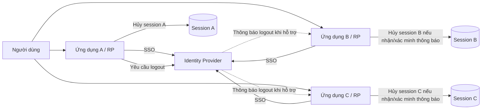
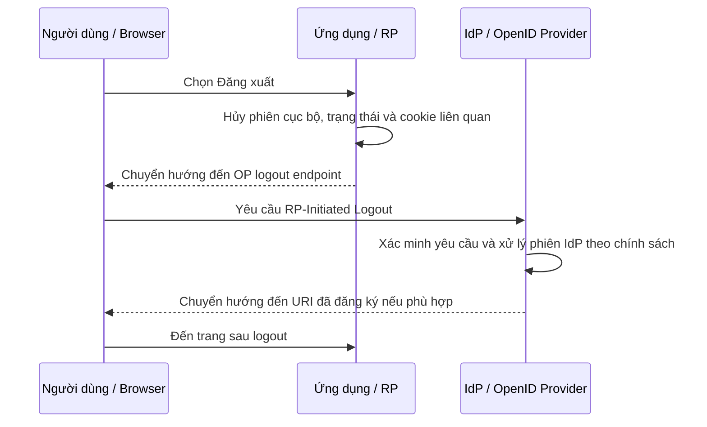
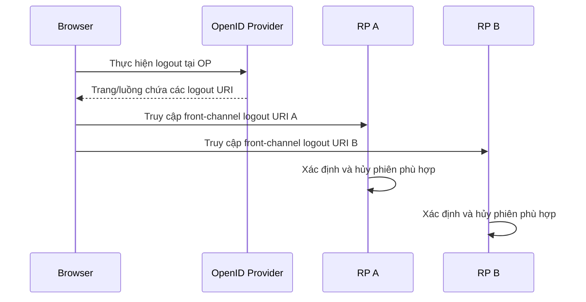
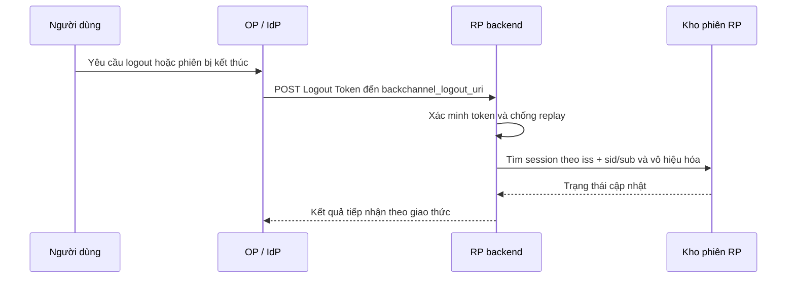
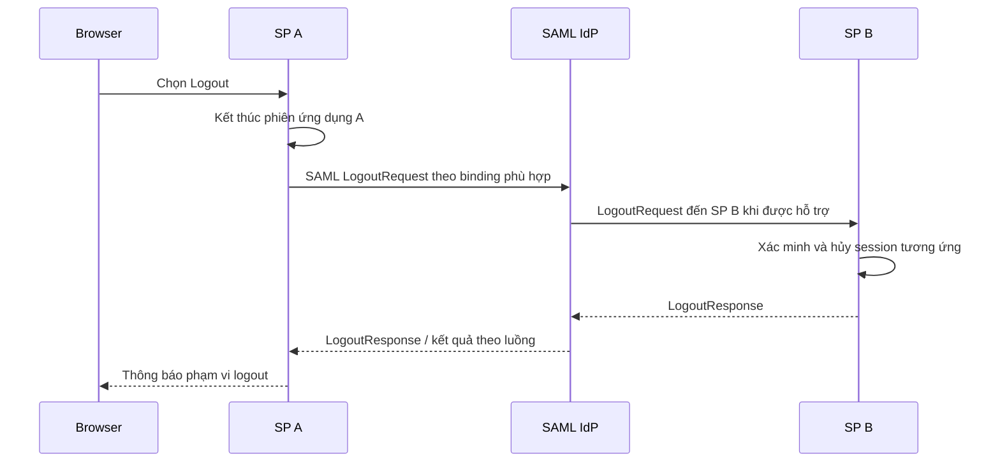

# Federation logout: Đăng xuất trong hệ thống định danh liên kết

Trong **identity federation** (liên kết định danh), người dùng có thể đăng nhập nhiều ứng dụng bằng danh tính được xác thực bởi một **Identity Provider (IdP)**. Ứng dụng dựa vào IdP thường được gọi là **Relying Party (RP)** trong OpenID Connect (OIDC) hoặc **Service Provider (SP)** trong SAML. Đăng nhập một lần (**Single Sign-On — SSO**) giúp giảm số lần nhập thông tin xác thực, nhưng kéo theo một câu hỏi quan trọng: **khi người dùng bấm “Đăng xuất”, những phiên nào thực sự kết thúc?**

**Federation logout** là tập hợp cơ chế và quy trình để chấm dứt hoặc thông báo chấm dứt **phiên xác thực liên kết** giữa IdP và các ứng dụng tham gia. Nó có thể bao gồm đăng xuất tại một ứng dụng, kết thúc phiên đăng nhập tập trung ở IdP, thông báo cho các ứng dụng khác và xử lý token/phiên liên quan. **Không phải mọi ứng dụng đều nhận hoặc thực thi logout theo cùng cách**, vì vậy “đã đăng xuất SSO” không mặc nhiên có nghĩa mọi phiên SaaS, API token và quyền truy cập đều biến mất.

Bài thuộc chương **Federation** của module `SECURITY_IDENTITY_ACCESS_MANAGEMENT_IDENTITY_LIFECYCLE`. Trong phạm vi quản lý vòng đời danh tính theo **Joiner–Mover–Leaver (JML)**, federation logout liên kết với IdP/SSO, SCIM, RBAC/ABAC, session management, tài khoản dịch vụ, kiểm toán và mục tiêu giảm quyền truy cập tồn dư. Trọng tâm là hiểu **ranh giới kỹ thuật của logout**, chọn cơ chế phù hợp và xác minh kết quả thực tế thay vì chỉ hiển thị màn hình “Bạn đã đăng xuất”.

Sau bài học, bạn có thể phân biệt local logout, IdP logout và federated Single Logout; mô tả các cơ chế OIDC và SAML phổ biến; thiết kế tương quan phiên, kiểm tra thông điệp logout và xử lý lỗi; đồng thời giải thích vì sao Leaver còn cần deprovisioning và thu hồi quyền ở từng hệ thống đích.

## 1. Những phiên nào tồn tại khi dùng SSO?

Giả sử nhân viên mở ba ứng dụng: CRM, hệ thống báo cáo và công cụ quản lý dự án. Cả ba dùng chung IdP. Khi đăng nhập vào CRM, nhân viên xác thực với IdP; sau đó khi mở hệ thống báo cáo, IdP có thể nhận ra phiên xác thực còn hiệu lực và hoàn tất SSO mà không yêu cầu đăng nhập lại.

Hệ thống này có thể có **nhiều trạng thái tồn tại độc lập**:

| Thành phần | Được tạo ở đâu? | Dùng để làm gì? | Khi logout một ứng dụng thì sao? |
| --- | --- | --- | --- |
| **Phiên IdP / SSO session** | IdP, thường qua cookie/phiên ở trình duyệt | Ghi nhận người dùng đã xác thực ở IdP | Có thể vẫn còn nếu chỉ xóa phiên ứng dụng |
| **Phiên RP/SP** | Tại từng ứng dụng CRM, báo cáo, dự án | Duy trì đăng nhập cục bộ của ứng dụng | Phải được chính ứng dụng hủy hoặc hết hạn |
| **ID token của OIDC** | IdP phát cho RP | Truyền kết quả xác thực và thông tin danh tính trong phạm vi client | Không phải cơ chế đăng xuất mọi ứng dụng; khác access token |
| **Access token** | Authorization server phát theo luồng OAuth | Cho client gọi API trong phạm vi và thời hạn được cấp | Có thể vẫn được API chấp nhận đến khi hết hạn hoặc bị chặn theo cơ chế riêng |
| **Refresh token** | Authorization server phát nếu luồng/chính sách cho phép | Xin access token mới | Cần cơ chế thu hồi/kiểm soát phát hành riêng nếu mục tiêu là ngừng cấp token |
| **Role/entitlement** | IAM, IdP hoặc hệ thống đích | Quyết định hành động/tài nguyên được phép | Không tự bị xóa chỉ vì người dùng bấm Logout |
| **Session ở ứng dụng thứ ba** | Một ứng dụng liên kết khác | Duy trì trạng thái của ứng dụng đó | Chỉ mất hiệu lực nếu nhận/thực thi logout hoặc có cơ chế kiểm soát khác |

Một lần **local logout** ở CRM có thể xóa cookie CRM, nhưng nếu phiên IdP còn, người dùng mở lại CRM có thể được xác thực SSO ngay. Ngược lại, khi phiên IdP kết thúc, **phiên báo cáo đã được tạo từ trước** có thể vẫn hoạt động nếu ứng dụng không nhận thông báo logout hoặc không kiểm tra lại trạng thái.

Đó là lý do cần phân biệt ba lớp: **IdP session**, **application session** và **API/token access**. Không nên dùng một biến `loggedOut=true` duy nhất để mô tả toàn bộ hệ sinh thái federation.

## 2. Local logout, IdP logout và federated logout

| Khái niệm | Phạm vi mục tiêu | Điều đạt được | Giới hạn |
| --- | --- | --- | --- |
| **Local logout** | Một RP/SP hoặc một phiên trong ứng dụng | Hủy phiên/cookie của ứng dụng tại phạm vi đã chọn | IdP session và các ứng dụng khác có thể vẫn hoạt động |
| **IdP logout** | Phiên đăng nhập tập trung tại IdP | Ngăn phiên SSO hiện tại tiếp tục được sử dụng để đăng nhập không cần xác thực lại | Không mặc nhiên xóa mọi phiên RP/SP hoặc access token |
| **Federated Single Logout (SLO)** | Các bên tham gia federation có hỗ trợ phối hợp logout | Thông báo hoặc yêu cầu ứng dụng kết thúc những phiên liên quan | Phụ thuộc giao thức, cấu hình, khả năng liên lạc và cách RP/SP thực thi |
| **Logout all sessions / all devices** | Nhiều phiên hoặc thiết bị của cùng chủ thể | Thường yêu cầu quản lý phiên tập trung riêng và chính sách về phạm vi | Không thể suy ra từ một request logout tại trình duyệt hiện tại |
| **Account disable / deprovisioning** | Danh tính, account và quyền truy cập | Chặn đăng nhập mới, gỡ hoặc vô hiệu hóa quyền theo JML | Vẫn phải xử lý token, phiên và tài khoản đích khi cần |

**Single Logout là mục tiêu phối hợp, không phải bảo đảm tuyệt đối.** Một số ứng dụng chỉ triển khai local logout; một số hỗ trợ OIDC RP-Initiated Logout nhưng không có front-channel/back-channel logout; một số SP hỗ trợ SAML SLO theo metadata và binding cụ thể. Người vận hành phải **kiểm chứng từng tích hợp**, không suy đoán từ việc nó đã hỗ trợ SSO.

### “Sign out” và “Sign out everywhere”

Nút **Sign out** thông thường nên có mô tả rõ phạm vi. Ví dụ “Đăng xuất khỏi ứng dụng này” khác “Đăng xuất khỏi các ứng dụng đã liên kết trên trình duyệt này” và khác “Kết thúc mọi phiên trên mọi thiết bị”. Chỉ hiển thị thông báo đã đăng xuất trên mọi nơi khi hệ thống thực sự có **cơ chế, phạm vi và bằng chứng** để thực hiện điều đó.

## 3. Mô hình logout liên kết giữa IdP và nhiều ứng dụng



Các mũi tên nét đứt là **khả năng**, không phải cam kết. Nếu B không hỗ trợ logout liên kết, B có thể giữ phiên đến khi hết hạn. Nếu hệ thống C tạm thời không phản hồi, logout tại IdP có thể thành công trong khi C vẫn chưa hủy session. Cần ghi nhận và xử lý sai lệch, đặc biệt với tài nguyên nhạy cảm.

Một thiết kế tốt phải trả lời: **ai khởi tạo logout**, **IdP và RP/SP có những phiên nào**, **thông điệp logout được gửi qua kênh nào**, **ứng dụng xác minh và hủy phiên nào**, **lỗi được báo và retry ra sao**, và **người dùng được thông báo về phạm vi thực tế như thế nào**.

## 4. OIDC RP-Initiated Logout: ứng dụng yêu cầu IdP kết thúc phiên

Trong **OpenID Connect**, một cách triển khai phổ biến là **RP-Initiated Logout**: ứng dụng đang giữ phiên của người dùng bắt đầu quá trình logout bằng cách chuyển trình duyệt đến **logout endpoint** của OpenID Provider (OP, đóng vai IdP). OP xử lý việc kết thúc phiên theo cấu hình và có thể chuyển người dùng về một địa chỉ sau logout đã được đăng ký.

### Luồng khái niệm



Sơ đồ chỉ minh họa trình tự thông dụng. Có hệ thống cần xác nhận thêm với người dùng, hoặc xử lý logout trong browser khác nhau. Việc IdP kết thúc phiên **không tự chứng minh** mọi ứng dụng liên kết đã hủy phiên; khả năng đó phụ thuộc các cơ chế thông báo và thực thi riêng.

### Các tham số thường gặp

| Tham số | Mục đích | Lưu ý bảo mật |
| --- | --- | --- |
| `id_token_hint` | Gợi ý về phiên/ID token mà RP đã nhận, giúp OP xác định ngữ cảnh logout | Có thể chứa thông tin danh tính; bảo vệ khỏi log, referrer và lộ trong URL |
| `post_logout_redirect_uri` | Địa chỉ đưa trình duyệt đến sau khi xử lý logout | Phải được kiểm tra theo danh sách đã đăng ký với OP; không nhận redirect tùy ý |
| `state` | Giá trị do RP sinh để liên kết yêu cầu với phản hồi sau logout | Sinh khó đoán, kiểm tra khi quay lại; không dùng như token xác thực |
| `client_id` | Nhận diện RP, cần trong một số tình huống cấu hình/thiếu token hint | Phải thuộc client đã đăng ký và phù hợp quy định của OP |
| `logout_hint` | Gợi ý bổ sung về phiên hoặc người dùng theo cơ chế của OP | Không được dùng riêng như bằng chứng quyền yêu cầu logout |

Không phải mọi OP hỗ trợ cùng tập tham số và chính sách, vì vậy cần xem discovery document và tài liệu cấu hình của nhà cung cấp. Một số môi trường gọi endpoint này là `end_session_endpoint`.

Ví dụ ý tưởng, **không phải URL thực tế để copy vào production**:

```text
OP logout endpoint: https://idp.example.org/oidc/logout
  id_token_hint              = <ID_TOKEN_ISSUED_TO_THIS_RP>
  post_logout_redirect_uri   = https://app.example.org/signed-out
  state                      = <UNPREDICTABLE_CORRELATION_VALUE>
```

Các tham số phải được mã hóa URL đúng cách trong request thực. Không tự đặt `post_logout_redirect_uri` theo một tham số URL do người dùng truyền mà chưa kiểm tra: cách làm đó có thể tạo **open redirect**. Cũng không ghi nguyên `id_token_hint` hoặc dữ liệu nhạy cảm của luồng logout vào log.

### Local logout ở RP vẫn quan trọng

RP nên hủy session cục bộ và xóa cookie tương ứng theo cách an toàn, **không chờ redirect về từ IdP mới coi là đã kết thúc phiên tại RP**. Nếu người dùng đóng trình duyệt giữa luồng, local session không nên vẫn còn được sử dụng. Những phiên khác của cùng người dùng tại RP chỉ bị hủy khi chính sách và cơ chế quản lý session có hỗ trợ.

## 5. OIDC Front-Channel Logout: thông báo qua trình duyệt

**Front-Channel Logout** dùng trình duyệt làm đường chuyển tải thông báo từ OP đến các RP có hỗ trợ, chẳng hạn tải những logout URI đã đăng ký. Khi nhận thông báo, RP cố gắng hủy session tương ứng.



Phương thức này có ưu điểm là tương đối tự nhiên với môi trường browser, nhưng phụ thuộc vào **việc trình duyệt thực sự tải được các URI**. Giới hạn cookie bên thứ ba, chính sách iframe/trình duyệt, đóng tab quá sớm hoặc mạng lỗi có thể khiến một RP không nhận đủ thông tin hay không ghép được phiên.

Một triển khai cần kiểm tra cách nó dùng các định danh phiên như `iss` và `sid` khi có, khả năng RP ánh xạ đến session local, kiểm soát URL endpoint và yêu cầu bảo mật của nhà cung cấp. **Không xem front-channel logout là kênh bảo đảm tuyệt đối**, đặc biệt khi cần chặn khẩn cấp tài khoản đặc quyền.

## 6. OIDC Back-Channel Logout: IdP gửi thông báo trực tiếp đến RP

**Back-Channel Logout** cho phép OP gửi **Logout Token** đến endpoint backend của RP, không phụ thuộc vào việc trình duyệt người dùng đang mở hay có tải được iframe hay không. Đây thường là một cách hiệu quả hơn để thông báo chấm dứt phiên cho ứng dụng có backend, nhưng vẫn cần **RP online, nhận được thông điệp và thực thi hủy session đúng cách**.

### Luồng khái niệm



Một Logout Token là **JWT phục vụ sự kiện logout**, **không phải access token cho API nghiệp vụ**. RP phải xác minh các thuộc tính theo cấu hình federation và đặc tả áp dụng, gồm:

- **Chữ ký và thuật toán được chấp nhận**, dựa trên khóa tin cậy đã cấu hình; không chấp nhận JWT chưa xác minh.
- **`iss` (issuer)**: khớp OP được tin cậy; không ghép issuer khác chỉ vì có cùng `sub`.
- **`aud` (audience)**: có chứa client ID của RP nhận logout.
- **`iat` và `jti`**: có thời điểm phát hành phù hợp, định danh token để kiểm soát trùng/replay theo chính sách.
- **`events`**: chứa sự kiện logout được định nghĩa bởi giao thức, không phải một sự kiện tùy ý do caller tự đặt.
- **`sid` và/hoặc `sub`**: thông tin liên kết phiên hoặc chủ thể để xác định đúng những session cần chấm dứt.
- **Không có `nonce`** trong Logout Token theo yêu cầu của cơ chế back-channel.

Ví dụ **payload minh họa**, không phải JWT thực có chữ ký:

```json
{
  "iss": "https://idp.example.org",
  "aud": "reports-client",
  "iat": 1795399200,
  "jti": "logout-event-9b3e",
  "sub": "user-8af2",
  "sid": "op-session-a92d",
  "events": {
    "http://schemas.openid.net/event/backchannel-logout": {}
  }
}
```

RP phải dùng **cơ chế mapping session** đã được duy trì khi login: phiên RP nào được tạo từ `(issuer, subject, sid)` nào. Nếu thông điệp dùng `sid`, phạm vi có thể là một phiên OP cụ thể; nếu dùng `sub` mà không có `sid`, RP xử lý các phiên của chủ thể theo quy định giao thức và chính sách của RP. **Không lấy mỗi username hoặc email làm khóa thu hồi**, vì chúng có thể đổi, trùng hoặc được tái sử dụng.

### Giả mã xử lý Back-Channel Logout

```text
onBackchannelLogout(logoutJwt):
    claims = verifySignedLogoutToken(
        logoutJwt,
        trustedIssuer,
        expectedClientId,
        configuredAlgorithmsAndKeys
    )

    requireValidIssuedAtAndRequiredClaims(claims)
    requireLogoutEventClaim(claims.events)
    requireNoNonceClaim(claims)
    require(claims.sid exists OR claims.sub exists)

    if replayStore.alreadyProcessed(claims.iss, claims.jti):
        return SUCCESS_ALREADY_HANDLED

    atomicallyMarkProcessed(claims.iss, claims.jti)
    sessions = findLocalSessionsByIssuerAndSidOrSubject(claims)
    revokeMatchedLocalSessions(sessions)
    auditWithoutTokens(claims.iss, claims.jti, sessions.count)
    return SUCCESS
```

Giả mã chỉ mô tả các kiểm soát khái niệm. Triển khai production phải giải quyết tính nguyên tử giữa việc đánh dấu sự kiện và hủy session, lỗi mạng, truy hồi sau sự cố, giới hạn lưu `jti`, concurrency, retry và các yêu cầu đầy đủ của đặc tả. **Không bao giờ tin `sid` hoặc `sub` được gửi đến endpoint logout nếu token chưa được xác minh.**

Nếu RP chỉ xóa cookie trên trình duyệt, nó sẽ không xử lý được Back-Channel Logout vì trình duyệt không tham gia. RP cần **lưu trạng thái phiên phía server hoặc một cơ chế vô hiệu hóa token/phiên có thể thực thi được**. Với session JWT tự chứa, cần chiến lược phù hợp như phiên ngắn hạn, version kiểm tra ở backend hoặc danh sách thu hồi theo rủi ro; chỉ gửi một Logout Token không làm JWT cũ tự biến mất.

## 7. SAML Single Logout (SLO)

Với **SAML 2.0**, ứng dụng thường được gọi là **Service Provider (SP)** và hệ thống xác thực là **Identity Provider (IdP)**. SAML có cơ chế **Single Logout** sử dụng các thông điệp như `LogoutRequest` và `LogoutResponse`. Một phiên có thể được nhận diện bằng thông tin như **NameID** và **SessionIndex** theo cách triển khai và các assertion trước đó.

### Hai hướng khởi tạo thường gặp

- **SP-initiated SLO:** người dùng đăng xuất ở SP; SP xử lý phiên cục bộ và gửi yêu cầu SAML Logout đến IdP theo binding/cấu hình phù hợp. IdP có thể phối hợp thông báo tới những SP khác.
- **IdP-initiated SLO:** người dùng hoặc quản trị viên kết thúc phiên ở IdP; IdP gửi yêu cầu logout đến các SP liên quan theo khả năng và cấu hình federation.



Các binding (ví dụ redirect/POST và các cơ chế phù hợp), chữ ký, endpoint SLO và việc phối hợp nhiều SP phụ thuộc metadata và cấu hình tin cậy. **Không phải mọi IdP/SP triển khai đầy đủ SAML SLO**, và một chuỗi logout có thể chỉ hoàn tất một phần nếu SP khác timeout hoặc không hỗ trợ.

### Các điểm kiểm soát với SAML SLO

1. Chỉ tin các thông điệp đến từ đối tác federation đã cấu hình; kiểm tra **Issuer, chữ ký, chứng chỉ/khóa và yêu cầu của binding**.
2. Kiểm tra **Destination, InResponseTo, thời hạn/ngữ cảnh và các định danh phiên** theo luồng và cấu hình.
3. Dùng NameID/SessionIndex đúng ngữ nghĩa để tìm phiên cần hủy; tránh gộp nhầm nhiều chủ thể có tên hiển thị giống nhau.
4. Chống replay hoặc xử lý lại thông điệp; logout lặp không được tái tạo phiên.
5. Nếu SP không phản hồi, không báo rằng logout toàn federation đã thành công; ghi trạng thái từng SP và phương án khắc phục.

**LogoutRequest hợp lệ không phải yêu cầu xóa tài khoản hay dữ liệu nghiệp vụ**. SAML SLO chủ yếu điều phối việc chấm dứt phiên, trong khi thay đổi entitlement và deprovisioning là quy trình riêng.

## 8. OIDC, SAML và API token: so sánh phạm vi

| Cơ chế | Luồng chính | Thành phần nhận | Điểm mạnh | Giới hạn đáng chú ý |
| --- | --- | --- | --- | --- |
| **OIDC RP-Initiated Logout** | RP chuyển browser đến OP logout endpoint | OP/IdP | Cho ứng dụng yêu cầu kết thúc phiên IdP | Không mặc nhiên hủy mọi phiên RP khác |
| **OIDC Front-Channel Logout** | OP thông báo thông qua browser | Các RP có đăng ký | Phù hợp một số ứng dụng web | Bị ảnh hưởng bởi cookie/iframe/browser, mạng và việc đóng tab |
| **OIDC Back-Channel Logout** | OP gửi JWT logout tới backend RP | Endpoint RP | Không phụ thuộc browser đang mở | RP cần xác minh token và có cơ chế thu hồi phiên; có thể lỗi mạng |
| **SAML SLO** | LogoutRequest/LogoutResponse theo cấu hình federation | IdP và SP liên quan | Cơ chế có trong hệ sinh thái SAML | Khác biệt binding, tính năng và chuỗi phản hồi giữa các sản phẩm |
| **OAuth token revocation** | Client yêu cầu server thu hồi token nếu hỗ trợ | Authorization server | Kiểm soát một số refresh/access token theo kiểu nền tảng | Không bảo đảm mọi JWT access token đã phát hành bị API từ chối ngay |
| **SCIM deprovisioning** | IAM cập nhật trạng thái user/group ở ứng dụng | SCIM service provider | Quản lý account/entitlement theo JML | Không phải giao thức SLO, không tự hủy mọi phiên |

**Một hệ thống có thể sử dụng nhiều cơ chế đồng thời.** Ví dụ khi người dùng bấm Logout, RP hủy session cục bộ rồi dùng RP-Initiated Logout. IdP có thể triển khai back-channel logout để RP khác kết thúc phiên. Khi Leaver, IAM bổ sung SCIM deactivate, gỡ role, thu hồi refresh token và đối soát các tài khoản local. Những bước đó có **mục đích và nguồn sự kiện khác nhau**.

## 9. Logout, token và quyền hiệu lực sau thay đổi trạng thái

### 9.1. ID token không phải access token

Trong OIDC, **ID token** mô tả kết quả xác thực cho client cụ thể; **access token** phục vụ ủy quyền truy cập tài nguyên/API. Dùng ID token ở API như access token là lỗi thiết kế. Việc RP gửi `id_token_hint` cho OP không đồng nghĩa API access token đã bị thu hồi.

Nếu access token là JWT tự chứa, một API chỉ kiểm tra chữ ký, `aud`, `exp` và các claim có thể tiếp tục chấp nhận token đến khi hết hạn dù phiên IdP đã logout. Để giảm khoảng rủi ro, thiết kế có thể dùng token ngắn hạn, introspection/check trạng thái, denylist, thay đổi session version hoặc cơ chế khác phù hợp. **Khả năng thu hồi tức thì phải được xác minh theo hệ thống**, không suy ra từ thông báo logout.

### 9.2. Quyền RBAC/ABAC có thể thay đổi khi phiên còn hoạt động

Ví dụ nhân viên có `project.editor` khi login, rồi Mover sang bộ phận khác và mất quyền đó. Nếu ứng dụng chỉ lấy role một lần lúc login rồi cache lâu, phiên cũ có thể tiếp tục giữ quyền sửa. **Logout có thể buộc đăng nhập lại**, nhưng để xử lý quyền kịp thời, ứng dụng còn cần chính sách cập nhật authorization/claims, thời hạn cache, xác minh ở API hoặc cơ chế vô hiệu hóa phiên khi quyền nhạy cảm thay đổi.

Không nên coi logout là **phương pháp thay thế cho role deprovisioning**. Quyền được gán trực tiếp tại ứng dụng vẫn có thể còn và sẽ được dùng lại ở phiên mới nếu không được thu hồi.

### 9.3. Đăng xuất ở một thiết bị không bảo đảm thiết bị khác đã mất phiên

IdP có thể duy trì nhiều phiên theo thiết bị, trình duyệt và người dùng. `sid` trong OIDC có thể giúp nhắm đến phiên nhất định, nhưng logout “mọi thiết bị” cần cơ chế session registry, revoke phù hợp và chính sách chặn token ở các ứng dụng. **Một phiên IdP bị kết thúc không mặc định là toàn bộ phiên IdP của chủ thể đã kết thúc.**

## 10. Thiết kế bảo mật cho logout endpoint

Một endpoint logout có thể là điểm gây lỗi bảo mật hoặc từ chối dịch vụ nếu được triển khai tùy tiện.

### Kiểm tra bắt buộc hoặc cần thiết theo luồng

| Rủi ro | Biện pháp thiết kế |
| --- | --- |
| **Logout CSRF**: website khác kích hoạt logout ngoài ý muốn | Với logout do người dùng khởi tạo, áp kiểm soát CSRF phù hợp và tránh thao tác nhạy cảm qua GET không được bảo vệ; phân biệt với endpoint nhận logout từ OP theo giao thức |
| **Open redirect** sau logout | Chỉ cho phép redirect URI đã đăng ký/được kiểm tra; kiểm soát `state` và ràng buộc với yêu cầu |
| **Giả mạo back-channel logout** | Xác minh JWT, issuer, audience, chữ ký, event claims và replay trước khi đụng tới session |
| **Giả mạo SAML LogoutRequest** | Kiểm tra chữ ký/binding, issuer, destination và quan hệ phiên theo metadata đối tác |
| **Hủy nhầm session** | Liên kết `iss + sub + sid` hoặc khóa phiên phù hợp, tránh chỉ dùng email/username |
| **Lộ token trong log** | Loại bỏ `id_token_hint`, logout JWT, session cookie và dữ liệu nhạy cảm khỏi log, URL ngoài phạm vi |
| **Retry gây trạng thái lỗi** | Xử lý logout idempotent: session đã vô hiệu hóa thì nhận thông điệp lặp không được kích hoạt lại |
| **Hệ thống đích offline** | Theo dõi, retry có kiểm soát, TTL phiên, cảnh báo và xác minh kết quả |
| **Cookie chưa được hủy đúng** | Xóa cookie đúng tên, path/domain, cờ bảo vệ; quan trọng hơn là vô hiệu hóa session phía server |
| **Thông điệp logout bị coi là lệnh xóa user** | Tách rạch ròi session logout, account disable và data retention |

Đặc biệt, **endpoint back-channel không được dựa vào cookie của browser** vì browser không tham gia yêu cầu. Ở chiều ngược lại, **endpoint logout do người dùng bấm** cần bảo vệ khỏi website ngoài khởi tạo logout không mong muốn. Các trường hợp phải được thiết kế tách biệt, không dùng một endpoint hỗn hợp thiếu kiểm tra.

### Cần kiểm chứng session thực tế, không chỉ cookie

Xóa cookie trong browser không đủ nếu backend vẫn cho một session ID hoặc bearer token cũ sử dụng lại. Với server-side session, có thể đánh dấu phiên bị vô hiệu hóa và kiểm tra ở mỗi request. Với token self-contained, phải xác định cơ chế làm mất hiệu lực theo rủi ro. Các cookie mới được tạo từ cùng IdP session cũng cần được kiểm soát nếu mục tiêu là không cho SSO lại ngay.

## 11. Xử lý lỗi, retry và logout hoàn tất một phần

Federation thường liên quan **nhiều hệ thống hoạt động độc lập**. Không có giao dịch nguyên tử chung đảm bảo rằng tất cả ứng dụng cùng hủy phiên chính xác tại một thời điểm.

Một mô hình theo dõi có thể tách **trạng thái IdP** và **trạng thái từng RP/SP**:

```yaml
logoutEventId: logout-event-0028
issuer: https://idp.example.org
subjectId: user-8af2
sessionId: op-session-a92d
initiatedBy: RP_A
requestedAt: "2026-11-23T03:10:00Z"
idpSessionState: TERMINATED
overallStatus: PARTIAL
targets:
  - app: crm
    requestedAction: END_SESSION
    observedState: TERMINATED
    verified: true
  - app: reports
    requestedAction: END_SESSION
    observedState: PENDING_RETRY
    verified: false
  - app: project
    requestedAction: END_SESSION
    observedState: UNSUPPORTED
    verified: false
```

Đây là **schema minh họa**, không phải hợp đồng kỹ thuật của OIDC/SAML. `overallStatus: PARTIAL` phản ánh thực tế: IdP và CRM đã xử lý nhưng reports chưa xác minh, project không hỗ trợ. Không nên báo “đã đăng xuất toàn bộ ứng dụng” khi vẫn còn trạng thái như vậy.

### Nguyên tắc xử lý lỗi

1. **Kết thúc phiên đang kiểm soát được càng sớm càng hợp lý:** RP hủy phiên của chính nó; IdP chấm dứt phiên của mình khi yêu cầu hợp lệ.
2. **Không coi mọi phản hồi HTTP thành công là mọi phiên đã biến mất:** ứng dụng cần xử lý session đúng cách và cho phép kiểm tra nếu có thể.
3. **Dùng idempotency:** logout lặp của phiên đã chết phải an toàn, không tạo lại session hay thay đổi quyền.
4. **Retry/backoff có kiểm soát:** đặc biệt với back-channel/server-to-server, tránh vòng lặp không giới hạn hoặc tắc nghẽn.
5. **Phân loại lỗi:** endpoint không hỗ trợ, token không hợp lệ, timeout, snapshot thiếu hoặc session thực sự chưa bị chặn là những nguyên nhân khác nhau.
6. **Cảnh báo theo rủi ro:** session còn tồn tại của tài khoản đặc quyền sau Leaver khẩn cấp cần ưu tiên cao hơn một phiên thông thường đã gần hết hạn.
7. **Thông báo minh bạch:** nếu chỉ logout ứng dụng hiện tại, giao diện cần nói rõ phạm vi và chỉ dẫn cách kết thúc các phiên khác khi cần.

Việc không còn nhận được request từ một ứng dụng **không tự chứng minh phiên ở đó đã kết thúc**: người dùng có thể chỉ đang không thao tác. Đối soát cần nguồn quan sát thích hợp (trạng thái session, kết quả API, hành vi truy cập được phép kiểm thử hoặc bằng chứng từ chủ ứng dụng).

## 12. Federation logout trong Joiner–Mover–Leaver

### 12.1. Joiner: thiết lập liên kết phiên và kỳ vọng logout từ đầu

Khi nhân viên mới được xác minh, IAM có thể provision tài khoản IdP và các ứng dụng qua SCIM/API. Với các ứng dụng sử dụng SSO, nhóm tích hợp cần cấu hình **session lifetime, RP-initiated logout, back-/front-channel nếu được hỗ trợ, URI và khóa tin cậy**, đồng thời kiểm thử logout trước khi triển khai rộng.

**Ví dụ:** Joiner đăng nhập CRM rồi mở hệ thống báo cáo bằng SSO. Người dùng bấm đăng xuất ở CRM. Nếu thiết kế chỉ có local logout, mở CRM lại có thể chuyển qua IdP SSO và đăng nhập tức thì. Điều này có thể đúng theo chính sách, nhưng **giao diện và tài liệu người dùng cần phản ánh đúng phạm vi**.

### 12.2. Mover: quyền đổi không đồng nghĩa mọi phiên tự được cập nhật

Khi người dùng đổi bộ phận, RBAC/ABAC và entitlement phải được tính lại. Nếu ứng dụng cache quyền trong phiên cũ, cơ chế logout hoặc revoke session có thể được dùng **như biện pháp bổ trợ** để làm mới context xác thực. Nhưng bước bắt buộc vẫn là **thu hồi quyền không còn căn cứ ở hệ thống đích** và kiểm tra hiệu lực.

**Ví dụ:** nhân viên rời bộ phận tài chính và mất role phê duyệt. IdP cập nhật nhóm nhưng phiên FinanceApp còn claim cũ. IAM phải xác định cách FinanceApp kiểm tra quyền mỗi request, hỗ trợ back-channel logout hay cần xử lý cache/session riêng. Không được coi việc người dùng tự bấm Logout là kiểm soát thu hồi đặc quyền đáng tin.

### 12.3. Leaver: logout chỉ là một phần của offboarding

Khi HRIS hoặc nguồn có thẩm quyền xác nhận Leaver, IAM cần phân biệt **thời điểm phải chặn truy cập** và **trạng thái từng đường truy cập**. Một quy trình có thể:

1. Đối chiếu `sourcePersonId`, `identityId`, account ID ở IdP và ứng dụng; xác minh `effectiveAt`.
2. **Disable hoặc chặn xác thực mới** ở IdP/directory theo chính sách.
3. **Kết thúc các phiên IdP, ứng dụng, refresh token và phương thức xác thực** trong phạm vi có thể thực thi.
4. **Gửi thông báo federation logout** qua cơ chế được hỗ trợ, xử lý RP/SP không nhận được.
5. **SCIM/API deprovisioning** tài khoản, gỡ nhóm, quyền trực tiếp, vai trò đặc quyền và đường đăng nhập local.
6. Xử lý API key, credential kỹ thuật và các tài khoản dịch vụ do người nghỉ việc sở hữu theo quy trình bàn giao.
7. **Đối soát hiệu lực ở từng đích**, ghi sai lệch và xử lý khẩn theo mức rủi ro trước khi đóng hồ sơ.

**Một lần SLO trả kết quả thành công không thay thế deprovisioning.** Nó có thể chỉ xử lý một tập phiên đã liên kết, không xóa quyền ứng dụng hoặc tất cả bearer token đã phát hành. Ngược lại, SCIM `active=false` cũng không nhất thiết hủy mọi session đang mở.

### 12.4. Đối tác/nhà thầu và federation liên tổ chức

Một đối tác có thể đăng nhập ứng dụng của công ty qua IdP của **tổ chức khác**. Khi người đó rời tổ chức đối tác, IdP bên ngoài có thể disable account, nhưng ứng dụng của công ty vẫn phải quản lý phiên, quyền và thời hạn truy cập của riêng mình.

Cần xác định trong hợp đồng tích hợp: **nguồn sự kiện Leaver nào đáng tin**, bên nào chịu trách nhiệm, có hỗ trợ logout liên kết không, độ trễ được chấp nhận, cơ chế deprovisioning và kiểm soát quyền tồn dư tại SP/RP. Không nên dựa hoàn toàn vào việc IdP đối tác tự gửi logout kịp thời mà không có cơ chế hạn quyền và đối soát của ứng dụng nội bộ.

## 13. Tài khoản dịch vụ và workload identity: không có browser logout

Một dịch vụ chạy nền gọi API bằng **OAuth client credentials**, managed identity, chứng chỉ hoặc API key thường **không có phiên trình duyệt và không cần nút Sign out**. Do đó, các cơ chế OIDC front-channel, RP-initiated logout và SAML SLO tương tác **không thay thế** vòng đời credential của workload.

Với service account hoặc service principal cần:

- Quy định **owner**, ứng dụng/môi trường, API và phạm vi quyền được phép.
- Dùng credential ngắn hạn hoặc workload federation khi phù hợp; bảo vệ khóa bí mật trong vault/secret manager.
- Thu hồi hoặc xoay vòng secret/chứng chỉ/refresh token theo tình huống, không chỉ logout tài khoản người vận hành.
- Hủy role và ứng dụng tích hợp khi workload ngừng dùng; theo dõi các bearer token còn hiệu lực.
- Khi nhân viên sở hữu hệ thống nghỉ việc, chuyển trách nhiệm và kiểm tra bí mật người đó đã biết, không xóa bừa tài khoản máy cần cho sản xuất.

**Không nên cố mô phỏng federation logout bằng cách chia sẻ mật khẩu hoặc TOTP của một người cho job tự động.** Xác thực workload phải được thiết kế riêng với quyền tối thiểu và khả năng thu hồi phù hợp.

## 14. Kiểm toán và các chỉ số vận hành logout

Một hồ sơ logout cần giữ **bằng chứng đủ để giải thích phạm vi và kết quả**, không lưu token hoặc cookie nhạy cảm. Các trường hữu ích gồm `logoutEventId`, issuer, subject ID ổn định, RP client ID, session ID đã được mã hóa hoặc tham chiếu có kiểm soát, phương thức khởi tạo, thời điểm, trạng thái mỗi RP/SP và nguyên nhân lỗi.

| Chỉ số | Điều cần đo | Mục đích |
| --- | --- | --- |
| Tỷ lệ logout cục bộ thành công | RP session đã bị vô hiệu hóa sau yêu cầu hợp lệ | Đảm bảo ứng dụng không tiếp tục chấp nhận session đã logout |
| Tỷ lệ thông báo logout được xử lý | Số RP/SP xác nhận và áp dụng trên tổng RP/SP trong phạm vi | Phát hiện tích hợp thiếu hoặc lỗi giao thức |
| Độ trễ logout theo đích | Thời gian từ sự kiện hợp lệ đến khi session đích kết thúc | Đo khoảng tồn dư truy cập |
| Lỗi back-channel/SAML SLO | Timeout, chữ ký không hợp lệ, mapping session sai, replay | Cải thiện bảo mật và độ tin cậy triển khai |
| Phiên/token còn hiệu lực sau Leaver | Số phiên/tài khoản chưa chặn sau `effectiveAt` | Ưu tiên khắc phục rủi ro cao |
| Tỷ lệ ứng dụng không hỗ trợ SLO | Số ứng dụng chỉ có local logout hoặc cơ chế riêng | Định hướng tích hợp và giảm rủi ro |
| Tỷ lệ sai lệch quyền sau Mover | Role cũ hoặc quyền còn hoạt động dù session thay đổi | Nhắc rằng authorization và logout phải được theo dõi riêng |
| Sự cố logout ngoài ý muốn | CSRF, vòng lặp redirect, xóa nhầm session | Cải thiện trải nghiệm và tính đúng đắn |

Không nên chỉ đo “số lượt nhấn Logout”. KPI có ý nghĩa hơn là **độ phủ giao thức, khả năng xử lý từng session, thời gian xác minh và mức rủi ro còn lại**. Một hệ thống có nhiều thông báo logout nhưng không thể chặn session cũ chưa được coi là an toàn.

## 15. Tình huống thực hành: ba ứng dụng, hai loại logout

Giả sử nhân viên **An** đăng nhập vào CRM, FinanceApp và báo cáo qua IdP trung tâm. CRM hỗ trợ OIDC RP-Initiated Logout và back-channel; FinanceApp chỉ hỗ trợ local logout; báo cáo có back-channel logout nhưng thỉnh thoảng mất kết nối.

| Thời điểm | Sự kiện | Kết quả có thể quan sát | Nhận định |
| --- | --- | --- | --- |
| 09:00 | An đăng nhập CRM rồi mở FinanceApp và báo cáo qua SSO | IdP và ba ứng dụng đều có phiên riêng | SSO không gộp các phiên thành một bản ghi duy nhất |
| 10:00 | An bấm local logout trong FinanceApp | FinanceApp hủy session hiện tại | Phiên IdP có thể vẫn cho phép SSO lại |
| 11:00 | An dùng logout liên kết từ CRM | CRM hủy session và chuyển đến OP; OP kết thúc phiên SSO | Các RP khác chỉ kết thúc phiên nếu được thông báo và thực thi |
| 11:01 | OP gửi back-channel đến báo cáo nhưng endpoint timeout | Chưa có bằng chứng báo cáo đã hủy session | Trạng thái logout **PARTIAL**, cần retry/đối soát |
| 17:00 | HR thông báo An nghỉ việc | IAM chặn account, thu hồi quyền và các đường truy cập liên quan | Phải kiểm tra FinanceApp, báo cáo, session/token và tài khoản local |

### Phân tích

**Thứ nhất**, FinanceApp không tự đăng xuất chỉ vì IdP session kết thúc nếu nó không có cơ chế nhận logout hoặc không chủ động kiểm tra lại. **Thứ hai**, báo cáo hỗ trợ back-channel nhưng một lỗi mạng có thể làm phiên chưa bị chặn, vì vậy phải theo dõi và xác minh. **Thứ ba**, Leaver cần xử lý thêm account và quyền nghiệp vụ: không thể giao toàn bộ trách nhiệm bảo mật cho một nút Logout.

### Kiểm thử chấp nhận

1. Local logout có khiến session ID cũ tại RP không còn được chấp nhận khi truy cập lại không?
2. Khi RP-Initiated Logout hoàn tất, phiên IdP tương ứng có thực sự kết thúc không? `post_logout_redirect_uri` có được kiểm tra theo đăng ký không?
3. Nếu một RP không hỗ trợ front-/back-channel logout, hệ thống có mô tả đúng giới hạn thay vì tuyên bố logout toàn bộ không?
4. Back-channel logout JWT sai chữ ký, issuer, audience hoặc không có event phù hợp có bị từ chối trước khi chạm tới session không?
5. Thông điệp logout trùng `jti` có được xử lý idempotent và chống replay không?
6. `sid` ở hai issuer khác nhau có bị ghép nhầm thành cùng một phiên không?
7. Nếu ứng dụng offline lúc IdP phát logout, có retry/cảnh báo hoặc biện pháp khác được phê duyệt không?
8. Sau khi người dùng bấm Logout, access token đã phát hành có còn được API chấp nhận không? Nếu có, thời hạn và cách giảm rủi ro là gì?
9. Khi Mover gỡ quyền nhạy cảm, ứng dụng có kiểm tra lại role/ABAC thay vì dựa vào claim cũ suốt phiên không?
10. Khi Leaver, tài khoản IdP disabled nhưng còn session FinanceApp, hồ sơ đã được giữ ở trạng thái cần xử lý chưa?

## 16. Câu hỏi tự kiểm tra

**Câu 1.** Người dùng đã logout ở CRM nhưng mở lại CRM và được đăng nhập ngay qua SSO. Vì sao?

**Trả lời:** Có thể chỉ **local session CRM** bị xóa, còn phiên tại IdP vẫn hợp lệ, nên IdP cho phép một phiên CRM mới. Muốn kết thúc thêm phiên IdP phải triển khai luồng phù hợp.

**Câu 2.** OIDC Back-Channel Logout khác Front-Channel Logout ở điểm quan trọng nào?

**Trả lời:** Back-channel gửi **Logout Token trực tiếp giữa OP và backend RP**, không phụ thuộc browser tải URI. Front-channel phụ thuộc trình duyệt để chuyển thông báo, nên có thêm giới hạn cookie/iframe, kết nối và việc người dùng đóng tab.

**Câu 3.** Có được hủy session theo `sub` trong Logout Token chưa kiểm tra chữ ký không?

**Trả lời:** Không. Phải xác minh token theo đối tác tin cậy, issuer, audience, sự kiện logout và các thuộc tính cần thiết trước khi xác định phạm vi session bị hủy.

**Câu 4.** SAML LogoutResponse báo thành công có nghĩa mọi SP và API token đã bị thu hồi không?

**Trả lời:** Không thể kết luận như vậy. Phải xem phạm vi, trạng thái từng SP và cơ chế token riêng. SAML SLO không thay thế SCIM deprovisioning hoặc thu hồi OAuth token.

**Câu 5.** Một nhân viên Mover không còn role tài chính; buộc họ logout có đủ để thu hồi quyền phê duyệt không?

**Trả lời:** Không. Cần gỡ role/entitlement, áp RBAC/ABAC tại ứng dụng và đối soát quyền hiệu lực. Logout chỉ là một biện pháp hỗ trợ làm mất hiệu lực session/claims cũ.

**Câu 6.** Người nghỉ việc đã bị disable ở IdP, nhưng một token JWT còn hạn đang được API chấp nhận. Leaver có hoàn tất chưa?

**Trả lời:** Chưa thể coi mục tiêu chặn truy cập đã hoàn tất. Cần xem cơ chế thu hồi/chặn token, thời gian tồn dư, các biện pháp giảm thiểu và xác minh tại API đích.

## Kết luận

**Federation logout là quá trình chấm dứt và phối hợp chấm dứt phiên xác thực giữa IdP và các ứng dụng liên kết**, nhưng hiệu lực phụ thuộc giao thức, phạm vi phiên, khả năng từng RP/SP và cơ chế token của hệ thống. **OIDC RP-Initiated Logout** giúp RP yêu cầu OP kết thúc phiên; **Front-Channel/Back-Channel Logout** thông báo đến các RP; **SAML SLO** phối hợp thông qua LogoutRequest/LogoutResponse. Không cơ chế nào tự thay thế **account deprovisioning, thu hồi quyền RBAC/ABAC, xử lý access/refresh token hoặc đối soát Leaver**. Khi tích hợp đúng phiên, kiểm tra thông điệp tin cậy, theo dõi lỗi từng đích và quản lý quyền theo Joiner–Mover–Leaver, tổ chức mới có thể giảm quyền truy cập tồn dư mà vẫn cung cấp trải nghiệm đăng xuất rõ ràng và kiểm toán được.
