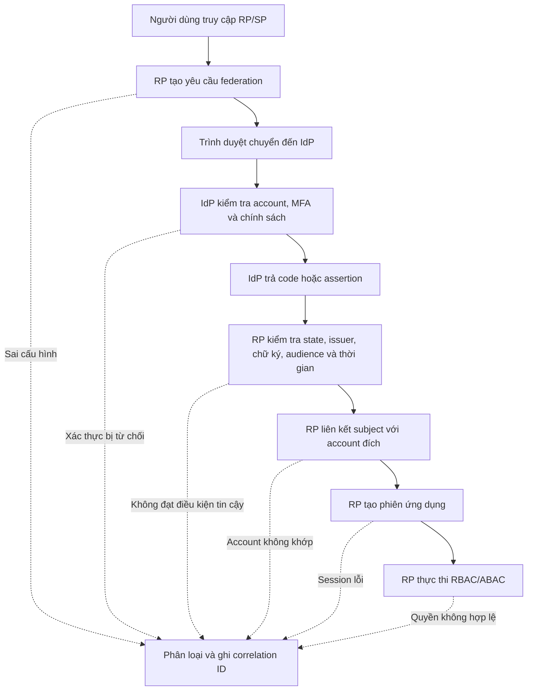

# Xử lý federation failure trong Identity and Access Management

**Federation failure** là tình huống một luồng đăng nhập liên kết giữa **Identity Provider (IdP)** và **Relying Party/Service Provider (RP/SP)** không hoàn thành đúng yêu cầu bảo mật hoặc nghiệp vụ. Lỗi có thể xảy ra ở chuyển hướng, xác thực, trao đổi mã/token, kiểm tra chữ ký, ánh xạ danh tính, tạo phiên ứng dụng hoặc bước xác định quyền truy cập. Trong **IAM**, xử lý federation failure không chỉ nhằm giúp người dùng đăng nhập lại, mà còn phải **tránh bỏ qua các bước xác minh tin cậy** và bảo đảm vòng đời **Joiner–Mover–Leaver (JML)** được thực thi chính xác.

Ví dụ, nhân viên vừa đổi bộ phận đăng nhập qua SSO nhưng ứng dụng báo không tìm thấy account. Đây có thể là lỗi provisioning hoặc liên kết danh tính, chứ không nhất thiết là mật khẩu sai. Ngược lại, ứng dụng báo token không hợp lệ do sai audience là **tín hiệu bảo mật**: không được tạm bỏ kiểm tra audience để “sửa nhanh”. Cách xử lý đúng bắt đầu bằng phân loại lỗi và tìm bằng chứng trên từng thành phần.

## 1. Phân biệt lỗi xác thực, federation, provisioning và authorization

| Nhóm lỗi | Dấu hiệu | Hướng điều tra |
| --- | --- | --- |
| **Authentication failure** | IdP từ chối vì authenticator, MFA hoặc chính sách rủi ro | Trạng thái account, phương thức MFA, thời gian và log IdP |
| **Federation protocol failure** | Sai `state`, code, chữ ký, issuer, audience, redirect hoặc thời hạn | Cấu hình OIDC/SAML, metadata, trust, đồng hồ và giao dịch |
| **Account correlation failure** | Token hợp lệ nhưng RP không ánh xạ được subject tới account | Liên kết `iss`+`sub`, NameID, external ID và quy tắc mapping |
| **Provisioning failure** | RP chưa có user/nhóm hoặc tài khoản disabled sai | SCIM/connector, trạng thái thực tế tại đích |
| **Authorization failure** | Đăng nhập thành công nhưng truy cập tài nguyên bị từ chối | RBAC/ABAC, entitlement, chính sách và thuộc tính |
| **Session/logout failure** | Phiên tạo không được hoặc phiên cũ vẫn dùng được sau Leaver | Cookie, session store, token, revoke và logout liên kết |
| **Availability failure** | IdP, DNS, mạng hoặc hệ thống trao đổi token không sẵn sàng | Kết nối, lỗi dịch vụ, cache metadata và kế hoạch dự phòng |

Một thông báo chung “SSO failed” có thể che nhiều nguyên nhân. **Không tự động cấp thêm quyền, tạo account mới hoặc vô hiệu hóa kiểm tra bảo mật** trước khi xác định lỗi thuộc lớp nào.

## 2. Mô hình các điểm có thể thất bại

Trong **OIDC Authorization Code Flow**, có thể xuất hiện lỗi tại authorization endpoint, callback, token endpoint hoặc bước kiểm tra ID token. Với **SAML 2.0**, lỗi thường liên quan AuthnRequest, assertion, binding, chữ ký XML, metadata hoặc ACS. Các giao thức có cơ chế và trường khác nhau: không thể áp dụng một bộ kiểm tra token chung rồi cho rằng cả OIDC và SAML đều đúng.

## 3. Quy trình xử lý failure có kiểm soát

### Bước 1 — Ghi nhận ngữ cảnh tối thiểu

Thu thập thời điểm, ứng dụng, tenant, loại client, môi trường, IdP issuer, mã lỗi chuẩn hóa, mã tương quan giao dịch, bước thất bại và phiên bản cấu hình. Có thể hỏi người dùng về hành vi quan sát được, nhưng không yêu cầu gửi mật khẩu, mã OTP, cookie phiên, authorization code hoặc token thô qua ticket.

**Đồng bộ thời gian** giữa hệ thống và log rất quan trọng. Chênh lệch giờ gây khó nối sự kiện, đồng thời có thể tạo lỗi ở `exp`, `nbf`, điều kiện thời gian SAML và thời gian sống của authorization code.

### Bước 2 — Phân lớp lỗi thay vì thử lại vô hạn

Nếu lỗi mạng tạm thời, có thể retry theo chính sách với giới hạn và backoff. Nếu lỗi là **chữ ký không hợp lệ, sai audience, issuer không được tin cậy hoặc replay**, không được thử vượt bảo mật hay cho phép truy cập tạm thời. Nếu lỗi do account chưa được provisioning, cần kiểm tra trạng thái JML trước khi tạo hoặc kích hoạt user.

Phân loại lỗi thành **transient** (có thể hồi phục), **configuration** (cần sửa hợp đồng tích hợp), **identity data** (sai mapping/trạng thái), **security rejection** (phải giữ từ chối) và **incident** (có chỉ báo tấn công hoặc rò rỉ credential).

### Bước 3 — Xác minh từng ranh giới tin cậy

Kiểm tra lần lượt: RP đã tạo request hợp lệ chưa; IdP có nhận và xác thực đúng account không; phản hồi có về đúng callback/ACS không; RP đã xác minh toàn bộ điều kiện giao thức chưa; subject được liên kết đúng identity không; phiên ứng dụng có tạo được không; và policy tại tài nguyên có cho phép truy cập không.

Tách **xác thực thành công** với **authorization thành công**. Nếu IdP phát ID token hợp lệ nhưng user không có quyền đối với dự án, kết quả bị từ chối có thể là **đúng chính sách**, không phải federation failure cần bỏ qua.

### Bước 4 — Khắc phục đúng nguồn và kiểm tra sau thay đổi

Nếu sai metadata hoặc khóa ký, sửa cấu hình trust theo quy trình thay đổi và kiểm thử bằng token/assertion hợp lệ. Nếu account thiếu ở SaaS, sửa provisioning/SCIM và đọc lại tại ứng dụng. Nếu mapping sai, xác minh stable ID và chính sách liên kết tài khoản; không tự gộp bằng email hiển thị.

Sau khắc phục, thử cả **positive path** (người hợp lệ đăng nhập và thực hiện quyền được phép) lẫn **negative path** (issuer khác, sai audience, token hết hạn, người đã Leaver hoặc quyền đã Mover bị từ chối). Đây là cách tránh biến một lỗi tính sẵn sàng thành lỗ hổng bảo mật.

## 4. Lỗi OIDC thường gặp

| Lỗi | Nguyên nhân có thể | Cách tiếp cận an toàn |
| --- | --- | --- |
| `redirect_uri` không khớp | URI ở request khác URI đã đăng ký | So khớp URI chính xác với cấu hình client; không dùng wildcard tùy tiện |
| `state` sai/mất | Phiên trình duyệt, cookie, callback hoặc request bị thay đổi | Kiểm tra ràng buộc request–response và chống CSRF; không bỏ kiểm tra |
| Authorization code hết hạn/đã dùng | Chậm callback hoặc replay | Phát sinh lại luồng hợp lệ, không tái sử dụng code |
| PKCE verifier không khớp | Lưu trữ `code_verifier` lỗi hoặc bị tráo | Xác minh state của client và triển khai PKCE đúng chuẩn |
| ID token sai `iss`/`aud` | Chọn sai IdP hoặc client | Sửa cấu hình trust, từ chối token không đúng đối tượng |
| Không xác minh được chữ ký | JWKS/thuật toán/key rotation không khớp | Tải khóa từ issuer tin cậy theo quy trình, không chấp nhận `alg` tùy ý |
| Token `exp`/`nbf` không hợp lệ | Đồng hồ lệch, token quá hạn | Đồng bộ giờ, áp dụng giới hạn clock skew có kiểm soát |
| `nonce` không hợp lệ khi cần | Response không gắn với yêu cầu ban đầu | Từ chối và kiểm tra lưu trạng thái giao dịch |

Đối với token JWT, **decode được payload không đồng nghĩa token hợp lệ**. Phải xác minh chữ ký, thuật toán được phép, issuer, audience, thời hạn và các claim liên quan đến luồng thực tế. **ID token dành cho client** không được đánh đồng với access token dùng cho API; ứng dụng phải xác định loại token, bên nhận và mục đích trước khi chấp nhận.

Khi cập nhật cấu hình issuer/JWKS, cần quan tâm **key rotation**. Cache khóa ký có thời hạn hoặc làm mới bất thường có thể gây lỗi xác minh; tuy vậy việc chấp nhận khóa mới phải dựa trên nguồn metadata tin cậy, không lấy khóa trực tiếp từ header token do bên gửi tùy ý chỉ định.

## 5. Lỗi SAML thường gặp

| Lỗi | Điều cần xác minh |
| --- | --- |
| Assertion signature invalid | Chữ ký trên phần tử phù hợp, khóa tin cậy, tránh XML signature wrapping |
| Issuer/entity ID mismatch | IdP đúng quan hệ đã thiết lập |
| AudienceRestriction không khớp | Assertion dành đúng SP |
| Destination/Recipient/ACS sai | Phản hồi đến đúng endpoint đã khai báo |
| `InResponseTo` không khớp | Phản hồi tương ứng request do SP khởi tạo khi áp dụng |
| `NotBefore`/`NotOnOrAfter` sai | Thời gian đồng bộ và hiệu lực assertion |
| NameID/attribute mapping không tìm thấy account | Stable identifier, định dạng thuộc tính và quy tắc liên kết |
| Assertion replay | Theo dõi ID assertion và chống sử dụng lại trong cửa sổ hiệu lực |

Đặc biệt, **không vô hiệu hóa xác minh chữ ký hoặc điều kiện audience để khôi phục dịch vụ**. Nếu IdP vừa xoay chứng thư, nhóm vận hành cần phối hợp xác minh metadata/chứng thư, thời gian chuyển tiếp và hiệu lực của khóa cũ.

Trong mô hình nhiều tenant, cấu hình SP/IdP phải ràng buộc rõ tenant; nếu không, một assertion hợp lệ cho tenant A có nguy cơ bị gắn vào account tenant B khi mapping lỏng lẻo.

## 6. Lỗi account correlation và provisioning

Một người đăng nhập thành công nhưng RP báo “User not found” thường cần kiểm tra **liên kết danh tính** hoặc account ở ứng dụng:

1. Kiểm tra `iss` và `sub` trong OIDC, hoặc NameID/định danh SAML đã được thiết kế.
2. Đối chiếu external ID, account ID nội bộ, tenant, trạng thái nhân sự/hợp đồng.
3. Xác định account nên được tạo trước qua **SCIM** hay bằng cơ chế **just-in-time (JIT) provisioning** nếu ứng dụng hỗ trợ.
4. Kiểm tra lỗi connector, phân trang, mapping nhóm, role và việc ứng dụng dùng tên thuộc tính khác.
5. Đọc lại account đích sau thay đổi, tránh chỉ tin thông báo `success` của workflow.

**Không tự tạo account mới từ mọi assertion có chữ ký hợp lệ.** Một IdP có thể xác thực nhân sự ngoài phạm vi được phép sử dụng ứng dụng. JIT provisioning phải tuân theo chính sách điều kiện được cấp quyền, hợp đồng và hạn sử dụng.

Khi email đổi sau Mover, mapping chỉ theo email có thể tạo account trùng. Nên dùng định danh ổn định theo issuer và hợp đồng federation, đồng thời xử lý các trường hợp ambiguous account mapping bằng điều tra có kiểm soát.

## 7. Federation failure qua Joiner–Mover–Leaver

| Giai đoạn | Failure tiêu biểu | Điều cần bảo vệ |
| --- | --- | --- |
| **Joiner** | IdP account đã có, RP chưa được tạo hoặc chưa kích hoạt | Không cấp trước ngày hiệu lực, kiểm tra entitlement ban đầu |
| **Mover** | Claim nhóm mới nhưng role cũ vẫn còn hoặc mapping sai | Thu hồi quyền cũ theo RBAC/ABAC, tránh tích lũy đặc quyền |
| **Leaver** | IdP đã disable nhưng phiên RP/token vẫn hoạt động | Chặn truy cập thực tế, không chỉ chặn đăng nhập mới |
| **Rejoiner** | Subject/account cũ được tái sử dụng hoặc liên kết sai | Kiểm tra proofing, binding và quyền trước khi kích hoạt |

**Joiner:** nếu đăng nhập bị từ chối do chưa đến ngày bắt đầu, không phải mọi trường hợp đều cần “sửa SSO”. Trạng thái từ chối có thể đúng chính sách. Cần đối chiếu thời điểm hiệu lực và điều kiện enrollment.

**Mover:** nếu IdP thành công nhưng ứng dụng từ chối vì thiếu role mới, hãy sửa entitlement theo phê duyệt. Không giải quyết bằng cách cấp `admin` hoặc phục hồi nhóm cũ. Nếu access token chứa claim cũ, xem xét kiểm soát tại policy enforcement point và thời hạn token.

**Leaver:** thành công ở khâu logout hoặc disable IdP chưa chứng minh phiên tại RP đã mất hiệu lực. Cần thu hồi hoặc chặn session ứng dụng, refresh token, quyền cục bộ, API credential và kiểm chứng hành vi truy cập. Token tự chứa có thể còn được chấp nhận đến hạn nếu hệ thống không có cơ chế kiểm tra trạng thái bổ sung.

## 8. Vấn đề với SSO logout và phiên

**Federated login** và **federated logout** thường có mức độ hỗ trợ khác nhau. IdP có thể xóa phiên SSO của mình nhưng một RP vẫn giữ cookie phiên riêng. OIDC và SAML có các cơ chế logout tương ứng, nhưng phải kiểm tra khả năng tích hợp cụ thể, phản hồi bất đồng bộ và xử lý lỗi tại từng ứng dụng.

Ví dụ: nhân viên logout từ cổng công ty, sau đó quay lại CRM bằng tab còn mở và vẫn truy cập được. Không thể kết luận chỉ từ màn hình logout rằng mọi phiên đã bị hủy. Với dữ liệu nhạy cảm và sự kiện Leaver, cần xác minh khả năng **từ chối truy cập thực tế tại CRM/API**, không chỉ trạng thái của IdP.

Nếu xác thực liên kết đang lỗi, không nên cấp “mật khẩu tạm dùng chung” cho mọi nhân viên như phương án dự phòng. Các cơ chế break-glass cần tách riêng, giới hạn quyền, giới hạn thời gian, bảo vệ MFA, có giám sát và chỉ áp dụng theo chính sách sự cố.

## 9. Xử lý IdP outage và sự cố trust

Đối với IdP không sẵn sàng, tổ chức cần phân biệt **khả năng hoạt động của phiên hiện tại** với **khả năng đăng nhập mới**. Một số ứng dụng vẫn phục vụ phiên có hiệu lực, nhưng đăng nhập mới hoặc thao tác yêu cầu step-up có thể thất bại. Không được tự kéo dài hạn token không kiểm soát hoặc bỏ điều kiện xác thực để giữ dịch vụ hoạt động.

Biện pháp vận hành có thể bao gồm:

- Giám sát IdP discovery/metadata, DNS, TLS, endpoint ủy quyền và token.
- Định tuyến dự phòng hoặc high availability đã được thiết kế và kiểm thử trước.
- Cache metadata/JWKS với thời hạn và chiến lược làm mới phù hợp, không chấp nhận khóa ngoài trust.
- Thông báo tới người dùng với thông tin không tiết lộ nội bộ nhạy cảm.
- Cơ chế khẩn cấp riêng cho tác vụ thiết yếu, được phê duyệt và giám sát.
- Sau khôi phục, đối soát đăng nhập, session, tài khoản và quyền tồn đọng.

Nếu nghi khóa ký IdP bị lộ hoặc assertion bị giả mạo, xử lý như **sự cố an ninh**: đánh giá phạm vi tin cậy, xoay khóa, cập nhật RP, kiểm tra session/token bị ảnh hưởng và lưu bằng chứng. “Chạy lại sau vài phút” không giải quyết rủi ro nguồn tin cậy đã bị xâm phạm.

## 10. Account dịch vụ, workload federation và failure

**Workload identity federation** khác luồng đăng nhập của con người: một ứng dụng hoặc job dùng danh tính kỹ thuật từ nền tảng phát hành để nhận token ngắn hạn. Lỗi thường liên quan **issuer, audience, subject binding, claim về môi trường, token exchange, scope hoặc trust policy**.

Ví dụ, job báo cáo chạy ở môi trường thử nghiệm nhưng yêu cầu token sản xuất; việc từ chối vì sai audience/môi trường là kết quả đúng. Không nên nới policy để cho mọi workload cùng nhận token sản xuất. Cần xác minh workload ID, service owner, môi trường, phạm vi API và quyền tối thiểu.

Khi kỹ sư chịu trách nhiệm workload nghỉ việc, lỗi token phát sinh không có nghĩa cần phục hồi token cá nhân của kỹ sư ấy. Cần chuyển ownership, thu hồi quyền cá nhân trong CI/CD, xoay credential có rủi ro và kiểm tra trust giữa workload với dịch vụ đích.

## 11. Runbook xử lý nhanh và tiêu chí đóng lỗi

| Bước | Câu hỏi | Bằng chứng |
| --- | --- | --- |
| 1. Thu nhận | Lỗi xảy ra ở RP, IdP, callback hay API? | Timestamp, mã lỗi, correlation ID |
| 2. Xác định phạm vi | Một account, một tenant hay toàn bộ ứng dụng? | Thống kê số người bị ảnh hưởng và tín hiệu giám sát |
| 3. Kiểm tra trust | Issuer/audience/chữ ký/thời gian có hợp lệ? | Kết quả xác minh giao thức, phiên bản metadata |
| 4. Kiểm tra identity | Subject đã gắn đúng account và quan hệ JML? | Mapping, trạng thái nguồn và account đích |
| 5. Kiểm tra quyền | Đây là lỗi đăng nhập hay từ chối RBAC/ABAC hợp lệ? | Policy decision và entitlement thực tế |
| 6. Khắc phục | Cần sửa config, connector, dữ liệu hay ứng phó sự cố? | Ticket thay đổi, owner và phê duyệt |
| 7. Xác nhận | Luồng hợp lệ hoạt động và luồng bất hợp lệ vẫn bị chặn? | Positive/negative test, readback |
| 8. Đóng | Có ngoại lệ hoặc truy cập tồn dư chưa xử lý? | Audit, thời hạn, người chịu trách nhiệm |

**Chỉ báo thành công không phải là “người dùng đã đăng nhập được bằng mọi giá”.** Một lỗi được xử lý thành công khi **luồng hợp lệ hoạt động**, **luồng giả mạo hoặc không đủ điều kiện vẫn bị từ chối** và thay đổi đã được kiểm chứng ở đúng phạm vi.

## 12. Kiểm toán và quan sát vận hành

Nên theo dõi tỷ lệ lỗi theo giao thức, issuer, ứng dụng, tenant, loại client, bước xử lý, phiên bản cấu hình và nhóm người dùng. Những chỉ số hữu ích gồm **OIDC callback failures**, **SAML signature failures**, lỗi token exchange, số account correlation không chắc chắn, SCIM provisioning delay, thời gian khôi phục đăng nhập và số quyền tồn dư sau Mover/Leaver.

Audit cần ghi người hoặc workload liên quan theo chính sách riêng tư, timestamp, correlation ID, nguồn/đích, loại lỗi, quyết định và thao tác khắc phục. **Không ghi authorization code, ID token, access token, refresh token, assertion thô chứa thông tin nhạy cảm, mật khẩu hay private key vào log**. Nếu cần phân tích đặc biệt, dùng kênh thu thập bảo mật có phân quyền và thời hạn lưu chặt chẽ.

## 13. Câu hỏi tự kiểm tra

**Tình huống A:** OIDC trả token có chữ ký hợp lệ nhưng `aud` thuộc client khác. Nên bỏ kiểm tra audience để khôi phục đăng nhập không? **Không.** Đây là ranh giới tin cậy bắt buộc; cần sửa cấu hình hoặc luồng phát hành.

**Tình huống B:** SAML assertion hợp lệ nhưng không tìm thấy user tại CRM. Có nên tự cấp role admin? **Không.** Phải kiểm tra liên kết identity, trạng thái JML và cơ chế provisioning được duyệt.

**Tình huống C:** Sau Mover, IdP phát claim nhóm mới nhưng ERP còn role tài chính cũ. Đây là lỗi xác thực không? **Không chủ yếu.** Đây là sai lệch entitlement cần thu hồi và đối soát tại ERP.

**Tình huống D:** IdP bị outage và ứng dụng đề xuất tắt xác minh chữ ký để người dùng tiếp tục làm việc. Có chấp nhận không? **Không.** Cần phương án sẵn sàng cao hoặc break-glass được thiết kế riêng, không hạ bỏ trust.

**Tình huống E:** Leaver đã bị disable IdP nhưng cookie CRM cũ vẫn truy cập được. Federation đã bảo đảm thu hồi quyền chưa? **Chưa.** Cần xử lý session và quyền tại ứng dụng, kiểm chứng truy cập bị từ chối.

## Ghi nhớ

**Xử lý federation failure** là chẩn đoán có hệ thống từ **request → IdP authentication → OIDC/SAML trust validation → account correlation → session → authorization**. Phải phân biệt lỗi tính sẵn sàng với **từ chối đúng chính sách**, không nới lỏng issuer, audience, chữ ký, state hay kiểm tra quyền để sửa nhanh. Trong **IAM Joiner–Mover–Leaver**, kết hợp **IdP/SSO, SCIM, RBAC/ABAC, quản trị workload và audit** giúp khôi phục đăng nhập hợp lệ đồng thời duy trì việc thu hồi quyền và kiểm soát truy cập tồn dư.
