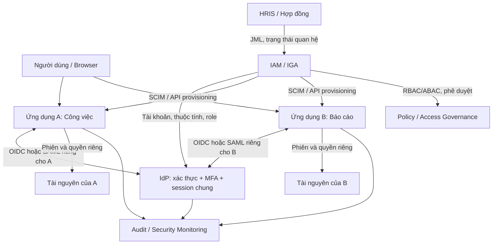
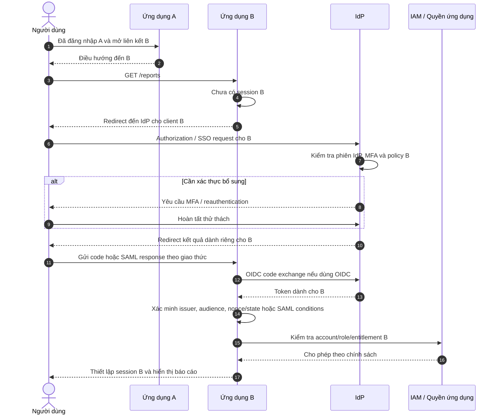

# SSO giữa ứng dụng trong vòng đời danh tính IAM

## 1. SSO giữa ứng dụng là gì?

**Single Sign-On (SSO) giữa ứng dụng** là khả năng một người dùng **đăng nhập vào nhiều ứng dụng dựa trên cùng một quan hệ tin cậy với hệ thống xác thực tập trung**, mà không phải nhập lại thông tin xác thực ở mỗi ứng dụng trong những điều kiện phiên và chính sách cho phép.

Ví dụ: một nhân viên mở **ứng dụng A** để quản lý công việc, sau đó nhấp liên kết sang **ứng dụng B** để xem báo cáo. Nếu cả hai ứng dụng đều tin cậy cùng một **Identity Provider (IdP)** và phiên xác thực tại IdP còn hợp lệ, B có thể hoàn thành giao thức đăng nhập qua IdP mà không yêu cầu nhân viên nhập lại mật khẩu hoặc MFA. B vẫn phải **tự xác minh kết quả xác thực** và thiết lập phiên ứng dụng B.

Điều này khác xa mô hình “ứng dụng A gửi mật khẩu cho ứng dụng B”. **SSO tốt không yêu cầu hai ứng dụng chia sẻ mật khẩu người dùng**, không cho ứng dụng A tự cấp quyền vào B và không biến mọi phiên ứng dụng thành một phiên duy nhất.

Trong quản lý vòng đời danh tính **Joiner–Mover–Leaver (JML)**, SSO kết nối trải nghiệm đăng nhập với các nhiệm vụ IAM:

- **Joiner:** xác minh danh tính, tạo tài khoản IdP, đăng ký MFA, cấp quyền vào những ứng dụng được duyệt.
- **Mover:** cập nhật thuộc tính và role, thu hồi quyền ứng dụng cũ, kiểm soát claim hoặc phiên còn mang thông tin cũ.
- **Leaver:** chặn đăng nhập mới, thu hồi tài khoản/quyền, xử lý phiên và token vẫn còn hiệu lực tại từng ứng dụng.
- **Kiểm toán:** truy vết hành trình xác thực qua IdP và kết quả thực thi quyền tại mỗi ứng dụng để phát hiện **quyền truy cập tồn dư**.

### 1.1. Điều kiện để SSO hoạt động

SSO giữa ứng dụng thường cần:

1. Các ứng dụng có **cấu hình tin cậy với IdP**, trực tiếp hoặc qua federation broker.
2. IdP đã xác thực người dùng bằng phương thức phù hợp, có thể yêu cầu MFA.
3. Trình duyệt/client có thể thực hiện **luồng chuyển hướng hoặc trao đổi giao thức** theo thiết kế.
4. Mỗi ứng dụng xác minh thông điệp hoặc token **được phát hành cho chính mình**.
5. Danh tính được liên kết chính xác, tài khoản và quan hệ nghiệp vụ còn hợp lệ.
6. Tài nguyên cần truy cập nằm trong **phạm vi quyền mà ứng dụng đã cho phép**.

Vì vậy, **đăng nhập được qua SSO không đồng nghĩa có mọi quyền trong ứng dụng**.

## 2. Phân biệt SSO, authentication, federation, provisioning và authorization

Những khái niệm liên quan nhưng không thể thay thế lẫn nhau:

| Khái niệm | Giải quyết câu hỏi gì? | Ví dụ |
|---|---|---|
| **Identity proofing** | Người yêu cầu là ai và có đủ căn cứ để liên kết đúng danh tính không? | Xác minh nhân viên mới trước khi tạo tài khoản |
| **Authentication (AuthN)** | Người đăng nhập có chứng minh được quyền kiểm soát authenticator không? | Mật khẩu + MFA hoặc passkey |
| **SSO** | Làm sao dùng kết quả xác thực đáng tin để truy cập nhiều ứng dụng thuận tiện? | A và B đăng nhập qua cùng IdP |
| **Federation** | Làm sao các miền quản trị tin và trao đổi kết quả xác thực với nhau? | Ứng dụng đối tác tin IdP của doanh nghiệp |
| **Provisioning** | Làm sao tạo, cập nhật hoặc khóa tài khoản/nhóm ở hệ thống đích? | SCIM đồng bộ nhân viên đến SaaS |
| **Authorization (AuthZ)** | Danh tính được phép làm gì trong ứng dụng? | Chỉ xem báo cáo dự án đã phân công |
| **Account reconciliation** | Trạng thái tài khoản/quyền thực tế có khớp chính sách không? | Phát hiện tài khoản Leaver vẫn active ở SaaS |

**OIDC** là một lớp xác thực danh tính xây trên OAuth 2.0; **SAML 2.0** là một cơ chế federation thường dùng trong doanh nghiệp. **OAuth 2.0** chủ yếu là khuôn khổ cấp quyền truy cập được ủy quyền, **không phải mặc nhiên là một giao thức đăng nhập thay cho OIDC**.

### 2.1. SSO không có nghĩa “một token dùng cho mọi ứng dụng”

Một ID token phát hành cho **ứng dụng A** không nên bị A chuyển thẳng sang B để B xem đó là bằng chứng đăng nhập hợp lệ. Token có **issuer, audience, thời hạn, chữ ký và mục đích** cụ thể. Trong SSO dựa trên trình duyệt, **B tự khởi tạo giao dịch đăng nhập với IdP** để nhận kết quả được phát hành riêng cho B.

Tương tự, một access token dành cho API X **không tự nhiên được phép** gọi API Y. Mỗi bên nhận cần kiểm tra audience, scope và các điều kiện ủy quyền phù hợp.

## 3. Kiến trúc SSO giữa hai ứng dụng

Giả sử người dùng dùng **Ứng dụng A — Cổng công việc** và **Ứng dụng B — Hệ thống báo cáo**, với một IdP tập trung.



Có **ba lớp trạng thái quan trọng**:

| Lớp | Ai quản lý? | Ví dụ trạng thái |
|---|---|---|
| **Phiên tại IdP** | IdP | Người dùng đã xác thực, thời điểm và phương thức MFA |
| **Phiên ứng dụng A** | Ứng dụng A | Cookie/session riêng, role và quyền của A |
| **Phiên ứng dụng B** | Ứng dụng B | Cookie/session riêng, role và quyền của B |

IdP có thể cho trải nghiệm SSO khi B chuyển trình duyệt tới IdP. Tuy nhiên, **phiên A và B không tự động là cùng một cookie**. Chúng có thể khác miền, thời hạn, chính sách bảo mật và cơ chế logout.

### 3.1. Mối quan hệ tin cậy

Mỗi ứng dụng cần cấu hình IdP theo giao thức:

- **OIDC:** issuer, client ID, redirect URI, public keys/JWKS, flow, scope và chính sách token.
- **SAML:** entity ID, metadata, endpoint, certificate/signing policy, audience, Recipient/Destination và các yêu cầu đối chiếu.
- **Đồng bộ tài khoản:** mapping subject ID và account ID ở ứng dụng.
- **Phân quyền:** role, group, ABAC và phê duyệt riêng cho tài nguyên đích.

**Việc cả A và B cùng hiển thị nút “Login with Company” chưa chứng minh cấu hình đủ an toàn**; từng ứng dụng phải xác thực đúng IdP và thông điệp dành cho mình.

## 4. Người dùng chuyển từ ứng dụng A sang B như thế nào?

Giả sử nhân viên đã đăng nhập A và có phiên IdP còn hiệu lực.

1. Người dùng nhấp liên kết `https://reports.example.org` từ A hoặc mở B trực tiếp.
2. B kiểm tra **phiên riêng của B**. Nếu chưa có, B bắt đầu một giao dịch đăng nhập với IdP.
3. Browser chuyển hướng đến IdP với yêu cầu chứa thông tin client và ngữ cảnh giao dịch.
4. IdP kiểm tra **phiên IdP** và chính sách của B; nếu đã đáp ứng, có thể không yêu cầu nhập lại thông tin xác thực.
5. IdP trả về kết quả giao thức dành cho **B**, chẳng hạn authorization code của OIDC hoặc SAML response.
6. B kiểm tra đầy đủ bằng chứng và ràng buộc giao dịch, liên kết với đúng tài khoản ứng dụng.
7. B đánh giá trạng thái tài khoản và **quyền truy cập B**, tạo phiên riêng của B nếu được phép.
8. Người dùng vào B mà không phải thực hiện lại những bước đăng nhập không cần thiết.



Điểm cần nhớ: **A không truyền mật khẩu hoặc session cookie của mình cho B**. A chỉ có thể đưa người dùng đến B. Việc B tạo session phải dựa trên **giao thức đăng nhập độc lập và kiểm tra quyền**.

## 5. OIDC Authorization Code Flow trong SSO giữa ứng dụng

**OpenID Connect (OIDC)** thường được sử dụng cho các ứng dụng web và hệ thống hiện đại. Với luồng Authorization Code, ứng dụng B (OIDC Relying Party/client) chuyển trình duyệt đến Authorization Server/OpenID Provider, nhận **authorization code** rồi đổi code thành token qua kênh phù hợp.

### 5.1. Các bước cốt lõi

1. B tạo giao dịch OIDC với `state` khó đoán để ràng buộc phản hồi vào đúng phiên.
2. B sử dụng `nonce` khi cần cho quy trình xác thực OIDC để liên kết ID token với giao dịch; bảo đảm xác minh đúng theo flow và policy.
3. Với client dùng PKCE, B tạo `code_verifier`, gửi `code_challenge` và chỉ dùng verifier ở bước đổi code.
4. Browser được chuyển tới authorization endpoint của **IdP đã tin cậy**.
5. Nếu phiên IdP đã đủ mức xác thực, người dùng không cần nhập mật khẩu; nếu chưa đủ, IdP yêu cầu bước bổ sung.
6. IdP chuyển **authorization code** về redirect URI đã đăng ký của B.
7. B đổi code qua token endpoint, theo kiểu xác thực client và PKCE thích hợp.
8. B **xác minh ID token** rồi quyết định có tạo session ứng dụng hay không.
9. B áp dụng authorization cho tài nguyên bên trong B.

### 5.2. Ví dụ thông điệp ở mức khái niệm

Ví dụ URL được viết thành từng dòng để minh họa các tham số; **không dùng các chuỗi giá trị giả này trong sản xuất**.

```text
GET https://idp.example.org/authorize?
    response_type=code&
    client_id=reports-web&
    redirect_uri=https%3A%2F%2Freports.example.org%2Foidc%2Fcallback&
    scope=openid%20profile&
    state=<unpredictable-state>&
    nonce=<unpredictable-nonce>&
    code_challenge=<derived-challenge>&
    code_challenge_method=S256
```

Ở bước đổi code, B sử dụng `code_verifier` cùng các tham số mà provider yêu cầu. **Authorization code ngắn hạn không phải access token và không được dùng trực tiếp để gọi API nghiệp vụ.**

### 5.3. Những thông tin B phải kiểm tra

| Kiểm tra | Mục đích |
|---|---|
| `issuer (iss)` | Token đến từ đúng IdP được cấu hình |
| `audience (aud)` | ID token được phát hành cho client B, không phải client A |
| Chữ ký và thuật toán được chấp thuận | Ngăn token giả và lỗi xác minh thuật toán |
| `exp`, `iat` và điều kiện thời gian | Không dùng token hết hạn hoặc bất thường |
| `nonce` nếu được sử dụng | Ràng buộc ID token với giao dịch đăng nhập |
| `state` | Chống trộn giao dịch/CSRF trong authorization response |
| `redirect_uri` và PKCE | Ngăn nhận code sai client/redirect hoặc bị chiếm |
| Subject liên kết với issuer | Tránh ghép nhầm tài khoản của người khác |
| `acr`, `amr`, `auth_time` khi chính sách cần | Đánh giá MFA hoặc mức xác thực đã đạt, có còn mới không |

Các kiểm tra trên là **nhóm kiểm soát đại diện**, không thay thế hướng dẫn triển khai OIDC và cấu hình provider cụ thể. Kiểm tra ở app B phải dùng thư viện giao thức đã được kiểm chứng, không tự viết các bước xác minh chữ ký/token sơ sài.

### 5.4. ID token và access token dùng khác nhau

**ID token** diễn đạt sự kiện xác thực cho OIDC client và không nên bị xem như bearer token chung cho API. **Access token** dành cho tài nguyên/API được cấp quyền theo scope và audience riêng. Sự phân biệt này đặc biệt quan trọng khi B gọi API hoặc khi A muốn nhúng nội dung từ B.

## 6. SAML 2.0 khi các ứng dụng dùng chung IdP

Nhiều ứng dụng doanh nghiệp sử dụng **SAML 2.0**, trong đó ứng dụng là **Service Provider (SP)** và IdP đưa ra **SAML assertion** về kết quả xác thực.

### 6.1. SP-initiated SSO

Một luồng phổ biến:

1. Người dùng truy cập **ứng dụng B**, chưa có phiên.
2. B tạo `AuthnRequest` và chuyển trình duyệt đến IdP.
3. IdP nhận diện B và kiểm tra phiên xác thực hiện tại.
4. Nếu cần, IdP yêu cầu đăng nhập hoặc MFA; nếu không, tận dụng phiên hiện có.
5. IdP trả `SAML Response` có assertion theo binding được cấu hình.
6. B kiểm tra chữ ký, issuer, audience, recipient, thời gian và ràng buộc phản hồi với request.
7. B ánh xạ subject và đánh giá quyền, rồi tạo session riêng.

### 6.2. Những điều phải xác minh với SAML

- **Chữ ký** bằng certificate/trust metadata đúng; không chấp nhận assertion giả hoặc response không đúng chính sách ký.
- **Issuer** và **AudienceRestriction** dành cho SP B.
- **Recipient/Destination** và endpoint nhận phản hồi.
- **InResponseTo** đối với luồng SP-initiated, có chống replay và xử lý request ID.
- **NotBefore/NotOnOrAfter** và giới hạn phiên thích hợp.
- **SubjectConfirmation** đúng loại và điều kiện.
- **NameID hoặc thuộc tính định danh** theo hợp đồng mapping, không hợp nhất tài khoản dựa vào email tùy ý.
- Chống **XML signature wrapping** và các lỗi parser, dùng thư viện SAML đáng tin.

**SAML assertion dành cho B không được dùng trực tiếp làm chứng cứ đăng nhập vào A.** Mỗi SP có ranh giới tin cậy, audience và phiên riêng, dù cùng IdP.

### 6.3. IdP-initiated SSO

Người dùng cũng có thể chọn ô ứng dụng B từ **portal của IdP**. Một số hệ thống dùng IdP-initiated SAML, nơi B không có `AuthnRequest` ban đầu để đối chiếu. Luồng này cần đánh giá kỹ khả năng ràng buộc giao dịch và chống unsolicited response, hoặc ưu tiên SP-initiated khi chính sách yêu cầu.

Không mặc định mọi ứng dụng hoặc IdP hỗ trợ cùng một mức đảm bảo ở cả hai chế độ.

## 7. Phiên đăng nhập: IdP session khác application session

Một trải nghiệm SSO dễ khiến người dùng nghĩ “đã đăng nhập một lần thì mọi nơi đã đăng nhập”. Về kỹ thuật, có thể tồn tại nhiều phiên:

| Phiên / trạng thái | Thuộc bên nào? | Tác động thường gặp |
|---|---|---|
| **IdP browser session** | IdP | Có thể cho phép B đăng nhập không nhập lại credential |
| **Application A session** | A | Cho phép truy cập A theo policy A |
| **Application B session** | B | Cho phép truy cập B theo policy B |
| **OIDC refresh token** | Authorization server/client được cấp | Có thể cấp access token mới theo policy |
| **OIDC access token** | API/resource server theo audience | Cho phép gọi API nếu còn hợp lệ và đủ quyền |
| **SAML assertion** | Được phát hành cho SP cụ thể | Bằng chứng thiết lập phiên, không phải cookie chung |
| **Local API key / PAT** | Ứng dụng cụ thể | Có thể hoạt động độc lập với phiên IdP |

**Không nên chia sẻ một cookie phiên trên nhiều ứng dụng khác miền** để thay cho giao thức SSO. Cookie có scope và bảo mật riêng; dùng cookie chung sai cách có thể tạo rủi ro chiếm phiên hoặc khó cô lập khi một ứng dụng bị xâm nhập.

### 7.1. Vì sao B có thể vẫn hỏi đăng nhập lại?

Các trường hợp hợp lý gồm:

- Phiên IdP đã hết hạn hoặc bị thu hồi.
- B yêu cầu **authentication freshness** cao hơn.
- B cần MFA mạnh hơn A theo rủi ro tài nguyên.
- User đã đổi tài khoản, tenant hoặc môi trường browser.
- Chính sách `prompt=login`, `max_age` hoặc ngữ cảnh xác thực yêu cầu thao tác mới.
- Browser chặn một cơ chế kiểm tra phiên ngầm mà ứng dụng dựa vào.
- B chưa được cấp quyền hoặc tài khoản B chưa được provision.

Đăng nhập lại **không tự động chứng minh SSO bị lỗi**; có thể là kết quả đúng của chính sách.

### 7.2. Third-party cookie và silent authentication

Một số giải pháp cũ cố kiểm tra IdP session trong iframe hoặc dùng cookie bên thứ ba để **silent authentication**. Trình duyệt hiện đại có chính sách hạn chế cookie/iframe theo ngữ cảnh, vì vậy cách này không phải bảo đảm bền vững.

**Top-level redirect** qua IdP vẫn là mô hình phổ biến cho tương tác đăng nhập. Ứng dụng phải thiết kế xử lý lỗi kiểm tra phiên, timeout và các chính sách browser thay vì coi thất bại trong iframe là bằng chứng người dùng chưa từng đăng nhập.

## 8. MFA và step-up khi đi từ A sang B

SSO giúp tái sử dụng **kết quả xác thực được IdP tin cậy** trong giới hạn policy, nhưng **mức xác thực mà B yêu cầu có thể cao hơn A**.

Ví dụ:

- A là cổng tin tức nội bộ, cho phép phiên thông thường.
- B là ứng dụng tài chính, yêu cầu MFA phishing-resistant và xác thực gần đây.
- Dù IdP session còn hợp lệ, B có thể đề nghị IdP **step-up authentication** trước khi tạo phiên B hoặc cho thực hiện giao dịch nhạy cảm.

### 8.1. Không suy luận “đã có MFA” chỉ từ một cờ

Một hệ thống có thể cung cấp ngữ cảnh xác thực theo OIDC/SAML, ví dụ `acr`, `amr`, `auth_time` hoặc Authentication Context. B phải xác minh:

1. Thông tin ngữ cảnh đến từ IdP được tin cậy.
2. Mức xác thực đáp ứng **policy của B**, không chỉ một nhãn bất kỳ.
3. Xác thực đủ **mới** cho giao dịch cần bảo vệ.
4. Phương thức đã dùng thực sự phù hợp, ví dụ phishing-resistant nếu cần.

**MFA enrollment** (đã đăng ký thiết bị) khác với việc **MFA authentication** thực sự được dùng trong phiên này. Một tài khoản có passkey trong hồ sơ không chứng minh lần đăng nhập hiện tại đã dùng passkey.

### 8.2. Reauthentication và quyền quản trị

Đối với hệ thống quản trị hoặc phê duyệt thanh toán, B có thể yêu cầu xác thực lại, dùng PAM, session ngắn hơn hoặc phê duyệt nghiệp vụ. **MFA mạnh không thay thế phân quyền** và không cho phép người dùng vào B nếu role chưa được chấp thuận.

## 9. Danh tính qua nhiều ứng dụng: liên kết theo khóa nào?

Ứng dụng A và B có thể dùng cùng một tên hiển thị hoặc email, nhưng **email không phải khóa danh tính bất biến**. Người dùng có thể đổi email, trùng bí danh, có nhiều hợp đồng hoặc nhiều tài khoản ở các tenant khác nhau.

### 9.1. Mô hình liên kết danh tính

Một cấu trúc minh họa:

| Lớp | Giá trị giả định | Dùng để làm gì? |
|---|---|---|
| HRIS | `worker_id = W-5210` | Khóa nhân sự trong nguồn có thẩm quyền |
| IAM | `identity_id = I-5210` | Liên kết một người với các quan hệ nghiệp vụ |
| OIDC | `(iss, sub) = (https://idp.example.org, a91f...)` | Khóa chủ thể trong phạm vi issuer |
| App A | `local_account_id = A-873` | Tài khoản nội bộ A |
| App B | `local_account_id = B-226` | Tài khoản nội bộ B |

**Cặp `(issuer, subject)`** thường là nền tảng nhận diện đáng tin của OIDC, không chỉ `sub` đứng riêng nếu ứng dụng tin nhiều issuer. Với SAML, cần chính sách xử lý NameID/thuộc tính và issuer tương ứng.

### 9.2. Account linking phải có kiểm soát

Khi một người đổi email hoặc được chuyển giữa IdP, không được tự ghép vào tài khoản B chỉ vì địa chỉ email vừa trùng với bản ghi sẵn có. Cần xác minh:

- Danh tính từ issuer tin cậy có đúng là người được cấp local account không?
- Có dấu vết provisioning/SCIM hoặc liên kết admin hợp lệ không?
- App B đã có một tài khoản thuộc một chủ thể khác dùng email tương tự chưa?
- Có thay đổi tenant hoặc pháp nhân làm thay đổi quyền hay không?

**Account takeover có thể xảy ra ở bước linking**, ngay cả khi giao thức OIDC/SAML xác minh chữ ký chính xác.

## 10. SSO không đồng nghĩa có tài khoản hoặc quyền ở B

Tại thời điểm người dùng truy cập B, có ít nhất ba câu hỏi độc lập:

1. IdP có xác thực được người dùng với mức đáp ứng policy không?
2. **Tài khoản B** có tồn tại hoặc có được tạo theo cơ chế được phép không?
3. **Quyền B** có được phê duyệt cho người dùng này hay không?

### 10.1. Provisioning trước bằng SCIM/API

IAM/IGA có thể provision user, group và thuộc tính đến B **trước lần đăng nhập đầu tiên**:

- Joiner tạo tài khoản B với trạng thái và ngày hiệu lực thích hợp.
- Mover cập nhật role/nhóm và thu hồi quyền cũ.
- Leaver disable/deprovision tài khoản B, độc lập với việc IdP còn session hay không.
- Reconciliation đọc lại account/role thực tế để phát hiện sai lệch.

SCIM chỉ hỗ trợ những thao tác mà ứng dụng B thực sự triển khai; một số role local có thể nằm ngoài SCIM.

### 10.2. Just-in-Time (JIT) provisioning

Ứng dụng B cũng có thể tạo local account **khi người dùng SSO lần đầu**. JIT provisioning cần kiểm soát:

- Chỉ chấp nhận issuer/tenant được tin cậy.
- Liên kết đúng subject, không tự chiếm account bằng email trùng.
- Xác định người dùng có quan hệ và quyền đăng nhập B hợp lệ.
- Không tự gán role admin hay quyền rộng chỉ vì đăng nhập thành công.
- Bảo đảm có cơ chế vô hiệu hóa tài khoản B khi Leaver, kể cả không đăng nhập lại.

**JIT chỉ tạo tài khoản đúng lúc, không phải Just-in-Time privileged access.** Hai thuật ngữ cùng chữ viết tắt nhưng giải quyết các vấn đề khác nhau.

### 10.3. Quyền theo RBAC/ABAC

A và B có thể đánh giá quyền khác nhau dựa trên:

- **RBAC:** vai trò/nhóm được phê duyệt.
- **ABAC:** phòng ban, dự án, tenant, phân loại dữ liệu, thời gian hoặc tình trạng quan hệ công việc.
- **IGA:** phê duyệt, Separation of Duties (SoD), hạn sử dụng ngoại lệ.
- **Deny và policy cục bộ:** hạn chế truy cập trong từng ứng dụng.

Ví dụ, người dùng có quyền **xem danh mục dự án ở A** không tự động có quyền **xuất dữ liệu khách hàng từ B**.

## 11. OIDC/SAML claims và dữ liệu quyền không nên dùng tùy tiện

IdP có thể gửi một số thuộc tính danh tính qua token hoặc assertion, nhưng **không phải mọi thuộc tính đều đáng tin cho mọi quyết định quyền**.

### 11.1. Những rủi ro thường gặp

| Thiết kế sai | Hậu quả |
|---|---|
| Dùng `email` làm duy nhất khóa account linking | Gộp nhầm người hoặc chiếm tài khoản |
| Tin trường `role=admin` từ client chưa xác thực | Cấp quyền sai |
| B dùng ID token có `aud` dành cho A | Chấp nhận token ngoài phạm vi |
| Gán quyền từ nhóm IdP mà không xác nhận source/tenant | Vượt ranh giới tin cậy |
| Sử dụng group claim cũ từ token đã phát hành lâu | Quyền Mover/Leaver không phản ánh hiện tại |
| Đưa quá nhiều PII hoặc nhóm vào assertion/token | Tăng rò rỉ thông tin, kích thước token |
| Mapping group name theo chuỗi hiển thị dễ trùng | Nhầm role hoặc tenant |
| Tin `amr=mfa` mà không hiểu chính sách IdP | Không đáp ứng yêu cầu MFA cụ thể của B |

### 11.2. Phương án đáng tin hơn

- Dùng khóa định danh ổn định và kiểm tra **issuer/audience**.
- Giảm claims xuống mức cần thiết; không phát hành dữ liệu HR nhạy cảm nếu không cần.
- Dùng **mapping theo group/role ID và policy version** thay vì tên tự khai báo.
- Với quyền nhạy cảm, ứng dụng nên kiểm tra thông tin còn hiệu lực tại điểm quyết định nếu kiến trúc hỗ trợ.
- Kiểm tra hiệu lực của hợp đồng, assignment, phê duyệt và SoD.
- Dùng TTL phù hợp, cơ chế thu hồi phiên/token và reconciliation để giảm quyền tồn dư.

## 12. Các kiểu kết nối SSO giữa ứng dụng

Có nhiều cách người dùng di chuyển giữa A và B:

| Kiểu | Cách hoạt động | Lưu ý |
|---|---|---|
| **Mở B trực tiếp** | B redirect đến IdP, tận dụng phiên IdP | Cách cơ bản và rõ ràng |
| **Link từ A sang B** | A điều hướng đến URL B; B tự làm SSO | Không gửi token của A cho B |
| **IdP application portal** | Chọn ứng dụng từ danh sách IdP | Kiểm tra mô hình SP-initiated/IdP-initiated |
| **Deep link tới tài nguyên B** | B lưu đích hợp lệ rồi hoàn thành SSO | Chống open redirect và tampering `returnUrl` |
| **Ứng dụng B nhúng trong A** | iframe/embedded app với session và cookie riêng | Browser policy, CSP/frame-ancestors, clickjacking, third-party cookies |
| **Mobile app A mở B** | Mỗi app dùng luồng OIDC phù hợp và phiên IdP/browser chung khi có | Không dùng WebView tùy tiện hoặc chia sẻ token lộ giữa apps |
| **Cross-organization federation** | B tin IdP đối tác/broker theo thỏa thuận | Cần sponsor, tenant boundary, account mapping và giới hạn quyền |

### 12.1. Deep link phải giữ đúng ý định và an toàn

Khi B yêu cầu người dùng đăng nhập trước khi mở `/reports/project-7`, ứng dụng có thể lưu đường dẫn mong muốn trong trạng thái giao dịch phía server. Sau khi nhận kết quả SSO hợp lệ, B chỉ điều hướng đến **đích nội bộ được kiểm soát và có quyền truy cập**.

**Không cho bất kỳ `returnUrl` tùy ý trỏ đến miền ngoài** nếu chưa có cơ chế kiểm tra chặt, vì có thể biến luồng SSO thành open redirect hoặc rò rỉ mã/tokens.

### 12.2. SSO và đăng nhập giữa các ứng dụng di động

Ứng dụng native thường dùng **system browser/authorization agent** theo mô hình phù hợp để tận dụng phiên IdP được bảo vệ. Dùng embedded WebView cho luồng đăng nhập có thể không đáp ứng khuyến nghị bảo mật của nền tảng/giao thức và khiến ứng dụng host quan sát credential.

Mỗi app vẫn cần client ID, redirect URI và cơ chế PKCE/token storage riêng, tránh “chuyển access token A sang B” để tạo SSO tắt.

## 13. App A gọi API của B có phải SSO không?

Không nên trộn **đăng nhập SSO cho người dùng** với **ủy quyền gọi API giữa ứng dụng**.

Giả sử A muốn gọi API của B để lấy dữ liệu thay người dùng. Đây là tình huống **OAuth 2.0 delegated authorization**, không chỉ là chuyển hướng SSO qua browser.

- Access token phải được cấp cho **đúng API/resource audience**, scope và người dùng/ứng dụng được ủy quyền.
- Backend A không nên chuyển ID token hoặc access token dành cho A sang B nếu B không phải audience.
- Nếu kiến trúc cần delegation, có thể sử dụng **token exchange hoặc on-behalf-of flow** khi authorization server và các API hỗ trợ, với chính sách và kiểm soát tin cậy rõ ràng.
- API B phải kiểm tra token, quyền và tài nguyên mục tiêu; không chỉ tin rằng A đã đăng nhập người dùng.
- Đối với tác vụ máy–máy không có người dùng, dùng **workload identity/client credentials hoặc cơ chế phù hợp**, không mượn phiên MFA của một cá nhân.

### 13.1. So sánh nhanh

| Tình huống | Đúng mô hình |
|---|---|
| Người dùng từ A mở giao diện B | B tự thực hiện OIDC/SAML login qua IdP |
| A gọi API B thay người dùng | Delegated OAuth/token exchange phù hợp, nếu được hỗ trợ |
| Worker nền gọi B không có người dùng | Workload identity và quyền máy–máy |
| B cần kiểm tra người dùng có role Finance | Authorization ở B/Policy Engine, không suy từ UI A |
| Người dùng nghỉ việc nhưng A còn refresh token | Thu hồi credential/token và kiểm tra quyền tại API |

## 14. SSO giữa ứng dụng trong Joiner lifecycle

Trong **Joiner**, việc có một IdP chung giúp người mới đăng nhập thuận tiện, nhưng tài khoản và entitlement của từng ứng dụng vẫn phải được chuẩn bị.

Ví dụ quy trình:

1. HRIS xác nhận hợp đồng và ngày bắt đầu của nhân viên `W-5210`.
2. IAM kiểm tra nguồn có thẩm quyền, ánh xạ identity ID và **identity proofing** theo policy.
3. IdP tạo tài khoản; người mới đăng ký MFA/passkey qua luồng bootstrap an toàn.
4. IGA/RBAC/ABAC tính quyền vào A và B, xác định phê duyệt cần thiết.
5. SCIM/API provision những tài khoản và nhóm cần có; hoặc cấu hình JIT của B với điều kiện chặt.
6. Tới thời điểm có hiệu lực, người dùng đăng nhập A tại IdP.
7. Khi mở B, B sử dụng phiên IdP còn hợp lệ để hoàn thành **luồng SSO riêng của B**.
8. B xác minh phiên/token và role theo quyền đã duyệt, rồi cho phép tài nguyên phù hợp.
9. IAM đối soát account/entitlement tại A và B, không chỉ kiểm tra login A đã thành công.

**Có phiên IdP không có nghĩa B phải tạo tài khoản cho mọi nhân viên.** Nếu B chỉ dành cho nhân viên tài chính thì một nhân viên phòng khác phải bị từ chối hợp lệ, ngay cả khi đăng nhập IdP thành công.

## 15. SSO giữa ứng dụng trong Mover lifecycle

Khi nhân viên chuyển phòng, IdP vẫn có thể cho SSO mượt mà giữa A và B, nhưng **vai trò và quyền tại mỗi ứng dụng phải thay đổi**.

Giả sử `W-5210` chuyển từ Sales sang Finance:

| Thành phần | Trước Mover | Sau Mover |
|---|---|---|
| Danh tính IdP | Vẫn là một identity | Duy trì identity, cập nhật thuộc tính |
| Ứng dụng A | Role Sales | Gỡ quyền Sales không còn cần |
| Ứng dụng B | Chưa có role Finance | Cấp role Finance được duyệt |
| IdP session | Có thể vẫn hợp lệ | Kiểm tra policy/session nếu thay đổi nhạy cảm |
| Token/claim cũ | Có thể chứa `department=SALES` | Xử lý refresh, TTL hoặc tái xác thực theo rủi ro |
| Role direct trong ứng dụng | Có thể giữ quyền cũ | Đọc lại và thu hồi nếu không còn căn cứ |

Một thay đổi trong HRIS có thể dẫn đến:

- **Mover theo RBAC:** gỡ nhóm cũ, thêm nhóm mới, kiểm tra SoD.
- **Mover theo ABAC:** đổi thuộc tính phòng ban/dự án và cập nhật chính sách tài nguyên.
- **Step-up:** yêu cầu xác thực mạnh hơn khi vai trò mới nhạy cảm.
- **Session reevaluation:** bảo đảm người dùng không tiếp tục giữ quyền qua token hoặc session cache cũ.

**SSO không tự thu hồi quyền do app lưu nội bộ.** Nếu B vẫn có role `sales-exporter` gán trực tiếp, việc đổi `department` ở IdP có thể chưa làm quyền đó biến mất.

## 16. SSO giữa ứng dụng trong Leaver lifecycle

**Leaver** là trường hợp SSO mang rủi ro quyền tồn dư rõ rệt nhất. Một người có thể bị khóa tài khoản IdP nhưng vẫn có **session B đang hoạt động**, access token đã phát hành hoặc tài khoản local chưa bị disable.

### 16.1. Những thao tác cần phối hợp

1. Nhận sự kiện Leaver có thẩm quyền, kiểm tra identity/account mapping và thời điểm hiệu lực.
2. Khóa hoặc disable tài khoản tại IdP để ngăn xác thực mới.
3. Thu hồi IdP session và refresh token theo khả năng hệ thống.
4. Gửi logout/revocation tới A/B khi có hỗ trợ và được cấu hình đúng.
5. Deprovision hoặc disable account tại từng ứng dụng qua SCIM/API/connector.
6. Gỡ group membership, quyền trực tiếp và role còn gắn với công việc cũ.
7. Thu hồi credential độc lập như PAT, API key, SSH key, quyền PAM nếu có.
8. Đối soát **quyền có hiệu lực thực tế** tại ứng dụng và các API liên quan.
9. Ghi những đường truy cập chưa thu hồi được, cảnh báo và xử lý theo SLA.

### 16.2. Logout ở một nơi có làm mọi nơi logout không?

**Không mặc nhiên.** Cần phân biệt:

| Hành động | Tác động thường gặp | Điều chưa tự chứng minh |
|---|---|---|
| Người dùng logout A | Kết thúc phiên A | B và IdP đã logout |
| Logout tại IdP | Kết thúc một phần trạng thái phiên IdP | Mọi session ứng dụng đều bị hủy |
| OIDC Front-Channel Logout | Có thể thông báo qua browser cho các RP được hỗ trợ | Tất cả RP nhận và hoàn tất khi browser bị hạn chế |
| OIDC Back-Channel Logout | IdP có thể gửi thông điệp server-to-server đến RP tích hợp | RP không hỗ trợ hoặc token/API độc lập đã mất hiệu lực |
| SAML Single Logout | Có thể phối hợp logout giữa SP/IdP theo cấu hình | Mọi SP chắc chắn đã nhận và xử lý |
| Disable user tại B | Ngăn truy cập theo ngữ nghĩa ứng dụng B | Mọi access token đã phát hành bị thu hồi ngay |

Các cơ chế logout **phụ thuộc khả năng của provider, ứng dụng và phiên/token**. Không được khẳng định rằng “logout một lần” đồng nghĩa “không còn mọi đường truy cập”.

### 16.3. Thu hồi quyền ngay cả khi token còn sống

Một hệ thống sử dụng **JWT tự xác minh ngoại tuyến** có thể tiếp tục chấp nhận token tới khi hết hạn nếu không có cơ chế kiểm tra hiệu lực bổ sung. Do đó:

- Thiết kế TTL phù hợp rủi ro.
- Cân nhắc introspection, kiểm tra trạng thái tài khoản/quyền tại API hoặc revocation theo khả năng kiến trúc.
- Kiểm soát refresh token và session.
- Đặt SLA/biện pháp bù với quyền nhạy cảm.
- Đọc lại trạng thái từng đích để không bỏ sót hệ thống legacy.

## 17. Kết nối liên tổ chức và nhiều IdP

SSO giữa ứng dụng còn xuất hiện khi A thuộc doanh nghiệp, B thuộc đối tác hoặc hai ứng dụng tin những IdP khác nhau thông qua **identity federation broker**.

### 17.1. Các ranh giới tin cậy

- **Home IdP:** xác thực người dùng thuộc một tổ chức.
- **Broker/Hub:** liên kết các IdP hoặc biến đổi assertion/token theo cấu hình.
- **Ứng dụng B:** chỉ chấp nhận issuer, audience và điều kiện chính sách đã được thỏa thuận.
- **Sponsor/contract:** quyết định người dùng ngoài tổ chức có quan hệ truy cập hợp lệ hay không.
- **IGA:** quản lý phê duyệt và thu hồi quyền tài nguyên trong tổ chức nhận truy cập.

Một IdP đối tác xác thực đúng một tài khoản **không cho ứng dụng B quyền tin rằng tài khoản đó là nhân viên chính thức**, hoặc cho phép mọi role bên đối tác tự động trở thành role nội bộ.

### 17.2. Account linking qua broker

Khi có nhiều issuer, hệ thống nên giữ **nguồn danh tính, subject ổn định, tenant và quan hệ liên kết**. Không gộp hai subject chỉ vì tên/email giống nhau. Nếu broker thay đổi `sub` hoặc định dạng NameID, việc chuyển đổi phải được kiểm soát để không chiếm tài khoản local.

### 17.3. Leaver đối tác

Khi hợp đồng nhà thầu hết hạn, B cần **thu hồi local account/role/guest membership** ngay cả khi Home IdP của đối tác vẫn xác thực được người đó. Chấm dứt quan hệ nghiệp vụ là sự kiện thuộc nguồn hợp đồng/sponsor; không nên chờ đối tác xóa danh tính của họ.

## 18. Bảo mật thiết kế SSO giữa ứng dụng

Một hệ thống SSO nối nhiều ứng dụng có thể tạo **điểm tập trung rủi ro**: IdP bị xâm nhập, client đăng ký sai, redirect mở hoặc mapping nhầm có thể ảnh hưởng diện rộng.

### 18.1. Kiểm soát phía IdP

- Yêu cầu MFA/phishing-resistant authentication theo loại tài nguyên và rủi ro.
- Quản lý client/SP registration, redirect/ACS URL và trust metadata.
- Bảo vệ khóa ký, quản lý rotation và việc công bố JWKS/metadata.
- Giới hạn session lifetime và authentication freshness theo chính sách.
- Chặn tài khoản Leaver, phát tín hiệu/session revocation khi được hỗ trợ.
- Ghi audit login, client, phương thức MFA, kết quả và bất thường.

### 18.2. Kiểm soát phía ứng dụng

- Dùng thư viện OIDC/SAML đã được kiểm tra; không tự ghép token hoặc bỏ signature validation.
- Kiểm tra chính xác **issuer, audience, chữ ký, thời gian và giao dịch**.
- Chỉ chấp nhận redirect URI và endpoint được đăng ký, chống open redirect.
- Sử dụng `state`/`nonce`/PKCE và phương pháp CSRF tương ứng.
- Kiểm soát local session, cookie `Secure`, `HttpOnly`, `SameSite` phù hợp, chống session fixation.
- Áp dụng **authorization tại B**; không suy từ việc người dùng đã vào A.
- Quản lý token theo audience, scope và thời hạn; tránh gửi token vào URL, log hoặc browser storage không an toàn.
- Kiểm tra app account status, SSO claim mapping và stale entitlement.
- Có quy trình logout, thu hồi quyền và trạng thái khi IdP không còn truy cập được.

### 18.3. Phishing, mix-up và token substitution

Khi ứng dụng tin nhiều issuer hoặc sử dụng nhiều authorization server, phải có cơ chế chống **authorization server mix-up** và đảm bảo authorization response được gắn đúng nhà cung cấp đã chọn. Tương tự, không chấp nhận token có audience của app khác hoặc thuật toán không nằm trong danh sách tin cậy.

Không cho người dùng chuyển tới trang IdP giả dựa trên tham số `idp_url` tự do; danh sách issuer/metadata phải được quản trị có thẩm quyền.

### 18.4. Privacy và data minimization

SSO qua nhiều ứng dụng **không có nghĩa tất cả ứng dụng cần toàn bộ dữ liệu nhân sự**. Claims nên giới hạn đến các thuộc tính cần cho định danh và chính sách. Không truyền thông tin nhạy cảm chỉ để tiện debug hoặc tạo hồ sơ local.

## 19. Ví dụ thực tế: đi từ ứng dụng công việc sang báo cáo

Giả sử công ty có:

- **WorkHub (A):** cổng công việc nội bộ.
- **ReportCenter (B):** hệ thống báo cáo có dữ liệu nhạy cảm.
- **Corporate IdP:** hỗ trợ OIDC và MFA.
- **HRIS/IGA:** nguồn trạng thái nhân sự, role và phê duyệt.

Nhân viên **Mai**, có mã `W-5210`, thuộc phòng Phân tích dữ liệu, được quyền truy cập A và chỉ xem báo cáo tổng hợp trong B.

### 19.1. Bước 1 — Đăng nhập vào A

Mai đăng nhập A qua Corporate IdP bằng passkey theo chính sách. A nhận ID token có audience là client A, xác minh rồi tạo session A.

### 19.2. Bước 2 — Từ A mở B

Mai nhấp `Xem báo cáo`. A điều hướng browser đến ReportCenter. B không có session nên thực hiện OIDC Authorization Code Flow **với client ID của B**.

IdP thấy phiên đăng nhập của Mai còn hợp lệ. Vì mức xác thực của phiên đáp ứng chính sách đọc báo cáo tổng hợp, IdP trả code cho B mà không yêu cầu Mai nhập lại bí mật.

### 19.3. Bước 3 — B xác minh và phân quyền

B đổi code, xác minh issuer/audience/nonce, liên kết subject với local account `B-226` và kiểm tra:

- Tài khoản B chưa bị disable.
- Quan hệ công việc còn hiệu lực.
- Quyền `report_summary_reader` đã được duyệt.
- Phạm vi ABAC chỉ cho phép báo cáo theo dự án.
- Không có yêu cầu step-up mới ở thời điểm truy cập.

B tạo session của B và cho Mai đọc đúng báo cáo được phép.

### 19.4. Bước 4 — Mai chuyển phòng

Khi HRIS ghi nhận Mover, IAM điều chỉnh role tại A/B. Một claim phòng ban cũ có thể còn trong session/token đã phát hành; hệ thống cần kiểm soát TTL, cập nhật role nội bộ và xác minh quyền hiệu lực. Việc Mai vẫn đăng nhập SSO thành công **không cho phép giữ các báo cáo của phòng cũ**.

### 19.5. Bước 5 — Mai nghỉ việc

HRIS phát Leaver. IdP disable tài khoản và xử lý phiên; IAM thu hồi quyền tại A/B. Nếu B vẫn có session riêng hoặc access token chưa hết hạn, workflow phải thực thi cơ chế vô hiệu hóa phù hợp và đối soát kết quả, không đánh dấu Leaver hoàn tất chỉ từ việc IdP disable thành công.

## 20. Khắc phục lỗi thường gặp khi chuyển ứng dụng

| Triệu chứng | Nguyên nhân khả dĩ | Hướng điều tra |
|---|---|---|
| Đã đăng nhập A nhưng B vẫn hỏi mật khẩu | IdP session hết hạn, MFA policy B mạnh hơn, browser context khác | Kiểm tra phiên IdP và yêu cầu xác thực của B |
| B báo “invalid audience” | Token/assertion được phát hành cho client/SP khác | Kiểm tra cấu hình audience/client ID, không tắt validation |
| B báo “invalid issuer” | Tin sai IdP hoặc metadata/tenant không khớp | Kiểm tra issuer và trust configuration |
| OIDC `state mismatch` | Mất session giao dịch, CSRF, callback không tương ứng | Kiểm tra state/session storage và callback, không bỏ qua state |
| SAML response hết hạn | Đồng hồ lệch, response đến trễ hoặc replay | Kiểm tra thời gian, policy và đồng bộ đồng hồ |
| B xác thực được nhưng “user not found” | Thiếu SCIM provisioning hoặc JIT/linking chưa hợp lệ | Đối soát account ID và nguồn định danh |
| B xác thực được nhưng “access denied” | Không có role/approval hoặc SoD chặn | Kiểm tra RBAC/ABAC và chính sách B, không tự cấp role |
| Logout A nhưng B vẫn vào được | Session B hoạt động độc lập | Kiểm tra SLO/front/back channel và session revocation |
| HR đổi phòng nhưng quyền B chưa đổi | Đồng bộ chậm, token cũ hoặc role local | Kiểm tra SCIM, cache, token TTL và reconciliation |
| Leaver vẫn có API access | PAT/access token hoặc local account chưa thu hồi | Kiểm tra các credential và đích liên quan |
| SSO hoạt động ở tab mới nhưng không trong iframe | Chính sách cookie/iframe của browser | Thiết kế lại UX bằng top-level redirect |
| Sai người sau khi đổi email | Linking dựa vào email thay vì subject ổn định | Dừng, điều tra account linking và kiểm tra trùng identity |

**Không xử lý các lỗi `issuer`, `audience`, `state` hay chữ ký bằng cách tắt kiểm tra bảo mật**. Những lỗi này thường báo hiệu cấu hình hoặc ranh giới tin cậy không đúng.

## 21. Audit, quan sát và các chỉ số

Cần quan sát **cả IdP lẫn ứng dụng**, vì IdP có thể báo đăng nhập thành công nhưng B từ chối quyền hoặc ngược lại B có session cũ sau khi IdP đã khóa.

### 21.1. Trường audit gợi ý

| Trường | Mục đích |
|---|---|
| `correlation_id` / `login_transaction_id` | Liên kết yêu cầu giữa Browser, IdP và B |
| `identity_id` / `target_account_id` | Xác định đúng danh tính và tài khoản |
| `issuer`, `client_id` / `sp_entity_id` | Xác định bên phát hành và bên nhận |
| `protocol` | OIDC hay SAML và biến thể flow được dùng |
| `auth_time`, `acr`, `amr` | Đánh giá thời điểm/mức xác thực khi cần |
| `result` / `failure_reason` | Thành công, từ chối, lỗi cấu hình hoặc phiên hết hạn |
| `local_session_id_ref` | Truy vết phiên app mà không ghi session secret |
| `entitlement_policy_version` | Vì sao B cho hoặc từ chối truy cập |
| `source_event_id` / `source_version` | Liên hệ Joiner, Mover, Leaver |
| `revocation_status` / `verified_at` | Biết đã xử lý logout/thu hồi đến đâu |

Chỉ ghi ID và metadata tối thiểu; **không ghi authorization code, access token, ID token đầy đủ, session cookie, private key hoặc SAML assertion chứa dữ liệu nhạy cảm** vào log.

### 21.2. Chỉ số vận hành

- **Cross-app SSO success rate:** tỷ lệ B hoàn thành đăng nhập qua IdP với điều kiện hợp lệ.
- **Unexpected reauthentication rate:** tỷ lệ người dùng bị hỏi lại bất ngờ, phân biệt step-up hợp lệ.
- **Time to access B:** thời gian từ điều hướng sang B đến khi thiết lập phiên hợp lệ.
- **Provisioning mismatch rate:** tỷ lệ người dùng xác thực thành công nhưng thiếu account/role B.
- **Account-linking anomaly count:** các liên kết subject/app account mâu thuẫn.
- **SSO logout propagation coverage:** ứng dụng nhận và xác minh được yêu cầu logout phù hợp.
- **Leaver residual session age:** thời gian session/credential còn hiệu lực sau sự kiện chấm dứt.
- **Role drift rate:** mức sai lệch giữa quyền thực tế và quyền được phép trong A/B.
- **MFA step-up outcome:** mức hoàn thành và lý do yêu cầu xác thực lại.
- **Certificate/JWKS rotation incidents:** sự cố do khóa/certificate tin cậy hết hạn hoặc đổi không đúng quy trình.

KPI nên đo **khả năng truy cập hợp lệ và mức giảm quyền tồn dư**, không chỉ tỷ lệ người dùng vào được B mà bỏ qua các lần cấp quyền sai.

## 22. Các tình huống kiểm thử quan trọng

| Tình huống | Kết quả mong đợi |
|---|---|
| Người dùng đã đăng nhập A, IdP session còn hợp lệ | B hoàn thành luồng riêng và có thể không hỏi lại credential |
| Chưa đăng nhập A nhưng vào B trực tiếp | B vẫn đăng nhập qua IdP theo policy |
| IdP session hết hạn | B yêu cầu xác thực lại |
| B cần MFA mạnh hơn A | IdP thực hiện step-up trước khi cho B truy cập nhạy cảm |
| Token OIDC có `aud` là A được gửi cho B | B từ chối |
| OIDC `iss` không khớp provider tin cậy | B từ chối |
| Callback thiếu/sai `state` hoặc `nonce` khi yêu cầu | B từ chối và không tạo session |
| Authorization code dùng lại | Không cho tạo phiên mới từ code đã sử dụng |
| Redirect URI không nằm trong danh sách đăng ký | IdP từ chối yêu cầu |
| SAML Response sai chữ ký hoặc audience | B từ chối |
| SAML unsolicited response khi policy không cho | B từ chối theo quy trình |
| Người dùng có cùng email từ hai IdP khác nhau | Không tự gộp hai subject |
| B chưa được provision và JIT không được phép | Từ chối có kiểm soát; không tạo tài khoản tùy tiện |
| B có role nhưng SoD chặn thao tác | Không cấp quyền bị cấm dù SSO thành công |
| Người dùng đổi phòng khi session B còn sống | Quyền được cập nhật/thu hồi theo policy và cơ chế session |
| Người dùng đã Leaver nhưng token API còn sống | Kiểm tra và áp dụng biện pháp thu hồi/giới hạn thực tế |
| Logout A | Không mặc định B logout; kiểm tra thiết kế SLO |
| Logout IdP và B hỗ trợ back-channel | B xử lý thông báo và xác minh trạng thái phiên phù hợp |
| Browser chặn third-party cookie | Top-level redirect hoạt động hoặc có UX fallback hợp lệ |
| Ứng dụng A nhúng B qua iframe | Kiểm tra CSP, cookie và ranh giới session |
| A backend gọi API B bằng ID token | B từ chối token sai mục đích |
| Nhà thầu SSO từ IdP đối tác, hợp đồng hết hạn | B thu hồi local quyền dù đối tác còn xác thực |
| Key ký IdP được rotation hợp lệ | B cập nhật trust/JWKS và tiếp tục xác minh an toàn |
| Log giao thức chứa token hoặc cookie thô | Phát hiện và loại bỏ dữ liệu nhạy cảm |

## 23. Những hiểu lầm cần tránh

| Hiểu lầm | Cách hiểu đúng |
|---|---|
| “SSO nghĩa là ứng dụng dùng chung một mật khẩu” | Mỗi app tin kết quả xác thực từ IdP; không cần chia sẻ mật khẩu |
| “Đăng nhập A thì B phải cho truy cập” | B cần phiên hợp lệ, account/role và policy riêng |
| “ID token A cũng đăng nhập được vào B” | Token phải dành cho đúng audience, issuer và giao dịch |
| “Có SSO là không cần SCIM” | SSO là xác thực; provisioning/quyền cần cơ chế khác |
| “MFA ở A thì B không bao giờ hỏi lại” | B có thể yêu cầu step-up hoặc freshness cao hơn |
| “Logout A là logout mọi ứng dụng” | Các session ứng dụng có thể độc lập |
| “IdP disable thì token và cookie B tự hết ngay” | Cần cơ chế revocation, TTL và kiểm soát ở B |
| “Email trùng là cùng một người” | Phải liên kết bằng subject và nguồn được kiểm chứng |
| “JWT có chữ ký đúng là đủ” | Còn issuer, audience, thời gian, mục đích và quyền |
| “Group claim do IdP cấp thì lúc nào cũng mới” | Claim có thể được phát hành trước Mover/Leaver |
| “JIT tạo user đồng nghĩa cấp được mọi role” | JIT phải theo chính sách, role cần phê duyệt |
| “OIDC là OAuth 2.0 tùy ý” | OIDC có ngữ nghĩa và kiểm tra danh tính riêng |
| “SSO giữa ứng dụng giống A gọi API B” | Đăng nhập browser và API delegation có cơ chế khác nhau |

## 24. Nguyên tắc triển khai cần ghi nhớ

**SSO giữa ứng dụng giúp người dùng di chuyển thuận tiện giữa nhiều hệ thống nhờ cùng một nguồn xác thực đáng tin, trong khi vẫn duy trì ranh giới bảo mật và quyền riêng của từng ứng dụng.** Những nguyên tắc cốt lõi:

1. **Xác định đúng vai trò:** IdP xác thực, ứng dụng tạo phiên riêng, IAM/IGA điều phối danh tính và quyền.
2. **Dùng giao thức chuẩn phù hợp:** OIDC Authorization Code + PKCE hoặc SAML 2.0 theo năng lực ứng dụng, tránh truyền mật khẩu/token tùy tiện.
3. **Kiểm tra trust boundary ở từng app:** issuer, audience, signature, state/nonce/PKCE hoặc SAML conditions, chống replay và account linking sai.
4. **Không dùng email làm khóa duy nhất:** liên kết chủ thể bằng ID ổn định và issuer phù hợp.
5. **Không đồng nhất SSO với authorization:** B kiểm tra RBAC/ABAC, SoD, phê duyệt và trạng thái tài khoản của chính B.
6. **Phối hợp với provisioning:** SCIM/API hoặc JIT có kiểm soát giúp tạo và thu hồi account, nhưng phải đối soát trạng thái thực tế.
7. **Cho phép MFA step-up:** ứng dụng nhạy cảm có thể yêu cầu xác thực mới hoặc mạnh hơn phiên IdP đang có.
8. **Hiểu nhiều lớp session:** IdP session, cookie A/B, access/refresh token và credential độc lập không có vòng đời đồng nhất.
9. **Thiết kế Leaver end-to-end:** disable IdP, thu hồi quyền tại app và xử lý session/token; không hứa logout mọi nơi khi chưa xác minh.
10. **Hỗ trợ nhiều tổ chức an toàn:** issuer/tenant rõ, sponsor hợp lệ, quyền khách có hạn, account linking được kiểm soát.
11. **Lưu audit không chứa bí mật:** truy vết đăng nhập, quyền và sự kiện JML qua correlation ID, theo dõi drift và thất bại.
12. **Kiểm tra liên tục:** kiểm thử token sai audience, session cũ, Mover/Leaver, browser cookie policy và ứng dụng thiếu provisioning.

**Kết luận:** SSO giữa ứng dụng không phải “một tài khoản được quyền vào mọi thứ”, mà là **cách tái sử dụng một sự kiện xác thực đáng tin** để mỗi ứng dụng quyết định đăng nhập và quyền của mình. Khi được kết hợp với **identity proofing, IdP, MFA, SCIM, RBAC/ABAC, đối soát và JML**, SSO vừa giảm ma sát đăng nhập vừa hỗ trợ ngăn **quyền truy cập tồn dư** khi nhân sự thay đổi hoặc rời tổ chức.
