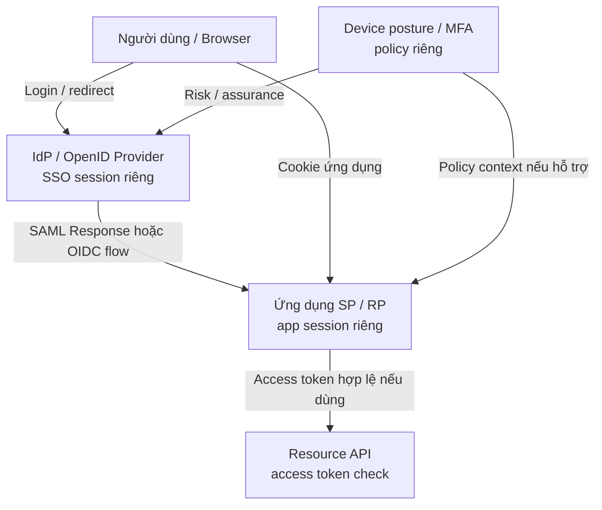
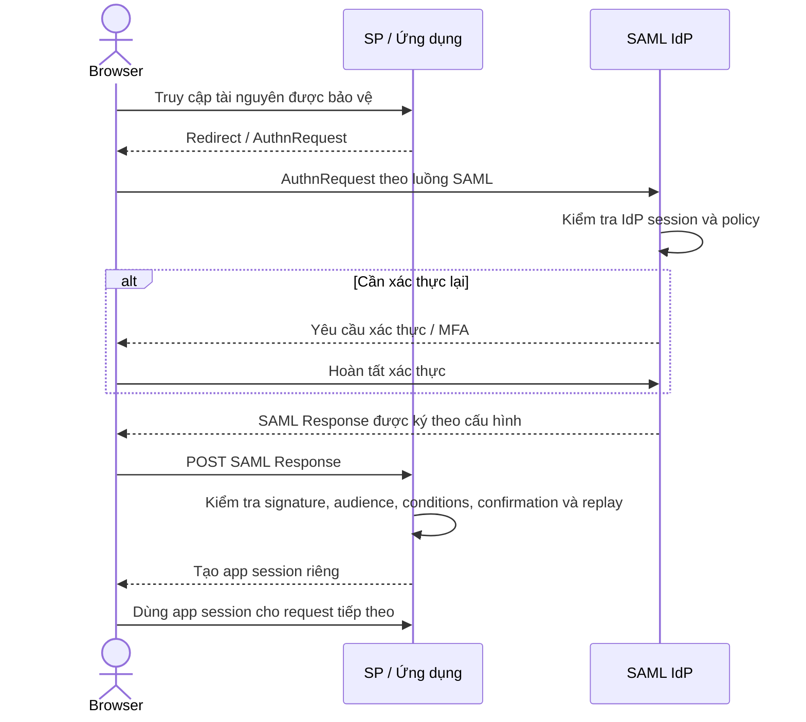

# SSO timeout trong quản lý vòng đời danh tính IAM

## Mục tiêu học tập

Sau bài này, người học có thể:

1. Giải thích **SSO timeout** là gì và vì sao timeout của phiên đăng nhập tại **Identity Provider (IdP)** khác với timeout ở **Service Provider/Relying Party (SP/RP)**, ứng dụng và API.
2. Phân biệt **idle timeout**, **absolute session lifetime**, thời hạn **SAML assertion**, **OIDC ID token**, **OAuth access token**, **refresh token** và yêu cầu **reauthentication**.
3. Thiết kế chính sách timeout phù hợp với rủi ro, trải nghiệm người dùng, **MFA/step-up**, **RBAC/ABAC** và các trạng thái **Joiner–Mover–Leaver (JML)**.
4. Phân tích những tình huống “hết phiên ứng dụng nhưng không cần nhập lại mật khẩu”, “token hết hạn nhưng SSO vẫn hoạt động” và “đã Leaver nhưng session cũ còn hiệu lực”.
5. Xử lý clock skew, phiên bất đồng bộ, logout không đồng nhất, tab trình duyệt cũ, API trả lỗi và các thay đổi quyền trong lúc người dùng đang đăng nhập.
6. Thiết kế quan sát, cảnh báo, kiểm toán, đối soát và kịch bản kiểm thử để hạn chế **residual access** (quyền truy cập tồn dư).
7. Tránh đánh đồng timeout với vô hiệu account hoặc thu hồi tất cả credential trong IdP, SaaS, ứng dụng local và workload identity.

## 1. SSO timeout là gì?

**Single Sign-On (SSO)** cho phép người dùng xác thực qua một **IdP** rồi truy cập nhiều ứng dụng tin cậy mà không cần nhập lại credential ở từng ứng dụng cho mỗi lần truy cập. Sau khi xác thực, IdP có thể giữ **phiên đăng nhập của chính IdP**; mỗi ứng dụng lại có thể tạo **phiên ứng dụng riêng**. Đồng thời, các giao thức SAML/OIDC và OAuth sử dụng các đối tượng mang thời hạn riêng.

**SSO timeout** là cách gọi rộng cho việc một **phiên, thông điệp xác thực hoặc thông tin ủy quyền** trong luồng SSO không còn hợp lệ theo điều kiện thời gian và chính sách. Vì có nhiều lớp, câu “SSO hết hạn sau 30 phút” **chưa đủ để mô tả chính xác hành vi**.

Ví dụ: Lan đăng nhập IdP lúc 09:00 rồi vào cổng nhân sự. Cổng nhân sự hết phiên sau 15 phút không hoạt động; IdP vẫn còn session hợp lệ. Khi Lan mở lại cổng, ứng dụng có thể chuyển hướng về IdP và lấy kết quả đăng nhập mới **mà Lan không cần nhập lại mật khẩu**. Người dùng tưởng timeout bị vô hiệu, nhưng thực tế **timeout của ứng dụng đã hoạt động**, chỉ là IdP vẫn chấp nhận phiên cũ.

Ở chiều ngược lại, IdP có thể hết session trong khi ứng dụng vẫn giữ cookie đăng nhập local. Nếu ứng dụng không hỏi IdP lại hoặc không kiểm tra trạng thái vòng đời khi thao tác nhạy cảm, người dùng có thể tiếp tục dùng ứng dụng một thời gian.

### 1.1. Timeout không giống các thao tác thu hồi

| Thuật ngữ | Ý nghĩa | Điều không được tự suy ra |
|---|---|---|
| **Session timeout** | Phiên không còn hợp lệ sau điều kiện thời gian/hoạt động | Không tự khẳng định account đã disabled |
| **Token expiration** | Một token quá thời hạn do issuer quy định | Không có nghĩa IdP session hoặc refresh token cũng hết |
| **Reauthentication** | Yêu cầu chứng minh lại danh tính bằng phương thức phù hợp | Không mặc nhiên xóa quyền đã được cấp |
| **Logout** | Kết thúc phiên tại một hoặc nhiều bên theo cơ chế có hỗ trợ | Không đảm bảo mọi app và token đã bị thu hồi |
| **Account disable** | Ngăn account được sử dụng theo chính sách ở hệ thống đích | Không chắc cookie/token đã phát hành hết hiệu lực tức thì |
| **Deprovisioning** | Thu hồi account, role, group, credential và đường truy cập cần thiết | Không thể hoàn tất chỉ bằng việc giảm một timeout |
| **Access review** | Xem xét quyền có còn hợp lệ không | Không phải cơ chế kết thúc session |

**Timeout là một lớp kiểm soát thời gian của xác thực và phiên**, còn quản lý vòng đời identity quyết định **ai vẫn được phép có account và quyền**.

## 2. Những đồng hồ thời gian trong một hệ thống SSO

Một hệ thống thường có nhiều “đồng hồ” chạy song song:

| Lớp | Nơi quản lý | Mục đích | Khi hết hạn |
|---|---|---|---|
| **IdP SSO session** | IdP | Ghi nhớ người dùng đã xác thực với IdP | Khi app cần xác thực lại, IdP có thể yêu cầu login |
| **SP/RP application session** | Ứng dụng | Duy trì phiên đăng nhập local | Ứng dụng đòi tạo phiên mới, thường qua SSO |
| **Idle timeout** | IdP hoặc ứng dụng | Giới hạn thời gian không hoạt động hợp lệ | Phiên bị kết thúc/challenge tùy chính sách |
| **Absolute session lifetime** | IdP hoặc ứng dụng | Giới hạn tổng thời gian phiên bất kể hoạt động | Buộc làm mới phiên hoặc re-auth theo policy |
| **SAML assertion validity** | IdP phát assertion; SP kiểm tra | Giới hạn thời gian chấp nhận thông điệp xác thực | Assertion mới hoặc giao dịch SSO mới có thể cần |
| **SAML session information** | IdP/SP tùy triển khai | Truyền thông tin về phiên xác thực tại IdP | Không tự đồng nghĩa logout mọi ứng dụng |
| **OIDC ID token expiration** | OpenID Provider phát; RP kiểm tra | Thời hạn ID token được chấp nhận theo giao thức/policy | RP cần xử lý token hết hạn đúng vai trò |
| **OAuth access token lifetime** | Authorization Server / API | Giới hạn thời gian token được dùng gọi API | API từ chối token hết hạn; client cần token hợp lệ mới |
| **Refresh token lifetime/revocation** | Authorization Server | Cho phép client nhận access token mới nếu được cấp và còn hợp lệ | Client phải có flow cấp quyền phù hợp hoặc xác thực lại |
| **MFA/step-up freshness** | IdP/RP/policy engine | Giới hạn thời gian kể từ xác thực đủ mạnh | Buộc reauthentication phù hợp cho thao tác nhạy cảm |
| **Browser cookie validity** | IdP và ứng dụng | Cơ chế vận chuyển/ràng buộc session | Cookie hết hạn không mặc định thu hồi mọi token phía server |
| **Device trust/posture TTL** | MDM/IdP/conditional access | Thời hạn đánh giá thiết bị đáng tin | Có thể yêu cầu đánh giá lại hoặc chặn truy cập |

Các giá trị có thể khác nhau vì từng lớp giải quyết rủi ro khác nhau. **Cấu hình một timeout ở IdP không tự thay đổi timeout của mọi SaaS**, và ngược lại.

### 2.1. Sơ đồ quan hệ thời hạn



Sơ đồ minh họa. Có ứng dụng chỉ sử dụng cookie backend không trực tiếp gọi API bằng OAuth, có ứng dụng SPA sử dụng token, có ứng dụng dùng cả hai. Cần xác định **kiến trúc cụ thể** trước khi quy định timeout.

## 3. Idle timeout, absolute timeout và sliding expiration

### 3.1. Idle timeout

**Idle timeout** là khoảng thời gian phiên không có hoạt động được tính là hợp lệ. Ví dụ một ứng dụng kết thúc phiên khi không có hoạt động được chấp nhận trong 15 phút.

Điểm khó là định nghĩa **hoạt động hợp lệ**:

- Người dùng tương tác với một chức năng thực sự cần xác thực.
- Ứng dụng gọi API nền mỗi vài giây.
- Trang tự refresh dữ liệu không có tương tác con người.
- Tab ẩn vẫn phát request định kỳ.
- Thiết bị bị khóa nhưng session cookie vẫn còn.

Nếu mọi request nền đều reset đồng hồ idle, một trang dashboard có thể duy trì phiên vô hạn dù người dùng đã rời bàn làm việc. Vì vậy cần thiết kế **nguồn tín hiệu hoạt động và kiểm tra phía server** phù hợp với rủi ro, không chỉ dựa vào JavaScript đếm thời gian trên browser.

### 3.2. Absolute session lifetime

**Absolute lifetime** giới hạn tuổi của phiên kể từ mốc xác thực/tạo phiên đã xác định, kể cả khi người dùng vẫn hoạt động. Nó giảm khả năng một phiên bị kéo dài không giới hạn qua các thao tác nền hoặc tương tác liên tục.

Ví dụ: phiên ứng dụng có idle timeout 15 phút và absolute lifetime 8 giờ. Người dùng tương tác mỗi 5 phút vẫn có thể bị buộc làm mới phiên khi đạt giới hạn tuyệt đối.

Cần phân biệt **làm mới phiên (session renewal)** với **reauthentication thực sự**. Nếu ứng dụng chỉ phát cookie mới bằng phiên IdP cũ mà không kiểm tra độ mới của xác thực, giới hạn tuyệt đối của cookie ứng dụng có thể không tạo ra bước chứng minh danh tính mới.

### 3.3. Sliding expiration

Với **sliding expiration**, mỗi lần hoạt động được chấp nhận có thể kéo dài hạn phiên, thường vẫn chịu giới hạn tuyệt đối nếu được thiết kế an toàn.

```text
sessionCreatedAt = 09:00
lastAcceptedActivityAt = 09:12
idleTimeout = 15 phút
absoluteLifetime = 8 giờ

idleDeadline = 09:27
absoluteDeadline = 17:00
effectiveDeadline = mốc sớm hơn trong hai deadline
```

Ví dụ chỉ minh họa chính sách. Không nên dùng timestamp trên trình duyệt do client tự gửi làm nguồn quyết định không kiểm chứng; server cần xác định hoặc xác minh thời điểm và hoạt động hợp lệ.

### 3.4. Session cookie và session server không nhất thiết hết cùng lúc

Một cookie `Expires` hoặc `Max-Age` quản lý thời gian browser gửi cookie. Server có thể giữ session record riêng, invalidation list hoặc cơ chế session stateless. Vì vậy:

- Cookie còn hiện diện **không bảo đảm** server chấp nhận nó.
- Cookie bị xóa **không chứng minh** token hoặc session khác đã bị thu hồi.
- Đổi cookie nhưng giữ session gốc có thể không làm mới mức độ xác thực.
- Phiên trên nhiều thiết bị có thể có tuổi và quy tắc thu hồi khác nhau.

Thiết kế cần đảm bảo session identifier đủ khó đoán, được rotate khi cần và bảo vệ bằng các thuộc tính cookie phù hợp (`Secure`, `HttpOnly`, `SameSite` theo threat model), TLS và kiểm soát CSRF cho thao tác thay đổi trạng thái.

## 4. Một ví dụ có nhiều timeout cùng tồn tại

Giả sử chính sách **minh họa, không phải mặc định của một IdP**:

| Đối tượng | Giá trị giả định |
|---|---|
| IdP idle timeout | 60 phút |
| IdP absolute lifetime | 10 giờ |
| Ứng dụng nhân sự idle timeout | 15 phút |
| Ứng dụng nhân sự absolute lifetime | 4 giờ |
| OAuth access token | 10 phút |
| Refresh token (nếu được phát) | 7 ngày hoặc bị revoke sớm hơn theo policy |
| Step-up freshness cho thao tác nhạy cảm | 5 phút |

Lịch sử:

1. **09:00:** Lan xác thực vào IdP và cổng nhân sự. IdP và ứng dụng tạo hai trạng thái phiên riêng.
2. **09:15:** Lan không hoạt động ở cổng 15 phút; ứng dụng kết thúc session local.
3. **09:20:** Lan mở lại cổng. Ứng dụng chuyển hướng SSO. Nếu IdP session còn hợp lệ và policy không buộc reauthentication, Lan có thể vào lại không nhập password.
4. **09:30:** API token phát trước đó đã hết hạn; ứng dụng có thể lấy token mới qua flow hợp lệ nếu đủ điều kiện. Token hết hạn **không chứng minh** phiên IdP cũng hết.
5. **10:30:** Nếu Lan không hoạt động ở IdP theo tiêu chí của IdP và session idle đã hết, lần chuyển hướng tiếp theo có thể yêu cầu xác thực.
6. **13:00:** Giới hạn tuyệt đối 4 giờ của phiên ứng dụng tạo từ 09:00 không còn cho phép kéo dài **chính phiên đó**. Tạo phiên mới vẫn có thể xảy ra qua IdP theo policy.
7. **Khi duyệt thanh toán:** ứng dụng yêu cầu bước MFA gần đây; việc SSO còn hoạt động không tự đáp ứng yêu cầu step-up 5 phút.

**Các giá trị thời gian trên chỉ để luyện phân tích.** Thực tế cần hiểu định nghĩa hoạt động của IdP, SP, browser, token issuer và cách chính sách xử lý refresh/silent login.

## 5. Timeout trong SAML 2.0

Với **SAML SSO**, IdP gửi một **SAML Response/Assertion** cho SP trong luồng xác thực. Assertion có thời điểm và điều kiện sử dụng, còn SP thường thiết lập **session ứng dụng** sau khi chấp nhận assertion.

### 5.1. Các mốc thời gian liên quan

| Thành phần SAML | Vai trò | Diễn giải cần đúng |
|---|---|---|
| `Conditions NotBefore` | Mốc sớm nhất để assertion hợp lệ theo conditions | SP không chấp nhận assertion trước mốc theo policy/skew |
| `Conditions NotOnOrAfter` | Mốc assertion không còn hợp lệ theo conditions | Không đồng nghĩa phiên ứng dụng phải đóng đúng thời điểm này |
| `SubjectConfirmationData NotOnOrAfter` | Giới hạn dùng xác nhận chủ thể trong bearer profile | Kiểm tra cùng Recipient/InResponseTo và điều kiện liên quan |
| `AuthnStatement AuthnInstant` | Thời điểm một sự kiện xác thực xảy ra | Hỗ trợ đánh giá độ mới của xác thực |
| `AuthnStatement SessionNotOnOrAfter` | Thông tin giới hạn phiên liên quan theo giao thức | Cách SP áp dụng đối với local session tùy thiết kế và yêu cầu profile/policy |
| `SessionIndex` | Chỉ số phiên hữu ích cho cơ chế logout khi hỗ trợ | Không phải token có thể tùy ý dùng để gia hạn phiên |

Một assertion SAML có thể chỉ còn hợp lệ trong thời gian ngắn để hạn chế replay. SP kiểm tra assertion tại thời điểm nhận, sau đó tạo session riêng. **Không nên lấy `NotOnOrAfter` của assertion và kết luận phiên browser chắc chắn kết thúc cùng lúc.**

### 5.2. Mô tả một giao dịch



SP cần kiểm tra chữ ký và nguồn tin cậy, `AudienceRestriction`, recipient/destination, điều kiện thời gian, liên hệ với request qua `InResponseTo` khi applicable, cùng cơ chế chống replay. **Chấp nhận assertion hết hạn hoặc chỉ kiểm tra thời gian mà bỏ các điều kiện khác là sai.**

### 5.3. Clock skew

Máy IdP và SP có thể lệch đồng hồ. Nếu hai hệ thống có thời gian khác nhau, assertion có thể bị báo “not yet valid” hoặc “expired” dù vừa phát.

Nên:

- Đồng bộ thời gian server bằng hệ thống time sync phù hợp.
- Theo dõi độ lệch thời gian của IdP/SP.
- Chỉ chấp nhận **clock skew allowance nhỏ và có chủ đích** khi giao thức/nền tảng cho phép.
- Không tăng bừa cửa sổ chấp nhận assertion để che giấu lỗi đồng hồ lớn.
- Ghi reason code và thời gian server của các bên để điều tra.
- Không dùng giờ trên máy người dùng làm căn cứ quyết định assertion hợp lệ.

**Clock skew allowance không phải cơ chế gia hạn session cho người dùng**; nó chỉ xử lý sai lệch đồng hồ trong xác minh thông điệp.

## 6. Timeout trong OpenID Connect và OAuth 2.0

**OpenID Connect (OIDC)** sử dụng kết quả xác thực từ **OpenID Provider (OP)** để RP thiết lập trạng thái đăng nhập; **OAuth 2.0** cấp token cho việc ủy quyền truy cập tài nguyên. Chúng có thể được sử dụng cùng nhau nhưng các đối tượng thời gian có chức năng khác nhau.

### 6.1. Đừng nhầm các token

| Đối tượng | Chủ yếu dùng cho | Khi hết hạn |
|---|---|---|
| **OIDC ID token** | Truyền thông tin về sự kiện xác thực và subject tới RP | RP không được chấp nhận ID token quá hạn trong các kiểm tra yêu cầu token hiện hành |
| **OAuth access token** | Gọi API/resource server theo phạm vi được cấp | Resource server từ chối token hết hiệu lực |
| **Refresh token** | Xin access token mới nếu được phát và còn hợp lệ | Client có thể cần flow cấp phép/xác thực mới |
| **Authorization code** | Trao đổi trong authorization flow, ngắn hạn và một lần | Không thể dùng lại hoặc dùng quá hạn |
| **IdP browser session** | Nhớ người dùng tại OP | Các lần authorization mới có thể yêu cầu login |
| **RP/app session** | Duy trì phiên ứng dụng | Có thể tiếp tục hoặc hết độc lập với token |

Đặc biệt, **ID token không phải token gọi API**. API nên kiểm tra access token theo đúng issuer, audience, scope/role và thời hạn. Cần tránh thiết kế “ID token còn hạn thì API được phép” hoặc “access token hết hạn tức là người dùng đã logout khỏi IdP”.

### 6.2. `exp`, `iat` và `auth_time`

- `exp` là mốc hết hạn của token có claim đó. Bên xác minh phải kiểm tra thời điểm hiện tại và các điều kiện bắt buộc liên quan.
- `iat` biểu thị thời điểm token được phát hành, không mặc định là thời điểm người dùng vừa nhập MFA.
- `auth_time` mô tả thời điểm xác thực người dùng diễn ra trong bối cảnh OIDC khi claim được cung cấp theo yêu cầu/quy tắc liên quan.
- `max_age` trong OIDC authorization request cho phép RP yêu cầu giới hạn tuổi xác thực; khi dùng đúng, RP cần kiểm tra `auth_time` và các yêu cầu giao thức tương ứng.
- `prompt=login` có thể được dùng để yêu cầu tương tác đăng nhập lại theo khả năng/giao thức, nhưng ứng dụng vẫn phải kiểm tra kết quả thực tế và đáp ứng policy.

**Đổi mới access token không tự chứng minh MFA vừa diễn ra.** Refresh token có thể cấp access token mới mà không có bước xác thực tương tác. Nếu thao tác cần chứng cứ xác thực gần đây, phải dùng cơ chế yêu cầu và kiểm tra **authentication freshness**, không chỉ nhìn `iat` của access token mới.

### 6.3. Ví dụ policy step-up với OIDC

Giả sử người dùng đã đăng nhập SSO lúc 09:00 và muốn phê duyệt chuyển tiền lúc 10:00. Ứng dụng cần xác thực đủ mạnh trong 5 phút gần nhất.

Luồng khái niệm:

```text
1. RP kiểm tra session và ngữ cảnh:
   - Người dùng ACTIVE?
   - Role phê duyệt còn hợp lệ?
   - Phương thức xác thực/assurance đạt yêu cầu?
   - Authn time có đủ mới không?

2. Nếu chưa đạt, RP bắt đầu authorization request yêu cầu
   reauthentication/step-up tương thích với IdP và policy.
   Có thể sử dụng max_age, acr_values hoặc cơ chế IdP hỗ trợ.

3. Khi nhận kết quả, RP kiểm tra issuer, audience, signature,
   nonce/state nơi applicable, auth_time, assurance claim và
   điều kiện token; không chỉ dựa vào redirect thành công.

4. Chỉ sau đó mới đánh giá authorization cho hành động đích.
```

Đây là ví dụ khái niệm, không phải mọi IdP đều hỗ trợ cùng `acr_values`, `max_age` hoặc claim MFA. Sự hỗ trợ phải được kiểm thử với sản phẩm thực tế.

### 6.4. Refresh token và “đăng nhập liên tục”

Một client có thể nhận refresh token với thời gian sống dài hơn access token. Khi access token hết hạn, client có thể lấy access token mới nếu refresh token chưa bị thu hồi và policy cho phép.

Điều đó **không đồng nghĩa phiên browser vẫn đang ở cùng mức tin cậy**:

- Refresh token có thể bị revoke hoặc expire.
- Refresh token rotation và reuse detection, nếu được hỗ trợ, giúp phát hiện lạm dụng.
- Client công khai và client bảo mật có mô hình lưu token khác nhau; cần phù hợp threat model.
- Token có thể bị chặn khi tài khoản Leaver hoặc điều kiện truy cập thay đổi, tùy cơ chế issuer.
- Một access token JWT tự xác minh có thể còn hiệu lực đến hạn nếu API không kiểm tra revocation/lifecycle.

Timeout cần được đánh giá với **refresh/session/token policies kết hợp**, không chọn thời gian token tùy ý rồi xem đã giải quyết hết rủi ro.

## 7. Timeout, logout và thu hồi phiên không đồng nghĩa

### 7.1. Logout từ ứng dụng

Người dùng nhấn “Đăng xuất” tại một ứng dụng. Ứng dụng có thể xóa hoặc invalidate **app session** của chính mình. IdP session và các ứng dụng khác có thể vẫn hoạt động.

Khi người dùng quay lại ứng dụng, redirect về IdP có thể tạo session ứng dụng mới mà không yêu cầu nhập lại password. Đây không nhất thiết là lỗi; đó là hệ quả của **SSO session độc lập**.

### 7.2. Logout ở IdP

Kết thúc session IdP có thể làm cho các lần SSO mới yêu cầu xác thực, nhưng **không luôn hủy app-local sessions đã được thiết lập**. Những session này có thể tiếp tục tới lúc ứng dụng tự timeout hoặc nhận tín hiệu logout mà nó hỗ trợ.

### 7.3. Single Logout (SLO) và các hạn chế

- **SAML Single Logout** có thể dùng thông điệp/phiên liên quan để thông báo các bên tham gia, nếu cấu hình và hỗ trợ tương thích.
- **OIDC Front-Channel Logout** và **Back-Channel Logout** cung cấp các cơ chế thông báo kết thúc phiên theo hỗ trợ của OP/RP.
- Front-channel phụ thuộc điều kiện browser, cookie và khả năng nhận thông báo.
- Back-channel có thể đáng tin cậy hơn đối với hệ thống nhận được thông điệp hợp lệ, nhưng vẫn cần triển khai đúng, xác minh nguồn và quản lý lỗi/độ trễ.
- Không phải mọi SaaS tích hợp các cơ chế này hoặc xử lý mọi loại phiên/token tương ứng.

**SLO không nên được coi là bằng chứng duy nhất cho deprovisioning hoàn tất.** Cần đọc lại trạng thái account, app session/token khi khả thi, và thực hiện revoke ở từng hệ thống đích.

### 7.4. Tại sao “đăng xuất tất cả” có thể không ngay lập tức?

| Đường truy cập | Vấn đề điển hình | Hướng xử lý |
|---|---|---|
| App session local | Ứng dụng không nhận hoặc không hỗ trợ SLO | API session revocation hoặc giới hạn TTL, kiểm tra app |
| JWT access token | Resource server tự xác minh chữ ký và `exp` | TTL phù hợp, introspection/denylist/CAE nếu có hỗ trợ |
| Refresh token | Token riêng có thể cấp lại access token | Revoke, rotation/reuse detection, policy theo lifecycle |
| Legacy local login | Người dùng còn password ứng dụng | Disable local account hoặc bỏ đường login |
| Personal API token | Không phụ thuộc session browser | Revoke tại issuer/ứng dụng |
| Device credential | Chứng chỉ/khóa thiết bị còn được trust | Xử lý device registration, PKI, VPN/NAC |
| Session trên thiết bị khác | Logout một browser không ảnh hưởng browser khác | Quản lý phiên theo user/device, admin revocation nếu cần |

Cần phân biệt **session timeout để hạn chế thời gian sử dụng** với **server-side revocation để xử lý một sự kiện rủi ro**. Đối với Leaver khẩn cấp, chờ tất cả token hết hạn tự nhiên có thể không đáp ứng yêu cầu.

## 8. Cấu hình timeout theo mức rủi ro và loại ứng dụng

Không có một cấu hình chung áp dụng an toàn cho mọi tổ chức. Ngân hàng, ứng dụng HR, cổng tài liệu nội bộ, console quản trị và ứng dụng tự động sẽ có threat model khác nhau.

Ví dụ bảng policy **giả định phục vụ giảng dạy**:

| Loại ứng dụng | Idle timeout ứng dụng | Absolute lifetime ứng dụng | Reauthentication |
|---|---|---|---|
| Cổng thông tin đọc nội bộ | 30 phút | 8 giờ | Khi app session hết và IdP/policy yêu cầu |
| Hồ sơ nhân sự nhạy cảm | 15 phút | 4 giờ | Step-up cho xuất dữ liệu/đổi thông tin quan trọng |
| Quản trị production | 5–10 phút | 1–2 giờ | Phương thức chống phishing và yêu cầu freshness cao |
| Kiosk/thiết bị dùng chung | Ngắn theo rủi ro ca làm | Không vượt ca làm | Bắt buộc logout/clear session khi đổi người |
| Ứng dụng di động có lưu offline | Theo risk và năng lực OS | Có chính sách giới hạn riêng | Re-unlock/step-up, bảo vệ data at rest |
| Backend workload | Không dùng browser SSO session của người | Token/credential lifetime riêng | Federation/managed identity, không áp idle timeout người dùng |

**Đây không phải ngưỡng chuẩn bắt buộc hoặc khuyến nghị chung của tiêu chuẩn nào.** Hãy chọn dựa trên tài nguyên, rủi ro, kiểu thiết bị, khả năng MFA, điều kiện hoạt động và luật/quy định áp dụng.

### 8.1. Ba tầng chính sách cần phối hợp

1. **Tầng IdP:** tuổi IdP session, tần suất yêu cầu xác thực, MFA, conditional access, device trust.
2. **Tầng SP/RP:** cookie phiên ứng dụng, idle/absolute lifetime, step-up ở hành động nhạy cảm, logout.
3. **Tầng API/resource:** access token TTL, kiểm tra token, quyền và điều kiện authorization ở thời điểm request.

Một chính sách có thể chọn app session ngắn hơn IdP session để bảo vệ màn hình không dùng, nhưng phải hiểu người dùng có thể SSO lại im lặng nếu IdP còn phiên. Với thao tác thật sự phải yêu cầu chứng minh danh tính mới, cần **authentication freshness** ở IdP/RP.

### 8.2. Những điều kiện cần xem xét

- **Dữ liệu nhạy cảm:** có thông tin tài chính, cá nhân, hồ sơ khách hàng hay secret không?
- **Quyền của người dùng:** account thường, admin, help desk, service owner hay break-glass?
- **Thiết bị:** corporate managed, BYOD, kiosk, thiết bị dùng chung hoặc có nguy cơ mất cắp?
- **Địa điểm/ngữ cảnh:** truy cập từ mạng tin cậy hoặc thiết bị có posture phù hợp?
- **Kiểu giao diện:** ứng dụng cần thao tác liên tục, có autosave, có tác vụ dài hoặc phiên realtime?
- **Khả năng hủy phiên:** ứng dụng hỗ trợ back-channel logout, revoke API token, introspection không?
- **Yêu cầu nghiệp vụ:** timeout đột ngột có thể gây mất dữ liệu hoặc gián đoạn công việc quan trọng không?

Policy được chọn phải cân bằng **bảo mật, khả năng vận hành và trải nghiệm người dùng**; không thể chỉ rút toàn bộ timeout xuống mức thấp nhất.

## 9. SSO timeout trong Joiner–Mover–Leaver

Chính sách timeout cần hỗ trợ vòng đời danh tính, nhưng **không thay thế điều kiện cấp/thu hồi quyền theo JML**.

### 9.1. Joiner: phiên chỉ được tạo khi account đủ điều kiện

Trong Joiner, IAM nhận thông tin nhân sự, xác minh identity và tạo account theo chính sách. Trước khi cho SSO, cần kiểm tra:

- Identity có mapping đáng tin với account không?
- Quy trình proofing đã đạt điều kiện cho quyền đích chưa?
- Account đã đến ngày hiệu lực, được kích hoạt hợp lệ chưa?
- Phương thức MFA cần thiết đã được enroll chưa?
- App role/group có được phê duyệt và provisioning đúng không?

Một account pre-provisioned nhưng chưa đến ngày bắt đầu **không được cấp quyền chỉ vì IdP có thể phát SSO token**. Nếu IdP account disabled, ứng dụng không nên có đường login khác tự kích hoạt account đó.

Ví dụ: nhân viên vào ngày 01/12. SSO session được tạo khi có đủ điều kiện Joiner; timeout sau đó chỉ quyết định thời điểm phải xác thực lại, không quyết định người đó có còn là nhân viên hay không.

### 9.2. Mover: session cũ có thể mang quyền cũ

Khi một nhân viên chuyển từ Sales sang Finance, IAM cần thu hồi quyền Sales và cấp quyền Finance được duyệt. Tuy nhiên, **token hoặc app session cũ có thể tiếp tục mang role/group snapshot của thời điểm đăng nhập**.

Các rủi ro:

- Ứng dụng dùng claim nhóm trong token cũ đến khi token hết hạn.
- RP giữ role trong session server và không cập nhật sau Mover.
- Cache authorization ở API chưa được invalidated.
- Người dùng có thể SSO lại bằng IdP session còn hợp lệ nhưng group mapping chưa đồng bộ qua SCIM.

Biện pháp:

1. Xác định thay đổi quyền ở hệ thống nguồn có thẩm quyền.
2. Provision/revoke group, role và entitlement tại ứng dụng đích.
3. Revoke hoặc làm mới session/token có claim lỗi thời khi rủi ro yêu cầu và hệ thống hỗ trợ.
4. Đối với thao tác nhạy cảm, kiểm tra authorization hiện tại ở backend thay vì hoàn toàn tin claim lâu tuổi.
5. Đọc lại **effective permissions** và trạng thái token/session có thể quan sát.

**Giảm token TTL** có thể thu hẹp cửa sổ quyền cũ tồn tại nhưng không đảm bảo thu hồi tức thì. Đối với rủi ro cao, cần cơ chế revoke hoặc kiểm tra policy trực tiếp.

### 9.3. Leaver: không chờ timeout để thu hồi tài khoản

Leaver từ HR hoặc nguồn hợp đồng là một sự kiện vòng đời có thẩm quyền. Khi đến mốc chấm dứt quyền:

- Disable account ở IdP và các ứng dụng local liên quan.
- Thu hồi group/role/entitlement không còn hợp lệ.
- Revoke session IdP, refresh token, app session, API key và credential khi được hỗ trợ.
- Chặn đăng nhập qua SSO và các đường fallback/local.
- Xử lý tài khoản đặc quyền, PAM, VPN, thiết bị và service credential do người nghỉ từng biết.
- Đối soát trạng thái thực tế; giữ exception có owner nếu một ứng dụng không hỗ trợ revoke lập tức.

**Một phiên SSO có absolute lifetime 8 giờ không có nghĩa người đã nghỉ được phép tiếp tục 8 giờ.** Timeout là giới hạn bảo vệ bổ sung, không phải SLA tối đa cho Leaver nếu chính sách thu hồi yêu cầu ngắn hơn.

### 9.4. Ví dụ Mover và Leaver cùng diễn ra

```text
09:00  Nhân viên xác thực, token có group SALES_READER.
10:00  HR cập nhật Mover sang Finance.
10:01  IAM gỡ quyền Sales và xử lý cấp quyền Finance.
10:02  API dùng token cũ vẫn thấy SALES_READER nếu chỉ đọc claim.
10:03  Hệ thống thực hiện revoke/invalidate theo chính sách hoặc
       API kiểm tra quyền hiện tại ở nguồn authorization.
17:00  HR phát Leaver có hiệu lực.
17:01  IdP account bị disable; các session/token/API key được xử lý.
17:02  Reconciliation xác minh ứng dụng đã chặn truy cập.
```

Đây là timeline minh họa. Một số hệ thống không thể revoke JWT đã phát ngay; phải ghi nhận cửa sổ tồn dư và lựa chọn biện pháp giảm rủi ro phù hợp, không tuyên bố `17:01` mọi token đều đã vô hiệu chỉ nhờ IdP disabled.

### 9.5. Rehire và account bị giữ

Một người quay lại tổ chức có thể vẫn có account disabled và bản ghi phiên/token lịch sử. Khi tái tuyển dụng, **không tự khôi phục mọi phiên cũ**. Cần xác minh identity mapping, proofing khi cần, credential/MFA, desired roles theo công việc mới và account lifecycle hiện tại.

Việc re-enable một account **không được làm token/session từ kỳ làm việc cũ trở lại được chấp nhận** nếu chính sách yêu cầu thiết lập lại trạng thái xác thực.

## 10. Ảnh hưởng của MFA, step-up và assurance

SSO giúp người dùng không phải nhập lại credential liên tục, nhưng có những hành động yêu cầu **fresh authentication** hoặc MFA mạnh hơn.

Ví dụ người dùng đăng nhập lúc 08:00 bằng password và MFA, rồi lúc 14:00 muốn thay đổi chính sách IAM. Ứng dụng có thể yêu cầu:

- Người dùng còn active và có quyền quản trị hợp lệ.
- Phiên ứng dụng và token còn được chấp nhận.
- Độ mạnh phương thức xác thực đáp ứng hành động.
- Bằng chứng xác thực đủ **mới** theo thời hạn do policy quy định.
- Bối cảnh hiện tại như thiết bị, IP hoặc rủi ro vẫn phù hợp.

Nếu không đủ, ứng dụng yêu cầu **reauthentication/step-up** qua IdP và kiểm tra claim hợp lệ. Không chỉ dựa vào việc cookie ứng dụng vừa được refresh để suy rằng MFA cũng vừa được thực hiện.

### 10.1. Định nghĩa ngắn các hành động

| Hành động | Mục tiêu |
|---|---|
| **Silent SSO** | Dựa vào IdP session còn hợp lệ để lấy kết quả SSO mà không cần tương tác mới |
| **Reauthentication** | Người dùng thực hiện lại bước xác thực theo yêu cầu của IdP/RP |
| **Step-up MFA** | Đạt mức bảo đảm cao hơn cho một tác vụ nhạy cảm |
| **Session renewal** | Tạo hoặc kéo dài session của app theo policy |
| **Token refresh** | Nhận access token mới từ refresh token nếu được phép |
| **Authorization reevaluation** | Xác minh người dùng còn quyền vào tài nguyên tại thời điểm hiện tại |

**Reauthentication không đồng nghĩa reauthorization**. Sau khi MFA thành công, ứng dụng vẫn phải kiểm tra RBAC/ABAC, tình trạng Leaver, phạm vi tài nguyên và SoD.

## 11. Thiết kế policy timeout an toàn

Một hệ thống nên quản lý chính sách ở các lớp riêng và có bằng chứng cấu hình.

```yaml
# Ví dụ mô hình nội bộ, không phải cú pháp IdP/SSO chuẩn
policyId: sso-timeout-risk-v4
scope:
  accountType: HUMAN_INTERACTIVE
  application: HR_SENSITIVE_PORTAL
idp:
  idleMinutes: 60
  absoluteMinutes: 600
  phishingResistantMfaForHighRiskActions: true
applicationSession:
  idleMinutes: 15
  absoluteMinutes: 240
  renewOnAcceptedUserActivity: true
  ignoreBackgroundPollingForIdleRenewal: true
resourceAccess:
  accessTokenMinutes: 10
  verifyCurrentAccountStateForSensitiveOperations: true
sensitiveAction:
  reauthenticationFreshnessMinutes: 5
  requireApprovedAssuranceLevel: true
lifecycle:
  denyWhenIdentityNotActive: true
  invalidateSessionsOnConfirmedLeaver: true
  reconcileAppAccessAfterMover: true
audit:
  recordTimeoutReasonWithoutSecrets: true
  trackRevocationCompletion: true
```

**Đây là YAML minh họa khái niệm**, không phải file có thể áp dụng nguyên trạng cho một IdP. Các giá trị chỉ phục vụ giải thích, cần được chủ sở hữu chính sách phê duyệt và kiểm thử theo ứng dụng thực.

### 11.1. Nguyên tắc khi thiết kế quy tắc

- Nêu rõ **idle dựa trên hoạt động nào** và cơ chế tính phía server.
- Có **absolute lifetime** hoặc cơ chế buộc xác thực lại đúng rủi ro khi dùng sliding session.
- Phân biệt hạn **cookie** với hạn **session record** và **token**.
- Định nghĩa lớp nào được phép silent SSO, lớp nào cần reauthentication.
- Định nghĩa freshness của MFA cho thao tác nhạy cảm.
- Nêu rõ khi lifecycle state đổi sang Mover/Leaver thì xử lý app session, token và role thế nào.
- Có phương án xử lý ngắt kết nối, autosave và UX khi phiên hết.
- Gắn owner và version cho policy, có rollback/change review.
- Không dùng timeout dài của refresh token làm lý do bỏ kiểm tra account state.
- Không làm giảm khả năng chống session fixation hoặc CSRF chỉ để giữ trải nghiệm liên tục.

### 11.2. Session renewal pseudocode

```text
function authorizeSessionRequest(request, now):
    session = loadServerSession(request.sessionId)

    if session is absent or session.revoked:
        return REQUIRE_LOGIN

    identity = loadAuthoritativeIdentity(session.identityId)
    if identity.lifecycleState != ACTIVE:
        revokeSession(session)
        return DENY_LIFECYCLE

    if now >= session.createdAt + policy.absoluteLifetime:
        revokeSession(session)
        return REQUIRE_NEW_SESSION_OR_REAUTH

    if now >= session.lastAcceptedActivityAt + policy.idleTimeout:
        revokeSession(session)
        return REQUIRE_NEW_SESSION_OR_REAUTH

    if request.action.requiresHighAssurance:
        if not session.assuranceMeets(request.action):
            return REQUIRE_STEP_UP

        if now - session.lastVerifiedAuthTime > policy.maxAuthAge:
            return REQUIRE_REAUTHENTICATION

    if not authorizeCurrentEntitlement(
        identity, request.action, request.resource
    ):
        return DENY_AUTHORIZATION

    if isAcceptedActivity(request):
        updateServerSideLastActivity(session, now)

    return ALLOW
```

Pseudocode không mô tả mọi cấu trúc ứng dụng. Trong thực tế cần tính đến concurrency, thời gian server, session storage phân tán, eventual consistency, risk policy và các hoạt động nền. **Không dùng claim lifecycle do browser tự gửi** để quyết định session còn hợp lệ.

### 11.3. Không nên xử lý timeout hoàn toàn ở frontend

Một đồng hồ JavaScript hiển thị “Còn 03:00” chỉ giúp UX. Nếu backend vẫn chấp nhận cookie sau hạn, việc ẩn màn hình hoặc redirect ở frontend **không tạo kiểm soát bảo mật đáng tin**.

Server/API cần kiểm tra tuổi phiên hoặc token thực tế. Client nên cảnh báo và giúp lưu bản nháp khi gần hết phiên, nhưng không được tự quyết định cho phép truy cập tài nguyên nhạy cảm.

## 12. Xử lý lỗi khi session/token hết hạn

Một người dùng có thể gặp redirect loop, màn hình trắng hoặc thông báo “SSO timeout”, nhưng nguyên nhân kỹ thuật nằm ở lớp khác nhau.

| Triệu chứng | Nguyên nhân có thể | Cách kiểm tra |
|---|---|---|
| App quay lại login sau 15 phút | App idle timeout | Kiểm tra session cookie/server last activity |
| Redirect về IdP rồi trở lại ngay không hỏi password | App timeout, IdP session còn | Kiểm tra IdP session và login policy |
| Login lặp vô hạn giữa app và IdP | Cookie không được lưu, SameSite/redirect sai, session mapping lỗi | Kiểm tra browser cookie, redirect URI, correlation/state |
| SAML báo assertion expired | Assertion validity, clock skew, response bị trễ/replay | Kiểm tra `NotOnOrAfter` và đồng hồ IdP/SP |
| OIDC `invalid_token` / access token expired | API token hết hạn | Kiểm tra `exp`, audience, issuer và flow refresh |
| Refresh token rejected | Refresh token hết hạn/revoked/rotation conflict | Kiểm tra issuer logs, reuse và policy |
| Đăng nhập được nhưng bị 403 | Authorization/role thay đổi, không nhất thiết timeout | Kiểm tra RBAC/ABAC và provisioning |
| Login thành công nhưng app không tạo session | Cookie bị chặn, session store lỗi, cross-site flow | Kiểm tra server logs/cookie attributes |
| Bị logout khi Mover | Policy refresh/risk thay đổi, token cũ bị thu hồi | Kiểm tra lifecycle event và audit |
| Leaver vẫn vào được app sau IdP disable | App-local session hoặc local login còn | Xác minh app session, account và revoke |
| MFA bị yêu cầu quá thường xuyên | Step-up freshness sai, `auth_time` không được kiểm tra/ghi đúng | Kiểm tra OIDC claims và IdP policy |
| User hoạt động nhưng bị logout | Idle logic chỉ tính một loại hoạt động; session store phân tán | Kiểm tra events, server timestamps và cache |

### 12.1. Phân biệt HTTP 401, 403 và redirect

Thông thường:

- **401 Unauthorized** biểu thị request chưa có thông tin xác thực hợp lệ theo cơ chế tài nguyên/API; client có thể phải lấy token mới hoặc đăng nhập lại.
- **403 Forbidden** biểu thị request bị từ chối do quyền/chính sách, không nhất thiết do phiên hết hạn.
- **302/303 Redirect** thường được sử dụng ở luồng browser chuyển đến IdP hoặc trang login; không phải mọi request API nên nhận HTML login.
- **429 Too Many Requests** có thể do rate limiting, không phải timeout xác thực.
- **5xx** có thể do lỗi dịch vụ; không nên quy thành “session expired” khi chưa có bằng chứng.

Đây là cách diễn giải phổ biến; ứng dụng thực có thể dùng mã riêng. API frontend cần phân biệt **hết token có thể refresh** và **bị từ chối quyền do Mover/Leaver**; không lặp lại redirect vô hạn khi account đã bị disable.

### 12.2. Redirect loop do cấu hình và cookie

Các lỗi hay gặp:

- Redirect URI/callback cấu hình khác môi trường thực.
- Cookie `SameSite` hoặc `Secure` không tương thích với luồng giao thức.
- Reverse proxy thay đổi scheme/host làm sai đường callback.
- Session state của nhiều node không được chia sẻ nhất quán.
- `state`/`nonce` của OIDC bị mất khi đổi tab hoặc load balancing.
- IdP policy yêu cầu MFA nhưng app liên tục yêu cầu authentication context mà IdP không đáp ứng.
- SAML Response đến sau hạn vì đồng hồ sai hoặc xử lý quá chậm.
- User bị vô hiệu nhưng app tự retry SSO thay vì hiển thị thông báo phù hợp.

Khi sửa, cần bảo toàn kiểm soát CSRF, anti-replay, cookie và signature. **Không vô hiệu kiểm tra `state`, `nonce`, chữ ký SAML hoặc tăng clock skew vô hạn để hết redirect loop.**

## 13. Cơ chế thu hồi nhanh và giới hạn của timeout

Trong hệ thống nhạy cảm, timeout ngắn là một lớp giảm rủi ro, nhưng có lúc cần thu hồi trước thời hạn tự nhiên.

### 13.1. Kịch bản rủi ro

- Security xác nhận access token hoặc session cookie bị đánh cắp.
- Nhân viên bị chấm dứt hợp đồng khẩn.
- Người dùng chuyển vai trò và mất quyền phê duyệt giao dịch.
- Thiết bị không còn đáp ứng posture/conditional access.
- Một tài khoản admin bị khóa do nghi compromise.

Các tình huống này cần cơ chế **server-side revocation hoặc kiểm tra authorization hiện hành** nếu rủi ro không cho phép chờ token hết hạn.

### 13.2. Những lựa chọn triển khai

| Cơ chế | Ưu điểm | Giới hạn |
|---|---|---|
| **TTL token ngắn** | Thu hẹp cửa sổ hiệu lực tự nhiên | Không thu hồi tức thì trước `exp` |
| **Token introspection** | Resource server hỏi nguồn trạng thái token | Phụ thuộc độ sẵn sàng và hiệu năng; không áp dụng mọi token |
| **Denylist/revocation registry** | Chặn token/session cụ thể khi nhận sự kiện | Cần đồng bộ, bảo trì và kiểm soát vùng cache |
| **Session store tập trung** | Có thể hủy phiên ở server | Phụ thuộc thiết kế ứng dụng và độ trễ phân tán |
| **Back-channel logout** | Thông báo logout không cần browser khi hỗ trợ | Cần SP/RP triển khai đúng, có retry/ack/giám sát |
| **Policy check theo request** | Phát hiện lifecycle/role đã thay đổi | Tăng phụ thuộc vào engine/trạng thái mới nhất |
| **Continuous access / event-driven reevaluation** | Có thể phản ứng nhanh với sự kiện rủi ro khi hệ thống hỗ trợ | Không mặc định có ở mọi IdP/ứng dụng hoặc mọi loại token |

Cần chọn cơ chế dựa trên ứng dụng, chuẩn và năng lực sản phẩm. Không quảng bá một cơ chế “thu hồi ngay mọi JWT” nếu các API đích chỉ tự kiểm tra chữ ký và hạn token.

### 13.3. Giảm residual access từ ứng dụng legacy

Một ứng dụng không có SLO, không có SCIM và giữ session lâu sẽ là điểm yếu của Leaver. Tổ chức có thể giảm rủi ro bằng cách:

1. Kiểm kê local accounts và phương thức xác thực ứng dụng.
2. Tích hợp SSO hoặc gateway phù hợp nếu khả thi.
3. Rút ngắn session lifetime và chặn login local không cần thiết.
4. Bổ sung khả năng revoke session/account tại app hoặc xử lý thủ công có SLA.
5. Giới hạn quyền ứng dụng và giám sát hoạt động sau mốc Leaver.
6. Rà soát biện pháp thay thế khi không thể đáp ứng thời gian thu hồi theo chính sách.

Đây là **quản trị deprovisioning**, không nên chỉ sửa giá trị timeout rồi kết luận vấn đề đã được giải quyết.

## 14. Ghi log và kiểm toán timeout an toàn

Một sự kiện timeout cần cho người vận hành xác định **lớp nào hết hạn và vì sao**, nhưng không được phát tán token hoặc session identifier đầy đủ vào log phổ thông.

Ví dụ schema audit nội bộ:

```json
{
  "eventType": "SSO_SESSION_TIMEOUT",
  "identityId": "IDN-1042",
  "applicationId": "HR_PORTAL",
  "sessionReference": "restricted-session-ref",
  "timeoutLayer": "APPLICATION_SESSION",
  "timeoutReason": "IDLE_LIMIT_REACHED",
  "sessionCreatedAt": "2026-11-23T01:00:00Z",
  "lastAcceptedActivityAt": "2026-11-23T01:10:00Z",
  "decisionAt": "2026-11-23T01:25:00Z",
  "policyVersion": "sso-timeout-risk-v4",
  "lifecycleStateAtDecision": "ACTIVE",
  "actionTaken": "LOCAL_SESSION_INVALIDATED",
  "correlationId": "AUTH-EVT-8821"
}
```

Đây là **schema ví dụ**, không phải định dạng chuẩn do SAML hoặc OIDC quy định.

Nên ghi:

- ID identity/account đã được kiểm chứng và ứng dụng/tenant.
- Loại timeout: IdP session, app session, token expiration, assurance freshness hoặc revocation.
- Thời điểm do server ghi nhận, time zone chuẩn và version policy.
- Authenticator/assurance ở mức metadata cần thiết, không lưu dữ liệu bí mật.
- Kết quả yêu cầu reauthentication, logout, refresh hoặc revoke.
- Lỗi connector/back-channel logout, SLA và ngoại lệ.
- Correlation ID cho chuỗi request nhiều dịch vụ.

**Không đưa SAML assertion nguyên văn, ID/access/refresh token, cookie phiên, private key, recovery code hoặc password vào log.** Các dữ liệu này có thể cho phép replay hoặc tiết lộ thông tin nhạy cảm.

### 14.1. Chỉ số vận hành

| Chỉ số | Ý nghĩa |
|---|---|
| **IdP session timeout count** | Số lần phiên IdP hết theo chính sách |
| **App idle timeout count** | Số lần phiên ứng dụng bị kết thúc do không hoạt động |
| **Absolute timeout count** | Số phiên bị kết thúc bởi giới hạn tuổi tuyệt đối |
| **Reauthentication success rate** | Tỷ lệ người dùng hợp lệ hoàn thành login/step-up lại |
| **Unexpected logout rate** | Tỷ lệ logout khi người dùng có hoạt động hợp lệ |
| **SSO redirect loop rate** | Tỷ lệ yêu cầu bị lặp vòng chuyển hướng |
| **SAML assertion expiration failures** | Lỗi hết hạn/clock skew trong thông điệp SAML |
| **Token refresh failure rate** | Lỗi xin token mới, cần phân loại revoke/expiry/service |
| **Stale-authorization window** | Thời gian token/session còn phản ánh quyền cũ sau Mover |
| **Leaver revocation latency** | Từ mốc Leaver đến khi đường truy cập được xác minh chặn |
| **Logout propagation coverage** | Bao nhiêu ứng dụng hỗ trợ và xác nhận logout liên thông |
| **App session exception age** | Thời gian một session chưa thể revoke vẫn đang được quản lý |

Mọi KPI cần mẫu số, hệ thống, phiên bản chính sách, khoảng thời gian đo và định nghĩa “đã xác minh”. **Số timeout tăng không mặc nhiên chứng minh an toàn hơn**: có thể đơn giản là cấu hình sai gây khó dùng.

### 14.2. Cảnh báo có giá trị

- Leaver đã có hiệu lực nhưng vẫn thấy app session có khả năng truy cập.
- Account bị disable nhưng vẫn refresh được access token.
- Role bị thu hồi ở IGA nhưng token lâu tuổi vẫn được dùng cho thao tác nhạy cảm.
- SAML assertions bị từ chối tăng đột biến do `NotOnOrAfter`/clock skew.
- Refresh token reuse hoặc session cố tiếp tục sau revocation.
- Đột ngột nhiều người bị logout cùng lúc sau thay đổi policy.
- Ứng dụng có SLO nhưng không xác nhận được logout hoặc callback lỗi kéo dài.
- Một account đặc quyền hoạt động dù step-up freshness vượt giới hạn.

Cảnh báo phải được liên kết với khả năng hệ thống quan sát thực tế. Nếu một SaaS không cho phép đọc trạng thái session, báo **mức giới hạn kiểm chứng**, không kết luận mọi session đã hết.

## 15. Kiểm thử SSO timeout trước khi triển khai

Một policy timeout chỉ đáng tin khi được kiểm tra trên cả **luồng SSO bình thường** và **luồng bất thường do JML/rủi ro**.

| Kiểm thử | Kết quả mong muốn |
|---|---|
| App idle hết, IdP session còn | App tạo flow SSO mới; IdP có thể SSO không tương tác đúng policy |
| IdP session hết, app session còn | App kiểm tra phiên local theo policy; không tự giả định IdP logout đã đóng app |
| Absolute lifetime tới hạn dù đang hoạt động | Phiên hiện tại không bị kéo dài vô hạn |
| Background polling liên tục | Không kéo dài idle trái mục đích nếu policy yêu cầu user activity |
| Access token hết, refresh token còn hợp lệ | Client xử lý refresh an toàn; API không chấp nhận token cũ hết hạn |
| Refresh token bị revoke | Client không thể tiếp tục lấy token chỉ bằng credential bị revoke |
| SAML assertion quá hạn | SP từ chối assertion, giữ kiểm tra chữ ký/conditions |
| Đồng hồ IdP/SP bị lệch | Báo lỗi rõ, kiểm soát skew nhỏ; không tắt kiểm tra thời gian |
| App yêu cầu auth freshness 5 phút | Không chấp nhận MFA cũ chỉ vì cookie vừa refresh |
| Người dùng chuyển role giữa phiên | Quyền cũ không còn được thực thi sau cơ chế revoke/reevaluation đã định |
| Leaver trong lúc app session đang active | Ngăn truy cập theo chính sách, xử lý session/token, ghi ngoại lệ nếu còn |
| Hai tab logout/login đồng thời | Không hồi sinh session đã revoke do race condition |
| Một ứng dụng không hỗ trợ SLO | Có lộ trình deprovision khác và hạn xử lý |
| Mạng gián đoạn lúc logout | Retry, trạng thái pending/exception, không tự ghi verified |
| 401 do token expired và 403 do thiếu quyền | Giao diện phân biệt, không loop login vô hạn |

Thử nghiệm cần kiểm tra cả cookie browser, session store, API resource và IdP. Không đưa token thật, cookie production hay assertion nhạy cảm vào tài liệu kiểm thử công khai.

## 16. Tình huống thực hành: “SSO timeout” nhưng người dùng vẫn vào ứng dụng

**Bối cảnh:** Công ty áp dụng IdP SSO cho cổng tài chính. Chính sách cổng ghi “15 phút không hoạt động sẽ logout”, trong khi IdP vẫn duy trì phiên 8 giờ nếu policy cho phép. Nhân viên Lan đóng tab lúc 09:00, quay lại lúc 09:30 và được đưa về IdP rồi trở lại ứng dụng chỉ sau vài giây mà không nhập mật khẩu.

Đến 11:00, Lan chuyển từ Sales sang Finance. IAM gỡ group Sales ở IdP, nhưng cổng lưu quyền `sales-report-reader` trong app session trước đó. Lúc 12:00, HR đột ngột phát sự kiện Leaver có hiệu lực; IAM disable IdP account. Tuy nhiên một ứng dụng SaaS khác vẫn giữ local session đến 17:00.

### 16.1. Câu hỏi phân tích

1. Vì sao Lan được vào lại lúc 09:30 dù app idle timeout là 15 phút?
2. Sự kiện này có chứng minh timeout “không hoạt động” không?
3. Việc app session giữ `sales-report-reader` sau Mover gây rủi ro gì?
4. Có nên chờ 17:00 để SaaS tự hết session khi Lan đã Leaver lúc 12:00?
5. Những cơ chế nào cần xem xét để thu hồi quyền nhanh?
6. Bằng chứng nào cần có để kết luận từng lớp timeout/revocation đã hoàn tất?
7. Thao tác nhạy cảm cần MFA mới có thể chỉ dựa vào thời điểm phát access token không?

### 16.2. Hướng giải

**Bước 1 — Phân biệt IdP và SP session.** Lúc 09:30, ứng dụng có thể đã kết thúc session local vì idle. SSO flow mới vẫn thành công không tương tác vì IdP session của Lan còn hợp lệ. Vì vậy cần phân biệt **app idle expiration** với **IdP reauthentication**.

**Bước 2 — Kiểm tra bằng chứng kỹ thuật.** Xem timestamp và trạng thái server-side app session, redirect, IdP authentication event, session ID mới và policy. Không dựa vào cảm giác “không hỏi password” để kết luận app chưa timeout.

**Bước 3 — Xử lý stale authorization khi Mover.** Đánh giá session/role cache, xử lý revoke/invalidation nếu được hỗ trợ, và bảo đảm backend kiểm tra quyền hiện hành khi truy cập báo cáo Sales. Không chỉ gỡ group trên IdP mà bỏ qua app-local entitlement.

**Bước 4 — Leaver phải ưu tiên revoke.** IdP disabled lúc 12:00 không đồng nghĩa SaaS local session đã mất. App owner cần revoke session/account hoặc chặn truy cập qua biện pháp khác theo khả năng, không đợi đến 17:00 nếu chính sách yêu cầu ngắn hơn.

**Bước 5 — Đối soát từng lớp.** Kiểm tra IdP account state, app session, token refresh, access token runtime policy, local login, SCIM provisioning và quyền thực tế. Mỗi mục có trạng thái `REQUESTED`, `APPLIED`, `VERIFIED` hoặc exception có owner.

**Bước 6 — Fresh MFA không được suy từ token issuance.** Access token có thể được refresh mà không cần MFA mới. Ứng dụng cần yêu cầu và xác minh độ mới của sự kiện authentication/assurance theo giao thức và chính sách.

### 16.3. Câu hỏi tự kiểm tra đúng/sai

1. “IdP SSO session và app session luôn có cùng thời gian hết hạn.”
2. “App session timeout có thể gây redirect tới IdP và silent SSO khi IdP session còn hiệu lực.”
3. “SAML assertion hết hạn nghĩa là mọi phiên ứng dụng được tạo từ assertion đó phải hết ngay.”
4. “Absolute lifetime có thể giới hạn phiên dù người dùng liên tục hoạt động.”
5. “Một API token mới được refresh luôn chứng minh người dùng vừa làm MFA.”
6. “OIDC `auth_time` có thể hỗ trợ RP đánh giá độ mới xác thực khi được dùng đúng.”
7. “Một token JWT hết hạn tự nhiên là cơ chế thu hồi quyền tức thời sau Leaver.”
8. “Ứng dụng có local session có thể còn truy cập sau khi IdP session bị logout.”
9. “Khi Mover, role cache trong app có thể tồn tại khác với quyền mới ở IGA.”
10. “SAML `NotOnOrAfter` và SP app idle timeout là hai điều kiện khác nhau.”
11. “Tắt kiểm tra chữ ký hoặc nới clock skew vô hạn là cách xử lý hợp lệ cho lỗi SSO.”
12. “401 do token không hợp lệ và 403 do thiếu quyền nên được phân biệt.”
13. “Logout ở một ứng dụng chắc chắn logout tất cả SaaS khác.”
14. “Khi Leaver, không được đợi timeout tự nhiên nếu rủi ro/chính sách đòi revoke sớm.”
15. “Readback và audit phải chỉ rõ đã xử lý lớp IdP, app, token, quyền hay còn ngoại lệ.”

**Đáp án:** 1 Sai; 2 Đúng; 3 Sai; 4 Đúng; 5 Sai; 6 Đúng; 7 Sai; 8 Đúng; 9 Đúng; 10 Đúng; 11 Sai; 12 Đúng; 13 Sai; 14 Đúng; 15 Đúng.

## 17. Những nguyên tắc cần ghi nhớ

1. **SSO timeout không phải một đồng hồ duy nhất.** IdP session, app session, assertion, token và MFA freshness có thời hạn riêng.
2. **Idle timeout, absolute lifetime và sliding expiration khác nhau**; chỉ tính hoạt động thực sự được policy chấp nhận.
3. **SAML assertion validity không đồng nghĩa tuổi app session**; SP phải kiểm tra signature, conditions và anti-replay đúng.
4. **OIDC ID token, OAuth access token và refresh token có vai trò khác nhau**, không dùng thời điểm phát token mới thay bằng chứng xác thực gần đây.
5. **Silent SSO sau app timeout có thể là hành vi đúng** khi IdP session còn hợp lệ; muốn MFA mới cần yêu cầu reauthentication/step-up phù hợp.
6. **Logout một nơi không chắc logout mọi nơi.** SAML SLO, OIDC logout và revocation cần được triển khai, giám sát và đối soát.
7. **Mover có thể để lại role/token cũ trong session**; cần xử lý quyền thực tế và giảm cửa sổ stale authorization.
8. **Leaver cần disable và revoke theo chính sách, không chờ timeout tự nhiên** để giải quyết residual access.
9. **Kiểm tra phía server, time synchronization, cookie security và chống redirect/replay** quan trọng hơn đồng hồ UI.
10. **Readback và audit theo từng lớp** giúp phân biệt timeout hợp lệ, lỗi vận hành và quyền truy cập còn tồn dư.
11. **Workload identity cần token/credential lifecycle riêng**, không áp idle timeout phiên browser của con người cho máy–máy.

SSO timeout được thiết kế đúng giúp cân bằng bảo mật và trải nghiệm đăng nhập liên thông. Trong quản lý vòng đời danh tính **Joiner–Mover–Leaver**, chính sách cần gắn thời hạn phiên với IdP, ứng dụng, SAML/OIDC, MFA, quyền RBAC/ABAC và cơ chế thu hồi thực tế để ngăn các phiên hoặc credential còn hoạt động ngoài thời gian được phép.
