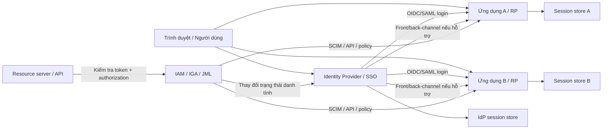
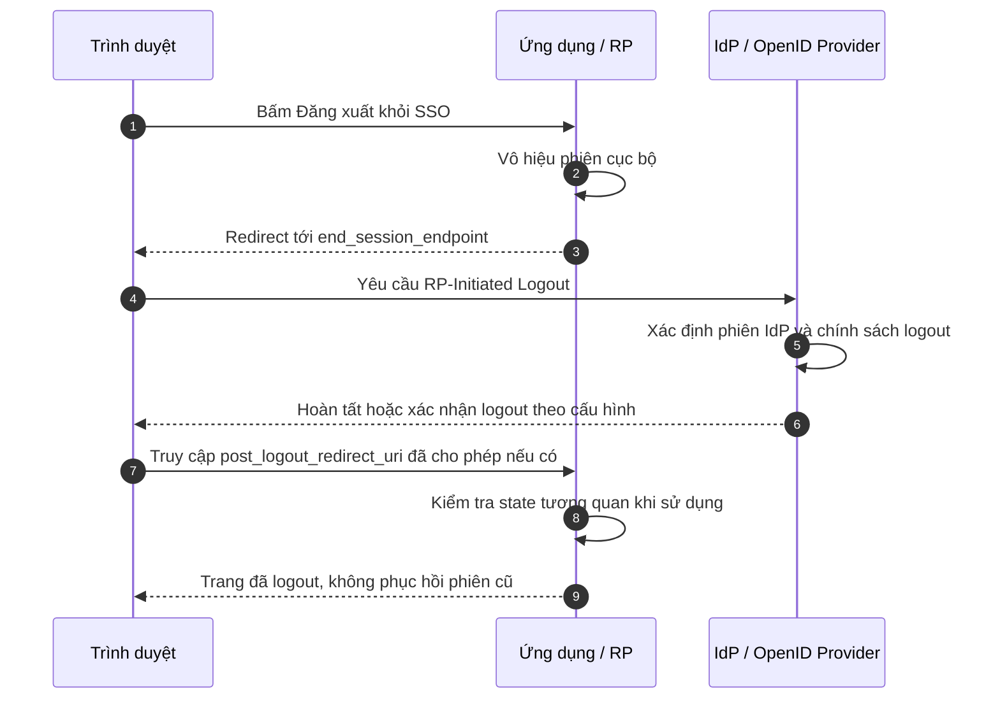
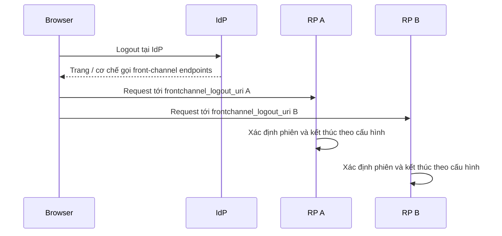
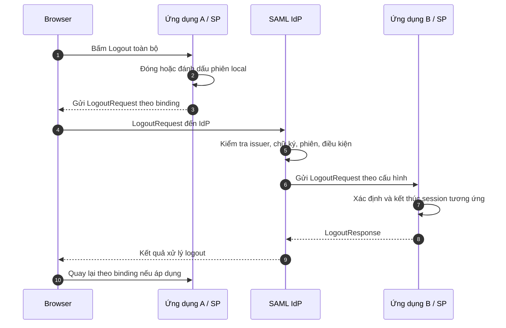

# SSO logout trong vòng đời quản lý danh tính IAM

## 1. SSO logout là gì?

**SSO logout** là quá trình kết thúc một hoặc nhiều **phiên đăng nhập** liên quan đến cơ chế **Single Sign-On (SSO)**, giúp người dùng không tiếp tục sử dụng phiên đã được xác thực mà không phải đăng nhập lại. Trong hệ thống có **Identity Provider (IdP)** và nhiều ứng dụng tiếp nhận kết quả xác thực, việc “đăng xuất” không nhất thiết là một thao tác duy nhất: mỗi thành phần có thể giữ phiên, cookie hoặc token riêng.

Ví dụ, nhân viên An đăng nhập qua IdP của doanh nghiệp rồi mở cổng nhân sự và ứng dụng quản lý dự án. Khi An bấm “Đăng xuất” ở ứng dụng dự án, ứng dụng có thể chỉ xóa **phiên cục bộ**. Phiên IdP và phiên cổng nhân sự vẫn còn; An có thể quay lại ứng dụng dự án và đăng nhập SSO mà không phải nhập lại mật khẩu. Nếu tổ chức muốn đăng xuất đồng bộ nhiều ứng dụng, cần thiết kế thêm cơ chế **Single Logout (SLO)** hoặc khả năng phối hợp phiên giữa các thành phần.

Trong module **SECURITY_IDENTITY_ACCESS_MANAGEMENT_IDENTITY_LIFECYCLE**, chủ đề này gắn với mô hình **Joiner–Mover–Leaver (JML)**: từ xác minh người dùng, tạo tài khoản, cấp quyền qua IdP/SSO/SCIM đến điều chỉnh hoặc thu hồi khi vai trò, hợp đồng hay trạng thái nhân sự thay đổi. **Logout là một kiểm soát phiên**, còn **deprovisioning** và các quyết định **RBAC/ABAC** là những kiểm soát khác, phải phối hợp để ngăn quyền truy cập tồn dư.

Điều cần nhớ ngay từ đầu:

- **Logout khỏi ứng dụng không mặc nhiên logout khỏi IdP.**
- **Logout khỏi IdP không mặc nhiên hủy phiên, token hay credential của mọi ứng dụng.**
- **Logout không xóa account, không tự gỡ nhóm SCIM, không thu hồi mọi entitlement.**
- **Leaver cần chặn truy cập theo chính sách, không chỉ hiển thị nút “Đăng xuất”.**

Bài học giải thích các loại phiên và mức logout, cơ chế OIDC/SAML, cách xử lý trình duyệt và token, mối liên hệ với JML, những giới hạn khi các hệ thống không hỗ trợ SLO đầy đủ, cùng phương án kiểm thử và kiểm toán.

## 2. Phân biệt logout, session expiration, token revocation và deprovisioning

Các thao tác này thường cùng xuất hiện trong quy trình kết thúc truy cập, nhưng **khác đối tượng, phạm vi và kết quả**.

| Khái niệm | Đối tượng chính | Kết quả mong muốn | Điều không được tự suy ra |
| --- | --- | --- | --- |
| **Local logout** | Phiên của một ứng dụng/RP/SP | Người dùng không tiếp tục dùng phiên cục bộ đó | Phiên IdP và ứng dụng khác đã chấm dứt |
| **IdP logout** | Phiên đăng nhập tại IdP | Không sử dụng phiên IdP hiện tại để SSO tiếp | Phiên do các RP/SP đã tạo đều bị hủy |
| **Single Logout (SLO)** | Nhiều phiên liên quan trong miền federation | Các bên hỗ trợ nhận và xử lý tín hiệu logout | Mọi thiết bị, mọi token/API và mọi ứng dụng chắc chắn bị thu hồi |
| **Session expiration** | Phiên có thời hạn | Phiên tự hết giá trị theo idle/absolute timeout | Danh tính/account hay entitlement đã bị xóa |
| **Token revocation** | Token hoặc grant có cơ chế thu hồi | Token/grant không còn được chấp nhận theo thiết kế | Các session cookie, API key hay token khác đã hết hiệu lực |
| **Account disable** | Account tại IdP hoặc ứng dụng | Chặn việc sử dụng account theo chính sách đích | Tất cả phiên hoặc bearer token đã phát bị hủy tức thì |
| **Deprovisioning** | Account, nhóm, quyền, credential, license | Đưa trạng thái truy cập về đúng lifecycle/policy | Một lệnh SCIM thành công đã bao phủ mọi đường truy cập |
| **Authorization re-evaluation** | Quyền thực thi từng hành động/tài nguyên | Quyền đã thu hồi không tiếp tục được sử dụng | Logout mới có thể thay thế mọi kiểm tra quyền |

**Logout là hành động liên quan phiên xác thực.** Khi nhân viên nghỉ việc, cần xử lý cả trạng thái danh tính, phiên, quyền, tài khoản và token. Ngược lại, khi người dùng chỉ đóng ca làm việc, thường không có lý do để xóa danh tính hoặc thu hồi vĩnh viễn các quyền được phê duyệt.

### Ba câu hỏi xác định “đã logout thành công”

1. **Logout khỏi đâu?** Một tab, một ứng dụng, toàn bộ phiên IdP hay các RP/SP trong một quan hệ federation?
2. **Ở phạm vi nào?** Phiên hiện tại, toàn bộ thiết bị của một người, một ứng dụng hoặc toàn bộ tổ chức?
3. **Đã kiểm chứng bằng gì?** Cookie/phiên cục bộ vô hiệu, IdP xác nhận, callback logout được xử lý hay resource server thực sự từ chối token?

Một thông báo UI “Bạn đã đăng xuất” chỉ đáng tin cho **phạm vi đã thực sự thực thi và xác nhận**. Không nên dùng thông báo đó để cam kết đã chặn hoàn toàn mọi truy cập.

## 3. Những trạng thái tồn tại đồng thời trong SSO

Giả sử một người mở ba ứng dụng dùng chung IdP. Ít nhất có thể tồn tại các lớp trạng thái sau:

| Thành phần | Trạng thái thường gặp | Ai kiểm soát? |
| --- | --- | --- |
| **IdP session** | Cookie/phiên chứng minh người dùng đã đăng nhập ở IdP | IdP |
| **RP/SP session** | Cookie hoặc phiên riêng để ứng dụng nhận diện người dùng | Từng RP/SP |
| **OIDC ID token / SAML assertion** | Kết quả xác thực đã phát cho ứng dụng | Issuer phát; RP/SP kiểm tra và sử dụng |
| **OAuth access token** | Token dùng để gọi API theo audience/scope riêng | Authorization server và resource server |
| **Refresh token** | Credential dùng để lấy access token mới nếu được cấp | Authorization server và client; khả năng thu hồi tùy cơ chế |
| **Local account / entitlement** | Tài khoản, nhóm, role, quyền đã cấp ở ứng dụng | IAM/IGA và application/data owner |
| **Device/recovery credential** | Passkey, khóa bảo mật, session trên thiết bị khác | IdP hoặc ứng dụng tùy thiết kế |

**Một lớp trạng thái bị chấm dứt không kéo theo tất cả lớp khác.** Ví dụ RP xóa session cookie nhưng access token do browser hoặc backend giữ có thể vẫn còn hiệu lực. Ngược lại, IdP mất session vì hết hạn không khiến RP tự biết để kết thúc session cục bộ của nó nếu không có tích hợp.

### Session và credential khác nhau

**Credential** như mật khẩu, passkey, khóa riêng hoặc client secret được dùng để chứng minh danh tính khi xác thực. **Session** là trạng thái được tạo sau xác thực để tránh bắt người dùng thực hiện lại mọi bước ở mỗi request. Logout thông thường **không xóa passkey hoặc mật khẩu**, cũng không hủy quyền truy cập nghiệp vụ của người dùng. Khi cần ngừng vĩnh viễn quyền đăng nhập, phải dùng bước account disable/credential revocation phù hợp.

## 4. Các kiểu logout trong hệ thống liên kết

| Kiểu logout | Người khởi tạo | Phạm vi thường đạt được | Rủi ro nếu hiểu sai |
| --- | --- | --- | --- |
| **RP-local logout** | Người dùng trong ứng dụng | Chỉ session của ứng dụng đó | Lần truy cập sau có thể SSO tự động |
| **RP-initiated IdP logout** | RP đưa trình duyệt tới logout endpoint của IdP | Phiên IdP, cộng cơ chế logout liên quan nếu cấu hình | Không mặc nhiên thu hồi access token/API key |
| **IdP-initiated logout** | Người dùng bấm logout tại IdP hoặc quản trị viên kích hoạt | Phiên IdP; có thể báo RP/SP theo giao thức | Ứng dụng không hỗ trợ vẫn giữ phiên |
| **Front-channel logout** | IdP thông báo qua trình duyệt | Các RP đã đăng ký và trình duyệt thực hiện được request | Bị giới hạn bởi cookie bên thứ ba, iframe, network, tab |
| **Back-channel logout** | IdP gửi thông báo trực tiếp đến RP server | RP có endpoint và xác minh thông báo để đóng phiên | Thông báo bất đồng bộ hoặc lỗi mạng cần retry/đối soát |
| **SAML Single Logout** | SP hoặc IdP phát yêu cầu logout trong SAML federation | Những phiên SP/IdP tham gia và hỗ trợ SLO | Không phải mọi SP đều triển khai đầy đủ |
| **Administrative sign-out / revocation** | IAM/Security khi Leaver hoặc sự cố | Các phiên/token được nền tảng hỗ trợ chấm dứt | Logout browser không bao phủ service token và quyền còn tồn dư |

Các tên **front-channel** và **back-channel** đặc biệt phổ biến trong họ đặc tả OIDC logout. Việc chọn hình thức phải dựa trên **mức hỗ trợ thực tế của IdP và từng RP**, không dựa một mình vào việc dùng OIDC hay SAML để đăng nhập.

## 5. Mô hình kiến trúc: logout không chỉ nằm ở IdP



Đường **OIDC/SAML login** và đường **logout** là hai phần cấu hình khác nhau. Ứng dụng có thể hoạt động tốt với SSO nhưng chưa đăng ký endpoint nhận logout. Ngoài ra, khi ứng dụng cấp phiên riêng, IdP không thể tự xóa cookie chỉ thuộc domain ứng dụng: IdP cần giao thức thông báo, hoặc ứng dụng tự xử lý khi nhận request phù hợp.

**Nguyên tắc thiết kế:** bên nào **tạo và sở hữu session** thì bên đó phải có khả năng **vô hiệu hóa hoặc để phiên hết hạn**. Bên gửi tín hiệu chỉ kích hoạt yêu cầu; kết quả cuối phải được xác nhận tại thành phần giữ phiên hoặc quyết định truy cập.

## 6. Local logout: bước tối thiểu mọi ứng dụng phải làm đúng

Khi người dùng bấm “Đăng xuất” tại RP, ứng dụng nên kết thúc phiên cục bộ có liên quan trước khi hiển thị trạng thái đã đăng xuất. Với phiên phía server, cần đánh dấu session bị vô hiệu hóa hoặc xóa trạng thái server; với cookie, gửi phản hồi hết hạn/xóa cookie bằng đúng tên, path, domain và các thuộc tính cần thiết. **Chỉ xóa cookie ở trình duyệt không đủ** nếu một session ID cũ vẫn có thể dùng được ở server.

Một trình tự hợp lý:

1. Xác minh yêu cầu logout thuộc phiên hiện tại và chống **logout CSRF** ở mức thích hợp cho ứng dụng.
2. Thu hồi session server của RP và các trạng thái liên quan thuộc quyền kiểm soát RP.
3. Xóa cookie phiên đúng phạm vi, đồng thời xử lý token cục bộ theo thiết kế.
4. Ghi audit **không chứa session ID đầy đủ hoặc bearer token**.
5. Nếu người dùng yêu cầu logout khỏi SSO, thực hiện luồng chuyển tiếp tới IdP theo cấu hình được phê duyệt.
6. Sau khi quay lại, kiểm tra RP không còn chấp nhận phiên đã đóng; hiển thị rõ phạm vi logout.

### Cookie và nhiều tab

Cookie có thuộc tính như `Secure`, `HttpOnly` và `SameSite` phù hợp giúp bảo vệ phiên. Khi xóa cookie, phải dùng phạm vi khớp với cookie đã thiết lập; sai path/domain khiến cookie cũ vẫn được gửi. Nếu nhiều tab cùng dùng một session, cần để server không còn chấp nhận session đó; các tab có thể cập nhật UI sau lần request tiếp theo hoặc qua sự kiện nội bộ phù hợp.

**Không dùng URL logout bất kỳ từ tham số người dùng để redirect** sau khi hủy session. Đích chuyển hướng phải được kiểm soát để tránh *open redirect* hoặc lừa người dùng chuyển sang trang phishing.

### Local logout có đủ không?

Local logout phù hợp khi người dùng muốn rời **một ứng dụng** và hiểu rằng các ứng dụng khác có thể còn đăng nhập. Nếu tổ chức yêu cầu dùng máy tính công cộng rồi “đăng xuất khỏi mọi ứng dụng”, phải có thiết kế SLO và hướng dẫn rõ giới hạn từng hệ thống. Đóng tab hoặc đóng trình duyệt không nên được xem là một sự kiện thu hồi đáng tin cho mọi session.

## 7. OIDC RP-Initiated Logout

**OpenID Connect RP-Initiated Logout** cho phép **Relying Party** khởi tạo yêu cầu kết thúc phiên ở **OpenID Provider (OP/IdP)**, thường bằng cách chuyển hướng trình duyệt tới **end-session endpoint** do IdP công bố/cấu hình. Đây là một cơ chế tương tác; việc có endpoint không bảo đảm mọi RP khác đã được thông báo logout.



### Tham số phổ biến

| Tham số | Ý nghĩa | Lưu ý |
| --- | --- | --- |
| `id_token_hint` | Gợi ý ID token được IdP cấp trước đó để nhận diện phiên/client | Có thể chứa dữ liệu nhạy cảm; quản lý và tránh ghi URL/token vào log |
| `post_logout_redirect_uri` | Địa chỉ quay lại RP sau khi IdP xử lý logout | Phải đáp ứng quy tắc đăng ký/cho phép của IdP; không nhận URL tùy ý |
| `state` | Giá trị RP dùng để liên kết phản hồi quay lại với yêu cầu logout | Sinh ngẫu nhiên, lưu/nghiệm lại theo phiên hoặc giao dịch; chống xử lý lẫn request |
| `client_id` | Nhận diện client khi IdP cần để xác định yêu cầu | Có thể được yêu cầu tùy tổ hợp tham số/triển khai |
| `logout_hint` | Gợi ý về phiên/người dùng theo khả năng IdP | Không dùng như bằng chứng xác thực độc lập |

Một request ví dụ **mang tính minh họa, không chứa token thật**:

```text
GET https://idp.example.org/oidc/logout
    ?id_token_hint=<ID_TOKEN_ISSUED_BY_THIS_IDP>
    &post_logout_redirect_uri=https%3A%2F%2Fportal.example.org%2Fsigned-out
    &state=<RANDOM_LOGOUT_CORRELATION_VALUE>
```

Endpoint, cách encode và tham số chính xác phải lấy từ **metadata/tài liệu IdP và profile giao thức được hỗ trợ**. ID token có thể xuất hiện trong query string ở một số flow; triển khai cần cân nhắc rủi ro lộ qua browser history, proxy, analytics và log. Không sao chép request minh họa vào log hoặc thêm token thật vào tài liệu.

### Những hiểu nhầm thường gặp

**Nhầm 1: redirect tới IdP là đủ để kết thúc phiên ứng dụng.** Nếu RP chưa vô hiệu hóa session cục bộ trước khi redirect, người dùng có thể vẫn có cookie hợp lệ khi trình duyệt quay lại.

**Nhầm 2: IdP logout chắc chắn hủy access token tại API.** Đời sống access/refresh token phụ thuộc cách token được phát, khả năng revocation của IdP và cách resource server kiểm tra.

**Nhầm 3: post-logout redirect nào cũng được phép.** Redirect phải được kiểm soát theo cấu hình client; nếu dùng URL chưa đăng ký có thể bị từ chối hoặc tạo lỗ hổng.

**Nhầm 4: RP phải luôn dùng mọi tham số.** Yêu cầu cụ thể phụ thuộc OIDC logout profile và IdP; **không tự dựng URL dựa vào phỏng đoán**.

## 8. OIDC Front-Channel Logout

**Front-channel logout** là cách OP dùng **trình duyệt người dùng** thông báo đến các RP có đăng ký địa chỉ logout. Trong một số triển khai, OP đưa các logout URI của RP vào những phần tử iframe hoặc yêu cầu trình duyệt truy cập endpoint tương ứng. RP xử lý thông báo và cố gắng vô hiệu hóa session phù hợp.



Ưu điểm của front-channel là có thể tận dụng các cơ chế trình duyệt trong những tình huống phù hợp. Tuy nhiên, nó có những giới hạn thực tế:

- Trình duyệt có thể chặn **third-party cookies**, hạn chế iframe, tracking hoặc request cross-site.
- Một request qua browser có thể thất bại nếu mạng mất, tab đóng hoặc người dùng chuyển trang trước khi thông báo hoàn tất.
- RP có thể không xác định được session cần hủy nếu cookie không được gửi và không có cơ chế định danh phiên được hỗ trợ.
- Cần phòng tránh việc endpoint logout bị gọi tùy ý gây gián đoạn người dùng; xử lý `iss`, `sid` khi profile cung cấp và đảm bảo kiểm soát phù hợp.
- Thành công khi gọi URL không đồng nghĩa đã xác minh mọi session thuộc tài khoản trên mọi thiết bị đều bị đóng.

**Không nên xây dựng yêu cầu an ninh “buộc mọi phiên trên mọi thiết bị hết hiệu lực ngay” chỉ dựa vào front-channel logout.** Với trường hợp rủi ro cao, cần thêm các cơ chế server-side, kiểm tra quyền runtime hoặc vô hiệu token phù hợp.

## 9. OIDC Back-Channel Logout

**Back-channel logout** cho phép OP gửi tín hiệu đến **backend của RP** thông qua kết nối server-to-server, không cần trình duyệt đang mở. Theo profile OIDC Back-Channel Logout, OP gửi một **Logout Token** có dạng JWT đến endpoint đã đăng ký của RP. RP phải xác minh thông báo và kết thúc những session mà token chỉ định.

Một payload **minh họa** của Logout Token:

```json
{
  "iss": "https://idp.example.org",
  "aud": "project-portal-client",
  "iat": 1795420000,
  "jti": "logout-event-8041",
  "sid": "op-session-782",
  "events": {
    "http://schemas.openid.net/event/backchannel-logout": {}
  }
}
```

Đây là **payload chưa ký**, chỉ để giải thích các trường; không phải JWT hợp lệ có thể gửi thẳng đến endpoint. Một Logout Token theo profile phải có đúng các yêu cầu về claim, chữ ký và cấu trúc; nó **không được chứa `nonce`** theo mục đích phân biệt với ID token.

| Trường/điều kiện | Mục đích kiểm tra |
| --- | --- |
| `iss` | Chỉ nhận thông báo từ OP đã được cấu hình tin cậy |
| `aud` | Thông báo dành đúng RP/client được đăng ký |
| `iat` | Thời điểm sự kiện, đánh giá theo chính sách độ mới và clock skew |
| `jti` | Nhận diện thông báo để chống xử lý phát lại |
| `events` | Phải chứa đúng khóa sự kiện back-channel logout với cấu trúc phù hợp |
| `sid` và/hoặc `sub` | Xác định session hoặc subject cần kết thúc theo hợp đồng và profile |
| Chữ ký và thuật toán | Phải xác thực JWT bằng khóa tin cậy và thuật toán được phép |
| Không có `nonce` | Phân biệt Logout Token với một ID token thông thường |

**Không chỉ parse JSON rồi xóa session.** Một endpoint back-channel được internet gọi tới phải xác minh chữ ký, issuer, audience, sự kiện, thời gian và replay; liên kết `sid` hoặc `sub` với những session đúng của RP trước khi vô hiệu hóa.

### Ưu điểm và giới hạn

Back-channel không phụ thuộc cookie bên thứ ba và trình duyệt phải mở, nên thường đáng tin hơn front-channel trong việc **gửi tín hiệu giữa server**. Nhưng kết quả vẫn phụ thuộc **khả năng liên lạc, retry, tính sẵn sàng endpoint, khóa tin cậy và cách RP lưu quan hệ session**.

Nếu RP nhận thông báo hợp lệ nhưng session store đang lỗi, không được trả lời hoặc ghi “đã hoàn tất” theo cách che giấu việc chưa thu hồi. Cần hàng đợi/retry/đối soát có kiểm soát. Ngược lại, hai Logout Token hợp lệ lặp lại không nên tạo lỗi hoặc làm vô hiệu nhầm phiên mới sau khi người dùng đăng nhập lại: **mapping theo session generation và xử lý idempotent** là rất quan trọng.

## 10. SAML 2.0 Single Logout (SLO)

Với **SAML 2.0**, **Single Logout** dùng các thông điệp như **`LogoutRequest`** và **`LogoutResponse`** để các bên phối hợp kết thúc phiên trong một quan hệ federation. Người dùng có thể logout ở **SP** hoặc **IdP**; bên khởi tạo thông báo qua các binding được cấu hình, chẳng hạn HTTP-Redirect, HTTP-POST hoặc SOAP khi được hỗ trợ.



Sơ đồ giản lược một luồng SP-initiated; giao thức thực tế có thể qua nhiều redirect/POST của trình duyệt hoặc kênh server tùy binding. Không phải mọi sản phẩm sẽ logout tất cả SP theo cách giống nhau.

### Những giá trị SAML cần kiểm tra

- **`Issuer` và metadata:** chỉ chấp nhận thông điệp từ IdP/SP đã đăng ký.
- **Chữ ký và vị trí chữ ký:** xác minh đúng nội dung XML mà ứng dụng thực sự xử lý; phòng XML signature wrapping.
- **`Destination`, endpoint và binding:** message đến đúng nơi đã thỏa thuận.
- **`NameID`:** xác định chủ thể theo định dạng đã thống nhất, không suy email là khóa ổn định.
- **`SessionIndex` khi có và áp dụng:** giúp liên kết logout với phiên cụ thể, không gộp nhầm nhiều phiên.
- **`InResponseTo`/request ID khi áp dụng:** gắn kết response với yêu cầu đã phát, phòng phản hồi giả hoặc sai ngữ cảnh.
- **Thời gian, replay, status:** xử lý giới hạn thời gian và yêu cầu lặp theo chính sách giao thức.

**Một `LogoutResponse` không phải bằng chứng đầy đủ rằng mọi phiên tại mọi SP đã biến mất.** Mỗi SP có cách quản lý session riêng, có thể lỗi hoặc không hỗ trợ SLO. IdP và SP cần quan sát trạng thái, log lỗi và có kế hoạch khi logout hoàn tất một phần.

### Khác biệt quan trọng với OIDC

OIDC có những profile logout riêng như RP-Initiated, Front-Channel và Back-Channel; SAML có các thông điệp SLO và binding của SAML. **Không chuyển máy móc tham số `id_token_hint` sang SAML** hoặc cố xử lý SAML `LogoutRequest` như một OIDC Logout Token. Cần thư viện và cấu hình đúng giao thức.

## 11. Logout với access token, refresh token và API

**SSO chủ yếu mô tả liên kết xác thực**, nhưng ứng dụng hiện đại còn sử dụng OAuth token để gọi API. Cần phân biệt token nào có thể thu hồi và cách resource server biết điều đó.

| Loại trạng thái | Logout có thể ảnh hưởng thế nào? | Điều phải kiểm chứng |
| --- | --- | --- |
| **RP session cookie** | RP hủy session server, hết hạn cookie | Request với cookie cũ bị từ chối |
| **IdP session** | IdP logout phiên hiện hành | SSO mới yêu cầu xác thực lại theo chính sách |
| **Refresh token** | Có thể bị thu hồi qua endpoint/API hoặc theo chính sách logout của IdP | Client không thể lấy access token mới từ grant bị thu hồi |
| **Opaque access token** | Có thể được kiểm tra bằng introspection, trạng thái có thể phản ánh thu hồi | Resource server từ chối token không còn active |
| **JWT access token tự chứa** | Có thể tiếp tục dùng đến `exp` nếu chỉ kiểm tra JWT tại chỗ | Resource server có cơ chế thu hồi/kiểm tra trạng thái hoặc chấp nhận cửa sổ TTL đã đánh giá |
| **API key / PAT / service credential** | Thường không phụ thuộc browser logout | Phải thu hồi riêng tại nơi phát hành hoặc quản trị key |
| **Entitlement/RBAC/ABAC** | Logout không sửa quyền đã được phê duyệt | Policy engine và ứng dụng xử lý quyền theo trạng thái hiện tại |

**OAuth 2.0 Token Revocation** là một cơ chế cho phép client yêu cầu authorization server vô hiệu token/grant khi được hỗ trợ; **Token Introspection** cho phép resource server xác định trạng thái token trong các kiến trúc phù hợp. Hai cơ chế này **không đồng nhất** với OIDC logout. Không mặc định rằng IdP có logout endpoint thì mọi access token bị thu hồi tức thì.

### JWT không thể “xóa khỏi trình duyệt là hết hiệu lực trên API”

Giả sử access token có thời hạn 15 phút, chữ ký đúng và API chỉ kiểm tra `iss`, `aud`, `exp`, scope. Nếu RP xóa bản token trong storage, một bản sao bị đánh cắp vẫn có thể được API chấp nhận đến hạn, trừ khi API dùng kiểm tra trạng thái hoặc cơ chế chặn khác. Do đó cần chọn **TTL, bảo vệ token, audience/scope, cơ chế thu hồi, kiểm tra trạng thái người dùng/quyền và chính sách rủi ro** một cách nhất quán.

Token có thể dành cho một API cụ thể. **ID token không được dùng như access token**; mỗi loại phải được kiểm tra đúng mục đích và audience.

## 12. Những giới hạn do trình duyệt, thiết bị và hệ thống phân tán

Một trải nghiệm logout tốt trên máy phát triển chưa chắc hoạt động đồng nhất ở trình duyệt hiện đại hoặc đa thiết bị.

**Cookie SameSite và third-party restrictions.** Browser có thể không gửi cookie của RP khi endpoint được gọi trong iframe từ domain IdP. Điều này ảnh hưởng khả năng RP nhận biết session trong front-channel. Các cấu hình `SameSite=None; Secure` trong những ngữ cảnh được cho phép có thể là một yếu tố, nhưng **không bảo đảm** vượt mọi chính sách chống theo dõi của trình duyệt. Cần xác định cơ chế đúng với yêu cầu an toàn và hỗ trợ thực tế.

**Nhiều tab.** Một người có thể đăng nhập cùng ứng dụng trong nhiều tab. Nếu session chung đã bị hủy ở server, các tab cần bị từ chối khi tiếp tục gọi API. UI có thể cập nhật qua cơ chế thông báo nội bộ, nhưng bảo mật phải dựa vào kiểm tra server chứ không dựa vào việc một tab đã chuyển trang logout.

**Nhiều thiết bị.** Logout phiên hiện tại trên laptop thường **không tự logout** phiên trên điện thoại nếu hệ thống không có cơ chế revoke theo subject hoặc quản lý phiên toàn cục. Nên phân biệt rõ nút **“Đăng xuất thiết bị này”** với **“Đăng xuất mọi thiết bị”**.

**Phiên phía RP tách biệt phiên IdP.** RP có thể dùng session cookie có absolute timeout dài, còn IdP có session ngắn. Nếu RP không yêu cầu xác thực lại ở những điểm nhạy cảm, người dùng vẫn dùng RP dù IdP session đã kết thúc.

**Kết nối mạng không ổn định.** Front-channel có thể bị dừng giữa chừng; back-channel có thể gặp timeout; SAML SLO có thể thất bại ở một SP. Hệ thống cần trạng thái **partial**, retry trong phạm vi hợp lý và đối soát, thay vì thông báo “tất cả đã logout” không có bằng chứng.

## 13. SSO logout trong Joiner–Mover–Leaver

Một bài toán IAM quan trọng là **phân biệt người chủ động logout với thay đổi quyền do tổ chức quyết định**. JML cung cấp tín hiệu vòng đời có thẩm quyền, còn logout là một trong nhiều biện pháp thực thi.

| Giai đoạn | Điều cần xảy ra ở identity/account | Yêu cầu đối với session/logout |
| --- | --- | --- |
| **Joiner** | Định danh được xác minh/liên kết, account và quyền tối thiểu được cấp đúng thời điểm | Phiên chỉ hình thành khi identity/account hợp lệ; SSO không bỏ qua ngày bắt đầu hoặc policy MFA |
| **Mover** | Thu hồi quyền cũ, cấp quyền mới được duyệt, cập nhật RBAC/ABAC | Đánh giá lại claim/group/session, yêu cầu re-auth/step-up hoặc revoke phiên cũ khi mức rủi ro cần |
| **Leaver** | Chặn account, deprovision quyền/credential tại IdP và ứng dụng | Vô hiệu hóa phiên hiện có theo khả năng đích; không chỉ gửi logout notification |
| **Contract expiry** | Guest/sponsor và quyền B2B hết hiệu lực theo nguồn có thẩm quyền | Chặn local guest ngay cả khi home IdP đối tác vẫn đăng nhập được |
| **Security incident** | Tài khoản bị nghi chiếm đoạt hoặc credential lộ | Có thể yêu cầu sign-out mọi phiên, thu hồi token, khóa phương thức xác thực và điều tra |

### Joiner: thiết lập đúng ranh giới phiên

Khi một nhân viên mới được tạo tài khoản IdP, ứng dụng chỉ được chấp nhận phiên SSO nếu danh tính liên kết đúng, nguồn HRIS cho phép bắt đầu và quyền ứng dụng đã được chấp thuận. Một ứng dụng triển khai JIT provisioning không nên xem token hợp lệ từ một IdP chung là lý do cấp quyền `admin` hoặc bỏ qua sponsor. Việc logout chủ yếu liên quan đến trải nghiệm và bảo vệ phiên; chưa có yêu cầu thu hồi quyền JML.

### Mover: quyền đổi nhưng phiên có thể vẫn tồn tại

Nhân viên chuyển từ Sales sang Finance. IGA tính lại quyền qua RBAC/ABAC; SCIM hoặc connector cập nhật nhóm và entitlement. Nếu ứng dụng đang cache `sales-export` trong session hoặc token, chỉ cập nhật IdP group chưa đủ để ngăn sử dụng quyền cũ.

Có thể cần **thu hồi phiên liên quan, làm mới claim, giới hạn TTL, ép xác thực lại hoặc kiểm tra authorization runtime**. Việc bắt người dùng logout rồi login lại có thể giúp cập nhật một số claim nhưng **không thay thế thu hồi quyền trực tiếp** nếu ứng dụng đang lưu grant cũ ngoài IdP.

### Leaver: ưu tiên chặn truy cập

HRIS hoặc hệ thống hợp đồng phát sự kiện Leaver có thẩm quyền. Quy trình deprovisioning nên:

1. Xác minh đúng danh tính, nguồn và thời điểm hiệu lực.
2. Chặn đăng nhập mới tại IdP; vô hiệu hóa account/guest theo chính sách.
3. Thu hồi nhóm và quyền tại ứng dụng thông qua SCIM/API hoặc thao tác quản trị có kiểm chứng.
4. Thực hiện **revoke session/token/refresh token** ở những đích có hỗ trợ, đồng thời đánh giá token chưa hết hạn tại API.
5. Xử lý PAT, API key, credential local và quyền ứng dụng không đi qua SSO.
6. Đối soát và ghi nhận những đường truy cập còn tồn dư, chỉ kết thúc khi đáp ứng tiêu chí theo rủi ro.

**Không chờ logout toàn cục hoàn tất mới khóa tài khoản Leaver.** Nhiều ứng dụng có thể offline hoặc không hỗ trợ SLO; tín hiệu đã xác nhận từ nguồn nhân sự vẫn phải kích hoạt kiểm soát truy cập theo đường khả thi.

## 14. SCIM, RBAC/ABAC và SSO logout: phối hợp nhưng không thay thế

Một sai lầm thường gặp là coi logout như công cụ thay thế provisioning. Thực tế:

- **SCIM** quản lý User/Group ở hệ thống đích qua các thao tác được provider hỗ trợ. Việc đặt `active=false` có thể chặn account ở ứng dụng, nhưng **không phải thao tác “logout mọi session” được SCIM bảo đảm**.
- **RBAC** quyết định những quyền gắn với vai trò sau Joiner/Mover; logout không xóa role khỏi danh mục hoặc membership đã được gán.
- **ABAC** dựa trên thuộc tính và ngữ cảnh như `employmentStatus`, `partnerId`, phân loại tài nguyên và mức xác thực. Nếu resource server kiểm tra thuộc tính đáng tin cậy ở thời điểm request, quyền có thể được từ chối ngay cả khi một access token còn hợp lệ về mặt mật mã.
- **IGA** quản trị phê duyệt, chứng nhận và lý do duy trì quyền. SLO không chứng minh một vai trò đã được thu hồi.
- **PAM/privileged access** có thể dùng phiên đặc quyền và credential riêng; cần cơ chế kết thúc session/thu hồi quyền theo sản phẩm PAM, không mặc định cookie SSO bao phủ.

Ví dụ guest của đối tác B vẫn đăng nhập thành công tại home IdP B nhưng hợp đồng với doanh nghiệp A đã kết thúc. A phải từ chối guest theo local contract/sponsor policy, bất kể người dùng có thể tạo phiên SSO mới từ B. Đây là **quyết định authorization và lifecycle**, không đơn thuần xử lý logout.

### Session mạnh nhưng quyền yếu vẫn nguy hiểm

MFA hoặc passkey giúp xác minh người dùng, nhưng nếu ứng dụng chỉ kiểm tra session cookie và không kiểm tra `resource.ownerId`, `partnerId` hay quyền trên hành động, người dùng có thể truy cập dữ liệu không được phép. **Xác thực đúng và logout đúng là cần thiết nhưng chưa đủ**: mỗi API phải có chính sách authorization phù hợp.

## 15. B2B federation và guest: trách nhiệm logout của hai tổ chức

Khi nhân viên của Công ty A đăng nhập cổng của Công ty B thông qua IdP A, có ít nhất hai miền trách nhiệm:

| Thành phần | Công ty A (home) | Công ty B (resource organization) |
| --- | --- | --- |
| Identity và credential | Quản lý người dùng, MFA, session IdP A | Không mặc định quản lý password A |
| Federation trust | Phát assertion/token đúng hợp đồng | Kiểm tra issuer, audience, chữ ký, phiên và claim được tin |
| Guest/account | Có home account | Có thể cần local guest, sponsor, hợp đồng và ngày hết hạn |
| Logout | Có thể kết thúc IdP session và phát tín hiệu theo giao thức | Phải kết thúc local RP session nếu nhận/khởi tạo logout |
| Leaver A | Disable home identity | Xử lý guest/quyền tại B theo sự kiện nhận được và chính sách |
| Contract expiry B | Có thể người đó vẫn làm việc tại A | B chặn guest và thu hồi quyền của B độc lập |

**Single Logout xuyên tổ chức không tự biến thành “ngừng hợp đồng tức thì”.** Nếu SAML SLO hoặc OIDC logout notification không đến B, local session B có thể còn; vì vậy B cần timeout hợp lý, kiểm tra guest status trong authorization và cơ chế deprovisioning theo sự kiện hợp đồng.

Khi một bên thay IdP hoặc cấu hình issuer, cần đánh giá lại session mapping và Logout Token/SAML NameID; không được tự gộp subject chỉ vì email trùng. Bất kỳ callback logout từ đối tác nào cũng phải được kiểm chứng đúng nguồn, tránh kẻ xấu kích hoạt logout nhầm hàng loạt.

## 16. Service account và workload: không áp dụng máy móc browser logout

**Tài khoản dịch vụ** và **workload identity** thường không tạo phiên trình duyệt qua SSO tương tác. Chúng có thể dùng mTLS, OAuth 2.0 client credentials, workload federation, chứng chỉ hoặc API key để gọi hệ thống khác.

Do đó, “logout một service account” thường không phải giải pháp đúng khi cần ngừng dịch vụ. Cần:

- Xác định **service owner**, `serviceId`, workload và môi trường.
- Kiểm kê token/credential, audience, scope, trust policy và tài nguyên.
- Khi service chuyển owner hoặc thay phạm vi (**Mover**), sửa quyền và điều kiện trust; luân chuyển credential khi cần.
- Khi chính workload ngừng (**Leaver**), vô hiệu hóa client/grant, thu hồi key/chứng chỉ/token theo khả năng, xóa trust không còn được phép và đối soát.
- Đặt TTL ngắn và quyền tối thiểu cho token, tránh dùng secret tĩnh dài hạn khi có workload identity federation/managed identity được hỗ trợ.
- Phân biệt **nhân viên tạo service account nghỉ việc** với **dịch vụ đã ngừng chạy**: có thể cần chuyển giao owner mà chưa deprovision workload.

Một API bearer token còn hợp lệ không bị ảnh hưởng chỉ vì kỹ sư phụ trách bấm logout khỏi cổng quản trị. Tổ chức cần kiểm soát danh tính máy riêng, đồng thời kết nối kết quả với JML và audit.

## 17. Pseudocode: thiết kế logout có trạng thái và bảo vệ giao thức

Ví dụ dưới đây mô tả một RP dùng OIDC, có session server-side và hỗ trợ nhận back-channel. Đây là **giả mã thiết kế**, không phải thư viện OIDC hoặc API production có thể dùng trực tiếp.

```text
logoutCurrentRpSession(request):
    require request.isAuthenticatedByCurrentSession()
    require csrfProtectionForLogoutAction(request)

    sid = request.serverSideSessionId
    sessionStore.invalidate(sid)
    revokeRpOwnedTokensIfSupported(sid)
    expireSessionCookiesUsingExactScope()

    audit.write("RP_LOCAL_LOGOUT", identityRef, sidReferenceOnly)

    if request.userSelectedSsoLogout:
        endpoint = trustedOidcMetadata.endSessionEndpoint
        state = newRandomCorrelationValue()
        saveLogoutTransaction(state, expectedIssuer, clientId)
        return redirectToAllowedEndSessionEndpoint(endpoint, {
            id_token_hint: getHintUnderSensitiveDataPolicy(),
            post_logout_redirect_uri: preRegisteredCallback,
            state: state
        })

    return showLocalLogoutCompleted()
```

Đối với back-channel:

```text
receiveBackChannelLogout(httpRequest):
    require endpointIsConfiguredForTrustedIssuer()

    token = parseLogoutTokenFromRequest(httpRequest)
    claims = verifySignedJwt(token, configuredIssuerKeys, allowedAlgorithms)
    require claims.iss == configuredIssuer
    require claims.aud includes expectedClientId
    require validIssuedAt(claims.iat)
    require validJti(claims.jti) and notPreviouslyProcessed(claims.jti)
    require correctBackchannelLogoutEvent(claims.events)
    require claims.nonce is absent
    require claims.sid exists or claims.sub exists

    sessions = findSessionsByTrustedIssuerAndSubjectOrSid(claims)
    for session in sessions:
        invalidateSessionIdempotently(session)

    recordProcessedLogoutEvent(claims.jti)
    audit.write("OIDC_BACKCHANNEL_LOGOUT", issuer, sessionReferences)
    return protocolCompatibleSuccessResponse()
```

**Những ràng buộc bắt buộc khi triển khai thật:**

- Không tự dùng một JWT decoder không xác minh chữ ký, không tin thuật toán từ header nếu không nằm trong cấu hình cho phép.
- Kiểm tra `iss`, `aud`, `iat`, `jti`, `events`, `sid`/`sub` theo profile và hợp đồng IdP.
- Khóa nhận diện session phải xét **issuer + client + subject/session**, không dùng `sid` trần trên toàn bộ hệ thống nếu có nguy cơ trùng.
- Chống replay, xử lý yêu cầu lặp an toàn, có cơ chế loại bỏ record chống replay theo retention đủ phù hợp.
- Không để thông báo logout cũ chấm dứt session **được tạo sau** nếu profile yêu cầu liên kết với session cụ thể.
- Không log raw Logout Token, ID token hay giá trị cookie; dùng tham chiếu và mã tương quan.
- Phản hồi HTTP và retry phải theo đặc tả/khả năng OP; lỗi tạm thời cần báo để bên gửi có thể thử lại nếu hỗ trợ.

## 18. Các kiểu lỗi và cách xử lý khi logout chưa hoàn tất

Một workflow logout nhiều bên thường **không có giao dịch nguyên tử**. Cần thiết kế trạng thái thay vì trả “thành công tất cả” từ một sự kiện.

| Lỗi | Điều người dùng có thể thấy | Rủi ro còn lại | Hướng xử lý |
| --- | --- | --- | --- |
| RP xóa cookie nhưng session server vẫn tồn tại | UI đã logout | Session ID cũ vẫn dùng được | Vô hiệu session server, kiểm thử lại cookie cũ |
| RP logout xong nhưng IdP session còn | Truy cập lại RP được SSO tự động | Không đạt ý định logout khỏi SSO | Khởi tạo RP-Initiated Logout khi được yêu cầu |
| IdP logout nhưng RP B không nhận thông báo | B vẫn mở | Quyền qua session B còn | Session revocation ở B, timeout, back-channel hoặc authorization check |
| Front-channel iframe bị chặn | Một số RP vẫn đăng nhập | Cookie không gửi và phiên không được tìm thấy | Dùng server-side/back-channel khi có, fallback có kiểm chứng |
| Back-channel endpoint lỗi | RP chưa thu hồi session | Tồn dư phiên trong lúc retry | Queue/retry, cảnh báo, đối soát và kiểm soát an ninh |
| SAML SLO phản hồi lỗi tại một SP | Logout toàn cục một phần | Phiên SP đó còn | Theo dõi kết quả từng SP và xử lý cụ thể |
| JWT access token chưa hết hạn | API vẫn chấp nhận token | Token tồn dư dù RP/IdP đã logout | TTL, revoke/introspection hoặc authorization hiện hành |
| Session bị hủy nhưng API key còn | API automation vẫn chạy | Credential độc lập chưa thu hồi | Inventory, revoke key và kiểm chứng theo JML |
| Event Leaver đến muộn | Người dùng tiếp tục dùng phiên | Sai lệch thời điểm khóa | Sự kiện ưu tiên, đối soát và kiểm soát nguồn |

### Trạng thái cần phân biệt

Một orchestration có thể dùng các trạng thái **minh họa**:

- `REQUESTED`: yêu cầu logout được khởi tạo.
- `RP_SESSION_REVOKED`: session cục bộ đã bị vô hiệu hóa.
- `IDP_LOGOUT_SENT`: đã gửi trình duyệt tới OP hoặc gửi yêu cầu theo giao thức.
- `FEDERATED_NOTIFICATIONS_IN_PROGRESS`: đang xử lý các RP/SP nhận logout.
- `PARTIALLY_APPLIED`: một hoặc nhiều bên chưa có bằng chứng hoàn tất.
- `VERIFIED`: những phạm vi mà quy trình đã cam kết được kiểm chứng.
- `UNSUPPORTED_TARGET`: ứng dụng đích không có cách logout liên kết đáng tin; cần biện pháp khác.

Một hệ thống có thể **không quan sát trực tiếp** mọi phiên ở các RP khác vì ranh giới tổ chức hoặc sản phẩm. Khi đó nên hiển thị giới hạn rõ ràng và quản trị theo **khả năng được xác nhận**, không tạo số liệu thành công giả.

## 19. Kiểm thử end-to-end: logout có hiệu lực tới đâu?

Kiểm thử cần dùng **cả phiên hiện hành và các bản token/đường truy cập đã phát trước khi logout**, không chỉ nhìn trang thông báo.

| Ca kiểm thử | Thao tác | Kết quả kỳ vọng |
| --- | --- | --- |
| Local logout A | Login A/B rồi logout A | A từ chối session cũ; B có thể vẫn còn nếu không yêu cầu SLO |
| RP-Initiated Logout | Logout A với yêu cầu SSO logout | A hết phiên; IdP session được xử lý theo OP; không khẳng định B nếu chưa kiểm chứng |
| Front-channel | Login A/B, IdP phát thông báo | RP có hỗ trợ nhận và xử lý; log phân biệt RP thất bại do browser |
| Back-channel | OP gửi Logout Token hợp lệ | RP kiểm tra JWT và hủy đúng session được chỉ định |
| JWT giả | Gửi token sai chữ ký hoặc issuer | RP từ chối, không xóa phiên không liên quan |
| Replay Logout Token | Gửi lại cùng `jti` | Không gây tác dụng ngoài ý muốn, có dấu vết xử lý lặp |
| Logout Token sai audience | Gửi event dành RP A tới RP B | B từ chối |
| Logout nhiều thiết bị | Login ở laptop + điện thoại | Phân biệt kết quả logout phiên hiện tại và tất cả thiết bị theo policy |
| Logout nhiều tab | Tạo 2 tab cùng session A | Session server bị hủy, các tab không tiếp tục gọi API hợp lệ |
| Mover | Đổi vai trò khi session A/B đang mở | Quyền cũ bị từ chối theo policy; session/claim cũ được xử lý theo thiết kế |
| Leaver | Disable account khi đang có phiên | Chặn đăng nhập mới và đường truy cập hiện hữu trong phạm vi đã cam kết |
| API token | Gọi API với access token cũ sau logout | Kết quả phù hợp TTL/revocation/authorization policy, không suy chung |
| Guest hết hợp đồng | Home IdP vẫn hoạt động | RP của tổ chức tiếp nhận từ chối guest đã hết hiệu lực |
| SAML SLO lỗi một SP | SP B không nhận/kết thúc phiên | Báo partial, không tuyên bố toàn bộ phiên đã bị hủy |
| Key rotation | Thay khóa ký OP hoặc chứng thư SAML | Logout message được kiểm tra bằng metadata/trust cập nhật an toàn |

**Kiểm thử với trình duyệt thực** cần lưu ý cookie cross-site và chính sách tracking, nhưng kết quả an ninh phải được xác nhận bằng request/API và session store, không chỉ ảnh chụp giao diện đã logout.

## 20. Audit trail và các chỉ số vận hành

Để điều tra một phiên tồn dư, cần nối được **sự kiện logout**, **phiên đã tạo**, **bên phát thông báo** và **trạng thái tài khoản/quyền hiện tại**.

Một audit trail hữu ích gồm:

- `identityId`, issuer, client/SP và ID tài khoản đích theo phạm vi cần thiết.
- Loại logout: local, RP-initiated, front-channel, back-channel, SAML SLO hoặc admin revocation.
- ID giao dịch, `jti` của Logout Token, tham chiếu session `sid` được bảo vệ, thời điểm và actor/nguồn phát.
- Quyết định kiểm tra chữ ký, issuer, audience, replay, ràng buộc session và kết quả xử lý.
- Bên nhận được thông báo, kết quả từng RP/SP, mã lỗi, retry và thời hạn xử lý.
- Liên kết với sự kiện JML, SCIM/API, thay đổi entitlement, kết quả đối soát và ngoại lệ.
- Chính sách giữ log, phân quyền truy cập và biện pháp giảm lộ dữ liệu.

**Không lưu raw ID token, Logout Token, access token, refresh token, session cookie hoặc client secret trong log.** Chúng có thể chứa dữ liệu cá nhân hoặc là credential có thể bị dùng lại. Dùng mã tương quan và tham chiếu đã bảo vệ.

| Chỉ số | Mục đích |
| --- | --- |
| **Local logout completion rate** | Tỷ lệ session RP đã xác nhận bị vô hiệu hóa |
| **Federated logout delivery success** | Tỷ lệ thông báo đến RP/SP và được xử lý theo khả năng giao thức |
| **Partial SLO count** | Những luồng mà một số ứng dụng chưa hoàn tất logout |
| **Logout processing latency** | Thời gian từ request tới xác nhận các session trong phạm vi cam kết |
| **Back-channel retry backlog** | Số thông báo lỗi và tuổi thông báo chưa xử lý |
| **Stale session after Leaver** | Phiên/token còn khả năng truy cập sau khi danh tính đã bị chấm dứt |
| **Session inventory coverage** | Tỷ lệ ứng dụng quan trọng hỗ trợ quan sát và revoke session |
| **Unmanaged logout path count** | Ứng dụng có SSO nhưng chưa có cơ chế xử lý logout đáng tin |
| **Unauthorized access after mover** | Lần truy cập bị cho phép sai sau khi quyền thay đổi |

Không nên lấy **số lần người dùng bấm logout** làm chỉ số thành công bảo mật. Mục tiêu là **trạng thái session và quyền thực tế** tương ứng với ý định người dùng và chính sách vòng đời.

## 21. Tình huống thực tế: Logout khỏi cổng nhân sự nhưng phiên dự án vẫn còn

Doanh nghiệp có IdP chung, cổng nhân sự **HR Portal** và ứng dụng quản lý dự án **Project Hub**. Nhân viên Minh đăng nhập qua SSO trên laptop, có một phiên IdP và hai phiên ứng dụng.

**Giai đoạn 1 — Logout cục bộ.** Minh bấm “Đăng xuất” tại Project Hub. Ứng dụng xóa cookie và vô hiệu phiên server của mình; HR Portal vẫn mở, IdP vẫn còn phiên. Khi Minh vào lại Project Hub, hệ thống chuyển sang IdP rồi trả về một phiên mới mà không yêu cầu nhập lại mật khẩu. Đây **không phải lỗi** nếu chức năng được định nghĩa là **local logout** và UI nói rõ phạm vi.

**Giai đoạn 2 — Logout khỏi SSO.** Tổ chức bổ sung nút “Đăng xuất SSO” dùng OIDC RP-Initiated Logout. Project Hub kết thúc phiên cục bộ, chuyển trình duyệt đến OP end-session endpoint đã đăng ký; OP chấm dứt phiên IdP và dùng back-channel gửi Logout Token tới HR Portal nếu hai bên hỗ trợ. HR Portal kiểm tra chữ ký/issuer/audience/`jti` và xác định `sid` để đóng phiên của mình. Các bước này được ghi lại theo từng thành phần, không coi redirect thành công là bằng chứng mọi ứng dụng đã logout.

**Giai đoạn 3 — Một ứng dụng lỗi.** HR Portal tạm không truy cập được session store nên chưa thể đóng phiên. Quy trình ghi `PARTIALLY_APPLIED`, cảnh báo và retry có kiểm soát. Trong thời gian đó, các API nhạy cảm của HR Portal vẫn kiểm tra trạng thái tài khoản và quyền hiện hành, không chỉ sự tồn tại của session cookie. Khi session store hoạt động, thông báo được xử lý và readback xác nhận phiên cũ không còn.

**Giai đoạn 4 — Minh chuyển vai trò.** Sau này Minh chuyển từ Sales sang Finance. HRIS gửi Mover có hiệu lực; IGA gỡ `sales-export` và cấp quyền Finance được duyệt. Dù Minh chưa bấm logout, ứng dụng phải không cho dùng quyền Sales cũ. Tổ chức có thể revoke session hoặc yêu cầu xác thực lại để cập nhật claim, nhưng vẫn phải xử lý quyền RBAC/ABAC và grant cục bộ.

**Giai đoạn 5 — Minh nghỉ việc.** Khi HRIS phát Leaver, IAM chặn đăng nhập IdP và account ứng dụng, xử lý phiên/token còn hiệu lực theo khả năng từng hệ thống, thu hồi quyền SCIM và kiểm tra key/credential ngoài SSO. Nếu một API vẫn nhận JWT cũ đến thời hạn hết hiệu lực, tổ chức phải đánh giá và triển khai biện pháp giảm cửa sổ rủi ro đã định, thay vì tuyên bố “logout toàn cục” đã giải quyết mọi truy cập.

Tình huống cho thấy **một trải nghiệm đăng xuất trông đơn giản có thể yêu cầu nhiều bước bất đồng bộ**, và chỉ kiểm tra giao diện không đủ để kết luận JML an toàn.

## 22. Những hiểu lầm phổ biến

**Hiểu lầm 1 — “SSO login có thì SSO logout tự có.”** Các profile logout và endpoint phải được cấu hình riêng, mức hỗ trợ khác nhau giữa ứng dụng.

**Hiểu lầm 2 — “Xóa cookie browser là đã thu hồi quyền.”** Session server, token và entitlement có thể vẫn còn. Logout và authorization/deprovisioning là các kiểm soát khác nhau.

**Hiểu lầm 3 — “IdP logout đồng nghĩa mọi thiết bị đã sign out.”** Cần xác định phạm vi phiên và khả năng revoke theo subject, client hoặc thiết bị.

**Hiểu lầm 4 — “OIDC ID token bị xóa thì OAuth access token cũng bị thu hồi.”** Token có purpose và lifecycle riêng, cần kiểm tra cơ chế revocation/resource server.

**Hiểu lầm 5 — “Front-channel luôn gọi được mọi ứng dụng.”** Cookie cross-site, iframe và kết nối có thể làm một RP không nhận được yêu cầu.

**Hiểu lầm 6 — “Back-channel request có `sid` thì được tin.”** Phải kiểm chứng JWT Logout Token, issuer/audience, chữ ký, sự kiện và replay; `sid` một mình không phải credential.

**Hiểu lầm 7 — “SAML LogoutResponse thành công nghĩa là mọi SP đã đóng session.”** Có thể còn SP không hỗ trợ, thất bại hoặc chỉ logout một phần.

**Hiểu lầm 8 — “Buộc người dùng logout sẽ xóa quyền cũ sau Mover.”** Nếu role/entitlement vẫn được cấp trong ứng dụng, đăng nhập lại cũng có thể giữ quyền đó.

**Hiểu lầm 9 — “Khóa IdP đủ để kết thúc Leaver.”** Local account, phiên ứng dụng, JWT/API key và guest entitlement có thể tồn dư.

**Hiểu lầm 10 — “Service account dùng SSO logout như người dùng.”** Workload dùng credential và token M2M, cần quy trình revoke/trust riêng.

**Hiểu lầm 11 — “Một URL logout bất kỳ an toàn để chuyển hướng.”** Redirect không kiểm soát có thể trở thành open redirect hoặc đường dẫn phishing.

## 23. Checklist triển khai SSO logout cho IAM lifecycle

Khi thiết kế hoặc đánh giá logout của một hệ thống có federation/SSO, cần trả lời:

1. **Phạm vi:** nút logout có nghĩa là local logout, IdP logout hay Single Logout nhiều RP/SP? UI có nói đúng phạm vi không?
2. **Session ownership:** IdP, RP/SP và resource server giữ những session/token nào? Ai có thẩm quyền vô hiệu hóa từng loại?
3. **Local logout:** RP có hủy session phía server và hết hạn cookie đúng scope, đồng thời bảo vệ logout action trước CSRF/open redirect chưa?
4. **OIDC:** OP có hỗ trợ RP-Initiated Logout, Front-Channel hoặc Back-Channel? Endpoint/metadata có được lấy từ issuer tin cậy không?
5. **OIDC token:** nếu dùng Back-Channel, có kiểm tra JWT chữ ký, issuer, audience, thời gian, `jti`, `events`, `sid/sub` và ngăn replay không?
6. **SAML:** có hỗ trợ SLO, LogoutRequest/Response, kiểm tra chữ ký, endpoint, NameID, SessionIndex, request correlation và replay theo flow không?
7. **Trình duyệt:** đã thử trên môi trường chặn third-party cookies, nhiều tab và nhiều thiết bị chưa?
8. **Token lifecycle:** access token, refresh token, JWT tự chứa, PAT và API key nào còn sau logout? Hệ thống có introspection/revocation hoặc kiểm tra quyền hiện hành không?
9. **Joiner:** account mới chỉ có thể đăng nhập khi trạng thái và chính sách đã cho phép, kể cả trong JIT provisioning?
10. **Mover:** quyền cũ bị thu hồi qua RBAC/ABAC/SCIM; claim và session cũ được đánh giá lại hoặc revoke theo mức rủi ro chưa?
11. **Leaver:** có chặn đăng nhập mới, xử lý phiên, token, local account và đường truy cập ngoài SSO một cách độc lập với logout protocol chưa?
12. **B2B guest:** bên tiếp nhận có thể chặn guest theo hợp đồng dù home IdP vẫn cho người dùng đăng nhập không?
13. **Workload:** các token, chứng chỉ và trust của service account được thu hồi qua đường riêng khi ngừng dịch vụ không?
14. **Chịu lỗi:** nếu một RP/SP không phản hồi, có trạng thái partial, retry, owner xử lý và thời hạn khắc phục không?
15. **Đối soát:** có kiểm tra session thực tế bị vô hiệu, quyền tài nguyên bị từ chối và không còn phiên tồn dư ngoài phạm vi cam kết không?
16. **Kiểm toán:** log có thể nối logout event với identity, IdP, RP/SP, JML và kết quả từng đích, nhưng không lộ token hay cookie không?

**SSO logout là cơ chế quản lý kết thúc phiên trong một hệ sinh thái xác thực liên kết, không phải thao tác thu hồi danh tính và quyền truy cập trọn vẹn.** OIDC và SAML cung cấp những cách phối hợp logout giữa IdP và ứng dụng; IdP, RP/SP và resource server vẫn giữ trạng thái riêng. Khi tích hợp logout với JML, SCIM, RBAC/ABAC, quản lý session/token, kiểm toán và đối soát, tổ chức có thể mang đến trải nghiệm đăng xuất rõ ràng **và** hạn chế truy cập tồn dư khi người dùng đổi vai trò hoặc rời hệ thống.
