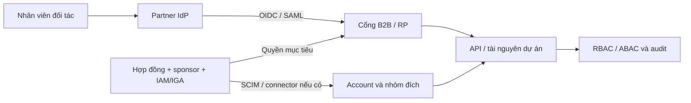

# SSO cho partner trong vòng đời danh tính IAM

**SSO cho partner** (*Partner Single Sign-On*) là mô hình cho phép nhân viên của doanh nghiệp đối tác truy cập cổng B2B hoặc ứng dụng của tổ chức cung cấp dịch vụ thông qua hệ thống xác thực liên kết, thay vì phải dùng mật khẩu riêng cho từng ứng dụng. Thường doanh nghiệp đối tác vận hành **Identity Provider (IdP)**, còn tổ chức cung cấp ứng dụng vận hành **Relying Party (RP)** hoặc **Service Provider (SP)**.

Trong **Identity and Access Management (IAM)**, mục tiêu không chỉ là đăng nhập thuận tiện. SSO cho partner phải giới hạn **đúng tổ chức, đúng cá nhân, đúng tài nguyên, đúng thời hạn hợp đồng** và có khả năng thu hồi khi thay đổi quan hệ. Mô hình **Joiner–Mover–Leaver (JML)** cần áp dụng cho danh tính ngoài tổ chức, phối hợp với **IdP, SSO, SCIM, RBAC/ABAC, tài khoản dịch vụ và kiểm toán** để giảm quyền truy cập tồn dư.

## 1. Partner SSO khác SSO cho nhân viên nội bộ như thế nào?

| Tiêu chí | SSO nhân viên | SSO cho partner |
| --- | --- | --- |
| Nguồn quan hệ có thẩm quyền | Thường là HRIS của doanh nghiệp | Hợp đồng B2B, sponsor, đối tác và sự kiện từ phía partner |
| Nơi xác thực | IdP doanh nghiệp | IdP của partner, IdP trung gian hoặc tài khoản B2B được quản lý |
| Chủ sở hữu quyền tại ứng dụng | Bộ phận nội bộ, application/data owner | Chủ sở hữu dịch vụ tại bên cung cấp và sponsor hợp đồng |
| Nhóm quyền | Vai trò nhân viên nội bộ | Vai trò partner, tenant, dự án, dữ liệu hợp đồng |
| Thu hồi | Sự kiện Leaver nội bộ | Partner báo nghỉ việc, sponsor rút quyền, hợp đồng/dự án hết hạn |
| Rủi ro nổi bật | Quyền tích lũy sau Mover | Trust sai tenant, thiếu thông báo Leaver, account/phiên tồn dư |

Điểm khác biệt lớn nhất là **doanh nghiệp cung cấp dịch vụ không trực tiếp kiểm soát toàn bộ vòng đời nhân sự của partner**. Việc đối tác xác thực thành công một người chỉ chứng minh yêu cầu đến từ một danh tính được đối tác quản lý; nó **không tự chứng minh người đó đang được phép truy cập dữ liệu của bên cung cấp**.

Ví dụ, doanh nghiệp A cho doanh nghiệp B tham gia dự án phân phối. Nhân viên của B đăng nhập bằng IdP của B, nhưng A vẫn phải kiểm tra người đó có nằm trong danh sách người được bảo trợ (*sponsored users*), hợp đồng còn hiệu lực và quyền đọc đơn hàng có đúng khu vực.

## 2. Kiến trúc và các vai trò cần xác định

- **Partner IdP:** xác thực người dùng của đối tác, thực thi MFA và phát hành assertion/token theo quan hệ tin cậy.
- **Ứng dụng B2B/RP/SP:** tiếp nhận kết quả xác thực, kiểm tra giao thức, liên kết subject với account và tạo phiên.
- **Sponsor:** người hoặc nhóm tại tổ chức cung cấp dịch vụ chịu trách nhiệm nhu cầu truy cập của partner.
- **Application/data owner:** phê duyệt chức năng, tập dữ liệu và phạm vi tài nguyên mà partner được dùng.
- **IAM/IGA:** quản lý onboarding, mapping, entitlement, thời hạn, rà soát và thu hồi.
- **SCIM/connector:** đồng bộ account/group khi được hỗ trợ; không phải giao thức đăng nhập.
- **Policy enforcement point:** kiểm tra quyền thực thi tại ứng dụng hoặc API đích theo RBAC/ABAC.



Sơ đồ phân biệt **luồng xác thực** từ partner IdP và **luồng cấp quyền** do tổ chức sở hữu ứng dụng kiểm soát. Một số hệ thống sử dụng **identity broker** hoặc IdP trung gian để gom nhiều IdP đối tác; khi đó phải quản lý thêm cấu hình issuer, ánh xạ claim và ranh giới tin cậy ở từng chặng.

## 3. Chọn mô hình liên kết danh tính

### Mô hình 1 — Federation trực tiếp

Ứng dụng B2B tin cậy trực tiếp IdP của từng partner. Mô hình này phù hợp khi số partner vừa phải hoặc các bên có khả năng vận hành chuẩn OIDC/SAML nhất quán. Cần quản lý cấu hình, khóa ký, metadata và sự cố của từng IdP.

### Mô hình 2 — Federation qua identity broker

Ứng dụng chỉ làm việc với một broker. Broker thiết lập quan hệ với IdP của nhiều partner và chuyển tiếp kết quả đăng nhập theo chính sách. Mô hình giúp giảm số tích hợp ở ứng dụng nhưng tăng yêu cầu bảo vệ broker, ánh xạ đúng issuer/subject và ngăn nhầm tenant.

### Mô hình 3 — Tài khoản B2B được quản lý

Trong trường hợp partner chưa có IdP phù hợp, doanh nghiệp cung cấp có thể tạo và quản lý account B2B hoặc mời người dùng vào tenant của mình. Cách này phát sinh trách nhiệm quản lý authenticator, khôi phục tài khoản và quy trình xóa/disable khi hợp đồng kết thúc.

**Không có mô hình nào tự động giải quyết quản lý quyền.** Quyết định phải xét chuẩn hỗ trợ, mức bảo đảm xác thực, số lượng đối tác, khả năng provisioning, yêu cầu pháp lý và mức độ quan sát vòng đời người dùng.

## 4. Thiết lập quan hệ tin cậy an toàn

Trước khi cho partner đăng nhập, hai bên cần thống nhất và kiểm thử các thông tin sau:

| Thành phần | Cần xác minh |
| --- | --- |
| **Issuer/entity ID** | Chính xác IdP được tin cậy cho partner và tenant cụ thể |
| **Audience/client ID** | Token hoặc assertion dành đúng RP/SP |
| **Redirect URI/ACS** | Endpoint tiếp nhận phản hồi đã đăng ký chính xác |
| **Khóa ký/metadata** | Nguồn tin cậy, thuật toán được phép, quy trình xoay khóa |
| **Subject identifier** | Định danh bền vững, có phạm vi issuer, không dựa duy nhất vào email |
| **Claim mapping** | Partner ID, tenant, nhóm và thuộc tính được phép dùng |
| **MFA/assurance** | Mức bảo đảm tối thiểu và cách biểu diễn/kiểm chứng theo giao thức |
| **Session/logout** | TTL, tái xác thực và khả năng thu hồi phía IdP và ứng dụng |
| **Lifecycle notification** | Kênh thông báo người nghỉ, đổi vị trí, thay đổi hợp đồng |
| **Audit/incident** | Liên hệ vận hành, chia sẻ sự kiện và quy trình ứng phó |

Với **OIDC**, ứng dụng cần kiểm tra chữ ký, `iss`, `aud`, thời hạn và các ràng buộc giao thức áp dụng; bảo vệ `state`, redirect và sử dụng PKCE theo loại client/luồng. Với **SAML**, SP cần kiểm tra chữ ký phù hợp, issuer, audience, recipient, thời hạn, quan hệ với request và replay khi áp dụng.

**Không chấp nhận assertion/token chỉ vì có chữ ký hợp lệ.** Một token ký bởi IdP B nhưng dành cho ứng dụng X không thể được nhận bởi ứng dụng Y. Không cho phép cấu hình wildcard issuer, tự động tin một khóa lấy từ dữ liệu không tin cậy hoặc tắt kiểm tra audience khi gặp lỗi tích hợp.

## 5. Liên kết subject với account B2B đúng cách

Federation cần trả lời: **subject do partner phát hành tương ứng với account nào trong hệ thống cung cấp dịch vụ?**

Với OIDC, định danh thường gắn với cặp `iss` + `sub`. Ứng dụng cần thêm **tenant/partner ID** được thiết lập trong cấu hình đáng tin, thay vì dựa vào tên công ty tự khai trong một claim. Email có thể đổi, tái sử dụng hoặc chưa được xác minh; không nên là khóa duy nhất để tự liên kết với account hiện có.

Ví dụ bản ghi liên kết:

```json
{
  "partnerId": "partner-b",
  "issuer": "https://login.partner-b.example",
  "subject": "user-92a8",
  "localAccountId": "b2b-4081",
  "sponsorId": "team-partner-success",
  "contractId": "agreement-204",
  "accessExpiresAt": "2027-01-31T23:59:59Z"
}
```

Đây là **schema minh họa**, không phải định dạng chuẩn OIDC hoặc SCIM. Nếu một subject ánh xạ tới nhiều account, hoặc hai subject có email trùng nhau, phải chuyển sang quy trình kiểm tra **identity correlation**. Tự động gộp account khi chưa xác minh có thể dẫn tới truy cập dữ liệu của người khác.

## 6. Provisioning trước hay Just-in-Time?

Hai chiến lược thường gặp:

**Pre-provisioning:** IAM tạo account, gán tenant/role và thời hạn trước khi người dùng đăng nhập. Có thể sử dụng **SCIM**, connector hoặc API quản trị. Ưu điểm là phê duyệt và đối soát quyền trước khi phiên đầu tiên được tạo; nhược điểm là phụ thuộc dữ liệu người dùng từ partner và quá trình đồng bộ.

**Just-in-Time (JIT) provisioning:** RP tạo hoặc liên kết account khi lần đăng nhập hợp lệ đầu tiên xảy ra. Cách này thuận tiện nhưng cần **gating** bằng danh sách mời, sponsor/hợp đồng đang hiệu lực, điều kiện tenant và chính sách cấp quyền. Không được tạo account và tự cấp quyền cho mọi subject được IdP đối tác xác thực.

| Quyết định | Kiểm soát cần có |
| --- | --- |
| Có cho phép account mới? | Partner được phép, hợp đồng active, sponsor hợp lệ |
| Ai được mời? | Danh sách đủ điều kiện, nhóm hoặc phê duyệt từ bên cung cấp |
| Quyền khởi tạo? | Role tối thiểu, scope/tenant chính xác |
| Khi thuộc tính thay đổi? | Cập nhật theo chính sách, không tự nâng quyền bởi claim tự khai |
| Khi không dùng nữa? | Hết hạn, rà soát và deprovision thực tế ở đích |

**SCIM không đồng nghĩa SSO**, và **SSO không đồng nghĩa account đã được provision**. Cần kiểm tra từng khả năng của ứng dụng đích và lưu bằng chứng từ readback.

## 7. Cấp quyền bằng RBAC/ABAC và ngăn xuyên tenant

Với partner, **RBAC** mô tả loại thao tác theo vai trò (ví dụ `partner-order-reader`). **ABAC** giới hạn phạm vi theo partner, hợp đồng, dự án, khu vực, loại dữ liệu và thời gian. Hai mô hình nên phối hợp để ngăn một partner nhìn thấy tài nguyên của partner khác.

```text
ALLOW read_order IF
    subject.lifecycle_status == "active"
    AND subject.partner_id == resource.partner_id
    AND "partner-order-reader" IN subject.effective_roles
    AND resource.contract_id IN subject.active_contracts
    AND current_time < subject.access_expiry
ELSE DENY
```

Đây là giả mã, không phải chính sách thực thi sẵn. Trong hệ thống thật, ứng dụng phải lấy `partner_id` và hợp đồng từ dữ liệu đã xác minh; không tin giá trị do client gửi tùy ý. Tenant isolation cần được kiểm tra ở API và tầng dữ liệu, không chỉ lọc giao diện.

MFA của partner IdP bảo vệ bước xác thực, **không thay thế authorization**. Một người đăng nhập thành công bằng passkey vẫn phải bị từ chối nếu thiếu role hoặc yêu cầu dữ liệu ngoài hợp đồng.

## 8. Joiner–Mover–Leaver đối với partner

| Giai đoạn | Sự kiện | Trách nhiệm chính | Xác minh hoàn tất |
| --- | --- | --- | --- |
| **Joiner** | Người mới được partner phân công dự án | Sponsor/owner phê duyệt; IAM mời hoặc cấp account | Đúng subject, tenant, role, ngày hiệu lực |
| **Mover** | Người chuyển dự án hoặc phạm vi hợp đồng đổi | Cập nhật role, scope và thu hồi quyền cũ | Không còn quyền dự án cũ; quyền mới hoạt động |
| **Leaver** | Nhân viên partner nghỉ hoặc rời dự án | Partner thông báo; sponsor/IAM thu hồi | Account, phiên, token và entitlement mất hiệu lực |
| **Contract expiry** | Hết hợp đồng dù người vẫn làm tại partner | Sponsor/IAM khóa truy cập theo ngày hết hạn | Không thể tiếp tục truy cập tài nguyên hết hợp đồng |

### Joiner — không cấp quyền chỉ vì đăng nhập được

Khi partner thêm nhân viên mới ở IdP của họ, người ấy không tự động được truy cập mọi ứng dụng B2B. Sponsor của dịch vụ phải xác nhận nhu cầu, phạm vi và thời hạn. IAM có thể cấp quyền cơ bản sau khi được duyệt và xác minh đúng binding giữa issuer/subject và account đích.

### Mover — loại bỏ quyền dự án cũ

Khi nhân viên partner chuyển từ dự án A sang B, cần tính lại tập quyền mục tiêu. Việc thêm role dự án B nhưng giữ role dự án A có thể tạo **quyền truy cập tồn dư**. Với hệ thống lưu ACL cục bộ, chỉ thay nhóm IdP chưa đủ; phải đọc entitlement thực tế ở ứng dụng.

### Leaver — không chỉ dựa vào IdP đối tác

Một người nghỉ việc có thể bị partner khóa tài khoản, nhưng phiên ứng dụng B2B tạo trước đó vẫn còn hiệu lực. Bên cung cấp cần thu hồi account hoặc role tại đích, xử lý session/refresh token khi hỗ trợ và đánh giá access token còn hiệu lực.

**Partner mất quyền tại bên cung cấp không nhất thiết đồng nghĩa identity bên partner bị xóa.** Hai tổ chức kiểm soát những phạm vi khác nhau; bên cung cấp phải có khả năng thu hồi quyền B2B độc lập, nhất là khi thông báo Leaver từ partner bị chậm.

## 9. Cơ chế thông báo và thu hồi quyền

Nên thống nhất trong thỏa thuận vận hành:

1. **Sự kiện nào phải báo:** nghỉ việc, rời dự án, chuyển đơn vị, nghi account bị chiếm, mất quyền đại diện, hết hợp đồng.
2. **Ai báo, ai nhận:** đầu mối kỹ thuật partner, sponsor nội bộ, IAM và chủ ứng dụng.
3. **Thời điểm và SLA:** thời điểm mất hiệu lực yêu cầu, kênh khẩn cấp và giới hạn xử lý; không coi thời gian minh họa là SLA mặc định.
4. **Nguồn xác thực:** event/API/SCIM hoặc quy trình thủ công có xác minh danh tính người gửi.
5. **Đối soát:** so sánh danh sách user, account, role và owner định kỳ với trạng thái hợp đồng.
6. **Bằng chứng:** log request, thao tác revoke, readback trạng thái và kết quả kiểm tra truy cập.

Nếu hỗ trợ, một số tích hợp có thể dùng sự kiện bảo mật hoặc cơ chế thông báo thay đổi trạng thái để phản ứng sớm. Tuy nhiên, **không thể mặc định mọi IdP hoặc SP hỗ trợ cùng một giao thức sự kiện**, nên phải thiết kế phương án khi sự kiện mất, trễ hoặc bị phát lặp.

## 10. Session, token và giới hạn của Single Logout

**Single Sign-On** không bảo đảm **Single Logout** hoàn chỉnh. IdP đối tác có thể chấm dứt phiên SSO, trong khi ứng dụng B2B vẫn giữ cookie riêng hoặc một API vẫn chấp nhận JWT cũ.

Cần phân biệt:

- **Khóa account tại IdP:** thường ngăn xác thực mới thông qua IdP ấy.
- **Thu hồi phiên tại RP:** yêu cầu RP vô hiệu hóa session nội bộ hoặc kiểm tra trạng thái tài khoản.
- **Thu hồi refresh token:** ngăn tạo thêm access token theo khả năng nền tảng.
- **Access token tự chứa:** có thể tiếp tục được chấp nhận tới lúc hết hạn nếu API không có cơ chế kiểm tra trạng thái/thu hồi bổ sung.
- **Thu hồi entitlement:** ngăn thao tác theo chính sách dù phiên còn tồn tại, nếu điểm thực thi kiểm tra quyền hiện hành.

Với quyền partner nhạy cảm, có thể áp dụng token ngắn hạn, session TTL hợp lý, kiểm tra trạng thái/entitlement ở API và khả năng khóa truy cập theo partner hoặc hợp đồng. **Không báo Leaver hoàn tất chỉ vì màn hình IdP hiển thị “disabled”.**

## 11. Ví dụ: đối tác cung cấp logistics

Giả sử doanh nghiệp giao hàng **B** vận hành IdP và doanh nghiệp bán hàng **A** cung cấp cổng tra cứu đơn hàng. B có nhân viên Nam được A phê duyệt xem đơn giao tại khu vực miền Trung, với hợp đồng hết hạn cuối tháng.

| Trạng thái | Điều kiện kỳ vọng | Sai lệch cần xử lý |
| --- | --- | --- |
| Đăng nhập | Token/assertion từ IdP B hợp lệ, đúng RP A | Issuer hoặc audience sai |
| Account | Subject của Nam liên kết đúng tenant B | Email trùng dẫn tới gắn nhầm account |
| Quyền | Chỉ `delivery-reader` cho miền Trung | Có thể đọc toàn quốc hoặc tenant khác |
| Mover | Nam chuyển sang dự án khác, mất quyền dự án cũ | Role cũ vẫn được lưu cục bộ |
| Leaver | Nam rời B, tài khoản B2B A bị chặn | Phiên A vẫn xem được đơn |
| Contract expiry | Hợp đồng hết hiệu lực, quyền A tự kết thúc theo chính sách | Chỉ trông chờ B báo nghỉ việc |

Nếu Nam chuyển dự án, A cần **thu hồi quyền miền Trung** dù Nam vẫn có account tại B. Nếu hợp đồng A–B chấm dứt, A cần vô hiệu hóa quyền B2B theo hợp đồng ngay cả khi mọi nhân viên B vẫn đăng nhập bình thường vào IdP của họ.

## 12. Tài khoản dịch vụ và tích hợp partner

Không nên dùng tài khoản SSO của nhân viên partner để chạy tích hợp API tự động nhiều tháng. Đó là sự phụ thuộc sai giữa vòng đời một người và một workload.

Với **service/workload identity**, nên dùng client credential hoặc workload identity federation phù hợp, gắn **owner, partner, ứng dụng, môi trường, audience, scope và thời hạn**. Khi nhân viên quản lý tích hợp nghỉ việc, chuyển owner và thu hồi khả năng truy cập secret/CI/CD của cá nhân; không xóa tùy tiện workload còn phục vụ hợp đồng.

Khi hợp đồng kết thúc, phải thu hồi quyền API, khóa/secret, trust policy và các liên kết tích hợp còn hiệu lực, đồng thời lưu bằng chứng phù hợp với nghĩa vụ bảo quản dữ liệu và bàn giao.

## 13. Sự cố và rủi ro thường gặp

| Rủi ro | Hậu quả | Kiểm soát |
| --- | --- | --- |
| Tin issuer ngoài danh sách | Đăng nhập từ nguồn không được duyệt | Kiểm tra issuer và quan hệ partner cụ thể |
| Không kiểm audience/chữ ký | Token dùng sai ứng dụng hoặc giả mạo | Xác minh OIDC/SAML đầy đủ |
| Mapping bằng email đơn thuần | Gắn nhầm user hoặc tenant | Stable ID, issuer+subject, correlation |
| JIT tạo account không kiểm soát | Bất kỳ user của partner cũng được truy cập | Sponsor, allowlist, hợp đồng và policy gating |
| Claim nhóm tự động thành quyền cao | Lạm dụng quyền từ bên ngoài | RBAC/ABAC do chủ tài nguyên kiểm soát |
| Partner báo Leaver chậm | Account/phiên tồn dư | Expiry, review, thu hồi độc lập |
| Chỉ disable IdP | RP session và ACL còn hoạt động | Revoke, readback, kiểm tra API |
| Thay khóa ký không điều phối | Mất đăng nhập hoặc trust không nhất quán | Rotation, metadata và kiểm thử |
| Không xử lý tài khoản kỹ thuật | Secret/API tồn dư sau hợp đồng | Owner, scope, credential lifecycle |

## 14. Kiểm toán và đo lường

Cần ghi lại sponsor, partner ID, identity liên kết, issuer tin cậy, ngày hiệu lực hợp đồng, quyền đã duyệt, kết quả provisioning/deprovisioning, phiên bị thu hồi và các ngoại lệ. **Không lưu token, mật khẩu, mã OTP hay khóa riêng thô vào audit log**; dữ liệu danh tính phải được giới hạn mục đích và quyền xem.

Các chỉ số hữu ích gồm tỷ lệ account partner có sponsor, tỷ lệ access có ngày hết hạn, thời gian thu hồi sau sự kiện Leaver/hết hợp đồng, số account mồ côi, số quyền vượt tenant, độ trễ SCIM, số phiên tồn dư và tỷ lệ đối soát entitlement thành công. Ưu tiên xử lý sai lệch theo mức độ nhạy cảm; một quyền export dữ liệu vượt tenant có thể nghiêm trọng hơn nhiều lỗi thuộc tính hiển thị.

## 15. Câu hỏi tự kiểm tra

**Tình huống A:** Nhân viên của partner đăng nhập thành công qua IdP B nhưng chưa được sponsor của A duyệt. Có nên tạo account B2B với role mặc định? **Không.** Xác thực thành công không thay thế điều kiện được cấp quyền.

**Tình huống B:** Hai partner có user cùng email. Có thể dùng email làm khóa duy nhất để liên kết account không? **Không.** Cần issuer/subject ổn định, tenant và quy trình identity correlation.

**Tình huống C:** Partner báo đã disable một nhân viên, nhưng cookie phiên trên portal vẫn hoạt động. Leaver đã hoàn tất chưa? **Chưa.** Phải xử lý phiên và entitlement tại portal, rồi kiểm chứng.

**Tình huống D:** Người dùng chuyển dự án, IdP cập nhật nhóm nhưng ứng dụng còn role cũ. Đó có phải lỗi đăng nhập không? **Không chủ yếu.** Đây là quyền tồn dư sau Mover cần deprovision và đối soát.

**Tình huống E:** API tích hợp B2B dùng refresh token cá nhân của một kỹ sư. Có nên tiếp tục cách này? **Không nên.** Thiết kế workload identity có owner và quyền tối thiểu độc lập với human identity.

## Ghi nhớ

**SSO cho partner** kết nối các miền danh tính bằng quan hệ tin cậy **IdP–RP/SP**, nhưng tổ chức sở hữu ứng dụng vẫn chịu trách nhiệm **liên kết account, cấp quyền, cô lập tenant, quản lý hợp đồng và thu hồi truy cập**. Cần kiểm tra chặt OIDC/SAML, không nhầm **SSO với SCIM provisioning**, sử dụng **RBAC/ABAC** ở tài nguyên và đối soát phiên/token thực tế. Kết hợp **Joiner–Mover–Leaver**, quản trị **service identity** và **audit** sẽ giảm account mồ côi, quyền dư và truy cập tồn dư khi partner thay đổi quan hệ.
