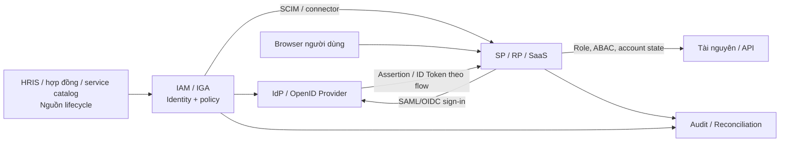
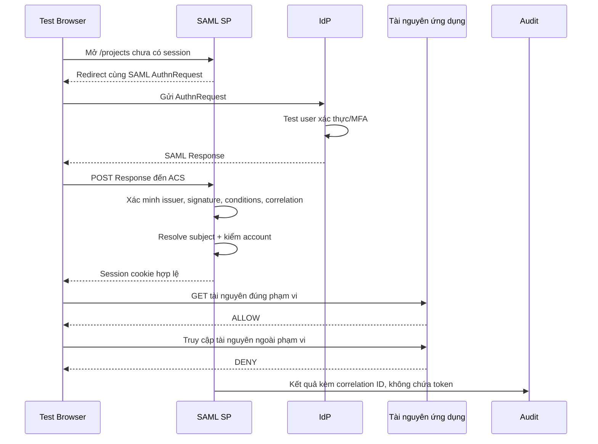
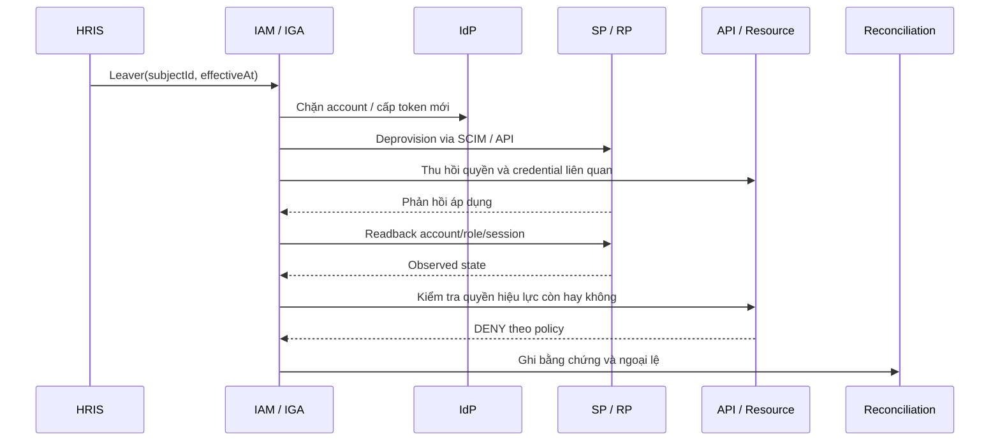

# Kiểm thử SSO trong IAM Identity Lifecycle

Một tổ chức triển khai **Single Sign-On (SSO)** để nhân viên chỉ cần xác thực qua Identity Provider (IdP) rồi truy cập nhiều ứng dụng. Nhóm dự án thử đăng nhập một tài khoản mẫu: người dùng được chuyển đến IdP, nhập thông tin, quay lại ứng dụng và thấy trang chủ. Kết quả được ghi là “SSO hoạt động”.

Nhưng một lần đăng nhập thành công chỉ kiểm tra **một phần nhỏ** của tích hợp. Điều gì xảy ra nếu assertion gửi cho ứng dụng khác bị chấp nhận? Nếu nhân viên chuyển phòng ban nhưng vẫn giữ vai trò cũ? Nếu tài khoản nghỉ việc bị khóa ở IdP mà phiên tại ứng dụng vẫn hoạt động? Nếu hệ thống tự tạo tài khoản trùng khi email đổi? Nếu khóa ký token được xoay vòng và mọi người cùng bị lỗi đăng nhập?

**Kiểm thử SSO (SSO testing)** là quá trình xác minh một luồng đăng nhập liên kết thực hiện **đúng giao thức, đúng ranh giới tin cậy, đúng danh tính, đúng điều kiện truy cập và đúng vòng đời**. Việc kiểm thử bao gồm **đường đi thành công, điều kiện bị từ chối, bảo mật thông điệp, phiên, liên kết account, provisioning, phân quyền, xử lý sự cố và bằng chứng vận hành**.

Bài này thuộc chương **SSO** của mô-đun **Identity Lifecycle** trong Identity and Access Management (IAM). Trọng tâm là thực hành kiểm thử SSO cho **SAML 2.0**, **OpenID Connect (OIDC)**, tích hợp **IdP/Service Provider (SP)/Relying Party (RP)** và ảnh hưởng của **Joiner–Mover–Leaver (JML)**. Nội dung liên kết **SCIM, RBAC/ABAC, tài khoản đặc quyền, tài khoản dịch vụ, audit và reconciliation** nhằm giảm **quyền truy cập tồn dư (residual access)**.

> **Nguyên tắc xuyên suốt:** SSO được xem là đủ điều kiện đưa vào vận hành khi **truy cập đúng được cho phép, truy cập sai bị từ chối**, các trường hợp thay đổi vòng đời được xử lý đúng và mỗi kết luận có bằng chứng phù hợp. Không chỉ kiểm tra người dùng “vào được ứng dụng”.

## 1. Kiểm thử SSO cần trả lời những câu hỏi nào?

Một kế hoạch kiểm thử đầy đủ nên trả lời:

1. **Authentication:** IdP có xác thực đúng người và SP/RP có chấp nhận đúng kết quả từ nguồn tin cậy không?
2. **Protocol security:** Chữ ký, issuer, audience, thời hạn, request correlation và chống replay có được kiểm tra không?
3. **Account linking:** Subject từ IdP được ánh xạ tới **đúng account và tenant** của ứng dụng không?
4. **Authorization:** Account đã đăng nhập có **đúng role, nhóm, phạm vi dữ liệu và hành động** theo RBAC/ABAC không?
5. **Session lifecycle:** Phiên được tạo, làm mới, hết hạn, logout và vô hiệu hóa như chính sách quy định không?
6. **Identity lifecycle:** Joiner được tạo quyền đúng lúc; Mover mất quyền cũ; Leaver không còn đường truy cập ngoài chính sách không?
7. **Provisioning:** SCIM/connector có tạo, cập nhật và deprovision tài khoản đúng ở hệ thống đích không?
8. **Failure handling:** Khi IdP không sẵn sàng, certificate hết hạn hoặc cấu hình sai, hệ thống xử lý an toàn và có thể khôi phục không?
9. **Audit:** Có đủ log để phân tích quyết định, thời điểm và kết quả mà không lộ token/secret không?
10. **Operations:** Mức độ ổn định, độ trễ, khả năng đổi khóa, cảnh báo và phản ứng sự cố đã được kiểm chứng chưa?

### 1.1. Phạm vi cần tách bạch

| Phạm vi | Điều được kiểm thử | Điều **không được mặc định** |
|---|---|---|
| **SSO authentication** | Luồng liên kết, xác minh assertion/ID Token, thiết lập phiên. | Không chứng minh user được phép làm mọi thao tác trong ứng dụng. |
| **Provisioning** | Account/nhóm/thuộc tính được đồng bộ bằng SCIM hoặc connector. | Không tự chứng minh token hoặc session đã bị thu hồi. |
| **Authorization** | RBAC/ABAC tại ứng dụng/API cho phép hoặc từ chối thao tác. | Không tự chứng minh danh tính đã được proofing đúng trước đó. |
| **Account lifecycle** | Quyền thay đổi theo Joiner–Mover–Leaver. | Không kết thúc ở việc đổi một trường trong IdP. |
| **Session management** | Cookie/phiên/token và logout/revocation. | Logout IdP không luôn làm mọi SP session biến mất. |
| **Audit/reconciliation** | Bằng chứng desired vs actual, xử lý sai lệch. | HTTP thành công không nhất thiết bằng quyền hiệu lực đã đổi. |

## 2. Hiểu kiến trúc trước khi thiết kế test

### 2.1. SAML SP và OIDC RP

Hai dạng tích hợp SSO phổ biến:

| Thành phần | SAML 2.0 | OpenID Connect |
|---|---|---|
| Hệ thống phát hành kết quả xác thực | **Identity Provider (IdP)** | **OpenID Provider (OP)** |
| Ứng dụng sử dụng kết quả | **Service Provider (SP)** | **Relying Party (RP)** |
| Dữ liệu xác thực liên kết | SAML Response/Assertion (XML). | ID Token và kết quả luồng OIDC; ID Token thường là JWT. |
| Điểm nhận kết quả | Assertion Consumer Service (ACS). | Redirect URI/callback và token endpoint trong Authorization Code Flow. |
| Ràng buộc ứng dụng | SP Entity ID, audience, recipient/destination. | Client ID, issuer, audience và redirect URI. |
| Chống gắn nhầm phiên/phát lại | InResponseTo, request ID, điều kiện thời gian, replay detection. | state, PKCE, nonce khi áp dụng, code một lần và điều kiện token. |
| Provisioning account | Cơ chế riêng như SCIM/JIT. | Cơ chế riêng như SCIM/JIT. |

**Không nhầm OAuth 2.0 access token với OIDC ID Token.** ID Token dùng để RP xác thực thông tin đăng nhập, còn API/Resource Server phải kiểm tra access token theo audience/scope và chính sách của chính API.

### 2.2. Các luồng cần nằm trong bản đồ kiểm thử



Sơ đồ thể hiện **hai đường độc lập nhưng phối hợp**: luồng xác thực liên kết và luồng quản lý account/entitlement. Một lỗi JML có thể nằm ở connector dù xác thực SAML/OIDC vẫn đúng; một lỗi kiểm chữ ký có thể nằm ở SP dù HRIS và SCIM đều hoạt động.

### 2.3. Xây dựng ma trận trách nhiệm

| Câu hỏi kiểm thử | Thành phần chủ yếu | Bằng chứng |
|---|---|---|
| Người dùng phải MFA trước khi vào ứng dụng nhạy cảm? | IdP/OP và chính sách SP/RP. | AuthnContext/acr/amr theo giao thức và policy thực thi. |
| Token hướng tới đúng ứng dụng? | SP/RP. | Kết quả validation audience/recipient và issuer. |
| Người chuyển phòng ban đã mất nhóm cũ? | IAM/IGA, connector và target. | Readback group/role/effective permission. |
| Account Leaver không đăng nhập được? | IdP và SP/RP. | Thử truy cập mới; kết quả account/session tại target. |
| API cũ còn chấp nhận token không? | Resource Server/API. | Kiểm thử authorization trong môi trường được phép. |
| Role admin có còn eligible qua PAM không? | PAM/PIM và target. | Assignment và quyền hiệu lực sau Leaver/Mover. |

## 3. Chuẩn bị môi trường kiểm thử an toàn

### 3.1. Tách môi trường và dữ liệu

Một bài test tích cực về thất bại xác thực có thể tạo nhiều login hoặc yêu cầu khóa tài khoản. Vì vậy nên:

- Dùng **IdP và SP/RP ở sandbox/staging** tách khỏi sản xuất khi có thể.
- Dùng **domain và account giả lập**, không lấy dữ liệu cá nhân thật nếu không cần.
- Chuẩn bị tenant, role, nhóm và ứng dụng test đủ gần cấu hình production để có ý nghĩa.
- Phân quyền cho nhóm kiểm thử thao tác trên tài khoản/chứng chỉ/khóa test.
- Không đưa mật khẩu thật, private key, SAML Response, ID Token hay access token có thể dùng được vào báo cáo.
- Nếu bắt buộc test tại production, dùng tài khoản và phạm vi được phê duyệt, có kế hoạch khôi phục và giám sát; không chủ động thử hành vi xâm nhập ngoài phạm vi.

Ví dụ tất cả endpoint sau là **tên giả**:

```text
IdP SAML: https://login.example.invalid/idp
SP SAML:  https://projects.example.invalid/saml/acs

OIDC issuer:     https://identity.example.invalid
OIDC callback:   https://reports.example.invalid/auth/callback
SCIM endpoint:   https://reports.example.invalid/scim/v2
```

### 3.2. Tài khoản test nên có những trạng thái nào?

| Fixture | Trạng thái | Dùng để kiểm thử |
|---|---|---|
| `joiner-pending` | Được tạo ở nguồn nhưng chưa tới ngày có hiệu lực. | Không cấp quyền/đăng nhập trước policy cho phép. |
| `employee-active` | Nhân viên thường đang hoạt động. | Happy path, role cơ bản và MFA. |
| `finance-reader` | Có quyền đọc dữ liệu phạm vi Finance. | RBAC/ABAC và scope. |
| `support-mover` | Đổi từ Support sang Finance tại ngày được đặt lịch. | Thu hồi quyền cũ, cập nhật claims và session. |
| `employee-leaver` | Trạng thái đã chấm dứt quan hệ. | Chặn đăng nhập, revoke quyền và phiên. |
| `contractor-expired` | Nhà thầu hết hợp đồng. | Sponsor, expiration và deprovision. |
| `admin-privileged` | Có quyền đặc biệt theo quy trình. | Step-up, PAM/JIT và SoD. |
| `partner-tenant-b` | Người dùng từ IdP đối tác khác. | Federation B2B và cô lập tenant. |
| `duplicate-email-test` | Trùng email với identity khác trong phạm vi test. | Chống account linking sai. |
| `service-bot-test` | Workload có owner và credential riêng. | Phân biệt machine identity và SSO người dùng. |

Mỗi fixture cần **nguồn có thẩm quyền, subject ID, trạng thái lifecycle, expected account, expected entitlements và người chịu trách nhiệm**. Không nên tạo toàn bộ test account rồi quên dọn account và secret sau đợt kiểm thử.

### 3.3. Kiểm soát thời gian và đồng hồ

Nhiều kiểm tra SAML/OIDC dựa trên `NotBefore`, `NotOnOrAfter`, `exp`, `iat`, `nbf` hoặc thời hạn session.

- Đồng bộ đồng hồ IdP/OP, SP/RP và hệ thống test.
- Xác định **clock skew** tối đa được policy cho phép.
- Dùng thời gian giả lập trong unit test ở lớp validation nếu thư viện hỗ trợ.
- Không thay đồng hồ hệ thống production để thử token hết hạn.
- Phân biệt thời điểm **sự kiện JML có hiệu lực**, thời điểm IdP cập nhật và thời điểm ứng dụng quan sát.

Nếu đồng hồ sai, hệ thống có thể từ chối assertion hợp lệ hoặc chấp nhận assertion đã hết hạn ngoài giới hạn cho phép.

## 4. Quy trình kiểm thử chuẩn và tiêu chí PASS/FAIL

Mỗi test case nên có các thành phần sau:

1. **ID và mục tiêu:** điều kiện bảo mật/khả năng nào đang được kiểm tra?
2. **Precondition:** người dùng, role, tenant, phiên, IdP/SP config và nguồn lifecycle.
3. **Input/action:** thao tác trình duyệt/API hoặc fixture giao thức được phép.
4. **Expected authentication:** SP/RP tạo session, từ chối hay yêu cầu bước bổ sung?
5. **Expected authorization:** quyền nào được phép và bị từ chối?
6. **Observed state:** trạng thái đọc lại ở IdP, SP và target liên quan.
7. **Evidence:** log correlation, request ID đã che dữ liệu, ảnh màn hình không chứa bí mật, audit reference.
8. **Cleanup:** xóa tài khoản/nhóm/phiên test, thu hồi secret và trả lại cấu hình.
9. **Result:** PASS, FAIL, BLOCKED hoặc NOT_RUN theo tiêu chí rõ.

**PASS không chỉ là HTTP 200.** Ví dụ test “SAML assertion sai audience phải bị từ chối” PASS nếu SP **từ chối** an toàn, không tạo session và log lý do phù hợp.

### 4.1. Phân biệt kết quả kỹ thuật

| Kết quả | Ý nghĩa |
|---|---|
| `PASS` | Đáp ứng đầy đủ điều kiện mong đợi và có bằng chứng hợp lệ. |
| `FAIL` | Hệ thống cho phép/từ chối sai hoặc trạng thái không đúng chính sách. |
| `BLOCKED` | Không thể thực thi do môi trường, kết nối hoặc phụ thuộc chưa sẵn sàng. |
| `NOT_RUN` | Chưa thực thi bài test trong kỳ. |
| `INCONCLUSIVE` | Đã thực thi nhưng bằng chứng chưa đủ để kết luận. |

Không biến BLOCKED/INCONCLUSIVE thành PASS chỉ vì thiếu thời gian. Báo cáo cần thể hiện phạm vi **không được kiểm tra** và mức ảnh hưởng.

## 5. Kiểm thử SAML: luồng đăng nhập hợp lệ

### 5.1. SP-initiated SSO

Trong **SP-initiated SSO**, ứng dụng tạo AuthnRequest rồi điều hướng trình duyệt sang IdP. Kịch bản kiểm thử:

1. Truy cập một URL được bảo vệ ở SP khi chưa có session.
2. Xác nhận SP tạo AuthnRequest với **Entity ID, request ID, ACS/binding** đã cấu hình.
3. Trình duyệt tới đúng IdP/SSO endpoint tin cậy.
4. IdP xác thực tài khoản test, áp dụng MFA theo policy.
5. SAML Response được đưa đến đúng ACS.
6. SP kiểm chữ ký và các điều kiện của assertion.
7. SP ánh xạ subject tới đúng account và tenant.
8. SP tạo session mới, điều hướng đến đường dẫn hợp lệ.
9. Role/entitlement được kiểm tra trên một tài nguyên cho phép và một tài nguyên bị từ chối.
10. Audit lưu kết quả mà không ghi raw SAML Response.

### 5.2. Sơ đồ test đường đi



### 5.3. Các trường hợp đăng nhập thành công cần tách

- Người dùng **chưa có IdP session** và phải đăng nhập.
- Người dùng **đã có IdP session**, được SSO không nhập lại mật khẩu nhưng vẫn tuân thủ policy step-up.
- Người dùng truy cập **deep link** được phép và quay lại đúng tài nguyên sau xác thực.
- Người dùng mở **nhiều tab**; request correlation không bị trộn.
- Người dùng có **nhiều account/tenant**; SP ánh xạ đúng ngữ cảnh.
- Người dùng thay đổi phương thức MFA hoặc IdP thực hiện step-up; SP xử lý ngữ cảnh xác thực đúng.
- Người dùng quay lại sau khi phiên SP hết hạn; luồng xác thực lại theo policy.

## 6. Kiểm thử bảo mật SAML Response và Assertion

Đây là nhóm test phải có **điều kiện từ chối**. Sử dụng **fixture và môi trường kiểm soát** để thay đổi thông điệp; không lấy assertion production thật rồi đưa vào công cụ ngoài tổ chức.

| Test ID | Biến thể đầu vào trong sandbox | Kết quả mong đợi |
|---|---|---|
| `SAM-01` | Response và assertion hợp lệ. | Đăng nhập đúng subject, đúng tenant. |
| `SAM-02` | Signature bị thay đổi hoặc không kiểm chứng được. | Từ chối, không tạo session. |
| `SAM-03` | Chữ ký hợp lệ nhưng khóa **không thuộc IdP tin cậy**. | Từ chối do trust mismatch. |
| `SAM-04` | `Issuer` khác IdP được phép. | Từ chối, không chọn issuer tùy ý từ dữ liệu chưa tin. |
| `SAM-05` | `AudienceRestriction` hướng đến SP khác. | Từ chối. |
| `SAM-06` | `Recipient` hoặc `Destination` không hợp lệ. | Từ chối theo profile và cấu hình binding. |
| `SAM-07` | Assertion ngoài khoảng `NotBefore`/`NotOnOrAfter`. | Từ chối trừ sai số thời gian được phép. |
| `SAM-08` | `InResponseTo` không khớp request còn hiệu lực trong SP-initiated flow. | Từ chối, không ghép nhầm session. |
| `SAM-09` | Assertion ID đã được sử dụng. | Replay bị chặn. |
| `SAM-10` | SubjectConfirmation không phù hợp. | Từ chối. |
| `SAM-11` | XML sai định dạng hoặc chứa cấu trúc không được hỗ trợ. | Từ chối an toàn, không lỗi parser làm lộ dữ liệu. |
| `SAM-12` | Phần tử được ứng dụng dùng khác phần tử đã được xác minh chữ ký. | Thư viện/policy phải từ chối, chống signature wrapping. |
| `SAM-13` | SAML Response hợp lệ từ IdP của tenant B cho tenant A. | Không tạo session tenant A. |
| `SAM-14` | Group/role claim không được nguồn chính sách tin cậy. | Không tự cấp đặc quyền chỉ dựa vào claim đó. |

**Quan trọng:** với SAML, vị trí chữ ký, điều kiện Recipient/Destination và các binding hợp lệ phụ thuộc profile cùng cấu hình hai bên. Bài test phải dựa trên **trust contract đã thống nhất**, không áp đặt một kiểm tra sai lên tất cả biến thể hợp lệ. Tuy nhiên không được “bỏ xác minh chữ ký” để làm test dương tính đi qua.

### 6.1. Phân biệt SP-initiated và IdP-initiated

Trong **IdP-initiated SSO**, IdP có thể gửi unsolicited SAML Response mà SP chưa tạo AuthnRequest. Nếu ứng dụng hỗ trợ:

- Cần xác nhận việc chấp nhận unsolicited response là **cấu hình được phê duyệt**.
- Vẫn kiểm chữ ký, issuer, audience, recipient, time, replay và tenant mapping.
- Kiểm soát login CSRF/session confusion, RelayState và redirect.
- Không kỳ vọng `InResponseTo` phải tham chiếu request chưa từng tồn tại.
- Từ chối unsolicited response nếu sản phẩm hoặc policy chỉ chấp nhận SP-initiated.

**Test PASS** trong cấu hình “không hỗ trợ IdP-initiated” là **từ chối an toàn** một unsolicited Response, không phải đăng nhập được.

### 6.2. Kiểm thử metadata và xoay chứng chỉ

Ít nhất cần thử:

1. SP nhận metadata IdP từ **nguồn đã phê duyệt** và đọc đúng Entity ID/signing key.
2. Certificate đang hoạt động xác minh thông điệp hợp lệ.
3. Trong **cửa sổ rollover được duyệt**, key cũ và mới được xử lý theo cấu hình đúng.
4. Sau khi chấm dứt giai đoạn rollover, key cũ không còn được chấp nhận khi policy yêu cầu.
5. Metadata lỗi, sai issuer hoặc không xác thực **không** tự thay trust configuration.
6. Thay đổi certificate không vô tình làm SP tin key của tenant khác.
7. Cảnh báo xuất hiện trước hạn hoặc khi lỗi xác minh tăng.

Không dùng cách “tin tất cả certificate” để giải quyết lỗi signing certificate hết hạn hoặc không khớp.

## 7. Kiểm thử OIDC Authorization Code Flow

Trong **OIDC**, ứng dụng đóng vai trò **Relying Party (RP)**, thường sử dụng Authorization Code Flow và **PKCE** theo cấu hình phù hợp. Mỗi thành phần phải được kiểm thử đúng chức năng.

### 7.1. Happy path OIDC

1. RP tạo authorization request tới **issuer/authorization endpoint đúng cấu hình**.
2. Request có `response_type=code`, `scope` bao gồm `openid`, `client_id` và `redirect_uri` đã đăng ký.
3. RP tạo state ràng buộc với phiên bắt đầu login; dùng PKCE `code_challenge`/`code_verifier`; dùng nonce theo nhu cầu/điều kiện giao thức và chính sách.
4. OP xác thực người dùng và trả authorization code về đúng callback.
5. RP kiểm state và xử lý callback không bị gắn nhầm browser session.
6. RP đổi code tại token endpoint với thông tin client và PKCE hợp lệ.
7. RP xác minh **ID Token** theo issuer, audience, signature, time, nonce khi có và những điều kiện liên quan.
8. RP dùng **`(iss, sub)`** cùng tenant/account mapping đã kiểm soát.
9. RP kiểm trạng thái account và entitlement trước khi tạo session hoặc cho truy cập.
10. Resource Server kiểm tra **access token** dành cho API khi người dùng gọi API.

### 7.2. Ma trận các lỗi OIDC nên thử

| Test ID | Biến thể | Kết quả mong đợi |
|---|---|---|
| `OID-01` | Authorization Code Flow hợp lệ, PKCE hợp lệ. | Login đúng account. |
| `OID-02` | Callback `state` khác giá trị đã tạo. | Từ chối; không tạo session. |
| `OID-03` | Code đổi bằng `code_verifier` sai. | Token endpoint từ chối; không login. |
| `OID-04` | Authorization code dùng lần thứ hai. | Từ chối replay theo giao thức. |
| `OID-05` | `redirect_uri` không đăng ký. | OP/RP từ chối theo cấu hình. |
| `OID-06` | ID Token có `iss` không khớp. | RP từ chối. |
| `OID-07` | ID Token có `aud` không dành cho client. | RP từ chối. |
| `OID-08` | Chữ ký sai, alg không được phép hoặc key không thuộc issuer. | RP từ chối. |
| `OID-09` | Token hết hạn hoặc `nbf` chưa hiệu lực khi claim áp dụng. | RP từ chối ngoài clock skew policy. |
| `OID-10` | Nonce không khớp trong luồng có nonce. | RP từ chối. |
| `OID-11` | `sub` trùng nhưng `iss` khác. | Không ghép vào cùng account chỉ vì sub trùng. |
| `OID-12` | Dùng ID Token để gọi API như access token. | API từ chối token sai loại/audience. |
| `OID-13` | Access token cho API A được gửi tới API B. | API B từ chối theo audience/policy. |
| `OID-14` | JWKS được xoay khóa theo lịch. | Token hợp lệ tiếp tục được kiểm tra với key đúng; không tin key tùy ý. |
| `OID-15` | User đã disabled ở ứng dụng dù OP còn xác thực. | RP/resource từ chối truy cập theo policy. |
| `OID-16` | Ứng dụng yêu cầu step-up nhưng context không đủ. | Từ chối hành động nhạy cảm hoặc yêu cầu xác thực bổ sung. |

Tùy client type, phương thức client authentication, profile OIDC và cách phát hành token, tập test phải được điều chỉnh. Không phải mọi RP đều có refresh token hoặc API access token; **chỉ test chức năng đã được triển khai** và ghi rõ phần không áp dụng.

### 7.3. Thử sự khác nhau giữa ID Token và Access Token

Một lỗi thiết kế thường gặp: RP dùng ID Token như access token và API chỉ kiểm “JWT có chữ ký đúng” mà bỏ qua audience.

Test nên xác minh:

- ID Token chỉ được RP dùng theo chức năng của nó.
- API chỉ chấp nhận access token **đúng issuer, audience, phạm vi và điều kiện**.
- Token hết hạn hoặc bị từ chối theo policy không mở đường gọi API.
- Token được cấp cho một client/resource khác không bị chấp nhận chỉ vì cùng OP.
- Hành động nhạy cảm vẫn cần kiểm role/ABAC ở resource, ngay cả khi token hợp lệ.

### 7.4. Kiểm thử OIDC Discovery và JWKS

- `issuer` trong metadata phải khớp cấu hình dự kiến.
- RP lấy endpoint/JWKS từ nguồn tin cậy, không qua URL do token chưa xác thực tùy ý đưa vào.
- Khi key rotation, `kid`/caching được xử lý theo lifecycle thực tế.
- Không cho phép token không ký hoặc thuật toán ngoài danh sách policy.
- Hệ thống xử lý OP/JWKS timeout an toàn; không tự bỏ qua signature verification.
- Giám sát lỗi key rollover và tài khoản bị ảnh hưởng.

## 8. Kiểm thử account linking và JIT provisioning

Một assertion/ID Token hợp lệ **không tự trả lời** “đây là account nào tại ứng dụng”.

### 8.1. Dữ liệu mapping cần test

| Thuộc tính | SAML | OIDC | Rủi ro |
|---|---|---|---|
| Nguồn phát hành | Entity ID của IdP/issuer theo trust. | `iss`. | Issuer confusion. |
| Chủ thể | NameID/subject identifier đã thỏa thuận. | `sub`. | Dùng ID không ổn định hoặc ghép sai. |
| Tenant | Theo endpoint/configuration hoặc mapping được duyệt. | Theo cấu hình RP/issuer/account mapping. | Cross-tenant access. |
| Email | Thuộc tính có thể được phát hành. | Claim có thể có nếu scope/profile hỗ trợ. | Trùng/đổi email, chưa chứng minh ownership. |
| Local account | Account ID tại SP. | Account ID tại RP. | Tạo trùng hoặc chiếm account. |

**Không lấy email làm khóa liên kết duy nhất** khi chưa có quy trình và bằng chứng đủ tin cậy. Một người đổi email sau Mover hoặc tái tuyển dụng vẫn có thể cùng identity, nhưng không được tự khôi phục quyền cũ.

### 8.2. Test case account mapping

| Kịch bản | Kỳ vọng |
|---|---|
| Subject mới có mapping đáng tin, account đã provision. | Đăng nhập đúng account hiện hữu. |
| Subject hợp lệ chưa có account, JIT được policy cho phép. | Tạo đúng tenant, quyền tối thiểu, ghi audit. |
| Subject hợp lệ nhưng JIT bị cấm. | Từ chối hoặc chuyển enrollment; không tự tạo account. |
| Người dùng đổi email, subject ID không đổi. | Không tạo account mới chỉ vì email đổi. |
| Hai issuer khác nhau cùng phát email giống nhau. | Không merge tự động hai tài khoản. |
| Subject từ tenant B truy cập tenant A. | Từ chối/không ánh xạ sai. |
| Account đích bị disabled trong khi assertion hợp lệ. | Từ chối login theo trạng thái account. |
| Subject có nhiều account với mapping mơ hồ. | Không tự chọn; yêu cầu xử lý có kiểm soát. |
| Account được soft-delete rồi tái tuyển dụng. | Quy trình re-enrollment/rehire riêng, không tự phục hồi mọi quyền lịch sử. |

### 8.3. JIT không đồng nghĩa đã phê duyệt quyền

**Just-in-Time provisioning** tạo account khi đăng nhập đầu tiên nếu đủ điều kiện. **Just-in-Time privileged access** là quyền nâng cấp tạm thời theo PAM; hai khái niệm khác nhau.

Test cần xác minh rằng account mới tạo không nhận role admin mặc định, không vượt phạm vi tenant và không được tạo bởi claim role tự khai. Quyền nhạy cảm vẫn cần kiểm tra **policy, approval và SoD**.

## 9. Kiểm thử MFA, authentication context và step-up

SSO có thể dùng xác thực nhiều yếu tố tại IdP, nhưng **SP/RP phải biết liệu mức xác thực nhận được có đủ cho hành động cần thực hiện hay không**.

### 9.1. Trường hợp cần thử

1. Login cơ bản bằng tài khoản thường với MFA theo chính sách IdP.
2. Login trên thiết bị chưa tin cậy hoặc ngữ cảnh rủi ro cao.
3. Truy cập dữ liệu nhạy cảm yêu cầu step-up.
4. Sử dụng phiên IdP cũ nhưng chính sách ứng dụng yêu cầu xác thực mới hơn.
5. Thao tác thay đổi role hoặc tạo API key cần reauthentication.
6. Đăng nhập sau khi người dùng reset mật khẩu hoặc đăng ký lại authenticator.
7. Tài khoản đặc quyền có điều kiện PAM/PIM/JIT và thời hạn cụ thể.

### 9.2. Diễn giải claim phải nhất quán

SAML có **AuthnContext** và OIDC có các thông tin như `acr`, `amr`, `auth_time` khi OP hỗ trợ và phát hành.

Một claim `amr` là bằng chứng mà RP cần diễn giải theo chính sách và cam kết của OP; nó không nên được coi là “MFA mạnh” chỉ vì chứa chuỗi tùy ý. Test phải dựa trên **mapping đã thống nhất với IdP**, không tự suy diễn mức bảo đảm từ văn bản claim.

Với thao tác quan trọng, test cần chứng minh **không có step-up → bị từ chối hoặc được yêu cầu xác thực bổ sung**, còn **đã đáp ứng step-up và đủ quyền → được phép**. Step-up **không thay thế authorization**.

## 10. Kiểm thử session, cookie và logout

### 10.1. Phân biệt ba lớp phiên

- **IdP/OP session:** người dùng đã xác thực tại bên cung cấp danh tính.
- **SP/RP session:** ứng dụng tạo sau khi chấp nhận kết quả SSO.
- **API/token session:** resource hoặc client dùng access token và có cơ chế hết hạn/revoke riêng.

Đóng một lớp **không mặc nhiên** đóng toàn bộ lớp còn lại.

### 10.2. Ma trận session test

| ID | Hành động | Kết quả mong đợi |
|---|---|---|
| `SES-01` | Login thành công. | SP/RP tạo session mới gắn đúng account và tenant. |
| `SES-02` | Dùng session ID được đặt trước login. | Session fixation bị ngăn; session được quản lý/rotate an toàn. |
| `SES-03` | Không hoạt động quá idle timeout. | Phiên hết hiệu lực theo policy. |
| `SES-04` | Vượt absolute session lifetime. | Phải xác thực lại theo policy. |
| `SES-05` | Logout ứng dụng. | Session cục bộ bị vô hiệu hóa; không còn dùng lại được. |
| `SES-06` | Logout IdP. | Hành vi SP phù hợp cam kết tích hợp, không suy luận SLO luôn thành công. |
| `SES-07` | Account bị disabled trong khi còn session. | Quyền bị chặn trong khoảng thời gian mục tiêu theo policy. |
| `SES-08` | Thay role/department khi còn session. | Hành động được đánh giá lại theo độ mới quy định. |
| `SES-09` | Token cũ còn hạn sau Leaver. | Kiểm tra khả năng chặn/revoke hoặc ghi rõ giới hạn và TTL còn rủi ro. |
| `SES-10` | Cookie thiếu/khác cài đặt bảo vệ trong môi trường phù hợp. | Kiểm tra `Secure`, `HttpOnly`, `SameSite` và CSRF policy. |
| `SES-11` | Nhiều thiết bị đăng nhập. | Logout/revoke theo chính sách cho một hoặc nhiều thiết bị. |
| `SES-12` | Người dùng chuyển tenant/ngữ cảnh. | Không dùng session tenant A để truy cập tenant B. |

### 10.3. Single Logout và back-channel logout

Một số cấu hình SAML hỗ trợ **Single Logout (SLO)**; một số hệ thống OIDC hỗ trợ các cơ chế logout/notification khác tùy profile và sản phẩm. Cần kiểm thử:

- Ứng dụng có thực sự hỗ trợ hình thức logout đó không?
- IdP gửi thông báo logout và SP/RP xử lý đúng không?
- Nếu trình duyệt tắt giữa luồng logout, còn session nào chưa bị chặn?
- Token ở API và login local có yêu cầu xử lý riêng không?
- Hệ thống báo rõ **không hỗ trợ** hay **không xác minh được** lớp phiên nào?

**Không ghi PASS cho “global logout” chỉ vì trang IdP đã hiện màn hình đăng xuất**. Kết quả cần được kiểm tra tại từng ứng dụng thuộc phạm vi.

### 10.4. Session cookie và CSRF

Khi ứng dụng dựa vào cookie, test cần xem:

- Chỉ gửi cookie qua HTTPS khi được yêu cầu.
- Script trình duyệt không đọc được session cookie nhạy cảm nếu dùng `HttpOnly`.
- `SameSite` phù hợp với luồng SSO và nghiệp vụ; không chọn giá trị gây hỏng callback rồi bỏ bảo vệ khác.
- Session ID không nằm trong URL, log, thông điệp hoặc referrer.
- Các thao tác thay đổi trạng thái chống CSRF theo mô hình ứng dụng.
- Callback login xử lý state/correlation chính xác.

## 11. Kiểm thử JML: Joiner, Mover và Leaver

SSO phải được thử với **những thay đổi thực tế của danh tính** chứ không chỉ user cố định trong một ngày.

### 11.1. Joiner — nhân viên mới

Test nên gồm:

1. Nhân viên được HRIS xác nhận nhưng **chưa đến ngày hiệu lực**.
2. Khi đến thời điểm hiệu lực, IdP có account và phương thức đăng nhập phù hợp.
3. SP được pre-provision qua SCIM hoặc tạo JIT theo policy.
4. Account không bị tạo trùng khi cùng event provisioning được gửi lại.
5. Người dùng login đúng identity/tenant, được cấp **quyền cơ sở vừa đủ**.
6. Role nhạy cảm không tự cấp chỉ dựa trên department hoặc email.
7. Khi SCIM trễ, ứng dụng xử lý theo chính sách: chờ, từ chối hoặc enrollment có kiểm soát.
8. Audit có thời điểm Joiner, account mapping và kết quả cấp quyền.

**Kỳ vọng an toàn:** trước khi thỏa điều kiện Joiner, một SAML/OIDC login hợp lệ từ một nguồn khác vẫn không được phép tự mở quyền ứng dụng nếu account không đủ điều kiện.

### 11.2. Mover — thay đổi phòng ban/role

Tình huống nhân viên chuyển từ Support sang Finance:

| Kiểm tra | Trước Mover | Sau Mover có hiệu lực |
|---|---|---|
| Attribute `department` | `SUPPORT` | `FINANCE` theo nguồn chuẩn. |
| Nhóm/role Support | Có theo nhiệm vụ cũ. | Bị thu hồi nếu không còn phù hợp. |
| Nhóm/role Finance | Chưa có. | Chỉ cấp quyền mới được policy/phê duyệt cho phép. |
| Direct grant ở SaaS | Có thể tồn tại. | Được đánh giá riêng, không bỏ sót. |
| Phiên SP đã mở | Có thể mang quyền/claim cũ. | Thực thi theo session invalidation/reauthorization policy. |
| SoD | Không có xung đột ban đầu. | Từ chối tổ hợp quyền mới và cũ gây xung đột nếu không được kiểm soát. |
| Audit | Sự kiện Mover được ghi. | Có kết quả readback và ngoại lệ. |

Cần test **quyền bị gỡ** bằng một thao tác **phải bị DENY**, không chỉ nhìn danh sách nhóm. Một phiên chưa hết hạn có thể vẫn giữ claim hoặc role cache cũ; phải biết hệ thống xử lý tới khi nào.

### 11.3. Leaver — ngừng truy cập đúng thời điểm

Đây là nhóm test có mức ưu tiên cao:

- Trước thời điểm Leaver được duyệt, account hoạt động theo policy.
- Khi Leaver có hiệu lực, **đăng nhập mới** qua IdP bị chặn.
- SCIM/connector cập nhật account, role và group của SP đúng theo policy.
- Session SP đã mở bị thu hồi hoặc không thể tiếp tục hành động ngoài giới hạn rủi ro cho phép.
- API access token, refresh token, local password và quyền quản trị được xử lý theo khả năng từng hệ thống.
- Bật lại thử liên kết reset password **không kích hoạt lại account Leaver**.
- Sự kiện Mover cũ đến sau Leaver **không khôi phục quyền**.
- Account có thể được lưu ở trạng thái disabled theo retention; không cần xóa dữ liệu ngay để chứng minh ngăn truy cập.
- Readback xác nhận trạng thái thực ở SP và hệ thống đích; các vùng không quan sát được phải ghi rõ.

Một kịch bản Leaver **không đạt** nếu IdP đã disabled nhưng SP vẫn cho thao tác nhạy cảm bằng session/credential cũ ngoài policy.

### 11.4. Nhà thầu hết hạn và tái tuyển dụng

- Contractor hết hợp đồng: account/role hết hạn và sponsor/owner được xử lý.
- Hợp đồng được gia hạn hợp lệ: chính sách xác định cách duy trì/trả quyền; không tự giữ quyền quá hạn.
- Người dùng tái tuyển dụng: xác minh identity mapping, không tự khôi phục mọi quyền từ lần làm việc trước.
- Một job deprovision cũ chạy sau khi tái tuyển dụng: phải kiểm tra trạng thái nguồn mới nhất để không xóa nhầm.
- Đổi manager/owner: yêu cầu phê duyệt mới không được gửi đến người không còn thẩm quyền.

### 11.5. Sơ đồ kiểm chứng Leaver



Thứ tự và mức song song tùy kiến trúc. **Chặn truy cập rủi ro cao** có thể phải ưu tiên hơn bước dọn account/dữ liệu, nhưng kết quả vẫn cần được xác minh.

## 12. Kiểm thử SCIM và provisioning song song với SSO

**SCIM (System for Cross-domain Identity Management)** giúp đồng bộ User và Group ở các sản phẩm hỗ trợ. Nó **không phải giao thức đăng nhập**, và không bảo đảm tự thu hồi session/token.

### 12.1. Những test cần có

| ID | Hành vi provisioning | Kỳ vọng |
|---|---|---|
| `SCI-01` | Tạo User với account mapping đúng. | Không trùng account, đúng tenant. |
| `SCI-02` | User được tạo trước lần SSO đầu. | SP liên kết đúng account đã provision. |
| `SCI-03` | Cập nhật department/manager theo nguồn chuẩn. | Target nhận trường hỗ trợ, đúng giá trị. |
| `SCI-04` | Thêm Group theo role hợp lệ. | Role/entitlement hiệu lực tương ứng, không vượt quyền. |
| `SCI-05` | Gỡ Group sau Mover. | Quyền cũ bị gỡ, kể cả đường cấp gián tiếp được kiểm tra. |
| `SCI-06` | Cập nhật `active=false` cho Leaver. | Trạng thái User và login theo hợp đồng target; test session riêng. |
| `SCI-07` | DELETE User trong môi trường hợp lệ. | Kiểm trạng thái xóa và retention theo sản phẩm; không nhầm với disable. |
| `SCI-08` | Event cập nhật gửi hai lần. | Idempotent, không tạo hai account hoặc hai membership sai. |
| `SCI-09` | Event cũ đến sau Leaver. | Không tái kích hoạt quyền. |
| `SCI-10` | Target API trả lỗi hoặc timeout. | Retry có kiểm soát, finding/owner, không báo hoàn tất giả. |
| `SCI-11` | Connector thiếu quyền đọc role. | Báo UNKNOWN/coverage gap, không kết luận role đã gỡ. |
| `SCI-12` | User bị xóa trực tiếp tại target trong khi nguồn vẫn active. | Phát hiện drift và xử lý theo desired state, không tự tạo lại trái policy. |

### 12.2. Cần nhìn vào trạng thái thực tế

Ví dụ IAM gửi `active=false` và nhận HTTP thành công. Test phải hỏi:

1. User ở target sau readback có trạng thái gì?
2. User còn role trực tiếp hoặc group khác ngoài SCIM không?
3. App còn local login hay API key riêng không?
4. Session đang mở và token đã cấp có thể còn hiệu lực không?
5. Nếu việc xóa/khóa bất đồng bộ, khi nào target thực sự từ chối quyền?

Không có API xem session không có nghĩa là phiên đã hết; báo cáo cần ghi **giới hạn kiểm chứng** và cơ chế giảm rủi ro.

## 13. Kiểm thử authorization RBAC/ABAC sau SSO

**Authentication** đúng nhưng **authorization** sai là một thất bại bảo mật độc lập.

### 13.1. RBAC

Ví dụ role:

```text
project-viewer:
  - projects.read

project-editor:
  - projects.read
  - projects.update

project-admin:
  - projects.manage-members
  - projects.configure
```

Test cần có:

- Viewer đọc được dự án hợp lệ nhưng **không sửa**.
- Editor sửa được trong phạm vi cho phép nhưng **không quản lý quyền**.
- Admin chỉ được quyền trong resource/tenant đã được cấp.
- Group/role claim từ IdP được ánh xạ theo nguồn tin cậy.
- Direct role trong ứng dụng được quản lý riêng, không bị quên sau Mover.
- Role hết hạn hoặc quyền JIT kết thúc thì bị chặn.

### 13.2. ABAC

Ví dụ policy khái niệm:

```text
allow reports.read khi:
  subject.lifecycleStatus == ACTIVE
  AND subject.department == resource.ownerDepartment
  AND subject.allowedRegion contains resource.region
  AND session.assurance đáp ứng yêu cầu
```

Kịch bản kiểm thử nên thay **một điều kiện mỗi lần**:

1. Cùng role nhưng khác phòng ban: DENY.
2. Cùng phòng ban nhưng account đã Leaver: DENY.
3. Đúng phòng ban nhưng resource ở region không được phép: DENY.
4. Đúng thuộc tính nhưng session không đạt assurance: DENY hoặc STEP_UP.
5. Thiếu thuộc tính quan trọng: xử lý theo policy, thường không tự cấp quyền nhạy cảm.
6. Đủ tất cả điều kiện và permission hợp lệ: ALLOW.

### 13.3. SoD và quyền đặc biệt

Một người vừa có quyền **tạo thanh toán** vừa có quyền **phê duyệt chính thanh toán đó** có thể vi phạm Separation of Duties (SoD).

Test nên xác nhận:

- Quyền từ phòng ban cũ + mới không âm thầm tạo tổ hợp xung đột.
- Approval/exception có phạm vi, thời hạn và người duyệt độc lập khi chính sách cho phép.
- Quyền PAM/PIM **eligible** và **active** được kiểm riêng.
- Quyền admin trực tiếp trong ứng dụng không bị xem là quyền cơ sở.
- Step-up MFA không tự thay thế phê duyệt nghiệp vụ.

## 14. Kiểm thử đa tenant và Federation với đối tác

Một SaaS có thể tin IdP của nhiều tổ chức. Test cần bảo đảm **issuer của một tenant không thể đăng nhập vào account/tài nguyên tenant khác**.

### 14.1. Các trường hợp quan trọng

- Tenant A và B cùng dùng email `shared@example.invalid` nhưng là **hai identity khác nhau**.
- IdP A phát assertion/token hợp lệ, nhưng yêu cầu truy cập tenant B: DENY.
- SP/RP dùng đúng **issuer + subject ID + tenant** để mapping.
- Một tenant thay signing certificate/issuer và tenant khác không bị ảnh hưởng ngoài phạm vi.
- Account linking giữa hai tổ chức yêu cầu quy trình rõ, không tự dựa vào email.
- Contractor của đối tác hết hạn hợp đồng vẫn bị thu hồi quyền ở SP.
- Người dùng chuyển tổ chức: không tự kế thừa permission của account cũ.
- Error response không tiết lộ danh sách account hoặc cấu hình tenant khác.

### 14.2. Test trust configuration

Một URL OIDC discovery hoặc SAML metadata được nhập vào trang quản trị **không tự tạo trust**. Kiểm tra:

- Chỉ administrator có thẩm quyền cấu hình IdP mới.
- Cấu hình issuer, key, redirect/ACS và tenant phải được xác minh.
- SP/RP không nhận khóa ký tùy ý từ token/assertion chưa kiểm chứng.
- Có lịch xoay khóa và thông báo chủ sở hữu.
- Rollback cấu hình phải giữ lại **kiểm tra chữ ký và ranh giới tenant**.

## 15. Kiểm thử negative, abuse và xử lý sự cố

Ngoài happy path, một hệ thống SSO phải từ chối an toàn khi đầu vào hoặc môi trường không đúng.

### 15.1. Bảng negative test tổng quát

| Nhóm | Kịch bản | Kỳ vọng |
|---|---|---|
| **Identity** | Account không tồn tại ở SP và JIT bị cấm. | Không tự tạo account. |
| **Lifecycle** | Account đã terminated. | Không mở phiên/truy cập trái policy. |
| **Mapping** | Subject mapping mơ hồ. | Từ chối hoặc đưa vào enrollment có kiểm soát. |
| **Protocol** | Issuer/audience sai. | Từ chối. |
| **Signature** | Chữ ký không hợp lệ. | Từ chối, không fallback bỏ xác minh. |
| **Time** | Assertion/token hết hạn. | Từ chối ngoài clock skew được phép. |
| **Replay** | Assertion/code đã dùng. | Từ chối. |
| **Redirect** | Return URL/RelayState ngoài allowlist. | Không open redirect. |
| **Cross-tenant** | Token tenant A tới B. | Từ chối. |
| **Authorization** | User có login nhưng thiếu quyền resource. | 403/deny theo ứng dụng. |
| **Session** | Session đã bị revoke. | Không tiếp tục truy cập. |
| **SCIM** | Connector lỗi hoặc chậm. | Có cảnh báo/ngoại lệ, không báo success giả. |
| **Recovery** | Password reset của Leaver. | Không hồi sinh account. |
| **External IdP** | OP/IdP không sẵn sàng. | Không bypass authentication; xử lý lỗi phù hợp. |

### 15.2. Hệ thống nên fail closed ở đâu?

Với **điều kiện xác thực hoặc quyền nhạy cảm** chưa thể xác minh, ứng dụng không nên tự cấp quyền chỉ vì IdP đang lỗi. Ví dụ:

- Không biết chữ ký có hợp lệ → **không tạo session mới**.
- Không xác định được tenant của subject → **không ghép account tùy tiện**.
- Không đọc được thuộc tính quyết định quyền quản trị → **không tự cấp quyền admin**.
- Xác thực đã hợp lệ nhưng không đủ quyền dữ liệu → **DENY** cho thao tác đó.

Tuy nhiên fail closed không có nghĩa phải phá hủy toàn bộ các phiên hợp lệ đang hoạt động mỗi khi IdP tạm mất kết nối. **Chính sách thời hạn session, khả năng kiểm tra trạng thái và thời gian chấp nhận rủi ro** cần được thiết kế từ trước và kiểm thử tương ứng.

### 15.3. Kiểm thử IdP outage

Trường hợp IdP tạm không khả dụng:

1. Người dùng chưa đăng nhập: thử đăng nhập và xác nhận không có bypass.
2. Người dùng đang có phiên SP: kiểm tra hành vi theo session policy công bố.
3. Ứng dụng có cache key/JWKS: kiểm tra giới hạn và xử lý khi không tải được metadata mới.
4. Chuyển sang IdP dự phòng nếu thiết kế hỗ trợ: kiểm trust và mapping, không cho fallback không được ủy quyền.
5. Khôi phục dịch vụ: các request đang chờ/luồng login phải được xử lý an toàn, không replay sai.
6. Logging và alert: phát hiện suy giảm và giúp vận hành điều tra.

### 15.4. Kiểm thử hiệu năng và độ ổn định

- Nhiều người dùng bắt đầu đăng nhập cùng thời điểm.
- Nhiều tab của cùng một browser và nhiều session khác nhau.
- Request cache của SAML và bộ nhớ state/nonce của OIDC khi scale nhiều instance.
- Độ trễ qua IdP, mạng, callback và token endpoint.
- Sự cố nhất thời ở SCIM/IGA và cách ảnh hưởng tới login.
- Key rotation đồng thời với lưu lượng login bình thường.
- Logout/revocation hàng loạt theo sự kiện Leaver hoặc sự cố bảo mật.

Không dùng test chịu tải gây từ chối dịch vụ lên IdP production nếu chưa có phạm vi và phê duyệt cụ thể.

## 16. Tự động hóa kiểm thử theo nhiều lớp

Không phải test nào cũng nên dùng trình duyệt E2E. Nên chia lớp để chạy nhanh và tìm lỗi chính xác.

| Lớp | Phù hợp kiểm gì? | Công cụ/phương pháp tổng quát |
|---|---|---|
| **Unit test** | Validation rules, mapping, authorization policy, expiry/time logic. | Test runner của ứng dụng với fixture, clock giả. |
| **Component/integration** | Thư viện SAML/OIDC, token validation, session store, SCIM connector. | Mock issuer/SP hoặc test IdP được kiểm soát. |
| **Contract test** | Metadata, claims, NameID/sub mapping, schema User/Group, role mapping. | Fixture phiên bản hóa và API test. |
| **Browser E2E** | Redirect, cookie, callback, MFA, deep link, logout và user experience. | Trình duyệt automation với tài khoản sandbox. |
| **Security negative** | Issuer/audience/signature/replay/correlation/tenant failures. | Fixture đặc thù trong môi trường được phép, không dùng token thật. |
| **Lifecycle E2E** | Joiner/Mover/Leaver + provisioning + readback quyền. | Orchestrated events và target sandbox. |
| **Resilience/operations** | IdP outage, key rollover, lỗi connector, độ trễ. | Fault injection có kiểm soát, monitoring. |
| **Manual exploratory** | Hiển thị lỗi, accessibility, tương tác MFA phức tạp. | Kịch bản có phê duyệt và bằng chứng phù hợp. |

### 16.1. Vì sao test bằng browser vẫn cần?

Unit test xác minh audience đúng không chứng minh **cookie SameSite**, redirect chain hoặc MFA form hoạt động với trình duyệt thực. Browser E2E phát hiện những vấn đề như:

- Callback bị chặn do cookie cấu hình sai.
- Redirect loop trên nhiều miền.
- Deep link không quay lại đúng tài nguyên.
- Session bị trộn khi mở nhiều tab.
- Trang lỗi hiển thị thông tin nhạy cảm.
- Logout không chấm dứt session ở ứng dụng.

### 16.2. Vì sao không chỉ chạy browser E2E?

Browser test thường khó tạo chính xác **assertion có issuer sai, token có chữ ký không hợp lệ hoặc timestamp hết hạn** một cách ổn định. Các negative test cấp giao thức nên dùng test harness/fixture dành cho thư viện xác minh trong môi trường được phép. Điều này cũng giảm khả năng làm rò rỉ token thật và làm kết quả E2E phụ thuộc quá nhiều vào nhà cung cấp IdP.

## 17. Bộ dữ liệu kiểm thử và file test case minh họa

### 17.1. Mẫu test case dạng YAML

```yaml
testId: SSO-SAML-EXPIRED-001
title: "SP phải từ chối assertion đã hết hạn"
protocol: SAML2
environment: staging
systemUnderTest: project-portal-sp
preconditions:
  - "Trusted IdP và ACS đã cấu hình"
  - "Tài khoản thử nghiệm tồn tại, trạng thái ACTIVE"
inputFixture:
  type: "signed-saml-response-with-expired-conditions"
action:
  type: "submit-to-acs-in-controlled-test"
expected:
  authentication: DENY
  sessionCreated: false
  reasonCategory: ASSERTION_EXPIRED
  secretsInLogs: false
evidence:
  - "testRunId"
  - "sanitizedSpAuditEvent"
cleanup:
  - "clear-test-session-and-fixture"
```

Đây là **schema tự minh họa**, không phải cú pháp bắt buộc của một framework. Fixture phải được tạo ở môi trường được phép, không sao chép chứng thực production để sửa thủ công.

### 17.2. Mẫu dữ liệu expected vs observed cho Mover

```json
{
  "testId": "SSO-JML-MOVER-004",
  "subjectId": "person-0451",
  "effectiveAt": "2026-12-01T09:00:00+07:00",
  "desired": {
    "department": "FINANCE",
    "allowedActions": ["finance.report.read"],
    "deniedActions": ["support.ticket.update"]
  },
  "observed": {
    "department": "FINANCE",
    "allowedActions": ["finance.report.read"],
    "deniedActions": ["support.ticket.update"],
    "verifiedAt": "2026-12-01T09:04:00+07:00"
  },
  "result": "PASS"
}
```

Mẫu chỉ có ý nghĩa khi hai hành động đã được thử ở **đúng tài nguyên/tenant**, bằng account được phép và với session/token phản ánh chính sách đang kiểm tra. Đọc được trường `department=FINANCE` đơn thuần **không đủ** để kết luận quyền Support đã bị gỡ.

### 17.3. Mẫu ma trận coverage

| Nhóm | Test ID tiêu biểu | Kết quả cần đạt |
|---|---|---|
| SAML positive | `SAM-01` | Login chính xác. |
| SAML trust negative | `SAM-02..14` | Từ chối đầu vào sai. |
| OIDC positive | `OID-01` | Code/PKCE và token hợp lệ. |
| OIDC negative | `OID-02..16` | Từ chối lỗi correlation/trust/token. |
| Session | `SES-01..12` | TTL, logout, revoke theo policy. |
| SCIM | `SCI-01..12` | Provisioning + readback đúng. |
| JML | Joiner/Mover/Leaver | Không dư quyền, không thiếu quyền hợp lệ. |
| Authorization | RBAC/ABAC/SoD | ALLOW/DENY theo policy. |
| Multi-tenant | Issuer/subject/tenant confusion | Không cross-tenant. |
| Operations | Outage, rollover, latency | Không bypass, khôi phục có kiểm soát. |

Một số bài test có thể không áp dụng với sản phẩm cụ thể; cần đánh dấu **NOT_APPLICABLE với lý do**, không xóa khỏi kế hoạch mà không giải thích.

## 18. Đo chất lượng SSO và thu thập bằng chứng

### 18.1. Một kết quả đăng nhập nên có log gì?

SP/RP có thể ghi:

- `eventId`, `testRunId` hoặc correlation ID theo nhu cầu.
- Thời điểm bắt đầu/kết thúc của từng pha.
- SP Entity ID/RP client ID và issuer đã xác minh.
- Tenant và account/subject ID đã ánh xạ an toàn.
- Loại luồng (SAML SP-/IdP-initiated, OIDC Authorization Code).
- Kết quả xác minh: PASS hoặc reason category (signature, issuer, audience, expiry, correlation...).
- Mức xác thực/step-up được chấp nhận nếu chính sách sử dụng.
- Session được tạo/bị từ chối/bị vô hiệu hóa.
- Quyết định authorization theo loại quyền và resource scope.
- Kết quả deprovision/readback cho lifecycle test.

**Không log raw assertion, ID Token, access token, password, refresh token, recovery code, cookie hoặc private key.** Dữ liệu identity và security policy cũng cần được phân quyền và giữ theo retention.

### 18.2. Báo cáo test chạy một lần

Một báo cáo chất lượng nên có:

| Trường | Mục đích |
|---|---|
| `runId` | Liên kết toàn bộ test và bằng chứng. |
| `environment/configVersion` | Biết đang kiểm cấu hình nào. |
| `issuer/tenant/application` | Xác định ranh giới trust trong phạm vi. |
| `protocol/profile` | SAML SP, OIDC RP và các tính năng bật. |
| `testCaseId` | Đối chiếu với ma trận coverage. |
| `expectedResult` | Kết quả theo policy. |
| `observedResult` | Kết quả quan sát được. |
| `evidenceRef` | Đường dẫn an toàn đến log/snapshot đã che bí mật. |
| `result` | PASS/FAIL/BLOCKED/INCONCLUSIVE/NOT_RUN. |
| `owner/severity` | Người chịu trách nhiệm lỗi và độ ưu tiên. |
| `retestStatus` | Đã sửa/kiểm lại và có tái diễn không. |

### 18.3. KPI/SLO cần hiểu đúng

| Chỉ số | Ý nghĩa |
|---|---|
| **SSO login success rate** | Tỷ lệ login hợp lệ thành công, không tính âm tính được mong đợi là lỗi dịch vụ. |
| **P95 login completion latency** | Độ trễ từ bắt đầu luồng đến có phiên hợp lệ, theo phạm vi đo. |
| **Signature/issuer/audience rejection rate** | Phát hiện lỗi trust hoặc yêu cầu không hợp lệ; cần phân tích nguồn. |
| **Session revocation latency** | Thời gian từ sự kiện yêu cầu chặn đến khi phiên không còn cho phép thao tác. |
| **Leaver access-block latency** | Thời gian từ mốc Leaver đến khi quyền bị chặn tại SP/API theo policy. |
| **Mover entitlement drift** | Số quyền cũ chưa thu hồi sau Mover. |
| **JIT/SCIM correlation failures** | Số account chưa ánh xạ hoặc tạo trùng. |
| **Coverage of negative tests** | Tỷ lệ kiểm thử các điều kiện từ chối quan trọng. |
| **Key rollover reliability** | Mức ổn định khi metadata/certificate/JWKS thay đổi. |
| **Unverified target coverage** | Số ứng dụng/phiên/quyền chưa có bằng chứng đủ. |

**Không gộp tất cả vào chỉ số “SSO hoạt động 99%”.** Một hệ thống đạt tỷ lệ login rất cao vẫn có thể thất bại ở Leaver, audience validation hoặc cross-tenant isolation.

## 19. Xử lý sự cố thường gặp sau kiểm thử

| Triệu chứng | Khả năng nguyên nhân | Hướng điều tra |
|---|---|---|
| Redirect loop sau login | Cookie/session không lưu, sai redirect/ACS, state mất. | Trace đã che dữ liệu, kiểm host/proxy/cookie/state. |
| SAML signature error | Key/metadata không khớp, rollover chưa cập nhật. | Kiểm trust và đúng phần tử được ký, không bỏ validation. |
| SAML audience mismatch | Entity ID cấu hình giữa SP/IdP sai. | Đối chiếu metadata và audience thực tế. |
| Unknown `InResponseTo` | Request cache mất, response cũ hoặc IdP-initiated chưa bật. | Kiểm request ID, TTL, cluster session và flow. |
| OIDC invalid state | Callback không khớp phiên bắt đầu. | Kiểm lưu state và cấu hình cookie. |
| OIDC invalid nonce | Nonce không khớp ID Token/flow. | Kiểm correlation và client/OP config. |
| OIDC invalid issuer | Discovery/config nhầm môi trường hoặc tenant. | Kiểm issuer chính xác và JWKS đáng tin. |
| Login được nhưng ứng dụng báo thiếu account | SCIM chưa provision hoặc mapping sai. | Kiểm issuer + subject + tenant + target ID. |
| Login được nhưng thiếu quyền | Role mapping/ABAC hoặc approval chưa hoàn tất. | So desired vs actual, kiểm quyền theo target. |
| Mover vẫn dùng quyền cũ | Direct grant hoặc session/claim cache. | Đối soát quyền thực tế, invalidation. |
| Leaver vẫn truy cập | SP session, local login, token hoặc grant chưa thu hồi. | Chặn theo policy tại target và đọc lại. |
| Đăng nhập hàng loạt lỗi sau rotate cert | SP/RP chưa nhận key mới hoặc tin key sai. | Kiểm rollover, version/config và log trust. |
| SCIM tạo lại account đã xóa | Nguồn provisioning vẫn xem user active. | Kiểm trạng thái nguồn, mapping và lịch deprovision. |

**Không sửa bằng cách tắt chữ ký, bỏ kiểm audience, chấp nhận mọi issuer hoặc cấp role admin mặc định.** Phải khắc phục cấu hình và policy tại nguyên nhân.

## 20. Rủi ro kiểm thử và quản trị thay đổi

### 20.1. Tránh biến test thành sự cố

Một test liên quan Leaver, logout hay quyền đặc biệt có thể ảnh hưởng người dùng thật nếu chạy sai môi trường. Cần:

- Phê duyệt phạm vi, account test, tenant và tác vụ được phép.
- Có người chịu trách nhiệm khôi phục fixture.
- Sao lưu cấu hình hợp lệ khi chuẩn bị test thay metadata/key.
- Không phá bỏ mối quan hệ trust production để tạo negative test.
- Không gửi assertion/token thật cho công cụ phân tích trực tuyến không được ủy quyền.
- Có mốc dừng và escalation khi test gây lỗi bất thường.
- Thực hiện cleanup role, account, credential, session và log test theo chính sách.

### 20.2. Những thay đổi phải được kiểm lại trước phát hành

- Thay IdP, issuer, metadata hoặc signing certificate.
- Thay SP Entity ID, ACS URL hoặc OIDC callback/redirect URI.
- Thay client authentication, PKCE/state/nonce handling.
- Thay account linking logic, JIT provisioning hoặc SCIM mapping.
- Thay role/group claim mapping, RBAC/ABAC policy.
- Thay thời hạn cookie, logout, session cache, token revocation.
- Thay luồng Joiner/Mover/Leaver hoặc cách xác định account status.
- Thay cấu hình multi-tenant hoặc tích hợp IdP đối tác.

Một thay đổi nhỏ như đổi domain có thể ảnh hưởng cả **cookie, issuer, audience, redirect và account linking**; cần chạy test theo ranh giới bị ảnh hưởng thay vì chỉ kiểm trang chủ.

## 21. Ví dụ triển khai kế hoạch UAT cho ứng dụng báo cáo

Giả sử tổ chức tích hợp ứng dụng báo cáo với IdP doanh nghiệp. Ứng dụng dùng **OIDC Authorization Code + PKCE** và account được pre-provision qua **SCIM**.

### 21.1. Tiêu chí đầu vào

- Có một tenant staging và OP issuer chính xác.
- Đã đăng ký client ID, redirect URI, scopes và phương thức client authentication phù hợp.
- Người dùng test ACTIVE, MOVER, LEAVER, ADMIN đã được xác minh.
- SCIM connector có quyền tạo/cập nhật/đọc User/Group trong sandbox.
- Chính sách RBAC/ABAC và mapping role đã được phê duyệt.
- Có cách readback session/role của ứng dụng hoặc giới hạn khả năng quan sát đã được ghi rõ.
- Đội test có quyền xem audit đã redacted.

### 21.2. Kịch bản UAT theo thứ tự hợp lý

**Vòng 1 — Giao thức và đăng nhập**

1. Login OIDC hợp lệ tạo đúng session.
2. State/PKCE/nonce và ID Token được kiểm theo cấu hình.
3. Issuer/audience sai hoặc token hết hạn bị từ chối.
4. Deep link, cookie, nhiều tab và logout hoạt động đúng.

**Vòng 2 — Mapping và quyền**

5. Account SCIM đã provision ánh xạ đúng `(iss, sub)`.
6. User không thuộc tenant bị từ chối.
7. Role reader đọc được nhưng không sửa hoặc cấp quyền.
8. Admin cần step-up/approval phù hợp.
9. Thuộc tính thiếu hoặc quá cũ không dẫn tới quyền rộng hơn policy.

**Vòng 3 — JML**

10. Joiner chỉ vào được sau thời điểm hiệu lực.
11. Mover gỡ quyền phòng ban cũ, cấp quyền mới và xử lý session cũ.
12. Leaver không tạo login mới, không còn quyền API/role/session ngoài policy.
13. SCIM lỗi được ghi finding, không báo deprovision hoàn tất giả.
14. Rehire hoặc event đến sai thứ tự không khôi phục quyền sai.

**Vòng 4 — Vận hành**

15. Key/JWKS rollover trong sandbox.
16. OP outage được xử lý an toàn.
17. Audit và alert có đủ bằng chứng.
18. Cleanup các tài khoản và quyền test.

### 21.3. Tiêu chí hoàn tất UAT

Một bộ tiêu chí thực tế có thể là:

- Không còn **FAIL chưa xử lý** ở nhóm trust validation, cross-tenant isolation hoặc Leaver privileged access.
- Mọi kịch bản dương tính quan trọng PASS, kịch bản âm tính từ chối theo policy.
- Kịch bản Mover/Leaver có **bằng chứng actual state** tại ứng dụng/API, không chỉ ở IdP.
- Các test BLOCKED/INCONCLUSIVE được ghi với mức ảnh hưởng, owner và quyết định xử lý rủi ro.
- Có kế hoạch rollback cấu hình, vận hành key rollover và cảnh báo.
- Không còn account/quyền/credential test ngoài phạm vi hợp lệ sau cleanup.

Các điều kiện đó là **đề xuất cho ví dụ**, không phải một tiêu chuẩn cố định; tổ chức phải đặt tiêu chí release phù hợp mức độ nhạy cảm của hệ thống.

## 22. Bài tập tình huống

### Tình huống A — “Login được” nhưng sai người dùng

Ứng dụng liên kết account theo email. Một người đã rời công ty, email cũ được cấp cho người mới. Người mới đăng nhập qua IdP hợp lệ và được ghép vào account SaaS của người cũ.

**Câu hỏi:** Kết quả kiểm thử SSO có được coi là PASS không?

**Gợi ý:** không. Authentication từ IdP có thể đúng nhưng **account linking sai**. Cần ràng buộc issuer, subject ID ổn định và tenant; đồng thời kiểm tra quy trình xử lý email tái sử dụng.

### Tình huống B — Khóa IdP nhưng session SP còn

Nhân viên đã Leaver. Login SSO mới thất bại đúng như kỳ vọng, nhưng tab SaaS đã mở từ trước vẫn sửa được dữ liệu.

**Câu hỏi:** Nhóm test nào bị bỏ sót và cần bằng chứng gì?

**Gợi ý:** session lifecycle và authorization sau Leaver. Kiểm thử tại SP/API đối với session/token cũ, xác minh revocation hoặc thời hạn/ngưỡng rủi ro được chấp nhận theo policy.

### Tình huống C — Assertion hợp lệ của ứng dụng khác

Một SAML Response có chữ ký hợp lệ, issuer tin cậy, nhưng `AudienceRestriction` trỏ tới SP khác. Ứng dụng vẫn tạo session.

**Câu hỏi:** Vì sao chữ ký đúng chưa đủ?

**Gợi ý:** chữ ký xác nhận nguồn và tính toàn vẹn trong phạm vi được ký, nhưng thông điệp **không dành cho SP hiện tại**. Phải kiểm audience, recipient/destination và điều kiện liên quan.

### Tình huống D — Mover và quyền trực tiếp

Nhân viên chuyển từ Support sang Finance. SCIM gỡ nhóm Support, nhưng trong ứng dụng còn direct role `support.export`. Test chỉ đọc membership SCIM nên báo hoàn tất.

**Câu hỏi:** Cần điều chỉnh kỳ vọng và kiểm chứng ra sao?

**Gợi ý:** so desired vs actual **effective permissions** ở ứng dụng, thử hành động export phải bị từ chối và ghi finding nếu role còn hiệu lực.

### Tình huống E — Hai tenant cùng email

IdP A và IdP B cùng có người dùng `analyst@example.invalid`. Ứng dụng chỉ dùng email để chọn account nên user của B thấy dữ liệu A.

**Câu hỏi:** Test nào phát hiện được và sửa ở đâu?

**Gợi ý:** multi-tenant isolation và account mapping; sửa khóa liên kết theo issuer + subject + tenant, kiểm authorization boundary tại mọi request.

### Tình huống F — Báo cáo toàn PASS nhưng thiếu lớp token

Nhóm test ghi toàn bộ test Leaver PASS vì SCIM `active=false` thành công. Tuy nhiên ứng dụng không cung cấp cách kiểm tra token API và chưa có phương án chặn token còn hạn.

**Câu hỏi:** Báo cáo có vấn đề gì?

**Gợi ý:** thiếu coverage và đánh đồng account state với effective access. Ghi INCONCLUSIVE/UNKNOWN cho lớp token, làm rõ TTL/biện pháp giảm rủi ro và owner.

### Tình huống G — SAML key rollover

Sau khi IdP xoay signing certificate, một nửa tài khoản không đăng nhập được vì một số node SP vẫn dùng metadata cũ.

**Câu hỏi:** Nên bổ sung kiểm thử nào?

**Gợi ý:** key rollover giữa các instance, caching/refresh metadata, trust configuration version, cảnh báo và rollback an toàn; không bỏ signature verification.

## 23. Checklist kiểm thử SSO trước khi phát hành

1. Đã ghi rõ **SAML SP hay OIDC RP**, issuer, tenant, endpoint và profile hỗ trợ?
2. Có môi trường và tài khoản test được ủy quyền, không dùng secret production trong fixture?
3. Có test **đường đăng nhập hợp lệ** bằng user chưa có và đã có IdP session?
4. Có xác minh signature, issuer, audience, recipient/destination theo SAML hoặc ID Token OIDC?
5. Có test token/assertion hết hạn, chưa hiệu lực và đồng hồ lệch theo giới hạn chính sách?
6. Có test request correlation, replay, state, PKCE, nonce khi áp dụng?
7. Có ngăn login CSRF/session fixation và open redirect?
8. SP/RP có ánh xạ account bằng **issuer + subject ID ổn định + tenant**, không chỉ email?
9. Có test account mới, account disabled, account mapping mơ hồ và JIT bị cấm?
10. Có test multi-tenant/B2B federation tránh truy cập chéo?
11. Có kiểm MFA/step-up và authentication context đúng policy?
12. Có test RBAC/ABAC cho cả **ALLOW và DENY** theo tài nguyên?
13. Có test session TTL, cookie, logout và giới hạn của SLO/global logout?
14. Có xác minh quyền ở API/Resource Server thay vì chỉ xem UI?
15. Có kiểm Joiner trước/sau ngày hiệu lực, tránh cấp quyền sớm?
16. Có kiểm Mover gỡ nhóm/role/direct grant cũ, xử lý cache và SoD?
17. Có kiểm Leaver chặn login mới, phiên cũ, token, local login và quyền quản trị theo policy?
18. Có kiểm account/service identity, owner và credential ngoài luồng SSO người dùng?
19. Có kiểm SCIM tạo/update/disable/delete và **readback**, không coi HTTP success là đủ?
20. Có test idempotency và event đến sai thứ tự, đặc biệt Mover cũ sau Leaver?
21. Có kiểm key/certificate/JWKS rollover và lỗi IdP/connector?
22. Có ghi **PASS/FAIL/BLOCKED/INCONCLUSIVE/NOT_RUN** cùng coverage?
23. Có lưu audit và bằng chứng không chứa raw assertion, token, password hoặc cookie?
24. Mỗi lỗi có severity, owner, hạn xử lý và kết quả retest?
25. Có cleanup fixture, thu hồi account/role/secret test và báo cáo ngoại lệ còn mở?
26. Tiêu chí chấp nhận release có bao gồm **quyền truy cập thực tế** và không chỉ login success rate?

## Kết luận

**Kiểm thử SSO** là kiểm thử **ranh giới tin cậy và vòng đời truy cập**, không đơn thuần là kiểm nút “Đăng nhập” dẫn tới trang chủ. Với **SAML**, SP cần xác minh chữ ký, issuer, audience, recipient, thời hạn, request correlation và replay. Với **OIDC**, RP cần xác minh Authorization Code Flow, state, PKCE, ID Token, issuer, audience và nonce khi áp dụng. Cả hai cần liên kết subject tới **đúng account/tenant**, quản lý phiên và áp dụng authorization độc lập với việc xác thực thành công.

Trong **Joiner–Mover–Leaver**, kiểm thử phải kiểm tra **account được tạo đúng lúc, quyền cũ được gỡ khi nhiệm vụ thay đổi và các đường truy cập bị chặn khi quan hệ kết thúc**. **IdP/SSO** giúp đăng nhập liên kết, **SCIM/connector** giúp provisioning, **RBAC/ABAC** quyết định quyền còn hợp lệ, còn **audit/reconciliation** chứng minh trạng thái thực tế ở SP/API. Khi bài test có cả trường hợp **được phép** lẫn **phải từ chối**, bao phủ phiên/token và xác minh sau JML, tổ chức giảm được **quyền truy cập tồn dư** và nâng độ tin cậy của hệ thống IAM.
