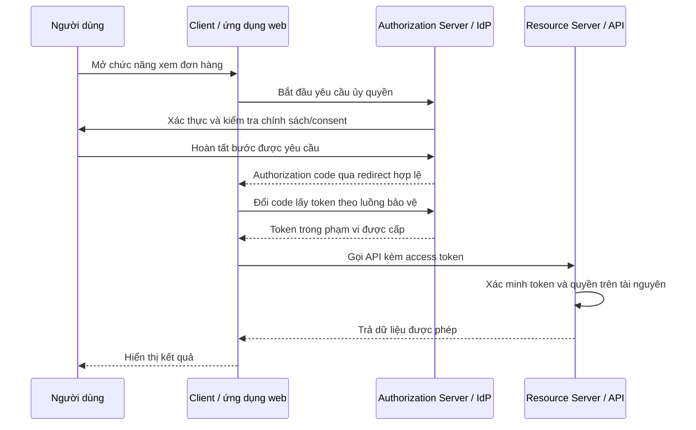
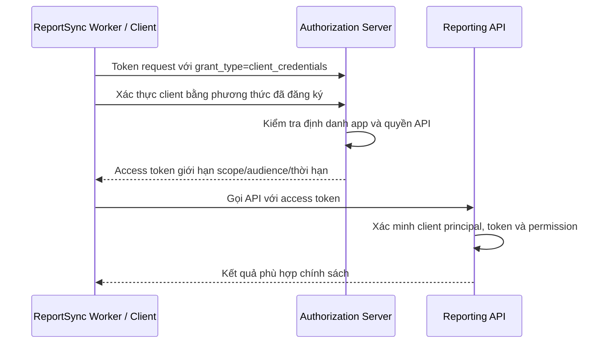
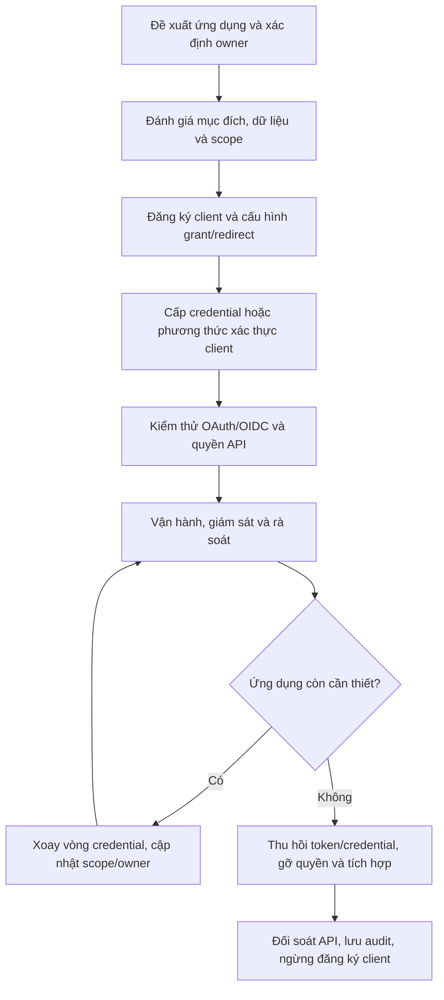

# Client trong OAuth 2.0 và OpenID Connect: Vai trò, bảo mật và vòng đời IAM

Trong **OAuth 2.0**, **Client** là ứng dụng yêu cầu quyền truy cập vào tài nguyên được bảo vệ, thay mặt **resource owner** hoặc trong những luồng dành riêng cho chính ứng dụng. Client có thể là một ứng dụng web, ứng dụng di động, ứng dụng chạy trong trình duyệt, dịch vụ backend hoặc một tiến trình tự động. Trong **OpenID Connect (OIDC)**, client cũng thường được gọi là **Relying Party (RP)** khi sử dụng IdP/OpenID Provider để xác thực người dùng.

Client **không đồng nghĩa với người dùng**, không phải API lưu dữ liệu, và cũng không mặc nhiên là một account quản trị. Nó là **một vai trò trong giao thức**. Cùng một sản phẩm phần mềm có thể đóng vai client khi gọi API khác, đồng thời đóng vai resource server khi nhận yêu cầu từ một client khác. Hiểu đúng client giúp thiết kế đăng nhập SSO, cấp quyền API và quản lý danh tính phi con người an toàn.

Bài học thuộc chương **OAuth và OIDC** của module `SECURITY_IDENTITY_ACCESS_MANAGEMENT_IDENTITY_LIFECYCLE`. Nội dung liên kết đăng ký client tại IdP, luồng OAuth/OIDC, token, RBAC/ABAC, provisioning qua SCIM và vòng đời **Joiner–Mover–Leaver (JML)**. Mục tiêu là phân biệt quyền của **con người** với quyền của **ứng dụng**, bảo vệ thông tin xác thực client, và giảm quyền truy cập tồn dư khi người dùng, người sở hữu ứng dụng hoặc chính ứng dụng thay đổi vòng đời.

Sau bài học, bạn có thể nhận diện OAuth/OIDC client trong kiến trúc, chọn loại client và luồng phù hợp, hiểu cách dùng `client_id`, redirect URI, PKCE và client authentication, kiểm tra ranh giới giữa ID token và access token, và quản trị client từ lúc đăng ký đến khi ngừng hoạt động.

## 1. Client là ai trong mô hình OAuth 2.0?

OAuth 2.0 thường được giải thích bằng bốn vai trò:

| Vai trò | Chức năng | Ví dụ |
| --- | --- | --- |
| **Resource Owner** | Chủ thể có thẩm quyền cho phép truy cập tài nguyên; trong tình huống người dùng, thường là chính người dùng hoặc cơ chế chính sách đại diện | Nhân viên có quyền xem những đơn hàng được giao |
| **Client** | Ứng dụng yêu cầu token để truy cập tài nguyên theo phạm vi được phép | Giao diện quản lý đơn hàng hoặc dịch vụ tạo báo cáo |
| **Authorization Server (AS)** | Xác thực và đánh giá yêu cầu ủy quyền, phát token theo chính sách | Dịch vụ OAuth của IdP |
| **Resource Server (RS)** | API/hệ thống chứa tài nguyên, kiểm tra access token và quyền trước khi phục vụ request | API đơn hàng, API báo cáo |

Sơ đồ minh họa khi nhân viên dùng ứng dụng web để xem dữ liệu:



Sơ đồ giả định luồng **Authorization Code**; cấu hình bảo vệ như PKCE, state, nonce và xác thực client được trình bày ở phần sau.

### Client không phải người dùng

Nếu nhân viên An mở ứng dụng `orders-web`, **An** là danh tính con người, còn **`orders-web` là client**. Khi An nghỉ việc, quyền đăng nhập và quyền dữ liệu của An phải bị chặn theo JML. Điều đó **không có nghĩa** phải xóa client `orders-web`: ứng dụng có thể vẫn phục vụ những nhân viên khác.

Ngược lại, khi `orders-web` ngừng vận hành, tổ chức cần thu hồi hoặc ngừng đăng ký client, quyền API, redirect URI, credential và tích hợp của ứng dụng, **không xóa các tài khoản nhân viên còn làm việc**.

### OAuth 2.0 không tự là giao thức đăng nhập

OAuth giải quyết **ủy quyền truy cập tài nguyên**. OIDC bổ sung lớp **xác thực**, trong đó client có thể yêu cầu scope `openid` và nhận **ID token** để kiểm tra kết quả đăng nhập. Không nên suy ra danh tính người dùng chỉ từ việc một client nhận được access token cho API bất kỳ. Cũng không nên sử dụng ID token làm access token tại resource server.

## 2. Một ứng dụng có thể đóng nhiều vai trò

Ví dụ sản phẩm OrderHub có ba thành phần:

1. **OrderHub Web** là client OIDC để nhân viên đăng nhập qua IdP.
2. **Orders API** là resource server, nhận access token và kiểm tra quyền trên đơn hàng.
3. **OrderSync Worker** là client chạy nền, gọi API báo cáo theo lịch mà không có phiên người dùng tương tác.

Đây là **ba bối cảnh bảo mật khác nhau**. Dùng cùng một client registration, secret và quyền API cho mọi thành phần chỉ để dễ triển khai có thể tạo đặc quyền rộng, khó thu hồi riêng từng thành phần và khó giải thích bản ghi kiểm toán.

| Thành phần | Vai trò giao thức | Chủ thể liên quan | Quyền cần có |
| --- | --- | --- | --- |
| OrderHub Web | OIDC RP/OAuth client | Người dùng đang đăng nhập | Những scope cần thiết và quyền nghiệp vụ của người dùng |
| Orders API | Resource server | Chủ thể được biểu diễn bởi access token hợp lệ | Kiểm tra audience, scope/role, resource và action |
| OrderSync Worker | OAuth client cho machine-to-machine | Danh tính của workload | Quyền ứng dụng được cấp riêng, giới hạn đúng API và môi trường |

Một client có thể truy cập nhiều API, nhưng từng API phải biết token nào dành cho mình. **Token có audience của API A không tự hợp lệ ở API B**, ngay cả khi cả hai dùng cùng IdP.

## 3. Public client và confidential client

OAuth phân loại client dựa vào **khả năng bảo vệ thông tin xác thực** và cách nó được triển khai, không dựa vào việc ứng dụng có nhiều người dùng hay có kết nối Internet.

| Loại | Đặc điểm | Ví dụ | Điều cần nhớ |
| --- | --- | --- | --- |
| **Public client** | Không thể bảo vệ client secret như một bí mật chỉ ứng dụng hợp lệ biết | SPA chạy trong browser, phần mã ứng dụng di động phân phối cho người dùng | Không coi secret nhúng trong JavaScript/app package là bí mật; dùng PKCE và bảo vệ redirect |
| **Confidential client** | Có thành phần server kiểm soát được credential và có thể xác thực với AS | Web backend lưu secret trong vault, backend job chạy trong hạ tầng quản lý | Bảo vệ secret/chứng chỉ/khóa; client authentication phải đúng cấu hình |
| **Client kết hợp** | Một sản phẩm có frontend public và backend confidential | SPA có Backend-for-Frontend (BFF) | Xác định **thành phần nào thực sự là OAuth client** ở mỗi luồng |

**`client_id` không phải bí mật.** Nó thường có thể xuất hiện trong URL yêu cầu ủy quyền, cấu hình ứng dụng và log được kiểm soát. Tính bí mật và quyền xác thực phải đến từ cơ chế được thiết kế phù hợp, không phải từ việc cố giấu client ID.

### Vì sao secret trong SPA hoặc app di động không an toàn?

JavaScript gửi xuống trình duyệt có thể được xem bởi người dùng; file cài đặt ứng dụng di động có thể bị trích xuất. Một `client_secret` nhúng trong đó không thể chứng minh request đến từ bản ứng dụng tin cậy. Vì thế, **public client không nên dùng một secret tĩnh được phân phối cùng ứng dụng như bằng chứng xác thực client**.

Với public client hỗ trợ Authorization Code, nên dùng **PKCE**, redirect URI được kiểm soát và biện pháp bảo vệ phiên phù hợp. Với backend confidential, **PKCE vẫn hữu ích và thường nên được áp dụng**, nhưng nó **không thay thế** client authentication khi AS yêu cầu xác thực confidential client.

### Cân nhắc BFF cho ứng dụng web

Trong mô hình **Backend-for-Frontend (BFF)**, trình duyệt duy trì một session được bảo vệ với backend, còn backend thực hiện luồng OAuth và quản lý token theo chính sách. Cách này giảm nhu cầu để access/refresh token tiếp xúc trực tiếp với JavaScript phía browser, nhưng cũng đòi hỏi **cookie bảo vệ, chống CSRF, session storage và kiểm soát API backend**. BFF không tự khắc phục lỗi XSS, session hijacking hoặc phân quyền sai.

## 4. Client registration: Đăng ký ứng dụng tại Authorization Server

Trước khi tham gia OAuth/OIDC, client thường được **đăng ký** với Authorization Server hoặc IdP. Registration mô tả danh tính ứng dụng, các endpoint và những cơ chế được phép sử dụng. Một số môi trường hỗ trợ đăng ký thủ công, một số có API hoặc **dynamic client registration** với quy trình phê duyệt riêng.

| Thuộc tính cấu hình | Vai trò | Kiểm soát cần có |
| --- | --- | --- |
| `client_id` | Định danh client do AS cấp | Gắn với đúng ứng dụng/tenant; không dùng như mật khẩu |
| Client type | Public hoặc confidential theo khả năng triển khai | Không khai confidential để hợp thức hóa secret nhúng trong SPA |
| `redirect_uris` | Đích hợp lệ nhận authorization response | Kiểm tra chính xác theo quy định, tránh wildcard và open redirect |
| Allowed grant types | Các luồng client được sử dụng | Chỉ bật luồng cần thiết; không mặc định bật mọi grant |
| `token_endpoint_auth_method` | Phương thức xác thực client ở token endpoint | Phù hợp public/confidential và năng lực IdP |
| Scopes/permissions | Phạm vi OAuth mà client có thể yêu cầu | Tuân theo chính sách, consent/phê duyệt; không cấp scope rộng vô cớ |
| `post_logout_redirect_uris` | Địa chỉ trở về sau RP-Initiated Logout nếu có | Phải đăng ký/kiểm tra; không redirect đến URL tùy ý |
| Chủ sở hữu và môi trường | Người/nhóm chịu trách nhiệm, dev/test/prod | Tách quyền và credential giữa môi trường |
| Credential metadata | Loại khóa, hết hạn, phiên bản, cách xoay vòng | Không đưa secret thật vào tài liệu cấu hình công khai |
| Danh mục API/audience | API mục tiêu hoặc tài nguyên được duyệt | Không mặc nhiên cho client truy cập mọi API cùng issuer |

Một bản ghi khái niệm:

```yaml
applicationName: orders-web
environment: production
ownerTeam: commerce-platform
clientId: orders-web-prod
clientType: confidential
grantTypes:
  - authorization_code
redirectUris:
  - https://orders.example.org/auth/callback
postLogoutRedirectUris:
  - https://orders.example.org/signed-out
tokenEndpointAuthMethod: private_key_jwt
allowedScopes:
  - openid
  - profile
  - orders.read
credentialRef: vault://commerce/orders-web/oauth-key
```

Đây là **schema minh họa**, không phải mẫu cấu hình bắt buộc của OAuth/OIDC hoặc một sản phẩm IdP cụ thể. Giá trị `credentialRef` chỉ là tham chiếu giả định; **không được chèn private key hoặc client secret thật vào tài liệu**.

### Nguyên tắc redirect URI

Redirect URI cần được đăng ký và kiểm tra theo cơ chế chuẩn. Một redirect tới `https://orders.example.org/auth/callback` không đồng nghĩa client được tùy ý chuyển mã ủy quyền tới `https://evil.example.org/collect` hoặc một URL chứa tham số điều hướng không được kiểm soát.

**Open redirect** hoặc xác minh redirect URI không đúng có thể làm lộ authorization code. Trong ứng dụng di động, nên dùng những phương án callback được nền tảng hỗ trợ và bảo vệ (ví dụ claimed HTTPS redirect/OS app links khi phù hợp); URI scheme riêng có thể gặp rủi ro bị ứng dụng khác chiếm. Không suy ra tính an toàn chỉ từ tên miền hoặc đường dẫn nhìn có vẻ quen thuộc.

## 5. Client tham gia Authorization Code Flow như thế nào?

Với ứng dụng tương tác cần xác thực người dùng qua OIDC, **Authorization Code Flow kết hợp PKCE** là lựa chọn phổ biến. Luồng tách việc điều hướng người dùng tại browser khỏi việc đổi code lấy token ở token endpoint.

```mermaid
sequenceDiagram
    participant U as Người dùng
    participant C as OAuth/OIDC Client
    participant AS as Authorization Server / IdP
    participant RS as Resource Server
    U->>C: Truy cập ứng dụng
    C->>C: Sinh state, nonce khi cần và PKCE verifier/challenge
    C-->>U: Chuyển tới authorization endpoint
    U->>AS: Yêu cầu authorization_code với code_challenge
    AS->>U: Xác thực và áp chính sách/consent
    U->>AS: Hoàn tất yêu cầu
    AS-->>U: Redirect với code và state
    U->>C: Callback đã đăng ký
    C->>C: Kiểm tra state, issuer/ngữ cảnh và callback
    C->>AS: Đổi code với code_verifier; xác thực client nếu cần
    AS-->>C: Access token và ID token trong luồng OIDC
    C->>C: Xác minh ID token, thiết lập session phù hợp
    C->>RS: Gọi API bằng access token
    RS->>RS: Kiểm tra token và quyền tài nguyên
    RS-->>C: Trả dữ liệu đúng phạm vi
```

### 5.1. `state`: liên kết request với callback

Client sinh `state` khó đoán và lưu sự liên kết với phiên/đợt đăng nhập đang chờ. Khi trình duyệt quay về callback, client kiểm tra giá trị đó để chống trộn lẫn response và một số dạng tấn công CSRF/login CSRF. Không được nhận authorization code ở callback mà **không xác minh request ban đầu thuộc đúng phiên đang chờ**, kể cả khi code có vẻ hợp lệ.

### 5.2. PKCE: bảo vệ authorization code

**Proof Key for Code Exchange (PKCE)** dùng một `code_verifier` khó đoán do client sinh và `code_challenge` tính từ verifier, thường theo phương pháp **`S256`**. Client gửi challenge lúc bắt đầu authorization, rồi chứng minh sở hữu verifier khi đổi authorization code.

```text
client tạo code_verifier ngẫu nhiên đủ mạnh
code_challenge = BASE64URL(SHA256(ASCII(code_verifier)))
code_challenge_method = S256

authorization request:
    response_type=code
    client_id=orders-web-prod
    redirect_uri=https://orders.example.org/auth/callback
    scope=openid profile orders.read
    state=<RANDOM_STATE>
    nonce=<RANDOM_NONCE>
    code_challenge=<CALCULATED_CHALLENGE>
    code_challenge_method=S256

token request sau callback:
    grant_type=authorization_code
    code=<RECEIVED_CODE>
    redirect_uri=https://orders.example.org/auth/callback
    code_verifier=<ORIGINAL_VERIFIER>
    ...client authentication nếu là confidential client
```

Các placeholder **không phải token hoặc secret thật**. Client cần ràng buộc verifier và state với đúng giao dịch đăng nhập, bảo vệ storage và loại bỏ dữ liệu tạm khi hoàn tất. **PKCE không phải là một cách đăng nhập thay người dùng** và không cấp quyền API: nó giúp ngăn việc kẻ khác đổi một authorization code bị chặn/đánh cắp.

### 5.3. `nonce`: liên kết kết quả xác thực OIDC

Trong OIDC, `nonce` là giá trị client có thể gửi để ràng buộc ID token với yêu cầu xác thực, đặc biệt quan trọng trong các cấu hình có yêu cầu chống replay. Nếu dùng nonce, client phải so sánh chính xác giá trị tương ứng trong ID token. **`state` và `nonce` phục vụ các mục đích liên quan nhưng không đồng nhất**: state liên kết authorization response với client session, còn nonce liên kết ID token với yêu cầu xác thực OIDC.

### 5.4. Token endpoint và xác thực client

Một **confidential client** thường xác thực tại token endpoint bằng phương thức mà AS cho phép, ví dụ client secret trong cơ chế HTTP Basic được hỗ trợ, JWT assertion ký bằng khóa riêng (`private_key_jwt`) hoặc mTLS trong cấu hình phù hợp. Một **public client** không thể chứng minh bí mật client tĩnh đã được giữ kín; AS phải thiết kế grant, redirect URI và PKCE tương ứng.

**Client authentication không thay thế user authentication.** Việc `orders-web` chứng minh nó là client hợp lệ không có nghĩa nhân viên An đã được xác thực, và cũng không chứng minh An có quyền phê duyệt đơn hàng.

## 6. Client phải kiểm tra token đúng mục đích

OIDC bổ sung **ID token** cho kết quả xác thực; OAuth dùng **access token** để gọi API. **Refresh token** (nếu được cấp) giúp client xin token mới theo chính sách.

| Token | Bên thường sử dụng | Cần kiểm tra |
| --- | --- | --- |
| **ID token** | OIDC client/RP | Chữ ký hoặc xác thực phù hợp, issuer, audience (client ID), thời hạn, nonce khi áp dụng, các điều kiện theo luồng |
| **Access token** | Resource server/API | Token hợp lệ đối với API: issuer, audience/resource, thời hạn, scope/role, điều kiện tài nguyên và chính sách |
| **Refresh token** | Client tại token endpoint | Bảo vệ như credential; chỉ cấp/lưu dùng theo chính sách, hỗ trợ rotation/revocation phù hợp |
| **Authorization code** | Client đổi một lần tại token endpoint | Ngắn hạn, liên kết client/redirect URI và PKCE; không phải token API |

### 6.1. ID token chứng minh điều gì?

ID token cho RP biết IdP đã thực hiện xác thực theo giao thức và thông tin claim được bảo vệ. Khi kiểm tra, client cần đối chiếu tối thiểu **`iss`**, **`aud`**, **`exp`**, và những claim khác mà OIDC yêu cầu tùy ngữ cảnh. Nếu có nhiều `aud`, cách xử lý `azp` phải tuân theo OIDC Core khi áp dụng. `sub` là định danh chủ thể **trong phạm vi issuer**; việc liên kết local user nên dựa trên cặp `(iss, sub)`, không tự suy từ email hoặc tên hiển thị.

Ví dụ một ID token có `aud=orders-web-prod` được phát cho OrderHub Web **không phải** token cho `orders-api`. Không được gửi ID token đó cho API để chứng minh quyền đọc dữ liệu.

### 6.2. Access token không phải cam kết mọi quyền

Một access token có thể chứa hoặc tham chiếu scope như `orders.read`, nhưng API vẫn phải kiểm tra **tài nguyên cụ thể**: người dùng có được xem đơn hàng của chi nhánh khác không, chủ thể có bị khóa không, chính sách ABAC có giới hạn dự án không. Phân quyền chỉ dựa vào việc token “có chữ ký hợp lệ” là thiếu.

Token có thể là JWT hoặc dạng opaque. **Client không được mặc định có thể giải mã/diễn giải access token để lấy thông tin đăng nhập**; cách phát hành và kiểm tra do AS/RS quyết định. Với JWT tự chứa, phải hiểu rằng quyền và trạng thái có thể thay đổi trước khi token hết hạn; giải pháp giới hạn thời hạn, kiểm tra trạng thái hoặc revoke phụ thuộc rủi ro và hạ tầng.

### 6.3. Refresh token thuộc về vòng đời credential

Client cần xác định có thực sự cần refresh token hay không. Nếu được cấp, phải bảo vệ khỏi rò rỉ, hạn chế thời hạn/phạm vi, thực hiện rotation hoặc sender-constraining khi AS hỗ trợ và áp dụng chính sách hiện hành. **Refresh token của client public** thường cần những biện pháp bảo vệ đặc biệt vì không có secret client tĩnh đáng tin.

Không lưu refresh token trong URL, log hoặc source code. Với browser, phải đánh giá XSS, session theft và mô hình lưu trữ phù hợp; với backend, lưu credential ở nơi được kiểm soát, phân quyền và kiểm tra việc hủy sau logout/Leaver.

## 7. Client Credentials: client gọi API bằng danh tính ứng dụng

Không phải mọi OAuth client đại diện cho một người dùng đang tương tác. Một job chạy mỗi đêm có thể sử dụng **Client Credentials Grant** để nhận access token nhằm truy cập API đã được cấp quyền cho chính client.



| Tiêu chí | Authorization Code + OIDC | Client Credentials |
| --- | --- | --- |
| Có người dùng tương tác? | Thường có | Không cần |
| Chủ thể của quyền | Theo ngữ cảnh người dùng/ủy quyền, chính sách và client | Danh tính ứng dụng/workload |
| Có ID token để đăng nhập người dùng? | Có thể có trong OIDC | Thông thường không có ID token cho người dùng |
| Client có tự nhận quyền của người dùng? | Không; quyền bị giới hạn theo AS và RS | Không; chỉ quyền application-only được cấp |
| Ứng dụng phù hợp | Web app đăng nhập, mobile/SPA với bảo vệ phù hợp | Backend job, tích hợp service-to-service |

**Client Credentials Grant thường không phát refresh token** vì client có thể xác thực lại để lấy access token mới theo chính sách. Không nên cấp một token có quyền `admin` toàn bộ tenant chỉ để một job đọc một bảng báo cáo.

### Delegated access và application-only access không đồng nghĩa

Nếu ứng dụng gọi API **thay mặt nhân viên An**, API phải bảo vệ quyền theo An và context được ủy quyền. Nếu `report-sync-prod` gọi API bằng danh tính máy, API phải đánh giá quyền của chính workload đó.

Một lỗi thiết kế nguy hiểm là nhận request của nhân viên có quyền thấp, sau đó backend dùng token application-only với đặc quyền cao để làm thao tác mà **không kiểm tra quyền của người gửi ban đầu**. Đây có thể là dạng *confused deputy*. Phải xác định rõ vì sao backend được phép thay mặt user hoặc thực hiện công việc của ứng dụng và áp kiểm tra ở điểm thực thi.

## 8. Scope, consent, audience và role của client

Một client có thể **yêu cầu** scope nhưng không có nghĩa AS phải **cấp** mọi scope được yêu cầu. Quyền hiệu lực phụ thuộc đăng ký client, tư cách người dùng (nếu có), phê duyệt, chính sách, đối tác, ứng dụng đích và tài nguyên.

| Khái niệm | Ý nghĩa | Ví dụ |
| --- | --- | --- |
| **Scope** | Nhãn mô tả phạm vi ủy quyền được yêu cầu/cấp | `orders.read` |
| **Consent** | Bước đồng ý của chủ thể hoặc admin theo chính sách nền tảng | Người dùng/administrator chấp thuận truy cập được phép |
| **Audience/resource** | API hoặc bên nhận dự định của token | `orders-api` |
| **App role / entitlement** | Quyền ứng dụng được gán cho user hoặc client | `order.viewer`, `report.writer` |
| **ABAC condition** | Điều kiện theo thuộc tính và bối cảnh | Chỉ xem đơn hàng thuộc `branchId` được giao |

**Consent không phải tấm vé vượt quyền.** Người dùng có thể đồng ý cho ứng dụng truy cập dữ liệu, nhưng nếu chính sách tổ chức cấm ứng dụng bên ngoài đọc toàn bộ hồ sơ nhân sự, AS và RS vẫn phải thực thi giới hạn. Với các scope nhạy cảm, tổ chức cần chủ sở hữu API, luồng phê duyệt và rà soát consent theo mức rủi ro.

Một ứng dụng gọi API hợp lệ phải có token dành cho đúng API và có quyền thực hiện **hành động cụ thể**, trên **đối tượng cụ thể**. Phân quyền đích không thể dựa duy nhất vào tên client hoặc một scope chung như `access`.

## 9. Bảo mật client: Các lỗi thường gặp

| Lỗi | Hậu quả | Biện pháp |
| --- | --- | --- |
| Nhúng `client_secret` trong JavaScript/browser | Ai cũng có thể trích xuất secret | Dùng public client + PKCE hoặc kiến trúc backend phù hợp |
| Dùng cùng secret cho dev/test/prod | Lộ môi trường thấp kéo theo rủi ro production | Đăng ký/credential riêng theo môi trường |
| Redirect URI quá rộng hoặc open redirect | Có thể làm lộ authorization code | Đăng ký URI chặt chẽ, xác minh theo chuẩn |
| Thiếu kiểm tra `state` | Tăng nguy cơ CSRF/login mix-up | Ràng buộc state với yêu cầu/phiên đang chờ |
| Thiếu/không kiểm tra PKCE | Code bị chặn có thể bị đổi trong một số tình huống | Sử dụng PKCE S256 và verifier hợp lệ |
| Chấp nhận ID token sai `aud` hoặc `iss` | Client chấp nhận token không dành cho mình | Xác minh issuer, audience, chữ ký và claim theo luồng |
| Dùng ID token để gọi API | Nhầm xác thực với ủy quyền | API chỉ chấp nhận access token dành đúng resource |
| Không kiểm tra audience ở API | Token cho dịch vụ khác được sử dụng sai mục đích | Resource server xác minh token và resource binding |
| Lưu token/secret vào log | Lộ credential qua hệ thống quan sát | Redact, phân quyền log, dùng vault và quản lý thời hạn |
| Cấp scope hoặc role app-only quá rộng | Workload có đặc quyền không cần thiết | Least privilege, chủ sở hữu và rà soát định kỳ |
| Không kiểm soát refresh token | Token tồn tại lâu sau thay đổi danh tính | Rotation/revoke/lifetime và quản trị session theo rủi ro |
| Bỏ quên client không còn dùng | Secret, token và quyền API vẫn tồn tại | Inventory, owner, decommission và đối soát |
| Dùng một client cho mọi tenant/app | Khó tách quyền, dễ nhầm phiên/issuer | Tách đăng ký hoặc ràng buộc tenant và issuer rõ ràng |

### Tránh các luồng không phù hợp với ứng dụng mới

Với triển khai mới, cần ưu tiên các luồng được khuyến nghị bởi thực hành bảo mật OAuth hiện đại. **Implicit grant** và **Resource Owner Password Credentials (password grant)** thường không phù hợp cho thiết kế ứng dụng mới vì hạn chế bảo vệ token hoặc buộc client xử lý mật khẩu người dùng. Không nên dùng password grant để “đơn giản hóa SSO” hay để backend biết mật khẩu IdP của người dùng.

**PKCE và xác thực client có chức năng khác nhau**: PKCE ràng buộc code với client khởi tạo luồng; xác thực confidential client chứng minh danh tính client cho AS. Cần áp đúng biện pháp chứ không thay thế tùy tiện.

## 10. Quản lý vòng đời client như một đối tượng IAM

Client registration có **vòng đời riêng** với vòng đời người dùng:



### Giai đoạn đăng ký

Ghi lại **ai sở hữu client**, ứng dụng/môi trường, mục đích, API cần truy cập, loại dữ liệu, nguồn cấu hình, quyền phê duyệt và thời hạn. Với ứng dụng của bên thứ ba, cần đánh giá rủi ro nhà cung cấp, scope/consent, phương án thu hồi và việc chuyển dữ liệu theo chính sách.

### Giai đoạn vận hành

Theo dõi lượt cấp token, lỗi client authentication, thay đổi redirect URI, phạm vi đã được cấp, secret/chứng chỉ sắp hết hạn và hoạt động truy cập bất thường. **Không ghi access token, refresh token hoặc secret thật vào log.** Có quy trình thay đổi cấu hình với kiểm thử và rollback/bù trừ phù hợp, không sửa trực tiếp production mà không biết ảnh hưởng tới người dùng.

### Giai đoạn xoay vòng credential

Với confidential client dùng secret/chứng chỉ, kế hoạch xoay vòng cần bảo đảm ứng dụng chuyển sang credential mới và **credential cũ thực sự hết hiệu lực**:

1. Xác minh client, owner, môi trường, API phụ thuộc và thời gian cần thay.
2. Tạo credential mới trong hệ thống quản lý bí mật hoặc hệ thống khóa được phê duyệt.
3. Cập nhật ứng dụng nhận credential qua kênh bảo vệ và triển khai có kiểm soát.
4. Kiểm thử client authentication và việc gọi API ở quyền tối thiểu.
5. Thu hồi/đặt hết hạn credential cũ theo cửa sổ chuyển đổi; kiểm tra không còn sử dụng.
6. Ghi audit và cảnh báo nếu ứng dụng tiếp tục dùng credential cũ.

Nếu hệ thống không cho chạy song song hai credential, cần có phương án bảo trì thích hợp. Đừng coi việc secret mới hoạt động là bằng chứng secret cũ đã bị hủy.

### Giai đoạn ngừng ứng dụng

Khi một ứng dụng ngừng sử dụng, phải rà soát client registration, grants, consent, client credential, redirect URI, service principal, quyền API, webhook/tích hợp và token còn hiệu lực. Thao tác **delete client** không chắc tự hủy mọi bearer token đã phát hành ở mọi resource server. Tổ chức cần xác minh phạm vi thu hồi và thời hạn token còn tồn dư.

## 11. Client trong Joiner–Mover–Leaver

### 11.1. Joiner: nhân viên nhận quyền sử dụng ứng dụng, không sở hữu client mặc định

Khi HRIS xác minh nhân viên mới, IAM có thể tạo account tại IdP, cấp nhóm và entitlement để nhân viên đăng nhập ứng dụng OIDC. Nếu ứng dụng đã có client registration ổn định, **không cần tạo một client OAuth mới cho từng nhân viên** chỉ để đăng nhập.

Ví dụ nhân viên bán hàng mới được cấp `crm.viewer` trên ứng dụng CRM. CRM là client OIDC dùng IdP; nhân viên là subject của phiên xác thực. SCIM có thể provision tài khoản tại CRM, còn OAuth/OIDC phục vụ xác thực và token. **Có quyền đăng nhập CRM không tự có nghĩa nhân viên là owner của client hoặc được cấp client secret.**

### 11.2. Mover: đổi vai trò, đánh giá delegated permission và quyền owner

Khi nhân viên chuyển bộ phận, IAM tính lại role, group và phạm vi dữ liệu. **Client ứng dụng có thể giữ nguyên**, còn quyền của người dùng thay đổi tại IdP/API. Nếu ứng dụng lưu role hoặc claim trong session/token lâu, cần kiểm soát độ trễ áp quyền mới.

Nếu nhân viên từng là người **sở hữu hoặc quản trị** client registration, Mover còn phải rà soát quyền sửa redirect URI, tạo secret, phê duyệt consent, triển khai production và xem log. Nhân viên chuyển khỏi nhóm phát triển không nên tiếp tục là owner của client production chỉ vì tài khoản IdP vẫn hoạt động.

### 11.3. Leaver: thu hồi quyền của người dùng và quản trị client theo hai nhánh

Khi một nhân viên nghỉ việc:

1. Đối chiếu đúng danh tính và `effectiveAt` từ nguồn HR có thẩm quyền.
2. Khóa đăng nhập/thu hồi phiên và quyền người dùng tại IdP/ứng dụng theo chính sách.
3. Gỡ nhóm, role, quyền trực tiếp, consent hoặc các đường ủy quyền còn hiệu lực phụ thuộc vào người nghỉ việc.
4. Rà soát token, phiên và account cục bộ; không coi IdP disabled là bằng chứng mọi API không còn truy cập được.
5. Nếu người đó là **client owner/admin**, chuyển owner và thu hồi quyền quản trị client registration.
6. Nếu người đó **biết secret/chứng chỉ/khóa của client**, đánh giá xoay vòng credential, đặc biệt nếu đã rời nhóm cần biết bí mật.
7. Đối soát quyền của chính ứng dụng; chỉ ngừng client nếu ứng dụng thực sự không còn cần thiết.

**Không vô hiệu hóa một client dùng chung chỉ vì một nhân viên sử dụng ứng dụng nghỉ việc**. Cũng **không bỏ qua** các client, service principal và credential kỹ thuật mà người nghỉ việc từng quản lý.

### 11.4. Rehire và contractor

Với nhân viên được tuyển lại, liên kết danh tính phải dựa trên ID ổn định và quyết định có thẩm quyền, không dựa vào email hoặc username trùng. Quyền ứng dụng, consent đặc biệt và quyền quản trị client phải được đánh giá lại. Nhà thầu/đối tác cần có thời hạn, owner hoặc sponsor, đồng thời phải thu hồi quyền người dùng và quyền client kỹ thuật do hợp đồng đó tạo ra khi hết hiệu lực.

## 12. SCIM, SSO và client registration khác nhau ra sao?

Một lỗi kiến trúc hay gặp là cho rằng “đã tích hợp SCIM nên OAuth client cũng được quản lý đầy đủ” hoặc “đã đăng nhập SSO nên ứng dụng đã được cấp đúng entitlement”.

| Công nghệ / đối tượng | Phục vụ việc gì? | Không tự thay thế |
| --- | --- | --- |
| **OAuth client registration** | Xác định ứng dụng được phép tham gia luồng OAuth và cấu hình quyền/cách xác thực client | Tài khoản người dùng và role nội bộ của SaaS |
| **OIDC / SSO** | Xác thực người dùng qua IdP và truyền kết quả xác thực theo giao thức | Quyền cụ thể trên từng dữ liệu của ứng dụng |
| **OAuth access token** | Cho client gọi API theo phạm vi được cấp | Xác nhận mọi quyền nghiệp vụ của con người |
| **SCIM** | Provision/đồng bộ người dùng, nhóm và một số thuộc tính/quyền ở ứng dụng đích | Đăng ký OAuth client hoặc xóa session/token một cách phổ quát |
| **RBAC/ABAC** | Tính và thực thi quyền theo role, thuộc tính và ngữ cảnh | Xác thực danh tính của client hoặc người dùng |
| **PAM / JIT** | Quản lý đặc quyền, cấp quyền đúng lúc và thời hạn | Phương thức bảo vệ client secret hoặc kiểm tra token |

Khi API của một ứng dụng cần gọi ứng dụng khác, còn cần phân biệt **principal là người dùng hay workload**. Client ID là khóa tham chiếu app, nhưng danh tính máy và các quyền được cấp có thể được biểu diễn bằng service principal hoặc mô hình khác tùy nhà cung cấp IdP.

## 13. Tình huống thực hành: Web client và workload client

Giả sử doanh nghiệp sử dụng:

- **`orders-web-prod`**: web client confidential có backend, nhân viên đăng nhập qua OIDC, gọi `orders-api` thay mặt người dùng.
- **`report-sync-prod`**: workload client dùng Client Credentials để ghi báo cáo tổng hợp vào `reporting-api`.
- **`orders-api`** và **`reporting-api`**: resource server, mỗi API tự kiểm tra audience và permission.

| Thời điểm | Sự kiện | Kiểm soát đúng | Lỗi dễ gặp |
| --- | --- | --- | --- |
| Joiner | Nhân viên An được giao xử lý đơn | An có account/role `orders.viewer`, sử dụng client `orders-web-prod` đã có | Tạo client secret riêng cho An hoặc cấp toàn quyền API chỉ vì login thành công |
| Mover | An chuyển sang báo cáo | Gỡ quyền sửa đơn, cấp quyền báo cáo theo chính sách; kiểm tra session/token cũ | Chỉ cấp role mới nhưng giữ quyền sửa đơn cũ |
| Owner thay đổi | Người quản lý `report-sync-prod` chuyển đội | Chuyển owner, thu hồi quyền tạo secret của người cũ và rà soát credential | Để owner cũ còn quyền quản trị OAuth client production |
| Leaver | An nghỉ việc | Chặn access của An, xử lý session/token và quyền ứng dụng | Xóa `orders-web-prod` làm gián đoạn toàn bộ nhân viên |
| Decommission | Dịch vụ ReportSync ngừng hoạt động | Gỡ app-only grant, thu hồi secret/chứng chỉ, dừng cấp token và đối soát API | Chỉ tắt job nhưng để client và quyền API tồn tại |

### Hai lỗi cần phân tích

**Lỗi A — secret xuất hiện trong bundle frontend.** Nhóm phát triển lưu `client_secret` trong mã JavaScript gửi tới browser vì cấu hình IdP yêu cầu. Secret bị người dùng trích xuất. Cách sửa không đơn thuần là đổi secret rồi tiếp tục nhúng: phải **đổi mô hình client** cho phù hợp (public + PKCE hoặc backend confidential), thu hồi secret cũ và kiểm tra dấu hiệu lạm dụng.

**Lỗi B — backend dùng client credentials cho request của người dùng mà bỏ qua phân quyền.** An chỉ được đọc đơn của chi nhánh A, nhưng `orders-web-prod` gọi API bằng token app-only có quyền toàn bộ đơn rồi trả dữ liệu theo `branchId` do An tự gửi. Nếu backend không kiểm tra danh tính, phạm vi được phép và tài nguyên cụ thể, client có thể trở thành *confused deputy*. Phải ràng buộc authorization của người dùng ở backend/API hoặc dùng delegated flow phù hợp.

## 14. Kiểm toán và đo chất lượng quản trị client

Một bản ghi quản trị client nên truy được **owner, môi trường, quyền được phê duyệt, cấu hình grant, phiên bản policy, redirect URI, thay đổi credential, thời điểm và người thực thi**. Log hoạt động cần đủ để điều tra nhưng **không chứa client secret, private key, refresh token, authorization code hoặc access token thật**.

| Chỉ số | Điều cần theo dõi |
| --- | --- |
| Client không có owner hợp lệ | Khả năng bỏ sót credential và quyền ứng dụng khi người phụ trách nghỉ việc |
| Client không sử dụng nhưng vẫn enabled | Nguy cơ app registration/service principal và API grant tồn dư |
| Credential hết hạn, không được xoay vòng | Nguy cơ gián đoạn hoặc bí mật bị bỏ quên |
| Số scope/role vượt nhu cầu | Rủi ro quyền API quá rộng, đặc biệt application-only |
| Lỗi client authentication và token endpoint | Secret sai/hết hạn, cấu hình lỗi hoặc dấu hiệu tấn công |
| Số redirect URI thay đổi hoặc chưa phê duyệt | Nguy cơ chuyển authorization response sai đích |
| Tỷ lệ app sử dụng Authorization Code + PKCE đúng cấu hình | Chất lượng bảo vệ các luồng tương tác |
| Quyền quản trị client tồn dư sau Mover/Leaver | Rủi ro nhân sự không còn nhiệm vụ vẫn sửa được client production |
| Access token còn hiệu lực sau disable/decommission | Khoảng chênh giữa trạng thái client và quyền API thực tế |
| Tỷ lệ đối soát các service principal/API grant | Độ phủ quản trị danh tính phi con người |

Các chỉ số nên được chia theo **mức rủi ro, môi trường production, loại client và độ nhạy cảm của API**, không chỉ tổng số client. Một workload có quyền ghi dữ liệu tài chính có thể quan trọng hơn nhiều client thử nghiệm không giữ dữ liệu nhạy cảm.

### Checklist trước khi đưa client vào production

1. Đã xác định thành phần nào là client, AS, RS và chủ thể người dùng/workload chưa?
2. Client được phân loại public/confidential dựa trên **khả năng giữ bí mật thực tế** chưa?
3. Client registration có owner, môi trường, redirect URI, allowed grant và scope được phê duyệt chưa?
4. Với authorization code, đã sử dụng PKCE và kiểm tra state/nonce/ngữ cảnh khi cần chưa?
5. Với confidential client, credential có nằm trong vault, dùng client authentication phù hợp và có kế hoạch rotation không?
6. Đã xác minh ID token bằng issuer, audience, signature, expiry và các claim OIDC theo luồng chưa?
7. API có kiểm tra access token đúng audience, quyền và phạm vi tài nguyên thay vì chỉ kiểm tra chữ ký chưa?
8. Có tách quyền delegated user khỏi quyền application-only và tránh confused deputy chưa?
9. Refresh token, cookie và session có thời hạn/thu hồi phù hợp; không ghi token vào URL hoặc log chưa?
10. Khi Mover/Leaver hoặc đổi owner, hệ thống có xử lý quyền người dùng **và** quyền quản trị client riêng biệt không?
11. Có đối soát client cũ, app-only grant, secret hết hạn, quyền API và tài khoản dịch vụ không?

## 15. Câu hỏi tự kiểm tra

**Câu 1.** Một SPA có `client_id` và `client_secret` nằm trong JavaScript, rồi tự xưng là confidential client. Phân loại đó có đáng tin không?

**Trả lời:** Không. JavaScript phân phối đến browser không thể giữ secret như bí mật của riêng ứng dụng hợp lệ. Nên thiết kế public client dùng PKCE hoặc chuyển phần client cần giữ credential sang backend thích hợp.

**Câu 2.** Client có access token chứa `orders.read`. Người dùng có tự động được đọc mọi đơn hàng không?

**Trả lời:** Không. API cần kiểm tra audience, scope/role, danh tính hoặc workload principal và quyền trên từng đơn hàng, kể cả điều kiện RBAC/ABAC.

**Câu 3.** Vì sao `state`, `nonce` và PKCE không thể thay thế lẫn nhau?

**Trả lời:** State liên kết authorization response với giao dịch client; nonce ràng buộc ID token với yêu cầu xác thực OIDC khi áp dụng; PKCE ràng buộc việc đổi authorization code với client đã khởi tạo. Chúng bảo vệ các rủi ro khác nhau.

**Câu 4.** Khi nhân viên dùng ứng dụng CRM nghỉ việc, có cần xóa OAuth client CRM không?

**Trả lời:** Không, nếu CRM còn phục vụ người dùng khác. Cần thu hồi quyền/phiên của nhân viên, còn client registration được quản lý theo vòng đời của chính ứng dụng.

**Câu 5.** Client Credentials Grant có chứng minh một người dùng đã đăng nhập không?

**Trả lời:** Không. Đây là luồng cho quyền của client/workload, không phải phiên xác thực người dùng. Không dùng app-only token như bằng chứng ủy quyền của một nhân viên cụ thể.

**Câu 6.** Một client đã bị disable nhưng resource server vẫn chấp nhận JWT access token còn hạn. Có thể coi việc thu hồi quyền API đã hoàn tất chưa?

**Trả lời:** Chưa chắc. Phải xác minh cơ chế thu hồi/chặn token tại resource server, thời hạn còn hiệu lực và trạng thái các grant/credential liên quan.

## Kết luận

**Client là ứng dụng tham gia OAuth 2.0 để yêu cầu quyền truy cập tài nguyên và, trong OIDC, có thể là Relying Party sử dụng IdP để xác thực người dùng.** Thiết kế an toàn bắt đầu từ phân biệt client với user và API, chọn public/confidential đúng khả năng giữ secret, đăng ký redirect/grant/scope chặt chẽ, dùng Authorization Code + PKCE cho luồng tương tác phù hợp, xác thực client khi cần và kiểm tra ID token/access token đúng mục đích. Client Credentials phục vụ danh tính ứng dụng, không đại diện mặc định cho người dùng. Trong quản lý vòng đời IAM, **Joiner–Mover–Leaver của con người và vòng đời client/service principal phải được theo dõi riêng nhưng liên kết qua owner, quyền, token và kiểm toán**. Chỉ khi có cơ chế bảo vệ credential, thu hồi quyền tại API và đối soát kết quả, tổ chức mới giảm được quyền truy cập tồn dư mà không làm gián đoạn ứng dụng hợp lệ.
