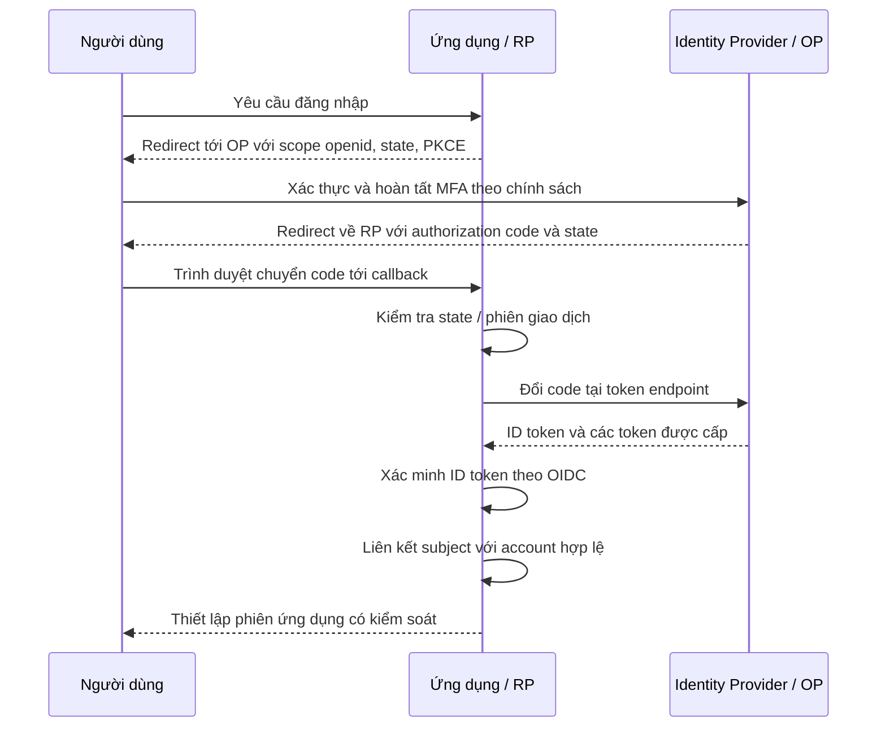

# ID token trong OAuth và OpenID Connect (OIDC)

**ID token** là một **security token** do **OpenID Provider (OP)** phát hành trong giao thức **OpenID Connect (OIDC)** để cung cấp thông tin về **sự kiện xác thực người dùng** cho ứng dụng đã yêu cầu đăng nhập, thường gọi là **Relying Party (RP)**. ID token thường có dạng **JSON Web Token (JWT)** với các claim như `iss`, `sub`, `aud`, `exp` và `iat`.

ID token trả lời câu hỏi quan trọng: **“Ứng dụng này đã nhận được bằng chứng xác thực về subject nào, từ nhà phát hành nào, dành cho ứng dụng nào?”** Nó **không phải** giấy phép chung để gọi API và không tự xác định toàn bộ quyền truy cập của người dùng.

Trong **Identity and Access Management (IAM)**, ID token là mắt xích nối **Identity Provider (IdP)**, đăng nhập **Single Sign-On (SSO)** và vòng đời **Joiner–Mover–Leaver (JML)**. Tuy vậy, provisioning bằng **SCIM**, phân quyền **RBAC/ABAC**, quản lý phiên, service account và thu hồi khi Leaver vẫn cần cơ chế riêng. Hiểu đúng phạm vi ID token giúp tránh cấp nhầm quyền hoặc duy trì truy cập tồn dư.

## 1. ID token khác access token và refresh token

| Loại token | Bên nhận/mục đích chính | Bên cần kiểm tra | Điều không nên làm |
| --- | --- | --- | --- |
| **ID token** | Cung cấp thông tin xác thực cho **OIDC client/RP** | RP đã yêu cầu đăng nhập | Dùng làm bearer token để gọi API tùy ý |
| **Access token** | Cho phép truy cập **resource server/API** trong phạm vi được cấp | Resource server/API | Coi là bằng chứng đăng nhập cho mọi RP |
| **Refresh token** | Cho client xin access token mới khi được phép | Authorization Server/token endpoint | Đưa vào URL, log hoặc trình duyệt không phù hợp |

Cùng một authorization server có thể phát cả ba loại token, nhưng **mục tiêu và đối tượng tiếp nhận khác nhau**. Một API không được chấp nhận ID token làm credential chỉ vì JWT đó có chữ ký đúng. Tương tự, một RP không nên đọc access token dành cho API rồi xem nó là ID token.

**OAuth 2.0** là khung ủy quyền, còn **OIDC** bổ sung lớp xác thực dựa trên OAuth 2.0. Khi client yêu cầu scope `openid` và thực hiện luồng OIDC được hỗ trợ, ID token là thành phần cốt lõi cho việc nhận biết subject đã xác thực.

## 2. ID token trong một luồng đăng nhập

Ví dụ ứng dụng quản lý nhân sự sử dụng OIDC Authorization Code Flow:



**ID token được RP xử lý sau khi nhận kết quả từ nhà phát hành**. Những giá trị như `state` và PKCE phục vụ bảo vệ luồng ủy quyền; chúng không phải các claim thay thế cho việc kiểm tra ID token. Trong những luồng và cấu hình có sử dụng `nonce`, RP còn phải ràng buộc `nonce` của ID token với giá trị đã gửi khi khởi tạo yêu cầu.

Cần phân biệt **xác thực thành công tại OP**, **ID token hợp lệ tại RP** và **quyền truy cập tài nguyên được cho phép**: đây là ba quyết định khác nhau.

## 3. Cấu trúc JWT của ID token

ID token dạng JWT gồm ba phần được mã hóa theo base64url, ngăn cách bởi dấu chấm:

```text
BASE64URL(header).BASE64URL(payload).BASE64URL(signature)
```

Ví dụ **payload minh họa**, không phải token có thể sử dụng:

```json
{
  "iss": "https://login.example.org",
  "sub": "subject-7d42",
  "aud": "b2b-portal-client",
  "exp": 1795450200,
  "iat": 1795449900,
  "auth_time": 1795449840,
  "nonce": "request-bound-value",
  "acr": "urn:example:assurance:high",
  "amr": ["pwd", "otp"]
}
```

Một token cụ thể có thể có ít hoặc nhiều claim hơn tùy luồng, yêu cầu và nhà phát hành. **Không tự suy rằng token có mặt `email`, `roles` hay `groups`**: các claim này không phải toàn bộ tập bắt buộc của ID token theo OIDC Core. Nếu ứng dụng cần thuộc tính hồ sơ, nó có thể yêu cầu scope/claim phù hợp hoặc sử dụng **UserInfo Endpoint** với access token được cấp cho mục đích ấy.

**Giải mã base64url không phải xác minh tính hợp lệ.** Payload JWT là dữ liệu do bên gửi trình bày; RP phải xác minh chữ ký và toàn bộ ràng buộc giao thức trước khi tin nội dung.

## 4. Các claim cốt lõi và cách diễn giải

| Claim | Ý nghĩa | Lưu ý kiểm tra |
| --- | --- | --- |
| `iss` | Issuer: định danh OP phát token | Phải khớp chính xác nhà phát hành được tin cậy |
| `sub` | Subject identifier tại issuer | Không dùng trần `sub` xuyên mọi IdP |
| `aud` | Audience: bên nhận token | Phải chứa client ID của RP |
| `exp` | Thời điểm token hết hạn (Unix time) | RP không chấp nhận token đã hết hạn |
| `iat` | Thời điểm token được phát hành | Kiểm tra theo chính sách và bối cảnh thời gian |
| `auth_time` | Thời điểm người dùng được xác thực | Cần thiết trong một số yêu cầu, ví dụ `max_age` |
| `nonce` | Giá trị liên kết phản hồi với yêu cầu đăng nhập | Xác minh khi luồng/việc sử dụng nonce yêu cầu |
| `acr` | Ngữ cảnh/lớp bảo đảm xác thực | Không tự gán mức bảo đảm từ một chuỗi lạ |
| `amr` | Các phương thức xác thực được báo cáo | Không thay thế đánh giá mức bảo đảm thực tế |
| `azp` | Authorized party trong các trường hợp liên quan | Kiểm tra theo quy tắc OIDC khi áp dụng |

Các claim `acr` và `amr` có ý nghĩa **theo hợp đồng giữa các bên**. Ví dụ `amr=["pwd","otp"]` mô tả phương thức được OP ghi nhận, nhưng RP không nên mặc định rằng mọi mã OTP đều chống phishing. Tổ chức cần thống nhất chính sách MFA và mức bảo đảm phù hợp rủi ro.

## 5. Quy trình xác minh ID token tại RP

RP phải dùng thư viện OIDC/JWT đáng tin cậy và cấu hình rõ client/issuer thay vì tự phân tách chuỗi rồi tin vào payload.

1. **Đúng nguồn:** kiểm tra `iss` khớp OP được cấu hình; không chấp nhận issuer do client tùy ý khai báo.
2. **Đúng người nhận:** `aud` phải chứa **client ID** của RP hiện tại; xem xét `azp` theo quy tắc áp dụng, nhất là khi có nhiều audience.
3. **Đúng chữ ký/khóa:** xác minh JWS với khóa ký của OP từ metadata/JWKS đáng tin, chỉ chấp nhận thuật toán được cấu hình. Các cấu hình dùng bảo vệ mã hóa hoặc MAC phải tuân theo hợp đồng client tương ứng.
4. **Đúng thời gian:** kiểm tra `exp` và các điều kiện thời gian khác theo chuẩn/chính sách; chỉ cho phép lệch đồng hồ nhỏ, có kiểm soát.
5. **Đúng giao dịch:** đối chiếu `nonce` nếu được sử dụng/yêu cầu, và kiểm soát `state` ở luồng redirect để chống tráo phản hồi.
6. **Đúng bối cảnh xác thực:** kiểm tra `auth_time`, `acr`, `amr` khi ứng dụng yêu cầu xác thực mới hoặc bảo đảm cao.
7. **Đúng liên kết account:** gắn `iss` + `sub` với đúng identity nội bộ sau khi xác minh token hợp lệ.
8. **Không nâng quyền bằng claim không được tin cậy:** kiểm tra role, tenant, dữ liệu/hợp đồng từ nguồn có thẩm quyền và policy thực tế.

**Không lấy khóa ký từ một URL do header của token chỉ định mà không kiểm soát**, không tự động cho phép thuật toán `none`, không chấp nhận token sai audience và không bỏ xác minh chữ ký để khắc phục lỗi đăng nhập.

## 6. Ví dụ thuật toán kiểm tra an toàn

```text
validate_oidc_login(id_token, login_transaction, rp_config):
    claims = verify_token_with_trusted_op_keys(
        id_token,
        allowed_issuer=rp_config.issuer,
        allowed_audience=rp_config.client_id,
        allowed_algorithms=rp_config.algorithms
    )
    require_not_expired(claims.exp)
    require_required_oidc_claims(claims)
    validate_authorized_party_if_applicable(claims)
    validate_nonce_if_required(claims, login_transaction.nonce)
    validate_authentication_age_if_required(claims.auth_time)
    identity = find_account_by_issuer_and_subject(claims.iss, claims.sub)
    require_identity_eligible_for_login(identity)
    return create_controlled_application_session(identity)
```

Giả mã trên **không thay thế thư viện OIDC phù hợp** và không mô tả hết những kiểm tra cần thiết cho mọi flow/token profile. Chức năng `verify_token_with_trusted_op_keys` phải kiểm tra đầy đủ chữ ký, cấu hình issuer, audience và những điều kiện OIDC tương ứng; một lời gọi “decode JWT” không thể đảm nhiệm việc đó.

## 7. `iss` + `sub`: liên kết danh tính bền vững

**`sub` thường chỉ có ý nghĩa trong phạm vi một issuer**, do đó cặp `iss` + `sub` là cơ sở quan trọng khi ánh xạ subject OIDC tới account nội bộ. Hai OP khác nhau có thể cùng phát chuỗi `sub="123"` mà không chỉ cùng một người.

**Email không phải khóa liên kết duy nhất đáng tin cậy.** Người dùng có thể đổi email, tài khoản bị tái sử dụng hoặc email chưa được xác minh. Với federation có nhiều partner, cần tính cả cấu hình tenant, issuer và chủ sở hữu quyền.

Ví dụ bảng liên kết:

| Identity nội bộ | Issuer | Subject | Account ứng dụng |
| --- | --- | --- | --- |
| `EMP-0042` | `https://login.company.example` | `u-8a2` | `crm-913` |
| `PARTNER-081` | `https://login.partner.example` | `u-8a2` | `b2b-502` |

Hai dòng có cùng `sub` nhưng **không phải một chủ thể** vì issuer khác nhau. Nếu mapping mơ hồ, phải dừng auto-link và điều tra, không tự gộp account.

## 8. ID token, phiên ứng dụng và SSO

Sau khi xác minh ID token, RP có thể tạo **phiên ứng dụng** với cookie được bảo vệ, giới hạn thời gian và chính sách tái xác thực phù hợp. ID token không nhất thiết được gửi đi cùng mọi request ứng dụng; ứng dụng thường xác thực phiên của chính mình và kiểm tra authorization ở điểm truy cập tài nguyên.

Một người có thể đồng thời có:

- Phiên tại **OP/IdP**, cho phép SSO sang ứng dụng khác.
- Phiên tại **RP**, lưu trạng thái đăng nhập cục bộ.
- Access token dùng gọi **API** với audience/scope riêng.
- Refresh token, nếu luồng và client được cấp.

**Hết hạn ID token không đồng nghĩa phiên RP tự kết thúc ở đúng thời điểm ấy**, và logout khỏi OP không bảo đảm mọi RP chấm dứt phiên. Các cơ chế logout liên kết, token revocation, phiên ngắn hạn hoặc kiểm tra trạng thái runtime cần được thiết kế, triển khai và kiểm chứng riêng.

## 9. ID token không thay thế authorization RBAC/ABAC

Ứng dụng có thể nhận claim về nhóm hoặc vai trò từ IdP, nhưng **việc xác thực thành công không có nghĩa người dùng được làm mọi việc trong ứng dụng**.

Ví dụ một nhân viên đã chuyển từ nhóm tài chính sang phân tích dữ liệu:

```text
ALLOW read_report IF
    subject.lifecycle_status == "active"
    AND "analytics-reader" IN subject.current_roles
    AND resource.project_id IN subject.authorized_projects
ELSE DENY
```

Đây là giả mã **ABAC kết hợp RBAC**, không phải cú pháp OIDC. Nếu ID token phát trước khi Mover chứa nhóm `finance` đã cũ, ứng dụng không được mặc định đó là trạng thái quyền hiện tại mãi mãi. Với hành động nhạy cảm, nên đánh giá quyền hiệu lực từ hệ thống policy/entitlement được quản lý, cân nhắc cache TTL và sự kiện thu hồi.

**Không sử dụng ID token làm bearer token cho API**, vì API phải kiểm tra loại credential và audience/scope phù hợp của **access token**. ID token dành cho RP khác audience API và có mục tiêu chứng minh xác thực, không ủy quyền gọi tài nguyên.

## 10. ID token qua vòng đời Joiner–Mover–Leaver

| Giai đoạn | Vai trò của ID token | Yêu cầu IAM đi kèm |
| --- | --- | --- |
| **Joiner** | RP nhận chứng cứ người mới đã xác thực qua IdP | Chỉ tạo/kích hoạt account và quyền đúng ngày hiệu lực |
| **Mover** | RP nhận subject giữ nguyên khi người dùng đổi bộ phận | Tính lại RBAC/ABAC, thu hồi quyền cũ ở ứng dụng |
| **Leaver** | IdP không nên xác thực mới khi account bị disabled | Xử lý phiên/token cũ và deprovision quyền tại đích |
| **Rejoiner** | Có thể có liên kết identity cũ hoặc subject mới | Xác minh proofing, binding và entitlement được phép trước khi cấp lại |

### Joiner: đăng nhập được không có nghĩa đã đủ điều kiện

Một nhân viên có thể được tạo account và đăng ký MFA trước ngày làm việc. Nếu ứng dụng hỗ trợ **Just-in-Time provisioning** theo lần đăng nhập đầu tiên, việc tạo account phải được điều kiện hóa bằng trạng thái Joiner, quan hệ hợp lệ, sponsor và chính sách quyền. Không tạo account có quyền nhạy cảm chỉ vì ID token có chữ ký đúng.

### Mover: claim cũ không được thành quyền vĩnh viễn

Khi chuyển vai trò, IdP có thể cập nhật nhóm và phát ID token mới, nhưng phiên hoặc claim tại RP đã lưu từ trước có thể còn cũ. Quy trình Mover phải đối soát quyền tại ứng dụng đích, xác minh những quyền từ vị trí cũ không còn hiệu lực và xử lý session/token theo rủi ro.

### Leaver: vô hiệu hóa IdP chưa chấm dứt mọi truy cập

Một người đã nghỉ việc có thể không xin được ID token mới, nhưng vẫn giữ **session RP**, access token tự chứa hoặc API key đã cấp trước đó. Vì vậy Leaver phải bao gồm disable/deprovision account, thu hồi nhóm/role, phiên và refresh token khi hỗ trợ, kiểm soát thời hạn access token còn hiệu lực và **readback/kiểm thử quyền thực tế**.

Không thể kết luận “đã thu hồi toàn bộ” chỉ từ việc ID token cũ hết hạn hoặc IdP chuyển trạng thái account sang disabled.

## 11. Liên hệ IdP, SCIM và quản trị tài khoản

| Thành phần | Vai trò | Giới hạn |
| --- | --- | --- |
| **OIDC/ID token** | Truyền kết quả xác thực đến RP | Không phải giao thức cấp/thu hồi account |
| **IdP/SSO** | Đăng nhập liên kết, MFA, phát token theo trust | Không đồng bộ mọi entitlement ứng dụng |
| **SCIM** | Đồng bộ user/group/thuộc tính khi ứng dụng hỗ trợ | Không tự kết thúc phiên RP hoặc thu hồi mọi token |
| **IGA/approval** | Phê duyệt role, scope, ngày hiệu lực và ngoại lệ | Không thay thế kiểm tra token tại runtime |
| **RBAC/ABAC** | Thực thi quyền trên tài nguyên | Không thay thế xác thực người dùng |
| **Audit/reconciliation** | Phát hiện sai lệch và chứng minh thu hồi | Cần dữ liệu trực tiếp từ hệ thống đích |

Một account SaaS có thể được **SCIM tạo trước**, sau đó người dùng đăng nhập OIDC lần đầu và nhận ID token. Hai sự kiện này phục vụ mục đích khác nhau; nếu một phía thất bại, cần sửa đúng quy trình mà không bỏ điều kiện an ninh của phía còn lại.

## 12. Tình huống token sai hoặc cấu hình trust lỗi

| Lỗi | Cách xử lý an toàn |
| --- | --- |
| Token có `iss` không nằm trong danh sách OP | Từ chối; kiểm tra cấu hình issuer |
| Token có `aud` của client khác | Từ chối; không bỏ qua audience |
| Chữ ký không xác minh được | Kiểm tra metadata/JWKS và rotation từ nguồn tin cậy |
| `exp` đã qua | Yêu cầu luồng xác thực hợp lệ mới khi account còn đủ điều kiện |
| `nonce` không khớp khi bắt buộc | Từ chối và kiểm tra binding giao dịch |
| Subject không tìm thấy account | Kiểm tra provisioning, mapping và trạng thái JML |
| ID token đúng nhưng API từ chối access token | Kiểm tra audience, scope, quyền và trạng thái API |
| Token đúng nhưng user đã Leaver | Từ chối theo chính sách lifecycle; xử lý session/quyền còn tồn dư |

Khi có sự cố trust, **không chuyển sang “chấp nhận mọi JWT” hoặc tạo account tự động cho mọi subject**. Mục tiêu xử lý là khôi phục luồng hợp lệ, trong khi các luồng sai issuer, audience, chữ ký và trạng thái vòng đời tiếp tục bị từ chối.

## 13. ID token với service account và workload

**ID token OIDC thường gắn với xác thực một end-user cho client**, nhưng thuật ngữ *ID token* còn xuất hiện trong một số cơ chế **workload identity federation** hoặc token trao đổi giữa dịch vụ. Vì vậy cần đọc đúng **profile, issuer, audience và bên nhận** trước khi quyết định cách sử dụng.

**Service account không nên dùng ID token đăng nhập của một nhân viên để gọi API theo lịch.** Tích hợp machine-to-machine thường cần credential và access token dành cho workload/resource server, ví dụ OAuth client credentials hoặc federation theo môi trường triển khai. Chủ sở hữu, scope, thời hạn và quy trình xoay/thu hồi credential phải độc lập với vòng đời mật khẩu cá nhân.

Khi người vận hành rời tổ chức, IAM cần thu hồi quyền của người ấy đối với secret/CI-CD và chuyển owner workload. Không mặc nhiên xóa workload còn đang sử dụng chỉ vì nhân viên tạo ra nó đã Leaver.

## 14. Audit, kiểm thử và tiêu chí hoàn tất

Không ghi ID token thô, access token, refresh token, authorization code, cookie, secret hoặc private key vào log thông thường. ID token có thể chứa **dữ liệu cá nhân**; chỉ lưu metadata cần thiết như issuer, định danh correlation đã bảo vệ, client, thời điểm, loại lỗi, quyết định trust và liên kết sự kiện JML theo chính sách bảo mật.

Một bộ kiểm thử tối thiểu nên bao gồm:

1. ID token hợp lệ, đúng issuer/audience và đủ điều kiện JML được RP chấp nhận.
2. Token sai chữ ký hoặc thuật toán ngoài allowlist bị từ chối.
3. Token sai issuer, audience hoặc hết hạn bị từ chối.
4. Token sai nonce khi yêu cầu có nonce bị từ chối.
5. Cùng `sub` nhưng khác `iss` không liên kết nhầm account.
6. Người đã Mover không sử dụng lại role cũ chỉ vì có claim/session cũ.
7. Leaver không thể đăng nhập mới; phiên/API token cũ được xử lý theo chính sách.
8. API không chấp nhận ID token thay cho access token.

Các chỉ số hữu ích gồm tỷ lệ login OIDC thành công, lỗi xác minh ID token, lỗi correlation, độ trễ cập nhật entitlement sau Mover, thời gian mất hiệu lực truy cập sau Leaver và số tài khoản/phiên tồn dư. **Token hợp lệ chỉ là một điều kiện, không phải bằng chứng toàn bộ IAM đã đúng.**

## 15. Câu hỏi tự kiểm tra

**Tình huống A:** ID token có chữ ký hợp lệ nhưng `aud` dành cho ứng dụng khác. Có nên cho đăng nhập? **Không.** RP phải xác minh audience chứa client ID của chính mình.

**Tình huống B:** RP giải mã ID token thành JSON và dùng `sub` để tạo session mà không xác minh chữ ký. Có an toàn không? **Không.** Giải mã payload không xác lập trust.

**Tình huống C:** Một ID token chứa `email` của nhân viên. Có nên dùng email làm khóa duy nhất ghép với account có sẵn? **Không.** Ưu tiên cặp issuer/subject và quy trình correlation có kiểm soát.

**Tình huống D:** Nhân viên Leaver đã không xin được ID token mới, nhưng vẫn truy cập bằng cookie CRM cũ. Quy trình đã hoàn tất chưa? **Chưa.** Cần chặn phiên và quyền tại CRM, đối soát kết quả.

**Tình huống E:** Backend muốn gửi ID token của nhân viên để gọi API phân tích. Có đúng không? **Không.** Cần access token phù hợp audience/scope và cơ chế ủy quyền được thiết kế cho API.

## Ghi nhớ

**ID token** là bằng chứng xác thực của **OpenID Connect** dành cho **client/RP**, không phải access token cho API và không phải quyết định cấp quyền. Để sử dụng an toàn, RP phải xác minh **issuer, subject binding, audience, chữ ký, thời gian và ràng buộc giao dịch** theo luồng OIDC. Trong **IAM Joiner–Mover–Leaver**, việc xác thực qua **IdP/SSO** cần phối hợp **SCIM, RBAC/ABAC, quản lý phiên/token, workload identity và audit** để người dùng có đúng quyền tại đúng thời điểm, đồng thời giảm quyền truy cập tồn dư.
