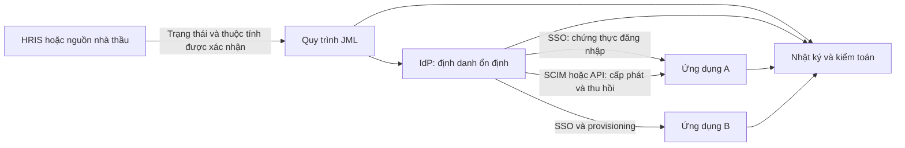

# Đúng người: bảo đảm danh tính được xác minh và gắn với chủ thể hợp lệ trong IAM

Trong quản lý định danh và truy cập (Identity and Access Management – **IAM**), câu hỏi đầu tiên trước khi cấp bất kỳ quyền nào là: **“Hệ thống đang cấp quyền cho ai, và có đủ căn cứ để tin danh tính đó là đúng không?”** Đây là mục tiêu **đúng người**. Một hệ thống phân quyền chặt chẽ vẫn có thể bị xâm nhập nếu tài khoản được tạo nhầm, gán cho sai nhân sự, bị người khác chiếm quyền hoặc tiếp tục tồn tại sau khi chủ thể rời tổ chức.

Trong phạm vi **quản lý vòng đời danh tính (Identity Lifecycle)**, “đúng người” không phải một lần kiểm tra giấy tờ khi tuyển dụng. Đó là chuỗi kiểm soát từ **xác minh chủ thể → tạo định danh số → liên kết tài khoản → xác thực khi sử dụng → cập nhật khi thay đổi → vô hiệu hóa khi không còn hợp lệ**. Chuỗi này thường được tổ chức thành mô hình **Joiner–Mover–Leaver (JML)**, kết hợp hệ thống nguồn nhân sự, nhà cung cấp danh tính (IdP), đăng nhập một lần (SSO), cấp phát tài khoản qua SCIM, chính sách RBAC/ABAC và kiểm toán.

## 1. Học xong bài này, bạn cần hiểu gì?

- Giải thích được “đúng người” là gì, khác gì với “đúng quyền” và “đúng thời điểm”.
- Phân biệt **xác minh danh tính**, **định danh**, **xác thực** và **ủy quyền** trong một luồng truy cập.
- Thiết kế cách liên kết một chủ thể thực với một định danh số ổn định, kể cả khi email, họ tên hoặc vai trò thay đổi.
- Nhận ra các thời điểm phải kiểm tra lại tính hợp lệ của danh tính trong JML.
- Đánh giá rủi ro của tài khoản mồ côi, tài khoản dùng chung, tài khoản đặc quyền và định danh phi con người.
- Xác định chứng cứ kiểm toán và chỉ số để biết tổ chức có thực sự cấp quyền cho đúng chủ thể hay không.

## 2. “Đúng người” thực sự có nghĩa là gì?

Giả sử công ty có hệ thống quản lý tài chính. Một yêu cầu đăng nhập bằng tài khoản `lan.nguyen@example.org` thành công chưa chứng minh được người đang thao tác là Lan. Nó chỉ cho biết người hoặc thiết bị gửi yêu cầu đã vượt qua cơ chế xác thực của tài khoản đó. Để khẳng định **đúng người**, IAM phải nối được các mắt xích sau:

1. **Chủ thể tồn tại và có căn cứ hợp lệ**: Lan là nhân viên, nhà thầu hoặc đối tác đã được tổ chức xác nhận.
2. **Định danh số thuộc đúng chủ thể**: hồ sơ nội bộ của Lan được liên kết duy nhất với một định danh ổn định trong IdP.
3. **Tài khoản và phương thức xác thực được giao đúng người**: không gán nhầm tài khoản, thiết bị MFA hoặc phương thức khôi phục cho người khác.
4. **Quan hệ vẫn còn hiệu lực**: Lan chưa nghỉ việc, hết hợp đồng hoặc bị đình chỉ cần khóa truy cập.
5. **Hành động có thể truy vết**: biết chủ thể nào, tài khoản nào, bằng phiên đăng nhập nào đã thực hiện hành động.

Ba mục tiêu IAM thường đi cùng nhau nhưng kiểm tra những câu hỏi khác nhau:

| Mục tiêu | Câu hỏi kiểm soát | Ví dụ lỗi |
| --- | --- | --- |
| **Đúng người** | Đây có phải chủ thể hợp lệ đang sở hữu danh tính số này không? | Tạo tài khoản cho nhầm nhân viên hoặc giữ tài khoản người đã nghỉ việc. |
| **Đúng quyền** | Chủ thể đó được làm những hành động nào trên tài nguyên nào? | Nhân viên hỗ trợ có quyền duyệt thanh toán. |
| **Đúng thời điểm** | Quyền và tài khoản còn hợp lệ ở thời điểm truy cập không? | Nhà thầu vẫn truy cập sau ngày kết thúc hợp đồng. |

Các mục tiêu liên quan mật thiết: kiểm soát **đúng người** cung cấp một `subject` đáng tin cậy để RBAC/ABAC áp dụng **đúng quyền**, còn dữ liệu trạng thái và thời hạn giúp duy trì **đúng thời điểm**. Việc đăng nhập thành công không thể tự thay thế những kiểm soát này.

## 3. Bốn khái niệm thường bị nhầm lẫn

| Khái niệm | Câu hỏi trả lời | Cơ chế điển hình |
| --- | --- | --- |
| **Identity proofing – xác minh chủ thể** | Người khai nhận danh tính có thực sự là chủ thể được tổ chức công nhận? | Đối chiếu quy trình tuyển dụng, xác nhận từ bên bảo trợ, kiểm tra tài liệu theo mức rủi ro. |
| **Identification – định danh** | Hệ thống gọi và phân biệt chủ thể đó bằng mã nào? | `personId`, `workforceId`, `subjectId` không tái sử dụng. |
| **Authentication – xác thực** | Người đang yêu cầu truy cập có kiểm soát phương thức xác thực gắn với tài khoản không? | Passkey, khóa bảo mật, MFA, xác thực liên kết qua IdP. |
| **Authorization – ủy quyền** | Định danh đã xác thực được phép làm gì? | Role trong RBAC, chính sách thuộc tính ABAC, phê duyệt đặc quyền. |

Ví dụ: một nhân sự đã được xác minh đúng nhưng làm mất thiết bị MFA. Việc một người khác đăng nhập được vào tài khoản của họ là **lỗi kiểm soát xác thực**. Ngược lại, một tài khoản được bảo vệ bằng MFA mạnh nhưng được khởi tạo từ hồ sơ tuyển dụng giả là **lỗi xác minh danh tính**. Hai lỗi này cần các biện pháp khác nhau.

> **Nguyên tắc thiết kế:** Đừng coi email, tên hiển thị hoặc việc có phiên SSO là bằng chứng đầy đủ về danh tính. Email có thể đổi, bí danh có thể trùng, tài khoản có thể được tái sử dụng và phiên đăng nhập có thể bị chiếm đoạt.

## 4. Nguồn dữ liệu đáng tin cậy và cách gắn một người với một tài khoản

Trong doanh nghiệp, hệ thống quản lý nhân sự (HRIS) thường là **nguồn có thẩm quyền** cho trạng thái nhân viên, bộ phận, người quản lý và ngày bắt đầu/kết thúc làm việc. Với đối tác, nguồn có thẩm quyền có thể là hệ thống quản lý nhà thầu, hồ sơ hợp đồng hoặc một người bảo trợ đã được ủy quyền. **IdP** là nơi quản lý định danh và xác thực kỹ thuật; IdP không tự chứng minh rằng thông tin gốc từ HRIS đã đúng.

Một bản ghi liên kết danh tính có thể được hình dung như sau:

```yaml
personId: P-10482              # Mã chủ thể ổn định, không tái sử dụng
relationshipType: EMPLOYEE
authoritativeSource: HRIS
sourceRecordId: HR-00871
employmentStatus: ACTIVE
idpSubjectId: 7d6b9c21-3a10-48f5-a8f1-f4a2c9e61234
primaryEmail: lan.nguyen@example.org # Thuộc tính có thể thay đổi
managerPersonId: P-10310
identityVerified: true
```

Đây là **mô hình minh họa**; tên trường và quy trình xác minh phụ thuộc hệ thống thực tế. Những ràng buộc cốt lõi gồm:

- **Mã chủ thể ổn định:** dùng khóa định danh riêng (`personId`, `subjectId`), tránh dùng email hoặc tên làm khóa chính. Không cấp lại mã cho người mới sau khi người cũ rời tổ chức.
- **Liên kết có kiểm soát:** bản ghi HRIS/đối tác phải được ánh xạ đến đúng chủ thể IdP. Phát hiện và xử lý trường hợp một người có nhiều hồ sơ hoặc nhiều người cùng trỏ đến một tài khoản.
- **Trạng thái có nguồn gốc:** biết hệ thống nào có thẩm quyền cập nhật `ACTIVE`, `SUSPENDED`, `TERMINATED`; tránh để nhiều ứng dụng tự ý xác lập trạng thái trái nhau.
- **Thuộc tính có thời hạn và người chịu trách nhiệm:** đơn vị, vị trí, hợp đồng, người bảo trợ và ngày hết hạn phải được cập nhật khi thay đổi.
- **Tối thiểu hóa dữ liệu:** chỉ chuyển cho ứng dụng thuộc tính thật sự cần dùng; thông tin xác minh nhạy cảm cần được bảo vệ và lưu theo chính sách, không đẩy bản sao giấy tờ vào mọi dịch vụ.

### Sơ đồ liên kết danh tính trong doanh nghiệp



**SSO** giúp ứng dụng tin vào quá trình đăng nhập tại IdP; **SCIM** (hoặc API provisioning tương đương) giúp tạo, đồng bộ thuộc tính, khóa tài khoản ở ứng dụng đích. Chúng bổ trợ cho nhau. Cấu hình SSO không bảo đảm tài khoản cục bộ đã bị xóa, phiên cũ đã hết hiệu lực hay API key riêng của ứng dụng đã được thu hồi.

## 5. Giữ đúng chủ thể trong ba giai đoạn Joiner–Mover–Leaver

### 5.1. Joiner: người mới gia nhập

Một quy trình Joiner an toàn bắt đầu từ **sự kiện được xác nhận**: nhân sự mới đã hoàn thành bước xác minh theo quy định hoặc nhà thầu được phê duyệt bởi bên bảo trợ. Từ đó IAM mới tạo định danh và cấp phát tài khoản.

Luồng tham khảo:

1. HRIS hoặc nguồn có thẩm quyền phát sự kiện tạo quan hệ làm việc, kèm mã chủ thể, loại quan hệ và ngày bắt đầu.
2. Quy trình xác nhận danh tính kiểm tra trạng thái phê duyệt, phát hiện hồ sơ trùng và xác nhận đơn vị/người quản lý.
3. IAM tạo hoặc liên kết `subjectId` bất biến tại IdP, có trạng thái rõ ràng trước ngày bắt đầu.
4. Người dùng nhận hướng dẫn kích hoạt qua **kênh đã được xác minh**; đăng ký passkey/MFA theo mức rủi ro. Kênh khôi phục cũng phải được kiểm chứng.
5. Hệ thống cấp tài khoản ứng dụng và role khởi điểm theo chính sách, ghi nhận nguồn cấp, người phê duyệt nếu cần và dấu thời gian.
6. Kiểm tra tài khoản đích, thông tin chủ sở hữu và kết quả kích hoạt; xử lý lỗi đồng bộ trước khi cho sử dụng chức năng nhạy cảm.

**Tình huống:** một ứng viên có email cá nhân giống với hồ sơ đã từng làm việc. Nếu hệ thống chỉ so khớp email, nó có thể liên kết nhầm vào định danh cũ. Nên dùng quy trình xác minh, mã hồ sơ được thẩm định và kiểm tra trùng trước khi nối hoặc tái kích hoạt một tài khoản. Chỉ tái kích hoạt khi quan hệ với **cùng chủ thể** đã được xác nhận; lịch sử quyền cũ vẫn cần đánh giá lại.

### 5.2. Mover: chuyển vai trò, bộ phận hoặc đơn vị quản lý

Một người đổi chức danh có thể vẫn đăng nhập bằng tài khoản và MFA cũ. Vì thế, xét riêng mục tiêu **đúng người**, không nhất thiết phải tạo danh tính mới; cần **giữ nguyên liên kết chủ thể** nhưng cập nhật quan hệ và thuộc tính có thẩm quyền.

| Thay đổi | Việc cần thực hiện để duy trì đúng người |
| --- | --- |
| Đổi email hoặc họ tên | Cập nhật thuộc tính hiển thị; giữ `subjectId` ổn định, kiểm tra alias và tài khoản liên kết. |
| Chuyển phòng ban | Nhận sự kiện từ HRIS, cập nhật đơn vị/người quản lý, kiểm tra lại quyền cũ theo role mới. |
| Chuyển từ nhà thầu sang nhân viên | Xác minh quan hệ mới, xác định có phải cùng chủ thể, đối chiếu tài khoản cũ trước khi liên kết. |
| Tạm nghỉ, đình chỉ hoặc thay đổi hợp đồng | Đánh giá chính sách vô hiệu hóa tạm thời, thời hạn và điều kiện khôi phục. |

Sai sót phổ biến là ứng dụng đích vẫn lưu email cũ như một khóa liên kết, rồi tạo **tài khoản thứ hai** khi email thay đổi. Tài khoản cũ trở thành tài khoản mồ côi và có thể giữ quyền truy cập tồn dư. Do đó, hệ thống nên ưu tiên liên kết bằng mã chủ thể/tài khoản bất biến, đồng bộ thay đổi theo giao thức được hỗ trợ và đối soát kết quả ở ứng dụng đích.

### 5.3. Leaver: quan hệ chấm dứt

Khi một nhân viên nghỉ việc hoặc hợp đồng nhà thầu hết hạn, bằng chứng “đúng người” của mối quan hệ truy cập **không còn hiệu lực**. Quy trình Leaver phải xét đủ đường truy cập, kể cả những đường không phụ thuộc trực tiếp vào lần đăng nhập SSO mới.

1. Nguồn có thẩm quyền cung cấp sự kiện chấm dứt, thời điểm hiệu lực và trường hợp cần khóa khẩn cấp.
2. IdP vô hiệu hóa quyền đăng nhập theo chính sách; thu hồi hoặc chặn phiên, refresh token và phương thức xác thực khi nền tảng hỗ trợ.
3. SCIM/API deprovisioning cập nhật trạng thái tài khoản ở từng ứng dụng; nếu ứng dụng không hỗ trợ thì có quy trình thủ công với người chịu trách nhiệm và hạn hoàn tất.
4. Thu hồi quyền đặc quyền, token ứng dụng, API key cá nhân, quyền VPN, tài khoản cục bộ và các liên kết federated khác.
5. Chuyển giao tài sản, dữ liệu và ownership hợp lệ theo chính sách lưu giữ; không để tài khoản cũ tiếp tục hoạt động để “giữ dữ liệu”.
6. Đối soát kết quả, lưu bằng chứng và phát cảnh báo với hệ thống chưa xác nhận thu hồi.

**Lưu ý kỹ thuật:** đặt `active: false` qua SCIM có thể khóa tài khoản tại ứng dụng đích nhưng không đồng nghĩa mọi phiên cũ bị hủy ngay. Việc thu hồi phiên, token hoặc khóa API phụ thuộc khả năng riêng của ứng dụng. Cần có danh mục các kênh truy cập và kiểm tra trạng thái thực tế sau khi gửi lệnh.

## 6. Các kiểm soát làm nên mục tiêu “đúng người”

### 6.1. Xác minh danh tính theo rủi ro

Không phải mọi tài khoản đều đòi hỏi cùng một cách xác minh. Người dùng hệ thống công cộng, nhân sự nội bộ, quản trị viên sản xuất và đối tác truy cập dữ liệu nhạy cảm có các mức rủi ro khác nhau. Chính sách cần chỉ rõ **ai xác minh**, **dựa trên bằng chứng nào**, **khi nào phải xác minh lại**, và **cơ chế xử lý ngoại lệ**.

Ví dụ, khi nhân viên yêu cầu thay đổi thiết bị MFA vì mất điện thoại, quy trình hỗ trợ phải xác minh lại chủ thể qua kênh độc lập đã được thiết lập. Nếu chỉ kiểm tra thông tin dễ đoán hoặc chấp nhận email gửi từ tài khoản vừa bị xâm nhập, kẻ tấn công có thể chiếm danh tính số dù bước đăng ký ban đầu đã đúng.

### 6.2. Xác thực mạnh và ràng buộc phiên đăng nhập

IdP có thể áp dụng MFA, passkey, khóa bảo mật và chính sách truy cập có điều kiện dựa trên rủi ro. Ứng dụng cần xác thực token đúng issuer/audience, hiệu lực, chữ ký và định danh chủ thể (`sub` hoặc claim ổn định tương đương) trước khi tạo phiên ứng dụng. Trong môi trường nhiều tenant, cần ràng buộc thêm tenant và quan hệ của chủ thể với tenant mục tiêu.

Một ví dụ **minh họa logic**, không phải mã thư viện cụ thể:

```text
onIncomingRequest(token, targetTenant):
    claims = verifySignatureIssuerAudienceExpiry(token)
    subject = identityDirectory.lookup(claims.issuer, claims.subject)

    if subject == null or subject.status != ACTIVE:
        deny("Unknown or inactive identity")

    if not subject.isMemberOf(targetTenant):
        deny("Identity not bound to target tenant")

    enforceAuthenticationAssuranceAndSessionPolicy(claims)
    return authorize(subject.id, targetTenant, requestedAction)
```

Điểm quan trọng là **ứng dụng xác định đúng chủ thể trước khi xét quyền**. `claims.subject` cần được hiểu trong phạm vi issuer phù hợp; một chuỗi `sub` trùng nhau từ hai IdP khác nhau không mặc nhiên chỉ cùng người. Không dùng một địa chỉ email người dùng tự khai trong request để thay thế định danh đã được xác thực.

### 6.3. Cấp phát và đồng bộ tài khoản nhất quán

SCIM cung cấp mô hình phổ biến để quản lý người dùng/nhóm trong các ứng dụng SaaS. Khi liên kết được thiết lập, quy trình có thể tạo tài khoản, cập nhật thuộc tính và vô hiệu hóa tài khoản bằng một kênh có kiểm soát. Tuy nhiên, cần thiết kế thêm:

- **Idempotency:** cùng sự kiện HRIS gửi lại không được tạo thêm tài khoản khác.
- **Xử lý thứ tự sự kiện:** sự kiện chuyển bộ phận cũ đến muộn không được ghi đè trạng thái nghỉ việc mới hơn.
- **Đối soát:** định kỳ so nguồn có thẩm quyền, IdP và từng ứng dụng để phát hiện lệch trạng thái.
- **Phản hồi lỗi:** ghi nhận yêu cầu thành công/thất bại, retry có giới hạn và chuyển ca xử lý khi không thể đồng bộ.

Ví dụ, bản cập nhật SCIM `active: false` là tín hiệu quản lý trạng thái; **chỉ sau khi ứng dụng đích xác nhận và kiểm tra hậu điều kiện** mới có cơ sở xem một bước thu hồi là hoàn tất.

### 6.4. RBAC và ABAC không thể sửa lỗi sai danh tính

**RBAC** ánh xạ role như `EMPLOYEE`, `FINANCE_REVIEWER` đến tập quyền; **ABAC** xét thêm thuộc tính như bộ phận, tenant, loại quan hệ và trạng thái hợp đồng. Cả hai chỉ đáng tin khi thuộc tính và bản ghi danh tính có nguồn gốc rõ ràng, cập nhật đúng thời điểm.

Chẳng hạn, chính sách `department == 'Finance'` không có ý nghĩa nếu trường `department` được lấy từ profile do người dùng tự sửa. Giá trị đó phải được đồng bộ từ nguồn được ủy quyền. Khi chuyển bộ phận, RBAC/ABAC phải đánh giá lại các quyền phát sinh trước đó để giảm truy cập tồn dư.

## 7. Những nhóm danh tính dễ bị bỏ sót

| Nhóm | Rủi ro liên quan “đúng người” | Kiểm soát khuyến nghị |
| --- | --- | --- |
| **Nhà thầu, đối tác** | Không có hồ sơ HRIS, hợp đồng hết hạn nhưng tài khoản còn sống. | Nguồn quản lý riêng, người bảo trợ, ngày hết hạn bắt buộc, rà soát định kỳ. |
| **Tài khoản quản trị đặc quyền** | Khó nối hành động quản trị tới chủ thể và phê duyệt. | Liên kết tài khoản admin với danh tính cá nhân, MFA mạnh, cấp quyền có thời hạn và audit. |
| **Tài khoản dùng chung** | Không thể xác định chính xác ai thực hiện thao tác. | Ưu tiên tài khoản cá nhân; nếu ngoại lệ bắt buộc, dùng kho bí mật và cơ chế ghi nhận người mượn/phiên sử dụng. |
| **Tài khoản khẩn cấp (break-glass)** | Dùng vượt tình huống khẩn cấp, không có chủ thể chịu trách nhiệm. | Giới hạn người giữ quyền, cơ chế truy cập khẩn cấp được kiểm soát, cảnh báo và hậu kiểm. |
| **Tài khoản dịch vụ, workload identity** | Không thuộc con người cụ thể; secret còn hoạt động sau khi đội phụ trách thay đổi. | Định danh cho từng workload, owner và hệ thống chịu trách nhiệm, secret/credential ngắn hạn khi phù hợp, vòng đời rõ ràng. |

Với **định danh phi con người** (non-human identity), câu hỏi tương đương không phải “người thật nào đang đăng nhập?” mà là **“workload hoặc dịch vụ nào được phép hoạt động, do ai sở hữu và còn cần thiết không?”** Ví dụ, job đồng bộ hóa chạy bằng service account cần được gắn với ứng dụng, môi trường triển khai và owner đang làm việc. Khi hệ thống ngừng hoạt động hoặc đổi owner, IAM phải rà soát hoặc thu hồi định danh đó.

## 8. Ví dụ xuyên suốt: một nhân sự chuyển bộ phận rồi nghỉ việc

Giả sử Minh vào công ty làm kỹ sư hỗ trợ, chuyển sang đội vận hành và sau đó nghỉ việc. Các hệ thống gồm HRIS, IdP, cổng VPN, Git và một ứng dụng SaaS quản lý công việc.

| Sự kiện | Bằng chứng nhận biết đúng chủ thể | Hành động IAM | Điểm cần kiểm tra |
| --- | --- | --- | --- |
| **Ngày 1 – Joiner** | HRIS xác nhận hồ sơ `P-2107`, ngày bắt đầu và người quản lý. | Tạo `subjectId` tại IdP; đăng ký MFA; provision VPN, Git, SaaS theo chính sách. | Không trùng hồ sơ, tài khoản đích được liên kết về `P-2107`. |
| **Tháng 4 – Mover** | HRIS đổi bộ phận và người quản lý của cùng `P-2107`. | Giữ định danh IdP; cập nhật nhóm/quyền; rà soát quyền cũ. | Không sinh tài khoản trùng; role hỗ trợ cũ đã được gỡ. |
| **Tháng 10 – Leaver** | HRIS xác nhận thời điểm chấm dứt quan hệ. | Vô hiệu hóa IdP; ngắt phiên khi hỗ trợ; deprovision các ứng dụng; thu hồi token/khóa liên quan. | Không thể mở phiên mới; mọi ứng dụng xác nhận vô hiệu hóa; tài khoản/khóa tồn dư được xử lý. |

Một lỗi đáng chú ý: SaaS đã bị khóa qua SCIM, nhưng Minh vẫn có một **personal access token** được phát hành trực tiếp tại Git. Chỉ nhìn trạng thái tài khoản IdP có thể dẫn đến kết luận sai rằng offboarding đã hoàn tất. Kiểm soát “đúng người” đòi hỏi đối soát từng đường truy cập và có người chịu trách nhiệm khắc phục phần tồn dư.

### Sự kiện và điều kiện xử lý mẫu

```json
{
  "eventId": "hr-event-7921",
  "eventType": "WORK_RELATIONSHIP_TERMINATED",
  "personId": "P-2107",
  "source": "HRIS",
  "effectiveAt": "2026-10-31T17:00:00Z",
  "sourceVersion": 24
}
```

Một bộ điều phối JML nên kiểm tra **nguồn phát sự kiện có thẩm quyền**, trạng thái mới có hợp lệ với trạng thái hiện tại không, `sourceVersion` có mới hơn dữ liệu đã xử lý không, và `eventId` đã được áp dụng chưa. Sau khi thực thi, nó ghi trạng thái từng hệ thống đích (`SUCCEEDED`, `FAILED`, `PENDING_MANUAL`) cùng bằng chứng. Các trường trên chỉ minh họa contract sự kiện, không phải chuẩn bắt buộc của HRIS hay SCIM.

## 9. Làm sao kiểm chứng hệ thống đang bảo đảm “đúng người”?

Không thể đo chất lượng chỉ bằng tỷ lệ đăng nhập SSO thành công. Một chương trình IAM trưởng thành cần có kiểm tra thường xuyên giữa nguồn dữ liệu, IdP và hệ thống đích.

### 9.1. Câu hỏi khi kiểm toán

1. Với một tài khoản bất kỳ, có truy ngược được **chủ thể duy nhất**, nguồn hồ sơ, loại quan hệ và owner không?
2. Có bao nhiêu định danh IdP **không có bản ghi nguồn hợp lệ**, hoặc trỏ về hồ sơ đã ngừng hoạt động?
3. Tài khoản có thể được tạo **ngoài luồng provisioning chuẩn** không? Nếu có, ai phê duyệt và khi nào sẽ đối soát?
4. Khi đổi email, vai trò hoặc hợp đồng, hệ thống có sinh bản ghi trùng và giữ quyền cũ không?
5. Khi offboarding, có bằng chứng từ **từng ứng dụng đích**, bao gồm phiên, token cá nhân và tài khoản cục bộ, không?
6. Những ngoại lệ như tài khoản dùng chung, break-glass, service account có owner, mục đích, hạn sử dụng và lịch rà soát không?

### 9.2. Chỉ số vận hành hữu ích

| Chỉ số | Cách hiểu | Mục đích |
| --- | --- | --- |
| **Tỷ lệ tài khoản có owner hợp lệ** | Tài khoản liên kết được với chủ thể hoặc owner đang hiệu lực / tổng tài khoản trong phạm vi. | Phát hiện tài khoản không rõ nguồn gốc. |
| **Số định danh trùng/mồ côi** | Tài khoản bị trùng chủ thể hoặc không còn nguồn xác thực hợp lệ. | Đánh giá chất lượng identity correlation. |
| **Thời gian khóa sau Leaver** | Khoảng từ thời điểm bắt buộc thu hồi đến thời điểm xác nhận khóa theo từng hệ thống. | Phát hiện cửa sổ truy cập tồn dư. |
| **Tỷ lệ deprovision hoàn tất** | Số hệ thống đích xác nhận thu hồi / số hệ thống cần thu hồi cho sự kiện. | Đo độ bao phủ và độ tin cậy của offboarding. |
| **Tỷ lệ tài khoản đặc quyền/phi con người được rà soát** | Số tài khoản được owner xác nhận trong kỳ / số tài khoản thuộc phạm vi rà soát. | Kiểm soát danh tính ngoài luồng nhân viên thông thường. |

Đặt mục tiêu phù hợp với mức rủi ro và khả năng hệ thống; không tự áp một con số chung cho mọi tổ chức. Quan trọng là định nghĩa **mốc bắt đầu, mốc xác nhận, phạm vi hệ thống và cách xử lý dữ liệu thiếu** để số đo không che giấu các trường hợp thất bại.

### 9.3. Nhật ký cần ghi những gì?

Với sự kiện tạo, liên kết, thay đổi và thu hồi danh tính, nên lưu tối thiểu: `eventId`/correlation ID, subject ID, nguồn có thẩm quyền, người hoặc dịch vụ khởi phát, loại thao tác, thời điểm, ứng dụng đích, kết quả, lý do và mã yêu cầu/phê duyệt nếu cần. Không lưu token, mật khẩu, bí mật hoặc giấy tờ nhạy cảm trực tiếp trong log. Chính sách lưu giữ và truy cập log phải cân bằng yêu cầu kiểm toán với bảo vệ dữ liệu cá nhân.

## 10. Những lỗi thiết kế phổ biến và cách khắc phục

| Sai lầm | Hệ quả | Cách cải thiện |
| --- | --- | --- |
| Dùng email làm ID duy nhất | Đổi email hoặc tái sử dụng địa chỉ dẫn đến gán nhầm tài khoản. | Dùng subject ID bất biến, ánh xạ có kiểm chứng tới email. |
| Cấp tài khoản khi chưa có xác minh từ nguồn tin cậy | Tài khoản hợp lệ về kỹ thuật nhưng chủ thể không hợp lệ. | Đặt điều kiện proofing/phê duyệt trước provisioning. |
| Coi đăng nhập SSO thành công là đủ | Bỏ sót sai liên kết tài khoản, trạng thái nghỉ việc và phiên/token cũ. | Kết hợp kiểm tra trạng thái và đối soát lifecycle ở ứng dụng đích. |
| Không xử lý Mover | Quyền cũ tồn dư hoặc tài khoản bị tạo trùng. | Đồng bộ thuộc tính, rà soát quyền và xác minh liên kết sau mỗi sự kiện. |
| Chỉ disable trong IdP khi Leaver | Tài khoản local, phiên SaaS hoặc API key còn dùng được. | Có danh mục hệ thống, quy trình thu hồi đa kênh, hậu kiểm. |
| Không có owner cho service account | Không biết ai phải thu hồi khi workload ngừng chạy. | Gắn owner, purpose, thời hạn và quy trình đổi chủ sở hữu. |

## 11. Bài tập tự kiểm tra

**Tình huống A.** Một người đã nghỉ việc vẫn truy cập được ứng dụng nội bộ bằng một phiên cũ, dù IdP đánh dấu tài khoản `DISABLED`. Có thể kết luận quy trình Leaver đã đạt mục tiêu “đúng người” chưa?

**Gợi ý:** Chưa. Trạng thái IdP chỉ xác minh một phần. Cần kiểm tra phiên, token, tài khoản tại ứng dụng đích, cơ chế logout/revocation và bằng chứng thu hồi thực tế.

**Tình huống B.** Một nhà thầu gia hạn hợp đồng, đồng thời đổi email công việc. Hệ thống provisioning tạo tài khoản mới theo email, giữ nguyên tài khoản cũ. Nguyên nhân gốc nào đáng điều tra?

**Gợi ý:** Cơ chế đối sánh danh tính có thể dùng thuộc tính thay đổi được làm khóa; thiếu ánh xạ subject ID ổn định, cập nhật quan hệ và đối soát tài khoản trùng.

**Tình huống C.** Một dịch vụ tự động dùng API key có quyền đọc dữ liệu sản xuất. Owner ban đầu đã chuyển đội. Ai được xem là “đúng chủ thể” trong trường hợp này?

**Gợi ý:** Chính workload/service identity là chủ thể kỹ thuật; tổ chức còn phải xác định được owner chịu trách nhiệm, mục đích sử dụng, phạm vi và trạng thái hoạt động. Khi đổi owner phải chuyển giao và rà soát credential/quyền.

## 12. Ghi nhớ

**Đúng người là tính liên tục của một liên kết danh tính đáng tin cậy.** IAM phải biết chủ thể thực hay workload nào đứng sau mỗi tài khoản, nguồn nào xác nhận quan hệ đó, phương thức xác thực có gắn đúng chủ thể không, và quan hệ còn hiệu lực vào thời điểm sử dụng không.

Trong vòng đời Joiner–Mover–Leaver, **Joiner** thiết lập liên kết đúng, **Mover** giữ liên kết đúng khi thuộc tính và vai trò thay đổi, còn **Leaver** chấm dứt mọi đường truy cập khi quan hệ không còn hợp lệ. IdP, SSO, SCIM, RBAC/ABAC, kiểm toán và đối soát giúp thực thi mục tiêu này; mỗi công cụ chỉ giải quyết một phần và cần được phối hợp theo cùng một nguồn danh tính có thẩm quyền.
