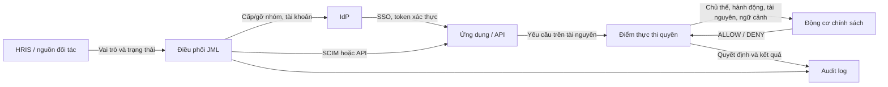
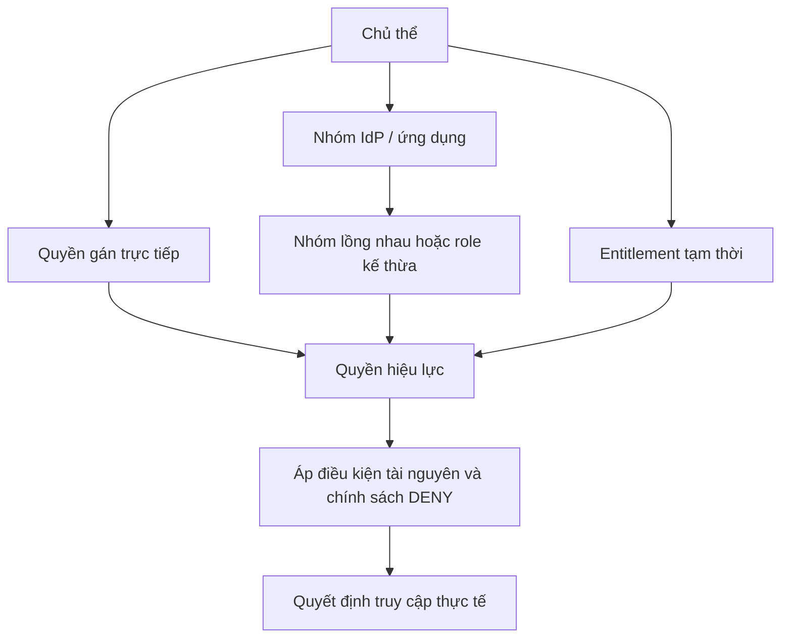
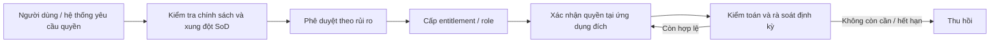

# Đúng quyền trong IAM: cấp đúng phạm vi, duy trì quyền tối thiểu và thu hồi kịp thời

Trong quản lý định danh và truy cập (Identity and Access Management – **IAM**), mục tiêu **“đúng quyền”** là bảo đảm mỗi chủ thể chỉ được thực hiện **những hành động thực sự cần thiết, trên những tài nguyên được phép, trong điều kiện được phê duyệt**. Chủ thể có thể là nhân viên, nhà thầu, đối tác hoặc một dịch vụ tự động. Danh tính đã xác minh và đăng nhập thành công chưa có nghĩa là chủ thể được phép đọc mọi hồ sơ hay thực hiện mọi thao tác.

Mục tiêu này đặc biệt quan trọng trong **quản lý vòng đời danh tính (Identity Lifecycle)** theo mô hình **Joiner–Mover–Leaver (JML)**. Quyền truy cập được cấp khi gia nhập, điều chỉnh khi thay đổi vai trò và thu hồi khi rời tổ chức. Nếu chỉ cấp thêm quyền khi chuyển bộ phận mà không gỡ quyền cũ, hệ thống sẽ tích lũy **quyền truy cập tồn dư** (*privilege creep*), tạo điều kiện cho lạm dụng hoặc khai thác tài khoản bị chiếm đoạt.

## 1. Kết quả học tập

Sau bài này, người học có thể:

- Phân biệt mục tiêu **đúng người**, **đúng quyền**, **đúng thời điểm** và hiểu mối liên hệ giữa chúng.
- Phân biệt **xác thực** (*authentication*) với **ủy quyền** (*authorization*), cũng như quyền, vai trò và gói quyền (*entitlement*).
- Mô hình hóa quyết định cấp quyền theo chủ thể, hành động, tài nguyên và ngữ cảnh.
- So sánh **RBAC**, **ABAC** và cách kết hợp chúng để thực hiện nguyên tắc **đặc quyền tối thiểu** (*least privilege*).
- Áp dụng các bước cấp, thay đổi, rà soát và thu hồi quyền trong vòng đời JML.
- Nhận biết rủi ro quyền chồng chéo, tài khoản đặc quyền, tài khoản dịch vụ và các lỗ hổng kiểm tra quyền ở cấp tài nguyên.
- Đề xuất bằng chứng kiểm toán, chỉ số vận hành và biện pháp khắc phục quyền truy cập tồn dư.

## 2. Đúng quyền là gì?

Hãy xét hệ thống xử lý hóa đơn. Một nhân viên kế toán cần xem hóa đơn của phòng ban mình, trong khi trưởng phòng được duyệt một số hóa đơn dưới hạn mức. Cả hai có thể đăng nhập qua cùng một IdP, nhưng quyền thực tế khác nhau.

| Câu hỏi IAM | Nội dung kiểm soát | Minh họa |
| --- | --- | --- |
| **Đúng người?** | Chủ thể truy cập có phải danh tính hợp lệ? | Tài khoản gắn với đúng nhân viên, đã xác thực. |
| **Đúng quyền?** | Chủ thể được thực hiện hành động nào trên tài nguyên nào? | Nhân viên được xem hóa đơn; chỉ người có thẩm quyền mới được duyệt. |
| **Đúng thời điểm?** | Quyền có đang có hiệu lực không? | Quyền duyệt tạm thời hết hạn sau khi kết thúc đợt thay ca. |

**Đúng quyền** không có nghĩa là cấp quyền thật ít bằng mọi giá. Cấp **thiếu quyền** có thể cản trở công việc; cấp **thừa quyền** gây rủi ro. Mục tiêu là **đủ quyền để hoàn thành nhiệm vụ hợp lệ, không có đặc quyền ngoài phạm vi cần thiết**.

Một quyết định quyền thường có dạng:

> Chủ thể S có được thực hiện hành động A trên tài nguyên R trong ngữ cảnh C hay không?

Ví dụ: “Nhân viên Lan có được duyệt hóa đơn #INV-42 trị giá 80 triệu đồng của tenant A vào lúc này không?” Chính sách có thể yêu cầu đồng thời: Lan đang làm việc, thuộc tenant A, giữ vai trò duyệt hóa đơn, có hạn mức từ 80 triệu đồng trở lên và không phải người tạo chính hóa đơn đó.

### Phân biệt thuật ngữ

| Thuật ngữ | Ý nghĩa | Ví dụ |
| --- | --- | --- |
| **Permission** – quyền thao tác | Cho phép hành động cụ thể trên tài nguyên/phạm vi. | `invoice:read`, `invoice:approve`. |
| **Role** – vai trò | Tập quyền được đóng gói để gán cho nhóm nhiệm vụ. | `FINANCE_VIEWER`, `FINANCE_APPROVER`. |
| **Entitlement** – quyền lợi truy cập được cấp | Đơn vị quyền/nhóm/chức năng mà chủ thể được cấp trong một hệ thống. | Thành viên nhóm `erp.invoice.approvers`. |
| **Policy** – chính sách | Quy tắc đánh giá khi nào một yêu cầu được phép. | Chỉ duyệt hóa đơn cùng tenant và không vượt hạn mức. |
| **Scope** – phạm vi | Giới hạn đối tượng mà quyền áp dụng. | Chỉ hóa đơn phòng ban X hoặc môi trường staging. |
| **Privilege** – đặc quyền | Khả năng thao tác nhạy cảm, thường có tác động lớn. | Quản trị người dùng, thay đổi cấu hình bảo mật. |

Tên và ý nghĩa entitlement có thể khác nhau giữa IdP, hệ thống SaaS, cơ sở dữ liệu và ứng dụng nội bộ. Do đó, việc một người thuộc nhóm tên `Admin` chưa đủ để suy ra các quyền thực tế; cần kiểm tra **cách ứng dụng đích ánh xạ nhóm vào quyền**.

## 3. Quyền được quyết định ở đâu trong kiến trúc IAM?

IAM kết nối nhiều hệ thống, nhưng mỗi thành phần có trách nhiệm khác nhau:

- **Hệ thống nguồn nhân sự/đối tác (HRIS, contractor management):** cung cấp trạng thái nhân sự, bộ phận, quản lý, loại hợp đồng và các thuộc tính có thẩm quyền.
- **IdP – Identity Provider:** quản lý danh tính, xác thực, nhóm và có thể phát hành các claim/role phục vụ ủy quyền.
- **SSO:** giúp ứng dụng sử dụng kết quả xác thực từ IdP; không tự bảo đảm từng thao tác trên dữ liệu đều hợp lệ.
- **SCIM/provisioning:** đồng bộ tài khoản, thuộc tính và thành viên nhóm nếu ứng dụng hỗ trợ; không mặc nhiên thực thi toàn bộ chính sách quyền chi tiết.
- **Ứng dụng hoặc dịch vụ API:** kiểm tra quyền **tại điểm thao tác**, sử dụng tài nguyên thực tế, quy tắc nghiệp vụ và ngữ cảnh đáng tin cậy.
- **Hệ thống kiểm toán/IGA/PAM (nếu có):** quản lý quy trình yêu cầu, phê duyệt, rà soát, cấp quyền đặc quyền và truy vết.



Trong mô hình chính sách, **PEP** (*Policy Enforcement Point*) là nơi chặn hoặc cho phép thao tác; **PDP** (*Policy Decision Point*) là nơi đánh giá chính sách. Đây là cách phân chia trách nhiệm về mặt kiến trúc: chúng có thể cùng nằm trong một ứng dụng, không nhất thiết là hai dịch vụ độc lập.

**Quy tắc quan trọng:** kiểm tra quyền phải diễn ra ở backend hoặc tại một điểm thực thi đáng tin cậy. Ẩn nút “Duyệt” trên giao diện không ngăn người dùng gửi trực tiếp yêu cầu HTTP tới API duyệt.

## 4. Ba nguyên tắc cốt lõi để cấp đúng quyền

### 4.1. Least privilege – đặc quyền tối thiểu

Mỗi người hoặc workload chỉ có những quyền cần cho công việc cụ thể. Chẳng hạn, tác vụ xuất báo cáo cần quyền **đọc dữ liệu phục vụ báo cáo**, không cần quyền xóa toàn bộ bảng hoặc sửa chính sách cấp quyền.

Khi định nghĩa quyền, cần xét ít nhất:

1. **Hành động:** đọc, tạo, sửa, xóa, duyệt, xuất dữ liệu, quản trị.
2. **Tài nguyên:** hóa đơn, hồ sơ khách hàng, repository, namespace, bucket.
3. **Phạm vi:** dự án, tenant, phòng ban, môi trường, tập bản ghi.
4. **Thời hạn:** quyền thường xuyên hay theo yêu cầu có thời hạn.
5. **Điều kiện:** trạng thái nhân sự, phê duyệt, mức nhạy cảm, giới hạn số tiền, separation of duties.

Least privilege khác với “mọi người phải xin quyền từng phút”. Quyền nền thường xuyên có thể được xác định qua role chuẩn; quyền hiếm gặp hoặc nhạy cảm nên yêu cầu phê duyệt và hết hạn tự động.

### 4.2. Default deny – không có quyền rõ ràng thì từ chối

Khi chính sách không xác định được chủ thể, tài nguyên, hành động hoặc ngữ cảnh, lựa chọn an toàn là **không cho phép**. Ví dụ, yêu cầu đọc hóa đơn thiếu tenant hợp lệ không được tự động mở rộng sang tất cả tenant.

Đối với hệ thống kết hợp nhiều rule, phải định nghĩa rõ thứ tự ưu tiên và cách giải quyết xung đột (*deny overrides*, *permit overrides* hoặc mô hình khác). Không nên giả định mọi nền tảng IAM đều có cùng một quy tắc ưu tiên.

### 4.3. Separation of duties – phân tách nhiệm vụ

Một người không nên độc lập thực hiện toàn bộ chuỗi hành động dễ bị lạm dụng. Ví dụ: người tạo nhà cung cấp mới không đồng thời là người duy nhất phê duyệt thanh toán cho nhà cung cấp đó.

Có hai hình thức phổ biến:

- **Phân tách tĩnh:** không cho một chủ thể đồng thời giữ hai role xung đột, như `PAYMENT_CREATOR` và `PAYMENT_AUDITOR` trong phạm vi đã định.
- **Phân tách động:** một người có thể giữ các role liên quan nhưng không được phê duyệt **chính giao dịch do mình tạo**.

Phân tách nhiệm vụ cần được kiểm tra ở điểm quyết định, không chỉ trong màn hình phân công role.

## 5. RBAC: quản lý quyền dựa trên vai trò

**Role-Based Access Control (RBAC)** gắn các permission với role rồi gán role cho chủ thể. Thay vì cấp từng permission cho từng nhân viên, tổ chức cấp một hoặc một số role theo nhiệm vụ.

Ví dụ:

| Role | Quyền | Đối tượng điển hình |
| --- | --- | --- |
| `FINANCE_READER` | Xem danh sách và chi tiết hóa đơn hợp lệ. | Nhân viên hỗ trợ tài chính. |
| `FINANCE_EDITOR` | Xem, tạo và chỉnh sửa hóa đơn nháp. | Nhân viên nhập liệu. |
| `FINANCE_APPROVER` | Xem và gửi yêu cầu duyệt hóa đơn. | Người được phân công phê duyệt. |
| `IAM_ADMIN` | Quản trị danh tính và chính sách theo phạm vi. | Nhân sự vận hành IAM có thẩm quyền. |

Role `FINANCE_APPROVER` **không tự động cho phép duyệt mọi hóa đơn**. Ứng dụng vẫn phải kiểm tra tenant, hạn mức, chủ sở hữu và điều kiện phân tách nhiệm vụ.

#### Cách thiết kế RBAC có kiểm soát

- **Thiết kế theo trách nhiệm công việc:** tránh role kiểu “toàn quyền cho phòng ban”.
- **Hạn chế gán quyền trực tiếp vào từng cá nhân:** dùng role/nhóm có owner để dễ rà soát, nhưng vẫn ghi nhận ngoại lệ khi bắt buộc.
- **Mô tả rõ phạm vi role:** role `PROJECT_ADMIN` ở dự án A không tương đương quản trị viên toàn hệ thống.
- **Quản lý vòng đời role:** xác định ai có quyền phê duyệt, ai sở hữu role, khi nào cần rà soát và cách ngừng sử dụng.
- **Phát hiện role explosion:** không tạo role mới cho mọi tổ hợp bộ phận, vùng, dự án, sản phẩm nếu các điều kiện có thể được biểu diễn bằng thuộc tính.

Một lỗi thường gặp là gán role nhóm “quản trị” để nhanh chóng giải quyết yêu cầu thiếu quyền. Đây có thể là cách mở rộng đặc quyền vô tình và tồn tại lâu sau khi sự cố đã kết thúc.

## 6. ABAC: quản lý quyền dựa trên thuộc tính

**Attribute-Based Access Control (ABAC)** đánh giá các thuộc tính của chủ thể, tài nguyên, hành động và môi trường thay vì chỉ xem tên role.

| Loại thuộc tính | Ví dụ | Nguồn đáng tin |
| --- | --- | --- |
| Chủ thể | `department`, `employmentStatus`, `tenantId`, `clearanceLevel`. | HRIS, IdP hoặc kho thuộc tính có kiểm soát. |
| Tài nguyên | `ownerId`, `tenantId`, `classification`, `amount`. | Cơ sở dữ liệu nghiệp vụ đáng tin cậy. |
| Hành động | `read`, `edit`, `approve`, `delete`. | API/router và mô hình permission. |
| Môi trường | Thời gian, trạng thái phiên, yêu cầu xác thực tăng cường. | Hạ tầng xác thực/chính sách đã xác minh. |

Ví dụ chính sách đọc tài liệu mật:

```text
ALLOW khi:
    subject.status == ACTIVE
    AND subject.tenantId == document.tenantId
    AND subject.department == document.owningDepartment
    AND subject.clearanceLevel >= document.classificationLevel
    AND action == "read"
    AND session.authenticationAssurance đáp ứng mức yêu cầu

Ngược lại: DENY
```

Đây là mô tả chính sách, không phải mã thực thi chuẩn. Thứ tự mức phân loại phải được định nghĩa trong hệ thống; không được so sánh tùy tiện hai chuỗi ký tự như `CONFIDENTIAL` và `PUBLIC`.

**Ưu điểm của ABAC** là biểu diễn điều kiện chi tiết, giảm số lượng role. **Thách thức** là quản trị nguồn thuộc tính, tính mới của dữ liệu, độ phức tạp chính sách và khả năng giải thích vì sao một yêu cầu bị từ chối. Nếu thuộc tính `department` có thể do người dùng tự sửa, ABAC không còn đáng tin cậy.

### Kết hợp RBAC + ABAC

Trong thực tế, có thể dùng:

- **RBAC** để kiểm tra một người có năng lực nghiệp vụ cơ bản, như quyền duyệt hóa đơn.
- **ABAC** để giới hạn hóa đơn thuộc tenant nào, trị giá bao nhiêu, trạng thái ra sao.
- **Quan hệ nghiệp vụ** (*relationship-based checks*) khi cần xác định người đó có phải người quản lý dự án hoặc được chỉ định xử lý bản ghi hay không.

Sự kết hợp này cho phép cấp role quản lý tương đối ổn định, đồng thời bảo vệ tài nguyên ở mức chi tiết.

## 7. Kiểm tra quyền ở cấp API và từng tài nguyên

Một ứng dụng có thể phân quyền đúng cho API “xem hóa đơn”, nhưng vẫn để lộ dữ liệu nếu không kiểm tra hóa đơn **cụ thể** nào thuộc quyền truy cập của người dùng. Đây là dạng lỗi phổ biến liên quan đến **Broken Object Level Authorization (BOLA)** hoặc **Insecure Direct Object Reference (IDOR)**.

Ví dụ, người dùng tenant A gọi:

```http
GET /api/invoices/INV-TENANT-B-77
Authorization: Bearer <access-token>
```

Nếu backend chỉ kiểm tra token hợp lệ và role `FINANCE_READER`, người dùng có thể đọc hóa đơn tenant B. Việc ID khó đoán cũng không thay thế kiểm tra quyền.

Một luồng triển khai an toàn ở mức khái niệm:

```text
function approveInvoice(token, invoiceId):
    claims = verifyAccessToken(token)
    actor = loadTrustedSubject(claims.issuer, claims.subject)
    invoice = loadInvoiceById(invoiceId)

    if actor is absent OR actor.status != ACTIVE:
        DENY
    if invoice is absent:
        return NOT_FOUND

    if actor.tenantId != invoice.tenantId:
        DENY
    if "invoice:approve" not in effectivePermissions(actor):
        DENY
    if actor.approvalLimit < invoice.amount:
        DENY
    if invoice.createdBySubjectId == actor.id:
        DENY
    if invoice.status != PENDING_APPROVAL:
        DENY

    approveAtomically(invoice, actor.id)
    audit(actor.id, "invoice:approve", invoice.id, "SUCCEEDED")
```

**Các lưu ý để hiện thực hóa đúng:**

- `actor` được tải từ định danh đã xác thực và nguồn thuộc tính đáng tin; **không nhận role, tenant, hạn mức từ request body** nếu client có thể tự sửa.
- Xác minh token cần kiểm tra chữ ký, issuer, audience, thời hạn và các ràng buộc phù hợp với giao thức.
- Quyền ở cấp endpoint **và** ở cấp đối tượng đều phải được kiểm tra.
- Khi dữ liệu hoặc trạng thái có thể thay đổi đồng thời, xác thực điều kiện và cập nhật cần nhất quán trong transaction hoặc cơ chế tương đương để ngăn *time-of-check/time-of-use*.
- API cần áp dụng chính sách quyền tương ứng cho cả thao tác **liệt kê, xem, sửa, xuất hàng loạt**, không chỉ thao tác duyệt.
- Kết quả lỗi nên hạn chế rò rỉ sự tồn tại của tài nguyên bên ngoài phạm vi; chiến lược trả lỗi có thể phụ thuộc chính sách sản phẩm.
- Việc kiểm tra quyền tại server còn quan trọng khi client gửi một job chạy nền: worker thực thi job phải mang ngữ cảnh được cấp phép và được kiểm tra phù hợp.

## 8. Quyền thay đổi như thế nào trong Joiner–Mover–Leaver?

### 8.1. Joiner: cấp quyền ban đầu theo vai trò

Khi người mới gia nhập, mục tiêu là tạo một **tập quyền mặc định có căn cứ**. Quá trình thường gồm:

1. Nhận sự kiện gia nhập từ nguồn có thẩm quyền, đã xác minh danh tính.
2. Xác định nhóm đối tượng: nhân viên, nhà thầu, thực tập sinh, đối tác, workload.
3. Ánh xạ nhiệm vụ và thuộc tính vào role/entitlement cơ bản đã được phê duyệt.
4. Chỉ cấp quyền nhạy cảm sau khi có kiểm soát bổ sung: owner tài nguyên, người quản lý, đào tạo bắt buộc hoặc phê duyệt nghiệp vụ nếu quy định.
5. Đồng bộ tài khoản/nhóm tới ứng dụng qua SCIM hoặc API; xác nhận quyền thực tế tại hệ thống đích.
6. Ghi log nguồn yêu cầu, chính sách, người phê duyệt, thời điểm cấp và thời hạn của quyền.

Ví dụ, người mới thuộc đội hỗ trợ chỉ cần quyền đọc ticket được giao và phản hồi khách hàng. Quyền xuất toàn bộ dữ liệu khách hàng hoặc thay đổi hệ thống thanh toán nên là yêu cầu riêng với lý do cụ thể.

### 8.2. Mover: thay quyền khi đổi vai trò

**Mover là giai đoạn dễ xảy ra quyền tồn dư.** Ví dụ, Nam chuyển từ bộ phận hỗ trợ sang đội vận hành. Nếu IAM chỉ thêm role `OPERATIONS_OPERATOR` mà vẫn giữ `SUPPORT_EXPORT_ALL`, Nam có quyền kết hợp mà cả hai công việc riêng lẻ đều không cần.

Một quy trình Mover đầy đủ nên:

1. Nhận sự kiện vai trò, đơn vị, người quản lý hoặc loại hợp đồng thay đổi.
2. Xác định **quyền cần có sau thay đổi** theo role, thuộc tính và phê duyệt còn hiệu lực.
3. So sánh với **quyền hiệu lực hiện tại** trên IdP và các ứng dụng.
4. Thu hồi quyền không còn cần thiết; cập nhật nhóm, scope, credential và quyền trong ứng dụng.
5. Cấp quyền mới theo chính sách, xử lý ngoại lệ có thời hạn nếu bàn giao công việc.
6. Đối soát hậu điều kiện và lưu bằng chứng rằng quyền cũ đã được gỡ.

Có trường hợp cần **thời gian chuyển giao** hợp lệ. Khi đó, quyền cũ có thể được giữ tạm thời nếu có owner phê duyệt, giới hạn phạm vi và mốc tự hết hạn. Không nên xem ngoại lệ tạm là quyền thường xuyên.

### 8.3. Leaver: thu hồi toàn bộ quyền liên quan

Khi chấm dứt quan hệ, cần ngừng mọi quyền truy cập không còn hợp lệ; phạm vi bao gồm **role, group, entitlement, tài khoản ứng dụng, quyền cục bộ, phiên, token và khóa cá nhân**.

| Lớp truy cập | Hành động cần kiểm tra khi Leaver |
| --- | --- |
| IdP và SSO | Vô hiệu hóa đăng nhập, xử lý phiên và token theo tính năng hỗ trợ. |
| SaaS / ứng dụng nội bộ | Deprovision qua SCIM/API và xác nhận trạng thái tại ứng dụng đích. |
| Nhóm/role/ACL | Gỡ thành viên nhóm, quyền trực tiếp và quyền được thừa kế. |
| Đặc quyền | Thu hồi quyền quản trị, vai trò khẩn cấp hoặc quyền truy cập tạm. |
| Credential ngoài SSO | Thu hồi PAT, API key cá nhân, khóa SSH, thông tin xác thực cục bộ khi thuộc phạm vi. |
| Tài nguyên được sở hữu | Chuyển giao ownership, dữ liệu và trách nhiệm theo quy trình được phê duyệt. |

**Phân biệt rõ:** một tài khoản bị khóa trong IdP không chứng minh các quyền trong từng hệ thống đích đã mất hiệu lực. Ví dụ, một Personal Access Token đã được tạo độc lập có thể tiếp tục hoạt động cho đến khi bị thu hồi theo cơ chế ứng dụng.

## 9. Quyền thực tế có thể rộng hơn quyền ghi trong một danh sách

Khi tính **effective permissions** (tập quyền thực sự có hiệu lực), phải xem tất cả đường cấp quyền:



Đây là sơ đồ khái niệm: không phải mọi hệ thống đều hỗ trợ nhóm lồng nhau hoặc cùng cách xử lý DENY. Một số ứng dụng lưu role cục bộ độc lập với IdP; một số sử dụng claim trong access token và chưa cập nhật ngay khi nhóm bị gỡ. Cần hiểu **độ trễ đồng bộ, thời hạn token và cơ chế làm mới thông tin quyền** của từng hệ thống.

### Ví dụ về quyền cấp gián tiếp

Hương thuộc nhóm `team-product`. Nhóm này được gán role `project-editor`; role lại có quyền sửa cấu hình của project X. Nếu chỉ rà soát các quyền **gán trực tiếp** cho Hương, người kiểm toán có thể kết luận sai rằng Hương không có quyền sửa cấu hình.

Vì vậy, một quy trình rà soát quyền tốt cần thể hiện **đường dẫn dẫn tới quyền hiệu lực**: chủ thể → nhóm → role → permission → phạm vi tài nguyên. Mỗi mắt xích nên có owner và căn cứ phê duyệt.

## 10. Quyền đặc quyền, quyền tạm thời và tài khoản dịch vụ

### 10.1. Privileged Access Management và JIT

Tài khoản quản trị hạ tầng, cơ sở dữ liệu hoặc IAM thường có tác động lớn. Có thể kết hợp:

- **JIT (Just-in-Time):** chỉ cấp đặc quyền khi có yêu cầu hợp lệ, sau đó tự hết hạn.
- **JEA (Just Enough Access):** giới hạn quyền trong phiên làm việc theo tác vụ.
- **MFA/xác thực tăng cường:** xác minh thêm trước thao tác nhạy cảm.
- **Phê duyệt và ghi nhận:** lưu mục đích, người phê duyệt, tài nguyên, thời gian và kết quả.
- **Break-glass:** cơ chế khẩn cấp với giới hạn, cảnh báo và hậu kiểm, có quy trình thu hồi.

Không có một mô hình áp dụng cho mọi tổ chức. Quyền JIT chỉ an toàn khi thời điểm hết hạn được thực thi thật và khi hệ thống xử lý được phiên/credential đã phát hành.

### 10.2. Service account và workload identity

Dịch vụ tự động cũng cần **đúng quyền**. Một job sao lưu có thể cần quyền đọc nguồn và ghi vào kho sao lưu; nó không cần quyền quản trị IAM hoặc xóa mọi workload trong cluster.

Với mỗi danh tính phi con người, nên có:

- **Owner chịu trách nhiệm** và mục đích sử dụng được ghi nhận.
- **Phạm vi chính xác**: môi trường, workload, tài nguyên, permission.
- **Cơ chế xác thực phù hợp**: ưu tiên credential ngắn hạn hoặc federation/workload identity nếu hạ tầng hỗ trợ.
- **Tách biệt môi trường**: tránh dùng cùng credential có quyền sản xuất trong môi trường phát triển.
- **Quy trình thay đổi/thu hồi** khi dịch vụ ngừng hoạt động, thay owner hoặc phát hiện lộ bí mật.

Một anti-pattern là chia sẻ một API key có quyền quản trị giữa nhiều microservice. Khi key bị lộ, khó biết dịch vụ nào gây ra yêu cầu và khó thu hồi mà không làm gián đoạn toàn bộ hệ thống.

### 10.3. Service account không đồng nghĩa tài khoản người dùng

Với tài khoản người dùng, role thường xuất phát từ quan hệ nhân sự. Với service account, entitlement phải xuất phát từ **nhiệm vụ workload**, owner, hệ thống triển khai và chính sách vận hành. Không nên tự gán role nhân viên hoặc dùng tài khoản cá nhân để chạy job lâu dài.

## 11. Quy trình quản trị quyền từ yêu cầu đến kiểm toán

Một hệ thống IAM tốt cần có vòng kiểm soát khép kín:



Các mắt xích cần được thiết kế rõ:

**Yêu cầu quyền.** Nêu chủ thể, tài nguyên, hành động, lý do công việc, phạm vi, thời hạn và ticket/căn cứ.

**Phê duyệt.** Chọn người có thẩm quyền phù hợp với rủi ro: người quản lý, data owner, resource owner hoặc nhóm quản trị đặc quyền. Không coi việc gửi yêu cầu là đồng nghĩa đã được phê duyệt.

**Cấp quyền.** Áp dụng theo nhóm/role/policy, lưu quyết định; nếu ứng dụng đích không hỗ trợ tự động, cần có tác vụ thủ công được theo dõi.

**Xác nhận.** Đọc lại trạng thái tại ứng dụng đích hoặc kiểm tra hậu điều kiện. Một lệnh API trả về thành công không luôn chứng minh chính sách đã có hiệu lực tức thì.

**Rà soát.** Định kỳ hỏi resource owner có còn cần quyền không, chú ý quyền nhạy cảm, tài khoản không hoạt động, ngoại lệ và quyền chuyển vai trò.

**Thu hồi.** Thực thi quyết định hết hạn/hủy phê duyệt/Leaver và đối soát lại quyền hiệu lực.

### Ai nên chịu trách nhiệm?

| Vai trò quản trị | Trách nhiệm điển hình |
| --- | --- |
| **HR/nguồn có thẩm quyền** | Duy trì đúng trạng thái nhân sự, vị trí, đơn vị và quan hệ làm việc. |
| **Người quản lý** | Xác nhận nhu cầu công việc và thay đổi nhiệm vụ. |
| **Chủ sở hữu dữ liệu/tài nguyên** | Quyết định phạm vi truy cập phù hợp với độ nhạy cảm. |
| **Đội IAM** | Vận hành quy trình cấp/thu hồi, role catalog, đồng bộ, đối soát và bằng chứng. |
| **Đội ứng dụng** | Thực thi quyền ở backend, xác nhận trạng thái cục bộ và bảo vệ API. |
| **Kiểm toán/rủi ro** | Đánh giá hiệu quả kiểm soát, ngoại lệ và sai lệch chính sách. |

Ranh giới trách nhiệm thực tế phụ thuộc cơ cấu tổ chức; mục đích của bảng là tránh tình trạng **không ai chịu trách nhiệm về quyền còn tồn tại trong một hệ thống**.

## 12. Ví dụ xuyên suốt: chuyển vai trò và nguy cơ tích lũy quyền

Giả sử Bình đang là nhân viên hỗ trợ khách hàng ở tenant A. Sau sáu tháng, Bình chuyển sang bộ phận tài chính của cùng tenant. Hệ thống sử dụng HRIS, IdP, SCIM và hai ứng dụng: ticketing, finance.

### Trạng thái quyền qua các thời điểm

| Thời điểm | Quyền cần có | Quyền phải xử lý | Kết quả mong muốn |
| --- | --- | --- | --- |
| **Joiner** – hỗ trợ khách hàng | `ticket:read-assigned`, `ticket:reply`. | Không cấp quyền tài chính. | Chỉ thao tác trên ticket được giao. |
| **Mover** – sang tài chính | `invoice:read`, `invoice:create-draft` trong tenant A. | Gỡ nhóm hỗ trợ và quyền export ticket nếu không còn cần. | Có quyền làm việc mới, không giữ quyền cũ. |
| **Được giao duyệt tạm** | `invoice:approve` với hạn mức 50 triệu, hiệu lực bảy ngày. | Yêu cầu phê duyệt, kiểm tra SoD. | Không duyệt hóa đơn tự tạo; tự hết hạn sau bảy ngày. |
| **Leaver** | Không còn quyền làm việc. | Gỡ role, nhóm, token, quyền ứng dụng và tài khoản cục bộ liên quan. | Mọi hệ thống xác nhận thu hồi. |

Khi chuyển vai trò, IdP gỡ nhóm `support-agent`. Tuy nhiên, ứng dụng ticketing có role `supervisor` từng được cấp thủ công cho Bình trong một đợt hỗ trợ khẩn cấp. Role này không được đồng bộ qua SCIM nên vẫn tồn tại.

Nếu chỉ kiểm tra nhóm IdP, IAM sẽ bỏ sót quyền cục bộ đó. Đối soát quyền hiệu lực giữa IdP và ứng dụng phát hiện Bình vẫn có quyền xuất toàn bộ ticket. Owner phải quyết định thu hồi hoặc cấp ngoại lệ mới với thời hạn rõ ràng.

Ví dụ này cho thấy cần kiểm soát **mọi đường gán quyền**, đặc biệt các ngoại lệ phát sinh thủ công.

## 13. Các chỉ số và bằng chứng kiểm chứng “đúng quyền”

### 13.1. Những câu hỏi kiểm toán nên trả lời được

1. Với từng entitlement, **ai sở hữu** và loại công việc nào cần nó?
2. Có truy được một quyền đến yêu cầu, chính sách và người phê duyệt tương ứng không?
3. Quyền hiệu lực của chủ thể đã phản ánh **vai trò hiện tại** hay vẫn giữ role cũ từ giai đoạn Mover?
4. Có bao nhiêu quyền không dùng đến, quyền trực tiếp, quyền ngoài danh mục và ngoại lệ quá hạn?
5. Việc thu hồi đã được **ứng dụng đích xác nhận** chưa?
6. Hệ thống có kiểm tra role tại endpoint **và** quyền trên đúng đối tượng dữ liệu không?
7. Tài khoản quản trị, service account, quyền JIT và break-glass có owner, lý do và dấu thời gian không?

### 13.2. Một số chỉ số vận hành

| Chỉ số | Ý nghĩa | Cách dùng |
| --- | --- | --- |
| **Tỷ lệ quyền có owner/phê duyệt hợp lệ** | Phần entitlement truy vết được tới owner và căn cứ cấp. | Xác định quyền không có người chịu trách nhiệm. |
| **Tỷ lệ Mover được làm sạch quyền cũ** | Số sự kiện chuyển vai trò đã xác nhận gỡ quyền không còn cần / tổng sự kiện cần xử lý. | Đo nguy cơ privilege creep. |
| **Thời gian thu hồi quyền** | Từ mốc thu hồi bắt buộc đến lúc ứng dụng đích xác nhận hết quyền. | Theo dõi cửa sổ rủi ro. |
| **Số quyền ngoại lệ quá hạn** | Quyền đặc biệt đã qua ngày hết hiệu lực nhưng còn active. | Ưu tiên xử lý rủi ro. |
| **Tỷ lệ hoàn thành access review** | Quyền thuộc phạm vi rà soát được chủ sở hữu xác nhận và xử lý. | Đo chất lượng quản trị; không chỉ số lần bấm duyệt. |
| **Số vi phạm SoD** | Những tổ hợp role hoặc hành động xung đột chưa được xử lý. | Phát hiện rủi ro gian lận và lạm dụng. |

Chỉ số cần ghi rõ **mẫu số, nguồn dữ liệu, thời điểm chốt và định nghĩa “hoàn tất”**. Đặc biệt, “đã gửi lệnh gỡ quyền” khác với “ứng dụng đã xác nhận không còn quyền”.

### 13.3. Nhật ký cần lưu

Một quyết định cấp, sử dụng hoặc thu hồi quyền nên có đủ thông tin hỗ trợ điều tra:

- **Who:** subject ID ổn định và tác nhân thực hiện/thay mặt.
- **What:** entitlement/permission, hành động, tài nguyên và phạm vi.
- **Why:** chính sách, lý do nghiệp vụ, ticket/phê duyệt.
- **When:** thời điểm yêu cầu, hiệu lực, hết hạn, thu hồi.
- **Where:** ứng dụng đích, tenant, môi trường.
- **Outcome:** cho phép/từ chối, cấp thành công/thất bại, kết quả xác nhận.
- **Correlation:** request ID, event ID hoặc correlation ID liên kết các hệ thống.

Nhật ký nên dùng định danh và mã tham chiếu thay vì chứa password, access token hoặc bí mật đầy đủ. Quyền truy cập và thời gian lưu giữ log cần theo chính sách bảo vệ dữ liệu.

## 14. Các sai lầm thường gặp

| Sai lầm | Vì sao nguy hiểm | Cách khắc phục |
| --- | --- | --- |
| Chỉ kiểm tra đăng nhập SSO | Người dùng hợp lệ vẫn có thể truy cập dữ liệu ngoài phạm vi. | Kiểm tra ủy quyền tại API và trên từng tài nguyên. |
| Lấy role/tenant từ request body | Client có thể tự khai quyền cao hơn. | Tải thuộc tính từ nguồn server tin cậy. |
| Cấp `ADMIN` để xử lý nhanh thiếu quyền | Phát sinh đặc quyền ngoài nhiệm vụ. | Thiết kế role tối thiểu, JIT và xử lý ngoại lệ có thời hạn. |
| Mover chỉ thêm role mới | Tích lũy quyền cũ. | Tính lại quyền mục tiêu và gỡ quyền không còn hợp lệ. |
| Chỉ rà soát role trực tiếp | Bỏ sót quyền qua nhóm/role kế thừa. | Tính effective permissions và chuỗi cấp quyền. |
| Coi SCIM thành công là đủ | Role cục bộ, phiên và API key có thể chưa thu hồi. | Đối soát trạng thái từng hệ thống đích. |
| Không áp dụng SoD cho giao dịch cụ thể | Người tạo có thể tự duyệt giao dịch. | Kiểm tra xung đột theo nghiệp vụ ở thời điểm thao tác. |
| Chia sẻ credential quản trị giữa các dịch vụ | Quyền quá rộng, khó truy nguồn và thu hồi. | Mỗi workload có danh tính và quyền riêng. |
| Không có lịch access review | Quyền lâu ngày không còn cần vẫn hoạt động. | Tự động hóa chiến dịch rà soát và thực thi quyết định thu hồi. |

## 15. Bài tập tình huống

**Tình huống A – Có role nhưng sai tài nguyên.** Mai có role `FINANCE_READER` tại tenant A, nhưng thử gọi API lấy hóa đơn của tenant B và nhận dữ liệu. Kiểm soát nào bị thiếu?

**Gợi ý:** Backend đang thiếu kiểm tra ủy quyền theo đối tượng và tenant. Role chỉ trả lời loại thao tác; cần kiểm tra quan hệ của chủ thể với hóa đơn cụ thể, đồng thời bảo đảm list/export áp dụng cùng phạm vi.

**Tình huống B – Mover với quyền tồn dư.** Tuấn đổi từ kỹ sư hỗ trợ sang đội sản phẩm. IAM thêm nhóm mới, không gỡ quyền SSH vào máy hỗ trợ sản xuất do đã được cấp trực tiếp. Giải pháp nào bền vững?

**Gợi ý:** Tạo tính toán chênh lệch giữa quyền hiện tại và quyền mục tiêu từ vai trò mới; rà soát quyền gán trực tiếp, quyền nhóm và quyền ở ứng dụng; thu hồi quyền không còn cần, ghi nhận ngoại lệ có thời hạn nếu có nhu cầu bàn giao.

**Tình huống C – Quyền duyệt và phân tách nhiệm vụ.** Một trưởng nhóm có role `FINANCE_APPROVER` và hạn mức 100 triệu. Người này tạo hóa đơn 70 triệu rồi tự duyệt. Role và hạn mức đều hợp lệ. Có đạt “đúng quyền” không?

**Gợi ý:** Chưa. Hệ thống còn phải áp dụng quy tắc SoD động: người tạo giao dịch không được tự phê duyệt, dù có role và hạn mức.

**Tình huống D – Tài khoản dịch vụ.** Job tổng hợp báo cáo hằng đêm sử dụng credential có thể xóa mọi database. Khi rà soát, chủ hệ thống giải thích rằng job “chưa từng dùng quyền xóa”. Nên xử lý thế nào?

**Gợi ý:** Việc chưa sử dụng không làm quyền trở nên cần thiết. Phân tách service identity, giảm quyền xuống các thao tác đọc cần thiết và ghi kết quả vào nơi phù hợp; thay credential theo phương thức được hỗ trợ; kiểm thử job sau khi thu hẹp quyền.

## 16. Ghi nhớ

**Đúng quyền là quyết định ủy quyền có căn cứ, đúng phạm vi và được duy trì theo vòng đời công việc.** Trong mô hình JML, **Joiner** cấp tập quyền nền đã phê duyệt, **Mover** tính lại tập quyền mục tiêu và gỡ quyền cũ, còn **Leaver** thu hồi quyền qua mọi hệ thống và kiểm chứng kết quả.

**RBAC** trả lời chủ thể có vai trò nào; **ABAC** bổ sung điều kiện về thuộc tính và ngữ cảnh; **chính sách tại ứng dụng** bảo đảm thao tác đúng tài nguyên. IdP, SSO và SCIM giúp xác thực, liên kết và đồng bộ, nhưng **điểm thực thi quyền ở backend cùng quy trình đối soát, rà soát và kiểm toán** mới quyết định quyền truy cập có thực sự phù hợp hay không.

Nguyên tắc hữu ích để tự kiểm tra mọi thiết kế IAM là: **Ai được làm gì, trên tài nguyên nào, với điều kiện nào, vì lý do gì, trong bao lâu, và bằng chứng nào chứng minh quyền đã được cấp hoặc thu hồi đúng?**
