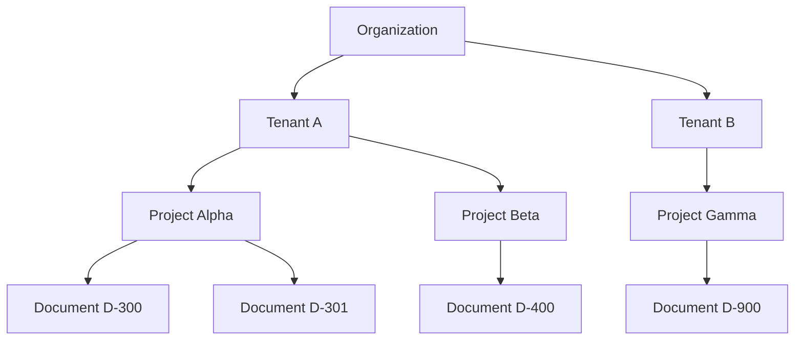
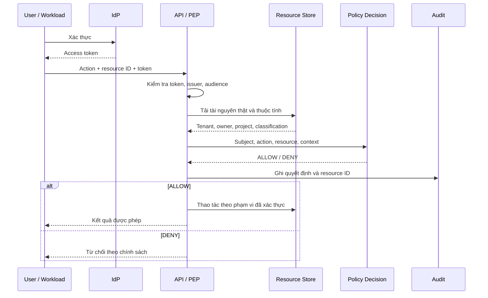

# Đúng tài nguyên trong IAM: kiểm soát phạm vi truy cập tới đúng đối tượng

Trong quản lý định danh và truy cập (**Identity and Access Management – IAM**), câu hỏi **“Đúng tài nguyên?”** yêu cầu hệ thống bảo đảm chủ thể chỉ truy cập **đúng những dữ liệu, dịch vụ, hệ thống hoặc đối tượng cụ thể** thuộc phạm vi được cho phép. Một nhân viên có quyền `invoice:read` vẫn có thể vi phạm bảo mật nếu đọc hóa đơn của khách hàng khác, phòng ban khác hoặc tenant khác. Quyền thao tác phù hợp là điều kiện cần; **tài nguyên đích và phạm vi của tài nguyên** cũng phải phù hợp.

Mục tiêu này gắn trực tiếp với quản lý vòng đời danh tính (**Identity Lifecycle**) theo mô hình **Joiner–Mover–Leaver (JML)**. Khi người dùng gia nhập, đổi vai trò hay rời tổ chức, phạm vi tài nguyên phải được cấp, điều chỉnh và thu hồi tương ứng. IdP, SSO, SCIM và RBAC/ABAC có thể tham gia quá trình đó, nhưng ứng dụng phải thực thi việc kiểm tra đối tượng thực tế tại thời điểm yêu cầu.

## 1. Sau bài học, bạn cần nắm được gì?

- Phân biệt **đúng người**, **đúng quyền**, **đúng tài nguyên** và **đúng thời điểm** trong một quyết định truy cập.
- Xác định một tài nguyên bằng định danh, loại đối tượng, owner, tenant, cấp phân loại và quan hệ với chủ thể.
- Hiểu vì sao có role hoặc token hợp lệ **không đồng nghĩa** có quyền với mọi đối tượng cùng loại.
- Thiết kế kiểm tra **object-level authorization**, giới hạn tenant, nhóm dự án, vùng dữ liệu và cấp phân loại.
- Kết hợp **RBAC**, **ABAC** và quan hệ sở hữu/thành viên khi xây dựng chính sách tài nguyên.
- Nhận diện lỗi IDOR/BOLA, lộ dữ liệu qua API danh sách, bộ nhớ đệm, đường dẫn tải tệp hoặc tác vụ nền.
- Áp dụng kiểm soát tài nguyên trong JML, quyền truy cập tạm thời, service account và quy trình kiểm toán.

## 2. “Đúng tài nguyên” khác “đúng quyền” như thế nào?

Giả sử Lan là nhân viên chăm sóc khách hàng của **tenant A**. Lan đã được xác thực qua SSO và giữ quyền `ticket:read`. Trong hệ thống có hai phiếu:

- `TICKET-A-107`: thuộc tenant A, được giao cho Lan.
- `TICKET-B-402`: thuộc tenant B, được giao cho một nhân viên khác.

Với yêu cầu đọc `TICKET-A-107`, cả chủ thể, quyền thao tác và phạm vi tài nguyên đều hợp lệ. Với yêu cầu đọc `TICKET-B-402`, **quyền `ticket:read` vẫn tồn tại**, nhưng tài nguyên đích nằm ngoài phạm vi được phép; hệ thống phải từ chối.

| Mục tiêu IAM | Câu hỏi phải trả lời | Ví dụ |
| --- | --- | --- |
| **Đúng người** | Danh tính đã được xác minh và đang hoạt động có đúng chủ thể không? | Phiên thuộc đúng tài khoản Lan. |
| **Đúng quyền** | Chủ thể có được phép thực hiện loại thao tác này không? | Lan được phép đọc ticket. |
| **Đúng tài nguyên** | Ticket **nào**, thuộc tenant/dự án/owner nào, được phép truy cập? | Lan chỉ xem ticket được giao thuộc tenant A. |
| **Đúng thời điểm** | Quan hệ và quyền còn hiệu lực lúc yêu cầu xảy ra không? | Việc giao ticket chưa bị hủy hoặc hết hạn. |

Một quyết định ủy quyền đầy đủ có thể được mô tả bằng:

```text
Decision = Policy(
    Subject,   // Ai đang yêu cầu?
    Action,    // Muốn làm gì?
    Resource,  // Đối tượng cụ thể là gì?
    Context    // Điều kiện tại thời điểm nào?
)
```

**Không nên đánh đồng hai câu hỏi:** “Có permission `document:read` không?” và “Có được đọc **document #D-300** này không?”. Câu đầu chỉ kiểm tra năng lực thao tác; câu sau kiểm tra phạm vi, chủ sở hữu, quan hệ và tình trạng của tài nguyên thực.

## 3. Tài nguyên trong IAM là gì?

**Resource** là mọi đối tượng mà một chủ thể có thể truy cập hoặc tác động. IAM thường quản lý tài nguyên ở nhiều cấp:

| Cấp tài nguyên | Ví dụ | Biên giới cần kiểm tra |
| --- | --- | --- |
| **Tổ chức/tenant** | Công ty A, khách hàng B trên nền tảng SaaS | Tenant của chủ thể có khớp tenant của dữ liệu? |
| **Tài khoản cloud / subscription** | Tài khoản sản xuất của một đơn vị | Vai trò có phạm vi tới tài khoản đó hay toàn tổ chức? |
| **Dự án/nhóm công việc** | Project Alpha, repository X | Chủ thể có là thành viên đúng dự án không? |
| **Dịch vụ/API** | Dịch vụ thanh toán, cổng quản trị | Token có đúng audience và chính sách của API không? |
| **Bản ghi nghiệp vụ** | Hóa đơn #42, hợp đồng #75, ticket #107 | Chủ thể có quyền trên **bản ghi cụ thể** không? |
| **Tệp/đối tượng lưu trữ** | File hồ sơ, bucket hoặc object | Chủ thể có quyền đúng file và đúng mức chia sẻ không? |
| **Hàng, cột hoặc trường dữ liệu** | Lương nhân sự, trường số CCCD | Chính sách có giới hạn trường/dòng nhạy cảm không? |
| **Bí mật và tài nguyên máy** | Secret, khóa, database, queue, VM | Workload có cần và được cấp đúng phạm vi không? |

Tài nguyên không chỉ là một đường URL hoặc một ID gửi từ trình duyệt. Định danh tài nguyên phải được **phân giải thành bản ghi đáng tin cậy**, từ đó lấy thuộc tính và quan hệ dùng cho quyết định quyền.

### 3.1. Thuộc tính cần quản trị cho tài nguyên

Một mô hình tài nguyên minh họa:

```yaml
resourceId: DOC-300
resourceType: CONTRACT
tenantId: TENANT-A
projectId: PROJECT-ALPHA
ownerSubjectId: P-1042
classification: CONFIDENTIAL
status: ACTIVE
sharingMode: RESTRICTED
version: 17
```

Một số lưu ý:

- `resourceId` cần xác định đúng đối tượng trong phạm vi định danh đã thiết kế; có hệ thống yêu cầu cặp `tenantId + resourceId` để bảo đảm duy nhất.
- `tenantId`, `ownerSubjectId` và `classification` phải đến từ nguồn dữ liệu tài nguyên tin cậy, không lấy nguyên giá trị do client tự khai.
- `projectId`, `ownerSubjectId` và mức phân loại **có thể thay đổi** khi tài nguyên được chuyển giao; không nên coi chúng là giá trị vĩnh viễn.
- `status` và `version` hỗ trợ kiểm tra tính hợp lệ tại thời điểm thao tác, đặc biệt với cập nhật đồng thời.
- Khi tài nguyên bị sao chép, di chuyển hoặc hợp nhất, quy tắc **kế thừa hay không kế thừa quyền** phải được định nghĩa rõ ràng.

Mẫu YAML trên là ví dụ mô hình dữ liệu, không phải schema bắt buộc của SCIM hay một sản phẩm IAM cụ thể.

## 4. Mô hình hóa phạm vi tài nguyên

Một quyền hợp lệ thường có cấu trúc **hành động + phạm vi**. Ví dụ:

```text
subject:       P-1042
action:        invoice:read
scope:
  tenantId:    TENANT-A
  projectIds:  [PROJECT-ALPHA, PROJECT-BETA]
  relation:    MEMBER
  maxClass:    INTERNAL
validUntil:    2026-12-31T23:59:59Z
```

Đây là mô tả khái niệm: permission `invoice:read` không tự biết danh sách project. Hệ thống ra quyết định phải áp dụng thêm chính sách scope.

### 4.1. Những dạng scope phổ biến

1. **Theo tenant:** chỉ dữ liệu thuộc một khách hàng hoặc tổ chức.
2. **Theo project/namespace:** chỉ tài nguyên của dự án hoặc vùng triển khai.
3. **Theo chủ sở hữu:** người tạo hoặc owner có thể thao tác trong phạm vi quy định.
4. **Theo quan hệ:** người được giao xử lý, reviewer, thành viên nhóm dự án, người quản lý của owner.
5. **Theo cấp phân loại:** giới hạn tài nguyên `PUBLIC`, `INTERNAL`, `CONFIDENTIAL` theo chính sách.
6. **Theo môi trường:** workload phát triển chỉ dùng tài nguyên dev/test; quyền sản xuất phải được cấp riêng.
7. **Theo trường dữ liệu:** đọc hồ sơ cơ bản nhưng không nhìn thấy thông tin định danh nhạy cảm.
8. **Theo thời hạn:** quyền chia sẻ hoặc truy cập ngoại lệ có mốc kết thúc.

Trong hệ thống lớn, scope thường được **kết hợp**. Một chính sách có thể yêu cầu đồng thời: cùng tenant, cùng project, đã được giao xử lý và có mức cho phép phù hợp với cấp phân loại.

### 4.2. Scope theo cây tài nguyên và kế thừa

Tài nguyên thường có quan hệ cha–con:



Một số nền tảng cho phép quyền được **kế thừa** từ organization xuống project hoặc từ project xuống tài nguyên con. Tuy nhiên, kế thừa là **tính chất cụ thể của hệ thống chính sách**, không phải giả định chung. Hãy xác định:

- Role được gắn ở cấp nào?
- Quyền có tự áp dụng tới mọi tài nguyên con không?
- Có cơ chế **deny** hoặc ngoại lệ ở cấp con không?
- Khi chuyển tài nguyên sang project khác, quyền theo cha cũ còn tồn tại không?
- Việc xóa nhóm, role hoặc thay owner có được phản ánh ngay ở tài nguyên con không?

Ví dụ: một người là `PROJECT_VIEWER` của Project Alpha không nhất thiết được phép đọc mọi tài liệu `CONFIDENTIAL` trong project nếu chính sách còn yêu cầu quyền đọc theo cấp phân loại. Kiểm tra cả **phạm vi kế thừa và ràng buộc riêng của đối tượng**.

## 5. Kiến trúc kiểm tra “đúng tài nguyên”

Thông thường, ứng dụng là nơi biết rõ nhất tài nguyên nào đang được yêu cầu và ai sở hữu nó. IdP có thể phát hành token hợp lệ, nhưng IdP không nhất thiết biết hóa đơn nào đã được chuyển sang tenant khác một giây trước.



Các thành phần chính:

- **PEP – Policy Enforcement Point:** điểm chặn yêu cầu, thường là API/backend hoặc proxy có đủ thông tin để áp dụng chính sách.
- **PDP – Policy Decision Point:** nơi quyết định cho phép/từ chối dựa trên rule.
- **PIP – Policy Information Point:** nguồn cung cấp thuộc tính cho chủ thể và tài nguyên, như directory, database hoặc service nội bộ.
- **Audit:** ghi lại chủ thể, hành động, tài nguyên, lý do quyết định và kết quả.

PEP và PDP có thể cùng nằm trong một dịch vụ. Điều quan trọng là luồng gọi **không thể bỏ qua kiểm tra quyền**, kể cả qua endpoint nội bộ, job nền, ứng dụng di động hoặc API dành cho đối tác.

## 6. RBAC, ABAC và quan hệ với tài nguyên

### 6.1. RBAC – xác định năng lực thao tác

**Role-Based Access Control (RBAC)** gán các permission vào role, rồi role vào chủ thể. Ví dụ:

| Vai trò | Permission | Ý nghĩa |
| --- | --- | --- |
| `DOC_READER` | `document:read` | Có năng lực đọc tài liệu trong scope cho phép. |
| `DOC_EDITOR` | `document:read`, `document:write` | Có năng lực chỉnh sửa tài liệu hợp lệ. |
| `PROJECT_ADMIN` | `project:manage` | Quản lý dự án trong scope tương ứng. |

**Sai lầm thường gặp:** suy ra một người có `DOC_READER` thì được đọc **mọi tài liệu**. Role chỉ là một đầu vào của phép kiểm tra; còn cần xem resource ID, tenant, quan hệ hoặc phân loại.

### 6.2. ABAC – xét các thuộc tính của tài nguyên

**Attribute-Based Access Control (ABAC)** bổ sung điều kiện cụ thể:

```text
ALLOW read document WHEN
    subject.status == ACTIVE
    AND subject.hasRole("DOC_READER")
    AND subject.tenantId == document.tenantId
    AND document.projectId IN subject.assignedProjects
    AND document.classification <= subject.clearanceLevel
    AND document.status == ACTIVE
OTHERWISE DENY
```

Điều kiện `classification <= clearanceLevel` đòi hỏi tổ chức có một thứ tự mức phân loại được định nghĩa; không nên so sánh thứ tự ký tự của các nhãn văn bản.

### 6.3. Quan hệ – người này gắn với tài nguyên như thế nào?

Đôi khi quyền không phụ thuộc vào phòng ban mà phụ thuộc vào mối quan hệ với đối tượng: *người được giao xử lý ticket*, *người quản lý dự án*, *chủ sở hữu document*, *người được chia sẻ file*.

Ví dụ:

```text
canReadTicket(subject, ticket) =
    subject.active
    AND subject.tenantId == ticket.tenantId
    AND subject.hasPermission("ticket:read")
    AND (
        ticket.assigneeId == subject.id
        OR subject.id IN ticket.supportTeamMembers
    )
```

Đây là cách diễn đạt một kiểm tra theo quan hệ, thường gọi là kiểm soát truy cập dựa trên quan hệ (*ReBAC*). Hệ thống có thể triển khai bằng rule nội bộ hoặc công cụ chính sách phù hợp.

**Thiết kế tốt** thường kết hợp ba lớp: RBAC cho loại thao tác, ABAC cho thuộc tính tài nguyên và quan hệ cho sự liên kết cụ thể.

## 7. Ví dụ kỹ thuật: chặn truy cập sai tài liệu ở backend

Giả sử API:

```http
GET /api/documents/DOC-300
Authorization: Bearer <access_token>
```

Không an toàn nếu controller chỉ có logic “token hợp lệ + role `DOC_READER` → trả tài liệu”. Người dùng có thể thay `DOC-300` bằng ID tài liệu của người khác.

Một dạng xử lý **pseudocode Java**:

```java
DocumentDto readDocument(
        AccessToken token,
        String requestedDocumentId
) {
    VerifiedPrincipal principal = tokenVerifier.verify(
        token
    ); // issuer, signature, audience, expiry, etc.

    Document doc = repository.findById(requestedDocumentId)
        .orElseThrow(NotFoundException::new);

    AuthorizationContext context =
        contextService.buildTrustedContext(principal, doc);

    authorizationService.requireAllowed(
        context.subject(),
        Action.DOCUMENT_READ,
        doc,
        context
    );

    audit.record(
        principal.subjectId(),
        "DOCUMENT_READ",
        doc.getId(),
        "ALLOWED"
    );

    return mapper.toAuthorizedView(doc, context);
}
```

Đây là mã minh họa cách tổ chức kiểm tra, **không phải lớp Java hoàn chỉnh** hay API của một framework cụ thể. Trong triển khai thật phải kiểm soát lỗi, tính nhất quán, log cho cả yêu cầu bị từ chối và chính sách che giấu sự tồn tại của tài nguyên.

Một số yêu cầu thiết yếu:

1. **Phân giải ID từ nguồn đáng tin:** đọc tài nguyên thật từ database bằng ID được kiểm soát; không chấp nhận `tenantId` hay `ownerId` trong request body làm sự thật về tài nguyên.
2. **Kiểm tra cả chủ thể và đối tượng:** token được xác thực chính xác, sau đó subject có scope trên `doc` cụ thể.
3. **Chỉ trả dữ liệu sau khi ALLOW:** tránh gọi mapper hoặc tạo response chứa dữ liệu nhạy cảm trước khi kiểm tra quyền.
4. **Kiểm soát đường truy cập thay thế:** tải file, xem bản cũ, xuất ZIP, chia sẻ URL, preview và search phải chịu cùng ranh giới quyền.
5. **Không phụ thuộc nút giao diện:** ẩn nút tải xuống không chặn được cuộc gọi HTTP trực tiếp.
6. **Bảo vệ thuộc tính quyền:** phân loại, tenant và owner không được client tùy ý sửa nếu việc sửa làm mở rộng quyền.

### 7.1. Truy vấn có scope ngay từ database

Ngoài việc kiểm tra sau khi tải, ứng dụng có thể **ràng buộc truy vấn** bằng điều kiện tenant/project để giảm nguy cơ trả dữ liệu ngoài phạm vi.

Ví dụ SQL minh họa:

```sql
SELECT id, title, project_id, classification
FROM documents
WHERE id = :document_id
  AND tenant_id = :trusted_tenant_id
  AND status = 'ACTIVE';
```

Giá trị `trusted_tenant_id` phải được tạo từ ngữ cảnh xác thực và chính sách server, không tin ngay tham số `tenantId` do client truyền. Điều kiện tenant trong SQL là một lớp bảo vệ hữu ích nhưng **chưa đủ** nếu tài liệu còn có quy tắc project, owner, mức phân loại hoặc chia sẻ.

Trong hệ quản trị hỗ trợ **Row-Level Security (RLS)**, chính sách có thể được thực thi thêm tại database. Phải cấu hình đúng context bảo mật cho từng phiên/kết nối, đặc biệt khi dùng connection pool; không mặc nhiên xem RLS là giải pháp thay thế toàn bộ kiểm tra nghiệp vụ ở API.

## 8. Các lỗi bảo mật điển hình

### 8.1. IDOR và BOLA

- **IDOR (Insecure Direct Object Reference):** tham chiếu trực tiếp tới đối tượng (ví dụ ID trên URL) nhưng kiểm tra ủy quyền không phù hợp.
- **BOLA (Broken Object Level Authorization):** API cho phép truy cập hoặc thao tác một đối tượng cụ thể không thuộc phạm vi được cấp.

Cả hai thường xuất hiện khi đổi:

```http
GET /api/orders/1001
```

thành:

```http
GET /api/orders/1002
```

và server trả thông tin đơn hàng thứ hai chỉ vì người gọi đã đăng nhập.

**ID ngẫu nhiên, UUID hoặc không đoán được không phải cơ chế ủy quyền.** Người dùng vẫn có thể thu được ID qua log, đường link, thông báo, chia sẻ nhầm hoặc nguồn dữ liệu khác.

### 8.2. Thiếu giới hạn tenant

Trong kiến trúc multi-tenant, yêu cầu của tenant A không được đọc/sửa dữ liệu tenant B dù người gọi có role cùng tên. Các điểm cần chú ý:

- Điều kiện tenant ở query và khi ghi dữ liệu.
- Cache key chứa tenant/scope phù hợp.
- Batch API và chức năng tìm kiếm áp dụng tenant filter.
- Quan hệ cha–con được kiểm tra nhất quán (invoice → customer → tenant).
- Không dùng tenant ID do client tự khai mà thiếu xác minh quan hệ của chủ thể với tenant.

### 8.3. Lộ dữ liệu qua danh sách, tìm kiếm và xuất dữ liệu

Một API `GET /documents/{id}` có thể đã kiểm tra quyền, nhưng `GET /documents` hoặc `POST /documents/export` lại trả toàn bộ dữ liệu. Phải áp dụng cùng chính sách lên:

| Đường truy cập | Điểm dễ bỏ sót |
| --- | --- |
| Danh sách phân trang | Lọc quyền sau khi phân trang gây thiếu dữ liệu hoặc lộ metadata. |
| Search và autocomplete | Search index hoặc gợi ý hiển thị tài nguyên ngoài scope. |
| Export CSV/PDF | Job xuất dữ liệu dùng tài khoản đặc quyền bỏ qua quyền của người yêu cầu. |
| Thống kê/tổng hợp | Count hoặc biểu đồ tiết lộ sự tồn tại của dữ liệu hạn chế. |
| Download/preview | URL tải file trực tiếp không kiểm tra lại quyền hoặc sống quá lâu. |
| Webhook/notification | Nội dung gửi tới người nhận không còn có quyền tài nguyên. |

Nếu dùng URL ký sẵn để tải đối tượng, cần giới hạn **resource cụ thể, hành động, thời hạn và điều kiện phù hợp**. URL đã phát có thể tiếp tục hoạt động trong thời hạn ký, kể cả khi quyền gốc thay đổi; thiết kế cần chấp nhận/giảm thiểu rủi ro này theo độ nhạy cảm của dữ liệu.

### 8.4. Cache và quyền thay đổi

Ví dụ: một tài liệu được chia sẻ với Lan lúc 9 giờ; quyền bị thu hồi lúc 10 giờ, nhưng API tiếp tục trả dữ liệu từ cache “quyền được phép” cho đến 17 giờ.

Để tránh việc thu hồi không có hiệu lực:

- Xác định TTL phù hợp cho quyết định ủy quyền và nội dung cache.
- Gắn cache key với subject, tenant, resource và phiên bản chính sách/quan hệ khi cần.
- Invalidate cache khi đổi owner, hủy chia sẻ, đổi nhóm hoặc thu hồi entitlement.
- Với dữ liệu nhạy cảm, cân nhắc xác minh lại quyền tại thời điểm truy cập thay vì sử dụng kết quả ALLOW lâu dài.

### 8.5. Thay đổi đồng thời – TOCTOU

Một tác vụ kiểm tra “Lan còn được duyệt hóa đơn này” rồi chờ vài giây trước khi duyệt có thể sai nếu hóa đơn đã đổi tenant, trạng thái hoặc người duyệt trong lúc đó.

Biện pháp có thể gồm transaction, khóa phù hợp hoặc **optimistic concurrency** theo version. Quyết định ủy quyền phải dựa vào trạng thái tài nguyên **đủ mới và nhất quán với thao tác**. Hệ thống phân tán cần thiết kế lại kiểm tra khi thực hiện tác vụ bất đồng bộ.

## 9. Tài nguyên biến đổi trong Joiner–Mover–Leaver

Phạm vi tài nguyên gắn với quan hệ của chủ thể và trạng thái của **chính tài nguyên**. Điều này đòi hỏi quản lý vòng đời cả hai phía.

### 9.1. Joiner – cấp quyền theo nhu cầu và phạm vi

Người mới gia nhập cần quyền tới đúng môi trường và dự án. Quy trình tham khảo:

1. HRIS hoặc nguồn có thẩm quyền xác nhận nhân sự và vai trò.
2. Quản lý hoặc resource owner xác định dự án, nhóm dữ liệu và tài nguyên cần truy cập.
3. IAM gán role và scope theo chính sách, tránh cấp `ALL_PROJECTS` khi chỉ cần một dự án.
4. IdP và hệ thống đích đồng bộ nhóm/entitlement qua SCIM hoặc API được hỗ trợ.
5. Ứng dụng kiểm tra cả role và quyền trên tài nguyên cụ thể.
6. Có bằng chứng phê duyệt và readback quyền hiệu lực.

Ví dụ, người mới thuộc đội hỗ trợ khu vực miền Nam được truy cập ticket của đúng đội, không mặc nhiên xem được ticket của mọi chi nhánh.

### 9.2. Mover – đổi vai trò và đổi phạm vi tài nguyên

Khi chuyển bộ phận, dự án hoặc tenant, thay đổi cần phản ánh **tập tài nguyên được phép**:

- Thu hồi quyền trên dự án cũ nếu không còn nhu cầu công việc.
- Cấp quyền dự án mới với owner/phê duyệt tương ứng.
- Đánh giá quyền gán trực tiếp, nhóm lồng nhau, quyền chia sẻ tệp và entitlement cục bộ.
- Kiểm tra cả **cache**, API key, phiên, nhóm IdP và ứng dụng đích nếu thay đổi không có hiệu lực tức thì.
- Có thời hạn tự hết hiệu lực cho ngoại lệ bàn giao.

**Tình huống:** Huy chuyển từ dự án A sang B. IAM đã gỡ role `PROJECT_A_EDITOR`, nhưng một thư mục được chia sẻ trực tiếp tới tài khoản Huy vẫn mở quyền đọc dữ liệu dự án A. Chỉ rà soát role không đủ; cần đối soát tất cả đường cấp quyền tới tài nguyên.

### 9.3. Leaver – cắt quyền với toàn bộ tài nguyên

Khi người dùng nghỉ việc hoặc hợp đồng kết thúc, IAM phải vô hiệu hóa danh tính theo chính sách và thu hồi những quyền còn tồn tại ở các hệ thống đích. Cần chú ý:

- ACL và chia sẻ trực tiếp trên file, bucket, repository, dashboard.
- Quyền owner hoặc người phê duyệt đối với project/tài nguyên.
- Membership trong nhóm IdP và nhóm cục bộ tại SaaS.
- Service token hoặc Personal Access Token liên quan tới cá nhân.
- Phiên hiện hữu, liên kết download, tác vụ xuất dữ liệu và job nền đã tạo.
- Tài nguyên chưa chuyển giao người sở hữu khi nhân viên nghỉ việc.

**SCIM** hỗ trợ cấp phát/vô hiệu hóa tài khoản tại hệ thống tương thích; nó **không tự bảo đảm** mọi ACL, đường link chia sẻ hoặc token độc lập đã bị thu hồi. Cần cơ chế riêng để xác minh hậu điều kiện ở ứng dụng đích.

## 10. Vòng đời của tài nguyên cũng ảnh hưởng đến quyền

IAM không chỉ phản ứng khi **người dùng** đổi vai trò. Tài nguyên cũng thay đổi:

| Sự kiện tài nguyên | Nguy cơ | Kiểm soát |
| --- | --- | --- |
| Tài liệu đổi owner | Quyền cũ theo owner vẫn được giữ. | Tính lại quan hệ/ACL, ghi nhận chuyển giao. |
| Project chuyển đơn vị | Nhóm cũ vẫn có quyền kế thừa. | Rà soát kế thừa trước và sau khi chuyển. |
| File đổi cấp phân loại | Người dùng có clearance thấp vẫn đọc được. | Áp dụng chính sách mới, xử lý cache/link đã phát. |
| Tài nguyên được sao chép | Bản sao kế thừa nhầm chia sẻ công khai. | Định nghĩa rõ quyền mặc định của bản sao. |
| Kho dữ liệu ngừng hoạt động | Service account và secret vẫn tồn tại. | Gỡ quyền, xóa key theo chính sách và xác nhận. |
| Tài nguyên đổi tenant | Dữ liệu lộ qua tenant cũ hoặc mới. | Kiểm tra tính hợp lệ nghiệp vụ, di chuyển an toàn, chuyển ownership. |

Ví dụ, một hợp đồng được nâng từ `INTERNAL` lên `CONFIDENTIAL`. Hệ thống phải đánh giá lại các quyền đọc đang có; không được dựa hoàn toàn vào danh sách người được phép từ lúc tài liệu còn ít nhạy cảm.

### Quản trị danh mục tài nguyên

Để thực hiện “đúng tài nguyên”, tổ chức cần biết **có những tài nguyên nào** và ai chịu trách nhiệm. Danh mục nên lưu:

- Resource ID và loại tài nguyên.
- Tenant, môi trường, owner, project/nhóm liên quan.
- Độ nhạy cảm/phân loại và trạng thái hiệu lực.
- Nguồn của dữ liệu quan hệ/thuộc tính.
- Cơ chế cấp quyền: role, ACL, policy, share link, token.
- Cơ chế thu hồi, sự kiện vòng đời, độ trễ cập nhật và cách lấy bằng chứng.

Không cần lưu mọi bản ghi trong một công cụ IAM duy nhất, nhưng phải có khả năng **truy vết và đối soát** giữa hệ thống nguồn, IdP và từng ứng dụng.

## 11. Quyền tài nguyên dành cho service account và workload identity

Định danh phi con người (non-human identity) thường thao tác trên tài nguyên với tần suất lớn. Nếu cấp sai phạm vi, một credential bị lộ có thể gây ảnh hưởng diện rộng.

Ví dụ: workload `billing-exporter-prod` chỉ cần:

- Đọc bảng hóa đơn của tenant/tập khách hàng được xử lý.
- Ghi kết quả vào **bucket báo cáo** được chỉ định.
- Gửi sự kiện tới queue của pipeline báo cáo.

Workload này **không cần** quyền đọc toàn bộ secret, xóa database hoặc quản trị IAM.

| Câu hỏi | Cách xác minh |
| --- | --- |
| Workload nào đang gọi? | Danh tính workload được xác thực và ràng buộc với môi trường triển khai. |
| Tài nguyên nào được dùng? | Bucket, queue, database/schema hoặc object theo định danh cụ thể. |
| Scope có quá rộng không? | So quyền thực tế với những API và dữ liệu mà job cần. |
| Ai chịu trách nhiệm? | Owner ứng dụng, đội vận hành và quy trình chuyển giao. |
| Quyền tồn tại bao lâu? | Ưu tiên credential ngắn hạn hoặc cơ chế federation khi hỗ trợ. |
| Khi workload bị bỏ đi? | Thu hồi permission, credential và membership; xác nhận không còn đường truy cập. |

Một anti-pattern là dùng chung credential có đặc quyền cao cho development, staging và production. Nó khiến ranh giới tài nguyên giữa các môi trường bị phá vỡ và khó điều tra nguồn gốc truy cập.

## 12. Ví dụ xuyên suốt: truy cập tài liệu của nền tảng nhiều tenant

Giả sử công ty cung cấp ứng dụng quản lý hợp đồng cho nhiều khách hàng:

- **Tenant A** có Project Alpha và Project Beta.
- **Tenant B** có Project Gamma.
- Lan làm việc cho tenant A và được gán role `CONTRACT_READER` trong Project Alpha.
- Minh cũng thuộc tenant A nhưng quản lý Project Beta.
- Trang thuộc tenant B.

Tài liệu:

| Tài liệu | Tenant | Project | Mức phân loại | Trạng thái |
| --- | --- | --- | --- | --- |
| `DOC-A1` | A | Alpha | INTERNAL | ACTIVE |
| `DOC-A2` | A | Beta | INTERNAL | ACTIVE |
| `DOC-B1` | B | Gamma | INTERNAL | ACTIVE |
| `DOC-A3` | A | Alpha | CONFIDENTIAL | ACTIVE |
| `DOC-A4` | A | Alpha | INTERNAL | ARCHIVED |

Giả sử Lan chỉ có clearance tới `INTERNAL`, và chính sách chỉ cho truy cập tài liệu `ACTIVE` thuộc project được phân công.

| Yêu cầu của Lan | Kết quả | Lý do |
| --- | --- | --- |
| Đọc `DOC-A1` | **ALLOW** | Đúng tenant, project, classification, trạng thái và permission. |
| Đọc `DOC-A2` | **DENY** | Cùng tenant nhưng khác project được phân công. |
| Đọc `DOC-B1` | **DENY** | Khác tenant. |
| Đọc `DOC-A3` | **DENY** | Classification cao hơn clearance được cấp. |
| Đọc `DOC-A4` | **DENY** | Chính sách không cho đọc tài liệu archived. |
| Sửa `DOC-A1` | **DENY** | Role hiện tại chỉ có quyền đọc. |

Phần lớn các quyết định **DENY** không xuất phát từ lỗi đăng nhập. Lan là chủ thể hợp lệ; lỗi nằm ở **tài nguyên mục tiêu, điều kiện của đối tượng hoặc loại hành động**.

### 12.1. Khi Lan chuyển sang Project Beta

HRIS/nguồn phân công dự án cập nhật quan hệ Mover. IAM phải tính lại phạm vi:

- Gỡ quan hệ thành viên Project Alpha nếu không còn nhiệm vụ.
- Thêm quyền đọc Project Beta theo phê duyệt.
- Xác minh Lan không còn quyền truy cập `DOC-A1` thông qua ACL chia sẻ trực tiếp còn sót.
- Xác minh `DOC-A2` được phép truy cập nếu các điều kiện khác vẫn hợp lệ.

Đây là thay đổi **tập tài nguyên được phép**, ngay cả khi permission `contract:read` và danh tính SSO không hề đổi.

### 12.2. Khi Project Beta được chuyển giao

Nếu Project Beta thuộc quyền quản lý của đơn vị khác, tổ chức cần xác định các permission kế thừa, đường chia sẻ trực tiếp và link tải xuống có còn hợp lệ không. Việc di chuyển project không được tự động tạo quyền đọc tenant khác chỉ vì tên project hoặc owner trùng nhau.

## 13. Thiết kế kiểm thử cho “đúng tài nguyên”

Một bài kiểm tra quyền cần nhiều hơn tình huống “người có role truy cập thành công”. Ma trận tối thiểu nên bao gồm các trục:

| Biến kiểm thử | Ca hợp lệ | Ca phải từ chối |
| --- | --- | --- |
| Subject | Người có quan hệ được duyệt | Người khác tenant hoặc tài khoản đã vô hiệu hóa |
| Action | Đọc với `reader` | Sửa/xóa với `reader` |
| Resource ID | ID trong scope | ID của đối tượng ngoài scope |
| Tenant | Trùng tenant hợp lệ | Khác tenant |
| Project | Thuộc dự án được giao | Dự án khác trong cùng tenant |
| Classification | Không vượt clearance | Vượt cấp phân loại |
| Trạng thái | ACTIVE | ARCHIVED/RESTRICTED theo chính sách |
| Quan hệ | Assignee/owner hợp lệ | Đã bị hủy phân công |
| Thời gian | Quyền còn hiệu lực | Quyền hết hạn hoặc đã thu hồi |

Ngoài một API xem chi tiết, cần kiểm tra **list, search, export, download, update, delete, bulk actions** và webhook/job. Với từng điểm truy cập, nên xác minh cả dữ liệu trả về, metadata, số lượng kết quả và side effect.

### 13.1. Một số kịch bản dễ bỏ sót

**Kịch bản 1 – Truy vấn theo ID khác.** Đăng nhập bằng tài khoản tenant A rồi thử gọi API với resource ID hợp lệ của tenant B. Kết quả phải là từ chối theo chính sách, không trả thông tin nhạy cảm.

**Kịch bản 2 – Đổi phân loại.** Người từng đọc tài liệu trước khi nâng cấp phân loại không được tiếp tục đọc nếu clearance mới không đủ; kiểm tra cache, preview và link tải.

**Kịch bản 3 – Gỡ quyền giữa lúc chạy job.** Một tác vụ xuất dữ liệu lớn đã được tạo; trong lúc job chờ, chủ thể bị thu hồi quyền. Xác định rõ chính sách tại thời điểm **xếp hàng** và **thực thi**, đồng thời giới hạn kết quả và thời hạn sử dụng.

**Kịch bản 4 – Dữ liệu được sao chép.** Tài liệu từ dự án bí mật được sao chép sang thư mục chung; hệ thống phải áp dụng chính sách phân loại/chia sẻ mới đúng, không âm thầm mở rộng quyền.

**Kịch bản 5 – Tenant tự nhập trong request.** Client gửi `tenantId=B` dù token thuộc tenant A; backend phải từ chối hoặc kiểm tra một quan hệ liên-tenant hợp lệ, không tự tin vào tham số.

### 13.2. Kiểm thử định kỳ và hồi quy

- Test các ranh giới quyền bằng **một cặp tài khoản/tài nguyên có scope khác nhau**.
- Tạo fixture ổn định cho quan hệ owner, assignee, project, tenant và classification.
- Chạy lại test khi thay đổi chính sách, cách ánh xạ token claim, truy vấn database hoặc mô hình dữ liệu.
- Kiểm tra kịch bản revoke sau Mover và Leaver, kể cả khi token cũ chưa hết hạn.
- Đảm bảo log có đủ thông tin để giải thích **vì sao** quyết định là ALLOW hoặc DENY, nhưng không ghi dữ liệu nhạy cảm thừa.

## 14. Kiểm toán, đối soát và các chỉ số

Không thể kiểm chứng “đúng tài nguyên” chỉ bằng số lượt đăng nhập thành công. Hệ thống cần các bằng chứng về **quan hệ chủ thể–tài nguyên** và quyết định cho từng hành động.

Một bản ghi kiểm toán minh họa:

```json
{
  "eventId": "authz-20392",
  "subjectId": "P-1042",
  "action": "document:read",
  "resourceType": "CONTRACT",
  "resourceId": "DOC-A2",
  "resourceTenantId": "TENANT-A",
  "resourceProjectId": "PROJECT-BETA",
  "decision": "DENY",
  "policyReason": "PROJECT_OUT_OF_SCOPE",
  "requestId": "req-8b72",
  "occurredAt": "2026-11-23T05:10:00Z"
}
```

Đây chỉ là định dạng ví dụ. Không nên ghi toàn bộ token, nội dung tài liệu hoặc bí mật trong log. Với dữ liệu nhiều tenant, quyền xem log cũng phải bị giới hạn theo chính sách.

### 14.1. Chỉ số gợi ý

| Chỉ số | Cách đo và ý nghĩa |
| --- | --- |
| **Tỷ lệ tài nguyên có owner hợp lệ** | Số tài nguyên xác định được owner hiện hành / tổng tài nguyên thuộc phạm vi; phát hiện tài nguyên mồ côi. |
| **Tỷ lệ cấp quyền có scope rõ ràng** | Số entitlement mô tả được tenant/project/resource / tổng entitlement được rà soát; phát hiện quyền rộng mơ hồ. |
| **Số quyền tài nguyên tồn dư sau Mover** | Số ACL, share hoặc entitlement vẫn hiệu lực trên tài nguyên cũ sau chuyển vai trò; đo privilege creep. |
| **Thời gian thu hồi chia sẻ/ACL** | Từ mốc yêu cầu thu hồi đến khi ứng dụng đích xác nhận không còn quyền. |
| **Số vi phạm ranh giới tenant trong kiểm thử** | Số đường truy cập ngoài tenant vẫn trả dữ liệu hoặc gây thay đổi ngoài phạm vi. |
| **Tỷ lệ tài nguyên nhạy cảm được rà soát** | Số tài nguyên/nhóm chia sẻ nhạy cảm được owner phê duyệt trong kỳ / số phải rà soát. |
| **Số quyết định DENY bất thường** | Các mẫu yêu cầu ngoài scope có thể chỉ ra lỗi cấu hình, script hoặc hành vi dò ID cần điều tra. |

Định nghĩa mẫu số, thời điểm đo và nguồn dữ liệu phải nhất quán. Một lệnh thu hồi SCIM đã gửi không được tính là “thu hồi tài nguyên hoàn tất” nếu ACL ở ứng dụng đích vẫn còn hiệu lực.

### 14.2. Các câu hỏi cần trả lời khi rà soát

1. Có thể truy vết từ tài nguyên tới **owner, tenant, cấp phân loại và chính sách** không?
2. Có thể tìm tất cả chủ thể đang có quyền với một tài nguyên, kể cả qua nhóm và chia sẻ trực tiếp không?
3. Khi đổi owner/project/classification, quyền cũ có được tính lại và thu hồi không?
4. Có danh mục các tài nguyên/ứng dụng **không** đồng bộ quyền qua SCIM hay IdP không?
5. Có bằng chứng readback từ API hoặc hệ thống đích sau khi thu hồi không?
6. Có kiểm thử negative path cho API, export, job nền và file download không?

## 15. Anti-pattern và cách khắc phục

| Thiết kế lỗi | Hậu quả | Biện pháp |
| --- | --- | --- |
| Chỉ kiểm tra `isAuthenticated()` | Mọi tài khoản đăng nhập đều xem được tài nguyên. | Kiểm tra policy theo subject, action và resource. |
| Chỉ kiểm tra role `DOC_READER` | Người có role đọc được dữ liệu project/tenant khác. | Kết hợp role với scope và thuộc tính tài nguyên. |
| Lấy tenant/owner từ request body | Client có thể tự gán phạm vi cao hơn. | Đọc thuộc tính tài nguyên và quan hệ từ server. |
| Cho rằng UUID không thể đoán là đủ | Lộ dữ liệu qua ID lấy được từ nguồn khác. | Luôn kiểm tra quyền với object ID được yêu cầu. |
| Lọc quyền chỉ ở UI | API trực tiếp bỏ qua giới hạn. | Đặt PEP tại backend hoặc lớp thực thi tin cậy. |
| Lọc danh sách đúng nhưng export sai | Tệp xuất chứa dữ liệu không được phép. | Áp dụng cùng scope tới batch/export/async. |
| Dùng cache ALLOW quá lâu | Quyền cũ tiếp tục có hiệu lực. | TTL, invalidate, phiên bản chính sách, recheck khi cần. |
| Không rà soát sau khi chuyển dự án | ACL và share cũ tạo quyền tồn dư. | Đồng bộ Mover và quét mọi đường cấp quyền. |
| Service account có scope toàn tổ chức | Credential bị lộ ảnh hưởng diện rộng. | Quyền tối thiểu theo workload, môi trường và tài nguyên. |

## 16. Câu hỏi và bài tập vận dụng

**Bài 1.** An có role `CUSTOMER_SUPPORT` của tenant A và quyền `ticket:read`. API chấp nhận `ticketId` bất kỳ và trả dữ liệu nếu role hợp lệ. Lỗi chính là gì? Sửa ở đâu?

**Gợi ý:** Thiếu object-level authorization, có nguy cơ BOLA/IDOR. Backend phải tải ticket thật và kiểm tra tenant, assignee/nhóm xử lý và trạng thái trước khi trả dữ liệu.

**Bài 2.** Nhân viên Hà chuyển từ Project Alpha sang Project Beta. Vai trò đọc tài liệu giữ nguyên; quyền nhóm Alpha đã gỡ nhưng Hà vẫn đọc được một file Alpha qua link chia sẻ trực tiếp. Cần rà soát gì?

**Gợi ý:** Các ACL/share cấp trực tiếp, link tải có hiệu lực, cache và quyền ở ứng dụng đích. Mover phải đối soát tập tài nguyên còn được phép, không chỉ nhóm ở IdP.

**Bài 3.** Hệ thống tìm kiếm chỉ áp dụng giới hạn tenant ở màn hình kết quả, nhưng autocomplete hiển thị tên hợp đồng của tenant khác. Đây có phải vi phạm “đúng tài nguyên” không?

**Gợi ý:** Có. Metadata/tên tài liệu cũng có thể là dữ liệu hạn chế. Cần lọc scope trước hoặc tại điểm truy vấn search và cả autocomplete, count, export.

**Bài 4.** Một job báo cáo chỉ đọc bảng sản xuất nhưng được cấp quyền quản trị toàn database. Việc job chưa từng gọi thao tác quản trị có đủ để chấp nhận quyền đó không?

**Gợi ý:** Không. Phải giảm quyền của workload xuống các tài nguyên và hành động thực sự cần; tách credential và môi trường, có owner, kế hoạch thu hồi và xác nhận sau thay đổi.

**Bài 5.** Một hợp đồng được chuyển từ tenant A sang tenant B. Người dùng thuộc tenant A vẫn có cache permission ALLOW và link tải chưa hết hạn. Thiết kế lại kiểm soát thế nào?

**Gợi ý:** Xem sự kiện chuyển tenant là thay đổi bảo mật cần tính lại quyền, invalidate cache và xử lý link đã phát theo chính sách; kiểm tra điều kiện tenant dựa trên bản ghi đáng tin trước thao tác.

## 17. Kết luận

**Đúng tài nguyên** nghĩa là mỗi yêu cầu truy cập phải hướng tới **đối tượng cụ thể thuộc phạm vi được cho phép**, xét cả tenant, project, owner, quan hệ, cấp phân loại và trạng thái. Danh tính đúng và permission đúng chưa đủ nếu ứng dụng không kiểm tra đối tượng mà người dùng thực sự muốn xem hoặc thay đổi.

Trong IAM theo vòng đời JML, **Joiner** xác lập phạm vi tài nguyên theo công việc; **Mover** chuyển đổi phạm vi và thu hồi liên kết cũ; **Leaver** cắt những đường truy cập còn tồn tại. IdP/SSO hỗ trợ xác thực, SCIM hỗ trợ đồng bộ tài khoản và nhóm, RBAC/ABAC/quan hệ hỗ trợ diễn đạt chính sách. Kiểm soát chỉ hoàn chỉnh khi **backend thực thi quyết định trên tài nguyên thực**, quản lý thay đổi quyền và tài nguyên, rồi kiểm toán được kết quả.

Khi đánh giá một thiết kế, hãy đặt câu hỏi: **Ai đang truy cập, muốn làm gì, với đúng tài nguyên nào, qua quan hệ và phạm vi nào, ở trạng thái nào, và bằng chứng nào chứng minh quyết định truy cập là hợp lệ?**
