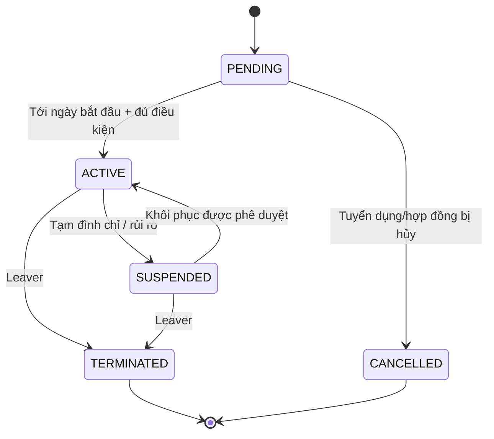
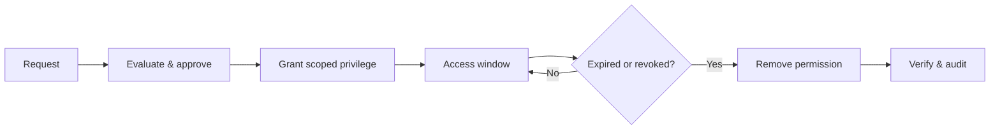
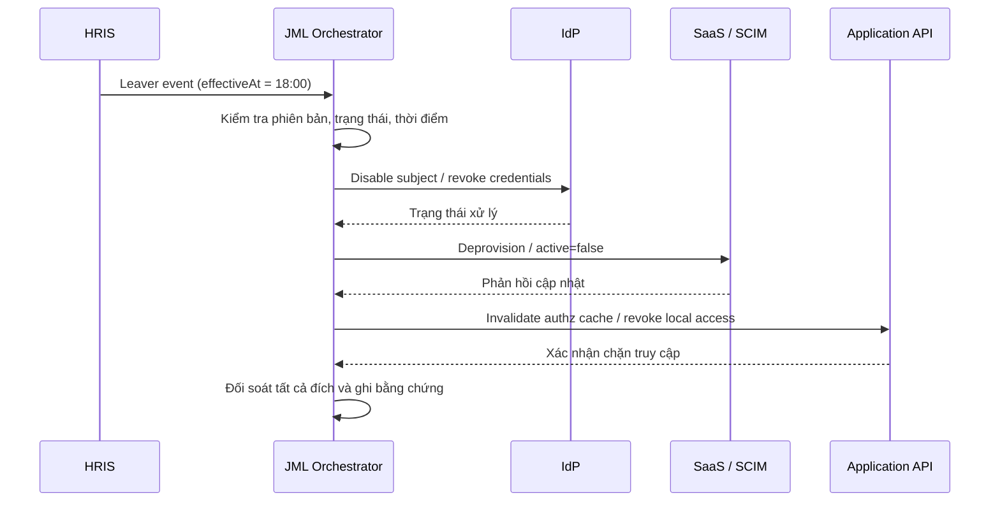

# Đúng thời điểm trong IAM: cấp và thu hồi truy cập khi còn hiệu lực

Trong quản lý định danh và truy cập (**Identity and Access Management – IAM**), mục tiêu **“đúng thời điểm”** là bảo đảm một chủ thể chỉ được sử dụng tài khoản và quyền truy cập **khi quan hệ, nhiệm vụ và điều kiện cấp quyền vẫn đang có hiệu lực**. Cùng một người, một hành động và một tài nguyên có thể được cho phép lúc 09:00 nhưng phải bị từ chối lúc 17:00 vì ca làm kết thúc, quyền hỗ trợ tạm thời hết hạn hoặc quan hệ lao động đã chấm dứt.

Mục tiêu này xuyên suốt **quản lý vòng đời danh tính (Identity Lifecycle)** theo mô hình **Joiner–Mover–Leaver (JML)**: kích hoạt vào đúng thời điểm gia nhập; cập nhật quyền khi chuyển vai trò; đình chỉ hoặc thu hồi khi hết hiệu lực. Các thành phần như hệ thống nguồn nhân sự, **IdP**, **SSO**, **SCIM**, **RBAC/ABAC**, tài khoản dịch vụ và hệ thống kiểm toán phải phối hợp để giảm **cửa sổ truy cập tồn dư**.

> **Ý tưởng trọng tâm:** Một quyền được cấp hợp lệ tại thời điểm ban đầu không mặc nhiên hợp lệ mãi mãi. Mỗi quyết định truy cập phải xét thời gian và trạng thái đủ mới của danh tính, quyền, tài nguyên và phiên truy cập.

## 1. Mục tiêu học tập

Sau bài này, người học cần có thể:

1. Giải thích “đúng thời điểm” và phân biệt với “đúng người”, “đúng quyền”, “đúng tài nguyên”.
2. Nhận biết các mốc **ngày bắt đầu**, **thời điểm hiệu lực**, **hết hạn**, **đình chỉ**, **thu hồi** và **khôi phục** quyền.
3. Thiết kế quy trình **Joiner–Mover–Leaver** có kiểm soát thời gian, sự kiện trễ và sự kiện đến sai thứ tự.
4. Hiểu sự khác nhau giữa **hết hạn entitlement**, **khóa tài khoản**, **hết hạn access token**, **thu hồi phiên** và **thu hồi credential độc lập**.
5. Áp dụng quyền truy cập **Just-in-Time (JIT)**, quyền có thời hạn và cơ chế phê duyệt cho thao tác đặc quyền.
6. Xác định các điểm cần kiểm tra lại quyền trong API, job nền và giao dịch kéo dài.
7. Đo thời gian thu hồi, phát hiện quyền tồn dư và lập bằng chứng kiểm toán.

## 2. “Đúng thời điểm” nghĩa là gì?

Giả sử một nhà thầu được giao hỗ trợ hệ thống sản xuất từ 09:00 ngày 5/12 đến 17:00 ngày 7/12. Nhà thầu đã xác minh danh tính, có MFA và được phê duyệt quyền vận hành. Trong khoảng được phép, một số hành động có thể hợp lệ; sau 17:00 ngày 7/12, việc tiếp tục mở phiên quản trị có thể vi phạm chính sách ngay cả khi tài khoản còn tồn tại trong IdP.

| Mục tiêu | Câu hỏi | Lỗi minh họa |
| --- | --- | --- |
| **Đúng người** | Đây có phải chủ thể đã được xác minh không? | Dùng tài khoản của người khác. |
| **Đúng quyền** | Chủ thể được thực hiện thao tác nào? | Có quyền xóa thay vì chỉ đọc log. |
| **Đúng tài nguyên** | Chủ thể được dùng tài nguyên nào? | Truy cập production B thay vì production A. |
| **Đúng thời điểm** | Quyền có hiệu lực **ngay lúc yêu cầu** và còn được phép kéo dài không? | Tiếp tục dùng quyền sau thời hạn hợp đồng hoặc ca trực. |

“Đúng thời điểm” không chỉ đồng nghĩa với đặt trường `expiresAt`. Nó gồm **quy tắc thời gian**, **tín hiệu thay đổi từ nguồn có thẩm quyền**, **độ trễ đồng bộ**, **các phiên đã tạo trước đó**, và **bằng chứng rằng quyền thực sự không còn sử dụng được**.

### 2.1. Một số thời điểm khác nhau không được đánh đồng

| Mốc | Ý nghĩa | Ví dụ |
| --- | --- | --- |
| **Event time** | Sự kiện nghiệp vụ xảy ra ở nguồn. | HR xác nhận nhân sự nghỉ việc. |
| **Effective time** | Thay đổi bắt đầu có hiệu lực theo chính sách. | Khóa quyền từ 18:00 hôm nay. |
| **Received/processing time** | IAM nhận và xử lý sự kiện. | Hệ thống nhận thông báo lúc 18:02. |
| **Provisioned time** | Lệnh cấp/thu hồi gửi đến ứng dụng đích. | SCIM gửi yêu cầu lúc 18:03. |
| **Confirmed time** | Ứng dụng đích xác nhận trạng thái mong muốn. | Ứng dụng xác nhận vô hiệu hóa lúc 18:04. |
| **Last successful access** | Lần truy cập thành công cuối quan sát được. | Phiên cũ thực hiện API lúc 18:05. |

Đây là các **mốc đo khác nhau**. Một thao tác thu hồi có thể được gửi đúng giờ nhưng phiên cũ vẫn còn hiệu lực. Khi kiểm toán, phải nói rõ đang đo thời gian gửi lệnh, thời gian ứng dụng ghi nhận hay thời gian **chặn được truy cập thực tế**.

## 3. Các loại giới hạn thời gian trong IAM

### 3.1. Thời gian của quan hệ làm việc

Quyền của nhân viên hoặc đối tác thường dựa vào hợp đồng và trạng thái nhân sự. Các trường tham khảo:

```yaml
personId: P-2048
relationshipType: CONTRACTOR
relationshipStatus: ACTIVE
validFrom: "2026-12-05T02:00:00Z"
validUntil: "2026-12-07T10:00:00Z"
sourceSystem: CONTRACTOR_MANAGEMENT
sourceRecordId: CONTRACT-839
```

Các mốc ở trên biểu diễn **09:00 ngày 5/12 và 17:00 ngày 7/12 tại Việt Nam (UTC+7)**. Khi cần lưu trữ và so sánh, nên ưu tiên thời điểm có múi giờ rõ ràng hoặc dạng instant UTC. Trường `validUntil` là một ranh giới chính sách; cách diễn giải bao gồm/không bao gồm phải được thống nhất.

### 3.2. Thời gian của một role hoặc entitlement

Một người có thể đang làm việc nhưng chỉ được giữ một quyền đặc biệt trong hai giờ:

```text
subject: P-2048
permission: production:read-logs
resourceScope: cluster-ap-southeast-1
grantedAt: 2026-12-05T02:00:00Z
validUntil: 2026-12-05T04:00:00Z
approvalId: CHG-920
```

Trong trường hợp này, quan hệ nhân sự và tài khoản chưa hết hạn, nhưng **entitlement cụ thể** phải hết hiệu lực ở thời điểm `validUntil`.

### 3.3. Thời gian của phiên đăng nhập và token

Một phiên SSO hoặc access token có tuổi thọ riêng. Ví dụ access token có claim `exp` hết hạn sau 15 phút. Điều này giúp giới hạn thời gian sử dụng token, nhưng **không mặc nhiên bảo đảm thu hồi tức thì** khi người dùng nghỉ việc trong 15 phút đó.

Ngoài access token còn có:

- Refresh token, có thể dùng để xin access token mới nếu chưa bị vô hiệu hóa.
- Phiên đăng nhập tại IdP và phiên cục bộ tại ứng dụng.
- Cookie session hoặc credential cho API riêng.
- Personal Access Token (PAT), SSH key, API key và secret không nhất thiết được quản lý qua phiên SSO.

Mỗi loại có vòng đời và cơ chế vô hiệu hóa riêng; tổ chức cần biết **quyền nào vẫn có thể sử dụng** sau khi account hoặc entitlement đã đổi trạng thái.

### 3.4. Thời gian của tài nguyên và điều kiện nghiệp vụ

Một tài nguyên cũng có thể hết hiệu lực: hợp đồng đóng, dự án lưu trữ, máy chủ ngừng vận hành, cửa sổ bảo trì kết thúc. Quyền thao tác từng hợp lệ vẫn có thể bị từ chối vì **trạng thái của tài nguyên** thay đổi.

Ví dụ, người dùng có role phê duyệt hóa đơn nhưng không được phê duyệt hóa đơn sau khi kỳ kế toán đã khóa. Đây là điều kiện thời gian nghiệp vụ, được ứng dụng kiểm tra cùng chính sách IAM.

## 4. Diễn đạt chính sách thời gian rõ ràng

Một quyết định ủy quyền có thể mô hình hóa bằng bốn thành phần: **subject, action, resource, context**. Thời gian là một phần của context, nhưng thông tin thời gian còn có thể nằm ở chính danh tính, entitlement và tài nguyên.

Ví dụ chính sách truy cập tài liệu nhạy cảm:

```text
ALLOW khi và chỉ khi:
    subject.status == ACTIVE
    AND relationship.validFrom <= trustedNow
    AND trustedNow < relationship.validUntil
    AND entitlement.status == ACTIVE
    AND entitlement.validFrom <= trustedNow
    AND trustedNow < entitlement.validUntil
    AND subject.tenantId == document.tenantId
    AND action == "read"
    AND document.status == ACTIVE
    AND session.assurance đáp ứng chính sách
OTHERWISE DENY
```

Mô tả trên có chủ đích dùng **khoảng thời gian nửa mở**:

```text
[validFrom, validUntil)
```

Nghĩa là bắt đầu **bao gồm** mốc `validFrom` và kết thúc **không bao gồm** `validUntil`. Nhờ vậy, tại đúng thời điểm hết hạn, quyền đã không còn hiệu lực. Đây là một lựa chọn thiết kế phổ biến, không phải quy tắc tự động của mọi sản phẩm IAM.

Cần thống nhất:

1. **Nguồn đồng hồ:** server tin cậy; không lấy thời gian trực tiếp từ thiết bị client để quyết định quyền.
2. **Múi giờ:** lưu và truyền các instant rõ timezone; chuyển sang giờ địa phương ở giao diện khi cần.
3. **Độ chính xác:** giây, mili giây hoặc độ phân giải khác; xử lý ranh giới hết hạn nhất quán.
4. **Giá trị thiếu:** nếu không có `validUntil` thì đó là quyền dài hạn được cho phép rõ ràng hay dữ liệu lỗi phải từ chối?
5. **Ưu tiên trạng thái:** `TERMINATED` hoặc yêu cầu khóa khẩn cấp không được bị ghi đè bởi một sự kiện `ACTIVE` cũ đến muộn.
6. **Độ tươi của dữ liệu:** cache quyền tồn tại bao lâu và được vô hiệu hóa theo sự kiện nào?

## 5. Joiner: kích hoạt đúng ngày bắt đầu

### 5.1. Chuẩn bị trước không đồng nghĩa được truy cập trước

Khi nhân sự mới đã hoàn tất tuyển dụng nhưng chưa tới ngày làm việc, tổ chức có thể cần **pre-provision** tài khoản, thiết bị hoặc nhóm ứng dụng trước để tránh chậm trễ. Tuy nhiên, việc tạo tài khoản sẵn cần được phân biệt với **cho phép sử dụng**.

Một quy trình Joiner có thể gồm:

1. HRIS phát sự kiện nhân sự được phê duyệt, kèm `effectiveStartAt`.
2. Bộ điều phối xác minh thông tin nguồn, định danh chủ thể và ngày hiệu lực.
3. IdP tạo bản ghi tài khoản ở trạng thái phù hợp; các ứng dụng được chuẩn bị nếu chính sách cho phép.
4. Quyền nền được lập lịch kích hoạt tại hoặc sau mốc bắt đầu.
5. Quy trình cấp phát đọc lại trạng thái tài khoản/nhóm ở hệ thống đích.
6. Ghi nhận thời điểm kích hoạt thực, lỗi hoặc độ trễ so với thời điểm mong muốn.

**Ví dụ:** nhân viên bắt đầu lúc 08:00 thứ Hai. Tài khoản có thể được tạo vào thứ Sáu tuần trước nhưng quyền truy cập hệ thống sản xuất chỉ được kích hoạt khi có sự kiện và điều kiện hợp lệ. Chính sách cụ thể phải định nghĩa liệu tài khoản chỉ được đăng ký MFA trước ngày đầu hay có thể vào cổng onboarding giới hạn.

### 5.2. Nếu ngày bắt đầu bị hoãn?

Giả sử HRIS thay đổi `effectiveStartAt` từ ngày 5/12 sang 12/12, sau khi lệnh cấp quyền đã xếp lịch. Nếu bộ điều phối không hủy hoặc điều chỉnh lịch cũ, quyền có thể được mở sớm bảy ngày.

Cách xử lý:

- Sự kiện mới mang **phiên bản hoặc thứ tự đáng tin** để phân biệt dữ liệu mới hơn.
- Cập nhật kế hoạch kích hoạt và vô hiệu hóa công việc đã xếp lịch cũ.
- Khi tới giờ kích hoạt, **đọc lại trạng thái hiện tại** từ kho trạng thái đáng tin trước khi mở quyền.
- Nếu thiếu nguồn xác thực hoặc trạng thái mâu thuẫn, không tự kích hoạt quyền nhạy cảm.

## 6. Mover: thay đổi quyền đúng mốc chuyển vai trò

**Mover** không chỉ có nghĩa là “thêm nhóm mới”. Khi chuyển phòng ban, thay dự án, đổi cấp bậc hoặc chuyển nhân sự thành nhà thầu, phải xác định **quyền nào cần được gỡ, quyền nào cần cấp và từ thời điểm nào**.

Ví dụ: một kỹ sư vận hành chuyển sang đội sản phẩm, hiệu lực từ 00:00 ngày 1/1. Hệ thống phải tính cả:

- Thời điểm role mới bắt đầu có hiệu lực.
- Thời điểm role cũ không còn hợp lệ.
- Cửa sổ bàn giao nếu cần và đã được phê duyệt.
- Quyền kế thừa, quyền gán trực tiếp, quyền cục bộ và token có thể tồn tại.
- Sự khác biệt giữa trạng thái mong muốn của IAM và trạng thái đang có ở ứng dụng.

### 6.1. Nguy cơ quyền chồng lấp quá lâu

Nếu quyền cũ vẫn hoạt động sau khi quyền mới đã được cấp, người dùng có thể có tổ hợp đặc quyền vượt nhu cầu công việc (**privilege creep**).

Bảng minh họa:

| Giai đoạn | Quyền cần có | Kiểm soát thời gian |
| --- | --- | --- |
| Trước chuyển vai trò | Hỗ trợ khách hàng theo dự án A | Giữ quyền cũ tới mốc hiệu lực. |
| Đúng lúc chuyển | Truy cập tài nguyên đội sản phẩm | Cấp role mới và bắt đầu thu hồi quyền cũ. |
| Bàn giao được duyệt | Có thể cần xem một số ticket cũ | Quyền ngoại lệ có phạm vi hẹp và hết hạn tự động. |
| Sau bàn giao | Chỉ quyền của vai trò mới | Đối soát, gỡ quyền ngoài tập mục tiêu. |

Không phải hệ thống nào cũng hỗ trợ chuyển đổi quyền một cách **nguyên tử** xuyên nhiều ứng dụng. Vì vậy, quy trình phải định nghĩa rõ thứ tự thao tác, ngưỡng trễ chấp nhận và cách xử lý nếu chỉ một phần thao tác thành công. Với quyền nhạy cảm, có thể ưu tiên **gỡ quyền cũ trước khi mở quyền xung đột mới** theo chính sách.

### 6.2. Rehire và khôi phục quyền

Một nhân viên cũ được tuyển lại không có nghĩa nên khôi phục **toàn bộ quyền từng có**. Danh tính có thể được liên kết trở lại cùng chủ thể sau xác minh, nhưng tập quyền mới phải được đánh giá theo quan hệ công việc **hiện tại**. Các entitlement cũ, quyền admin, khóa và phiên đã bị thu hồi không nên tự hồi sinh chỉ vì trạng thái nhân sự chuyển lại `ACTIVE`.

## 7. Leaver: thu hồi đúng thời điểm, kể cả trường hợp khẩn cấp

Khi quan hệ lao động hoặc hợp đồng chấm dứt, quyền cần hết hiệu lực theo thời điểm được xác định bởi nguồn có thẩm quyền và chính sách tổ chức.

Phân biệt các tình huống:

| Tình huống | Đặc điểm thời gian | Hành động chính |
| --- | --- | --- |
| Nghỉ việc có kế hoạch | Biết trước mốc kết thúc | Lập lịch và chuẩn bị deprovisioning, xác nhận đúng mốc. |
| Hết hợp đồng nhà thầu | Có `validUntil` | Hết hạn tự động, rà soát gia hạn có phê duyệt. |
| Tạm đình chỉ | Có thể phải khóa ngay và cho khôi phục sau | Tạm ngừng quyền, theo dõi lý do và người phê duyệt mở lại. |
| Sa thải/biến cố an ninh | Yêu cầu vô hiệu hóa khẩn cấp | Thực thi chặn truy cập, thu hồi phiên/credential theo khả năng. |
| Tài khoản không còn owner | Không có quan hệ hợp lệ | Cách ly, rà soát, thu hồi hoặc chuyển ownership theo chính sách. |

### 7.1. Chuỗi thu hồi không dừng ở IdP

Một quy trình Leaver có thể gồm:

1. **Nhận mốc hiệu lực:** HRIS/hệ thống nhà thầu gửi sự kiện chấm dứt.
2. **Đặt trạng thái danh tính:** vô hiệu hóa đăng nhập ở IdP theo chính sách.
3. **Xử lý phiên:** hủy phiên/refresh token và yêu cầu xác thực lại ở ứng dụng khi nền tảng hỗ trợ.
4. **Deprovisioning:** dùng SCIM hoặc API đích để vô hiệu hóa tài khoản, gỡ nhóm hoặc entitlement.
5. **Thu hồi đường truy cập khác:** API key cá nhân, PAT, SSH key, VPN, tài khoản cục bộ, quyền chia sẻ trực tiếp.
6. **Đối soát:** đọc lại trạng thái từng ứng dụng và phát hiện hệ thống chưa xác nhận thu hồi.
7. **Lưu bằng chứng:** ai yêu cầu, mốc hiệu lực, thời điểm xử lý, kết quả và các ngoại lệ còn mở.

**Điểm dễ nhầm:** SCIM có thể cập nhật `active: false` ở ứng dụng đích, nhưng điều đó không đồng nghĩa mọi session, access token, share link hoặc credential độc lập đã bị vô hiệu hóa lập tức. Kết quả thực tế tùy cơ chế của từng ứng dụng.

### 7.2. Sự kiện đến muộn không được kéo dài truy cập

Nếu người dùng phải bị khóa từ 18:00 nhưng bộ điều phối mới nhận thông báo lúc 18:08, đó là **khoảng trễ thu hồi** cần được ghi nhận và xử lý theo mức rủi ro. Không được “điều chỉnh lại” mốc hiệu lực thành 18:08 để báo cáo đẹp hơn.

Trong trường hợp khẩn cấp, có thể dùng thêm đường thông báo ưu tiên, webhook, thao tác trực tiếp tại IdP/PAM hoặc chính sách chặn ở proxy/API. Mục tiêu là giảm thời gian cho đến khi **người dùng thực sự không thể tiếp tục truy cập**.

## 8. Trạng thái danh tính và nguyên tắc chuyển trạng thái

Một mô hình trạng thái minh họa:



Mô hình này mang tính **khái niệm**: một số hệ thống có thêm trạng thái `DISABLED`, `EXPIRED`, `LOCKED`, `ARCHIVED` hoặc chính sách tái tuyển dụng khác. Điều quan trọng là **định nghĩa rõ quyền truy cập tương ứng với từng trạng thái**.

Các nguyên tắc thường hữu ích:

- `PENDING` không mở truy cập sản xuất trước hiệu lực.
- `SUSPENDED` từ chối truy cập cho tới khi có quyết định khôi phục hợp lệ.
- `TERMINATED` không bị sự kiện cập nhật thuộc tính cũ chuyển ngược thành `ACTIVE`.
- Một sự kiện **rehire** là quy trình có thẩm quyền và phê duyệt riêng; có thể sử dụng liên kết danh tính cũ nhưng phải đánh giá lại quyền từ đầu.
- Phải phân biệt **khóa tài khoản do sai mật khẩu** với **đình chỉ quan hệ công việc**, vì điều kiện mở lại rất khác nhau.

Trạng thái danh tính là một đầu vào, còn hiệu lực **entitlement, resource và phiên** phải được kiểm tra riêng theo chính sách tương ứng.

## 9. JIT, quyền đặc quyền tạm thời và quyền theo ca

### 9.1. Just-in-Time (JIT)

**JIT access** cấp quyền khi có nhu cầu công việc thực, trong thời gian ngắn, thay vì giữ đặc quyền mạnh liên tục.

Một quy trình mẫu:

1. Kỹ sư yêu cầu quyền `production:restart-service` cho dịch vụ X trong 30 phút.
2. Hệ thống xác minh danh tính, trạng thái làm việc, phạm vi tài nguyên và điều kiện rủi ro.
3. Người có thẩm quyền hoặc chính sách tự động phê duyệt.
4. PAM/IAM kích hoạt role/entitlement và ghi `validUntil`.
5. API/hạ tầng thực thi đúng quyền trong khoảng hiệu lực.
6. Hết hạn hoặc bị hủy yêu cầu, hệ thống gỡ quyền, xử lý phiên/credential còn hoạt động và xác nhận hậu điều kiện.



**JIT khác MFA:** MFA giúp tăng độ tin cậy khi xác thực chủ thể; JIT giới hạn **thời điểm và khoảng thời gian của đặc quyền**. Hệ thống nhạy cảm thường cần cả hai.

### 9.2. Quyền theo ca, theo sự cố và truy cập khẩn cấp

Một số quyền chỉ hợp lệ trong ca trực hoặc cửa sổ xử lý sự cố. Cần định nghĩa:

- Ca làm là thời điểm **theo múi giờ nào**?
- Người được đổi ca có được cập nhật trạng thái trước giờ bắt đầu không?
- Có yêu cầu phê duyệt hoặc xác thực tăng cường khi vào ca?
- Khi hết ca, token/phiên còn giữ quyền bao lâu?
- Khi người trực chính vắng mặt, cơ chế chuyển quyền dự phòng hoạt động ra sao?

Quyền **break-glass** cho tình huống khẩn cấp cần có thời hạn, cảnh báo, log, người chịu trách nhiệm và hậu kiểm. Tính khẩn cấp không có nghĩa quyền được giữ vĩnh viễn.

### 9.3. Lease thay vì quyền không hạn định

Có thể coi entitlement tạm thời như một **lease** với mốc hết hạn rõ ràng. Việc gia hạn phải là **hành động có căn cứ mới**, thay vì tự kéo dài vô hạn sau mỗi lần đăng nhập.

Ví dụ:

```json
{
  "entitlementId": "ent-792",
  "subjectId": "P-2048",
  "resource": "service-x:production",
  "permission": "restart",
  "validFrom": "2026-12-05T03:00:00Z",
  "validUntil": "2026-12-05T03:30:00Z",
  "approvalId": "INC-1902",
  "state": "ACTIVE"
}
```

Không nên giả định rằng chỉ lưu trường `validUntil` là đủ. **Hệ thống ra quyết định và hệ thống đích phải thực sự áp dụng mốc đó**.

## 10. Phiên SSO, access token và giới hạn của thu hồi tức thời

Khi IdP xác thực người dùng qua SSO, ứng dụng có thể giữ phiên riêng hoặc tin vào access token. Sự thay đổi trạng thái tại IdP không nhất thiết cập nhật ngay mọi quyền đang dùng.

### 10.1. Token hết hạn và tài khoản bị thu hồi là hai sự kiện khác nhau

Giả sử access token được cấp lúc 17:50, hết hạn 18:05; nhân viên nghỉ việc lúc 18:00.

Nếu API chỉ xác minh chữ ký và `exp` của token, API có thể tiếp tục chấp nhận token tới 18:05 dù tài khoản IdP đã bị khóa lúc 18:00. Việc giới hạn lifetime của token làm **ngắn cửa sổ rủi ro**, nhưng không bảo đảm thu hồi ngay tức thì.

Các cách giảm rủi ro tùy kiến trúc:

| Cơ chế | Ưu điểm | Hạn chế cần hiểu |
| --- | --- | --- |
| Access token thời hạn ngắn | Giới hạn thời gian sử dụng token đã phát hành. | Vẫn có cửa sổ tới lúc hết hạn. |
| Kiểm tra trạng thái subject/entitlement tại API | Có thể từ chối sớm khi trạng thái đã đổi. | Thêm độ trễ/phụ thuộc; cache có thể giữ trạng thái cũ. |
| Token introspection (khi phù hợp) | Có thể kiểm tra token còn active theo authorization server. | Không tự bảo đảm ứng dụng đã cập nhật trạng thái quyền chi tiết. |
| Thu hồi refresh token/phiên | Hạn chế cấp access token mới và phiên mới. | Access token hiện hữu có thể còn hiệu lực theo cơ chế ứng dụng. |
| Back-channel logout hoặc cơ chế hủy phiên riêng | Có thể yêu cầu ứng dụng đóng phiên khi hỗ trợ. | Chỉ hiệu quả ở ứng dụng tích hợp và xử lý tín hiệu đúng. |
| Rút quyền tại hệ thống đích | Chặn thao tác theo quyền hiện hành. | Cần cơ chế deprovision và hậu kiểm từng hệ thống. |

**Nguyên tắc:** không đưa ra cam kết “khóa IdP nghĩa là chặn ngay mọi API” nếu chưa kiểm chứng token, phiên, cache và credential thực tế của các ứng dụng liên quan.

### 10.2. Clock skew

Các máy chủ có thể lệch đồng hồ. Một số cơ chế xác thực token cho phép khoảng sai lệch (*clock skew tolerance*) để tránh từ chối yêu cầu hợp lệ do chênh lệch nhỏ. Tuy nhiên, chính sách phải **xác định rõ giới hạn**, nhất là với thao tác cần hết hạn chính xác. Cần đồng bộ giờ hệ thống và kiểm tra các ranh giới `nbf`, `iat`, `exp` đúng thiết kế của nền tảng.

## 11. Đồng bộ thời gian qua HRIS, IdP, SCIM và ứng dụng

Hệ thống IAM phân tán hiếm khi cập nhật mọi đích cùng một thời điểm. Ví dụ:



Trong thực tế, một bước có thể thất bại hoặc timeout. Bộ điều phối cần phân biệt:

- **Desired state:** trạng thái mong muốn do nguồn có thẩm quyền và chính sách xác định.
- **Observed state:** trạng thái thực tế xác nhận được tại IdP hoặc ứng dụng.
- **Pending/failed state:** hệ thống chưa chứng minh đã đạt trạng thái mong muốn.

Một lệnh ghi thành công không thay thế **readback hoặc hậu kiểm** nếu hệ thống cần xác nhận thu hồi thực tế.

### 11.1. Sự kiện trùng và đến sai thứ tự

Webhook, queue và kết nối mạng có thể dẫn tới:

- Một sự kiện được gửi lại nhiều lần.
- Sự kiện `MOVER` đến sau `LEAVER` dù xảy ra trước đó.
- Một lần gia hạn hợp đồng và một lần hủy hợp đồng được nhận không đúng thứ tự.
- Tác vụ kích hoạt đã xếp lịch chạy sau khi ngày bắt đầu bị lùi.

Phương án xử lý nên có:

1. **Idempotency:** nhận lại cùng `eventId` không tạo thao tác cấp quyền trùng.
2. **Thứ tự/phiên bản nguồn:** dùng `sourceVersion` hoặc cơ chế thứ tự đáng tin do nguồn cung cấp; không đơn thuần dựa vào thời điểm server nhận.
3. **Đối soát trạng thái hiện tại:** trước thao tác nhạy cảm, đọc lại trạng thái mới nhất có thẩm quyền.
4. **Job có điều kiện:** một lịch mở quyền cũ không được thực thi nếu mốc hiệu lực hoặc trạng thái đã đổi.
5. **Quy tắc ưu tiên khẩn cấp:** yêu cầu đình chỉ/thu hồi được xử lý theo chính sách và không bị bản cập nhật cũ ghi đè.
6. **Hàng chờ lỗi và cảnh báo:** thất bại nhiều lần phải được quan sát, phân công xử lý và kiểm tra hậu điều kiện.

Thứ tự sự kiện chỉ có ý nghĩa khi nguồn cung cấp **định danh và phiên bản trong phạm vi thích hợp**; không nên so sánh các số phiên bản không cùng dòng dữ liệu.

## 12. Ví dụ thiết kế: bộ điều phối vòng đời xét thời gian

Giả sử hệ thống nhận sự kiện chấm dứt quan hệ:

```json
{
  "eventId": "hr-termination-9204",
  "personId": "P-2048",
  "source": "HRIS",
  "sourceVersion": 42,
  "eventType": "RELATIONSHIP_TERMINATED",
  "occurredAt": "2026-12-07T09:30:00Z",
  "effectiveAt": "2026-12-07T10:00:00Z"
}
```

Hai mốc thời gian khác nhau: nguồn quyết định nghỉ việc lúc **16:30 giờ Việt Nam**, nhưng **hiệu lực từ 17:00**. Nếu chính sách yêu cầu khóa khẩn cấp ngay, không được suy ra có thể đợi tới `effectiveAt` mà phải theo **chỉ thị và mức ưu tiên của sự kiện**.

### 12.1. Logic minh họa

```text
onLifecycleEvent(event):
    assert isTrustedSource(event.source)
    assert event.personId is valid

    if alreadyProcessed(event.eventId):
        return ALREADY_HANDLED

    current = loadAuthoritativeLifecycleState(event.personId)

    if event.isStaleComparedTo(current):
        recordStaleEvent(event)
        return UNCHANGED

    nextState = applyAuthorizedTransition(current, event)
    persistDesiredStateWithVersion(nextState)

    if nextState.effectiveAt <= trustedNow():
        executeTransition(nextState)
    else:
        scheduleConditionalTransition(
            personId = nextState.personId,
            expectedVersion = nextState.sourceVersion,
            effectiveAt = nextState.effectiveAt
        )

executeTransition(expected):
    latest = loadAuthoritativeLifecycleState(expected.personId)

    if latest.version != expected.version:
        return CANCELLED_STALE_SCHEDULE

    if latest.state requires blocking access:
        blockAtIdentityProvider(latest.personId)
        revokeSupportedSessionsAndTokens(latest.personId)
        deprovisionDownstreamApplications(latest.personId)
        recordObservedStatesAndFailures(latest.personId)
        reconcileUntilPolicyRequirementSatisfied(latest.personId)
```

Đây là **pseudocode về ý tưởng**, không phải một thuật toán production hoàn chỉnh. Khi triển khai cần xử lý transaction, crash recovery, đồng thời, retry, timeout, phiên bản và lịch trình an toàn; xác định kết quả nào bắt buộc thành công trước khi cho phép quyền mới.

### 12.2. Phân biệt hành động và chứng cứ

Trong bảng công việc của bộ điều phối, nên lưu riêng:

| Hệ thống | Hành động | Trạng thái | Bằng chứng |
| --- | --- | --- | --- |
| IdP | Khóa tài khoản | `SUCCEEDED` | Trạng thái readback và thời điểm. |
| SaaS A | Deprovision SCIM | `SUCCEEDED` | Tài khoản đích không còn active. |
| SaaS B | Thu hồi role cục bộ | `PENDING_MANUAL` | Ticket đang mở, owner xử lý. |
| Git | Thu hồi PAT cá nhân | `FAILED` | API lỗi, cần retry/điều tra. |
| VPN | Kết thúc phiên | `SUCCEEDED` | Phiên không còn active theo hệ thống. |

Không thể báo “Leaver hoàn tất toàn bộ” khi Git còn token hoạt động hoặc SaaS B chưa xác nhận thu hồi. Trong vận hành, có thể phân cấp kết quả và cảnh báo theo mức độ nguy hiểm của từng hệ thống.

## 13. Thời điểm kiểm tra quyền trong API và công việc kéo dài

### 13.1. Kiểm tra tại thời điểm thao tác

Giả sử một người đã đăng nhập lúc 08:00, nhưng bị đình chỉ lúc 10:00. Khi người đó gọi API lúc 10:01, API cần xác định **trạng thái có hiệu lực lúc gọi**, trong giới hạn nhất quán của hệ thống.

Với hành động nhạy cảm, có thể cần kiểm tra đồng thời:

```text
permit(subject, action, resource, trustedNow) =
    subject.status == ACTIVE
    AND relationship.isEffectiveAt(trustedNow)
    AND entitlement.isEffectiveAt(trustedNow)
    AND resource.isEligibleFor(action, trustedNow)
    AND policy.allows(subject, action, resource)
```

Nếu trạng thái danh tính/quyền không thể truy xuất trong thời gian quy định, hệ thống phải có chính sách **fail closed hoặc chế độ suy giảm an toàn** phù hợp. Với thao tác quản trị nhạy cảm, không nên tự chuyển lỗi tra cứu quyền thành mặc định ALLOW.

### 13.2. TOCTOU: quyền thay đổi giữa lúc kiểm tra và lúc làm

**Time-of-check/time-of-use (TOCTOU)** xuất hiện khi quyền hợp lệ lúc kiểm tra nhưng bị thu hồi trước khi hành động thật sự được thực hiện.

Ví dụ: hệ thống kiểm tra quyền duyệt chuyển khoản ở bước gửi yêu cầu, nhưng job xử lý chờ trong hàng đợi 30 phút. Trong lúc đó người dùng đã bị thu hồi quyền phê duyệt.

Các phương án cần cân nhắc:

- **Kiểm tra lại quyền khi job thực thi** nếu chính sách yêu cầu quyền còn hiệu lực lúc thực hiện.
- **Lưu snapshot được phê duyệt** nếu nghiệp vụ quy định một ủy quyền giao dịch có hiệu lực độc lập với phiên người dùng; snapshot phải được bảo vệ và có thời hạn.
- **Ràng buộc job với chủ thể và phạm vi tài nguyên** để worker không chạy với quyền admin rộng.
- **Dùng transaction/version** để tránh dữ liệu mục tiêu đổi trạng thái giữa kiểm tra và cập nhật.
- **Xác định hành vi khi bị thu hồi giữa chừng:** hủy, hoàn tác khi an toàn, chặn bước tiếp theo hay cho phép hoàn tất tác vụ đã được cam kết theo chính sách.

Không có quy tắc chung rằng mọi tác vụ dài phải tự động hủy ngay. Điều cần thiết là **định nghĩa và thực thi rõ thời điểm hiệu lực của phê duyệt**, đặc biệt với tác vụ có tác động không thể đảo ngược.

### 13.3. Quyền trong cache

Bộ nhớ đệm giúp hệ thống hoạt động nhanh nhưng có thể giữ lại trạng thái `ALLOW` đã cũ. Với dữ liệu nhạy cảm, nên xác định:

- TTL tối đa của kết quả kiểm tra quyền.
- Sự kiện invalidate cache (Leaver, Mover, revoke, resource ownership change).
- Có dùng phiên bản chính sách, nhóm hoặc quan hệ để ngăn dữ liệu cũ không.
- Thời gian tối đa cho phép từ yêu cầu thu hồi đến lúc toàn bộ điểm thực thi từ chối.

## 14. Tài khoản dịch vụ và quyền của workload cũng có vòng đời

Không chỉ người dùng có thời điểm hiệu lực. **Service account**, workload identity, API key và secret cần được gắn với **mục đích và thời gian sử dụng**.

Ví dụ:

| Danh tính phi con người | Quyền hợp lệ | Điều kiện thời gian |
| --- | --- | --- |
| Job backup hằng đêm | Đọc nguồn, ghi đúng bucket lưu trữ | Credential chỉ dùng trong khoảng cần thiết nếu cơ chế hỗ trợ. |
| Pipeline triển khai | Deploy vào môi trường staging | Quyền theo phiên pipeline hoặc lần triển khai đã phê duyệt. |
| Tác vụ migration | Ghi schema trong cửa sổ bảo trì | Quyền tạm hết hạn khi migration xong. |
| Tích hợp nhà thầu | Gọi API trong hợp đồng dịch vụ | Hết hạn cùng hợp đồng và được thu hồi khi chấm dứt. |
| Job bảo trì đặc quyền | Thay đổi cấu hình sản xuất | JIT, giới hạn tài nguyên và thời hạn. |

Các thực hành hữu ích:

- Ưu tiên **credential ngắn hạn, tự cấp theo workload identity/federation** nếu hạ tầng hỗ trợ.
- Theo dõi owner và ngày rà soát của từng tài khoản dịch vụ.
- Thu hồi secret/API key khi workload ngừng hoạt động hoặc chuyển owner.
- Không dùng chung tài khoản dịch vụ quyền cao cho nhiều job với vòng đời khác nhau.
- Tách điều kiện hết hạn của **credential** khỏi thời hạn của **permission**: secret còn sử dụng được không có nghĩa policy phải cho phép mọi tài nguyên.

Đối với token hoặc secret đã lộ, việc đợi tới thời điểm hết hạn định kỳ có thể không đủ. Quy trình phải hỗ trợ thu hồi/rotation khẩn cấp và kiểm tra các dịch vụ phụ thuộc.

## 15. Các biên thời gian cần thử nghiệm

### 15.1. Thời điểm bằng mốc hết hạn

Với quy ước khoảng nửa mở `[from, until)`, yêu cầu ở:

- `from - 1 ms` → **DENY**.
- `from` → **ALLOW** nếu mọi điều kiện khác hợp lệ.
- `until - 1 ms` → **ALLOW** nếu mọi điều kiện khác hợp lệ.
- `until` → **DENY**.

Hệ thống phải thống nhất độ phân giải thời gian; không nên trộn so sánh theo ngày (date) với instant UTC rồi vô tình gia hạn quyền thêm một ngày.

### 15.2. Múi giờ và lịch địa phương

Ví dụ, một quyền “hết hạn cuối ngày 31/12 tại Việt Nam” cần được chuyển đúng sang UTC theo quy ước của tổ chức. Không nên lưu chuỗi `2026-12-31 23:59:59` thiếu thông tin múi giờ rồi để mỗi dịch vụ tự diễn giải.

Với địa điểm có **giờ mùa hè (DST)**, giờ địa phương có thể bị lặp hoặc không tồn tại vào ngày đổi giờ. Khi lập lịch ở nhiều quốc gia, cần dùng múi giờ IANA phù hợp, chuyển thành instant cụ thể theo quy tắc đã thống nhất, và kiểm thử ngày chuyển DST.

### 15.3. Đồng hồ lệch và downtime

Kiểm thử thêm:

1. IdP và ứng dụng lệch đồng hồ gần ngưỡng cho phép.
2. Sự kiện thu hồi tới muộn sau mốc hiệu lực.
3. Webhook gửi trùng ba lần.
4. Sự kiện Mover cũ đến sau Leaver mới.
5. Công việc đã xếp lịch kích hoạt chạy khi ngày bắt đầu đã bị hoãn.
6. Hệ thống đích tạm không khả dụng rồi khôi phục.
7. Phiên/token được tạo trước mốc thu hồi vẫn chưa hết hạn.
8. Một job nền đang chạy khi quyền bị thu hồi.
9. Hai yêu cầu gia hạn và hủy quyền xảy ra sát nhau.
10. Một tài khoản được tuyển lại sau khi đã deprovision hoàn toàn.

Trong kiểm thử tự động, nên sử dụng **đồng hồ có thể điều khiển (injected clock/fake clock)** để kiểm tra ranh giới thời gian một cách xác định, không phụ thuộc việc chờ thời gian thực.

## 16. Đo lường khả năng thu hồi đúng thời điểm

### 16.1. Các chỉ số vận hành

| Chỉ số | Định nghĩa thực dụng | Ý nghĩa |
| --- | --- | --- |
| **Thời gian từ hiệu lực Leaver tới chặn truy cập** | `confirmedBlockAt - effectiveAt` theo từng hệ thống trong phạm vi. | Đo cửa sổ truy cập tồn dư thực tế. |
| **Tỷ lệ thu hồi đúng hạn** | Sự kiện được xác nhận thu hồi trước hạn chính sách / tổng sự kiện cần thu hồi. | Đánh giá năng lực đáp ứng mốc thời gian. |
| **Số quyền tạm đã quá hạn nhưng còn hoạt động** | Entitlement `validUntil < now` vẫn có thể sử dụng. | Phát hiện lỗi JIT và cleanup. |
| **Tỷ lệ hệ thống đích xác nhận deprovision** | Hệ thống đã xác minh trạng thái mới / tổng hệ thống phải xử lý. | Đánh giá mức bao phủ của Leaver. |
| **Số phiên/token còn hiệu lực sau thu hồi** | Các đường truy cập được quan sát sau mốc chấm dứt. | Phát hiện điểm yếu của logout/revocation. |
| **Độ trễ đồng bộ sự kiện JML** | Khoảng giữa event time và processing/confirmation time. | Tìm điểm nghẽn HRIS, queue, SCIM hoặc ứng dụng. |
| **Tỷ lệ quyền ngoại lệ được gia hạn hợp lệ** | Quyền được gia hạn với phê duyệt mới / tổng quyền kéo dài qua hạn. | Ngăn gia hạn âm thầm. |

Khi tính toán, phải quy định cách xử lý **mốc âm** (thu hồi trước khi chính thức hết hiệu lực), **dữ liệu chưa xác nhận** và khác biệt giữa “API báo thành công” với “truy cập thực tế bị chặn”. Các quyền nhạy cảm có thể cần ngưỡng đáp ứng chặt hơn quyền thông thường theo chính sách nội bộ.

### 16.2. Nhật ký và bằng chứng kiểm toán

Một sự kiện quản lý vòng đời nên lưu ít nhất:

- Subject ID, nguồn có thẩm quyền, event ID, event type và source version.
- `occurredAt`, `effectiveAt`, `receivedAt`, `processedAt` và `confirmedAt` khi có.
- Trạng thái trước/sau, entitlement/resource scope, hệ thống đích.
- Người hoặc dịch vụ yêu cầu, người phê duyệt, lý do và ticket liên quan.
- Kết quả từng thao tác, mã lỗi, trạng thái retry và hậu kiểm.
- Correlation ID nối xuyên HRIS, IdP, provisioning và ứng dụng.

Không đưa mật khẩu, access token, khóa bí mật hoặc hồ sơ cá nhân nhạy cảm vào log. Giữ và bảo vệ bản ghi theo chính sách pháp lý và yêu cầu kiểm toán áp dụng.

## 17. Anti-pattern và hướng cải thiện

| Sai lầm | Hệ quả | Cải thiện |
| --- | --- | --- |
| Tạo tài khoản sớm và tự cho phép dùng ngay | Người chưa bắt đầu làm việc đã truy cập dữ liệu. | Tách pre-provisioning khỏi thời điểm kích hoạt. |
| Chỉ lưu ngày mà không có múi giờ | Quyền hết hạn sai giờ, đặc biệt hệ thống toàn cầu. | Chuẩn hóa instant và quy ước timezone rõ ràng. |
| Giữ role cũ sau Mover vô thời hạn | Tích lũy quyền truy cập tồn dư. | Tính lại quyền mục tiêu, gỡ quyền cũ, ngoại lệ có hạn. |
| Gia hạn JIT tự động khi người dùng đăng nhập | Quyền tạm thành quyền thường xuyên. | Bắt buộc yêu cầu và phê duyệt gia hạn mới. |
| Coi khóa IdP là thu hồi toàn bộ | Token, phiên và tài khoản local vẫn dùng được. | Thu hồi đa kênh, readback từ ứng dụng đích. |
| Coi phản hồi SCIM thành công là đã chặn được mọi thao tác | Chưa tính đến phiên cũ, token và sự chậm cập nhật. | Định nghĩa hậu điều kiện và xác minh theo từng ứng dụng. |
| Không kiểm soát thứ tự sự kiện | Sự kiện cũ vô tình khôi phục tài khoản vừa khóa. | Version, idempotency, kiểm tra trạng thái trước thao tác. |
| Chỉ kiểm tra quyền lúc tạo job | Job có thể thực thi sau khi quyền đã hết. | Xác định chính sách kiểm tra lại lúc thực thi. |
| Cache ALLOW kéo dài không có invalidation | Quyền đã thu hồi vẫn được chấp nhận. | TTL theo rủi ro, invalidation và kiểm tra đủ mới. |
| Tài khoản dịch vụ không có ngày rà soát | Credential và quyền tồn tại sau khi workload ngừng. | Owner, lifecycle, credential ngắn hạn và cleanup. |

## 18. Tình huống thực hành

### Tình huống A – Nhân viên bắt đầu làm việc muộn hơn dự kiến

HRIS ban đầu ghi ngày bắt đầu 01/12, sau đó đổi sang 08/12. Job cấp quyền được tạo từ lịch cũ và vẫn chạy lúc 08:00 ngày 01/12.

**Câu hỏi:** Những kiểm soát nào cần bổ sung?

**Gợi ý:** Lịch kích hoạt phải ràng buộc với phiên bản trạng thái có thẩm quyền và xác minh lại `effectiveStartAt` ngay trước khi mở quyền. Khi ngày bắt đầu đổi, phải cập nhật hoặc vô hiệu hóa lịch cũ.

### Tình huống B – Leaver nhưng JWT vẫn còn hiệu lực

Một nhân viên nghỉ lúc 18:00. IdP bị khóa lúc 18:00:03 nhưng một API vẫn cho phép yêu cầu mang access token đã phát lúc 17:55 và hết hạn 18:10.

**Câu hỏi:** Lỗi nằm ở đâu, và có thể giảm cửa sổ rủi ro như thế nào?

**Gợi ý:** Token còn hợp lệ về chữ ký và thời gian nhưng thông tin trạng thái danh tính/quyền tại API đã cũ. Cân nhắc token ngắn hạn, kiểm tra trạng thái hoặc introspection phù hợp, thu hồi phiên/token, chặn tại hệ thống đích và xử lý cache. Kiểm tra hành vi thực tế của từng ứng dụng.

### Tình huống C – Quyền đặc quyền 30 phút

Một kỹ sư được duyệt role quản trị sản xuất từ 10:00 đến 10:30. Lúc 10:29 kỹ sư mở phiên shell kéo dài đến 11:15. Từ 10:30, giao diện IAM đã hiển thị role hết hạn.

**Câu hỏi:** Đã đạt mục tiêu đúng thời điểm chưa?

**Gợi ý:** Chưa thể kết luận. Phải xác minh quyền hiệu lực trong phiên shell, hành động sau 10:30, cách PAM/hệ điều hành xử lý phiên/credential và bằng chứng thực thi mốc hết hạn.

### Tình huống D – Sự kiện đến sai thứ tự

Sự kiện `TERMINATED(version=51)` đã xử lý xong, sau đó queue trả lại `MOVED(version=50)` chứa trạng thái `ACTIVE`.

**Câu hỏi:** Làm gì để không mở lại quyền?

**Gợi ý:** Kiểm tra source version trên cùng chủ thể, bỏ qua hoặc ghi nhận sự kiện cũ, đồng thời không cho job đã xếp lịch cũ khôi phục trạng thái. Các lần rehire cần sự kiện và quy trình hợp lệ riêng.

### Tình huống E – Job nền sau khi bị thu hồi

Người dùng yêu cầu xuất báo cáo lúc 14:00, có quyền hợp lệ. Job tới 14:25 mới chạy; quyền xuất dữ liệu bị thu hồi lúc 14:10.

**Câu hỏi:** Nên từ chối hay thực hiện?

**Gợi ý:** Quyết định tùy chính sách nghiệp vụ: nếu yêu cầu quyền phải còn hiệu lực lúc thực thi, job phải kiểm tra lại và từ chối; nếu nghiệp vụ sử dụng một ủy quyền tác vụ đã phê duyệt độc lập, cần snapshot giới hạn, thời hạn, phạm vi và bằng chứng. Không để job tự chạy bằng quyền admin rộng.

## 19. Checklist thiết kế thực tế

Trước khi triển khai một luồng truy cập có giới hạn thời gian, nhóm thiết kế nên xác nhận:

- [ ] Biết rõ **nguồn dữ liệu có thẩm quyền** và mốc hiệu lực của Joiner/Mover/Leaver.
- [ ] Tách thời điểm tạo tài khoản khỏi thời điểm mở quyền.
- [ ] Có quy tắc cho entitlement, role, resource và phiên, kể cả quyền tạm/JIT.
- [ ] Mốc `validFrom`, `validUntil` có timezone và quy ước ranh giới nhất quán.
- [ ] Xác định cơ chế xử lý sự kiện đến trễ, trùng, sai thứ tự và job đã xếp lịch.
- [ ] Biết các đường truy cập không phụ thuộc IdP: session cục bộ, PAT, key, SSH, VPN, share link.
- [ ] Có hậu kiểm trạng thái ứng dụng đích sau mỗi lệnh thu hồi quan trọng.
- [ ] Xác định cách xử lý quyền giữa lúc API/job đang thực thi.
- [ ] Có ngưỡng thời gian thu hồi, cảnh báo sự cố và owner chịu trách nhiệm.
- [ ] Lưu đủ dấu thời gian và bằng chứng để đo **trễ thu hồi thực tế**.

## 20. Ghi nhớ

“**Đúng thời điểm**” là tính hợp lệ theo thời gian của **danh tính, quan hệ công việc, quyền truy cập, tài nguyên và phiên đang sử dụng**. Trong vòng đời JML, Joiner không được kích hoạt quá sớm, Mover không được giữ quyền cũ quá lâu, và Leaver phải được thu hồi theo mốc hiệu lực cùng bằng chứng xác nhận từ hệ thống đích.

IdP và SSO giúp quản lý danh tính và phiên, SCIM giúp đồng bộ tài khoản, RBAC/ABAC xác định điều kiện truy cập, JIT giới hạn đặc quyền, còn kiểm toán giúp đo được độ trễ và phần truy cập tồn dư. Một thiết kế đúng cần trả lời: **“Quyền có hiệu lực từ khi nào, hết hiệu lực khi nào, ai quyết định, hệ thống nào thực thi, và tại thời điểm nào chúng ta đã xác nhận không thể tiếp tục sử dụng?”**
