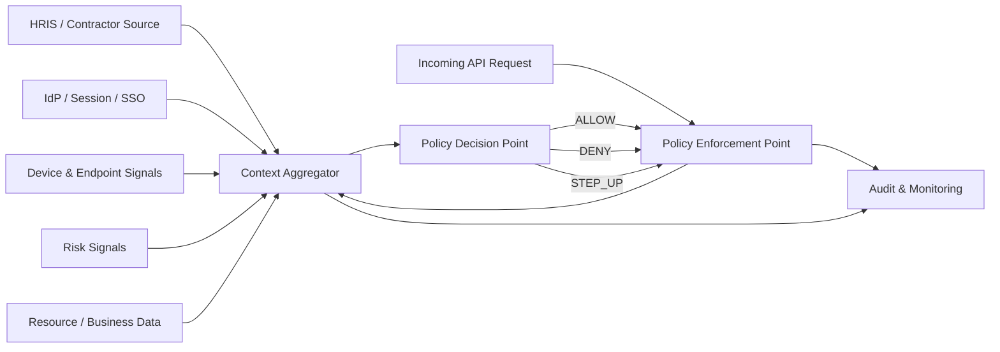

# Đúng ngữ cảnh trong IAM: quyết định truy cập dựa trên điều kiện thực tế

Trong quản lý định danh và truy cập (**Identity and Access Management – IAM**), mục tiêu **“đúng ngữ cảnh”** là bảo đảm quyết định cho phép hoặc từ chối một yêu cầu phụ thuộc vào **điều kiện thực tế, đủ tin cậy và đang còn hiệu lực** tại thời điểm truy cập. Cùng một nhân viên, cùng quyền và cùng tài nguyên có thể được phép thao tác trong một tình huống nhưng phải xác thực tăng cường hoặc bị từ chối ở tình huống khác.

Ví dụ, nhân viên tài chính có role xem báo cáo lương được phép mở báo cáo từ thiết bị do tổ chức quản lý, khi phiên đăng nhập đáp ứng mức xác thực yêu cầu. Nếu tài khoản đó đột ngột đăng nhập qua trình duyệt mới trên thiết bị chưa được xác nhận, quyết định hợp lý có thể là **yêu cầu xác thực tăng cường**, **giới hạn chức năng** hoặc **từ chối**, tùy độ nhạy cảm và chính sách. Quyền trên giấy tờ không thay đổi, nhưng **ngữ cảnh của yêu cầu** đã thay đổi.

Trong mô hình quản lý vòng đời danh tính **Joiner–Mover–Leaver (JML)**, ngữ cảnh giúp liên kết trạng thái nhân sự, IdP, SSO, SCIM, RBAC/ABAC, tình trạng thiết bị, mức rủi ro, tài khoản dịch vụ và kiểm toán. Mục tiêu là giảm truy cập không phù hợp và **quyền truy cập tồn dư**, đồng thời duy trì khả năng làm việc hợp lệ.

## 1. Mục tiêu học tập

Sau bài này, người học có thể:

1. Giải thích **đúng ngữ cảnh** và phân biệt với **đúng người**, **đúng quyền**, **đúng tài nguyên**, **đúng thời điểm**.
2. Phân loại tín hiệu ngữ cảnh: **danh tính**, **phiên xác thực**, **thiết bị**, **mạng**, **vị trí**, **rủi ro**, **dữ liệu**, **nghiệp vụ** và **thời gian**.
3. Phân biệt tín hiệu **đáng tin**, **tín hiệu suy đoán** và **dữ liệu do client tự khai**.
4. Thiết kế chính sách **Conditional Access**, **Adaptive Authentication**, **Step-up Authentication** bằng RBAC và ABAC.
5. Tổ chức kiểm tra ngữ cảnh trước đăng nhập, khi gọi API và khi trạng thái thay đổi trong phiên.
6. Nhận diện giới hạn của IP, định vị, User-Agent, thiết bị quản lý, MFA và đánh giá rủi ro.
7. Vận dụng ngữ cảnh trong JML, quyền JIT, truy cập đặc quyền và danh tính workload.
8. Xây dựng kịch bản kiểm thử, thông tin kiểm toán và chỉ số theo dõi chất lượng quyết định.

## 2. “Đúng ngữ cảnh” nằm ở đâu trong quyết định IAM?

Giả sử Minh là nhân viên thuộc tenant A và có quyền `invoice:approve` với hạn mức 50 triệu đồng. Minh gửi yêu cầu duyệt hóa đơn 35 triệu thuộc tenant A. Hệ thống còn cần trả lời:

- Minh đã đăng nhập bằng phương thức xác thực đáp ứng mức bảo đảm của thao tác duyệt chưa?
- Thiết bị hiện tại có đáp ứng yêu cầu bảo mật không, và bằng chứng đó có còn mới?
- Trạng thái nhân sự và quyền đang được lấy từ dữ liệu đủ mới không?
- Đây là hành động bình thường của ca làm hay một yêu cầu bất thường cần xác minh thêm?
- Hóa đơn có thuộc trường hợp cần phân tách nhiệm vụ (người tạo không được tự duyệt) không?
- Ứng dụng có rơi vào trạng thái không thể lấy thông tin rủi ro, và chính sách yêu cầu làm gì trong trường hợp đó?

Đó là các yếu tố ảnh hưởng đến quyết định **ngay cả khi định danh và role không đổi**.

| Mục tiêu IAM | Câu hỏi chính | Ví dụ kiểm soát |
| --- | --- | --- |
| **Đúng người** | Chủ thể đang yêu cầu có danh tính hợp lệ? | Xác minh danh tính, xác thực token và trạng thái nhân sự. |
| **Đúng quyền** | Chủ thể có thể làm thao tác gì? | Permission, role, entitlement, giới hạn nghiệp vụ. |
| **Đúng tài nguyên** | Thao tác được phép trên đối tượng cụ thể nào? | Tenant, owner, project, classification, quan hệ. |
| **Đúng thời điểm** | Quyền và quan hệ còn hiệu lực khi yêu cầu xảy ra? | Ngày bắt đầu/kết thúc, JIT, thời hạn phiên và entitlement. |
| **Đúng ngữ cảnh** | Điều kiện hiện tại có đủ đáng tin, phù hợp rủi ro của thao tác? | Mức MFA, tình trạng thiết bị, tín hiệu rủi ro, giới hạn nghiệp vụ. |

Các tiêu chí có phần giao nhau. Ví dụ **thời gian** vừa là mục tiêu riêng vừa có thể là một thuộc tính trong ngữ cảnh ABAC. Điều cần giữ rõ là mọi quyết định được áp dụng **đúng thời điểm, với dữ liệu ngữ cảnh đáng tin**, không dựa vào suy luận từ một dấu hiệu đơn lẻ.

## 3. Ngữ cảnh gồm những gì?

Ngữ cảnh không chỉ là vị trí IP. Có nhiều lớp thông tin cùng tham gia, với độ tin cậy và khả năng thay đổi khác nhau.

| Nhóm tín hiệu | Ví dụ | Cần xác minh điều gì? |
| --- | --- | --- |
| **Danh tính và quan hệ** | `subjectId`, `employmentStatus`, loại hợp đồng, người quản lý, tenant | Nguồn có thẩm quyền, thời điểm cập nhật và quan hệ còn hợp lệ. |
| **Quyền và vai trò** | Role, nhóm, scope, phê duyệt JIT, hạn mức | Nguồn role/entitlement, hiệu lực và bản quyền hiện tại. |
| **Xác thực / phiên** | Loại MFA, thời điểm xác thực gần nhất, độ mạnh phương thức, phiên có bị thu hồi không | Bằng chứng từ IdP hoặc hệ thống xác thực đáng tin. |
| **Thiết bị** | Thiết bị được quản lý, mã hóa ổ đĩa, trạng thái tuân thủ, bằng chứng endpoint | Khả năng ràng buộc thiết bị với phiên và độ mới của tín hiệu. |
| **Mạng** | IP nguồn, proxy đáng tin, mạng công ty, VPN/ZTNA | IP thật được quan sát ở điểm vào, giới hạn tin cậy của mạng. |
| **Vị trí** | Vùng địa lý suy ra từ IP, địa điểm làm việc được khai báo | Sai số địa lý, VPN, NAT, roaming, dữ liệu thiếu. |
| **Rủi ro** | Tín hiệu đăng nhập bất thường, thiết bị mới, thông báo credential bị lộ | Nguồn phát hiện, độ tin cậy, thời gian hết hiệu lực, khả năng phản hồi. |
| **Tài nguyên** | Độ mật, trạng thái dự án, tenant, loại dữ liệu | Thuộc tính từ nguồn tài nguyên đáng tin, không tin request body. |
| **Nghiệp vụ** | Ca trực, ticket sự cố, workflow phê duyệt, giới hạn thanh toán | Có căn cứ nghiệp vụ hợp lệ và chưa bị thay đổi. |
| **Thời gian** | Thời điểm hiện tại, thời gian phiên, hạn quyền | Đồng hồ đáng tin, timezone, ranh giới hiệu lực. |

Một chính sách tốt xem xét **tín hiệu nào thật sự cần** cho hành động cụ thể. Ví dụ, đọc tài liệu công khai không nhất thiết cần thiết bị được quản lý; xuất hàng loạt dữ liệu khách hàng hoặc đổi thông tin thanh toán có thể cần kiểm tra ngữ cảnh nghiêm ngặt hơn.

### 3.1. Context có tính động

Cùng một phiên đăng nhập có thể đi qua nhiều trạng thái:

1. Người dùng đăng nhập từ laptop được quản lý: **ngữ cảnh ban đầu đạt yêu cầu**.
2. Bộ phận an ninh phát hiện thiết bị mất tuân thủ: **ngữ cảnh thay đổi**.
3. Người dùng vẫn đang giữ access token cũ: **ngữ cảnh trong token có thể lỗi thời**.
4. API nhận yêu cầu nhạy cảm: cần kiểm tra trạng thái ngữ cảnh theo chính sách hiện hành và độ mới phù hợp.

Vì vậy, việc xét ngữ cảnh **một lần duy nhất lúc đăng nhập** không luôn đủ cho những tài nguyên và thao tác có rủi ro cao.

## 4. Phân biệt dữ liệu đáng tin và dữ liệu do client tự khai

Một trong những lỗi nghiêm trọng nhất là cho phép ứng dụng dựa vào tín hiệu ngữ cảnh mà người gọi có thể tự sửa.

Ví dụ HTTP:

```http
POST /api/finance/approve
Authorization: Bearer <access_token>
Content-Type: application/json

{
  "invoiceId": "INV-104",
  "tenantId": "tenant-A",
  "deviceTrusted": true,
  "riskLevel": "LOW",
  "role": "FINANCE_APPROVER"
}
```

Các giá trị `deviceTrusted`, `riskLevel`, `role` và `tenantId` trong body **không được coi là bằng chứng** vì client có thể thay đổi chúng. Backend phải suy ra từ hệ thống đáng tin:

| Trường cần dùng | Nguồn nên xem xét |
| --- | --- |
| Subject ID, issuer, thời điểm xác thực | Token được xác minh đúng và hệ thống quản lý phiên. |
| Quyền, vai trò, tenant membership | Directory/IdP hoặc kho quyền theo nguồn có thẩm quyền. |
| Tenant của hóa đơn | Database nghiệp vụ đáng tin được tải theo invoice ID. |
| Tình trạng thiết bị | Hệ thống quản lý thiết bị/endpoint và cơ chế xác nhận tính gắn kết với phiên. |
| Mức rủi ro | Hệ thống đánh giá rủi ro được ủy quyền, kèm thời điểm, mức tin cậy. |
| Thời điểm quyết định | Đồng hồ hệ thống phía server với chính sách đồng bộ giờ. |

**Lưu ý:** trường có tên “trusted” không tự động làm dữ liệu đáng tin. Cần kiểm tra **ai tạo dữ liệu, dữ liệu tới bằng kênh nào, có bị giả mạo không, còn mới không và liên kết với đúng subject/session/device không**.

### 4.1. Ranh giới tin cậy của proxy và API gateway

Thông tin IP nguồn có thể được chuyển tiếp qua header như `X-Forwarded-For`. Nếu backend nhận trực tiếp header này từ client mà không xác định proxy tin cậy, người gọi có thể giả IP.

Hướng tiếp cận:

- Chỉ tin thông tin mạng được đặt hoặc chuẩn hóa bởi **proxy/load balancer tin cậy** theo cấu hình đúng.
- Quy định danh sách proxy tin cậy và cách trích IP nguồn khi có nhiều hop.
- Ngăn truy cập trực tiếp tới backend nếu nó có thể bỏ qua lớp xác minh của gateway.
- Đối chiếu và kiểm thử cấu hình nhiều tầng proxy/NAT/CDN.

Tương tự, một cờ thiết bị “compliant” chỉ có ý nghĩa nếu có **chứng cứ tin cậy và còn hiệu lực** từ cơ chế quản lý thiết bị, không chỉ một chuỗi trong HTTP header.

## 5. Luồng đánh giá ngữ cảnh trong kiến trúc IAM

Trong hệ thống doanh nghiệp, tín hiệu đến từ nhiều nguồn:

- **HRIS/hệ thống quản lý nhà thầu**: trạng thái và quan hệ làm việc.
- **IdP**: định danh, xác thực, chính sách đăng nhập và một số thông tin phiên.
- **SSO**: đưa người dùng vào ứng dụng thông qua luồng xác thực liên kết.
- **SCIM hoặc API provisioning**: đồng bộ tài khoản, nhóm và thuộc tính; không tự đánh giá mọi ngữ cảnh cho từng request.
- **Device management / endpoint security**: tình trạng quản lý và tuân thủ thiết bị.
- **Risk engine / SIEM**: các tín hiệu có thể dẫn tới đánh giá rủi ro.
- **Hệ thống nghiệp vụ**: chủ tài nguyên, tenant, hạn mức, phiên bản tài liệu, ticket sự cố.
- **Ứng dụng/API**: điểm thực thi quyết định và ghi nhận kết quả.



**PEP** (*Policy Enforcement Point*) là nơi ngăn hoặc cho phép thao tác; **PDP** (*Policy Decision Point*) là nơi đánh giá chính sách; nguồn dữ liệu thuộc tính đôi khi được gọi là **PIP** (*Policy Information Point*).

Sơ đồ thể hiện **mô hình logic**. Trong một hệ thống đơn giản, nhiều thành phần có thể nằm chung trong backend. Không bắt buộc triển khai thêm một dịch vụ cho mỗi hộp. Quan trọng là có ranh giới tin cậy rõ ràng và không có đường truy cập bỏ qua PEP.

## 6. Conditional Access và Adaptive Authentication

### 6.1. Conditional Access – truy cập có điều kiện

**Conditional Access** áp dụng chính sách dựa trên tình trạng hiện tại. Ví dụ:

- Chỉ cho phép truy cập cổng nội bộ khi danh tính đang hoạt động.
- Yêu cầu MFA đạt mức phù hợp khi truy cập hệ thống nhân sự.
- Giới hạn xuất dữ liệu nhạy cảm với thiết bị đã được quản lý.
- Từ chối yêu cầu đặc quyền nếu trạng thái rủi ro không thể chấp nhận.
- Cho phép một số thao tác đọc cơ bản nhưng từ chối thao tác ghi trên thiết bị không đáp ứng yêu cầu.

Điều kiện có thể được đánh giá **khi đăng nhập** hoặc **khi thực hiện thao tác** tùy kiến trúc. Không nên mặc nhiên cho rằng chính sách IdP đã bảo vệ mọi API và đường tải dữ liệu bên trong ứng dụng.

### 6.2. Adaptive Authentication – xác thực thích ứng

Thay vì áp cùng một mức xác thực cho mọi tình huống, hệ thống điều chỉnh yêu cầu dựa trên ngữ cảnh.

Ví dụ:

| Tình huống | Phản ứng có thể phù hợp |
| --- | --- |
| Mở trang thông tin công khai | Không yêu cầu xác thực. |
| Xem thông tin cá nhân thông thường | Cần phiên xác thực hợp lệ. |
| Thay đổi tài khoản nhận lương | Yêu cầu xác thực mạnh gần thời điểm thao tác và kiểm tra điều kiện nghiệp vụ. |
| Đăng nhập từ thiết bị lạ với tín hiệu rủi ro tăng | Yêu cầu bước xác minh bổ sung hoặc hạn chế truy cập. |
| Truy cập production với quyền JIT đang hiệu lực | Yêu cầu xác thực tăng cường, phê duyệt và kiểm tra phạm vi. |
| Tín hiệu cho thấy tài khoản có nguy cơ bị chiếm đoạt nghiêm trọng | Từ chối/đình chỉ theo chính sách, điều tra và khôi phục an toàn. |

**Step-up Authentication** là yêu cầu người dùng thực hiện bước xác thực có mức bảo đảm cao hơn khi cần thiết. Một phiên đăng nhập ban đầu có thể đủ để đọc trang cơ bản nhưng chưa đủ để chuyển tiền hoặc đổi chính sách IAM.

### 6.3. Chọn phản ứng theo độ rủi ro

Không phải mọi tín hiệu bất thường đều dẫn tới khóa tài khoản. Có thể phân biệt các quyết định:

- **ALLOW:** điều kiện hiện tại đủ để hoàn thành thao tác.
- **STEP_UP / CHALLENGE:** cần xác minh mạnh hơn hoặc một bước phê duyệt hợp lệ.
- **LIMITED_ACCESS:** chỉ cho phép tập chức năng ít nhạy cảm.
- **DENY:** điều kiện không đạt hoặc có tín hiệu chặn rõ ràng.
- **MANUAL_REVIEW:** tạm giữ yêu cầu nhạy cảm để người có thẩm quyền xem xét.

Đây là tập kết quả khái niệm, **không phải enum mặc định** của mọi sản phẩm IAM. Chính sách thực tế cần xác định hành động nào hỗ trợ thử lại sau step-up, hành động nào bị từ chối hoàn toàn, và cách bảo vệ người dùng trước việc lạm dụng bước xác minh.

## 7. Kết hợp RBAC, ABAC và ngữ cảnh trong ủy quyền

**RBAC** trả lời người dùng giữ role nào. **ABAC** cho phép xét thêm thuộc tính chủ thể, tài nguyên, hành động và môi trường. “Đúng ngữ cảnh” thường được triển khai như các điều kiện ABAC bên cạnh quyền dựa trên role.

Ví dụ: người dùng có role `FINANCE_APPROVER` nhưng chỉ được duyệt hóa đơn khi:

1. Tài khoản và quan hệ làm việc còn `ACTIVE`.
2. Tenant của người dùng khớp tenant của hóa đơn.
3. Người dùng có entitlement `invoice:approve` còn hiệu lực.
4. Hạn mức cho phép đủ lớn và hóa đơn đang chờ duyệt.
5. Người duyệt không phải người tạo hóa đơn.
6. Phiên có mức xác thực phù hợp và chưa quá thời hạn cho thao tác nhạy cảm.
7. Thiết bị/ngữ cảnh rủi ro đáp ứng chính sách hiện hành.

Một chính sách **mô tả**, không phải cấu hình của nhà cung cấp cụ thể:

```text
PERMIT invoice.approve IF
    subject.status == ACTIVE
    AND subject.hasRole("FINANCE_APPROVER")
    AND subject.tenantId == invoice.tenantId
    AND entitlement.isEffectiveAt(trustedNow)
    AND invoice.status == PENDING
    AND invoice.amount <= subject.approvalLimit
    AND invoice.createdBy != subject.id
    AND session.assurance >= policy.requiredAssurance
    AND session.recentAuthentication == true
    AND device.status == COMPLIANT
    AND risk.assessment == ACCEPTABLE

IF only session assurance is insufficient:
    REQUIRE_STEP_UP

OTHERWISE:
    DENY
```

Trong triển khai thực tế, cần xác định thứ tự kiểm tra và điều kiện **nào có thể khắc phục bằng step-up**. Chẳng hạn, xác thực tăng cường không thể sửa việc sai tenant hoặc thiếu permission. Người dùng cũng không được tự thay đổi `device.status` hoặc `risk.assessment` để qua điều kiện.

### 7.1. Đừng dùng rủi ro để bỏ qua quyền cứng

Một chính sách không nên biến `risk=LOW` thành lý do bỏ qua kiểm tra permission hoặc tenant. **Ngữ cảnh thuận lợi chỉ có thể bổ sung điều kiện cho quyền đã hợp lệ**, trừ khi quy trình nghiệp vụ chính thức cấp một quyền mới có căn cứ, thời hạn và kiểm toán.

Ngược lại, quyền mạnh không tự tạo ngữ cảnh đủ tin cậy: quản trị viên IAM vẫn có thể cần xác thực tăng cường, thiết bị phù hợp và quy trình phê duyệt cho các thao tác nhạy cảm.

## 8. Ngữ cảnh trong các giai đoạn Joiner–Mover–Leaver

### 8.1. Joiner – thiết lập ngữ cảnh đáng tin ban đầu

Khi người mới gia nhập, trạng thái và thuộc tính từ nguồn có thẩm quyền là đầu vào cho việc cấp danh tính và role. Đồng thời, tổ chức phải thiết lập **các tín hiệu bảo đảm truy cập**:

1. HRIS/nguồn nhà thầu xác nhận quan hệ, ngày bắt đầu và người quản lý.
2. IAM tạo và liên kết định danh ổn định tại IdP.
3. Người dùng đăng ký MFA/passkey qua quy trình được xác minh.
4. Thiết bị hoặc cơ chế truy cập phù hợp được ghi nhận nếu công việc yêu cầu.
5. Các ứng dụng nhận tài khoản/nhóm qua SCIM hoặc API.
6. Chính sách RBAC/ABAC định nghĩa mức bảo đảm xác thực, tài nguyên và ngữ cảnh cần thiết.
7. Thực hiện thử truy cập với ca hợp lệ và ca thiếu ngữ cảnh để bảo đảm PEP đang hoạt động.

**Ví dụ:** một nhân viên tài chính mới được cấp role theo công việc nhưng chưa hoàn tất đăng ký phương thức MFA phù hợp. Tài khoản có thể tồn tại, song ứng dụng nhạy cảm cần từ chối hoặc yêu cầu hoàn tất bước đăng ký trước khi truy cập.

### 8.2. Mover – cập nhật điều kiện theo vai trò và nhiệm vụ mới

Khi chuyển phòng ban hoặc vai trò, người dùng có thể chuyển từ thao tác thông thường sang quản trị sản xuất. Bên cạnh việc **gỡ quyền cũ, cấp quyền mới**, hệ thống phải đánh giá lại ngữ cảnh:

- Role mới đòi hỏi mức xác thực nào?
- Thiết bị cũ có được phép truy cập dữ liệu của bộ phận mới không?
- Có yêu cầu quản lý endpoint, chứng nhận hoặc đào tạo mới không?
- Có quyền truy cập theo ca, theo project hoặc phê duyệt JIT không?
- Token, phiên và cache chính sách cũ còn mang ngữ cảnh không phù hợp không?
- Đã thu hồi ACL, nhóm và credential liên quan tới công việc cũ chưa?

**Tình huống:** Hòa chuyển từ hỗ trợ khách hàng sang quản trị hạ tầng. Nếu hệ thống chỉ thêm role `PROD_OPERATOR` mà bỏ qua điều kiện thiết bị, MFA và phê duyệt, quyền mới có thể sử dụng ngay từ phiên cũ vốn chỉ phù hợp cho tác vụ hỗ trợ ít nhạy cảm.

### 8.3. Leaver – ngữ cảnh hợp lệ kết thúc theo quan hệ

Khi nhân viên nghỉ việc, hợp đồng hết hạn hoặc quan hệ bị đình chỉ, tín hiệu trạng thái từ nguồn có thẩm quyền trở thành **điều kiện chặn quan trọng**. Các hệ thống cần ngừng cho phép truy cập theo chính sách, kể cả khi:

- Token còn `exp` chưa hết hạn.
- Phiên tại ứng dụng đã được tạo trước đó.
- Thiết bị vẫn được đánh dấu compliant.
- Role trong token hoặc cache còn tồn tại.
- SCIM đã gửi yêu cầu vô hiệu hóa nhưng ứng dụng chưa xác nhận.
- Có API key/PAT độc lập với IdP.

Đây là lý do các tín hiệu trạng thái JML cần được **đồng bộ và đối soát** với các đường truy cập thực tế. Thiết bị “an toàn” hoặc một vị trí “đáng tin” không thể làm hợp lệ lại danh tính đã chấm dứt quan hệ.

### 8.4. Nhà thầu và người dùng bên ngoài

Người dùng ngoài tổ chức có thể truy cập qua danh tính từ IdP đối tác. Khi đó, nguồn xác minh trạng thái, mức bảo đảm MFA, thiết bị và phạm vi hợp đồng có thể khác nhân viên nội bộ.

Trước khi chấp nhận claim từ IdP bên ngoài, cần xác định:

- Quan hệ liên kết/federation nào được tổ chức tin cậy?
- Những claim nào được phép sử dụng để cấp quyền?
- Mức xác thực có đủ theo chính sách nội bộ không?
- Ai là sponsor/owner và khi nào quyền hết hạn?
- Có thể thu hồi truy cập cục bộ ngay cả khi phiên ở IdP đối tác còn sống không?

Không nên giả định hai IdP dùng cùng tên claim hoặc cùng cách diễn giải một mức xác thực.

## 9. Ngữ cảnh mạng và vị trí: tín hiệu hữu ích nhưng có giới hạn

### 9.1. IP và vị trí không chứng minh danh tính

Địa chỉ IP có thể thay đổi qua VPN, NAT, mạng di động, proxy, CGNAT hoặc điểm truy cập công cộng. Định vị IP có sai số và không nhất thiết phản ánh địa điểm vật lý của người dùng. Vì vậy:

- IP thuộc mạng công ty **không tự chứng minh** yêu cầu được gửi bởi người được phép.
- IP ở vị trí lạ **không tự chứng minh** người dùng đang bị chiếm tài khoản.
- Vị trí IP chỉ nên là một yếu tố trong tập tín hiệu khi chính sách cần.
- Với trường hợp bất thường, nên đánh giá thêm xác thực, thiết bị, trạng thái nhân sự, tài nguyên và lịch sử phiên.

Ví dụ, kỹ sư đi công tác có thể dùng một nhà mạng có điểm thoát IP ở vùng khác. Tự khóa tài khoản mỗi lần IP đổi có thể gây gián đoạn mà không giúp giảm rủi ro tương xứng.

### 9.2. “Mạng nội bộ” không mặc định đáng tin

Trong mô hình Zero Trust, vị trí mạng đơn thuần không đủ để quyết định ủy quyền. Một máy bên trong VPN có thể đã bị xâm nhập, hoặc người dùng có thể dùng tài khoản hợp lệ trên thiết bị không đáp ứng yêu cầu.

Bảo vệ nên xét nhiều lớp: danh tính, thiết bị, chính sách tài nguyên, xác thực, quan hệ và ngữ cảnh thực tế. Nên giới hạn quyền của VPN hoặc đường kết nối, đồng thời tiếp tục kiểm tra backend/API.

### 9.3. Vị trí bất thường và “impossible travel”

Hai lần đăng nhập từ hai vùng địa lý xa nhau trong một khoảng quá ngắn có thể là tín hiệu rủi ro. Tuy nhiên, VPN doanh nghiệp, proxy, mạng di động và đồng bộ tự động có thể tạo dương tính giả. Kết quả đánh giá cần bao gồm **mức độ tin cậy**, bằng chứng thời gian và khả năng xử lý ngoại lệ, thay vì xem đây là bản án tự động.

## 10. Ngữ cảnh thiết bị: sức khỏe, nguồn gốc và độ mới

Một thiết bị được đánh dấu quản lý tại thời điểm `T0` không đảm bảo còn đáp ứng chính sách tại `T1`. Cần chú ý:

- Thiết bị thuộc danh mục quản lý nào?
- Có bằng chứng ràng buộc phiên/token với thiết bị đó không?
- Trạng thái tuân thủ do hệ thống nào cấp?
- Mốc cập nhật cuối là khi nào, và TTL tối đa là bao lâu?
- Nếu thiết bị mất tuân thủ, bao lâu quyết định API bị cập nhật?
- Điều gì xảy ra nếu nguồn posture không khả dụng?

### 10.1. Thiết bị được quản lý không có nghĩa luôn an toàn

Thiết bị được quản lý có thể có cấu hình đúng nhưng vẫn bị xâm nhập. Vì vậy, yếu tố quản lý thiết bị nên là **điều kiện giúp giảm rủi ro**, không thay thế xác thực người dùng, kiểm tra permission hoặc phát hiện hoạt động bất thường.

Một số thao tác rất nhạy cảm có thể đòi hỏi kết hợp thiết bị được quản lý, xác thực chống phishing, phiên mới và quyền JIT. Các thao tác thông thường có thể dùng điều kiện nhẹ hơn theo chính sách.

### 10.2. BYOD và truy cập giới hạn

Với thiết bị cá nhân (*Bring Your Own Device – BYOD*), tổ chức có thể cho phép sử dụng một tập chức năng hạn chế, ví dụ xem thông báo công việc nhưng không tải xuống tệp chứa dữ liệu nhạy cảm. Chính sách phải được kiểm tra **ở ứng dụng và kênh dữ liệu thực tế**, không chỉ ẩn nút tải xuống trên giao diện.

### 10.3. Dữ liệu ngữ cảnh thiếu hoặc lỗi thời

Nếu backend không nhận được trạng thái thiết bị hiện tại, **không tự gán `COMPLIANT`**. Phản ứng phụ thuộc chính sách, chẳng hạn:

- Từ chối thao tác đặc quyền hoặc export dữ liệu mật.
- Cho phép các chức năng ít rủi ro khi có giới hạn rõ.
- Yêu cầu xác minh lại hoặc chuyển sang thiết bị đủ điều kiện.
- Ghi cảnh báo và lý do để vận hành xử lý.

Cần phân biệt “dữ liệu chưa có” với “đã xác định thiết bị không tuân thủ”; cả hai có thể dẫn tới từ chối, nhưng thông điệp hỗ trợ người dùng và cách khắc phục khác nhau.

## 11. Thời gian phiên, xác thực tăng cường và thay đổi ngữ cảnh giữa phiên

### 11.1. Một lần SSO không bảo đảm mọi hành động suốt cả ngày

SSO giúp người dùng đăng nhập và nhận phiên ban đầu. Tuy nhiên, một phiên được tạo từ buổi sáng có thể không đủ điều kiện cho thao tác nhạy cảm vào cuối ngày, nhất là khi:

- Người dùng vừa chuyển role hoặc bị thu hồi quyền.
- Thiết bị mất trạng thái compliant.
- Mức rủi ro tăng.
- Thao tác đòi hỏi xác thực gần đây (*fresh authentication*).
- Session/token bị thu hồi hoặc hết hạn.

Hệ thống cần định nghĩa **khi nào phải đánh giá lại** và cơ chế phối hợp IdP–ứng dụng để yêu cầu step-up.

### 11.2. Token mang claim không phải trạng thái “sống”

Một access token có thể mang role, tenant, thời điểm xác thực hoặc claim liên quan mức bảo đảm. Các claim này phản ánh **trạng thái tại thời điểm phát hành** và cấu hình của issuer. Nếu role hoặc thiết bị thay đổi sau đó, claim trong token cũ có thể chưa được cập nhật.

Cách xử lý tùy mức rủi ro:

1. Giới hạn thời hạn token phù hợp.
2. Với hành động nhạy cảm, kiểm tra trạng thái quyền/ngữ cảnh hiện hành ở backend hoặc dịch vụ chính sách.
3. Có cơ chế thu hồi phiên hoặc token phù hợp với hệ thống.
4. Thiết kế invalidation cache khi xuất hiện sự kiện JML, revoke, device non-compliance.
5. Theo dõi độ trễ từ khi sự kiện thay đổi đến lúc điểm thực thi từ chối yêu cầu.

**Không nên giả định:** khóa account tại IdP ngay lập tức làm mất hiệu lực mọi access token đã được ứng dụng khác kiểm tra offline.

### 11.3. Step-up phải ràng buộc với hành động

Khi thao tác yêu cầu xác thực mạnh hơn, hệ thống nên ràng buộc kết quả step-up với **chủ thể, phiên và mục đích hợp lệ**, cùng thời hạn phù hợp. Không nên để kết quả xác minh một hành động ít nhạy cảm trở thành giấy phép mở mọi chức năng quản trị.

Ví dụ, xác thực tăng cường để đổi tài khoản ngân hàng nhận lương không tự động cho phép thay đổi chính sách IAM hay duyệt giao dịch ngoài phạm vi. **Quyền và điều kiện nghiệp vụ vẫn phải kiểm tra riêng**.

### 11.4. Tác vụ dài, WebSocket và job chạy nền

Một tác vụ được chấp thuận lúc tạo có thể thực thi sau khi ngữ cảnh thay đổi. Cần xác định:

- Khi nào phải kiểm tra lại quyền và điều kiện thiết bị?
- Nếu subject bị đình chỉ trong lúc job chờ, có hủy job không?
- Nếu job đã được phê duyệt như một ủy quyền nghiệp vụ độc lập, snapshot đó có scope và thời hạn gì?
- Với WebSocket hoặc streaming, có cơ chế đóng kênh hoặc từ chối thao tác tiếp theo khi điều kiện thay đổi không?
- Worker nền có sử dụng identity của người yêu cầu với scope rõ ràng hay đang chạy bằng quyền dịch vụ quá rộng?

Đây là bài toán **time-of-check/time-of-use (TOCTOU)**. Không có một quy tắc phù hợp mọi nghiệp vụ; cần nêu chính sách rõ ràng và áp dụng nhất quán ở thời điểm có hiệu lực.

## 12. Ví dụ thiết kế chính sách ngữ cảnh ở backend

Xét một hệ thống quản lý dữ liệu khách hàng. Người dùng có role `CUSTOMER_ANALYST` và xin xuất báo cáo chứa dữ liệu nhạy cảm. Backend cần xác minh **danh tính, quyền, tài nguyên và ngữ cảnh** trước khi tạo job xuất dữ liệu.

Ví dụ **pseudocode**, không gắn với một framework cụ thể:

```text
function requestSensitiveExport(accessToken, datasetId):
    principal = verifyToken(
        accessToken,
        expectedIssuer,
        expectedAudience,
        allowedAlgorithms
    )

    subject = directory.loadSubject(principal.subject)
    dataset = resourceStore.loadDataset(datasetId)
    session = trustedSessionStore.load(principal.sessionId)
    device = trustedDeviceService.assess(session.deviceBinding)
    risk = riskService.assess(principal.subject, session.id)
    now = trustedClock.now()

    if subject is null OR dataset is null:
        DENY
    if subject.status != ACTIVE:
        DENY
    if subject.tenantId != dataset.tenantId:
        DENY
    if not policy.hasPermission(subject, "dataset:export", dataset):
        DENY

    if session.recentStrongAuthentication is insufficient:
        REQUIRE_STEP_UP

    if device.dataMissingOrTooOld:
        DENY_OR_LIMIT_AS_POLICY_REQUIRES
    if not device.compliant:
        DENY

    if risk.highConfidenceCompromiseSignal:
        DENY_AND_ALERT

    authorization = issueScopedExportAuthorization(
        subjectId = subject.id,
        datasetId = dataset.id,
        expiresAt = now + shortLifetime,
        policyVersion = policy.currentVersion
    )

    audit(subject.id, dataset.id, "EXPORT_REQUESTED", authorization.id)
    queueExport(authorization)
```

Các điểm quan trọng:

- Dữ liệu client **không quyết định trực tiếp** role, rủi ro, tenant hay posture thiết bị.
- `verifyToken` cần kiểm tra issuer, audience, chữ ký, hạn token và các ràng buộc cần thiết.
- API tải tài nguyên thực và áp dụng **ủy quyền ở cấp đối tượng**.
- Khi cần step-up, không thực hiện export trước khi kết quả xác thực tăng cường được xác minh.
- Job xuất dùng một **ủy quyền có phạm vi hẹp**, không mặc nhiên dùng quyền admin của worker.
- Chính sách phải nêu rõ điều kiện tái kiểm tra khi job thực thi hoặc bị hủy.
- Hệ thống phải ghi cả quyết định bị từ chối và các lỗi truy vấn tín hiệu quan trọng mà không lộ dữ liệu nhạy cảm.

### 12.1. Kết quả chính sách không nhất thiết chỉ là Boolean

Một kiểu kết quả mở rộng có thể gồm:

```json
{
  "decision": "STEP_UP",
  "subjectId": "P-2048",
  "action": "dataset:export",
  "resourceId": "DATASET-31",
  "policyId": "export-sensitive-v4",
  "requirements": [
    "RECENT_STRONG_AUTHENTICATION",
    "DEVICE_COMPLIANCE_VERIFIED"
  ],
  "evaluatedAt": "2026-11-23T08:00:00Z"
}
```

Đây là cấu trúc **minh họa**. Hệ thống thực tế phải kiểm tra và thực thi nghĩa của `STEP_UP`, không nhận giá trị `decision` do client gửi. Kết quả cũng nên có phiên bản policy và mã lý do đủ để kiểm toán, tránh lộ chi tiết nhạy cảm về quy tắc phát hiện cho người không có quyền.

## 13. Ngữ cảnh của service account và workload identity

“Đúng ngữ cảnh” không chỉ dành cho con người. Với workload, những tín hiệu thường có ý nghĩa hơn IP hoặc vị trí địa lý là:

- Workload được triển khai trong **namespace, cluster, project hoặc môi trường nào**?
- Danh tính dịch vụ có được cấp từ cơ chế đáng tin (ví dụ workload identity federation, mTLS identity) không?
- Artifact/instance có thuộc pipeline triển khai được chấp thuận không?
- Quyền truy cập có ràng buộc **mục đích, tài nguyên và thời hạn** không?
- Credential là ngắn hạn hay bí mật dùng chung lâu dài?
- Owner và ứng dụng của workload có còn tồn tại không?

Ví dụ, `billing-exporter-prod` được quyền ghi vào bucket báo cáo production. Một process trong môi trường test tự khai `serviceName=billing-exporter-prod` không được thừa hưởng quyền này. Hệ thống phải sử dụng danh tính workload được cấp qua cơ chế tin cậy và kiểm tra audience, namespace, environment hoặc thuộc tính ràng buộc tương đương.

### 13.1. Chính sách workload theo môi trường

```text
PERMIT secret.read IF
    workload.identity is verified
    AND workload.environment == "production"
    AND workload.application == "billing-exporter"
    AND secret.namespace == "billing"
    AND secret.purpose == "report-export"
    AND credential.isValidNow
    AND serviceOwner.isActive
OTHERWISE DENY
```

Điều kiện trên mang tính minh họa. Cần định nghĩa rõ cách xác minh `serviceOwner.isActive` và không để sự thay đổi owner hợp lệ làm gián đoạn ngoài ý muốn. Mục tiêu vẫn là **có người chịu trách nhiệm, đúng workload, đúng tài nguyên và đúng hoàn cảnh**.

### 13.2. Leaver của owner và ngữ cảnh phi con người

Khi người sở hữu service account rời tổ chức, không nhất thiết phải tắt ngay workload đang phục vụ hệ thống sống. Nhưng phải kích hoạt quy trình **chuyển owner hoặc đánh giá lại**:

1. Xác định dịch vụ còn cần thiết không.
2. Chuyển giao ownership hợp lệ.
3. Kiểm tra credential, secret, permission và environment binding.
4. Thu hồi tài khoản/secret không còn sử dụng.
5. Ghi bằng chứng, mốc hoàn thành và người chịu trách nhiệm mới.

Đây là cách áp dụng nguyên tắc JML vào danh tính phi con người mà không gắn trực tiếp vòng đời service account với một nhân viên duy nhất.

## 14. Rủi ro, thang điểm và phản ứng hợp lý

Một số hệ thống kết hợp nhiều tín hiệu để đánh giá mức rủi ro. Tuy nhiên, **risk score không phải sự thật tuyệt đối** và cần được hiệu chỉnh theo bối cảnh hệ thống.

Ví dụ một yêu cầu có các dấu hiệu:

| Tín hiệu | Cách diễn giải thận trọng |
| --- | --- |
| Thiết bị chưa từng thấy | Cần xác minh thêm; có thể là thay máy hợp lệ. |
| IP khác vị trí thường dùng | Có thể là du lịch, VPN hoặc mạng di động. |
| MFA chống phishing thành công | Làm tăng độ tin cậy cho việc xác thực, không chứng minh thiết bị không nhiễm mã độc. |
| Trạng thái nhân sự `TERMINATED` | Điều kiện chặn rõ ràng dù tín hiệu mạng bình thường. |
| Thiết bị có báo cáo endpoint bị xâm nhập | Tín hiệu nguy cơ quan trọng, nên phản ứng theo chính sách bảo mật. |
| Quyền JIT đã hết hạn | Quyền không còn hợp lệ, cần từ chối thao tác đặc quyền. |

Chính sách nên **tách những điều kiện chặn cứng** (ví dụ không có quyền, sai tenant, quan hệ chấm dứt) khỏi **tín hiệu rủi ro có độ bất định** (IP lạ, thiết bị mới). Các điều kiện chặn cứng không thể được “bù điểm” bằng việc đăng nhập từ một mạng quen thuộc.

Nếu dùng thang điểm, phải có chủ sở hữu mô hình, kiểm thử dương tính giả/âm tính giả, giới hạn phạm vi, giải thích quyết định và phương án xử lý sự cố. Không nên tự áp một ngưỡng số cố định cho mọi ứng dụng khi chưa có dữ liệu và chính sách thực tế.

## 15. Thao tác ngoại lệ và khả năng duy trì hoạt động

Một chính sách ngữ cảnh quá cứng có thể chặn công việc hợp lệ, đặc biệt khi người dùng đổi thiết bị hoặc nguồn đánh giá rủi ro tạm thời lỗi. Cần chuẩn bị quy trình ngoại lệ có kiểm soát:

- **Hỗ trợ thay thiết bị/MFA:** xác minh lại chủ thể qua kênh độc lập trước khi cấp lại phương thức.
- **Truy cập khẩn cấp (break-glass):** có owner, lý do, giới hạn thời gian, cảnh báo và hậu kiểm.
- **Thiết bị mất kết nối nguồn posture:** xác định rõ chức năng nào được dùng ở chế độ suy giảm.
- **Sự cố hệ thống rủi ro hoặc IdP:** phân biệt tác vụ nhạy cảm phải từ chối với tác vụ ít rủi ro có thể hoạt động theo cơ chế dự phòng đã phê duyệt.
- **Đối tác liên kết SSO bị lỗi:** có phương án liên hệ hoặc phục hồi, không chuyển sang tin claim tự khai từ ứng dụng.

Không nên coi ngoại lệ là cách bỏ hẳn kiểm soát. Mỗi ngoại lệ cần **căn cứ, phạm vi, thời hạn, người phê duyệt và dấu vết sử dụng**.

### 15.1. Thất bại khi lấy ngữ cảnh

Một rủi ro quan trọng là **fail open**: khi không tải được trạng thái thiết bị, dịch vụ trả giá trị mặc định `COMPLIANT` để không ảnh hưởng trải nghiệm. Điều này mở đường truy cập không đáp ứng chính sách.

Với tác vụ nhạy cảm, hướng an toàn thường là từ chối hoặc giữ yêu cầu tới khi có tín hiệu đủ tin. Với các chức năng ít rủi ro, có thể thiết kế chế độ giới hạn nếu đã được phân tích và phê duyệt. Cần ghi lý do **nguồn dữ liệu không khả dụng**, tránh báo sai rằng người dùng thực sự vi phạm chính sách.

## 16. Quyền riêng tư, minh bạch và giảm dữ liệu ngữ cảnh

Ngữ cảnh có thể liên quan đến IP, thông tin thiết bị, vị trí, lịch sử đăng nhập và dấu hiệu hành vi. Thu thập quá mức làm tăng rủi ro quyền riêng tư và chi phí quản trị.

Một thiết kế có trách nhiệm cần:

1. **Chỉ thu thập tín hiệu cần cho mục đích bảo mật xác định.** Ví dụ, không cần tọa độ GPS chính xác để kiểm tra quyền đọc một trang thông tin ít nhạy cảm.
2. **Giới hạn nơi sử dụng dữ liệu.** Tín hiệu ngữ cảnh phục vụ kiểm soát truy cập không nên mặc nhiên tái sử dụng cho mục đích giám sát năng suất.
3. **Giới hạn lưu giữ và truy cập.** Log chứa IP hoặc device ID có kiểm soát và thời hạn lưu theo chính sách.
4. **Hạn chế nội dung log.** Không ghi token, mật khẩu, bí mật, toàn bộ nội dung tài liệu hoặc dữ liệu nhạy cảm không cần thiết.
5. **Có cách giải thích kết quả cho người dùng.** Ví dụ “thiết bị chưa đáp ứng yêu cầu” thay vì tiết lộ toàn bộ thuật toán phát hiện gian lận.
6. **Đo tác động sai số.** Tín hiệu vị trí/mạng có thể sai, gây cản trở hợp lệ; cần kênh hỗ trợ và kiểm tra chất lượng.

Mức dữ liệu và điều kiện pháp lý cụ thể phụ thuộc khu vực và tổ chức. Về mặt kỹ thuật, chính sách IAM cần được thiết kế theo nguyên tắc **tối thiểu hóa dữ liệu và kiểm soát mục đích**.

## 17. Kiểm thử “đúng ngữ cảnh” bằng ma trận tình huống

Kiểm thử chỉ với tài khoản role hợp lệ sẽ bỏ sót nhiều rủi ro. Một ma trận nên thay đổi từng tín hiệu độc lập và kiểm tra quyết định tổng thể.

| Trường hợp | Người/quyền/tài nguyên | Ngữ cảnh | Kết quả kỳ vọng theo chính sách ví dụ |
| --- | --- | --- | --- |
| Nhân viên xem tài liệu thường | Hợp lệ | Phiên còn hiệu lực | **ALLOW**. |
| Nhân viên export dữ liệu nhạy cảm | Hợp lệ | Chưa có xác thực mạnh gần đây | **STEP_UP** trước export. |
| Role quản trị production | Hợp lệ | Quyền JIT đã hết hạn | **DENY** dù MFA thành công. |
| Người dùng tenant A | Có `invoice:read` | Yêu cầu hóa đơn tenant B | **DENY** dù thiết bị compliant. |
| Nhân viên `TERMINATED` | Token cũ chưa hết hạn | Mạng và thiết bị quen thuộc | **DENY** theo trạng thái quan hệ. |
| Đăng nhập từ IP mới | Hợp lệ | Thiết bị đã xác minh, MFA mạnh | Đánh giá bổ sung; không mặc nhiên khóa chỉ vì IP. |
| Export dữ liệu mật | Hợp lệ | Nguồn device posture tạm lỗi | **DENY/giữ yêu cầu** theo chính sách nhạy cảm. |
| Workload production | Danh tính hợp lệ | Credential xuất hiện ở môi trường test | **DENY** nếu ràng buộc environment không khớp. |
| Mover chuyển bộ phận | Token chứa role cũ | Ngữ cảnh danh tính/role đã đổi | Kiểm tra lại và gỡ quyền tồn dư. |
| Đổi thiết bị/MFA | Người dùng hợp lệ | Mất thiết bị cũ | Quy trình khôi phục được xác minh, không cấp lại chỉ qua thông tin tự khai. |

Các kỳ vọng ALLOW/STEP_UP/DENY trong bảng là **chính sách minh họa**, cần điều chỉnh theo hệ thống thật.

### 17.1. Các bài kiểm thử kỹ thuật cần chú ý

- **Giả mạo client context:** sửa `riskLevel`, `deviceTrusted`, `tenantId` trong request body và header.
- **Giả mạo IP chuyển tiếp:** thêm hoặc thay `X-Forwarded-For` ngoài proxy tin cậy.
- **Token từ issuer khác:** thử token có cùng `sub` nhưng issuer/audience khác.
- **Role/claim cũ:** gỡ role ở IdP khi token cũ còn hiệu lực; xác nhận API nhạy cảm xử lý theo chính sách.
- **Thiết bị mất tuân thủ:** thay posture sau khi đã tạo phiên.
- **JIT hết hạn:** thử yêu cầu sát mốc `validUntil` và sau mốc đó.
- **Ngữ cảnh thiếu:** ngắt kết nối nguồn risk/device; xác minh ứng dụng không tự cho ALLOW.
- **Mạng đổi giữa phiên:** chuyển IP hoặc đường truy cập hợp lệ, đánh giá tác động và khả năng giải thích.
- **Job nền:** thay trạng thái subject sau khi tạo job trước khi thực thi.
- **Chia sẻ tài nguyên:** thay owner, tenant hoặc classification, xác minh không dựa vào cache cũ.
- **Tài khoản dịch vụ:** cố dùng cùng credential ở namespace/môi trường không được phép.
- **Khôi phục MFA:** kiểm thử kẻ tấn công có thông tin công khai không thể chiếm phương thức xác thực.

### 17.2. Kiểm thử bằng đồng hồ và trạng thái giả lập

Đối với mốc thời gian hoặc quyền tạm, nên dùng **đồng hồ có thể điều khiển trong test** thay vì ngủ/chờ đồng hồ thật. Có thể mô phỏng trạng thái `ACTIVE → SUSPENDED → TERMINATED`, `COMPLIANT → NON_COMPLIANT` hoặc `LOW_RISK → HIGH_RISK` rồi kiểm tra PEP phản ứng theo từng phiên bản dữ liệu và thời điểm.

Đối với hệ thống phân tán, cần kiểm tra **sự kiện đến trễ, đến trùng, thứ tự đảo và cache không nhất quán** để thấy cửa sổ mà chính sách thực tế chưa được áp dụng.

## 18. Kiểm toán và đo lường chất lượng ngữ cảnh

### 18.1. Bằng chứng một quyết định truy cập

Một bản ghi minh họa:

```json
{
  "decisionId": "authz-8271",
  "subjectId": "P-2048",
  "action": "invoice:approve",
  "resourceId": "INV-104",
  "tenantId": "TENANT-A",
  "decision": "STEP_UP",
  "reasonCode": "AUTHENTICATION_FRESHNESS_REQUIRED",
  "policyId": "invoice-approval-v5",
  "sessionRef": "session-hash-reference",
  "devicePosture": "COMPLIANT",
  "deviceAssessedAt": "2026-11-23T07:58:00Z",
  "riskCategory": "LOW",
  "evaluatedAt": "2026-11-23T08:00:00Z",
  "correlationId": "req-20941"
}
```

Đây không phải schema bắt buộc. Nhật ký không nên chứa access token, secret, dữ liệu định vị quá mức hoặc nội dung tài liệu. Trường `sessionRef` nên là tham chiếu an toàn, không phải giá trị cookie/secret có thể tái sử dụng. Tùy độ nhạy cảm, chỉ lưu **reason code** và thông tin ngữ cảnh đã được giảm chi tiết.

### 18.2. Chỉ số hữu ích

| Chỉ số | Cách hiểu | Vấn đề phát hiện |
| --- | --- | --- |
| **Tỷ lệ quyết định có đủ tín hiệu bắt buộc** | Số yêu cầu lấy được dữ liệu ngữ cảnh cần thiết / tổng yêu cầu trong phạm vi. | Thiếu nguồn context hoặc lỗi tích hợp. |
| **Độ trễ cập nhật trạng thái** | Từ lúc JML/device event có hiệu lực đến lúc PEP áp dụng quyết định mới. | Cache cũ và cửa sổ rủi ro. |
| **Tỷ lệ step-up thành công** | Yêu cầu step-up hoàn tất đúng quy trình / tổng yêu cầu step-up. | Ma sát người dùng, vấn đề phương thức xác thực. |
| **Tỷ lệ từ chối do tín hiệu thiếu** | Quyết định không cho phép vì nguồn ngữ cảnh không có/đã cũ. | Tính sẵn sàng và xử lý fallback. |
| **Số truy cập sai ngữ cảnh được kiểm thử phát hiện** | Kịch bản lỗi vượt qua chính sách trong test. | Lỗ hổng ở API, gateway, cache hoặc đồng bộ. |
| **Tỷ lệ ngoại lệ quá hạn** | Ngoại lệ đã hết thời hạn nhưng vẫn còn hiệu lực. | Quyền ngoại lệ tồn dư. |
| **Tỷ lệ dương tính giả được xác minh** | Các ca ban đầu bị đánh giá rủi ro cao nhưng điều tra xác nhận hợp lệ. | Chất lượng tín hiệu và mức ảnh hưởng người dùng. |
| **Tỷ lệ thu hồi sau Leaver được xác nhận** | Ứng dụng đích xác nhận chặn quyền theo thời hạn / tổng đích cần chặn. | Khoảng trống giữa chính sách và trạng thái thật. |

Khi báo cáo chỉ số cần định nghĩa rõ mẫu số, thời điểm đo, độ mới dữ liệu, loại hành động và các trạng thái chưa có kết luận. “Đã gửi lệnh SCIM” hoặc “đã thu hồi trên IdP” không được đánh đồng với **đã xác nhận toàn bộ đường truy cập không còn hiệu lực**.

## 19. Những sai lầm thường gặp

| Anti-pattern | Hậu quả | Cải thiện |
| --- | --- | --- |
| Coi IP công ty là điều kiện đủ để ALLOW | Bỏ qua danh tính, thiết bị và tài nguyên thực. | Yêu cầu xác thực/ủy quyền đầy đủ ở backend. |
| Tin `deviceTrusted=true` do client gửi | Client có thể tự nâng trạng thái thiết bị. | Kiểm tra bằng chứng từ nguồn device management tin cậy. |
| Chỉ đánh giá ngữ cảnh tại SSO | Phiên và token vẫn dùng được sau Mover/Leaver hoặc thay posture. | Xác định điểm kiểm tra lại và cơ chế thu hồi/cache invalidation. |
| Dùng vị trí IP như bằng chứng chắc chắn | Người dùng hợp lệ bị khóa, hoặc tác nhân xấu dùng VPN vượt qua. | Kết hợp nhiều tín hiệu với mức tin cậy rõ ràng. |
| Role admin bỏ qua chính sách ngữ cảnh | Đặc quyền cao bị dùng trên thiết bị/phiên không phù hợp. | Step-up, JIT, kiểm tra tình trạng thiết bị và audit. |
| Dùng risk score thấp để bỏ qua quyền tenant | Đọc được dữ liệu ngoài phạm vi. | Tách điều kiện chặn cứng khỏi đánh giá rủi ro. |
| Fail open khi nguồn context lỗi | Mất nguồn đánh giá lại làm lộ dữ liệu nhạy cảm. | Chế độ suy giảm an toàn theo mức rủi ro. |
| Lưu claim hoặc cache quá lâu | Quyền và ngữ cảnh lỗi thời. | TTL phù hợp, event invalidation, kiểm tra trạng thái khi cần. |
| Không kiểm tra job nền | Tác vụ tiếp tục sau khi user bị đình chỉ. | Ràng buộc ủy quyền job và kiểm tra lại tại mốc nghiệp vụ. |
| Thu thập quá nhiều dữ liệu vị trí/hành vi | Tăng rủi ro quyền riêng tư và chi phí vận hành. | Giảm dữ liệu, mục đích rõ, thời hạn lưu và phân quyền log. |
| Service account dùng credential chung mọi môi trường | Phá ranh giới ngữ cảnh prod/staging/dev. | Workload identity riêng, scope và environment binding. |
| Ngoại lệ xác thực không có thời hạn | Biến cơ chế cứu hộ thành đường truy cập thường xuyên. | Phê duyệt, owner, expiry, cảnh báo và hậu kiểm. |

## 20. Tình huống thực hành

### Tình huống A – Nhân viên hợp lệ nhưng thiết bị lạ

Một nhân viên nhân sự đã có `employee:read` và được phân công xem hồ sơ tại tenant A. Người đó đăng nhập từ laptop cá nhân mới, có MFA nhưng chưa có bằng chứng thiết bị đáp ứng chính sách công ty. Họ muốn tải toàn bộ hồ sơ nhân sự.

**Câu hỏi:** Có đủ cơ sở để ALLOW không? Nên kiểm tra thêm điều gì?

**Gợi ý:** Xác thực MFA và role hợp lệ chưa đủ cho export nhạy cảm. Cần xem chính sách yêu cầu trạng thái thiết bị nào, độ mới của tín hiệu, quyền export riêng, tenant và mức nhạy cảm; có thể từ chối export hoặc yêu cầu dùng thiết bị phù hợp, trong khi vẫn cho chức năng ít rủi ro nếu được quy định.

### Tình huống B – Đăng nhập từ vùng địa lý khác

Một nhân viên chuyển sang mạng di động khi đang công tác. IP nguồn được định vị sang quốc gia lân cận, nhưng người dùng đã dùng passkey và thiết bị đáp ứng yêu cầu. Hệ thống đang định khóa mọi phiên có vị trí IP bất thường.

**Câu hỏi:** Vì sao chính sách này có thể gây lỗi? Cách cải thiện?

**Gợi ý:** IP geolocation có thể sai do VPN, NAT và đường đi mạng. Nên kết hợp tín hiệu xác thực, posture, trạng thái nhân sự và rủi ro; lựa chọn step-up hoặc kiểm tra phù hợp thay vì dùng IP làm bằng chứng tuyệt đối.

### Tình huống C – API tin ngữ cảnh do client tự khai

Ứng dụng yêu cầu gửi `{"deviceTrusted":true,"risk":"low"}` trong body để duyệt chuyển khoản. Mọi yêu cầu khai đủ hai trường đều được chấp nhận nếu có role duyệt.

**Câu hỏi:** Lỗ hổng nằm ở đâu?

**Gợi ý:** Client kiểm soát dữ liệu ngữ cảnh, không có nguồn bằng chứng đáng tin. Backend phải xác minh thiết bị và rủi ro qua nguồn tin cậy, kiểm tra đồng thời subject, action, resource, SoD và ngữ cảnh; không lấy các cờ tự khai làm cơ sở quyết định.

### Tình huống D – Tài khoản đã Leaver nhưng thiết bị compliant

Tài khoản của Linh được HRIS đánh dấu `TERMINATED` lúc 18:00. Device management vẫn báo laptop của Linh đạt chuẩn, còn access token mới phát lúc 17:55. Một API chỉ kiểm tra chữ ký token và compliance nên cho phép thao tác lúc 18:03.

**Câu hỏi:** Thiếu kiểm soát gì?

**Gợi ý:** Cần xét trạng thái danh tính/quyền hiện hành, độ mới của token và cơ chế revoke/session. Context thiết bị tốt không thể bù cho một quan hệ đã kết thúc; cần kiểm tra đường truy cập ở ứng dụng đích sau khi thu hồi.

### Tình huống E – Workload khác môi trường

Job tự động chạy trong namespace test nhưng dùng credential của một service account production để đọc secret production. Quyền trong cloud IAM cho phép thao tác đó.

**Câu hỏi:** Làm sao nâng cấp từ “đúng quyền” sang “đúng ngữ cảnh”?

**Gợi ý:** Cấp danh tính workload tách theo môi trường, xác minh nguồn identity và namespace/project, giới hạn audience/resource, ưu tiên credential ngắn hạn; chính sách phải từ chối khi context workload không khớp environment.

### Tình huống F – Ngữ cảnh thay đổi khi job đang chờ

Một yêu cầu export báo cáo được phê duyệt lúc 10:00. Đến 10:05 thiết bị mất compliant; job thực thi lúc 10:20. Hệ thống vẫn xuất vì đã kiểm tra lúc 10:00.

**Câu hỏi:** Có bắt buộc hủy job không?

**Gợi ý:** Phụ thuộc chính sách nghiệp vụ. Nếu quyền và ngữ cảnh phải còn hợp lệ khi thực thi, cần kiểm tra lại trước xuất. Nếu job đã nhận một ủy quyền tác vụ độc lập, phải giới hạn tài nguyên, thời hạn và lưu bằng chứng; không dùng quyền admin mặc định để bỏ qua điều kiện.

## 21. Checklist áp dụng trong thiết kế hệ thống

Trước khi đưa một chính sách dựa trên ngữ cảnh vào sử dụng, nhóm thiết kế nên xác minh:

- [ ] Đã xác định rõ thao tác/tài nguyên nào cần tín hiệu ngữ cảnh bổ sung.
- [ ] Tín hiệu dùng trong quyết định có **nguồn có thẩm quyền** và mức tin cậy rõ ràng.
- [ ] Các claim từ token được xác minh issuer, audience, hạn, chữ ký và ràng buộc phù hợp.
- [ ] Server không tin role, tenant, posture hoặc risk do client tự khai.
- [ ] Các tín hiệu mạng qua proxy được xử lý ở ranh giới tin cậy.
- [ ] RBAC/ABAC, scope tài nguyên và trạng thái JML luôn được kiểm tra đúng.
- [ ] Step-up chỉ giải quyết thiếu mức xác thực, không bỏ qua permission hoặc deny cứng.
- [ ] Có chính sách khi context thiếu, stale hoặc nguồn dữ liệu không khả dụng.
- [ ] Có cơ chế cập nhật khi Mover/Leaver, thiết bị mất compliant hoặc quyền JIT hết hạn.
- [ ] Tác vụ nền, download, WebSocket và API nội bộ có thực thi chính sách.
- [ ] Service account được ràng buộc với workload/môi trường/tài nguyên đúng.
- [ ] Có quy trình ngoại lệ được phê duyệt, phạm vi hẹp, thời hạn và hậu kiểm.
- [ ] Log chứa đủ dữ liệu giải thích quyết định mà không lộ secret và dữ liệu nhạy cảm.
- [ ] Có kịch bản test cho token cũ, proxy giả, trạng thái thiếu, lỗi cache và đổi ngữ cảnh giữa phiên.
- [ ] Có chỉ số theo dõi độ trễ cập nhật, dương tính giả, thiếu tín hiệu và truy cập tồn dư.

## 22. Ghi nhớ

**Đúng ngữ cảnh** là bảo đảm **điều kiện thực tế tại thời điểm truy cập** phù hợp với mức rủi ro của hành động và tài nguyên. Ngữ cảnh bao gồm danh tính, quyền, trạng thái quan hệ, phiên, phương thức xác thực, thiết bị, mạng, nguồn rủi ro, tài nguyên và nghiệp vụ. Mỗi tín hiệu chỉ có giá trị khi được lấy từ **nguồn tin cậy, đủ mới và liên kết đúng chủ thể**.

Trong JML, Joiner thiết lập các điều kiện ban đầu; Mover yêu cầu đánh giá lại vai trò, thiết bị và mức bảo đảm; Leaver kết thúc quyền truy cập bất kể token hoặc thiết bị còn trạng thái thuận lợi. **IdP/SSO** hỗ trợ xác thực và phiên, **SCIM** hỗ trợ đồng bộ tài khoản, **RBAC/ABAC** diễn đạt quyền và điều kiện, còn **API/backend** phải thực thi chính sách trên thao tác thật. Kiểm toán và đối soát cho biết liệu ngữ cảnh mới có thực sự làm thay đổi quyền truy cập hay chưa.

Khi phân tích bất kỳ yêu cầu nào, hãy hỏi: **“Người này hoặc workload này có quyền với tài nguyên đó không, trong điều kiện hiện tại có đủ đáng tin để cho phép thao tác không, và điều gì sẽ xảy ra nếu ngữ cảnh thay đổi ngay sau quyết định?”**
