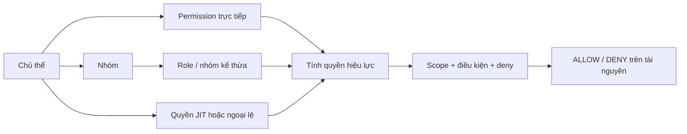
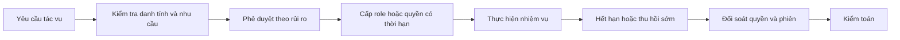
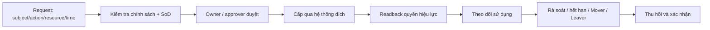

# Nguyên tắc quyền tối thiểu trong IAM: chỉ cấp quyền cần thiết, đúng phạm vi và đúng thời hạn

**Nguyên tắc quyền tối thiểu** (*Principle of Least Privilege – PoLP*) yêu cầu mỗi danh tính — nhân viên, đối tác, tài khoản quản trị, ứng dụng hoặc workload — chỉ có các quyền **thực sự cần để thực hiện nhiệm vụ đã được cho phép**, trên những tài nguyên cần thiết, trong khoảng thời gian cần thiết. Khi công việc, quan hệ hoặc điều kiện thay đổi, tập quyền cũng phải được đánh giá và thu hẹp.

Trong quản lý vòng đời danh tính (**Identity Lifecycle**) của IAM, PoLP không chỉ là một quy tắc lúc cấp tài khoản. Nó là mục tiêu duy trì xuyên suốt **Joiner – Mover – Leaver (JML)**: cấp đúng quyền khởi đầu, loại bỏ quyền không còn phù hợp khi chuyển vai trò, thu hồi những đường truy cập còn tồn tại khi rời tổ chức. Các hệ thống như nguồn nhân sự, **IdP**, **SSO**, **SCIM**, **RBAC/ABAC**, PAM, ứng dụng và kiểm toán cùng góp phần thực hiện mục tiêu đó.

Ví dụ, nhân viên hỗ trợ khách hàng chỉ cần quyền **đọc và cập nhật các ticket được phân công**. Nếu cấp thêm quyền xem toàn bộ dữ liệu khách hàng, sửa hóa đơn và quản trị tài khoản, quyền lớn hơn sẽ tăng thiệt hại tiềm tàng khi nhân viên thao tác nhầm hoặc tài khoản bị chiếm đoạt. Nguyên tắc quyền tối thiểu giúp giảm vùng ảnh hưởng mà không cản trở nhiệm vụ hợp lệ.

## 1. Mục tiêu học tập

Sau bài này, người học cần có thể:

1. Giải thích PoLP theo **chủ thể – hành động – tài nguyên – điều kiện – thời hạn**.
2. Phân biệt quyền tối thiểu với “không có quyền”, **need-to-know**, **default deny**, **separation of duties (SoD)** và **Zero Trust**.
3. Tổ chức **role/entitlement catalog** có owner, mô tả tác vụ, phạm vi và quy trình phê duyệt.
4. Kết hợp **RBAC, ABAC** và ràng buộc quan hệ để giảm quyền quá rộng.
5. Thiết kế cấp quyền trong Joiner, thay quyền trong Mover và thu hồi trong Leaver để tránh **privilege creep**.
6. Áp dụng **Just-in-Time (JIT)** và quản lý đặc quyền cho nhiệm vụ nhạy cảm.
7. Quản trị quyền tối thiểu cho **service account, workload identity, API token, CI/CD** và hệ thống cloud.
8. Xác định quyền hiệu lực kể cả quyền kế thừa, nhóm lồng nhau và ngoại lệ thủ công.
9. Kiểm thử, đo lường và kiểm toán để chứng minh quyền đã được giới hạn và thu hồi trên hệ thống đích.

## 2. Quyền tối thiểu thực sự có nghĩa là gì?

PoLP đặt ra câu hỏi: **“Chủ thể này cần đúng năng lực nào để hoàn thành công việc đã được giao?”** Trả lời câu hỏi đó phải xét đủ năm chiều:

| Chiều | Câu hỏi | Ví dụ giới hạn |
| --- | --- | --- |
| **Chủ thể (subject)** | Ai hoặc workload nào đang thực hiện? | Nhân viên `P-2031` hoặc job `billing-exporter-prod`. |
| **Hành động (action)** | Cần đọc, tạo, sửa, xóa, duyệt hay quản trị? | Chỉ `invoice:read`, không có `invoice:delete`. |
| **Tài nguyên (resource)** | Tập dữ liệu hoặc hệ thống cụ thể nào? | Hóa đơn tenant A và dự án Alpha. |
| **Ngữ cảnh/điều kiện (context)** | Điều kiện nào phải đúng để sử dụng? | Tài khoản ACTIVE, MFA phù hợp, không tự duyệt giao dịch. |
| **Thời hạn (time)** | Quyền cần tồn tại bao lâu? | Trong thời gian làm dự án hoặc 30 phút JIT. |

Một định nghĩa thực dụng:

> **Quyền tối thiểu = tập permission, scope và thời gian nhỏ nhất vẫn đáp ứng các tác vụ đã được phê duyệt theo điều kiện an toàn.**

“Nhỏ nhất” là khái niệm tương đối với **nhu cầu nghiệp vụ cụ thể**. Không có một tập quyền chung cho mọi người. Nếu kế toán cần đọc báo cáo của hai đơn vị để hoàn thành hợp nhất tài chính, chỉ cấp quyền một đơn vị là **thiếu quyền**; cấp quyền toàn doanh nghiệp không có lý do là **thừa quyền**.

### 2.1. Một tình huống đối chiếu

Một ứng dụng quản lý đơn hàng có các thao tác:

```text
order:read
order:create
order:update-draft
order:approve
order:refund
order:delete
user:manage
```

Nhân viên xử lý đơn hàng cần `order:read`, `order:create` và `order:update-draft` cho đơn được giao. Nếu nhóm phát triển gán role `APP_ADMIN` để “đỡ phải xin quyền”, họ vô tình thêm `order:refund`, `order:delete` và `user:manage`.

Điều cần cải thiện không phải bắt nhân viên xin phê duyệt trước mỗi lần lưu nháp, mà là tạo **role tác vụ rõ ràng** và chính sách cấp quyền theo phạm vi công việc.

## 3. Vị trí của PoLP trong các mục tiêu IAM

Các mục tiêu IAM thường đi cùng nhau:

| Mục tiêu | Câu hỏi điều khiển | Quan hệ với PoLP |
| --- | --- | --- |
| **Đúng người** | Chủ thể nào đang truy cập, đã được xác minh chưa? | Quyền được gán cho định danh có chủ sở hữu rõ ràng. |
| **Đúng quyền** | Được thực hiện những thao tác nào? | Chỉ giữ permission cần thiết. |
| **Đúng tài nguyên** | Trên những đối tượng nào? | Chỉ cấp scope liên quan nhiệm vụ. |
| **Đúng thời điểm** | Khi nào quyền có hiệu lực và phải chấm dứt? | Dùng thời hạn, JIT và thu hồi theo JML. |
| **Đúng ngữ cảnh** | Điều kiện phiên, tài nguyên, thiết bị và rủi ro có phù hợp? | Không để permission mạnh hoạt động trong hoàn cảnh không được phê duyệt. |

PoLP **không thể thay thế** xác minh danh tính, xác thực, kiểm tra tài nguyên hoặc bảo vệ token. Nó giúp giới hạn tác động khi một mắt xích thất bại. Một tài khoản đã bị chiếm quyền nhưng chỉ có quyền đọc dữ liệu của một dự án thường gây vùng ảnh hưởng nhỏ hơn tài khoản có quyền quản trị mọi dự án.

### 3.1. So sánh với các nguyên tắc liên quan

- **Default deny:** một thao tác không được cho phép nếu không có quyền/chính sách hợp lệ. Đây là cách thực thi bổ trợ cho PoLP.
- **Need-to-know:** việc xem thông tin nhạy cảm phải dựa trên nhu cầu công việc; thường là một cách cụ thể hóa PoLP cho quyền đọc dữ liệu.
- **Separation of duties (SoD):** tách nhiệm vụ dễ xung đột, ví dụ người tạo phiếu chi không được tự duyệt phiếu do mình tạo. SoD giới hạn tổ hợp quyền và hành vi; PoLP giới hạn quyền cần thiết cho từng nhiệm vụ.
- **Just-in-Time (JIT):** chỉ kích hoạt quyền đặc biệt khi có nhu cầu và cho hết hạn tự động; giúp giảm **thời gian giữ đặc quyền**.
- **Zero Trust:** quyết định truy cập dựa trên xác minh và chính sách liên tục phù hợp; PoLP là một trong những nguyên tắc hỗ trợ.
- **Defense in depth:** giới hạn quyền ở nhiều lớp như cloud IAM, database, API và tài nguyên để một lỗi đơn lẻ không mở toàn bộ hệ thống.

## 4. Quyền được gán và quyền thực sự có hiệu lực

Một người có thể có nhiều quyền hơn những gì màn hình quản lý role trực tiếp thể hiện. **Effective permissions** là tập quyền cuối cùng sau khi tính toàn bộ đường gán quyền và chính sách của hệ thống đích.



Quyền có thể đến từ:

1. **Role trực tiếp** tại IdP hoặc ứng dụng.
2. **Thành viên nhóm**, kể cả nhóm lồng nhau nếu nền tảng hỗ trợ.
3. **ACL / chia sẻ trực tiếp** trên file, project, repository hoặc tài nguyên.
4. **Role kế thừa** từ organization xuống project hoặc resource con.
5. **Entitlement cục bộ** được quản trị thủ công tại SaaS hoặc database.
6. **Role tạm/JIT** còn hiệu lực.
7. **Token/credential cũ** hoặc phiên đang hoạt động với khả năng chưa được cập nhật sau khi thu hồi.

Không phải mọi nền tảng có cùng quy tắc cộng/trừ quyền, kế thừa hoặc ưu tiên explicit deny. Phải phân tích **quy tắc đánh giá của hệ thống đích** trước khi kết luận người dùng thực sự có thể làm gì.

### 4.1. Hai loại “thừa quyền”

**Quyền quá rộng ngay lúc cấp:** nhân viên đọc báo cáo được cấp quyền admin cơ sở dữ liệu. Nguồn lỗi thường là role thiết kế thô, cấp nhanh hoặc thiếu phê duyệt.

**Quyền tích lũy theo thời gian:** một người đổi vai trò ba lần và vẫn giữ nhóm, ACL và token từ những nhiệm vụ cũ. Nguồn lỗi thường là Mover chỉ có cơ chế **add** mà thiếu **remove** và đối soát.

Cả hai cần được sửa: thiết kế quyền đầu vào tốt và **quy trình lifecycle liên tục**.

## 5. Thiết kế quyền theo hành động, dữ liệu và phạm vi

Cấp quyền tối thiểu trước hết đòi hỏi mô hình permission đủ rõ ràng.

### 5.1. Tách các thao tác có mức ảnh hưởng khác nhau

Một permission quá rộng như `DOCUMENT_ALL` khó kiểm soát. Có thể chia thành:

| Permission | Nội dung | Mức nhạy cảm tham khảo |
| --- | --- | --- |
| `document:read` | Xem tài liệu được phép. | Tùy phân loại tài liệu. |
| `document:create` | Tạo tài liệu trong dự án được phép. | Trung bình. |
| `document:update` | Chỉnh sửa tài liệu trong phạm vi. | Trung bình/cao. |
| `document:share` | Mở rộng người được xem. | Cao nếu tài liệu nhạy cảm. |
| `document:export-bulk` | Tải dữ liệu hàng loạt. | Cao. |
| `document:delete` | Xóa dữ liệu. | Cao, phụ thuộc khả năng khôi phục. |
| `document:manage-policy` | Thay đổi quyền người khác. | Rất cao. |

Các mức trên chỉ minh họa. Tổ chức cần đánh giá rủi ro theo **dữ liệu, quy trình nghiệp vụ, môi trường** và tác động thực tế.

Tách permission không phải lúc nào càng nhỏ càng tốt. Nếu chia thành hàng nghìn quyền không có owner hoặc khó hiểu, việc vận hành và rà soát có thể kém hiệu quả. Mức hạt nên đủ để phân biệt **trách nhiệm và ranh giới rủi ro quan trọng**.

### 5.2. Giới hạn tài nguyên đi kèm permission

Quyền `invoice:read` cần gắn với phạm vi:

```yaml
entitlement:
  subjectId: P-2031
  permission: invoice:read
  scope:
    tenantId: TENANT-A
    departmentId: FINANCE
    projectIds:
      - PROJECT-ALPHA
  validFrom: "2026-12-01T00:00:00Z"
  validUntil: "2027-01-31T00:00:00Z"
  approvedBy: DATA_OWNER_FINANCE
```

Mẫu này dùng để giải thích **phạm vi của một quyền**, không phải định dạng SCIM hoặc schema chuẩn của nhà cung cấp. Quyền và hạn phải được **ứng dụng đích thực thi**, không chỉ tồn tại trong hệ thống duyệt.

### 5.3. Giảm quyền với dữ liệu nhạy cảm

Ngoài giới hạn bản ghi, có thể cần:

- **Row-level security:** giới hạn dòng theo tenant, project, owner.
- **Column/field-level control:** che thông tin lương, số định danh hoặc dữ liệu cá nhân không cần thiết.
- **Read-only thay vì write:** chỉ cho truy vấn, không sửa/xóa.
- **Masking và aggregation:** cung cấp thống kê cần thiết mà không xuất dữ liệu gốc.
- **Giới hạn export hàng loạt:** tách quyền xem một đối tượng với quyền tải toàn bộ tập dữ liệu.

Người có quyền đọc trang chi tiết không mặc nhiên được tải hàng triệu bản ghi. Các đường **search, export, download, report, background job** cần áp cùng ranh giới dữ liệu.

## 6. RBAC: xây dựng role phù hợp nhiệm vụ

**Role-Based Access Control (RBAC)** giúp đóng gói các permission thường đi cùng một trách nhiệm, giảm công sức cấp từng quyền cho từng người.

Ví dụ một hệ thống tài chính:

| Role | Nhiệm vụ | Permission nền |
| --- | --- | --- |
| `INVOICE_VIEWER` | Tra cứu hóa đơn được phép. | `invoice:read`. |
| `INVOICE_AUTHOR` | Tạo và cập nhật hóa đơn nháp. | `invoice:read`, `invoice:create`, `invoice:update-draft`. |
| `INVOICE_APPROVER` | Xem và duyệt hóa đơn trong hạn mức. | `invoice:read`, `invoice:approve`, kèm kiểm tra SoD. |
| `FINANCE_AUDITOR` | Rà soát dấu vết. | `invoice:read`, `audit:read` trong phạm vi kiểm toán. |

Vai trò không tự bảo đảm người dùng được thao tác trên **mọi hóa đơn**. Scope tenant, phòng ban, hạn mức và điều kiện nghiệp vụ còn phải được đánh giá.

### 6.1. Cách thiết kế role có thể duy trì

1. **Xuất phát từ nhiệm vụ:** ghi các tác vụ thường xuyên theo chức danh, không sao chép mù role đã cấp cho người tiền nhiệm.
2. **Định nghĩa quyền cần có:** gán những permission đủ dùng; tách quyền nhạy cảm dùng hiếm.
3. **Gắn owner:** mỗi role có người chịu trách nhiệm phê duyệt thay đổi và rà soát thành viên.
4. **Đặt tên theo ý nghĩa:** tránh tên mơ hồ như `POWER_USER` nếu không định nghĩa cụ thể.
5. **Tách role nghiệp vụ khỏi role hạ tầng:** đọc báo cáo không đòi hỏi quyền quản trị database.
6. **Rà soát khi nhiệm vụ đổi:** thay đổi sản phẩm, nguồn dữ liệu hoặc quy trình có thể khiến role cũ quá rộng.

**Role explosion** xảy ra khi tạo role riêng cho mọi kết hợp tenant, dự án, vùng, chức danh và điều kiện. Giải pháp có thể là role phản ánh **loại hành động**, kết hợp chính sách **ABAC** cho các điều kiện biến thiên.

### 6.2. Cấp role qua nhóm IdP không bảo đảm hoàn tất

IdP có thể gắn nhóm cho người dùng rồi dùng SSO/SCIM để đồng bộ vào ứng dụng. Tuy nhiên, cần xác minh:

- Nhóm IdP được ánh xạ tới đúng role nào tại ứng dụng?
- Role cục bộ nào có thể được cấp **ngoài luồng**?
- SCIM có đồng bộ thành viên nhóm và trạng thái tài khoản đúng không?
- Độ trễ khiến quyền được cấp hoặc gỡ chậm bao lâu?
- Session và token cũ có mang claim role chưa cập nhật không?

**Phản hồi provisioning thành công** là bằng chứng thực hiện một bước; để chứng minh PoLP, nên có **đối soát quyền hiệu lực ở ứng dụng đích**.

## 7. ABAC và quan hệ tài nguyên giúp thu hẹp quyền

**Attribute-Based Access Control (ABAC)** cho phép xét các thuộc tính tin cậy của chủ thể, tài nguyên, hành động và ngữ cảnh. Một role đọc dữ liệu có thể được giới hạn theo tenant, dự án và mức phân loại.

Ví dụ:

```text
PERMIT document.read WHEN
    subject.status == ACTIVE
    AND subject.hasRole("DOC_READER")
    AND subject.tenantId == document.tenantId
    AND document.projectId IN subject.assignedProjects
    AND subject.clearanceLevel >= document.classificationLevel
    AND document.status == ACTIVE

OTHERWISE DENY
```

Đây là **pseudocode** về chính sách. So sánh phân loại đòi hỏi tổ chức có thứ tự mức rõ ràng; các thuộc tính như `assignedProjects` phải đến từ nguồn đáng tin, không từ request body.

Một số tài nguyên còn cần điều kiện theo **quan hệ**:

```text
canUpdateTicket(subject, ticket) =
    subject.active
    AND subject.hasPermission("ticket:update")
    AND subject.tenantId == ticket.tenantId
    AND (
        ticket.assigneeId == subject.id
        OR subject.id IN ticket.authorizedTeam
    )
```

Đây là cách thể hiện kiểm tra theo quan hệ (*relationship-based access control*, thường gọi là **ReBAC**). Mối quan hệ được xác định từ cơ sở dữ liệu nghiệp vụ đáng tin, có thể thay đổi khi ticket chuyển người xử lý.

### 7.1. Chính sách “đúng ngữ cảnh” không thay thế permission

Ví dụ, dù đăng nhập từ thiết bị được quản lý, IP công ty và MFA mạnh, nhân viên không có `payroll:export` vẫn **không được xuất lương**. Các tín hiệu ngữ cảnh tốt không tự cấp thêm permission thiếu.

Ngược lại, một người có permission `payroll:export` chưa chắc được xuất dữ liệu trong phiên thiếu mức xác thực theo chính sách. PoLP được duy trì bằng **điều kiện kết hợp**, không phải bằng một dấu hiệu đơn lẻ.

## 8. PoLP trong Joiner: cấp đúng quyền nền ban đầu

Ở giai đoạn **Joiner**, người mới gia nhập thường cần một tập quyền tiêu chuẩn đủ để làm việc. Quy trình lý tưởng:

1. **Nguồn có thẩm quyền** (HRIS, quản lý nhà thầu) xác nhận quan hệ, chức danh, đơn vị, ngày bắt đầu và người quản lý.
2. IAM liên kết hồ sơ với đúng định danh ổn định trong IdP.
3. Vai trò công việc được ánh xạ tới **baseline role/entitlement** đã được định nghĩa.
4. Những quyền nhạy cảm hoặc ngoài baseline đi qua **yêu cầu và phê duyệt riêng**.
5. Hệ thống đích nhận tài khoản/nhóm qua SCIM hoặc API provisioning khi hỗ trợ.
6. Quyền hiệu lực được kiểm tra lại theo tenant, scope, môi trường và hạn.
7. Ghi log người phê duyệt, lý do, trạng thái từng ứng dụng và các ngoại lệ.

**Tình huống:** nhân viên hỗ trợ mới chỉ cần quản lý ticket thuộc nhóm mình. Một mẫu cấp quyền có thể là:

```yaml
subjectCategory: EMPLOYEE
jobFunction: CUSTOMER_SUPPORT
baselineEntitlements:
  - permission: ticket:read
    scope: ASSIGNED_TEAM
  - permission: ticket:reply
    scope: ASSIGNED_TICKETS
privilegedEntitlements: []
```

Mẫu là mô tả mục tiêu thiết kế, không phải schema của hệ thống IAM cụ thể. Baseline phải được owner nghiệp vụ rà soát khi tác vụ thay đổi.

### 8.1. Tránh sao chép toàn bộ quyền của nhân viên cũ

Một cách cấp quyền nhanh là “cấp cho nhân viên mới giống người giữ vị trí trước”. Cách này có thể sao chép **quyền đặc biệt, ngoại lệ quá hạn, role bổ sung vì nhiệm vụ cũ** hoặc quyền trực tiếp không còn cần thiết.

Nếu cần dùng người mẫu để tham khảo, phải **đối chiếu với catalog và nhiệm vụ hiện tại**, phát hiện quyền ngoài baseline và phê duyệt theo phạm vi, không sao chép nguyên trạng.

## 9. PoLP trong Mover: tính lại tập quyền thay vì chỉ cộng thêm

Trong giai đoạn **Mover**, người dùng chuyển vai trò, đơn vị, dự án hoặc loại quan hệ. Rủi ro lớn là **privilege creep**: những quyền của nhiệm vụ cũ còn tồn tại trong khi quyền mới đã được thêm.

Một phương pháp hữu ích là so sánh:

```text
desiredPermissions = baseline(newRole)
                   + approvedActiveExceptions
                   + currentResourceRelationships

permissionsToRevoke = currentEffectivePermissions
                    - desiredPermissions

permissionsToGrant  = desiredPermissions
                    - currentEffectivePermissions
```

Đây chỉ là công thức khái niệm. Phép trừ tập hợp cần phân biệt **nguồn cấp quyền và scope**, đồng thời tôn trọng chính sách kế thừa của nền tảng. Không thể xóa một permission hiệu lực nếu nó vẫn được cấp qua một đường khác mà chưa được xử lý.

### 9.1. Ví dụ chuyển từ hỗ trợ sang tài chính

Giả sử Nam từng là nhân viên hỗ trợ, có:

- `ticket:read-team`.
- `ticket:reply`.
- Ngoại lệ `customer:export-all` dùng cho sự cố, đã hết hạn.
- Quyền đọc dashboard hỗ trợ thông qua chia sẻ trực tiếp.

Khi Nam chuyển sang kế toán, tập quyền mục tiêu gồm:

- `invoice:read` trong tenant A.
- `invoice:create-draft` trong tenant A.
- Quyền duyệt hóa đơn **chưa được cấp** nếu chưa có phê duyệt và điều kiện SoD.

Quy trình Mover phải xử lý cả role hỗ trợ, ngoại lệ export và chia sẻ dashboard. Nếu chỉ gỡ nhóm `support-team` ở IdP, **ngoại lệ hoặc ACL tại ứng dụng** có thể vẫn sống.

### 9.2. Bàn giao công việc được phê duyệt

Đôi khi cần giữ một số quyền cũ trong 3 ngày để bàn giao. Có thể cấp **ngoại lệ hẹp**:

```yaml
exceptionId: EX-2207
subjectId: P-2031
permission: ticket:read
scope:
  projectId: SUPPORT-LEGACY
validUntil: "2026-12-10T10:00:00Z"
businessJustification: "Bàn giao ticket chưa đóng"
approvedBy: SUPPORT_DATA_OWNER
```

Điều kiện quan trọng là quyền cũ **không được giữ vô thời hạn** chỉ vì có một yêu cầu bàn giao. Cần có mốc kết thúc, người phê duyệt, kiểm tra sử dụng và thu hồi xác nhận.

### 9.3. SoD khi kết hợp role cũ và mới

Quá trình chuyển vai trò có thể vô tình tạo tổ hợp quyền không an toàn. Ví dụ người tạo nhà cung cấp cũ chuyển sang vị trí phê duyệt thanh toán, nhưng vẫn giữ quyền sửa thông tin nhà cung cấp.

PoLP yêu cầu gỡ những quyền không còn cần; **SoD** bổ sung kiểm tra cấm tổ hợp role hoặc hành động xung đột. Cả hai nên cùng được chạy khi Mover và khi yêu cầu entitlement đặc biệt.

## 10. PoLP trong Leaver: không còn nhiệm vụ thì không còn quyền

Khi quan hệ làm việc/hợp đồng kết thúc, tập quyền được phép phục vụ quan hệ đó thường phải được thu hồi theo chính sách. Cần xét **toàn bộ đường truy cập**, không chỉ role ở IdP:

| Hệ thống/đường truy cập | Nội dung cần đối soát |
| --- | --- |
| IdP / SSO | Khóa đăng nhập, xử lý phiên/refresh token theo tính năng có sẵn. |
| Ứng dụng SaaS | Deprovision tài khoản, nhóm, entitlement và role cục bộ. |
| Hạ tầng cloud | Gỡ role, policy binding, khóa người dùng và quyền console/API. |
| Database / API | Thu hồi tài khoản cục bộ, credential và quyền riêng. |
| Git / CI/CD | Personal Access Token, SSH key, quyền repository và runner. |
| File và tài nguyên chia sẻ | ACL, share link, owner và quyền trên dự án cũ. |
| Tác vụ nền | Quyền được ủy quyền cho job và dữ liệu xuất đang chờ thực hiện. |
| Danh tính đặc quyền | Quyền PAM/JIT, break-glass và session quản trị liên quan. |

**SCIM `active: false` không tự chứng minh tất cả phiên hoặc API key độc lập đã bị thu hồi.** Một trạng thái Leaver hoàn tất cần có thông tin từ từng ứng dụng đích theo phạm vi đã xác định.

### 10.1. Đo cửa sổ quyền tồn dư

Nếu quyền hết hiệu lực theo chính sách lúc 18:00 nhưng ứng dụng xác nhận từ chối truy cập lúc 18:07, có một cửa sổ 7 phút cần được ghi nhận. Cách giảm trễ phụ thuộc rủi ro và nền tảng:

- Cập nhật trạng thái ở hệ thống nguồn kịp thời.
- Truyền sự kiện JML đáng tin và xử lý ưu tiên đối với khóa khẩn cấp.
- Giảm độ trễ provisioning hoặc dùng đường thu hồi trực tiếp khi cần.
- Thu hồi/invalidate phiên hoặc token theo cơ chế có sẵn.
- Đối soát và cảnh báo hệ thống chưa xác nhận.
- Quy định ngưỡng thời gian khác nhau cho đặc quyền cao và truy cập thông thường.

Không nên thay đổi mốc “thời điểm phải thu hồi” thành “thời điểm đã gửi lệnh” để che giấu độ trễ.

## 11. Quyền có thời hạn và Just-in-Time

Một quyền **standing privilege** luôn hoạt động gây cửa sổ rủi ro dài. Với thao tác hiếm hoặc đặc quyền cao, **Just-in-Time (JIT)** giúp giảm **thời gian quyền thực sự được kích hoạt**.

Quy trình JIT minh họa:



Ví dụ, kỹ sư chỉ cần **restart một service production** để xử lý sự cố:

```json
{
  "requestId": "access-4382",
  "subjectId": "P-2031",
  "permission": "service:restart",
  "resource": "payments-api-prod",
  "reason": "INC-2026-0098",
  "validFrom": "2026-12-05T08:00:00Z",
  "validUntil": "2026-12-05T08:30:00Z",
  "approvalStatus": "APPROVED"
}
```

Khi tới `validUntil`, **PAM/IAM và hệ thống đích phải làm quyền hết hiệu lực thật**. Nếu một phiên shell, credential hoặc token có thể tiếp tục dùng quyền sau khi role hiển thị “expired”, chưa đạt mục tiêu PoLP theo thời hạn.

### 11.1. Just Enough Access (JEA)

**JEA** giới hạn **tập thao tác**; **JIT** giới hạn **thời gian**. Kết hợp hai cơ chế thường hiệu quả hơn một quyền admin toàn phần trong 30 phút.

Ví dụ:

- **Không phù hợp:** cấp `CLOUD_ADMIN` trên mọi project để restart một service.
- **Phù hợp hơn:** cấp quyền restart duy nhất service X, trong môi trường production đã chỉ định, trong 30 phút, có dấu vết phê duyệt.

Khi nền tảng chỉ hỗ trợ role rộng, cần cân nhắc công cụ trung gian (PAM, API tác vụ giới hạn, quy trình vận hành) thay vì chấp nhận role cao vô điều kiện.

### 11.2. Break-glass là ngoại lệ có kiểm soát

Tài khoản khẩn cấp có thể cần quyền lớn để khôi phục hệ thống khi cơ chế bình thường không hoạt động. PoLP vẫn áp dụng ở mức **tối thiểu cần cho tình huống khẩn cấp**, kết hợp:

- Phân công người giữ và điều kiện sử dụng rõ ràng.
- Cảnh báo tức thời và lưu vết truy cập.
- Kiểm soát credential và quy trình bàn giao.
- Hạn chế thời gian/scope nếu khả thi.
- Hậu kiểm sau khi sử dụng, xoay vòng bí mật nếu cần.
- Rà soát định kỳ để tránh biến tài khoản khẩn cấp thành tài khoản admin thường ngày.

## 12. Tài khoản đặc quyền và quản trị hạ tầng

Đặc quyền thường có khả năng mở rộng tác động: thay chính sách IAM, tạo credential, truy cập dữ liệu hàng loạt, xóa tài nguyên hoặc tắt hệ thống kiểm toán.

Một nguyên tắc quan trọng là **tách tác vụ quản trị khỏi công việc thường ngày**. Ví dụ người quản trị dùng danh tính cá nhân cho giao tiếp, đọc tài liệu và dùng tài khoản/quy trình đặc quyền có kiểm soát cho thao tác hạ tầng.

| Mức truy cập | Minh họa | Cách giảm đặc quyền |
| --- | --- | --- |
| Đọc trạng thái hệ thống | Xem logs, metrics cần thiết | Read-only role, giới hạn namespace/project. |
| Thao tác vận hành | Restart service, rollout lại deployment | Permission riêng, resource scope cụ thể, JIT khi phù hợp. |
| Quản trị ứng dụng | Quản lý nhóm/người dùng một ứng dụng | Giới hạn tenant/app, tách phê duyệt nhạy cảm. |
| Quản trị nền tảng | Sửa IAM policy, tài nguyên production | MFA mạnh, PAM/JIT, kiểm toán chi tiết và SoD. |
| Khẩn cấp | Phục hồi kiểm soát khi hệ thống lỗi | Break-glass với giám sát và hậu kiểm. |

Đội vận hành cần biết **role rộng nào đang được cấp liên tục** và liệu có thể phân tách thành role theo tác vụ hay không. Tần suất sử dụng là một tín hiệu hỗ trợ thiết kế; không đủ để tự động xóa quyền nếu tồn tại nhiệm vụ hiếm nhưng quan trọng đã được phê duyệt.

## 13. PoLP cho service account và workload identity

Định danh phi con người có thể tạo ra rủi ro lớn vì hoạt động tự động, số lượng nhiều và credential đôi khi được lưu lâu. **Workload identity** nên có **quyền, tài nguyên, môi trường và owner riêng**, thay vì dùng credential chung với đặc quyền rộng.

### 13.1. Ví dụ job xuất báo cáo

Một job tên `billing-reporter-prod` cần:

- Đọc các bảng dữ liệu hóa đơn đã được phê duyệt.
- Ghi một bucket báo cáo production.
- Gửi thông báo hoàn tất vào queue công việc.

Job **không cần** đọc mọi secret, sửa chính sách IAM, quản trị toàn database hay xóa bucket khác.

| Thành phần | Thiết kế quá rộng | Thiết kế theo PoLP |
| --- | --- | --- |
| Database | Superuser toàn database | Read-only trên schema/bảng cần thiết. |
| Object storage | Read/write/delete mọi bucket | Put vào prefix/bucket báo cáo cụ thể; thêm read khi thực sự cần. |
| Message queue | Admin mọi queue | Publish tới đúng queue. |
| Identity | API key dùng chung nhiều service | Danh tính workload riêng, xác thực theo môi trường. |
| Credential | Bí mật dài hạn trong cấu hình | Ưu tiên credential ngắn hạn/federation khi hạ tầng hỗ trợ. |

### 13.2. Service account cần chủ sở hữu và vòng đời

Mỗi identity phi con người nên có:

1. **Owner chịu trách nhiệm** và hệ thống/dịch vụ đang sử dụng.
2. Mục đích nghiệp vụ, danh mục tài nguyên, permission.
3. Môi trường: dev, test, staging, production.
4. Cơ chế quản lý credential và thời hạn.
5. Lịch rà soát quyền và quy trình xử lý khi workload không còn hoạt động.
6. Cách chuyển owner khi người phụ trách rời đội.
7. Bằng chứng những hệ thống đích thực sự thực thi scope.

**Leaver của người owner không luôn đồng nghĩa tắt ngay service account**, vì có thể làm gián đoạn hệ thống đang chạy. Nhưng phải có quy trình chuyển ownership và rà soát quyền, credential, mục đích sử dụng; những tài khoản không còn owner hoặc workload hợp lệ cần được xử lý.

### 13.3. CI/CD và automation

Một pipeline triển khai chỉ nên có quyền với môi trường/dịch vụ nó triển khai. Không nên dùng cùng secret admin cho pipeline build pull request và deploy production.

Ví dụ phân chia:

- Job test: quyền đọc source và chạy kiểm thử trong sandbox.
- Job build: đọc dependencies, ghi artifact vào registry được chỉ định.
- Job deploy staging: deploy staging.
- Job deploy production: thao tác trên tài nguyên production cụ thể, có phê duyệt và định danh pipeline đáng tin.
- Job rotate credential: quyền riêng trên secret cần thay, không cấp cho mọi job.

Tách identity còn giúp kiểm toán biết **job nào đã dùng quyền nào**, giảm vùng ảnh hưởng khi một pipeline bị xâm nhập.

## 14. Quyền tối thiểu trên cloud và database

Trong cloud IAM, permission có thể áp vào **organization, account/subscription, project, resource group, namespace hoặc từng tài nguyên**. Một role gán ở cấp cha có thể lan xuống nhiều tài nguyên con tùy hệ thống.

### 14.1. Tránh gán ở cấp quá cao

Ví dụ:

- Kỹ sư chỉ quản lý một ứng dụng: nên cấp quyền trên **project/service** tương ứng nếu hệ thống hỗ trợ.
- Job chỉ cần đọc một object prefix: không cấp quyền liệt kê, xóa và sửa tất cả bucket.
- Ứng dụng chỉ cần đọc một secret: không cấp quyền đọc toàn bộ secret store.
- Analyst chỉ cần dữ liệu tổng hợp: không cấp DBA hoặc quyền xem mọi bảng.

Cần xem cả **quyền thông qua nhóm, role kế thừa, resource policies và trust relationships**. Một danh tính không có policy trực tiếp vẫn có thể nhận đặc quyền qua một role khác.

### 14.2. Cơ sở dữ liệu

Một ví dụ SQL minh họa về quyền đọc có phạm vi:

```sql
-- Minh họa cú pháp theo hệ quản trị hỗ trợ role và GRANT.
CREATE ROLE reporting_reader;
GRANT SELECT ON finance.invoice_summary TO reporting_reader;
-- Không tự GRANT INSERT, UPDATE, DELETE hoặc quyền quản trị.
```

Cú pháp, kế thừa role và khả năng giới hạn theo schema/table có khác nhau giữa các hệ quản trị. **GRANT SELECT trên một bảng** chưa bảo đảm người dùng chỉ thấy đúng tenant; nếu cần, phải thêm cơ chế như **row-level security, view lọc dữ liệu hoặc kiểm tra tại ứng dụng**.

### 14.3. Dữ liệu nhạy cảm trong API

Không nên trộn một permission như `user:read` cho cả:

- Xem tên hiển thị và thông tin công khai.
- Xem thông tin liên hệ nội bộ.
- Xem thông tin nhạy cảm.
- Xuất hàng loạt danh sách người dùng.

Tách quyền theo **mức nhạy cảm và khả năng xuất dữ liệu** giúp ngăn việc một tính năng hữu ích vô tình mở thêm đường lộ dữ liệu.

## 15. Vòng đời của một yêu cầu cấp quyền ngoại lệ

Ngoài role nền, doanh nghiệp luôn có yêu cầu không thường xuyên. Để giữ PoLP, mỗi ngoại lệ nên là một **entitlement được quản trị**.



Các trường nên có trong hồ sơ yêu cầu:

| Nhóm dữ liệu | Nội dung |
| --- | --- |
| **Ai** | Subject ID, loại quan hệ và owner. |
| **Làm gì** | Permission/action cụ thể. |
| **Ở đâu** | Ứng dụng, môi trường, tenant, project hoặc tài nguyên. |
| **Vì sao** | Ticket, dự án, nhiệm vụ hoặc lý do được phê duyệt. |
| **Bao lâu** | Mốc bắt đầu, mốc hết hạn hoặc điều kiện kết thúc. |
| **Ai duyệt** | Resource/data owner, manager hoặc người phê duyệt được ủy quyền. |
| **Đã thực thi chưa** | Trạng thái provisioning và readback ở ứng dụng đích. |
| **Thu hồi ra sao** | Cơ chế hết hạn, sự kiện JML, owner xử lý và bằng chứng. |

**Phê duyệt phải phù hợp độ rủi ro.** Quyền đọc tài liệu nội bộ thông thường có thể nằm trong baseline; quyền sửa IAM policy hoặc xem dữ liệu nhạy cảm diện rộng có thể cần owner dữ liệu, xác thực tăng cường và thời hạn ngắn.

### 15.1. Quyền vĩnh viễn có phải luôn sai?

Không. Có những entitlement nền cần xuyên suốt thời gian đảm nhiệm vai trò, như truy cập hệ thống ticket của nhân viên hỗ trợ. PoLP không yêu cầu mọi permission có hạn 15 phút; nó yêu cầu **quyền phù hợp với vai trò hiện tại** và được thu hồi khi vai trò hoặc quan hệ thay đổi.

Điểm cần phân biệt là **quyền nền còn cần thường xuyên** với **quyền ngoại lệ mạnh chỉ cần ngắn hạn**.

## 16. Thực thi PoLP tại API và backend

Một giao diện chỉ ẩn chức năng không phải kiểm soát quyền đủ mạnh. Backend phải kiểm tra từng hành động trên tài nguyên cụ thể.

Ví dụ service duyệt hóa đơn:

```java
// Pseudocode Java: tên lớp/hàm minh họa, không phụ thuộc framework.
void approveInvoice(VerifiedPrincipal principal, String invoiceId) {
    Subject actor = subjectStore.loadActive(principal.subjectId());
    Invoice invoice = invoiceStore.load(invoiceId);

    if (actor == null || invoice == null) {
        throw new AccessDeniedException();
    }

    AuthorizationContext context = policyContext.forInvoice(actor, invoice);
    authorization.requirePermission(
        actor,
        "invoice:approve",
        invoice,
        context
    );

    if (!actor.tenantId().equals(invoice.tenantId())) {
        throw new AccessDeniedException();
    }
    if (invoice.amount().compareTo(actor.approvalLimit()) > 0) {
        throw new AccessDeniedException();
    }
    if (invoice.createdBySubjectId().equals(actor.id())) {
        throw new AccessDeniedException(); // SoD động.
    }
    if (!invoice.status().equals("PENDING")) {
        throw new AccessDeniedException();
    }

    invoiceStore.approveWithConcurrencyCheck(invoice, actor.id());
    audit.log(actor.id(), "invoice:approve", invoice.id(), "SUCCEEDED");
}
```

Đây là ví dụ để thấy **quyền thao tác phải đi cùng phạm vi và điều kiện nghiệp vụ**. Trong triển khai thật, cần xác minh principal/token đúng issuer, audience, chữ ký và hạn; xử lý audit cho cả từ chối; thực hiện kiểm tra quyền và thay đổi dữ liệu với tính nhất quán phù hợp để tránh **TOCTOU** (thay đổi dữ liệu giữa lúc kiểm tra và lúc sử dụng).

### 16.1. Các lỗi PoLP thường tạo ra lỗ hổng truy cập

- **BOLA/IDOR:** có `document:read` nhưng không kiểm tra document ID có thuộc scope không.
- **Broken Function Level Authorization:** người đọc dữ liệu gọi được API quản trị chỉ vì endpoint quên kiểm tra role.
- **Mass assignment:** người dùng sửa một trường không được phép như `isAdmin` hoặc `ownerId` thông qua request body.
- **Export bỏ qua phạm vi:** API chi tiết lọc tenant nhưng API export dùng service account có quyền toàn bộ database.
- **Confused deputy:** dịch vụ có đặc quyền dùng quyền của chính nó để thực hiện yêu cầu của user ngoài scope được cho phép.
- **Cache quyền cũ:** role đã bị gỡ nhưng API vẫn chấp nhận quyết định `ALLOW` từ cache.
- **Đường nội bộ không bảo vệ:** endpoint của job/batch bỏ qua policy vì “chỉ được gọi nội bộ”.

Giảm rủi ro bằng một **điểm thực thi chính sách đáng tin**, dùng kiểm tra authorization ở tầng nghiệp vụ, kiểm tra đối tượng thực tế và các bài test từ chối rõ ràng.

### 16.2. Nguyên tắc ủy quyền cho dịch vụ trung gian

Nếu API A được người dùng gọi rồi gọi API B bằng service identity, B cần biết **hành động thay mặt ai và phạm vi được ủy quyền nào** khi chính sách yêu cầu. Không nên biến một yêu cầu chỉ có quyền đọc thành thao tác ghi thông qua đặc quyền của API A.

Tùy kiến trúc, có thể sử dụng token trao đổi/ủy quyền có scope phù hợp, hoặc truyền ngữ cảnh được ký và xác minh giữa các dịch vụ. Tính đúng đắn dựa vào **nguồn ngữ cảnh tin cậy và việc B kiểm tra quyền**, không dựa trên trường `userId` do client tùy ý gửi.

## 17. Access review và chứng minh quyền thực tế còn cần

**Access review / access certification** là hoạt động chủ sở hữu kiểm tra người nào còn cần quyền gì. Việc rà soát cần đi xa hơn câu hỏi “người này còn ở công ty không?”.

Một vòng rà soát hữu ích gồm:

1. Lấy danh sách **entitlement và effective permissions** từ ứng dụng, IdP, database, cloud và công cụ PAM trong phạm vi.
2. Gắn từng quyền với **chủ thể, role, tài nguyên, owner, nguồn cấp, thời gian**.
3. Phát hiện quyền đặc quyền, quyền gán trực tiếp, quyền ngoại lệ, quyền lâu không dùng hoặc quyền quá hạn.
4. Owner xác nhận **nhu cầu công việc hiện tại**; nếu cần, yêu cầu người quản lý bổ sung ngữ cảnh.
5. Gỡ quyền không còn cần hoặc giảm scope; đối soát kết quả.
6. Ghi lại quyết định, người xác nhận, mốc hoàn tất và lý do giữ quyền nhạy cảm.

### 17.1. Quyền không sử dụng có nên tự động xóa?

**Dữ liệu sử dụng** là tín hiệu mạnh giúp phát hiện quyền không cần thiết. Tuy nhiên, một số tác vụ hợp lệ xảy ra hiếm, như khôi phục sự cố, quyết toán cuối năm, hỗ trợ thiên tai hoặc vận hành hệ thống dự phòng.

Vì vậy, trước khi tự động thu hồi quyền dựa trên “không dùng trong 90 ngày”, cần xác định **tác vụ, tần suất nghiệp vụ, owner và phương án xin lại quyền**. Với quyền admin nhạy cảm, dữ liệu không dùng có thể là lý do tốt để chuyển sang JIT thay vì giữ standing privilege.

### 17.2. Vì sao cần người chịu trách nhiệm về role/entitlement?

Nếu một quyền không có owner, không ai có căn cứ chắc chắn để kết luận nó cần tồn tại. Catalog nên giúp trả lời:

- Quyền này cho phép hành động gì?
- Có ảnh hưởng tới dữ liệu hoặc sản xuất không?
- Được cấp trên phạm vi nào?
- Ai có thẩm quyền phê duyệt?
- Nhiệm vụ nào cần nó?
- Khi nào rà soát và tiêu chí thu hồi ra sao?

## 18. Ví dụ xuyên suốt: một nhân sự đổi vai trò rồi nghỉ việc

Giả sử **Lan** làm hỗ trợ khách hàng tại tenant A, sau đó chuyển sang vận hành hệ thống, rồi nghỉ việc. Hệ thống sử dụng HRIS, IdP, SSO, SaaS ticket, cloud và SCIM.

### 18.1. Giai đoạn Joiner

Nhu cầu công việc ban đầu:

| Entitlement | Cấp hay không? | Lý do |
| --- | --- | --- |
| `ticket:read-assigned` | **Cấp** | Đọc ticket được phân công. |
| `ticket:reply` | **Cấp** | Trả lời khách hàng trong đội. |
| `ticket:export-all` | **Không** | Không phải tác vụ cần thiết. |
| `cloud:admin` | **Không** | Không thuộc vai trò hỗ trợ. |
| `identity:manage-users` | **Không** | Không cần quản trị người dùng. |

Tập quyền được quản lý qua role và phạm vi. Đăng nhập SSO không tự mở rộng quyền ở ứng dụng.

### 18.2. Giai đoạn Mover

Lan chuyển sang vận hành service X. Phần chênh lệch cần xử lý:

- **Thu hồi** quyền trả lời ticket và các chia sẻ trực tiếp không còn liên quan.
- **Giữ** quyền đọc ticket cũ trong hai ngày chỉ nếu có phê duyệt bàn giao, giới hạn đúng dự án và hết hạn tự động.
- **Cấp** quyền xem log service X và các chức năng vận hành thường xuyên.
- **Không cấp đứng** quyền admin toàn cloud; sử dụng JIT để restart service X khi có sự cố.
- **Kiểm tra SoD** và đối soát role cục bộ, nhóm lồng nhau, token phiên cũ.

Nếu Lan đã từng có một quyền export ticket đặc biệt trong ứng dụng SaaS, việc gỡ role ở IdP có thể **không gỡ được entitlement cục bộ đó**. Phải phát hiện và xác nhận thu hồi trực tiếp từ ứng dụng.

### 18.3. Giai đoạn Leaver

HRIS thông báo chấm dứt quan hệ lúc 18:00:

1. IdP chặn đăng nhập theo chính sách.
2. Kênh SSO, phiên và refresh token được xử lý theo tính năng hỗ trợ.
3. Ứng dụng SaaS được deprovision qua SCIM/API.
4. Quyền cloud, PAT, SSH key, tài khoản cục bộ và quyền JIT được rà soát/thu hồi.
5. Các tài nguyên sở hữu được chuyển giao cho owner mới theo quy trình.
6. Kết quả từng hệ thống được xác nhận; quyền còn tồn dư phải có cảnh báo và người xử lý.

**Điểm quyết định:** PoLP không chỉ được đánh giá bằng việc Lan có role tối thiểu khi còn làm việc. Nó được đánh giá bằng khả năng **duy trì và thu hồi đúng tập quyền** qua mọi thay đổi trong vòng đời.

## 19. Các chỉ số đánh giá PoLP

Một chương trình IAM cần số đo rõ **mẫu số, phạm vi hệ thống và nguồn bằng chứng**.

| Chỉ số | Cách hiểu | Điều cần chú ý |
| --- | --- | --- |
| **Tỷ lệ entitlement có owner** | Entitlement có owner chịu trách nhiệm / tổng entitlement trong phạm vi. | Owner cần còn hiệu lực và có trách nhiệm thật. |
| **Tỷ lệ cấp quyền theo baseline** | Cấp quyền phù hợp role chuẩn / tổng lần cấp trong phạm vi. | Baseline phải được rà soát, không coi mọi role chuẩn là an toàn tuyệt đối. |
| **Số quyền đặc quyền liên tục** | Standing privilege có rủi ro cao đang hoạt động. | Theo dõi chuyển đổi sang JIT hoặc giảm scope. |
| **Số ngoại lệ quá hạn** | Entitlement đã qua thời hạn nhưng vẫn còn hiệu lực. | Kiểm tra tại hệ thống đích. |
| **Tỷ lệ Mover được làm sạch quyền cũ** | Sự kiện Mover hoàn tất thu hồi quyền không còn cần / tổng Mover cần xử lý. | Kiểm tra cả quyền trực tiếp, ACL, nhóm lồng nhau. |
| **Thời gian thu hồi Leaver** | Từ mốc phải thu hồi đến lúc từng hệ thống xác nhận chặn quyền. | Không nhầm mốc gửi lệnh với mốc chặn thật. |
| **Tỷ lệ hoàn tất access review** | Quyền đã được owner quyết định và thực thi kết quả / tổng quyền phải rà soát. | Một lần bấm “certify” chưa đủ nếu quyền cần gỡ vẫn còn. |
| **Số quyền SoD xung đột** | Tổ hợp quyền/hành vi xung đột chưa được xử lý. | Xem cả SoD tĩnh và động. |
| **Số service account không owner** | Danh tính phi con người thiếu người chịu trách nhiệm. | Ưu tiên credential có đặc quyền cao. |
| **Số ca test vượt scope thành công** | Kịch bản API/cloud truy cập trái phép vẫn được phép. | Đây là lỗi kiểm soát, cần điều tra và sửa. |

Chỉ số dùng để **phát hiện và cải thiện kiểm soát**, không phải chạy theo một tỷ lệ “đẹp” bằng cách xóa nhu cầu nghiệp vụ hợp lệ. Mức mục tiêu và hạn xử lý nên dựa trên rủi ro cụ thể.

### 19.1. Nhật ký cấp và thu hồi cần có gì?

Một sự kiện entitlement nên truy vết được:

- Subject ID, loại danh tính, người hoặc service owner.
- Permission, role/entitlement, resource scope và policy version.
- Nguồn yêu cầu, lý do công việc và mã phê duyệt.
- Người phê duyệt, thời điểm bắt đầu, thời điểm hết hạn.
- Hệ thống đích và kết quả provisioning/readback.
- Sự kiện Mover/Leaver hoặc lý do thu hồi.
- Trạng thái xử lý, lỗi, retry và mốc xác nhận hoàn tất.

Không ghi mật khẩu, token đầy đủ hoặc credential bí mật trong log. Quyền xem log và thời gian lưu dữ liệu phải phù hợp chính sách bảo mật, riêng tư và kiểm toán.

## 20. Kiểm thử quyền tối thiểu có ý nghĩa

Kiểm thử PoLP cần chứng minh **đường truy cập hợp lệ vẫn hoạt động** và **đường truy cập thừa quyền bị từ chối**.

| Trường hợp | Yêu cầu hợp lệ | Ca đối chứng cần từ chối |
| --- | --- | --- |
| Nhân viên hỗ trợ | Đọc ticket được giao | Đọc toàn bộ ticket tenant khác. |
| Kế toán nhập liệu | Tạo hóa đơn nháp | Duyệt hóa đơn do chính mình tạo. |
| Nhân viên xem báo cáo | Xem dữ liệu nhóm được cấp | Export toàn công ty không có entitlement. |
| Quản trị JIT | Restart service X trong 30 phút | Thực thi sau hết hạn hoặc restart service Y. |
| Service account báo cáo | Đọc bảng cần thiết | Xóa database hoặc đọc secret khác. |
| Pipeline staging | Deploy staging | Deploy production bằng cùng credential. |
| Mover | Dùng role mới hợp lệ | Dùng quyền/ACL cũ đã phải thu hồi. |
| Leaver | Không có quyền sau mốc thu hồi | Dùng token, phiên, PAT hoặc tài khoản cục bộ còn sót. |

### 20.1. Những ca kiểm thử dễ bị bỏ quên

1. **IDOR/BOLA:** thay resource ID trong API, giữ nguyên role.
2. **Role lồng nhau:** gỡ role trực tiếp nhưng nhóm kế thừa vẫn cấp quyền.
3. **Export hàng loạt:** danh sách trên UI được lọc đúng nhưng batch job dùng service account admin.
4. **Tác vụ nền:** quyền được thu hồi giữa lúc job xếp hàng và lúc thực thi.
5. **Token cũ:** role đã gỡ ở IdP nhưng JWT còn `exp` chưa hết hạn.
6. **Tài khoản ngoài luồng:** ứng dụng có role nội bộ mà SCIM không quản lý.
7. **Nhiều môi trường:** credential staging truy cập được production.
8. **Phê duyệt hết hạn:** quyền JIT hiển thị hết hạn nhưng phiên shell/API key tiếp tục sử dụng.
9. **Người dùng mới:** quy trình sao chép quyền từ người tiền nhiệm có ngoại lệ cũ.
10. **Chia sẻ tài nguyên:** tệp hoặc repository còn quyền share trực tiếp sau Mover.
11. **Sự kiện đến sai thứ tự:** sự kiện `ACTIVE` cũ không được khôi phục quyền đã thu hồi bởi Leaver mới.
12. **Thiếu dữ liệu chính sách:** lỗi tra cứu permission không được biến thành mặc định ALLOW cho thao tác nhạy cảm.

## 21. Các anti-pattern thường gặp

| Anti-pattern | Tác hại | Hướng xử lý |
| --- | --- | --- |
| Mọi nhân viên đều có role `ADMIN` để tiện làm việc | Vùng ảnh hưởng lớn, khó phân trách nhiệm. | Thiết kế role nền theo tác vụ, quyền đặc biệt qua JIT. |
| Cấp quyền kiểu “giống nhân viên cũ” | Sao chép quyền ngoại lệ và quyền tồn dư. | So role chuẩn với nhiệm vụ thực tế trước cấp. |
| Chỉ cộng quyền khi đổi bộ phận | Tích lũy privilege creep. | Tính chênh lệch quyền mục tiêu và gỡ quyền cũ. |
| Role rộng ở cấp tổ chức khi chỉ cần một project | Mở truy cập ngoài tài nguyên công việc. | Thu hẹp scope, dùng ABAC/ACL khi phù hợp. |
| Kiểm tra quyền ở UI | API trực tiếp có thể vượt qua hạn chế. | Thực thi tại backend và kiểm tra theo từng tài nguyên. |
| Tin vai trò/tenant do client gửi | Người dùng tự nâng quyền hoặc phạm vi. | Đọc từ token được xác minh và kho thuộc tính đáng tin. |
| Quyền JIT không tự gỡ ở hệ thống đích | Quyền tạm biến thành quyền dài hạn. | TTL, revoke phiên, readback và cảnh báo. |
| Tài khoản dịch vụ dùng chung secret admin | Khó truy vết, rủi ro lan rộng. | Identity riêng theo workload, scope và môi trường. |
| Coi SSO/SCIM đủ để thu hồi mọi quyền | API key, phiên và role cục bộ còn hoạt động. | Đối soát từng đường truy cập thực tế. |
| Access review chỉ “duyệt lại” danh sách | Quyền không cần thiết vẫn tồn tại. | Owner phải giải thích nhu cầu và thực hiện quyết định thu hồi. |
| Không có người sở hữu entitlement | Không có căn cứ phê duyệt hoặc ngừng quyền. | Catalog với owner, purpose và lịch rà soát. |
| Giảm quyền bằng cách cắt ngẫu nhiên | Ứng dụng ngừng hoạt động hoặc phải cấp lại quyền mạnh. | Phân tích tác vụ, log, scope và kiểm thử hồi quy trước thay đổi. |

## 22. Bài tập tình huống

### Bài 1 – Quyền quá rộng trên một project

Mai được giao vận hành một dịch vụ trong Project Alpha. IAM hiện cấp `PROJECT_ADMIN` ở cấp organization, có thể quản lý cả Project Beta và Gamma.

**Câu hỏi:** Cần thay đổi gì để phù hợp PoLP?

**Gợi ý:** Liệt kê những hành động Mai thực sự cần, cấp quyền trên Project Alpha hoặc service cụ thể khi nền tảng hỗ trợ, tách thao tác đặc quyền hiếm thành JIT và kiểm thử khả năng truy cập các project còn lại phải bị từ chối.

### Bài 2 – Mover và quyền tồn dư

An chuyển từ đội kiểm toán sang đội vận hành. IAM gỡ nhóm kiểm toán tại IdP, nhưng An vẫn đọc được dashboard nhạy cảm vì được share trực tiếp trước đó.

**Câu hỏi:** Vì sao gỡ nhóm chưa đủ? Hậu kiểm nên làm thế nào?

**Gợi ý:** Effective permissions còn đường cấp qua ACL. Cần tra cứu quyền tại ứng dụng/dashboard, đối chiếu với tập quyền mục tiêu, thu hồi chia sẻ và xác nhận hành động đọc đã bị từ chối.

### Bài 3 – Quyền hiếm dùng của kỹ sư

Một kỹ sư chỉ cần restart production vài lần mỗi tháng, nhưng giữ quyền full admin 24/7. Giải pháp PoLP phù hợp?

**Gợi ý:** Tách permission restart service khỏi toàn quyền admin; dùng JEA với scope hẹp và JIT khi cần, có phê duyệt, MFA, giới hạn thời gian, log và hậu kiểm quyền/phiên sau hết hạn.

### Bài 4 – Service account đang hoạt động

Job tạo báo cáo hàng ngày có quyền `database:superuser` vì “trước đây lỗi permission”. Job chỉ thực hiện truy vấn SELECT. Chủ hệ thống không muốn thay vì sợ gián đoạn.

**Câu hỏi:** Giảm quyền như thế nào mà vẫn bảo đảm hoạt động?

**Gợi ý:** Xác định chính xác query, schema/table, môi trường và dependency; thiết kế role đọc tối thiểu; thử trong môi trường tương đương, quan sát lỗi permission có ý nghĩa, triển khai có kiểm soát và xác nhận job hoàn tất. Không đánh đồng nỗi lo gián đoạn với nhu cầu thật về superuser.

### Bài 5 – Token còn hoạt động sau Leaver

HRIS đánh dấu nhân viên `TERMINATED`, IdP khóa tài khoản, nhưng token cũ có thể truy vấn API riêng thêm 10 phút.

**Câu hỏi:** Bài học nào về PoLP và vòng đời?

**Gợi ý:** Thời gian quyền hiệu lực phải được thực thi cả tại API/ứng dụng. Đánh giá thời hạn token, introspection/tra trạng thái, cơ chế revoke và cache để giảm cửa sổ còn sử dụng được; đo từ mốc chính sách đến mốc từ chối thực tế.

### Bài 6 – SoD trong chức năng thanh toán

Trưởng nhóm có quyền `payment:create` và `payment:approve` vì từng thay ca. Hiện người đó có thể tự duyệt giao dịch mình tạo.

**Câu hỏi:** Chỉ giảm role xuống một permission có đủ không?

**Gợi ý:** Có thể gỡ quyền không còn cần theo PoLP; nếu nghiệp vụ vẫn cần hai loại tác vụ trong những tình huống khác nhau, phải áp dụng **SoD động** ở cấp giao dịch, có thể kết hợp JIT và phê duyệt độc lập. Kiểm soát permission và kiểm soát xung đột không hoàn toàn đồng nhất.

## 23. Checklist áp dụng PoLP trong chương trình IAM

- [ ] Mỗi role/entitlement có mô tả nhiệm vụ, owner và phạm vi rõ ràng.
- [ ] Quyền cấp cho Joiner lấy từ baseline đã được rà soát.
- [ ] Quyền nhạy cảm ngoài baseline cần căn cứ và phê duyệt riêng.
- [ ] Permission phân biệt các hành động có mức ảnh hưởng khác nhau.
- [ ] Scope giới hạn tenant, project, tài nguyên và môi trường phù hợp.
- [ ] ABAC/quan hệ dùng thuộc tính từ nguồn có thẩm quyền.
- [ ] Mover tính lại quyền cần có và gỡ mọi đường cấp quyền cũ không còn cần.
- [ ] Ngoại lệ bàn giao có thời hạn, phạm vi hẹp và owner.
- [ ] Leaver có danh mục toàn bộ ứng dụng và credential cần thu hồi.
- [ ] Quyền JIT/PAM thực sự hết hiệu lực tại hệ thống đích.
- [ ] Tài khoản dịch vụ và workload có owner, mục đích, scope và môi trường riêng.
- [ ] Quyền gán trực tiếp, role cục bộ, ACL và nhóm kế thừa đều được đối soát.
- [ ] Backend kiểm tra permission và quyền với đối tượng/tài nguyên cụ thể.
- [ ] Có test từ chối cho export, API, batch job và quyền qua nhiều môi trường.
- [ ] Access review ghi quyết định và xác nhận thực thi thu hồi.
- [ ] Audit cho phép tìm đường cấp quyền, lý do, người phê duyệt và trạng thái đích.
- [ ] Có chỉ số phát hiện quyền rộng, đặc quyền liên tục, quyền quá hạn và privilege creep.

## 24. Ghi nhớ

**Nguyên tắc quyền tối thiểu** không chỉ đặt câu hỏi “người này có permission nào?” mà còn hỏi **“người này có cần permission đó, trên đúng tài nguyên đó, với đúng điều kiện, trong đúng khoảng thời gian đó không?”** Tập quyền hiệu lực phải phản ánh nhiệm vụ **hiện tại**, kể cả quyền qua nhóm, role kế thừa, ACL, JIT và ứng dụng cục bộ.

Trong quản lý vòng đời danh tính, **Joiner** cấp quyền khởi đầu có căn cứ, **Mover** loại bỏ quyền nhiệm vụ cũ và cấp quyền mới, **Leaver** thu hồi mọi đường truy cập khi quan hệ không còn hợp lệ. **RBAC/ABAC** mô tả chính sách, **IdP/SSO** hỗ trợ định danh và xác thực, **SCIM/API provisioning** đồng bộ tài khoản, **PAM/JIT** giới hạn đặc quyền, còn **kiểm tra tại ứng dụng và readback sau thu hồi** giúp xác nhận quyền thực tế đã đúng.

Một cách đánh giá đơn giản khi xét cấp quyền là: **“Nếu bỏ quyền này đi, tác vụ hợp lệ cụ thể nào sẽ không thể hoàn thành? Nếu quyền vẫn cần, có thể giảm hành động, phạm vi, thời hạn hoặc điều kiện sử dụng đến đâu?”**
